# Bản đồ hệ thống Văn phòng AI — từ workflow tới mã nguồn

> Sinh tự động bằng `node tools/ve-ban-do.js` từ `.ua/domain-graph.json` (workflow nghiệp vụ) và `.ua/knowledge-graph.json` (bản đồ hệ thống) do Understand Anything vẽ tại commit `6b30e9f`. Bản đồ tự cập nhật sau mỗi commit/merge: `node tools/cap-nhat-ban-do.js` giao Codex vẽ lại phần đổi rồi chạy lại lệnh trên (xem bản đồ có cũ không: `node tools/cap-nhat-ban-do.js --kiem`); đừng sửa tay trang này.

**Bản tương tác** (bấm vào từng node, xem quan hệ, đi theo lộ trình): trong repo chạy `/understand-dashboard` của plugin Understand Anything (Claude Code), hoặc lệnh `npx` trong README của dự án Understand Anything. Lệnh đó tải và chạy mã của bên thứ ba: chỉ chạy khi anh tin nguồn; đọc các sơ đồ dưới đây trên GitHub thì không cần.

Quy mô: 9 miền nghiệp vụ, 74 workflow, 456 bước · 958 node (230 file, 524 hàm, 167 route API, 36 tài liệu/cấu hình/CI) · 2190 quan hệ (244 lời gọi, 399 import, 163 liên kết test) · 10 lớp kiến trúc · lộ trình 13 bước.

Mục lục: [1. Miền nghiệp vụ](#1-các-miền-nghiệp-vụ) · [2. Workflow trung tâm](#2-workflow-trung-tâm-ceo-giao-việc--đội-ai--ceo-duyệt) · [3. Từng workflow](#3-từng-workflow-từng-bước-trỏ-tới-mã) · [4. Lớp kiến trúc](#4-bản-đồ-hệ-thống-các-lớp-kiến-trúc) · [5. Lộ trình đọc mã](#5-lộ-trình-đọc-mã) · [6. Điểm cần anh rà](#6-điểm-phát-hiện-khi-vẽ--đã-xử-lý)

## 1. Các miền nghiệp vụ

9 miền, nối với nhau như sau (chữ trên mũi tên: miền này dùng gì của miền kia).

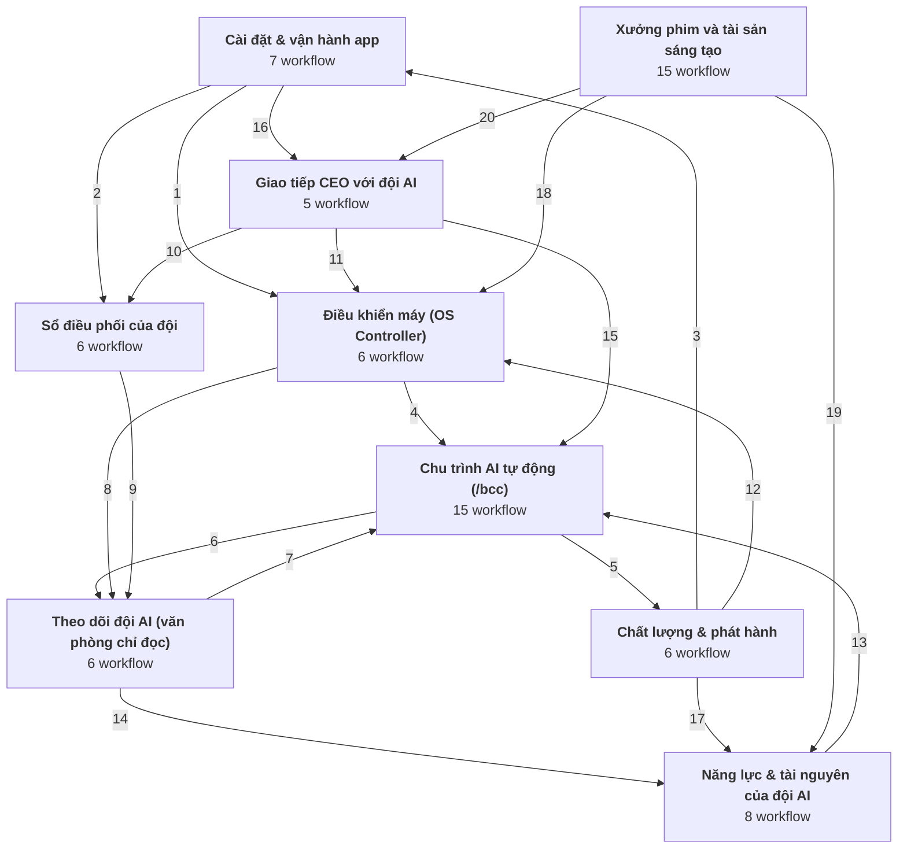

1. **Cài đặt & vận hành app** → **Điều khiển máy (OS Controller)**: npm run all / npm run app bật OS Controller cạnh văn phòng; bộ cập nhật kiểm /health của ctl và chặn khi còn job/luồng AI
2. **Cài đặt & vận hành app** → **Sổ điều phối của đội**: setup.js tạo sổ data/ từ khung mau/ và chèn đoạn luật đội vào AGENTS.md/CLAUDE.md
3. **Chất lượng & phát hành** → **Cài đặt & vận hành app**: tag vX.Y.Z đã qua phat-hanh.yml là bản duy nhất kênh phat-hanh của nút Cập nhật nhận
4. **Điều khiển máy (OS Controller)** → **Chu trình AI tự động (/bcc)**: mỗi lượt AI là một job của ctl: chính sách, timeout, rà soát toàn quyền, kiểm toán, phanh; nạp repo tạo agent.md để chu trình chạy
5. **Chu trình AI tự động (/bcc)** → **Chất lượng & phát hành**: bộ kiểm agent.md chấm từng lượt; nhánh ai/… đẩy lên GitHub thành PR qua CI
6. **Chu trình AI tự động (/bcc)** → **Theo dõi đội AI (văn phòng chỉ đọc)**: luồng, lượt và nhật ký hiện trên văn phòng 3D, bàn điều phối và trang tiến độ
7. **Theo dõi đội AI (văn phòng chỉ đọc)** → **Chu trình AI tự động (/bcc)**: bộ theo dõi hạn mức cho luồng biết giờ chạy lại và chọn AI soạn master prompt
8. **Điều khiển máy (OS Controller)** → **Theo dõi đội AI (văn phòng chỉ đọc)**: văn phòng gọi /ctl/* qua cầu nối chỉ từ chính máy (job, tiến độ repo, hạn mức)
9. **Sổ điều phối của đội** → **Theo dõi đội AI (văn phòng chỉ đọc)**: agent ghi sổ bằng vp, văn phòng chỉ đọc để hiện tường, Tổng quan, Hiệu suất
10. **Giao tiếp CEO với đội AI** → **Sổ điều phối của đội**: tin của Giám đốc ghi vào hòm thư data/hop-thu, agent đọc bằng vp tiep
11. **Giao tiếp CEO với đội AI** → **Điều khiển máy (OS Controller)**: chat chạy CLI như job “cmd”; dừng việc chuyển lệnh kill sang ctl
12. **Chất lượng & phát hành** → **Điều khiển máy (OS Controller)**: xuất bản và cài bộ kiểm chạy lệnh qua jobs, đọc repo qua workspace và GitHub của ctl
13. **Năng lực & tài nguyên của đội AI** → **Chu trình AI tự động (/bcc)**: mỗi lượt AI nhận model + mức suy nghĩ, mục lục từ bản đồ, bộ skill, MCP theo phòng/trên máy và công cụ tra cứu; tài khoản Antigravity đổi trước lượt khi cạn
14. **Theo dõi đội AI (văn phòng chỉ đọc)** → **Năng lực & tài nguyên của đội AI**: ảnh chụp hạn mức cho bộ điều phối hạ bậc model và cho tài khoản Antigravity tự chuyển
15. **Giao tiếp CEO với đội AI** → **Chu trình AI tự động (/bcc)**: điện thoại đã ghép giao việc, duyệt/trả bàn giao, trả lời câu hỏi và tạo dự án mới qua /dkx/api → /autopilot, /handoffs, /du-an-moi
16. **Cài đặt & vận hành app** → **Giao tiếp CEO với đội AI**: đường vào Tailscale/Cloudflare và mã ghép cấp khóa thiết bị cho kênh điều khiển /dkx
17. **Chất lượng & phát hành** → **Năng lực & tài nguyên của đội AI**: bản đồ .ua vẽ lại là nguồn mục lục đưa vào prompt mỗi lượt AI
18. **Xưởng phim và tài sản sáng tạo** → **Điều khiển máy (OS Controller)**: Xưởng phim dùng tác vụ, nguồn lực AI và các quyết định CEO để sản xuất, quản lý tài sản và nghiệm thu.
19. **Xưởng phim và tài sản sáng tạo** → **Năng lực & tài nguyên của đội AI**: Xưởng phim dùng tác vụ, nguồn lực AI và các quyết định CEO để sản xuất, quản lý tài sản và nghiệm thu.
20. **Xưởng phim và tài sản sáng tạo** → **Giao tiếp CEO với đội AI**: Xưởng phim dùng tác vụ, nguồn lực AI và các quyết định CEO để sản xuất, quản lý tài sản và nghiệm thu.

- **Cài đặt & vận hành app** — Đưa Văn phòng AI lên máy Chủ Dự Án và giữ nó chạy ổn định: cài lần đầu (agent tự cài theo HUONG-DAN-CHO-AGENT.md hoặc npm run setup), mở như app trên máy có tự bật lại, cập nhật một nút theo kênh phát hành có tự quay lại, nâng cấp sổ ctl.db an toàn, lưu khóa…
- **Theo dõi đội AI (văn phòng chỉ đọc)** — Máy chủ văn phòng (server.js, cổng 7788) chỉ đọc nhật ký phiên Claude Code/Codex, sổ data/ và agent.md của các repo để dựng văn phòng 3D, bảng tổng quan, đánh giá nhân sự, tiến độ giao thức, hạn mức AI và nhật ký “ai làm gì”.
- **Giao tiếp CEO với đội AI** — CEO nói chuyện với đội qua chat hai bước: hỏi chỉ đọc có web, hoặc duyệt lời xin làm cụ thể sau khi xem cổng kiểm web.
- **Sổ điều phối của đội** — Bộ sổ chung trong data/ mà các agent (Claude Code, Codex) ghi bằng công cụ dòng lệnh vp (tools/vp.js) còn văn phòng chỉ đọc: hòm thư giữa các vai, lượt dùng môi trường DEV, sổ “Cần anh”, việc ưu tiên – gói việc – tiến độ và sổ bài học tự học.
- **Chu trình AI tự động (/bcc)** — Trái tim của OS Controller: CEO giao một việc (hoặc ý tưởng), các lượt AI chạy nối tiếp theo NEXT_OWNER trong agent.md (Hinata/Antigravity → Sol, Astra trên Codex → Claude đội trưởng) trên nhánh git riêng ai/…; mỗi lượt phải nộp dòng JSON bàn giao hợp lệ.
- **Năng lực & tài nguyên của đội AI** — Cho mỗi lượt AI đúng công cụ với chi phí hợp lý: điều phối model và mức suy nghĩ theo độ khó và hạn mức, mục lục từ bản đồ hệ thống, nhiều tài khoản Antigravity và GPT (Codex) tự chuyển khi cạn, bộ skill ghim commit cài cho cả ba AI, duyệt skill/MCP mới từ li…
- **Điều khiển máy (OS Controller)** — OS Controller (ctl/main.js, chỉ nghe 127.0.0.1:7790, Bearer token sinh mới mỗi lần khởi động) là bàn tay của CEO trên máy: chạy lệnh theo chính sách allow/approve/deny không qua shell, phanh khẩn cấp dừng cả cây tiến trình, mở repo GitHub thành workspace, nạp…
- **Chất lượng & phát hành** — Máy kiểm thay người nhớ luật: bộ kiểm agent.md (lib/kiem-agent.js) chấm từng lượt AI trong văn phòng và từng PR trên CI; văn phòng cài bộ kiểm này vào repo dự án qua nhánh riêng; xuất bản dự án hai bước do CEO bấm; và phát hành chính Văn phòng AI bằng tag vX.…
- **Xưởng phim và tài sản sáng tạo** — Quản lý phim trên máy từ ý tưởng, kịch bản đến tài sản, cảnh quay, dựng và nghiệm thu.

## 2. Workflow trung tâm: CEO giao việc → đội AI → CEO duyệt

Vòng lặp `ctl/autopilot.js` + `ctl/runner.js`. Mỗi ô tròn là một trạng thái thật của luồng (`run.status`). Mặc định 10 lượt nội bộ, 90 phút (tối đa 12 lượt, 120 phút). CEO giao từ máy tính (`/ctl`) hoặc từ điện thoại đã ghép (`/dkx/api`, cùng các route).

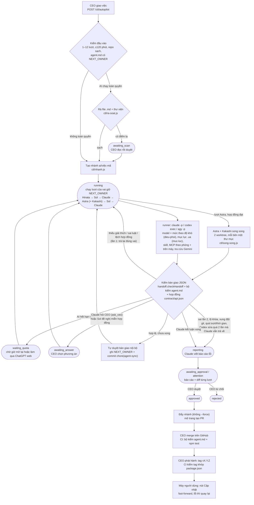

## 3. Từng workflow, từng bước trỏ tới mã

### Cài đặt & vận hành app

Đưa Văn phòng AI lên máy Chủ Dự Án và giữ nó chạy ổn định: cài lần đầu (agent tự cài theo HUONG-DAN-CHO-AGENT.md hoặc npm run setup), mở như app trên máy có tự bật lại, cập nhật một nút theo kênh phát hành có tự quay lại, nâng cấp sổ ctl.db an toàn, lưu khóa tài khoản AI và xem qua điện thoại bằng đường hầm.

**Luật nghiệp vụ:**
- Không cần npm install, không thư viện ngoài; Node ≥ 18 (ctl cần node:sqlite)
- Agent cài phải hỏi chủ trước khi cài phần mềm, sửa AGENTS.md/CLAUDE.md hoặc mở văn phòng ra Internet
- Cập nhật chỉ fast-forward; bản mới không bật được hoặc /health sai phiên bản thì tự quay về bản cũ (git reset --keep)
- Không cập nhật khi còn việc AI/luồng tự động đang chạy (AI_BUSY) hoặc văn phòng không chạy bằng app (NOT_APP)
- Nâng cấp sổ ctl.db chỉ thêm bảng/cột/index, mỗi bước trong một giao dịch, lỗi thì ROLLBACK
- Khóa API lưu ở ~/.van-phong-ao/keys.json, không vào config.json, không trả về trình duyệt
- Xem từ xa bắt buộc accessKey; OS Controller không bao giờ mở cho truy cập từ xa
- Ghép điện thoại bằng mã 6 số tạo trên chính máy tính, dùng một lần, sống 5 phút; tối đa 5 máy, thu hồi được

```mermaid
flowchart TD
  subgraph flow_cai_dat_lan_dau["Cài văn phòng lần đầu"]
    direction LR
    step_cai_dat_lan_dau_doc_huong_dan["1. Đọc hướng dẫn 8 bước và ranh giới an toàn"]
    step_cai_dat_lan_dau_goi_y_du_an["2. Gợi ý dự án đang dùng Claude Code/Codex"]
    step_cai_dat_lan_dau_ghi_config["3. Hỏi tên văn phòng, chủ, khóa xem và ghi config.json"]
    step_cai_dat_lan_dau_chep_khung_so["4. Chép khung sổ mau/ sang data/"]
    step_cai_dat_lan_dau_chen_luat_doi["5. Điền và chèn đoạn luật đội"]
    step_cai_dat_lan_dau_nap_cau_hinh["6. Nạp cấu hình khi chạy"]
    step_cai_dat_lan_dau_kiem_state["7. Bật server.js và kiểm GET /state"]
    step_cai_dat_lan_dau_doc_huong_dan --> step_cai_dat_lan_dau_goi_y_du_an
    step_cai_dat_lan_dau_goi_y_du_an --> step_cai_dat_lan_dau_ghi_config
    step_cai_dat_lan_dau_ghi_config --> step_cai_dat_lan_dau_chep_khung_so
    step_cai_dat_lan_dau_chep_khung_so --> step_cai_dat_lan_dau_chen_luat_doi
    step_cai_dat_lan_dau_chen_luat_doi --> step_cai_dat_lan_dau_nap_cau_hinh
    step_cai_dat_lan_dau_nap_cau_hinh --> step_cai_dat_lan_dau_kiem_state
  end
  subgraph flow_mo_app["Mở app trên máy & tự bật lại"]
    direction LR
    step_mo_app_tao_loi_tat["1. Tạo lối tắt Desktop, Start Menu, Startup"]
    step_mo_app_kiem_dang_chay["2. Kiểm văn phòng đã chạy chưa"]
    step_mo_app_bat_ngam["3. Bật bộ chạy ngầm, chờ tối đa 30 giây"]
    step_mo_app_bat_hai_tien_trinh["4. Bật văn phòng và OS Controller có kênh IPC"]
    step_mo_app_tu_bat_lai["5. Tự bật lại bên bị sập"]
    step_mo_app_mo_cua_so["6. Mở cửa sổ app bằng Edge/Chrome --app"]
    step_mo_app_trang_ngoai_tuyen["7. Báo “chưa chạy” khi văn phòng tắt"]
    step_mo_app_tat_an_toan["8. Tắt app đúng tiến trình"]
    step_mo_app_tao_loi_tat --> step_mo_app_kiem_dang_chay
    step_mo_app_kiem_dang_chay --> step_mo_app_bat_ngam
    step_mo_app_bat_ngam --> step_mo_app_bat_hai_tien_trinh
    step_mo_app_bat_hai_tien_trinh --> step_mo_app_tu_bat_lai
    step_mo_app_tu_bat_lai --> step_mo_app_mo_cua_so
    step_mo_app_mo_cua_so --> step_mo_app_trang_ngoai_tuyen
    step_mo_app_trang_ngoai_tuyen --> step_mo_app_tat_an_toan
  end
  subgraph flow_cap_nhat_app["Cập nhật app một nút"]
    direction LR
    step_cap_nhat_app_kiem_ban_moi["1. Kiểm bản mới trên GitHub"]
    step_cap_nhat_app_tinh_tinh_trang["2. Tính tình trạng theo kênh cập nhật"]
    step_cap_nhat_app_chan_khi_ban["3. Chặn khi đang bận hoặc không chạy bằng app"]
    step_cap_nhat_app_tach_tien_trinh["4. Tách tiến trình cập nhật khỏi văn phòng"]
    step_cap_nhat_app_tat_van_phong["5. Tắt văn phòng (dang-tat)"]
    step_cap_nhat_app_ap_fast_forward["6. Áp bản mới kiểu fast-forward (dang-cap-nhat)"]
    step_cap_nhat_app_bat_kiem_health["7. Bật lại và kiểm /health (dang-khoi-dong)"]
    step_cap_nhat_app_quay_lai["8. Tự quay về bản cũ khi bản mới không chạy"]
    step_cap_nhat_app_theo_doi["9. Trang theo dõi tới trạng thái cuối"]
    step_cap_nhat_app_kiem_ban_moi --> step_cap_nhat_app_tinh_tinh_trang
    step_cap_nhat_app_tinh_tinh_trang --> step_cap_nhat_app_chan_khi_ban
    step_cap_nhat_app_chan_khi_ban --> step_cap_nhat_app_tach_tien_trinh
    step_cap_nhat_app_tach_tien_trinh --> step_cap_nhat_app_tat_van_phong
    step_cap_nhat_app_tat_van_phong --> step_cap_nhat_app_ap_fast_forward
    step_cap_nhat_app_ap_fast_forward --> step_cap_nhat_app_bat_kiem_health
    step_cap_nhat_app_bat_kiem_health --> step_cap_nhat_app_quay_lai
    step_cap_nhat_app_quay_lai --> step_cap_nhat_app_theo_doi
  end
  subgraph flow_nang_cap_so_ctl["Nâng cấp sổ ctl.db khi khởi động"]
    direction LR
    step_nang_cap_so_ctl_mo_so["1. Mở sổ ctl.db"]
    step_nang_cap_so_ctl_ap_schema["2. Áp schema các bảng"]
    step_nang_cap_so_ctl_chay_migration["3. Chạy bước nâng cấp còn thiếu"]
    step_nang_cap_so_ctl_loi_migration["4. Bước lỗi: ROLLBACK và đóng sổ"]
    step_nang_cap_so_ctl_don_kiem_toan["5. Dọn nhật ký kiểm toán cũ"]
    step_nang_cap_so_ctl_mo_so --> step_nang_cap_so_ctl_ap_schema
    step_nang_cap_so_ctl_ap_schema --> step_nang_cap_so_ctl_chay_migration
    step_nang_cap_so_ctl_chay_migration --> step_nang_cap_so_ctl_loi_migration
    step_nang_cap_so_ctl_loi_migration --> step_nang_cap_so_ctl_don_kiem_toan
  end
  subgraph flow_xem_dien_thoai["Xem văn phòng trên điện thoại"]
    direction LR
    step_xem_dien_thoai_kiem_dieu_kien["1. Kiểm config.json, accessKey và cloudflared"]
    step_xem_dien_thoai_mo_duong_ham["2. Mở đường hầm tới localhost:port"]
    step_xem_dien_thoai_kiem_host["3. Kiểm Host và khóa xem"]
    step_xem_dien_thoai_chan_ctl["4. Chặn OS Controller khi truy cập từ xa"]
    step_xem_dien_thoai_kiem_dieu_kien --> step_xem_dien_thoai_mo_duong_ham
    step_xem_dien_thoai_mo_duong_ham --> step_xem_dien_thoai_kiem_host
    step_xem_dien_thoai_kiem_host --> step_xem_dien_thoai_chan_ctl
  end
  subgraph flow_ghep_dien_thoai["Ghép điện thoại để điều khiển văn phòng"]
    direction LR
    step_ghep_dien_thoai_duong_vao["1. Mở đường vào bằng Tailscale"]
    step_ghep_dien_thoai_can_khoa_xem["2. Bắt buộc khóa xem"]
    step_ghep_dien_thoai_tao_ma["3. Máy tính tạo mã ghép"]
    step_ghep_dien_thoai_nhap_ma["4. Điện thoại nhập mã"]
    step_ghep_dien_thoai_ghep["5. Ghép và cấp khóa thiết bị"]
    step_ghep_dien_thoai_cookie["6. Đặt cookie vpd"]
    step_ghep_dien_thoai_quan_ly["7. Xem và thu hồi máy đã ghép"]
    step_ghep_dien_thoai_duong_vao --> step_ghep_dien_thoai_can_khoa_xem
    step_ghep_dien_thoai_can_khoa_xem --> step_ghep_dien_thoai_tao_ma
    step_ghep_dien_thoai_tao_ma --> step_ghep_dien_thoai_nhap_ma
    step_ghep_dien_thoai_nhap_ma --> step_ghep_dien_thoai_ghep
    step_ghep_dien_thoai_ghep --> step_ghep_dien_thoai_cookie
    step_ghep_dien_thoai_cookie --> step_ghep_dien_thoai_quan_ly
  end
  subgraph flow_luu_khoa_tai_khoan["Lưu khóa API tài khoản AI"]
    direction LR
    step_luu_khoa_tai_khoan_xem_trang_thai["1. Đọc trạng thái tài khoản không lộ khóa"]
    step_luu_khoa_tai_khoan_chan_ghi_la["2. Chặn yêu cầu ghi không từ văn phòng"]
    step_luu_khoa_tai_khoan_kiem_dinh_dang["3. Kiểm nhà cung cấp và định dạng khóa"]
    step_luu_khoa_tai_khoan_ghi_nguyen_tu["4. Ghi nguyên tử keys.json ngoài repo"]
    step_luu_khoa_tai_khoan_tra_trang_thai["5. Trả trạng thái mới"]
    step_luu_khoa_tai_khoan_xem_trang_thai --> step_luu_khoa_tai_khoan_chan_ghi_la
    step_luu_khoa_tai_khoan_chan_ghi_la --> step_luu_khoa_tai_khoan_kiem_dinh_dang
    step_luu_khoa_tai_khoan_kiem_dinh_dang --> step_luu_khoa_tai_khoan_ghi_nguyen_tu
    step_luu_khoa_tai_khoan_ghi_nguyen_tu --> step_luu_khoa_tai_khoan_tra_trang_thai
  end
  flow_cai_dat_lan_dau ~~~ flow_mo_app
  flow_mo_app ~~~ flow_cap_nhat_app
  flow_cap_nhat_app ~~~ flow_nang_cap_so_ctl
  flow_nang_cap_so_ctl ~~~ flow_xem_dien_thoai
  flow_xem_dien_thoai ~~~ flow_ghep_dien_thoai
  flow_ghep_dien_thoai ~~~ flow_luu_khoa_tai_khoan
```

#### Cài văn phòng lần đầu

Agent (hoặc chủ) cài văn phòng: kiểm máy, gợi ý dự án đang dùng Claude Code/Codex, ghi config.json, chép khung sổ data/, chèn luật đội vào AGENTS.md/CLAUDE.md của dự án rồi bật server và kiểm /state. — *Kích hoạt:* `Agent đọc HUONG-DAN-CHO-AGENT.md / npm run setup (node setup.js --yes)` (cli).

1. **Đọc hướng dẫn 8 bước và ranh giới an toàn** — Agent theo HUONG-DAN-CHO-AGENT.md: kiểm Node 18+, clone kho, và phải hỏi chủ trước khi cài phần mềm, sửa AGENTS.md/CLAUDE.md hay mở ra Internet. [`HUONG-DAN-CHO-AGENT.md:1`](../HUONG-DAN-CHO-AGENT.md#L1-L167)
2. **Gợi ý dự án đang dùng Claude Code/Codex** — setup.findProjects quét ~/.claude/projects và ~/.codex/sessions sửa trong 14 ngày, lấy cwd, gộp theo thư mục, bỏ worktree con và sắp mới nhất. [`setup.js:26`](../setup.js#L26-L45)
3. **Hỏi tên văn phòng, chủ, khóa xem và ghi config.json** — setup.main lấy câu trả lời (hoặc cờ khi --yes), tạo accessKey ngẫu nhiên nếu muốn xem qua Internet và ghi config.json, sao lưu bản cũ thành .bak. [`setup.js:47`](../setup.js#L47-L112)
4. **Chép khung sổ mau/ sang data/** — Chép NOI-QUY, UU-TIEN.json, gói vi-du, BAI-HOC (kế thừa bài học), CAN-ANH… sang data/ mà không ghi đè file đã có; tạo data/hop-thu. [`setup.js:47`](../setup.js#L47-L112)
5. **Điền và chèn đoạn luật đội** — Thay {{PORT}}, {{DATA}}, {{VP}} trong mau/DOAN-CHEN-VAO-AGENTS.md; chỉ dán vào cuối AGENTS.md/CLAUDE.md của dự án khi chủ đồng ý (--chen-luat). [`mau/DOAN-CHEN-VAO-AGENTS.md:1`](../mau/DOAN-CHEN-VAO-AGENTS.md#L1-L18)
6. **Nạp cấu hình khi chạy** — lib/config.loadConfig đọc config.json (bỏ BOM) và trộn mặc định: cổng 7788, host 127.0.0.1, dataDir, giá token, trần tiền AI, updateChannel; thiếu file thì trả null. [`lib/config.js:22`](../lib/config.js#L22-L29)
7. **Bật server.js và kiểm GET /state** — Agent chạy npm start, gọi /state để xác nhận văn phòng đọc được phiên và sổ, điền sổ bằng tools/vp.js rồi báo lại chủ. [`server.js:807`](../server.js#L807-L807)

#### Mở app trên máy & tự bật lại

Dùng văn phòng như một app: lối tắt Desktop/Start Menu, bật ngầm cả văn phòng (:7788) lẫn OS Controller (:7790) có tự bật lại khi sập, mở cửa sổ --app, trang ngoại tuyến khi tắt và tắt đúng tiến trình. — *Kích hoạt:* `Lối tắt “Văn phòng AI” / npm run app; tắt bằng npm run tat-app` (manual).

1. **Tạo lối tắt Desktop, Start Menu, Startup** — npm run cai-app (chỉ Windows): plan dựng tham số WScript.Shell qua PowerShell, mọi đường dẫn truyền bằng biến môi trường VP_* để không bị chèn lệnh; --go để gỡ. [`scripts/cai-app.js:40`](../scripts/cai-app.js#L40-L51)
2. **Kiểm văn phòng đã chạy chưa** — lib/app.isUp gọi GET /manifest.webmanifest; 200 hoặc 401 (khóa xem) coi là đang chạy, lỗi/timeout là chưa chạy. [`lib/app.js:22`](../lib/app.js#L22-L28)
3. **Bật bộ chạy ngầm, chờ tối đa 30 giây** — scripts/mo-app.js spawn chay-tat-ca.js --tu-bat-lai chạy ngầm, ghi app.log và app.pid rồi waitUp; quá 30 giây thì báo lỗi kèm đường dẫn log. [`scripts/mo-app.js:1`](../scripts/mo-app.js#L1-L50)
4. **Bật văn phòng và OS Controller có kênh IPC** — chay-tat-ca.launch spawn server.js (7788) và ctl/main.js (7790) bằng node có kênh IPC; một bên thoát ngoài lúc tắt thì ghi nhận lần sập. [`scripts/chay-tat-ca.js:28`](../scripts/chay-tat-ca.js#L28-L43)
5. **Tự bật lại bên bị sập** — Với --tu-bat-lai: bật lại sau 3 giây, tối đa 5 lần trong 10 phút, vượt ngưỡng thì tắt hẳn; không có cờ thì một bên chết là tắt cả hai. [`scripts/chay-tat-ca.js:28`](../scripts/chay-tat-ca.js#L28-L43)
6. **Mở cửa sổ app bằng Edge/Chrome --app** — findBrowser tìm Edge/Chrome/Brave/Chromium, openCommand dựng lệnh không qua shell; không có Chromium thì mở trình duyệt mặc định; --nen chỉ bật ngầm. [`lib/app.js:60`](../lib/app.js#L60-L65)
7. **Báo “chưa chạy” khi văn phòng tắt** — Service worker chỉ lưu đệm offline.html và trả nó cho yêu cầu điều hướng khi máy chủ không trả lời; không bao giờ lưu đệm dữ liệu (bài học BROWSER-CACHE); offline.html thử lại mỗi 3 giây. [`public/sw.js:1`](../public/sw.js#L1-L19)
8. **Tắt app đúng tiến trình** — tat-app.js đọc app.pid, isAppProcess xác minh đúng chay-tat-ca.js (PID cũ của chương trình khác thì chỉ xóa app.pid), gửi dừng, chờ 15 giây rồi mới killTree; ctl nhận “stop” qua IPC, quá 8 giây mới giết cả cây. [`scripts/tat-app.js:1`](../scripts/tat-app.js#L1-L34)

#### Cập nhật app một nút

CEO bấm Cập nhật: văn phòng kiểm bản mới theo kênh, tách tiến trình cập nhật, tắt văn phòng, fast-forward lên bản mới, bật lại và kiểm /health; bản mới hỏng thì tự quay về bản cũ, dữ liệu giữ nguyên. — *Kích hoạt:* `Trang cap-nhat.html → GET /ctl/cap-nhat?fetch=1, POST /ctl/cap-nhat` (http).

1. **Kiểm bản mới trên GitHub** — cap-nhat.html gọi GET /ctl/cap-nhat?fetch=1; updater.refresh tải tag/nhánh một lần tại một thời điểm (fetchAsync không chặn) và lưu kết quả ở cap-nhat-kiem.json. [`ctl/cap-nhat.js:27`](../ctl/cap-nhat.js#L27-L44)
2. **Tính tình trạng theo kênh cập nhật** — lib/cap-nhat.check: kênh phat-hanh chỉ nhận tag vX.Y.Z mới nhất (so bằng cmpTag), kênh main theo origin/main; ra trạng thái khong-phai-git / chua-phat-hanh / moi-nhat / co-ban-moi / lech kèm danh sách commit và ghi chú tag. [`lib/cap-nhat.js:38`](../lib/cap-nhat.js#L38-L85)
3. **Chặn khi đang bận hoặc không chạy bằng app** — updater.start: còn job AI hoặc luồng tự động thì AI_BUSY; văn phòng không chạy bằng npm run app thì NOT_APP (hướng dẫn tắt, git pull --ff-only, bật lại). [`ctl/cap-nhat.js:45`](../ctl/cap-nhat.js#L45-L63)
4. **Tách tiến trình cập nhật khỏi văn phòng** — ctl spawn scripts/cap-nhat.js --tach --tu --den --ten (detached); tiến trình tự chạy lại tách khỏi cây văn phòng và kiểm --tu/--den là SHA đủ 40 ký tự, sai thì thoát mã 2. [`scripts/cap-nhat.js:1`](../scripts/cap-nhat.js#L1-L37)
5. **Tắt văn phòng (dang-tat)** — runUpdate gọi stopApp = scripts/tat-app.js; không tắt được thì dừng ở “loi” và giữ nguyên bản trên máy. [`lib/cap-nhat.js:111`](../lib/cap-nhat.js#L111-L129)
6. **Áp bản mới kiểu fast-forward (dang-cap-nhat)** — apply: HEAD vẫn bằng from, không có file đang sửa, from là tổ tiên của to, rồi git merge --ff-only; lỗi CHANGED/DIRTY/NOT_FF/FAILED thì bật lại bản cũ và báo lỗi. [`lib/cap-nhat.js:88`](../lib/cap-nhat.js#L88-L94)
7. **Bật lại và kiểm /health (dang-khoi-dong)** — startApp = mo-app.js --nen; healthy thăm dò GET /health của ctl tối đa 40 lần × 750 ms tới khi version khớp package.json mới; quá 30 giây coi là hỏng. [`scripts/cap-nhat.js:49`](../scripts/cap-nhat.js#L49-L58)
8. **Tự quay về bản cũ khi bản mới không chạy** — dang-quay-lai: tắt lại, rollback bằng git reset --keep, bật lại → “da-quay-lai” (dữ liệu giữ nguyên) hoặc “loi” kèm đường dẫn logs/cap-nhat.log. [`lib/cap-nhat.js:97`](../lib/cap-nhat.js#L97-L99)
9. **Trang theo dõi tới trạng thái cuối** — cap-nhat.html follow hỏi lại mỗi 2 giây, coi lỗi kết nối là văn phòng đang khởi động lại, dừng khi gặp xong / da-quay-lai / loi. [`public/cap-nhat.html:148`](../public/cap-nhat.html#L148-L177)

#### Nâng cấp sổ ctl.db khi khởi động

Mỗi lần OS Controller khởi động, sổ SQLite ~/.van-phong-ao/ctl.db được mở, áp schema và chạy các bước nâng cấp còn thiếu theo PRAGMA user_version, sao cho bản cũ vẫn đọc được nếu bộ cập nhật phải quay lại. — *Kích hoạt:* `OS Controller khởi động (createCtl → db.open)` (event).

1. **Mở sổ ctl.db** — db.open tạo thư mục sổ và logs với quyền 0700, mở ctl.db bằng node:sqlite, bật WAL và busy_timeout. [`ctl/db.js:90`](../ctl/db.js#L90-L98)
2. **Áp schema các bảng** — SCHEMA tạo bảng jobs, audit (trigger chặn sửa, chỉ xóa bản ghi quá 90 ngày), handoffs, workspaces nếu chưa có. [`ctl/db.js:10`](../ctl/db.js#L10-L69)
3. **Chạy bước nâng cấp còn thiếu** — migrate đọc PRAGMA user_version, chạy từng bước của MIGRATIONS (chuỗi SQL hoặc hàm) trong một giao dịch rồi tăng user_version; chỉ được thêm bảng/cột/index, không xóa hay đổi tên. [`ctl/db.js:74`](../ctl/db.js#L74-L88)
4. **Bước lỗi: ROLLBACK và đóng sổ** — Bước lỗi thì ROLLBACK và ném DB_MIGRATION; open đóng sổ để không giữ khóa file, ctl không lên nên /health sai và bộ cập nhật tự quay về bản cũ. [`ctl/db.js:90`](../ctl/db.js#L90-L98)
5. **Dọn nhật ký kiểm toán cũ** — createAudit chuẩn bị log/recent/prune: ghi chỉ-thêm có che khóa, prune xóa dòng quá 90 ngày. [`ctl/audit.js:5`](../ctl/audit.js#L5-L17)

#### Xem văn phòng trên điện thoại

Mở đường hầm Cloudflare tới văn phòng để xem trên điện thoại; bắt buộc khóa xem, cầu /ctl bị chặn khi truy cập từ xa. — *Kích hoạt:* `scripts/xem-tren-dien-thoai.ps1 (Windows) / .sh (macOS, Linux)` (cli).

1. **Kiểm config.json, accessKey và cloudflared** — Script dừng nếu chưa có config.json, chưa đặt accessKey hoặc chưa cài cloudflared; cổng mặc định 7788. [`scripts/xem-tren-dien-thoai.ps1:2`](../scripts/xem-tren-dien-thoai.ps1#L2-L15)
2. **Mở đường hầm tới localhost:<port>** — cloudflared tunnel không cần tài khoản; bản shell lấy port bằng sed rồi exec cloudflared. [`scripts/xem-tren-dien-thoai.sh:1`](../scripts/xem-tren-dien-thoai.sh#L1-L15)
3. **Kiểm Host và khóa xem** — guard.checkHost chỉ nhận Host lạ khi đã bật accessKey (chống DNS rebinding); checkWrite chặn CSRF cho yêu cầu ghi. [`lib/guard.js:17`](../lib/guard.js#L17-L21)
4. **Chặn OS Controller khi truy cập từ xa** — ctlbridge.proxy trả 403 khi yêu cầu có header Cloudflare/x-forwarded-for hoặc không phải loopback: từ điện thoại chỉ xem, không điều khiển máy. [`lib/ctlbridge.js:40`](../lib/ctlbridge.js#L40-L59)

#### Ghép điện thoại để điều khiển văn phòng

Mở đường vào cho điện thoại (Tailscale hoặc Cloudflare), rồi ghép điện thoại một lần bằng mã 6 số tạo trên chính máy tính; điện thoại nhận khóa thiết bị (cookie HttpOnly), máy tính xem và thu hồi được từng máy. — *Kích hoạt:* `Trang dien-thoai.html trên máy tính → POST /dkx/ma; điện thoại mở /dieu-khien.html → POST /dkx/ghep` (http).

1. **Mở đường vào bằng Tailscale** — Script kiểm accessKey và Tailscale rồi tailscale serve cổng văn phòng qua HTTPS *.ts.net trong mạng riêng; Cloudflare (xem-tren-dien-thoai) là cách thay thế. [`scripts/dien-thoai-tailscale.ps1:1`](../scripts/dien-thoai-tailscale.ps1#L1-L25)
2. **Bắt buộc khóa xem** — Từ xa mà văn phòng chưa đặt accessKey thì /dkx không nhận gì, kể cả ghép. [`lib/dieu-khien-xa.js:157`](../lib/dieu-khien-xa.js#L157-L158)
3. **Máy tính tạo mã ghép** — Trang Điện thoại trên chính máy tính gọi POST /dkx/ma: mã 6 số sống 5 phút, chỉ trong bộ nhớ. [`lib/dieu-khien-xa.js:75`](../lib/dieu-khien-xa.js#L75-L79)
4. **Điện thoại nhập mã** — App điều khiển chưa ghép thì hiện màn nhập mã và tên máy. [`public/dieu-khien.html:119`](../public/dieu-khien.html#L119-L132)
5. **Ghép và cấp khóa thiết bị** — Kiểm mã bằng timingSafeEqual, khóa ghép 15 phút sau 5 lần sai, tối đa 5 máy; khóa 256 bit chỉ lưu bản băm. [`lib/dieu-khien-xa.js:81`](../lib/dieu-khien-xa.js#L81-L95)
6. **Đặt cookie vpd** — Cookie HttpOnly, SameSite=Strict, Path=/dkx, sống 90 ngày; thêm Secure khi đi qua HTTPS. [`lib/dieu-khien-xa.js:170`](../lib/dieu-khien-xa.js#L170-L174)
7. **Xem và thu hồi máy đã ghép** — Máy tính liệt kê máy đã ghép, giờ dùng, IP, nhật ký lệnh và thu hồi máy mất. [`public/dien-thoai.html:46`](../public/dien-thoai.html#L46-L62)

#### Lưu khóa API tài khoản AI

Giám đốc xem tình trạng tài khoản Claude/GPT/Gemini và lưu khóa API ở ngoài mã nguồn; máy chủ chỉ trả “đã có khóa hay chưa”. — *Kích hoạt:* `Thẻ “Tài khoản AI” → GET /api/accounts, POST /api/accounts/save` (http).

1. **Đọc trạng thái tài khoản không lộ khóa** — Đọc trạng thái tài khoản và phiên bản CLI, kiểm tra trường cần thiết rồi trả trạng thái đã che; không trả khóa hoặc credential cho trình duyệt. [`server.js:611`](../server.js#L611-L706)
2. **Chặn yêu cầu ghi không từ văn phòng** — guard.checkWrite: Content-Type application/json, Origin khớp Host, Sec-Fetch-Site same-origin/none. [`lib/guard.js:23`](../lib/guard.js#L23-L42)
3. **Kiểm nhà cung cấp và định dạng khóa** — keys.save chỉ nhận claude (sk-ant-…) và gpt (sk-…); sai thì trả {ok:false, error} thay vì ném lỗi. [`lib/keys.js:17`](../lib/keys.js#L17-L30)
4. **Ghi nguyên tử keys.json ngoài repo** — Tạo ~/.van-phong-ao quyền 700, ghi keys.json quyền 600 bằng writeAtomic (file tạm rồi đổi tên). [`lib/ghi-file.js:17`](../lib/ghi-file.js#L17-L20)
5. **Trả trạng thái mới** — POST /api/accounts/save trả lại trạng thái tài khoản đã cập nhật, không kèm khóa. [`server.js:773`](../server.js#L773-L783)

### Theo dõi đội AI (văn phòng chỉ đọc)

Máy chủ văn phòng (server.js, cổng 7788) chỉ đọc nhật ký phiên Claude Code/Codex, sổ data/ và agent.md của các repo để dựng văn phòng 3D, bảng tổng quan, đánh giá nhân sự, tiến độ giao thức, hạn mức AI và nhật ký “ai làm gì”.

**Luật nghiệp vụ:**
- Chỉ đọc ~/.claude, ~/.codex, data/ và agent.md; không ghi vào dự án
- Che khóa (maskSecrets/maskText) trước khi trả trình duyệt
- Mỗi file chỉ đọc lại khi mtime/size đổi; nhật ký đọc tăng dần theo offset
- Hạn mức đọc qua CLI cục bộ, không lộ dữ liệu tài khoản; lỗi từng hãng độc lập
- Blocker OPEN chỉ tính ở Vùng [5]

```mermaid
flowchart TD
  subgraph flow_trang_thai_realtime["Cập nhật trạng thái văn phòng mỗi giây"]
    direction LR
    step_trang_thai_realtime_tim_phien["1. Phát hiện phiên mới"]
    step_trang_thai_realtime_phien_dang_mo["2. Đọc phiên Claude đang mở"]
    step_trang_thai_realtime_doc_nhat_ky["3. Đọc tăng dần nhật ký phiên"]
    step_trang_thai_realtime_doc_so_data["4. Đọc sổ điều phối"]
    step_trang_thai_realtime_viec_cho_ceo["5. Gom việc chờ Giám đốc"]
    step_trang_thai_realtime_dung_snapshot["6. Dựng snapshot đã che khóa"]
    step_trang_thai_realtime_day_sse["7. Đẩy SSE mỗi giây"]
    step_trang_thai_realtime_ve_3d["8. Vẽ văn phòng 3D"]
    step_trang_thai_realtime_tim_phien --> step_trang_thai_realtime_phien_dang_mo
    step_trang_thai_realtime_phien_dang_mo --> step_trang_thai_realtime_doc_nhat_ky
    step_trang_thai_realtime_doc_nhat_ky --> step_trang_thai_realtime_doc_so_data
    step_trang_thai_realtime_doc_so_data --> step_trang_thai_realtime_viec_cho_ceo
    step_trang_thai_realtime_viec_cho_ceo --> step_trang_thai_realtime_dung_snapshot
    step_trang_thai_realtime_dung_snapshot --> step_trang_thai_realtime_day_sse
    step_trang_thai_realtime_day_sse --> step_trang_thai_realtime_ve_3d
  end
  subgraph flow_danh_gia_nhan_su["Đánh giá nhân sự & tiền AI"]
    direction LR
    step_danh_gia_nhan_su_quet_nhat_ky["1. Quét lần lượt nhật ký các agent"]
    step_danh_gia_nhan_su_nhay_7_ngay["2. Nhảy tới mốc 7 ngày"]
    step_danh_gia_nhan_su_dem_token["3. Đếm token Codex và Claude"]
    step_danh_gia_nhan_su_cham_diem["4. Chấm điểm thang 100"]
    step_danh_gia_nhan_su_uoc_tien["5. Ước tính tiền AI theo ngày"]
    step_danh_gia_nhan_su_hien_bang["6. Hiện KPI, biểu đồ và bảng xếp loại"]
    step_danh_gia_nhan_su_quet_nhat_ky --> step_danh_gia_nhan_su_nhay_7_ngay
    step_danh_gia_nhan_su_nhay_7_ngay --> step_danh_gia_nhan_su_dem_token
    step_danh_gia_nhan_su_dem_token --> step_danh_gia_nhan_su_cham_diem
    step_danh_gia_nhan_su_cham_diem --> step_danh_gia_nhan_su_uoc_tien
    step_danh_gia_nhan_su_uoc_tien --> step_danh_gia_nhan_su_hien_bang
  end
  subgraph flow_tong_quan_giam_doc["Tổng quan & sổ sách cho Giám đốc"]
    direction LR
    step_tong_quan_giam_doc_ghep_viec["1. Ghép việc ưu tiên với gói việc và người làm"]
    step_tong_quan_giam_doc_tien_do_moi["2. Lấy dòng tiến độ mới nhất"]
    step_tong_quan_giam_doc_tong_hop_hom_thu["3. Tổng hợp hòm thư theo vai"]
    step_tong_quan_giam_doc_dung_so_sach["4. Dựng sổ nội quy, đội ngũ và sổ tay"]
    step_tong_quan_giam_doc_phuc_vu_cache["5. Phục vụ JSON có cache"]
    step_tong_quan_giam_doc_hien_markdown["6. Hiện Markdown an toàn"]
    step_tong_quan_giam_doc_ghep_viec --> step_tong_quan_giam_doc_tien_do_moi
    step_tong_quan_giam_doc_tien_do_moi --> step_tong_quan_giam_doc_tong_hop_hom_thu
    step_tong_quan_giam_doc_tong_hop_hom_thu --> step_tong_quan_giam_doc_dung_so_sach
    step_tong_quan_giam_doc_dung_so_sach --> step_tong_quan_giam_doc_phuc_vu_cache
    step_tong_quan_giam_doc_phuc_vu_cache --> step_tong_quan_giam_doc_hien_markdown
  end
  subgraph flow_tien_do_du_an["Tiến độ giao thức agent.md của từng dự án"]
    direction LR
    step_tien_do_du_an_chon_du_an["1. Chọn dự án đang xem"]
    step_tien_do_du_an_cong_khai["2. Xác định repo công khai hay riêng tư"]
    step_tien_do_du_an_doc_repo["3. Đọc thật git, công nghệ, README"]
    step_tien_do_du_an_phan_tich_agent_md["4. Phân tích tiến độ agent.md"]
    step_tien_do_du_an_bang_du_an["5. Tổng hợp bảng mọi dự án"]
    step_tien_do_du_an_hien_tien_do["6. Hiện “đang dừng ở đâu / đã làm gì / còn cần gì”"]
    step_tien_do_du_an_chon_du_an --> step_tien_do_du_an_cong_khai
    step_tien_do_du_an_cong_khai --> step_tien_do_du_an_doc_repo
    step_tien_do_du_an_doc_repo --> step_tien_do_du_an_phan_tich_agent_md
    step_tien_do_du_an_phan_tich_agent_md --> step_tien_do_du_an_bang_du_an
    step_tien_do_du_an_bang_du_an --> step_tien_do_du_an_hien_tien_do
  end
  subgraph flow_theo_doi_han_muc["Theo dõi hạn mức thuê bao AI"]
    direction LR
    step_theo_doi_han_muc_den_han["1. Chỉ đọc nhà cung cấp đến hạn"]
    step_theo_doi_han_muc_chay_cli["2. Chạy CLI cục bộ không qua shell"]
    step_theo_doi_han_muc_chuan_hoa["3. Chuẩn hóa bucket và giờ đặt lại"]
    step_theo_doi_han_muc_tai_khoan_agy["4. Hạn mức theo từng tài khoản Antigravity"]
    step_theo_doi_han_muc_loi_doc_lap["5. Lỗi từng hãng độc lập"]
    step_theo_doi_han_muc_hien_han_muc["6. Hiện hạn mức"]
    step_theo_doi_han_muc_den_han --> step_theo_doi_han_muc_chay_cli
    step_theo_doi_han_muc_chay_cli --> step_theo_doi_han_muc_chuan_hoa
    step_theo_doi_han_muc_chuan_hoa --> step_theo_doi_han_muc_tai_khoan_agy
    step_theo_doi_han_muc_tai_khoan_agy --> step_theo_doi_han_muc_loi_doc_lap
    step_theo_doi_han_muc_loi_doc_lap --> step_theo_doi_han_muc_hien_han_muc
  end
  subgraph flow_nhat_ky_van_phong["Nhật ký “ai làm gì, lúc nào”"]
    direction LR
    step_nhat_ky_van_phong_doc_log_job["1. Đọc dần log từng lượt AI"]
    step_nhat_ky_van_phong_dich_dong["2. Dịch dòng log thành mục dễ đọc"]
    step_nhat_ky_van_phong_ghep_luong["3. Ghép với luồng tự động và nhân vật"]
    step_nhat_ky_van_phong_hien_nhat_ky["4. Hiện cùng nhịp đồng bộ bàn điều phối"]
    step_nhat_ky_van_phong_doc_log_job --> step_nhat_ky_van_phong_dich_dong
    step_nhat_ky_van_phong_dich_dong --> step_nhat_ky_van_phong_ghep_luong
    step_nhat_ky_van_phong_ghep_luong --> step_nhat_ky_van_phong_hien_nhat_ky
  end
  flow_trang_thai_realtime ~~~ flow_danh_gia_nhan_su
  flow_danh_gia_nhan_su ~~~ flow_tong_quan_giam_doc
  flow_tong_quan_giam_doc ~~~ flow_tien_do_du_an
  flow_tien_do_du_an ~~~ flow_theo_doi_han_muc
  flow_theo_doi_han_muc ~~~ flow_nhat_ky_van_phong
```

#### Cập nhật trạng thái văn phòng mỗi giây

Phát hiện phiên, đọc tăng dần nhật ký Claude/Codex và sổ data/, gom việc chờ Giám đốc, dựng snapshot đã che khóa và đẩy SSE mỗi giây tới văn phòng 3D. — *Kích hoạt:* `Mở http://localhost:7788 (GET /events)` (http).

1. **Phát hiện phiên mới** — discover mỗi 5 giây quét ~/.claude/projects và ~/.codex/sessions trong thời hạn KEEP thuộc dự án theo dõi; addAgent gán tên/vai/phòng theo staff trong config. [`server.js:149`](../server.js#L149-L185)
2. **Đọc phiên Claude đang mở** — readLive mỗi 3 giây đọc ~/.claude/sessions/<pid>.json, chỉ giữ tiến trình còn sống, lưu tên phiên và trạng thái bận. [`server.js:118`](../server.js#L118-L129)
3. **Đọc tăng dần nhật ký phiên** — pollAgent đọc phần mới từ offset (lần đầu 8 MB cuối) và chuyển từng dòng cho parseClaude/parseCodex: phút hoạt động, câu trả lời, SendMessage, thẻ [VIỆC]/[CẦN ANH]. [`server.js:306`](../server.js#L306-L327)
4. **Đọc sổ điều phối** — readTasks ghép UU-TIEN.json với goi/<gói>/viec.json; readDev đọc DEV.lock/DEV-LUOT.jsonl; readCanAnh đọc CAN-ANH.md (mỗi giây, chỉ khi tệp đổi). [`server.js:384`](../server.js#L384-L418)
5. **Gom việc chờ Giám đốc** — ceoAsks lấy tối đa 14 mục từ sổ Cần anh, hộp hỏi đang mở, tin [CẦN ANH] 24 giờ và phiên bị chặn; moneyOf tính tiền AI 7 ngày. [`server.js:458`](../server.js#L458-L473)
6. **Dựng snapshot đã che khóa** — snapshot gom nhân viên, phòng, cảnh báo (DEV trống, chờ lâu), lịch sử 60 phút; mask che PIN, đường dẫn secrets và chuỗi giống khóa. [`server.js:500`](../server.js#L500-L546)
7. **Đẩy SSE mỗi giây** — GET /events gửi snapshot mỗi giây cho trình duyệt; GET /state trả một lần. [`server.js:784`](../server.js#L784-L784)
8. **Vẽ văn phòng 3D** — index.html dựng cảnh bằng vanphong3d.createOffice (NPC theo vai, say/setBusy/goToRoom) và thoitiet.connectLive (giờ Việt Nam, thời tiết Hà Nội từ Open-Meteo). [`public/vanphong3d.js:48`](../public/vanphong3d.js#L48-L1725)

#### Đánh giá nhân sự & tiền AI

Đếm token thật của từng agent trong 7 ngày, chấm điểm thang 100 và ước tính tiền AI, hiện trên trang Đánh giá nhân sự. — *Kích hoạt:* `Trang hieusuat.html (GET /perf, SSE /perf-events)` (http).

1. **Quét lần lượt nhật ký các agent** — perf.scanAll mỗi 3 giây xếp hàng mọi tệp nhật ký (kể cả subagent Claude) và quét từng khúc qua setImmediate, bỏ qua nếu lượt trước chưa xong. [`lib/perf.js:98`](../lib/perf.js#L98-L109)
2. **Nhảy tới mốc 7 ngày** — step/seekTime: tệp lớn hơn 8 MB thì tìm nhị phân vị trí dòng đầu mới hơn mốc 7 ngày; bỏ dòng khổng lồ. [`lib/perf.js:22`](../lib/perf.js#L22-L36)
3. **Đếm token Codex và Claude** — lineCodex lấy phần chênh của token_count tổng dồn và quỹ dùng tuần; Claude cộng message.usage bỏ trùng theo message.id. [`lib/perf.js:43`](../lib/perf.js#L43-L57)
4. **Chấm điểm thang 100** — compute: Kết quả 40, Tin cậy 20, Chăm chỉ 20, Tiết kiệm 20; dùng token 24 giờ/7 ngày, giờ hoạt động, lượt DEV đạt/hỏng, tỉ lệ lỗi công cụ, tin gửi/nhận. [`lib/perf.js:131`](../lib/perf.js#L131-L185)
5. **Ước tính tiền AI theo ngày** — costDays nhân token theo giờ với bảng giá input/cacheRead/output theo nền tảng; moneyOf cộng USD tự khai khi nhả lượt DEV. [`lib/perf.js:188`](../lib/perf.js#L188-L200)
6. **Hiện KPI, biểu đồ và bảng xếp loại** — SSE /perf-events mỗi 2 giây (cache 1,5 giây); hieusuat.html vẽ biểu đồ SVG, bảng xếp loại và ngăn chi tiết. [`public/hieusuat.html:220`](../public/hieusuat.html#L220-L250)

#### Tổng quan & sổ sách cho Giám đốc

Ghép việc ưu tiên, trạng thái gói việc, tiến độ mới nhất và hòm thư theo vai để Giám đốc biết việc gì, ai làm, nghẽn ở đâu; hiện nội quy, đội ngũ và sổ tay. — *Kích hoạt:* `prototype.html, noiquy.html, hopthu.html (GET /tongquan, /docs, /hopthu)` (http).

1. **Ghép việc ưu tiên với gói việc và người làm** — tongquan.build ghép UU-TIEN.json với snapshot.tasks; matchAgent ghép nhãn người với phiên; đánh dấu quá hạn và bot rảnh mà còn việc. [`lib/tongquan.js:45`](../lib/tongquan.js#L45-L85)
2. **Lấy dòng tiến độ mới nhất** — lastProgress/tailLines đọc 512 KB cuối tien-do.md, ưu tiên dòng nhắc đúng mã mục, che khóa. [`lib/tongquan.js:31`](../lib/tongquan.js#L31-L43)
3. **Tổng hợp hòm thư theo vai** — hopthu.build: số tin mở, chờ quá 1 giờ, bị nhắc từ 2 lần, chưa đọc và tin cũ nhất; sắp vai theo mức nghẽn. [`lib/hopthu.js:37`](../lib/hopthu.js#L37-L56)
4. **Dựng sổ nội quy, đội ngũ và sổ tay** — docs.build đọc UU-TIEN, QUYET-DINH, gói việc, CAN-ANH, nội quy (rulesWithAge đánh dấu mục mới), CAP-BAC, DOI-NGU, BAI-HOC, VIEC-LAM-SAU, TU-DIEN, spec/*.md. [`lib/docs.js:62`](../lib/docs.js#L62-L116)
5. **Phục vụ JSON có cache** — tongquanNow (3 giây), docsNow (1,5 giây), hopthuNow (10 giây); lỗi thì trả JSON lỗi đã che khóa. [`server.js:566`](../server.js#L566-L572)
6. **Hiện Markdown an toàn** — md.js luôn thoát HTML trước khi định dạng vì nội dung do agent viết là dữ liệu; noiquy.html renderRules/renderBook. [`public/md.js:15`](../public/md.js#L15-L44)

#### Tiến độ giao thức agent.md của từng dự án

Đọc thật repo đang chọn (git, công nghệ, README, agent.md) và bảng mọi dự án để biết Phase, ai giữ lượt, AUDIT_STATUS, blocker OPEN và bộ kiểm CI đã cài chưa. — *Kích hoạt:* `Bàn điều phối / prototype.html → GET /ctl/workspaces/overview, GET /ctl/projects` (http).

1. **Chọn dự án đang xem** — prototype.loadRepo gọi /ctl/workspaces/overview (timeout 25 giây), chỉ đọc lại khi đổi dự án hoặc ép làm mới. [`public/prototype.js:357`](../public/prototype.js#L357-L368)
2. **Xác định repo công khai hay riêng tư** — github.visibility qua origin và GitHub API, nhớ 10 phút; công khai mà agent.md chưa từng commit thì excludeAgentMd. [`ctl/github.js:127`](../ctl/github.js#L127-L136)
3. **Đọc thật git, công nghệ, README** — ws.overview đọc repo; mục nào không đọc được để null kèm lý do, không tạo agent.md khi thiếu. [`ctl/workspaces.js:182`](../ctl/workspaces.js#L182-L222)
4. **Phân tích tiến độ agent.md** — readProgress lấy CURRENT_PHASE, NEXT_OWNER, LAST_UPDATED_BY ở Vùng [4], AUDIT_STATUS và blocker [ ] OPEN chỉ ở Vùng [5], 25 dòng cuối [4.1], các mục [1]–[3] còn nội dung mẫu; che secret. [`ctl/workspaces.js:11`](../ctl/workspaces.js#L11-L44)
5. **Tổng hợp bảng mọi dự án** — projects(): với mỗi workspace đọc lượt, AUDIT_STATUS, số blocker, bàn giao chờ, job đang chạy/10 việc gần nhất và luồng tự động; mọi chuỗi đã che khóa; thư mục mất vẫn có phần tử kèm problem. [`ctl/main.js:213`](../ctl/main.js#L213-L234)
6. **Hiện “đang dừng ở đâu / đã làm gì / còn cần gì”** — progress-view.html dựng ba phần tiến độ kèm trạng thái bộ kiểm chu trình (nút cài khi chua-cai hoặc cu). [`public/progress-view.js:18`](../public/progress-view.js#L18-L32)

#### Theo dõi hạn mức thuê bao AI

Đọc hạn mức gói của Codex, Claude và Antigravity qua CLI cục bộ, chuẩn hóa thành % còn lại kèm giờ đặt lại, cho CEO xem và cho luồng tự động biết khi nào chạy lại. — *Kích hoạt:* `Tab Hạn mức → GET /ctl/quotas, POST /ctl/quotas/refresh` (http).

1. **Chỉ đọc nhà cung cấp đến hạn** — createQuotas.refresh theo chu kỳ 2 phút, gộp các yêu cầu đồng thời, giữ trạng thái loading/ready/stale/error từng hãng. [`ctl/quotas.js:170`](../ctl/quotas.js#L170-L273)
2. **Chạy CLI cục bộ không qua shell** — createQueries spawn CLI với env đã lọc khóa, timeout 25 giây, tối đa 2 MB; Codex dùng JSON-RPC app-server (account/rateLimits/read), Claude và Antigravity dùng /usage. [`ctl/quotas.js:102`](../ctl/quotas.js#L102-L165)
3. **Chuẩn hóa bucket và giờ đặt lại** — codexBuckets, claudeBuckets (+ claudeReset quy đổi múi giờ, qua năm/nửa đêm), antigravityBuckets ra bucket 5 giờ/7 ngày theo % đã dùng/còn lại. [`ctl/quotas.js:54`](../ctl/quotas.js#L54-L67)
4. **Hạn mức theo từng tài khoản Antigravity** — Ghi hạn mức cho đúng tài khoản đang đăng nhập và đọc tài khoản nghỉ. [`ctl/quotas.js:202`](../ctl/quotas.js#L202-L210)
5. **Lỗi từng hãng độc lập** — Hãng lỗi thì giữ số liệu cũ (stale) và lùi 5 phút, không ảnh hưởng hãng khác; không để lộ dữ liệu tài khoản. [`ctl/quotas.js:170`](../ctl/quotas.js#L170-L273)
6. **Hiện hạn mức** — prototype.renderQuotas đánh dấu số liệu cũ hoặc đã qua giờ đặt lại. [`public/prototype.js:107`](../public/prototype.js#L107-L128)

#### Nhật ký “ai làm gì, lúc nào”

Ghép log JSONL từng lượt AI và các luồng tự động thành dòng thời gian dễ đọc (câu nói, lệnh chạy, file sửa) gán theo nhân vật 3D. — *Kích hoạt:* `Bàn điều phối → Nhật ký (GET /ctl/nhat-ky)` (http).

1. **Đọc dần log từng lượt AI** — createJournal nhớ offset qua jobs.readLog, giữ tối đa 200 job / 400 mục. [`ctl/nhat-ky.js:46`](../ctl/nhat-ky.js#L46-L89)
2. **Dịch dòng log thành mục dễ đọc** — parseLine: noi/lenh/loi/sua cho item.completed của Codex, stream-json của Claude (Edit/Write/Bash/mcp__) và tin trợ lý của Antigravity. [`ctl/nhat-ky.js:15`](../ctl/nhat-ky.js#L15-L44)
3. **Ghép với luồng tự động và nhân vật** — Thêm mục nhận việc/bắt đầu/xong/lỗi/chờ duyệt từ 3 luồng gần nhất, che khóa bằng maskText, gán nhân vật theo vai, sắp mới nhất trước. [`ctl/nhat-ky.js:46`](../ctl/nhat-ky.js#L46-L89)
4. **Hiện cùng nhịp đồng bộ bàn điều phối** — office-desk.syncTurn đọc /nhat-ky song song với /autopilot, /jobs, /handoffs, /quotas… [`public/office-desk.js:505`](../public/office-desk.js#L505-L539)

### Giao tiếp CEO với đội AI

CEO nói chuyện với đội qua chat hai bước: hỏi chỉ đọc có web, hoặc duyệt lời xin làm cụ thể sau khi xem cổng kiểm web.

**Luật nghiệp vụ:**
- Chat hỏi chỉ đọc có web khi CEO giám sát; lượt thực thi chỉ chạy khi CEO duyệt lời xin còn hiệu lực, đã kết thúc kiểm web và workspace không bận.
- Mỗi người tối đa 40 tin, chỉ một câu đang chờ trả lời
- Từ xa chỉ qua điện thoại đã ghép (khóa xem + khóa thiết bị + danh sách lệnh)
- Giao việc cả đội luôn đi qua luồng tự động thật; không có việc giả trong bộ nhớ
- Phanh chỉ báo đã dừng khi ctl xác nhận PID đã mất
- Điện thoại không được chạy lệnh tùy ý, đọc/ghi file, duyệt rà soát, xuất bản, đẩy nhánh hay cập nhật app
- Lượt thực thi có ảnh chụp repo để kiểm phạm vi sửa và xóa; app bị ngắt vẫn kiểm lại khi mở.

```mermaid
flowchart TD
  subgraph flow_chat_nhan_vat["Chat với nhân vật AI"]
    direction LR
    step_chat_nhan_vat_gui_tin["1. CEO gửi tin cho một nhân vật"]
    step_chat_nhan_vat_kiem_tin["2. Kiểm tin và trạng thái bận"]
    step_chat_nhan_vat_dung_prompt["3. Dựng prompt theo phạm vi phòng"]
    step_chat_nhan_vat_chay_cli["4. Chạy CLI chỉ đọc như job “cmd”"]
    step_chat_nhan_vat_xu_ly_tra_loi["5. Xử lý câu trả lời hoặc lỗi"]
    step_chat_nhan_vat_luu_lich_su["6. Lưu lịch sử chat.json"]
    step_chat_nhan_vat_gui_tin --> step_chat_nhan_vat_kiem_tin
    step_chat_nhan_vat_kiem_tin --> step_chat_nhan_vat_dung_prompt
    step_chat_nhan_vat_dung_prompt --> step_chat_nhan_vat_chay_cli
    step_chat_nhan_vat_chay_cli --> step_chat_nhan_vat_xu_ly_tra_loi
    step_chat_nhan_vat_xu_ly_tra_loi --> step_chat_nhan_vat_luu_lich_su
  end
  subgraph flow_giao_viec_ca_doi["Giao việc cả đội hoặc một vai & dừng việc đang chạy"]
    direction LR
    step_giao_viec_ca_doi_mo_ban_giao_viec["1. Nút 📢 mở mục Giao việc cho cả đội"]
    step_giao_viec_ca_doi_bat_luong_tu_dong["2. Gửi việc vào luồng tự động thật"]
    step_giao_viec_ca_doi_mot_vai_doc_luot["3. Nút ⚡ đọc lượt hiện tại"]
    step_giao_viec_ca_doi_mot_vai_chay["4. Chạy một lượt AI của vai giữ lượt"]
    step_giao_viec_ca_doi_liet_ke["5. Liệt kê việc đang chạy thật"]
    step_giao_viec_ca_doi_hien_canh_bao["6. Hiện danh sách và cảnh báo chạy lâu"]
    step_giao_viec_ca_doi_dung_viec["7. Dừng một việc hoặc tất cả"]
    step_giao_viec_ca_doi_mo_ban_giao_viec --> step_giao_viec_ca_doi_bat_luong_tu_dong
    step_giao_viec_ca_doi_bat_luong_tu_dong --> step_giao_viec_ca_doi_mot_vai_doc_luot
    step_giao_viec_ca_doi_mot_vai_doc_luot --> step_giao_viec_ca_doi_mot_vai_chay
    step_giao_viec_ca_doi_mot_vai_chay --> step_giao_viec_ca_doi_liet_ke
    step_giao_viec_ca_doi_liet_ke --> step_giao_viec_ca_doi_hien_canh_bao
    step_giao_viec_ca_doi_hien_canh_bao --> step_giao_viec_ca_doi_dung_viec
  end
  subgraph flow_dieu_khien_tu_dien_thoai["Điều khiển văn phòng từ điện thoại đã ghép"]
    direction LR
    step_dieu_khien_tu_dien_thoai_mo_app["1. Mở app điều khiển"]
    step_dieu_khien_tu_dien_thoai_chon_duong["2. Văn phòng 3D chọn đường gọi"]
    step_dieu_khien_tu_dien_thoai_nhan_dien["3. Nhận diện chính máy hay từ xa"]
    step_dieu_khien_tu_dien_thoai_xac_thuc["4. Xác thực khóa thiết bị"]
    step_dieu_khien_tu_dien_thoai_danh_sach["5. Kiểm danh sách lệnh"]
    step_dieu_khien_tu_dien_thoai_ep_an_toan["6. Ép tham số an toàn"]
    step_dieu_khien_tu_dien_thoai_chuyen_ctl["7. Chuyển sang OS Controller"]
    step_dieu_khien_tu_dien_thoai_nhat_ky["8. Ghi nhật ký lệnh"]
    step_dieu_khien_tu_dien_thoai_mo_app --> step_dieu_khien_tu_dien_thoai_chon_duong
    step_dieu_khien_tu_dien_thoai_chon_duong --> step_dieu_khien_tu_dien_thoai_nhan_dien
    step_dieu_khien_tu_dien_thoai_nhan_dien --> step_dieu_khien_tu_dien_thoai_xac_thuc
    step_dieu_khien_tu_dien_thoai_xac_thuc --> step_dieu_khien_tu_dien_thoai_danh_sach
    step_dieu_khien_tu_dien_thoai_danh_sach --> step_dieu_khien_tu_dien_thoai_ep_an_toan
    step_dieu_khien_tu_dien_thoai_ep_an_toan --> step_dieu_khien_tu_dien_thoai_chuyen_ctl
    step_dieu_khien_tu_dien_thoai_chuyen_ctl --> step_dieu_khien_tu_dien_thoai_nhat_ky
  end
  subgraph flow_chat_duyet_thuc_thi["CEO duyệt việc AI xin làm trong chat"]
    direction LR
    step_chat_duyet_thuc_thi_khai_bao["1. AI khai phạm vi sửa và lý do xóa"]
    step_chat_duyet_thuc_thi_kiem_hieu_luc["2. Kiểm lời xin mới nhất và cổng web"]
    step_chat_duyet_thuc_thi_kiem_ban["3. Chặn lượt hoặc bàn giao đang bận"]
    step_chat_duyet_thuc_thi_chup["4. Chụp repo trước lượt"]
    step_chat_duyet_thuc_thi_chay["5. Chạy đúng việc CEO duyệt"]
    step_chat_duyet_thuc_thi_kiem_sau["6. Kiểm file khi kết thúc"]
    step_chat_duyet_thuc_thi_quyet["7. CEO xử lý phần còn lại"]
    step_chat_duyet_thuc_thi_khai_bao --> step_chat_duyet_thuc_thi_kiem_hieu_luc
    step_chat_duyet_thuc_thi_kiem_hieu_luc --> step_chat_duyet_thuc_thi_kiem_ban
    step_chat_duyet_thuc_thi_kiem_ban --> step_chat_duyet_thuc_thi_chup
    step_chat_duyet_thuc_thi_chup --> step_chat_duyet_thuc_thi_chay
    step_chat_duyet_thuc_thi_chay --> step_chat_duyet_thuc_thi_kiem_sau
    step_chat_duyet_thuc_thi_kiem_sau --> step_chat_duyet_thuc_thi_quyet
  end
  subgraph flow_cong_kiem_web["Kiểm nguồn web trước khi CEO duyệt"]
    direction LR
    step_cong_kiem_web_gom["1. Gom nguồn từ công cụ web"]
    step_cong_kiem_web_loc["2. Chặn URL và DNS nội bộ"]
    step_cong_kiem_web_tai["3. Tải lại nguồn có giới hạn"]
    step_cong_kiem_web_quet["4. Máy quét nhật ký và trang"]
    step_cong_kiem_web_claude["5. Claude đánh giá chỉ đọc"]
    step_cong_kiem_web_ket_luan["6. Lấy mức cao hơn và hiện cảnh báo"]
    step_cong_kiem_web_huy["7. Hủy khi lời xin hết hiệu lực"]
    step_cong_kiem_web_gom --> step_cong_kiem_web_loc
    step_cong_kiem_web_loc --> step_cong_kiem_web_tai
    step_cong_kiem_web_tai --> step_cong_kiem_web_quet
    step_cong_kiem_web_quet --> step_cong_kiem_web_claude
    step_cong_kiem_web_claude --> step_cong_kiem_web_ket_luan
    step_cong_kiem_web_ket_luan --> step_cong_kiem_web_huy
  end
  flow_chat_nhan_vat ~~~ flow_giao_viec_ca_doi
  flow_giao_viec_ca_doi ~~~ flow_dieu_khien_tu_dien_thoai
  flow_dieu_khien_tu_dien_thoai ~~~ flow_chat_duyet_thuc_thi
  flow_chat_duyet_thuc_thi ~~~ flow_cong_kiem_web
```

#### Chat với nhân vật AI

CEO hỏi nhân vật trong chế độ chỉ đọc có công cụ web; AI có thể trả lời, chuyển phòng hoặc xin làm. — *Kích hoạt:* `Bấm nhân vật trong văn phòng 3D → POST /ctl/chat` (http).

1. **CEO gửi tin cho một nhân vật** — index.html renderChat → POST /ctl/chat qua cầu /ctl (chỉ từ chính máy); trả 202. [`ctl/main.js:462`](../ctl/main.js#L462-L462)
2. **Kiểm tin và trạng thái bận** — chat.send: tin ≤ 4000 ký tự, mỗi người chỉ một câu đang chờ. [`ctl/chat.js:213`](../ctl/chat.js#L213-L298)
3. **Dựng prompt theo phạm vi phòng** — promptFor dựng ngữ cảnh phòng và lịch sử; lượt thường chỉ đọc và được dùng web, lượt CEO duyệt nhận việc cụ thể, phạm vi sửa và lý do xóa. [`ctl/chat.js:40`](../ctl/chat.js#L40-L100)
4. **Chạy CLI chỉ đọc như job “cmd”** — runner.chatArgv chọn tham số theo hãng: chat hỏi chỉ đọc có web khi CEO giám sát; chat lịch chạy không bật web. [`ctl/runner.js:746`](../ctl/runner.js#L746-L788)
5. **Xử lý câu trả lời hoặc lỗi** — finish dùng loiDeHieu chuyển lỗi CLI, hạn mức, timeout và câu trả lời rỗng thành thông báo dễ đọc. [`ctl/chat.js:300`](../ctl/chat.js#L300-L362)
6. **Lưu lịch sử chat.json** — Lưu chat.json theo workspace và nhân vật, giữ lịch sử hữu hạn. [`ctl/chat.js:122`](../ctl/chat.js#L122-L374)

#### Giao việc cả đội hoặc một vai & dừng việc đang chạy

Giám đốc giao việc từ thanh trên của văn phòng 3D: nút 📢 mở mục giao việc thật của bàn làm việc (luồng tự động /ctl/autopilot); nút ⚡ chạy đúng một lượt AI cho vai đang giữ NEXT_OWNER (/ctl/ai/run); văn phòng liệt kê việc OS Controller đang chạy và cho dừng từng việc hoặc tất cả. — *Kích hoạt:* `Nút 📢 Giao việc cả đội → POST /ctl/autopilot; nút ⚡ Giao việc một vai → POST /ctl/ai/run (index.html)` (http).

1. **Nút 📢 mở mục Giao việc cho cả đội** — Bấm 📢 "Giao việc cả đội" trên thanh trên: mở thẳng mục giao việc của bàn làm việc (nút data-desk="assign"), không còn hộp gợi ý theo từ khóa. [`public/index.html:859`](../public/index.html#L859-L898)
2. **Gửi việc vào luồng tự động thật** — Bàn làm việc gọi POST /ctl/autopilot {workspace, task}: đội Hinata → Sol → Astra → Claude làm trên nhánh riêng, Claude báo cáo cho CEO duyệt (xem workflow "Luồng tự động"). [`public/office-desk.js:655`](../public/office-desk.js#L655-L655)
3. **Nút ⚡ đọc lượt hiện tại** — Bấm ⚡ “Giao việc một vai”: hộp thoại gọi desk.turnNow() (GET /ctl/workspaces, /ctl/ai/status) để hiện dự án, vai đang giữ NEXT_OWNER và lý do chưa chạy được (đang có lượt chạy, bàn giao chờ duyệt, vai chưa có CLI); chỉ vai giữ lượt chọn được. [`public/index.html:820`](../public/index.html#L820-L824)
4. **Chạy một lượt AI của vai giữ lượt** — desk.runTurn(role, task) gọi POST /ctl/ai/run {workspace, role, task}; runner chặn NOT_YOUR_TURN, AI_BUSY, HANDOFF_PENDING, NO_CLI và lỗi được đưa nguyên lên hộp thoại, không báo thành công giả. [`public/office-desk.js:779`](../public/office-desk.js#L779-L779)
5. **Liệt kê việc đang chạy thật** — GET /api/running-tasks: chỉ các việc OS Controller đang chạy (lượt AI, lệnh), có pid; gắn cờ cảnh báo quá 10 phút. [`server.js:722`](../server.js#L722-L736)
6. **Hiện danh sách và cảnh báo chạy lâu** — refreshRunningTasks đếm việc đang chạy, đổi màu nút cảnh báo, dựng danh sách có nút dừng từng việc. [`public/index.html:909`](../public/index.html#L909-L967)
7. **Dừng một việc hoặc tất cả** — POST /api/kill-task: chuyển sang OS Controller dừng cả cây tiến trình; ctl không chạy thì báo 503, không giả vờ đã dừng. [`server.js:739`](../server.js#L739-L757)

#### Điều khiển văn phòng từ điện thoại đã ghép

Điện thoại đã ghép (app điều khiển hoặc văn phòng 3D mở qua Tailscale) xem tình hình, giao việc, duyệt/trả bàn giao, trả lời câu hỏi, phanh khẩn cấp, ghi ý tưởng, tạo dự án mới và đổi model/tài khoản; mọi lệnh đi qua /dkx/api và danh sách lệnh được phép. — *Kích hoạt:* `dieu-khien.html (app màn hình chính) hoặc văn phòng 3D trên điện thoại → /dkx/api/*` (http).

1. **Mở app điều khiển** — Hỏi /dkx/trang-thai: đã ghép thì tải 4 thẻ Tình hình, Giao việc, Chờ duyệt, Hạn mức. [`public/dieu-khien.html:106`](../public/dieu-khien.html#L106-L117)
2. **Văn phòng 3D chọn đường gọi** — Bàn làm việc dùng /ctl trên máy tính, /dkx/api trên điện thoại đã ghép. [`public/office-desk.js:20`](../public/office-desk.js#L20-L30)
3. **Nhận diện chính máy hay từ xa** — Loopback + Host loopback + không có tiêu đề proxy; đường hầm nối từ 127.0.0.1 vẫn là từ xa. [`lib/guard.js:57`](../lib/guard.js#L57-L60)
4. **Xác thực khóa thiết bị** — So bản băm khóa trong cookie vpd; không khớp thì 401 NOT_PAIRED. [`lib/dieu-khien-xa.js:98`](../lib/dieu-khien-xa.js#L98-L108)
5. **Kiểm danh sách lệnh** — Chỉ mở xem, giao việc, duyệt/trả bàn giao, trả lời, phanh, ý tưởng, dự án mới, đổi tài khoản/model; không mở /jobs, /fs, rà soát, xuất bản, đẩy nhánh. [`lib/dieu-khien-xa.js:22`](../lib/dieu-khien-xa.js#L22-L48)
6. **Ép tham số an toàn** — Repo tạo từ điện thoại luôn riêng tư; điều phối chỉ nhận model cố định theo phòng; thời gian chờ riêng cho lệnh chậm. [`lib/dieu-khien-xa.js:192`](../lib/dieu-khien-xa.js#L192-L201)
7. **Chuyển sang OS Controller** — Gọi ctl bằng token trên máy qua ctlbridge.call; ctl tắt thì 503 CTL_OFFLINE. [`lib/ctlbridge.js:24`](../lib/ctlbridge.js#L24-L37)
8. **Ghi nhật ký lệnh** — Mỗi lệnh ghi (và lệnh bị chặn) ghi kèm thiết bị, tên máy, IP và kết quả vào dieu-khien-xa.log. [`lib/dieu-khien-xa.js:70`](../lib/dieu-khien-xa.js#L70-L72)

#### CEO duyệt việc AI xin làm trong chat

Chuyển lời xin làm còn hiệu lực thành lượt thực thi có quyền và phạm vi rõ ràng. — *Kích hoạt:* `CEO bấm Đồng ý làm` (manual).

1. **AI khai phạm vi sửa và lý do xóa** — Tách xin_lam, danh sách sua_file, từng mục xoa kèm lý do và nguồn web khỏi JSON cuối. [`ctl/chat.js:103`](../ctl/chat.js#L103-L120)
2. **Kiểm lời xin mới nhất và cổng web** — Lời xin phải còn chờ và thuộc tin AI mới nhất; không duyệt khi cổng web đang kiểm. [`ctl/chat.js:169`](../ctl/chat.js#L169-L374)
3. **Chặn lượt hoặc bàn giao đang bận** — Kiểm AI_BUSY, luồng tự chạy và HANDOFF_PENDING để không thực thi đồng thời trong repo. [`ctl/chat.js:169`](../ctl/chat.js#L169-L374)
4. **Chụp repo trước lượt** — Chụp cây Git bằng index tạm và dấu file bị ignore; repo Git chụp lỗi thì không chạy. [`ctl/chot-file.js:101`](../ctl/chot-file.js#L101-L105)
5. **Chạy đúng việc CEO duyệt** — Dựng chatArgv cho lượt duyệt với quyền của vai, cảnh báo cổng web, phạm vi sửa và quyền xóa; đánh dấu CHAT_*_DUYET. [`ctl/chat.js:169`](../ctl/chat.js#L169-L374)
6. **Kiểm file khi kết thúc** — So trạng thái trước và sau lượt, trả file cũ bị sửa ngoài phạm vi và phục hồi xóa chưa được duyệt; lưu kết quả để CEO xem. [`ctl/chot-file.js:143`](../ctl/chot-file.js#L143-L176)
7. **CEO xử lý phần còn lại** — CEO có thể lấy lại bản AI sửa hoặc xử lý file mới ngoài phạm vi; kiểm xung đột trước khi áp dụng. [`ctl/chot-file.js:185`](../ctl/chot-file.js#L185-L210)

#### Kiểm nguồn web trước khi CEO duyệt

Chấm nguy cơ chèn chỉ dẫn và mã độc trên nguồn AI đã dùng, không coi trang web là chỉ thị. — *Kích hoạt:* `AI dùng web rồi trả xin_lam` (manual).

1. **Gom nguồn từ công cụ web** — Ưu tiên URL trong lệnh và kết quả công cụ web, gộp nguồn tự khai và mạch hội thoại; không tải link chỉ nằm trong file repo. [`ctl/cong-web.js:62`](../ctl/cong-web.js#L62-L86)
2. **Chặn URL và DNS nội bộ** — URL qua kiemLink và bộ chặn miền tuồn dữ liệu; kiểm mọi IP từ DNS ngay lúc nối, chặn dải nội bộ hoặc dành riêng. [`ctl/cong-web.js:118`](../ctl/cong-web.js#L118-L129)
3. **Tải lại nguồn có giới hạn** — Chỉ GET, không cookie, tối đa 8 URL; giới hạn 1,5 MB, 15 giây và số chuyển hướng, chỉ đọc loại nội dung chữ. [`ctl/cong-web.js:155`](../ctl/cong-web.js#L155-L305)
4. **Máy quét nhật ký và trang** — Quét chữ AI đã thấy, nguồn tải lại và lời xin làm bằng luật prompt injection, mã độc, SQL injection và tuồn dữ liệu. [`ctl/cong-web.js:45`](../ctl/cong-web.js#L45-L53)
5. **Claude đánh giá chỉ đọc** — Lưu bản nguồn riêng và gọi Claude chỉ đọc, không web, không kết nối, cấm đọc file khóa; nhận kết luận trong tập nhãn cho phép. [`ctl/cong-web.js:155`](../ctl/cong-web.js#L155-L305)
6. **Lấy mức cao hơn và hiện cảnh báo** — Máy quét là mức sàn; lỗi hoặc hết hạn mức trả chưa rõ. [`ctl/cong-web.js:155`](../ctl/cong-web.js#L155-L305)
7. **Hủy khi lời xin hết hiệu lực** — Tin mới, từ chối hoặc xóa chat làm lời xin cũ hết hiệu lực và hủy cổng đang kiểm để tránh tốn lượt. [`ctl/chat.js:169`](../ctl/chat.js#L169-L374)

### Sổ điều phối của đội

Bộ sổ chung trong data/ mà các agent (Claude Code, Codex) ghi bằng công cụ dòng lệnh vp (tools/vp.js) còn văn phòng chỉ đọc: hòm thư giữa các vai, lượt dùng môi trường DEV, sổ “Cần anh”, việc ưu tiên – gói việc – tiến độ và sổ bài học tự học.

**Luật nghiệp vụ:**
- Văn phòng không ghi sổ; chỉ vp (và ô nhắn tin) ghi
- Mỗi lúc chỉ một người giữ lượt DEV; lấy lượt khi người khác giữ bị từ chối
- Thứ tự việc chỉ ở UU-TIEN.json; trạng thái đạt lấy từ viec.json
- Việc chỉ chủ quyết được (production, tiền, khóa mới, xóa dữ liệu, đổi luật) phải ghi vào Cần anh
- Lỗi mất ≥ 20 phút phải ghi bài học kèm cái chặn tự động
- Tên gói là chữ thường không dấu; sửa mục từ 3 lần thì cảnh báo

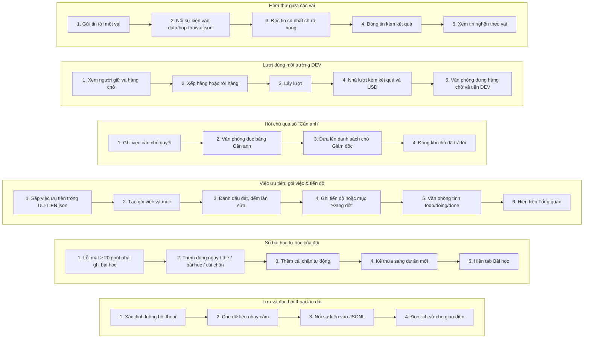

#### Hòm thư giữa các vai

Các vai gửi, nhận và đóng tin cho nhau qua tệp JSONL theo vai; văn phòng hiện tin nghẽn. — *Kích hoạt:* `vp gui / vp tiep / vp xong / vp ds` (cli).

1. **Gửi tin tới một vai** — cmdGui với --toi sinh mã ht-<giờ>-<hex> và ghi sự kiện “tin”. [`tools/vp.js:72`](../tools/vp.js#L72-L77)
2. **Nối sự kiện vào data/hop-thu/<vai>.jsonl** — mailbox.append tạo thư mục nếu thiếu, tên tệp theo vai đã bỏ dấu (slug), kèm thời điểm ISO. [`lib/mailbox.js:11`](../lib/mailbox.js#L11-L14)
3. **Đọc tin cũ nhất chưa xong** — cmdTiep lấy tin cũ nhất chưa xong của vai, ghi “go” (đã đọc) và in hướng dẫn đóng tin. [`tools/vp.js:82`](../tools/vp.js#L82-L88)
4. **Đóng tin kèm kết quả** — cmdXong dùng findVai tìm đúng tệp chứa mã tin rồi ghi “xong” kèm ghi chú. [`tools/vp.js:89`](../tools/vp.js#L89-L94)
5. **Xem tin nghẽn theo vai** — cmdDs in bảng tin chưa xong (chờ quá 1 giờ, bị nhắc, chưa đọc); hopthu.html đọc /hopthu mỗi 30 giây. [`tools/vp.js:95`](../tools/vp.js#L95-L100)

#### Lượt dùng môi trường DEV

Xếp hàng dùng môi trường DEV chung: chỉ một người giữ khóa, nhả lượt kèm kết quả và chi phí tự khai; văn phòng dựng hàng chờ và tiền DEV. — *Kích hoạt:* `vp luot xem | cho | huy | lay | nha` (cli).

1. **Xem người giữ và hàng chờ** — vp luot xem đọc DEV.lock và DEV-LUOT.jsonl. [`tools/vp.js:104`](../tools/vp.js#L104-L132)
2. **Xếp hàng hoặc rời hàng** — vp luot cho / huy ghi sự kiện vào DEV-LUOT.jsonl. [`tools/vp.js:104`](../tools/vp.js#L104-L132)
3. **Lấy lượt** — vp luot lay ghi DEV.lock; từ chối khi người khác đang giữ. [`tools/vp.js:104`](../tools/vp.js#L104-L132)
4. **Nhả lượt kèm kết quả và USD** — vp luot nha ghi đạt/hỏng và USD tự khai rồi xóa khóa. [`tools/vp.js:104`](../tools/vp.js#L104-L132)
5. **Văn phòng dựng hàng chờ và tiền DEV** — server.readDev ghép lay với nha kế tiếp, cảnh báo DEV trống; perf đếm lượt đạt/hỏng, moneyOf cộng USD. [`server.js:333`](../server.js#L333-L369)

#### Hỏi chủ qua sổ “Cần anh”

Vai ghi việc chỉ chủ văn phòng quyết được, văn phòng đưa lên danh sách chờ Giám đốc, vai tự đóng khi có câu trả lời. — *Kích hoạt:* `vp cananh hoi | ds | xong` (cli).

1. **Ghi việc cần chủ quyết** — vp cananh hoi thêm dòng CA-n trạng thái CHỜ (production, tiền, khóa mới, xóa dữ liệu, đổi luật). [`tools/vp.js:137`](../tools/vp.js#L137-L158)
2. **Văn phòng đọc bảng Cần anh** — readCanAnh đọc CAN-ANH.md khi tệp đổi, ghép người hỏi với nhân viên. [`server.js:437`](../server.js#L437-L449)
3. **Đưa lên danh sách chờ Giám đốc** — ceoAsks gộp mục còn CHỜ với các nguồn khác để hiện trên văn phòng. [`server.js:458`](../server.js#L458-L473)
4. **Đóng khi chủ đã trả lời** — vp cananh xong CA-n đổi trạng thái sang XONG kèm câu trả lời. [`tools/vp.js:137`](../tools/vp.js#L137-L158)

#### Việc ưu tiên, gói việc & tiến độ

Quản lý/Điều phối sắp việc ưu tiên, kỹ sư làm theo gói việc có mục, bằng chứng và tiến độ; văn phòng tính trạng thái và hiện trên Tổng quan. — *Kích hoạt:* `vp viec / vp goi / vp tiendo` (cli).

1. **Sắp việc ưu tiên trong UU-TIEN.json** — cmdViec ds/them/sua/dung/xoa: đổi thứ tự, hạn chuyển ISO, tạm dừng kèm lý do; luôn cập nhật cap_nhat. [`tools/vp.js:162`](../tools/vp.js#L162-L184)
2. **Tạo gói việc và mục** — cmdGoi tao gói (kèm tien-do.md) và muc thêm mục; tên gói chữ thường không dấu. [`tools/vp.js:187`](../tools/vp.js#L187-L212)
3. **Đánh dấu đạt, đếm lần sửa** — cmdGoi dat ghi bằng chứng/sha; sua tăng lan_sua và cảnh báo từ 3 lần. [`tools/vp.js:187`](../tools/vp.js#L187-L212)
4. **Ghi tiến độ hoặc mục “Đang dở”** — cmdTienDo nối dòng có dấu thời gian; --dang-do lưu khối Đang dở trước khi nghỉ/nén ngữ cảnh. [`tools/vp.js:213`](../tools/vp.js#L213-L219)
5. **Văn phòng tính todo/doing/done** — readTasks ghép UU-TIEN với viec.json: trạng thái, số lần sửa, bằng chứng, người giữ. [`server.js:384`](../server.js#L384-L418)
6. **Hiện trên Tổng quan** — tongquan.build đặt việc vào hàng, kèm tiến độ mới nhất và hạn. [`lib/tongquan.js:45`](../lib/tongquan.js#L45-L85)

#### Sổ bài học tự học của đội

Vòng tự học: lỗi tốn thời gian được ghi thành bài học kèm cái chặn tự động, kế thừa sang dự án mới và hiện ở tab Bài học. — *Kích hoạt:* `vp baihoc` (cli).

1. **Lỗi mất ≥ 20 phút phải ghi bài học** — Cơ chế 4 pha: phát hiện lỗi → cái chặn tự động → nạp đón đầu → kế thừa liên dự án. [`docs/CO-CHE-TU-HOC.md:1`](../docs/CO-CHE-TU-HOC.md#L1-L78)
2. **Thêm dòng ngày / thẻ / bài học / cái chặn** — cmdBaiHoc thêm vào bảng data/BAI-HOC.md, tạo khung nếu chưa có. [`tools/vp.js:220`](../tools/vp.js#L220-L226)
3. **Thêm cái chặn tự động** — Ví dụ test/html.test.js chặn lỗi IMPORTMAP-MODULE (importmap trước script module, script nội tuyến qua node --check). [`test/html.test.js:1`](../test/html.test.js#L1-L31)
4. **Kế thừa sang dự án mới** — mau/BAI-HOC.md đã có 15 bài học thật, setup.js chép sang data/ khi cài. [`mau/BAI-HOC.md:1`](../mau/BAI-HOC.md#L1-L23)
5. **Hiện tab Bài học** — docs.build đọc BAI-HOC.md; noiquy.html renderBook có ô tìm kiếm. [`public/noiquy.html:120`](../public/noiquy.html#L120-L157)

#### Lưu và đọc hội thoại lâu dài

Giữ tin nhắn của văn phòng trong sổ JSONL để tải lại được sau các phiên. — *Kích hoạt:* `Giao diện đọc hoặc thêm tin nhắn` (manual).

1. **Xác định luồng hội thoại** — Chuẩn hóa luồng và dữ liệu tin nhắn trước khi đọc hoặc ghi sổ. [`lib/so-tin-nhan.js:29`](../lib/so-tin-nhan.js#L29-L102)
2. **Che dữ liệu nhạy cảm** — Che nội dung nhạy cảm trong dữ liệu tin trước khi nối sổ lâu dài. [`lib/so-tin-nhan.js:29`](../lib/so-tin-nhan.js#L29-L102)
3. **Nối sự kiện vào JSONL** — Ghi từng sự kiện vào sổ tin nhắn theo luồng, không thay toàn bộ lịch sử. [`lib/so-tin-nhan.js:29`](../lib/so-tin-nhan.js#L29-L102)
4. **Đọc lịch sử cho giao diện** — Máy chủ cung cấp dữ liệu hội thoại để giao diện nạp lại và đồng bộ với trạng thái văn phòng. [`server.js:499`](../server.js#L499-L545)

### Chu trình AI tự động (/bcc)

Trái tim của OS Controller: CEO giao một việc (hoặc ý tưởng), các lượt AI chạy nối tiếp theo NEXT_OWNER trong agent.md (Hinata/Antigravity → Sol, Astra trên Codex → Claude đội trưởng) trên nhánh git riêng ai/…; mỗi lượt phải nộp dòng JSON bàn giao hợp lệ.

**Luật nghiệp vụ:**
- Chỉ vai trùng NEXT_OWNER được chạy; 1 lượt AI mỗi workspace; còn bàn giao chưa quyết thì không chạy lượt kế (HANDOFF_PENDING)
- Bàn giao sai schema không được duyệt; chỉ thiếu giải thích hoặc sai luật agent.md thì trả lại đúng vai một lần
- Ngắt mạch khi hết lượt/thời gian, không có bàn giao, log có chuỗi giống khóa API, xung đột git, Codex sửa quá MAX_REWORK = 2 lần
- Chỉ CLAUDE_AUDITOR được hỏi CEO (ask_ceo), đặt effort cho Codex và xóa file
- Luồng giới hạn 1–12 lượt, ≤ 120 phút; thời gian chờ hạn mức và chờ rà soát không tính
- Không push/merge/release trong luồng; chỉ đẩy nhánh sau CEO duyệt, không --force
- Diff có chuỗi giống khóa thì không commit; repo đang sửa dở thì từ chối giao việc (DIRTY_REPO)
- Hợp đồng trước, code sau: có backend/frontend thì Sol viết contract/api.json; lệch hợp đồng là lỗi bàn giao của đúng vai
- Miễn hợp đồng chỉ CEO quyết; Sol ghi 'Không có API' mới là đề nghị
- Chạy song song Astra + Kakashi chỉ khi hợp đồng đạt và hai thư mục không chồng nhau; mỗi bên chỉ sửa phần mình, văn phòng tự ghi agent.md sau khi gộp
- Dự án mới chỉ tạo khi CEO bấm duyệt, repo luôn riêng tư

```mermaid
flowchart TD
  subgraph flow_giao_y_tuong["Giao ý tưởng mới (bước 1 /bcc)"]
    direction LR
    step_giao_y_tuong_luu["1. Lưu ý tưởng ngoài repo"]
    step_giao_y_tuong_kiem_truoc["2. Kiểm trước khi giao"]
    step_giao_y_tuong_ghi_de_luot["3. Sai lượt thì cần CEO xác nhận ghi đè"]
    step_giao_y_tuong_commit_luot["4. Commit riêng agent.md khi ghi đè"]
    step_giao_y_tuong_bat_luong["5. Bật luồng từ lượt SPEC_ARCHITECT"]
    step_giao_y_tuong_luu --> step_giao_y_tuong_kiem_truoc
    step_giao_y_tuong_kiem_truoc --> step_giao_y_tuong_ghi_de_luot
    step_giao_y_tuong_ghi_de_luot --> step_giao_y_tuong_commit_luot
    step_giao_y_tuong_commit_luot --> step_giao_y_tuong_bat_luong
  end
  subgraph flow_tao_du_an_moi["Tạo dự án mới từ ý tưởng"]
    direction LR
    step_tao_du_an_moi_nhap_y_tuong["1. CEO gõ ý tưởng, xin gợi ý tên"]
    step_tao_du_an_moi_goi_y["2. Gợi ý 3 tên repo"]
    step_tao_du_an_moi_kiem_ten["3. Kiểm tên còn trống"]
    step_tao_du_an_moi_duyet["4. CEO duyệt tên"]
    step_tao_du_an_moi_tao_repo["5. Tạo repo riêng tư"]
    step_tao_du_an_moi_khoi_dong["6. Tải về, mở dự án, cài bộ kiểm, giao Hinata"]
    step_tao_du_an_moi_theo_doi["7. Theo dõi từng bước"]
    step_tao_du_an_moi_nhap_y_tuong --> step_tao_du_an_moi_goi_y
    step_tao_du_an_moi_goi_y --> step_tao_du_an_moi_kiem_ten
    step_tao_du_an_moi_kiem_ten --> step_tao_du_an_moi_duyet
    step_tao_du_an_moi_duyet --> step_tao_du_an_moi_tao_repo
    step_tao_du_an_moi_tao_repo --> step_tao_du_an_moi_khoi_dong
    step_tao_du_an_moi_khoi_dong --> step_tao_du_an_moi_theo_doi
  end
  subgraph flow_luong_tu_dong["Luồng tự động: CEO giao việc → báo cáo Claude"]
    direction LR
    step_luong_tu_dong_ceo_giao["1. CEO giao việc cho cả đội"]
    step_luong_tu_dong_kiem_dau_vao["2. Kiểm đầu vào và dự án rảnh"]
    step_luong_tu_dong_ra_soat_md["3. Cổng rà soát file .md khi toàn quyền"]
    step_luong_tu_dong_repo_sach["4. Kiểm repo sạch"]
    step_luong_tu_dong_tao_nhanh["5. Tạo nhánh riêng ai/việc-mã"]
    step_luong_tu_dong_chay_luot["6. Chạy lượt kế tiếp theo NEXT_OWNER"]
    step_luong_tu_dong_song_song["7. Lượt Astra: chạy song song khi có hợp đồng"]
    step_luong_tu_dong_commit_luot["8. Commit file AI đổi sau lượt"]
    step_luong_tu_dong_kiem_ban_giao["9. Kiểm bàn giao, trả lại đúng vai một lần"]
    step_luong_tu_dong_duyet_noi_bo["10. Duyệt nội bộ và chuyển lượt"]
    step_luong_tu_dong_bao_cao_cuoi["11. Dừng ở báo cáo Claude chờ CEO"]
    step_luong_tu_dong_ceo_giao --> step_luong_tu_dong_kiem_dau_vao
    step_luong_tu_dong_kiem_dau_vao --> step_luong_tu_dong_ra_soat_md
    step_luong_tu_dong_ra_soat_md --> step_luong_tu_dong_repo_sach
    step_luong_tu_dong_repo_sach --> step_luong_tu_dong_tao_nhanh
    step_luong_tu_dong_tao_nhanh --> step_luong_tu_dong_chay_luot
    step_luong_tu_dong_chay_luot --> step_luong_tu_dong_song_song
    step_luong_tu_dong_song_song --> step_luong_tu_dong_commit_luot
    step_luong_tu_dong_commit_luot --> step_luong_tu_dong_kiem_ban_giao
    step_luong_tu_dong_kiem_ban_giao --> step_luong_tu_dong_duyet_noi_bo
    step_luong_tu_dong_duyet_noi_bo --> step_luong_tu_dong_bao_cao_cuoi
  end
  subgraph flow_mot_luot_ai["Một lượt AI và kiểm bàn giao"]
    direction LR
    step_mot_luot_ai_kiem_luot["1. Kiểm đúng lượt và workspace rảnh"]
    step_mot_luot_ai_loi_giao["2. Ghép lời giao việc"]
    step_mot_luot_ai_dieu_phoi["3. Chọn model, mức và mục lục"]
    step_mot_luot_ai_dung_lenh["4. Dựng lệnh CLI"]
    step_mot_luot_ai_chay_job["5. Chạy job kind=ai"]
    step_mot_luot_ai_thu_lai["6. Lỗi tạm thời: hẹn chạy lại một lần"]
    step_mot_luot_ai_tim_ban_giao["7. Tìm dòng JSON bàn giao trong log"]
    step_mot_luot_ai_kiem_schema["8. Kiểm schema bàn giao"]
    step_mot_luot_ai_kiem_agent_md["9. Cộng lỗi chu trình agent.md và lưu"]
    step_mot_luot_ai_hop_dong["10. Kiểm hợp đồng giao tiếp"]
    step_mot_luot_ai_duyet_tay["11. CEO duyệt hoặc từ chối (chạy tay)"]
    step_mot_luot_ai_kiem_luot --> step_mot_luot_ai_loi_giao
    step_mot_luot_ai_loi_giao --> step_mot_luot_ai_dieu_phoi
    step_mot_luot_ai_dieu_phoi --> step_mot_luot_ai_dung_lenh
    step_mot_luot_ai_dung_lenh --> step_mot_luot_ai_chay_job
    step_mot_luot_ai_chay_job --> step_mot_luot_ai_thu_lai
    step_mot_luot_ai_thu_lai --> step_mot_luot_ai_tim_ban_giao
    step_mot_luot_ai_tim_ban_giao --> step_mot_luot_ai_kiem_schema
    step_mot_luot_ai_kiem_schema --> step_mot_luot_ai_kiem_agent_md
    step_mot_luot_ai_kiem_agent_md --> step_mot_luot_ai_hop_dong
    step_mot_luot_ai_hop_dong --> step_mot_luot_ai_duyet_tay
  end
  subgraph flow_hop_dong_giao_tiep["Chốt hợp đồng giao tiếp trước khi code"]
    direction LR
    step_hop_dong_giao_tiep_luat["1. Luật hợp đồng trước, code sau"]
    step_hop_dong_giao_tiep_kiem_cau_truc["2. Kiểm cấu trúc hợp đồng"]
    step_hop_dong_giao_tiep_sau_luot["3. Kiểm sau mỗi lượt theo vai"]
    step_hop_dong_giao_tiep_kiem_lech["4. Bắt lệch hợp đồng với mã"]
    step_hop_dong_giao_tiep_ci["5. CI của repo dự án"]
    step_hop_dong_giao_tiep_smoke["6. Kiểm phản hồi thật"]
    step_hop_dong_giao_tiep_luat --> step_hop_dong_giao_tiep_kiem_cau_truc
    step_hop_dong_giao_tiep_kiem_cau_truc --> step_hop_dong_giao_tiep_sau_luot
    step_hop_dong_giao_tiep_sau_luot --> step_hop_dong_giao_tiep_kiem_lech
    step_hop_dong_giao_tiep_kiem_lech --> step_hop_dong_giao_tiep_ci
    step_hop_dong_giao_tiep_ci --> step_hop_dong_giao_tiep_smoke
  end
  subgraph flow_mien_hop_dong["Miễn hợp đồng giao tiếp: chỉ CEO quyết"]
    direction LR
    step_mien_hop_dong_de_nghi["1. Phát hiện đề nghị miễn"]
    step_mien_hop_dong_hoi["2. Dừng luồng hỏi CEO"]
    step_mien_hop_dong_nguyen_van["3. Lấy nguyên văn đề nghị"]
    step_mien_hop_dong_tra_loi["4. CEO chọn A/B"]
    step_mien_hop_dong_ghi_so["5. Ghi sổ miễn"]
    step_mien_hop_dong_bo_loi["6. Bỏ lỗi đã được CEO quyết"]
    step_mien_hop_dong_de_nghi --> step_mien_hop_dong_hoi
    step_mien_hop_dong_hoi --> step_mien_hop_dong_nguyen_van
    step_mien_hop_dong_nguyen_van --> step_mien_hop_dong_tra_loi
    step_mien_hop_dong_tra_loi --> step_mien_hop_dong_ghi_so
    step_mien_hop_dong_ghi_so --> step_mien_hop_dong_bo_loi
  end
  subgraph flow_song_song_astra_kakashi["Chạy song song Astra (backend) và Kakashi (frontend)"]
    direction LR
    step_song_song_astra_kakashi_dieu_kien["1. Kiểm điều kiện song song"]
    step_song_song_astra_kakashi_bat_dau["2. Bắt đầu hai bên"]
    step_song_song_astra_kakashi_worktree["3. Tạo hai worktree tách rời"]
    step_song_song_astra_kakashi_chay_ben["4. Chạy lượt từng bên"]
    step_song_song_astra_kakashi_pham_vi["5. Kiểm phạm vi thư mục"]
    step_song_song_astra_kakashi_theo_doi["6. Theo dõi và trả lại riêng bên sai"]
    step_song_song_astra_kakashi_gop["7. Gộp hai phần, ghi agent.md"]
    step_song_song_astra_kakashi_don["8. Dọn worktree"]
    step_song_song_astra_kakashi_dieu_kien --> step_song_song_astra_kakashi_bat_dau
    step_song_song_astra_kakashi_bat_dau --> step_song_song_astra_kakashi_worktree
    step_song_song_astra_kakashi_worktree --> step_song_song_astra_kakashi_chay_ben
    step_song_song_astra_kakashi_chay_ben --> step_song_song_astra_kakashi_pham_vi
    step_song_song_astra_kakashi_pham_vi --> step_song_song_astra_kakashi_theo_doi
    step_song_song_astra_kakashi_theo_doi --> step_song_song_astra_kakashi_gop
    step_song_song_astra_kakashi_gop --> step_song_song_astra_kakashi_don
  end
  subgraph flow_claude_hoi_ceo["Claude hỏi CEO (ask_ceo)"]
    direction LR
    step_claude_hoi_ceo_dat_cau_hoi["1. Claude đặt câu hỏi kèm phương án"]
    step_claude_hoi_ceo_luong_cho["2. Luồng chuyển awaiting_answer"]
    step_claude_hoi_ceo_hien_cho_ceo["3. Hiện ở “Việc chờ anh duyệt”"]
    step_claude_hoi_ceo_ceo_chon["4. CEO chọn phương án"]
    step_claude_hoi_ceo_duyet_theo_pa["5. Duyệt bàn giao theo phương án"]
    step_claude_hoi_ceo_chay_tiep["6. Ghi quyết định và chạy tiếp"]
    step_claude_hoi_ceo_dat_cau_hoi --> step_claude_hoi_ceo_luong_cho
    step_claude_hoi_ceo_luong_cho --> step_claude_hoi_ceo_hien_cho_ceo
    step_claude_hoi_ceo_hien_cho_ceo --> step_claude_hoi_ceo_ceo_chon
    step_claude_hoi_ceo_ceo_chon --> step_claude_hoi_ceo_duyet_theo_pa
    step_claude_hoi_ceo_duyet_theo_pa --> step_claude_hoi_ceo_chay_tiep
  end
  subgraph flow_het_han_muc["Hết hạn mức: chờ hoặc làm qua ChatGPT web"]
    direction LR
    step_het_han_muc_nhan_dien["1. Nhận ra hết hạn mức gói"]
    step_het_han_muc_tinh_gio["2. Chuyển waiting_quota và tính giờ chạy lại"]
    step_het_han_muc_tu_chay_lai["3. Tới giờ tự chạy lại đúng lượt"]
    step_het_han_muc_xin_master_prompt["4. CEO xin master prompt"]
    step_het_han_muc_mau_du_phong["5. Không ai còn hạn mức: dùng mẫu"]
    step_het_han_muc_tach_ket_qua["6. Tách MASTER_PROMPT / CHUAN_DAU_RA"]
    step_het_han_muc_dan_ket_qua["7. CEO dán kết quả ChatGPT web"]
    step_het_han_muc_tu_choi_web["8. Kết quả web không đạt: quay lại chờ"]
    step_het_han_muc_nhan_dien --> step_het_han_muc_tinh_gio
    step_het_han_muc_tinh_gio --> step_het_han_muc_tu_chay_lai
    step_het_han_muc_tu_chay_lai --> step_het_han_muc_xin_master_prompt
    step_het_han_muc_xin_master_prompt --> step_het_han_muc_mau_du_phong
    step_het_han_muc_mau_du_phong --> step_het_han_muc_tach_ket_qua
    step_het_han_muc_tach_ket_qua --> step_het_han_muc_dan_ket_qua
    step_het_han_muc_dan_ket_qua --> step_het_han_muc_tu_choi_web
  end
  subgraph flow_ngat_mach_bao_cao["Ngắt mạch & báo cáo của Claude"]
    direction LR
    step_ngat_mach_bao_cao_dieu_kien["1. Phát hiện điều kiện ngắt mạch"]
    step_ngat_mach_bao_cao_gom_bang_chung["2. Gom bằng chứng"]
    step_ngat_mach_bao_cao_claude_bao_cao["3. Claude viết báo cáo chỉ đọc"]
    step_ngat_mach_bao_cao_nhan_bao_cao["4. Nhận báo cáo hoặc cần anh xem"]
    step_ngat_mach_bao_cao_bao_ra_may["5. Báo ra máy cho CEO"]
    step_ngat_mach_bao_cao_ceo_dung["6. CEO dừng luồng / ctl khởi động lại"]
    step_ngat_mach_bao_cao_dieu_kien --> step_ngat_mach_bao_cao_gom_bang_chung
    step_ngat_mach_bao_cao_gom_bang_chung --> step_ngat_mach_bao_cao_claude_bao_cao
    step_ngat_mach_bao_cao_claude_bao_cao --> step_ngat_mach_bao_cao_nhan_bao_cao
    step_ngat_mach_bao_cao_nhan_bao_cao --> step_ngat_mach_bao_cao_bao_ra_may
    step_ngat_mach_bao_cao_bao_ra_may --> step_ngat_mach_bao_cao_ceo_dung
  end
  subgraph flow_duyet_day_nhanh["CEO duyệt báo cáo, đẩy nhánh & mở PR"]
    direction LR
    step_duyet_day_nhanh_xem_diff["1. Xem diff từng lượt"]
    step_duyet_day_nhanh_doc_giai_thich["2. Đọc “Vì sao làm vậy”"]
    step_duyet_day_nhanh_duyet_tu_choi["3. Duyệt hoặc từ chối báo cáo"]
    step_duyet_day_nhanh_day_nhanh["4. Đẩy nhánh lên GitHub"]
    step_duyet_day_nhanh_link_pr["5. Lấy link tạo PR"]
    step_duyet_day_nhanh_ci_pr["6. PR chạy CI trước khi merge"]
    step_duyet_day_nhanh_xem_diff --> step_duyet_day_nhanh_doc_giai_thich
    step_duyet_day_nhanh_doc_giai_thich --> step_duyet_day_nhanh_duyet_tu_choi
    step_duyet_day_nhanh_duyet_tu_choi --> step_duyet_day_nhanh_day_nhanh
    step_duyet_day_nhanh_day_nhanh --> step_duyet_day_nhanh_link_pr
    step_duyet_day_nhanh_link_pr --> step_duyet_day_nhanh_ci_pr
  end
  subgraph flow_xoa_file_trong_luong["Kiểm soát xóa file trong luồng"]
    direction LR
    step_xoa_file_trong_luong_khai_bao["1. AI khai đề nghị xóa / đã xóa"]
    step_xoa_file_trong_luong_so_git["2. So git với mốc đầu lượt"]
    step_xoa_file_trong_luong_khoi_phuc["3. Vai khác Claude tự xóa: khôi phục"]
    step_xoa_file_trong_luong_vi_pham["4. Xóa ngoài git: ghi vi phạm, báo CEO"]
    step_xoa_file_trong_luong_claude_quyet["5. Claude quyết đề nghị xóa"]
    step_xoa_file_trong_luong_hien_khung["6. Hiện khung xóa file"]
    step_xoa_file_trong_luong_khai_bao --> step_xoa_file_trong_luong_so_git
    step_xoa_file_trong_luong_so_git --> step_xoa_file_trong_luong_khoi_phuc
    step_xoa_file_trong_luong_khoi_phuc --> step_xoa_file_trong_luong_vi_pham
    step_xoa_file_trong_luong_vi_pham --> step_xoa_file_trong_luong_claude_quyet
    step_xoa_file_trong_luong_claude_quyet --> step_xoa_file_trong_luong_hien_khung
  end
  subgraph flow_ket_noi_mcp["Kết nối MCP theo phòng"]
    direction LR
    step_ket_noi_mcp_doc_trang_thai["1. Đọc trạng thái kết nối của 3 CLI"]
    step_ket_noi_mcp_danh_muc["2. Ghép danh mục kết nối dùng chung"]
    step_ket_noi_mcp_giao_phong["3. Giao kết nối cho phòng"]
    step_ket_noi_mcp_them_dang_nhap["4. Thêm / đăng nhập kết nối"]
    step_ket_noi_mcp_mcp_may["5. MCP chạy trên máy"]
    step_ket_noi_mcp_sinh_co["6. Sinh cờ CLI theo phòng của vai"]
    step_ket_noi_mcp_chen_vao_luot["7. Chèn vào lệnh của lượt AI"]
    step_ket_noi_mcp_doc_trang_thai --> step_ket_noi_mcp_danh_muc
    step_ket_noi_mcp_danh_muc --> step_ket_noi_mcp_giao_phong
    step_ket_noi_mcp_giao_phong --> step_ket_noi_mcp_them_dang_nhap
    step_ket_noi_mcp_them_dang_nhap --> step_ket_noi_mcp_mcp_may
    step_ket_noi_mcp_mcp_may --> step_ket_noi_mcp_sinh_co
    step_ket_noi_mcp_sinh_co --> step_ket_noi_mcp_chen_vao_luot
  end
  subgraph flow_lich_giao_viec["Hẹn giờ giao luồng hoặc hỏi AI"]
    direction LR
    step_lich_giao_viec_kiem["1. Kiểm nhịp và nhiệm vụ"]
    step_lich_giao_viec_tinh["2. Tính và lưu lần chạy tới"]
    step_lich_giao_viec_den_han["3. Chọn lịch đến hạn"]
    step_lich_giao_viec_ban["4. Kiểm bận và hạn mức"]
    step_lich_giao_viec_giao["5. Giao vào luồng hoặc chat"]
    step_lich_giao_viec_ghi_ket_qua["6. Lưu kết quả và kiểm toán"]
    step_lich_giao_viec_kiem --> step_lich_giao_viec_tinh
    step_lich_giao_viec_tinh --> step_lich_giao_viec_den_han
    step_lich_giao_viec_den_han --> step_lich_giao_viec_ban
    step_lich_giao_viec_ban --> step_lich_giao_viec_giao
    step_lich_giao_viec_giao --> step_lich_giao_viec_ghi_ket_qua
  end
  subgraph flow_tai_lieu_y_tuong["Đính kèm tài liệu khi tạo dự án"]
    direction LR
    step_tai_lieu_y_tuong_chon["1. Chọn tài liệu từ khu dự án"]
    step_tai_lieu_y_tuong_kiem["2. Kiểm loại, tên và dung lượng"]
    step_tai_lieu_y_tuong_exclude["3. Giữ tài liệu ngoài Git"]
    step_tai_lieu_y_tuong_giao["4. Đưa danh sách vào lời giao"]
    step_tai_lieu_y_tuong_chon --> step_tai_lieu_y_tuong_kiem
    step_tai_lieu_y_tuong_kiem --> step_tai_lieu_y_tuong_exclude
    step_tai_lieu_y_tuong_exclude --> step_tai_lieu_y_tuong_giao
  end
  flow_giao_y_tuong ~~~ flow_tao_du_an_moi
  flow_tao_du_an_moi ~~~ flow_luong_tu_dong
  flow_luong_tu_dong ~~~ flow_mot_luot_ai
  flow_mot_luot_ai ~~~ flow_hop_dong_giao_tiep
  flow_hop_dong_giao_tiep ~~~ flow_mien_hop_dong
  flow_mien_hop_dong ~~~ flow_song_song_astra_kakashi
  flow_song_song_astra_kakashi ~~~ flow_claude_hoi_ceo
  flow_claude_hoi_ceo ~~~ flow_het_han_muc
  flow_het_han_muc ~~~ flow_ngat_mach_bao_cao
  flow_ngat_mach_bao_cao ~~~ flow_duyet_day_nhanh
  flow_duyet_day_nhanh ~~~ flow_xoa_file_trong_luong
  flow_xoa_file_trong_luong ~~~ flow_ket_noi_mcp
  flow_ket_noi_mcp ~~~ flow_lich_giao_viec
  flow_lich_giao_viec ~~~ flow_tai_lieu_y_tuong
```

#### Giao ý tưởng mới (bước 1 /bcc)

CEO lưu ý tưởng rồi giao cho đội: luồng tự động bắt đầu từ lượt SPEC_ARCHITECT (Hinata) để đặc tả Vùng [2]; sổ đang tới lượt người khác thì CEO phải xác nhận ghi đè. — *Kích hoạt:* `Bàn CEO → Ý tưởng → POST /ctl/ideas, POST /ctl/ideas/:id/start` (http).

1. **Lưu ý tưởng ngoài repo** — ideas.add: tên 1–200 ký tự, mô tả ≤ 2400, che khóa, lưu ideas.json ngoài repo; chỉ hiện ở đúng dự án. [`ctl/ideas.js:35`](../ctl/ideas.js#L35-L46)
2. **Kiểm trước khi giao** — ideas.start: ý tưởng chưa chạy, agent.md đọc được, dự án rảnh, preflight (rà soát toàn quyền + repo sạch). [`ctl/ideas.js:55`](../ctl/ideas.js#L55-L98)
3. **Sai lượt thì cần CEO xác nhận ghi đè** — NEXT_OWNER khác SPEC_ARCHITECT mà không có force thì từ chối; có force thì setTurn ghi đúng hai dòng LAST_UPDATED_BY/NEXT_OWNER. [`ctl/handoff.js:27`](../ctl/handoff.js#L27-L33)
4. **Commit riêng agent.md khi ghi đè** — commitTurn chỉ commit khi agent.md được git theo dõi và có thay đổi; trả mã commit ngắn. [`ctl/ideas.js:47`](../ctl/ideas.js#L47-L53)
5. **Bật luồng từ lượt SPEC_ARCHITECT** — Gọi autopilot.start với nhiệm vụ đặc tả Vùng [2]; trạng thái ý tưởng lấy từ luồng thật. [`ctl/autopilot.js:523`](../ctl/autopilot.js#L523-L540)

#### Tạo dự án mới từ ý tưởng

CEO gõ ý tưởng; văn phòng gợi ý 3 tên repo và kiểm tên trống trên GitHub; CEO chọn/sửa rồi duyệt thì văn phòng tạo repo riêng tư, tải về, mở làm dự án với agent.md, lưu ý tưởng, cài bộ kiểm và giao Hinata đặc tả. — *Kích hoạt:* `Bàn làm việc → Dự án mới → POST /ctl/du-an-moi/goi-y rồi POST /ctl/du-an-moi` (http).

1. **CEO gõ ý tưởng, xin gợi ý tên** — Mục Dự án mới gửi ý tưởng, hiện 3 tên kèm mô tả và tên nào đã có. [`public/office-desk.js:558`](../public/office-desk.js#L558-L580)
2. **Gợi ý 3 tên repo** — Claude Haiku đề xuất; lỗi thì đặt tên theo quy tắc; mỗi lúc một lượt Claude. [`ctl/du-an-moi.js:221`](../ctl/du-an-moi.js#L221-L227)
3. **Kiểm tên còn trống** — Hỏi GitHub repo owner/tên đã có chưa. [`ctl/github.js:154`](../ctl/github.js#L154-L157)
4. **CEO duyệt tên** — Kiểm tên và tài liệu đính kèm trước khi chạy quy trình nền; CEO duyệt tên, mô tả và chế độ dự án rồi nhận mã theo dõi. [`ctl/du-an-moi.js:252`](../ctl/du-an-moi.js#L252-L268)
5. **Tạo repo riêng tư** — POST /user/repos với auto_init; quá giờ thì kiểm lại repo đã có chưa. [`ctl/github.js:161`](../ctl/github.js#L161-L175)
6. **Tải về, mở dự án, cài bộ kiểm, giao Hinata** — Quy trình tạo repo và workspace, lưu tài liệu CEO đính kèm chỉ trên máy, dựng khung, cài bộ kiểm và giao bước đặc tả; lưu trạng thái từng bước, lỗi thì dừng và giữ bước đã xong. [`ctl/du-an-moi.js:270`](../ctl/du-an-moi.js#L270-L349)
7. **Theo dõi từng bước** — Giao diện hỏi GET /du-an-moi/:id theo nhịp tới khi xong. [`public/office-desk.js:581`](../public/office-desk.js#L581-L596)

#### Luồng tự động: CEO giao việc → báo cáo Claude

Con đường chính: kiểm đầu vào, rà file .md, tạo nhánh ai/…, chạy từng lượt theo NEXT_OWNER, commit sau mỗi lượt, kiểm bàn giao (trả lại đúng vai một lần), duyệt nội bộ chuyển lượt và dừng ở báo cáo của Claude chờ CEO. — *Kích hoạt:* `Bàn điều phối “Giao việc” → POST /ctl/autopilot` (http).

1. **CEO giao việc cho cả đội** — office-desk “Giao việc” hoặc prototype autoTask gửi POST /ctl/autopilot (workspace, task, maxSteps, timeoutMs). [`ctl/main.js:528`](../ctl/main.js#L528-L528)
2. **Kiểm đầu vào và dự án rảnh** — start: việc ≤ 3000 ký tự, 1–12 lượt, ≤ 120 phút (mặc định 10 lượt/90 phút); đã có luồng/báo cáo chờ hoặc job/bàn giao đang chờ → AI_BUSY; agent.md không đọc được → BAD_AGENT_MD. [`ctl/autopilot.js:523`](../ctl/autopilot.js#L523-L540)
3. **Cổng rà soát file .md khi toàn quyền** — scanGate gọi scanner.require; còn điểm bất thường chưa duyệt thì NEEDS_SCAN_APPROVAL, luồng không bắt đầu (xem luồng Rà file trước khi cho AI toàn quyền). [`ctl/ra-soat.js:202`](../ctl/ra-soat.js#L202-L244)
4. **Kiểm repo sạch** — nhanh.preflight: chưa có commit → NO_COMMIT; file đang theo dõi bị sửa chưa commit (trừ agent.md) → DIRTY_REPO; thư mục không phải git thì chạy không nhánh. [`ctl/nhanh.js:55`](../ctl/nhanh.js#L55-L61)
5. **Tạo nhánh riêng ai/<việc>-<mã>** — nhanh.prepare: slug bỏ dấu ≤ 32 ký tự + 6 ký tự cuối mã luồng; đang đứng trên nhánh ai/ cũ đã merge thì về nhánh chính và fast-forward trước; chụp baseline file chưa theo dõi. [`ctl/nhanh.js:65`](../ctl/nhanh.js#L65-L79)
6. **Chạy lượt kế tiếp theo NEXT_OWNER** — launch: chạm maxSteps thì ngắt mạch; lời giao gồm đặc cách CEO, quyết định CEO, giải thích các lượt và đề nghị xóa (cho Claude), ghi chú bị trả lại; chụp mốc git rồi runner.run; gặp NEEDS_SCAN_APPROVAL thì luồng chuyển awaiting_scan. [`ctl/autopilot.js:295`](../ctl/autopilot.js#L295-L483)
7. **Lượt Astra: chạy song song khi có hợp đồng** — Hợp đồng đạt thì Astra + Kakashi chạy cùng lúc trong hai worktree rồi gộp. [`ctl/autopilot.js:363`](../ctl/autopilot.js#L363-L373)
8. **Commit file AI đổi sau lượt** — tick → saveStep → nhanh.save: add -u (trừ agent.md) + file mới so với baseline; diff có chuỗi giống khóa thì bỏ stage, không commit và ngắt mạch. [`ctl/nhanh.js:83`](../ctl/nhanh.js#L83-L94)
9. **Kiểm bàn giao, trả lại đúng vai một lần** — Lỗi chỉ thuộc giai_thich hoặc “agent.md:” và vai vẫn giữ lượt → runner.reject, ghi retryNote, chạy lại đúng vai đó một lần; lần hai còn sai hoặc lỗi khác → ngắt mạch báo CEO. [`ctl/autopilot.js:580`](../ctl/autopilot.js#L580-L598)
10. **Duyệt nội bộ và chuyển lượt** — Sau khi qua kiểm khóa trong log, xung đột git, ask_ceo, MAX_REWORK và giới hạn: Claude đặt effort cho vai Codex kế; runner.approve ghi agent.md, commit chore(agent-sync) rồi launch lượt sau. [`ctl/runner.js:575`](../ctl/runner.js#L575-L602)
11. **Dừng ở báo cáo Claude chờ CEO** — CLAUDE_AUDITOR bàn giao done:true hoặc không trả về CODEX_ASTRA_DEV → awaiting_approval, lưu báo cáo; thông báo Windows một lần. [`ctl/autopilot.js:610`](../ctl/autopilot.js#L610-L612)

#### Một lượt AI và kiểm bàn giao

Chạy một lượt của vai giữ lượt bằng CLI nền (claude -p / codex exec / agy -p), tìm và kiểm dòng JSON bàn giao cùng luật agent.md, lưu vào bảng handoffs để luồng tự động hoặc CEO duyệt/từ chối. — *Kích hoạt:* `runner.run — từ luồng tự động hoặc nút “Chạy lượt” (POST /ctl/ai/run) ở Điều khiển máy` (event).

1. **Kiểm đúng lượt và workspace rảnh** — run: vai hợp lệ và có CLI; NOT_YOUR_TURN khi NEXT_OWNER khác; AI_BUSY khi đã có lượt; HANDOFF_PENDING khi bàn giao trước chưa quyết; guard rà soát khi vai chạy toàn quyền. [`ctl/runner.js:432`](../ctl/runner.js#L432-L446)
2. **Ghép lời giao việc** — Prompt vai + ghi chú quyền (toàn quyền hoặc sandbox Codex) + kết nối MCP của phòng + việc giao (≤ 8000) + END(role) bắt buộc dòng JSON; Claude nhận thêm CAPTAIN. [`ctl/runner.js:444`](../ctl/runner.js#L444-L490)
3. **Chọn model, mức và mục lục** — Runner hỏi bộ điều phối (model + mức theo độ khó, hạn mức), thêm mục lục từ bản đồ .ua, bộ skill, MCP theo phòng và MCP trên máy; đổi tài khoản Antigravity nếu cần. [`ctl/runner.js:449`](../ctl/runner.js#L449-L474)
4. **Dựng lệnh CLI** — argvFor kiểm cấu hình CLI và chỗ đặt prompt; áp lựa chọn model, effort, quyền, tài khoản và MCP theo vai. [`ctl/runner.js:402`](../ctl/runner.js#L402-L416)
5. **Chạy job kind=ai** — jobs.start spawn không qua shell, env đã lọc khóa; trước đó agentBefore chụp agent.md để so sau lượt. [`ctl/jobs.js:129`](../ctl/jobs.js#L129-L136)
6. **Lỗi tạm thời: hẹn chạy lại một lần** — done: job failed và log khớp RETRYABLE (rate limit, 429, overloaded, ECONNRESET…) khi allowRetry → chạy lại sau 1 phút một lần (luồng tự động tắt allowRetry). [`ctl/runner.js:536`](../ctl/runner.js#L536-L557)
7. **Tìm dòng JSON bàn giao trong log** — findHandoff lấy object {"role":…} cuối cùng, kể cả lồng trong JSON/JSONL của claude --output-format json và codex exec --json. [`ctl/handoff.js:126`](../ctl/handoff.js#L126-L149)
8. **Kiểm schema bàn giao** — checkHandoff: role khớp, next_owner hợp lệ và khác vai, files/claim_fixed (ID dạng P2-C01), effort chỉ Claude; checkExplain (giai_thich 1–20 mục, 15–2000 ký tự, chặn chữ mẫu), checkAsk, checkList. [`ctl/handoff.js:38`](../ctl/handoff.js#L38-L60)
9. **Cộng lỗi chu trình agent.md và lưu** — agentProblems gọi kiemAgent.checkChange (tiền tố “agent.md:”); lưu bàn giao + danh sách lỗi vào bảng handoffs và ghi kiểm toán. [`ctl/runner.js:503`](../ctl/runner.js#L503-L557)
10. **Kiểm hợp đồng giao tiếp** — Lỗi lệch hợp đồng thuộc phần của vai được cộng vào bàn giao. [`ctl/runner.js:519`](../ctl/runner.js#L519-L534)
11. **CEO duyệt hoặc từ chối (chạy tay)** — dieukhien loadHandoffs → POST /handoffs/:id/approve|reject; approve chặn INVALID_HANDOFF, NEEDS_ANSWER, TURN_CHANGED, ghi agent.md và commit “chore(agent-sync): VAI -> NEXT: VAI”. [`public/dieukhien.html:255`](../public/dieukhien.html#L255-L266)

#### Chốt hợp đồng giao tiếp trước khi code

Giao thức v2.3: Sol viết contract/api.json (OpenAPI 3 dạng JSON) cùng Vùng [3]; sau mỗi lượt văn phòng kiểm cấu trúc hợp đồng và độ lệch giữa hợp đồng với mã backend/frontend của đúng vai; CI của repo dự án chặn chỗ lệch; smoke test kiểm phản hồi thật theo schema. — *Kích hoạt:* `Lượt SOL_ARCHITECT_PLANNER trong luồng tự động; mỗi PR của repo dự án (kiem-chu-trinh.yml)` (event).

1. **Luật hợp đồng trước, code sau** — agent.md mẫu v2.3: [1].8 smoke test theo hợp đồng, [1].9 Backend/Frontend giao tiếp đúng contract/api.json. [`ctl/agent-template.md:24`](../ctl/agent-template.md#L24-L25)
2. **Kiểm cấu trúc hợp đồng** — openapi 3.x, responses, $ref, required, example đúng kiểu, tham số đường dẫn. [`lib/kiem-hop-dong.js:121`](../lib/kiem-hop-dong.js#L121-L166)
3. **Kiểm sau mỗi lượt theo vai** — Sol chưa tạo hợp đồng thì trả lại; lỗi lệch chỉ tính phần của vai (backend/frontend/cấu trúc). [`ctl/runner.js:519`](../ctl/runner.js#L519-L534)
4. **Bắt lệch hợp đồng với mã** — Backend thiếu đường dẫn/sự kiện của Phase hiện tại; frontend gọi ngoài hợp đồng. [`lib/kiem-hop-dong.js:235`](../lib/kiem-hop-dong.js#L235-L284)
5. **CI của repo dự án** — Workflow kiem-chu-trinh.yml chạy node tools/kiem-hop-dong.js --neu-co trên mỗi PR. [`ctl/khung/kiem-chu-trinh.yml:41`](../ctl/khung/kiem-chu-trinh.yml#L41-L42)
6. **Kiểm phản hồi thật** — --kiem-mau so một phản hồi JSON thật với schema/sự kiện trong hợp đồng. [`lib/kiem-hop-dong.js:298`](../lib/kiem-hop-dong.js#L298-L302)

#### Miễn hợp đồng giao tiếp: chỉ CEO quyết

Sol ghi “Không có API” ở Vùng [3] chỉ là đề nghị: luồng dừng hỏi CEO kèm nguyên văn và hệ quả; CEO đồng ý thì văn phòng ghi sổ miễn (AI không ghi được) và chạy tiếp, không đồng ý thì trả lại Sol tạo hợp đồng. — *Kích hoạt:* `Bàn giao của Sol có lỗi hop-dong-mien → luồng tự động` (event).

1. **Phát hiện đề nghị miễn** — Vùng [3] ghi 'Không có API' mà chưa có sổ miễn: bàn giao mang lỗi chờ CEO duyệt. [`ctl/runner.js:519`](../ctl/runner.js#L519-L534)
2. **Dừng luồng hỏi CEO** — awaiting_answer với câu hỏi kèm dòng đề nghị, giải thích của Sol, hệ quả khi miễn; gửi thông báo. [`ctl/autopilot.js:628`](../ctl/autopilot.js#L628-L648)
3. **Lấy nguyên văn đề nghị** — Dòng Vùng [3] của Sol đưa nguyên vào câu hỏi. [`ctl/mien-hop-dong.js:26`](../ctl/mien-hop-dong.js#L26-L29)
4. **CEO chọn A/B** — A: ghi miễn, bỏ lỗi chờ duyệt; B: trả lại Sol tạo contract/api.json. [`ctl/autopilot.js:649`](../ctl/autopilot.js#L649-L670)
5. **Ghi sổ miễn** — Sổ nằm trong thư mục dữ liệu văn phòng, theo đường dẫn dự án. [`ctl/mien-hop-dong.js:10`](../ctl/mien-hop-dong.js#L10-L24)
6. **Bỏ lỗi đã được CEO quyết** — Bàn giao xử lý tiếp như thường: đạt thì chuyển lượt. [`ctl/runner.js:631`](../ctl/runner.js#L631-L638)

#### Chạy song song Astra (backend) và Kakashi (frontend)

Tới lượt Astra mà hợp đồng đã đạt và khai đủ thư mục hai bên: văn phòng tạo hai worktree, chạy hai AI cùng lúc theo một hợp đồng, kiểm bàn giao và phạm vi từng bên (trả lại riêng bên sai một lần), rồi gộp vào nhánh luồng và ghi agent.md bằng hai commit đúng giao thức. — *Kích hoạt:* `Luồng tự động, khi NEXT_OWNER là CODEX_ASTRA_DEV` (event).

1. **Kiểm điều kiện song song** — Hợp đồng đạt, x-thu-muc đủ backend + frontend không chồng nhau, repo sạch. [`ctl/song-song.js:28`](../ctl/song-song.js#L28-L45)
2. **Bắt đầu hai bên** — Đủ 2 lượt trong giới hạn thì tạo worktree và chạy cả hai; không thì chạy lần lượt. [`ctl/autopilot.js:363`](../ctl/autopilot.js#L363-L373)
3. **Tạo hai worktree tách rời** — Cùng một mốc, HEAD tách rời, không tạo nhánh. [`ctl/song-song.js:49`](../ctl/song-song.js#L49-L66)
4. **Chạy lượt từng bên** — Lời giao việc song song: chỉ sửa thư mục của mình, không sửa agent.md/hợp đồng, chạy kiểm hợp đồng trước khi bàn giao. [`ctl/autopilot.js:374`](../ctl/autopilot.js#L374-L401)
5. **Kiểm phạm vi thư mục** — File ngoài phần của bên đó (kể cả đổi tên, xoá) là lỗi bàn giao. [`ctl/song-song.js:69`](../ctl/song-song.js#L69-L79)
6. **Theo dõi và trả lại riêng bên sai** — Bên sai được trả lại một lần; sai nữa hoặc lỗi khác thì dừng cả luồng và báo cáo. [`ctl/autopilot.js:416`](../ctl/autopilot.js#L416-L483)
7. **Gộp hai phần, ghi agent.md** — Commit từng bên, gộp lần lượt (xung đột thì huỷ và báo CEO), hai commit agent.md chuyển lượt sang Sol. [`ctl/song-song.js:83`](../ctl/song-song.js#L83-L140)
8. **Dọn worktree** — Gỡ worktree tạm; gộp lỗi thì giữ lại để CEO xem. [`ctl/autopilot.js:405`](../ctl/autopilot.js#L405-L415)

#### Claude hỏi CEO (ask_ceo)

Đội trưởng Claude không tự quyết hướng: nộp câu hỏi kèm 2–4 phương án, luồng dừng chờ; CEO chọn, lượt chuyển sang vai của phương án và quyết định được ghi cho các lượt sau. — *Kích hoạt:* `Bàn giao của CLAUDE_AUDITOR có trường ask_ceo` (event).

1. **Claude đặt câu hỏi kèm phương án** — checkAsk: chỉ CLAUDE_AUDITOR được hỏi; question 1–2000 ký tự; 2–4 phương án có id ngắn không trùng, label, next_owner hợp lệ, task ≤ 4000. [`ctl/handoff.js:106`](../ctl/handoff.js#L106-L122)
2. **Luồng chuyển awaiting_answer** — tick không tự duyệt, lưu câu hỏi kèm toàn bộ phân tích của Claude để CEO đọc trước khi chọn; thông báo Windows. [`ctl/autopilot.js:602`](../ctl/autopilot.js#L602-L608)
3. **Hiện ở “Việc chờ anh duyệt”** — office-desk.renderApprovals hiện câu hỏi Claude cùng các luồng cần CEO. [`public/office-desk.js:176`](../public/office-desk.js#L176-L209)
4. **CEO chọn phương án** — POST /autopilot/:id/answer (chạy tay thì POST /handoffs/:id/answer). [`ctl/main.js:530`](../ctl/main.js#L530-L530)
5. **Duyệt bàn giao theo phương án** — runner.answer duyệt với next_owner của phương án, ghi kiểm toán và trả câu quyết định. [`ctl/runner.js:606`](../ctl/runner.js#L606-L618)
6. **Ghi quyết định và chạy tiếp** — autopilot.answer thêm quyết định vào luồng (các lượt sau làm theo), đặt lại mốc lượt/thời gian rồi launch. [`ctl/autopilot.js:674`](../ctl/autopilot.js#L674-L687)

#### Hết hạn mức: chờ hoặc làm qua ChatGPT web

AI của lượt hết hạn mức gói: luồng chờ tới giờ mở lại rồi chạy lại đúng lượt đó, hoặc CEO xin master prompt để tự làm lượt trên ChatGPT web, dán kết quả cho AI còn hạn mức kiểm và áp vào repo. — *Kích hoạt:* `Log lượt khớp QUOTA_HIT (usage limit, insufficient_quota, rate_limit_exceeded…)` (event).

1. **Nhận ra hết hạn mức gói** — tick: lượt không có bàn giao hợp lệ mà 8000 ký tự cuối log khớp QUOTA_HIT → từ chối bàn giao dở và chuyển sang chờ. [`ctl/autopilot.js:576`](../ctl/autopilot.js#L576-L578)
2. **Chuyển waiting_quota và tính giờ chạy lại** — waitQuota/resumeTime: ưu tiên giờ mở lại từ bộ theo dõi hạn mức, rồi câu “try again in…” của CLI, mặc định 30 phút; kẹp 2 phút–8 giờ, cộng 1 phút đệm; không tính vào giới hạn lượt. [`ctl/autopilot.js:184`](../ctl/autopilot.js#L184-L200)
3. **Tới giờ tự chạy lại đúng lượt** — resume cộng thời gian chờ vào hạn chót và launch; CEO có thể bấm “Chạy lại ngay” (POST /autopilot/:id/resume, NOT_WAITING nếu không chờ). [`ctl/autopilot.js:202`](../ctl/autopilot.js#L202-L208)
4. **CEO xin master prompt** — POST /autopilot/:id/web-prompt → webPrompt chụp hạn mức → nextWriter chọn AI còn nhiều hạn mức nhất (trừ AI vừa hết và AI đã hỏng) chạy runner.webPrompt chỉ đọc. [`ctl/autopilot.js:249`](../ctl/autopilot.js#L249-L264)
5. **Không ai còn hạn mức: dùng mẫu** — templatePrompt soạn từ agent.md (đã che khóa), việc CEO giao và quyết định, kèm chuẩn đầu ra từng vai. [`ctl/autopilot.js:211`](../ctl/autopilot.js#L211-L231)
6. **Tách MASTER_PROMPT / CHUAN_DAU_RA** — finishWeb: đạt thì đánh dấu sẵn sàng và thông báo; không đạt thì chuyển AI kế tiếp; cảnh báo nếu có chuỗi giống khóa. [`ctl/autopilot.js:275`](../ctl/autopilot.js#L275-L293)
7. **CEO dán kết quả ChatGPT web** — POST /autopilot/:id/web-result → applyWeb: kiểm độ dài và chuỗi giống khóa, lưu vào .git/van-phong-ai, giao Claude hoặc Codex còn hạn mức kiểm và áp như một lượt của vai đó (runner.applyWeb). [`ctl/autopilot.js:746`](../ctl/autopilot.js#L746-L777)
8. **Kết quả web không đạt: quay lại chờ** — webRejected lấy lý do WEB_RESULT_REJECTED hoặc lỗi bàn giao, từ chối bàn giao và đưa luồng về waiting_quota để CEO sửa rồi dán lại. [`ctl/autopilot.js:779`](../ctl/autopilot.js#L779-L790)

#### Ngắt mạch & báo cáo của Claude

Khi luồng gặp điều kiện nguy hiểm hoặc vượt giới hạn, bộ điều phối dừng, gom bằng chứng và giao Claude viết báo cáo chỉ đọc cho CEO; CEO có thể dừng luồng bất kỳ lúc nào. — *Kích hoạt:* `Một điều kiện ngắt mạch trong tick/launch` (event).

1. **Phát hiện điều kiện ngắt mạch** — Hết thời gian (kill job “autopilot-timeout”), hết maxSteps, lượt không có bàn giao, bàn giao sai sau lần trả lại, log có chuỗi giống khóa API, xung đột git, Codex sửa quá 2 lần, diff có khóa. [`ctl/autopilot.js:542`](../ctl/autopilot.js#L542-L625)
2. **Gom bằng chứng** — report: giải thích các lượt (≤ 8000 ký tự) + 4000 ký tự cuối log mỗi lượt, che khóa. [`ctl/autopilot.js:511`](../ctl/autopilot.js#L511-L521)
3. **Claude viết báo cáo chỉ đọc** — runner.report chạy Claude chỉ đọc → luồng “reporting”; không chạy được thì “attention”. [`ctl/runner.js:648`](../ctl/runner.js#L648-L694)
4. **Nhận báo cáo hoặc cần anh xem** — tick: responseText lấy câu trả lời cuối; job done và có nội dung → awaiting_approval; Claude hết lượt phiên hoặc không gửi được → attention. [`ctl/autopilot.js:59`](../ctl/autopilot.js#L59-L71)
5. **Báo ra máy cho CEO** — createNotifier gửi toast Windows một lần mỗi trạng thái cần CEO, tiêu đề/nội dung qua biến môi trường; VP_NO_TOAST=1 hoặc máy khác Windows chỉ ghi kiểm toán. [`ctl/thongbao.js:20`](../ctl/thongbao.js#L20-L30)
6. **CEO dừng luồng / ctl khởi động lại** — POST /autopilot/:id/stop → stop: kill job, từ chối bàn giao còn chờ, commit dở lượt cuối; ctl khởi động lại thì luồng đang chạy thành attention, không tự chạy lại việc dang dở. [`ctl/autopilot.js:689`](../ctl/autopilot.js#L689-L699)

#### CEO duyệt báo cáo, đẩy nhánh & mở PR

CEO xem diff và lời giải thích từng lượt, duyệt hoặc từ chối báo cáo; sau khi duyệt mới đẩy nhánh ai/… lên GitHub (không --force) và mở PR để CI kiểm. — *Kích hoạt:* `Bàn CEO → POST /ctl/autopilot/:id/approve, /push` (http).

1. **Xem diff từng lượt** — GET /autopilot/:id/steps/:n/diff → stepDiff → nhanh.diff: file với số dòng thêm/bớt, commit, patch đã che khóa cắt ở 300 KB. [`ctl/nhanh.js:109`](../ctl/nhanh.js#L109-L121)
2. **Đọc “Vì sao làm vậy”** — explainHtml hiện vấn đề, đã làm, vì sao, cách khác của từng lượt và lượt bị trả lại. [`public/progress-view.js:36`](../public/progress-view.js#L36-L47)
3. **Duyệt hoặc từ chối báo cáo** — decide duyệt/từ chối bàn giao cuối của Claude qua runner và chuyển luồng sang approved / acknowledged / rejected. [`ctl/autopilot.js:701`](../ctl/autopilot.js#L701-L715)
4. **Đẩy nhánh lên GitHub** — pushBranch → nhanh.push --set-upstream, không --force, timeout 120 giây; lỗi GIT_PUSH đã che khóa; bỏ user:token@ khỏi URL. [`ctl/nhanh.js:124`](../ctl/nhanh.js#L124-L131)
5. **Lấy link tạo PR** — compareUrl dựng compare/<main>...<nhánh>?expand=1; remote không phải GitHub thì null. [`ctl/nhanh.js:133`](../ctl/nhanh.js#L133-L137)
6. **PR chạy CI trước khi merge** — Repo dự án chạy kiem-chu-trinh.yml (kiểm agent.md + lint/test), repo văn phòng chạy kiem-tra.yml; CI đỏ thì không merge (luật [1].6). [`ctl/khung/kiem-chu-trinh.yml:1`](../ctl/khung/kiem-chu-trinh.yml#L1-L67)

#### Kiểm soát xóa file trong luồng

Chỉ Claude được xóa file và phải giải thích; vai khác tự xóa thì file được khôi phục và chuyển thành đề nghị chờ Claude, xóa ngoài git không khôi phục được thì ghi vi phạm và báo CEO. — *Kích hoạt:* `Sau mỗi lượt (tick → checkDeletes)` (event).

1. **AI khai đề nghị xóa / đã xóa** — Bàn giao có de_nghi_xoa / da_xoa; checkList: mảng ≤ 50 mục, trường đủ dài, ≤ 1000 ký tự, không viết cho có. [`ctl/handoff.js:63`](../ctl/handoff.js#L63-L73)
2. **So git với mốc đầu lượt** — nhanh.deleted liệt kê file theo dõi bị xóa (kể cả khi AI tự commit việc xóa) và so danh sách file chưa theo dõi trước/sau lượt. [`ctl/nhanh.js:97`](../ctl/nhanh.js#L97-L100)
3. **Vai khác Claude tự xóa: khôi phục** — nhanh.restore lấy lại file ở mốc đầu lượt và chuyển thành đề nghị xóa “chờ Claude”. [`ctl/nhanh.js:102`](../ctl/nhanh.js#L102-L106)
4. **Xóa ngoài git: ghi vi phạm, báo CEO** — checkDeletes ghi file không khôi phục được vào lượt và gửi thông báo; Claude xóa mà không giải thích cũng bị nêu. [`ctl/autopilot.js:126`](../ctl/autopilot.js#L126-L161)
5. **Claude quyết đề nghị xóa** — deletesForClaude đưa đề nghị chờ và vi phạm vào lời giao của Claude (là dữ liệu, không phải chỉ thị) để ghi Vùng [5] và báo CEO. [`ctl/autopilot.js:493`](../ctl/autopilot.js#L493-L498)
6. **Hiện khung xóa file** — deleteHtml hiện Claude đã xóa (lý do, đã kiểm), xóa không giải thích, AI tự xóa bị khôi phục/không khôi phục được và đề nghị chờ. [`public/progress-view.js:73`](../public/progress-view.js#L73-L84)

#### Kết nối MCP theo phòng

Mỗi phòng (vai) chỉ được bật các kết nối MCP của mình: trang Kết nối đọc trạng thái từ ba CLI, CEO giao kết nối cho phòng, và mỗi lượt AI nhận cờ CLI tắt mọi kết nối ngoài phòng; nhóm gửi/triển khai bị chặn khi chạy toàn quyền. — *Kích hoạt:* `Trang ket-noi.html → GET /ctl/ket-noi, POST /ctl/ket-noi/phong|add|login` (http).

1. **Đọc trạng thái kết nối của 3 CLI** — connectors.status chạy “mcp list” của Claude, Codex, Antigravity song song qua runner.cliOf (cache 5 phút) rồi parseClaude/parseCodex/parseAgy. [`ctl/ket-noi.js:43`](../ctl/ket-noi.js#L43-L91)
2. **Ghép danh mục kết nối dùng chung** — ket-noi-danh-muc: Notion, Figma, Canva, Supabase, Google, Gmail, Vercel, CapCut… kèm tên claude.ai, URL MCP và CHAN_CLAUDE (công cụ gửi/triển khai bị chặn khi toàn quyền). [`ctl/ket-noi-danh-muc.js:1`](../ctl/ket-noi-danh-muc.js#L1-L35)
3. **Giao kết nối cho phòng** — POST /ket-noi/phong → mcp-phong.save: phòng phải chạy lượt, mọi id hợp lệ (hopLe), bỏ trùng, ghi nguyên tử mcp-phong.json. [`ctl/mcp-phong.js:42`](../ctl/mcp-phong.js#L42-L51)
4. **Thêm / đăng nhập kết nối** — POST /ket-noi/add, /ket-noi/login: thêm MCP và đăng nhập OAuth cho Codex/Antigravity, ghi kiểm toán; nhóm gửi/triển khai bị chặn. [`ctl/ket-noi.js:92`](../ctl/ket-noi.js#L92-L142)
5. **MCP chạy trên máy** — Chrome DevTools và MCP CEO duyệt thêm: cài đúng bản ghim, chỉ gắn vào lượt của phòng được bật. [`ctl/ket-noi.js:120`](../ctl/ket-noi.js#L120-L129)
6. **Sinh cờ CLI theo phòng của vai** — ROLE_PHONG (hinata/itachi/sasuke/sakura) → argsFor: Claude nhận --disallowedTools tắt kết nối ngoài phòng; Codex nhận -c features.apps=false và tắt server ngoài phòng; Antigravity giữ nguyên. [`ctl/mcp-phong.js:58`](../ctl/mcp-phong.js#L58-L78)
7. **Chèn vào lệnh của lượt AI** — runner.withMcp gộp vào một --disallowedTools (Claude) hoặc chèn -c sau “exec” (Codex); phong.note liệt kê kết nối phòng được dùng trong lời giao. [`ctl/runner.js:330`](../ctl/runner.js#L330-L343)

#### Hẹn giờ giao luồng hoặc hỏi AI

Lịch có nhịp riêng, kiểm hạn mức và trạng thái bận trước khi giao. — *Kích hoạt:* `Bộ hẹn giờ cục bộ` (cron).

1. **Kiểm nhịp và nhiệm vụ** — Nhịp theo phút tối thiểu 30 phút hoặc theo giờ hằng ngày/hằng tuần; kiểm vai, workspace và độ dài mô tả. [`ctl/lich-chay.js:20`](../ctl/lich-chay.js#L20-L32)
2. **Tính và lưu lần chạy tới** — Tính mốc kế tiếp theo giờ máy và lưu lịch bằng ghi nguyên tử. [`ctl/lich-chay.js:34`](../ctl/lich-chay.js#L34-L56)
3. **Chọn lịch đến hạn** — Ghi lần tới trước khi giao để tránh chạy lặp; lịch đã trễ ngoài cửa sổ cho phép được tính lại. [`ctl/lich-chay.js:64`](../ctl/lich-chay.js#L64-L245)
4. **Kiểm bận và hạn mức** — Bỏ qua nếu workspace đang có việc, lần trước chưa xong hoặc hạn mức liên quan dưới 15%; thiếu dữ liệu hạn mức được ghi chú. [`ctl/lich-chay.js:64`](../ctl/lich-chay.js#L64-L245)
5. **Giao vào luồng hoặc chat** — Loại luồng gọi autopilot.start; loại hỏi gọi chat.send với actor lịch chạy nên không bật web. [`ctl/lich-chay.js:64`](../ctl/lich-chay.js#L64-L245)
6. **Lưu kết quả và kiểm toán** — Ghi thành công, bỏ qua hoặc lỗi với mã tác vụ, che thông tin nhạy cảm và giữ lịch sử hữu hạn. [`ctl/lich-chay.js:64`](../ctl/lich-chay.js#L64-L245)

#### Đính kèm tài liệu khi tạo dự án

Giữ tài liệu ý tưởng của CEO chỉ trên máy và đưa danh sách vào lời giao việc. — *Kích hoạt:* `CEO chọn tệp rồi duyệt tạo dự án` (manual).

1. **Chọn tài liệu từ khu dự án** — Giao diện nhận tài liệu cùng ý tưởng tạo dự án và gửi theo yêu cầu tạo. [`public/os/khu/code-du-an.js:26`](../public/os/khu/code-du-an.js#L26-L381)
2. **Kiểm loại, tên và dung lượng** — Tối đa 5 tệp, giới hạn từng tệp và tổng; Markdown có trần riêng. [`ctl/du-an-moi.js:147`](../ctl/du-an-moi.js#L147-L174)
3. **Giữ tài liệu ngoài Git** — Đăng ký tai-lieu-y-tuong vào info/exclude của repo; kiểm thư mục thường và ghi không đè tệp có sẵn. [`ctl/du-an-moi.js:177`](../ctl/du-an-moi.js#L177-L202)
4. **Đưa danh sách vào lời giao** — Nối đường dẫn tài liệu vào ý tưởng cho bước đặc tả; không commit hoặc đẩy tài liệu riêng lên GitHub. [`ctl/du-an-moi.js:209`](../ctl/du-an-moi.js#L209-L354)

### Năng lực & tài nguyên của đội AI

Cho mỗi lượt AI đúng công cụ với chi phí hợp lý: điều phối model và mức suy nghĩ theo độ khó và hạn mức, mục lục từ bản đồ hệ thống, nhiều tài khoản Antigravity và GPT (Codex) tự chuyển khi cạn, bộ skill ghim commit cài cho cả ba AI, duyệt skill/MCP mới từ link GitHub, MCP chạy trên máy (Chrome DevTools) và tra cứu Gemini miễn phí.

**Luật nghiệp vụ:**
- CEO cố định model/mức cho phòng thì dùng đúng như vậy; cờ tự cấu hình trong lệnh được giữ nguyên
- Chỉ đổi tài khoản Antigravity khi không có tiến trình agy nào chạy; token không qua Node
- Tài khoản GPT cho Codex: mỗi tài khoản một CODEX_HOME, văn phòng không chép hay đọc file đăng nhập; đổi tài khoản không ảnh hưởng lượt đang chạy
- Skill và MCP tải về luôn ghim commit/phiên bản, không chạy script cài, không npx; skill người dùng tự cài không bị ghi đè
- Repo skill mới chỉ cài sau khi máy rà, Claude đội trưởng đọc chỉ-đọc và CEO bấm duyệt; nội dung repo là dữ liệu, không phải chỉ thị
- MCP chạy trên máy chỉ gắn vào lượt Claude/Codex của phòng được bật, không đăng ký chung vào cấu hình CLI
- Tra cứu Gemini chỉ nhận câu hỏi ngắn và link công khai, tối đa 200 lần/ngày; khóa không bao giờ trả cho AI

```mermaid
flowchart TD
  subgraph flow_dieu_phoi_model["Chọn model và mức suy nghĩ cho từng lượt"]
    direction LR
    step_dieu_phoi_model_cham["1. Chấm độ khó lượt"]
    step_dieu_phoi_model_han_muc["2. Đọc hạn mức còn lại"]
    step_dieu_phoi_model_quyet["3. Quyết định model + mức"]
    step_dieu_phoi_model_chen_co["4. Chèn cờ vào lệnh"]
    step_dieu_phoi_model_muc_luc["5. Đưa mục lục vào prompt"]
    step_dieu_phoi_model_ds_model["6. Danh sách model thật"]
    step_dieu_phoi_model_ceo_chon["7. CEO chạm để chọn"]
    step_dieu_phoi_model_cham --> step_dieu_phoi_model_han_muc
    step_dieu_phoi_model_han_muc --> step_dieu_phoi_model_quyet
    step_dieu_phoi_model_quyet --> step_dieu_phoi_model_chen_co
    step_dieu_phoi_model_chen_co --> step_dieu_phoi_model_muc_luc
    step_dieu_phoi_model_muc_luc --> step_dieu_phoi_model_ds_model
    step_dieu_phoi_model_ds_model --> step_dieu_phoi_model_ceo_chon
  end
  subgraph flow_doi_tai_khoan_agy["Nhiều tài khoản Antigravity và tự chuyển khi cạn"]
    direction LR
    step_doi_tai_khoan_agy_cat["1. Cất đăng nhập"]
    step_doi_tai_khoan_agy_script["2. Script Credential Manager"]
    step_doi_tai_khoan_agy_doc_nghi["3. Đọc hạn mức tài khoản nghỉ"]
    step_doi_tai_khoan_agy_truoc_chay["4. Trả lại tài khoản đang mượn"]
    step_doi_tai_khoan_agy_tu_chuyen["5. Tự chuyển trước lượt"]
    step_doi_tai_khoan_agy_doi["6. Đổi tài khoản"]
    step_doi_tai_khoan_agy_mot_cham["7. Đổi một chạm trên điện thoại"]
    step_doi_tai_khoan_agy_cat --> step_doi_tai_khoan_agy_script
    step_doi_tai_khoan_agy_script --> step_doi_tai_khoan_agy_doc_nghi
    step_doi_tai_khoan_agy_doc_nghi --> step_doi_tai_khoan_agy_truoc_chay
    step_doi_tai_khoan_agy_truoc_chay --> step_doi_tai_khoan_agy_tu_chuyen
    step_doi_tai_khoan_agy_tu_chuyen --> step_doi_tai_khoan_agy_doi
    step_doi_tai_khoan_agy_doi --> step_doi_tai_khoan_agy_mot_cham
  end
  subgraph flow_doi_tai_khoan_gpt["Nhiều tài khoản GPT cho Codex và tự chuyển khi cạn"]
    direction LR
    step_doi_tai_khoan_gpt_them["1. Thêm tài khoản"]
    step_doi_tai_khoan_gpt_dong_bo["2. Dùng chung cấu hình với ~/.codex"]
    step_doi_tai_khoan_gpt_dang_nhap["3. CEO đăng nhập"]
    step_doi_tai_khoan_gpt_doc_han_muc["4. Đọc hạn mức mọi tài khoản"]
    step_doi_tai_khoan_gpt_truoc_luot["5. Tự chuyển trước lượt"]
    step_doi_tai_khoan_gpt_env["6. Tiến trình nhận CODEX_HOME lúc khởi chạy"]
    step_doi_tai_khoan_gpt_het_han_muc["7. Hết hạn mức: đổi ngay"]
    step_doi_tai_khoan_gpt_mot_cham["8. Đổi một chạm"]
    step_doi_tai_khoan_gpt_them --> step_doi_tai_khoan_gpt_dong_bo
    step_doi_tai_khoan_gpt_dong_bo --> step_doi_tai_khoan_gpt_dang_nhap
    step_doi_tai_khoan_gpt_dang_nhap --> step_doi_tai_khoan_gpt_doc_han_muc
    step_doi_tai_khoan_gpt_doc_han_muc --> step_doi_tai_khoan_gpt_truoc_luot
    step_doi_tai_khoan_gpt_truoc_luot --> step_doi_tai_khoan_gpt_env
    step_doi_tai_khoan_gpt_env --> step_doi_tai_khoan_gpt_het_han_muc
    step_doi_tai_khoan_gpt_het_han_muc --> step_doi_tai_khoan_gpt_mot_cham
  end
  subgraph flow_bo_skill_mac_dinh["Cài bộ skill mặc định cho cả ba AI"]
    direction LR
    step_bo_skill_mac_dinh_danh_muc["1. Đọc danh mục ghim commit"]
    step_bo_skill_mac_dinh_lenh["2. Lệnh cài/kiểm"]
    step_bo_skill_mac_dinh_tai["3. Tải đúng commit"]
    step_bo_skill_mac_dinh_cai["4. Chép cho 3 AI"]
    step_bo_skill_mac_dinh_nhac["5. Nhắc trong lời giao việc"]
    step_bo_skill_mac_dinh_khai["6. Bàn giao khai skill_da_dung"]
    step_bo_skill_mac_dinh_danh_muc --> step_bo_skill_mac_dinh_lenh
    step_bo_skill_mac_dinh_lenh --> step_bo_skill_mac_dinh_tai
    step_bo_skill_mac_dinh_tai --> step_bo_skill_mac_dinh_cai
    step_bo_skill_mac_dinh_cai --> step_bo_skill_mac_dinh_nhac
    step_bo_skill_mac_dinh_nhac --> step_bo_skill_mac_dinh_khai
  end
  subgraph flow_duyet_repo_skill["Duyệt skill / MCP mới từ link GitHub"]
    direction LR
    step_duyet_repo_skill_dan_link["1. CEO dán link"]
    step_duyet_repo_skill_lay_commit["2. Tìm commit"]
    step_duyet_repo_skill_cach_ly["3. Tải vào chỗ cách ly"]
    step_duyet_repo_skill_may_ra["4. Máy rà"]
    step_duyet_repo_skill_npm["5. Tra gói npm của MCP"]
    step_duyet_repo_skill_claude["6. Claude đội trưởng xem chỉ-đọc"]
    step_duyet_repo_skill_hien["7. CEO xem kết quả"]
    step_duyet_repo_skill_duyet["8. Duyệt cài skill"]
    step_duyet_repo_skill_duyet_mcp["9. Duyệt cài MCP"]
    step_duyet_repo_skill_tu_choi["10. Từ chối"]
    step_duyet_repo_skill_dan_link --> step_duyet_repo_skill_lay_commit
    step_duyet_repo_skill_lay_commit --> step_duyet_repo_skill_cach_ly
    step_duyet_repo_skill_cach_ly --> step_duyet_repo_skill_may_ra
    step_duyet_repo_skill_may_ra --> step_duyet_repo_skill_npm
    step_duyet_repo_skill_npm --> step_duyet_repo_skill_claude
    step_duyet_repo_skill_claude --> step_duyet_repo_skill_hien
    step_duyet_repo_skill_hien --> step_duyet_repo_skill_duyet
    step_duyet_repo_skill_duyet --> step_duyet_repo_skill_duyet_mcp
    step_duyet_repo_skill_duyet_mcp --> step_duyet_repo_skill_tu_choi
  end
  subgraph flow_chrome_devtools_mcp["Kiểm giao diện bằng Chrome thật (Chrome DevTools MCP)"]
    direction LR
    step_chrome_devtools_mcp_ghim["1. Ghim bản và cờ an toàn"]
    step_chrome_devtools_mcp_bam_cai["2. CEO bấm Cài trên máy"]
    step_chrome_devtools_mcp_npm["3. Cài từ npm không chạy script"]
    step_chrome_devtools_mcp_gan_luot["4. Gắn vào lượt của phòng được bật"]
    step_chrome_devtools_mcp_lenh["5. Chạy bằng node + file của gói"]
    step_chrome_devtools_mcp_cau_hinh["6. Đưa cấu hình cho CLI"]
    step_chrome_devtools_mcp_ghim --> step_chrome_devtools_mcp_bam_cai
    step_chrome_devtools_mcp_bam_cai --> step_chrome_devtools_mcp_npm
    step_chrome_devtools_mcp_npm --> step_chrome_devtools_mcp_gan_luot
    step_chrome_devtools_mcp_gan_luot --> step_chrome_devtools_mcp_lenh
    step_chrome_devtools_mcp_lenh --> step_chrome_devtools_mcp_cau_hinh
  end
  subgraph flow_tra_cuu_gemini["Tra cứu miễn phí bằng Gemini"]
    direction LR
    step_tra_cuu_gemini_luu_khoa["1. Lưu khóa Gemini"]
    step_tra_cuu_gemini_bat["2. Bật cho lượt khi có khóa"]
    step_tra_cuu_gemini_mcp["3. Máy chủ MCP stdio"]
    step_tra_cuu_gemini_chan_cau["4. Chặn câu hỏi"]
    step_tra_cuu_gemini_chan_link["5. Chặn link"]
    step_tra_cuu_gemini_goi["6. Gọi Gemini"]
    step_tra_cuu_gemini_luu_khoa --> step_tra_cuu_gemini_bat
    step_tra_cuu_gemini_bat --> step_tra_cuu_gemini_mcp
    step_tra_cuu_gemini_mcp --> step_tra_cuu_gemini_chan_cau
    step_tra_cuu_gemini_chan_cau --> step_tra_cuu_gemini_chan_link
    step_tra_cuu_gemini_chan_link --> step_tra_cuu_gemini_goi
  end
  subgraph flow_bo_nao_tri_thuc["Đọc sửa sổ kiến thức của bộ não"]
    direction LR
    step_bo_nao_tri_thuc_khoi_tao["1. Khởi tạo cây sổ và Git riêng"]
    step_bo_nao_tri_thuc_duong_dan["2. Kiểm đường dẫn từng thành phần"]
    step_bo_nao_tri_thuc_doc["3. Đọc nội dung kèm dấu phiên bản"]
    step_bo_nao_tri_thuc_ghi["4. Ghi với bản gốc và kiểm khóa"]
    step_bo_nao_tri_thuc_lich_su["5. Xem lịch sử hoặc xóa có kiểm"]
    step_bo_nao_tri_thuc_giao_dien["6. Hiện sổ và trạng thái lỗi"]
    step_bo_nao_tri_thuc_khoi_tao --> step_bo_nao_tri_thuc_duong_dan
    step_bo_nao_tri_thuc_duong_dan --> step_bo_nao_tri_thuc_doc
    step_bo_nao_tri_thuc_doc --> step_bo_nao_tri_thuc_ghi
    step_bo_nao_tri_thuc_ghi --> step_bo_nao_tri_thuc_lich_su
    step_bo_nao_tri_thuc_lich_su --> step_bo_nao_tri_thuc_giao_dien
  end
  flow_dieu_phoi_model ~~~ flow_doi_tai_khoan_agy
  flow_doi_tai_khoan_agy ~~~ flow_doi_tai_khoan_gpt
  flow_doi_tai_khoan_gpt ~~~ flow_bo_skill_mac_dinh
  flow_bo_skill_mac_dinh ~~~ flow_duyet_repo_skill
  flow_duyet_repo_skill ~~~ flow_chrome_devtools_mcp
  flow_chrome_devtools_mcp ~~~ flow_tra_cuu_gemini
  flow_tra_cuu_gemini ~~~ flow_bo_nao_tri_thuc
```

#### Chọn model và mức suy nghĩ cho từng lượt

Mỗi lượt AI được chấm độ khó, chọn model + mức suy nghĩ theo bảng của từng CLI, leo thang khi bị trả lại, hạ bậc khi sắp hết hạn mức, kèm mục lục file:dòng từ bản đồ hệ thống; CEO cố định được model cho từng phòng bằng cách chạm nhãn nhân vật. — *Kích hoạt:* `runner.run trước mỗi lượt; CEO chọn ở mục Hạn mức / ô ⚙ dưới tên nhân vật → POST /ctl/dieu-phoi` (event).

1. **Chấm độ khó lượt** — Theo vai, chữ trong việc, blocker CRITICAL, lượt bị trả lại. [`ctl/dieu-phoi.js:50`](../ctl/dieu-phoi.js#L50-L62)
2. **Đọc hạn mức còn lại** — % còn lại của AI sẽ chạy từ ảnh chụp hạn mức. [`ctl/dieu-phoi.js:41`](../ctl/dieu-phoi.js#L41-L47)
3. **Quyết định model + mức** — Cố định của CEO trước, rồi bảng theo độ khó; leo thang/hạ bậc; ghi lý do vào kiểm toán. [`ctl/dieu-phoi.js:86`](../ctl/dieu-phoi.js#L86-L98)
4. **Chèn cờ vào lệnh** — --model/--effort, -c model_reasoning_effort, --model Gemini; giữ cờ tự cấu hình. [`ctl/dieu-phoi.js:101`](../ctl/dieu-phoi.js#L101-L114)
5. **Đưa mục lục vào prompt** — Chọn workflow/hàm khớp việc trong .ua của repo, kèm file:dòng và cảnh báo lệch commit. [`ctl/muc-luc.js:49`](../ctl/muc-luc.js#L49-L70)
6. **Danh sách model thật** — Đọc model của 3 CLI (nhớ 6 giờ) cho bảng chọn. [`ctl/quotas.js:255`](../ctl/quotas.js#L255-L270)
7. **CEO chạm để chọn** — Bảng chọn model dạng thẻ và mức suy nghĩ dạng nút cho một phòng. [`public/office-desk.js:377`](../public/office-desk.js#L377-L405)

#### Nhiều tài khoản Antigravity và tự chuyển khi cạn

CEO cất đăng nhập từng tài khoản Antigravity (family, Pro); văn phòng đọc hạn mức cả tài khoản đang nghỉ, tự chuyển trước lượt khi tài khoản đang dùng sắp cạn, và cho đổi tay một chạm — chỉ khi không có tiến trình agy nào chạy. — *Kích hoạt:* `Mục Hạn mức / menu ☰ trên điện thoại → POST /ctl/agy-tai-khoan/*; runner trước lượt Antigravity` (http).

1. **Cất đăng nhập** — Chép đăng nhập đang dùng vào chỗ cất riêng của tài khoản (script PowerShell, chỉ trả email). [`ctl/agy-tai-khoan.js:112`](../ctl/agy-tai-khoan.js#L112-L124)
2. **Script Credential Manager** — luu/nap/xoa/email trên Windows Credential Manager; token không ra khỏi tiến trình. [`ctl/agy-dang-nhap.ps1:1`](../ctl/agy-dang-nhap.ps1#L1-L60)
3. **Đọc hạn mức tài khoản nghỉ** — Mượn ~10 giây, đọc /usage rồi đổi về; tối đa 30 phút một lần, chỉ khi máy rảnh. [`ctl/agy-tai-khoan.js:276`](../ctl/agy-tai-khoan.js#L276-L331)
4. **Trả lại tài khoản đang mượn** — Còn mượn để đọc hạn mức thì trả lại trước khi chạy agy. [`ctl/agy-tai-khoan.js:258`](../ctl/agy-tai-khoan.js#L258-L272)
5. **Tự chuyển trước lượt** — Tài khoản đang dùng dưới ngưỡng mà tài khoản kia còn nhiều hơn thì chuyển. [`ctl/agy-tai-khoan.js:215`](../ctl/agy-tai-khoan.js#L215-L251)
6. **Đổi tài khoản** — Cất lại đăng nhập hiện tại, nạp bản đã cất, kiểm email; đang có agy chạy thì AGY_BUSY. [`ctl/agy-tai-khoan.js:151`](../ctl/agy-tai-khoan.js#L151-L168)
7. **Đổi một chạm trên điện thoại** — Khối tài khoản trong ngăn kéo ☰: đang dùng + % còn lại. [`public/office-desk.js:318`](../public/office-desk.js#L318-L332)

#### Nhiều tài khoản GPT cho Codex và tự chuyển khi cạn

CEO thêm tài khoản GPT và tự đăng nhập bằng codex login văn phòng mở; mỗi tài khoản một CODEX_HOME dùng chung cấu hình với ~/.codex. — *Kích hoạt:* `Mục Hạn mức / menu ☰ trên điện thoại → POST /ctl/codex-tai-khoan/*; runner trước lượt Codex` (http).

1. **Thêm tài khoản** — Tạo thư mục CODEX_HOME riêng; không chép file đăng nhập. [`ctl/codex-tai-khoan.js:74`](../ctl/codex-tai-khoan.js#L74-L86)
2. **Dùng chung cấu hình với ~/.codex** — Chép config.toml, AGENTS.md; nối skills, plugins, sandbox. [`ctl/codex-tai-khoan.js:46`](../ctl/codex-tai-khoan.js#L46-L63)
3. **CEO đăng nhập** — Văn phòng mở codex login với CODEX_HOME đó, CEO bấm link trên trình duyệt. [`ctl/codex-tai-khoan.js:90`](../ctl/codex-tai-khoan.js#L90-L115)
4. **Đọc hạn mức mọi tài khoản** — app-server với CODEX_HOME riêng từng tài khoản, kèm email/gói. [`ctl/quotas.js:187`](../ctl/quotas.js#L187-L199)
5. **Tự chuyển trước lượt** — Tài khoản đang dùng ≤ ngưỡng thì sang tài khoản còn nhiều nhất. [`ctl/codex-tai-khoan.js:201`](../ctl/codex-tai-khoan.js#L201-L210)
6. **Tiến trình nhận CODEX_HOME lúc khởi chạy** — Bộ chạy việc thêm biến của tài khoản đang chọn khi spawn. [`ctl/codex-tai-khoan.js:66`](../ctl/codex-tai-khoan.js#L66-L71)
7. **Hết hạn mức: đổi ngay** — Đánh dấu cạn, đổi tài khoản; luồng tự động chạy lại lượt ở nhịp kế tiếp. [`ctl/codex-tai-khoan.js:213`](../ctl/codex-tai-khoan.js#L213-L222)
8. **Đổi một chạm** — Bảng tài khoản GPT trong mục Hạn mức và menu điện thoại. [`public/office-desk.js:286`](../public/office-desk.js#L286-L311)

#### Cài bộ skill mặc định cho cả ba AI

Văn phòng cài cùng một bộ skill ghim commit cho Claude, Codex và Antigravity, báo thiếu/cũ, không ghi đè skill người dùng tự cài, và nhắc mỗi lượt dùng skill khớp việc rồi khai trong bàn giao. — *Kích hoạt:* `node tools/cai-skill.js cai / trang Repo & Skill; mỗi lượt AI (runner)` (cli).

1. **Đọc danh mục ghim commit** — skill-mac-dinh.json + nguồn CEO duyệt thêm; nhóm A/B. [`ctl/skill.js:37`](../ctl/skill.js#L37-L45)
2. **Lệnh cài/kiểm** — Không tham số thì báo thiếu/cũ; `cai` thì cài. [`tools/cai-skill.js:1`](../tools/cai-skill.js#L1-L23)
3. **Tải đúng commit** — git fetch --depth 1 đúng commit đã kiểm. [`ctl/skill.js:79`](../ctl/skill.js#L79-L89)
4. **Chép cho 3 AI** — Chép thư mục skill kèm dấu .vp-skill.json; không chạy file nào, không ghi đè skill của người dùng. [`ctl/skill.js:111`](../ctl/skill.js#L111-L139)
5. **Nhắc trong lời giao việc** — Dùng skill nhóm A khớp việc của lượt. [`ctl/skill.js:158`](../ctl/skill.js#L158-L171)
6. **Bàn giao khai skill_da_dung** — Máy đã cài bộ skill thì bàn giao phải khai; rỗng phải có lý do. [`ctl/skill.js:177`](../ctl/skill.js#L177-L182)

#### Duyệt skill / MCP mới từ link GitHub

CEO dán link repo; văn phòng tải đúng một commit vào chỗ cách ly, máy rà, Claude đội trưởng đọc chỉ-đọc rồi giải thích và đề nghị; CEO duyệt mới cài (skill cho cả 3 AI, MCP vào máy) với commit/phiên bản đã xem, từ chối thì xoá bản tải. — *Kích hoạt:* `Trang Repo & Skill → POST /ctl/skill/de-xuat, POST /ctl/skill/de-xuat/:id/duyet|tu-choi|tham-khao` (http).

1. **CEO dán link** — Chỉ nhận repo github.com, tách nhánh và thư mục. [`ctl/skill-duyet.js:34`](../ctl/skill-duyet.js#L34-L47)
2. **Tìm commit** — git ls-remote nhánh hoặc HEAD. [`ctl/skill-duyet.js:55`](../ctl/skill-duyet.js#L55-L65)
3. **Tải vào chỗ cách ly** — git init + fetch đúng commit; không chạy file nào. [`ctl/skill-duyet.js:66`](../ctl/skill-duyet.js#L66-L74)
4. **Máy rà** — Skill, script, hook, cấu hình MCP, gói npm, nhị phân, file dặn AI, tự chạy khi cài, điểm bất thường. [`ctl/skill-duyet.js:82`](../ctl/skill-duyet.js#L82-L141)
5. **Tra gói npm của MCP** — Phiên bản đủ tuổi, repo nguồn khớp, script cài. [`ctl/skill-duyet.js:163`](../ctl/skill-duyet.js#L163-L192)
6. **Claude đội trưởng xem chỉ-đọc** — Read/Grep/Glob, không MCP; giải thích và đề nghị nhóm A/B/không cài. [`ctl/skill-duyet.js:280`](../ctl/skill-duyet.js#L280-L324)
7. **CEO xem kết quả** — Trang Repo & Skill hiện máy rà, phần giải thích và nút quyết định. [`public/skill.html:158`](../public/skill.html#L158-L182)
8. **Duyệt cài skill** — Ghim commit vào danh mục riêng, cài cho cả 3 AI bằng đúng bản đã tải. [`ctl/skill-duyet.js:426`](../ctl/skill-duyet.js#L426-L446)
9. **Duyệt cài MCP** — Ghim gói/phiên bản vào mcp-them.json, cài vào máy, gắn phòng. [`ctl/skill-duyet.js:384`](../ctl/skill-duyet.js#L384-L413)
10. **Từ chối** — Chỉ ghi nhận, xoá bản tải. [`ctl/skill-duyet.js:448`](../ctl/skill-duyet.js#L448-L456)

#### Kiểm giao diện bằng Chrome thật (Chrome DevTools MCP)

CEO bấm Cài trên trang Kết nối (hoặc chạy tools/cai-chrome-devtools.js): văn phòng cài chrome-devtools-mcp đúng bản ghim vào thư mục dữ liệu; lượt Claude/Codex của phòng được bật (mặc định Sakura) nhận máy chủ MCP này với Chrome ẩn, hồ sơ tạm, không gửi thống kê. — *Kích hoạt:* `Trang Kết nối → POST /ctl/ket-noi/cai-may; bật cho phòng ở trang Kết nối` (http).

1. **Ghim bản và cờ an toàn** — chrome-devtools-mcp 1.12.0; --headless, --isolated, --no-usage-statistics, --no-performance-crux, --no-file-navigations… [`ctl/chrome-devtools.js:15`](../ctl/chrome-devtools.js#L15-L19)
2. **CEO bấm Cài trên máy** — Trang Kết nối gọi /ket-noi/cai-may cho đúng kết nối này. [`ctl/ket-noi.js:120`](../ctl/ket-noi.js#L120-L129)
3. **Cài từ npm không chạy script** — npm install gói@phiên bản --ignore-scripts vào ~/.van-phong-ao/mcp/<id>. [`ctl/mcp-may.js:75`](../ctl/mcp-may.js#L75-L88)
4. **Gắn vào lượt của phòng được bật** — Chỉ khi phòng bật và máy đã cài; Antigravity chưa nạp MCP nên không dùng. [`ctl/runner.js:289`](../ctl/runner.js#L289-L303)
5. **Chạy bằng node + file của gói** — Không npx; chưa cài thì lượt không có công cụ. [`ctl/mcp-may.js:68`](../ctl/mcp-may.js#L68-L72)
6. **Đưa cấu hình cho CLI** — Claude: file --mcp-config gộp theo phòng; Codex: cờ -c mcp_servers.*, tool_timeout_sec 180. [`ctl/runner.js:304`](../ctl/runner.js#L304-L326)

#### Tra cứu miễn phí bằng Gemini

CEO lưu khóa Gemini AI Studio; từ đó lượt Claude/Codex có hai công cụ tim_kiem và doc_tai_lieu gọi Gemini thay cho tự đọc dài. — *Kích hoạt:* `Thẻ Tài khoản AI → Lưu khóa Gemini (POST /api/accounts/save); AI gọi công cụ mcp__tra-cuu__*` (http).

1. **Lưu khóa Gemini** — Khóa AIza… lưu vào ~/.van-phong-ao/keys.json, không trả về trình duyệt. [`lib/keys.js:17`](../lib/keys.js#L17-L30)
2. **Bật cho lượt khi có khóa** — Có khóa và CEO không tắt thì gắn MCP tra-cuu. [`ctl/tra-cuu.js:127`](../ctl/tra-cuu.js#L127-L130)
3. **Máy chủ MCP stdio** — initialize, tools/list, tools/call cho tim_kiem / doc_tai_lieu. [`ctl/tra-cuu-mcp.js:20`](../ctl/tra-cuu-mcp.js#L20-L36)
4. **Chặn câu hỏi** — Dài quá, giống khóa/token, chuỗi mã hóa dài. [`ctl/tra-cuu.js:29`](../ctl/tra-cuu.js#L29-L38)
5. **Chặn link** — Chỉ http(s) công khai; giải % từng lớp; chặn nội bộ, *.ts.net, tài khoản trong link. [`ctl/tra-cuu.js:48`](../ctl/tra-cuu.js#L48-L72)
6. **Gọi Gemini** — Khóa qua header, có Google Search, ≤30 giây, thử lại khi bận; đếm 200 lần/ngày. [`ctl/tra-cuu.js:84`](../ctl/tra-cuu.js#L84-L112)

#### Đọc sửa sổ kiến thức của bộ não

Sổ kiến thức tách khỏi repo dự án và có lịch sử Git riêng. — *Kích hoạt:* `CEO thao tác trong khu Bộ não` (manual).

1. **Khởi tạo cây sổ và Git riêng** — Kiểm thư mục gốc và kho Git trước khi tạo hoặc nạp sổ bộ não. [`ctl/bo-nao.js:70`](../ctl/bo-nao.js#L70-L292)
2. **Kiểm đường dẫn từng thành phần** — Chặn đường dẫn thoát thư mục, symlink và cấu trúc không hợp lệ trước thao tác tệp. [`ctl/bo-nao.js:70`](../ctl/bo-nao.js#L70-L292)
3. **Đọc nội dung kèm dấu phiên bản** — Đọc file trong giới hạn 512 KB và trả hàm băm để chống ghi đè đồng thời. [`ctl/bo-nao.js:70`](../ctl/bo-nao.js#L70-L292)
4. **Ghi với bản gốc và kiểm khóa** — Nội dung và lý do không chứa chuỗi giống khóa; dấu bản gốc phải khớp trước khi ghi và commit riêng file. [`ctl/bo-nao.js:70`](../ctl/bo-nao.js#L70-L292)
5. **Xem lịch sử hoặc xóa có kiểm** — Lịch sử chỉ trả đường dẫn hợp lệ; thao tác xóa kiểm bản gốc và bảo vệ README thư mục gốc. [`ctl/bo-nao.js:70`](../ctl/bo-nao.js#L70-L292)
6. **Hiện sổ và trạng thái lỗi** — Khu Bộ não cho CEO chọn, đọc, sửa nội dung và xem lịch sử tại chỗ. [`public/os/khu/bo-nao.js:9`](../public/os/khu/bo-nao.js#L9-L155)

### Điều khiển máy (OS Controller)

OS Controller (ctl/main.js, chỉ nghe 127.0.0.1:7790, Bearer token sinh mới mỗi lần khởi động) là bàn tay của CEO trên máy: chạy lệnh theo chính sách allow/approve/deny không qua shell, phanh khẩn cấp dừng cả cây tiến trình, mở repo GitHub thành workspace, nạp repo mới kèm agent.md, sửa file an toàn và rà soát an ninh trước khi cho AI toàn quyền.

**Luật nghiệp vụ:**
- Chỉ nhận Host loopback và Bearer token; trình duyệt chỉ vào qua cầu /ctl từ chính máy
- Shell/trình thông dịch tùy ý bị cấm; git push, reset --hard… cần CEO duyệt
- Tối đa 8 job đồng thời, 1 lượt AI mỗi workspace; tiến trình con nhận env đã lọc khóa
- Không đăng ký cả ổ đĩa, thư mục người dùng hay thư mục ẩn (.ssh, .claude…)
- Ghi file phải kèm sha256 của bản đang đọc
- Không bao giờ ghi đè agent.md đã có; repo công khai giữ agent.md trên máy
- Duyệt rà soát gắn với dấu vân tay; dấu vân tay đổi phải duyệt lại

```mermaid
flowchart TD
  subgraph flow_chay_lenh["Chạy lệnh theo chính sách"]
    direction LR
    step_chay_lenh_gui_lenh["1. CEO gửi argv qua cầu /ctl"]
    step_chay_lenh_xac_thuc["2. ctl kiểm Host và token"]
    step_chay_lenh_phan_loai["3. Phân loại allow / approve / deny"]
    step_chay_lenh_chay_hoac_cho["4. Deny thì từ chối, approve thì chờ CEO"]
    step_chay_lenh_tim_chuong_trinh["5. Tìm chương trình spawn không qua shell"]
    step_chay_lenh_chay_job["6. Chạy job có giới hạn"]
    step_chay_lenh_xem_log["7. Xem log và tài nguyên"]
    step_chay_lenh_gui_lenh --> step_chay_lenh_xac_thuc
    step_chay_lenh_xac_thuc --> step_chay_lenh_phan_loai
    step_chay_lenh_phan_loai --> step_chay_lenh_chay_hoac_cho
    step_chay_lenh_chay_hoac_cho --> step_chay_lenh_tim_chuong_trinh
    step_chay_lenh_tim_chuong_trinh --> step_chay_lenh_chay_job
    step_chay_lenh_chay_job --> step_chay_lenh_xem_log
  end
  subgraph flow_phanh_khan_cap["Phanh khẩn cấp (Kill-All)"]
    direction LR
    step_phanh_khan_cap_bam_phanh["1. CEO bấm phanh"]
    step_phanh_khan_cap_huy_luong["2. Hủy mọi luồng tự động đang chạy"]
    step_phanh_khan_cap_kill_job["3. Kill toàn bộ job"]
    step_phanh_khan_cap_dung_ca_cay["4. Dừng cả cây tiến trình"]
    step_phanh_khan_cap_bao_ket_qua["5. Báo kết quả"]
    step_phanh_khan_cap_tat_ctl["6. Tắt ctl có trật tự"]
    step_phanh_khan_cap_bam_phanh --> step_phanh_khan_cap_huy_luong
    step_phanh_khan_cap_huy_luong --> step_phanh_khan_cap_kill_job
    step_phanh_khan_cap_kill_job --> step_phanh_khan_cap_dung_ca_cay
    step_phanh_khan_cap_dung_ca_cay --> step_phanh_khan_cap_bao_ket_qua
    step_phanh_khan_cap_bao_ket_qua --> step_phanh_khan_cap_tat_ctl
  end
  subgraph flow_workspace_repo["Mở repo GitHub thành workspace"]
    direction LR
    step_workspace_repo_liet_ke_repo["1. Liệt kê repo của tài khoản"]
    step_workspace_repo_bat_dau_mo["2. Bắt đầu phiên mở repo"]
    step_workspace_repo_tim_ban_sao["3. Tìm bản sao có sẵn"]
    step_workspace_repo_clone["4. Clone khi chưa có"]
    step_workspace_repo_dang_ky_chon["5. Đăng ký và chọn workspace"]
    step_workspace_repo_hoi_ket_qua["6. Trình duyệt hỏi kết quả"]
    step_workspace_repo_liet_ke_repo --> step_workspace_repo_bat_dau_mo
    step_workspace_repo_bat_dau_mo --> step_workspace_repo_tim_ban_sao
    step_workspace_repo_tim_ban_sao --> step_workspace_repo_clone
    step_workspace_repo_clone --> step_workspace_repo_dang_ky_chon
    step_workspace_repo_dang_ky_chon --> step_workspace_repo_hoi_ket_qua
  end
  subgraph flow_nap_repo_moi["Nạp repo mới và tạo agent.md từ mẫu"]
    direction LR
    step_nap_repo_moi_dang_ky["1. Đăng ký thư mục an toàn"]
    step_nap_repo_moi_tao_agent_md["2. Tạo agent.md từ mẫu"]
    step_nap_repo_moi_luat_mau["3. Mẫu mang luật 1 .6 và 1 .7"]
    step_nap_repo_moi_bao_ve_cong_khai["4. Repo công khai: agent.md chỉ giữ trên máy"]
    step_nap_repo_moi_muc_mau["5. Đánh dấu mục còn nội dung mẫu"]
    step_nap_repo_moi_commit_dau["6. Commit agent.md ở lần duyệt đầu"]
    step_nap_repo_moi_dang_ky --> step_nap_repo_moi_tao_agent_md
    step_nap_repo_moi_tao_agent_md --> step_nap_repo_moi_luat_mau
    step_nap_repo_moi_luat_mau --> step_nap_repo_moi_bao_ve_cong_khai
    step_nap_repo_moi_bao_ve_cong_khai --> step_nap_repo_moi_muc_mau
    step_nap_repo_moi_muc_mau --> step_nap_repo_moi_commit_dau
  end
  subgraph flow_sua_file["Sửa file an toàn trong workspace"]
    direction LR
    step_sua_file_liet_ke["1. Liệt kê thư mục"]
    step_sua_file_chan_thoat["2. Chặn thoát khỏi workspace"]
    step_sua_file_doc_sha["3. Đọc file ≤ 2 MB kèm sha256"]
    step_sua_file_ghi_kiem_sha["4. Ghi với expectSha256"]
    step_sua_file_ghi_nguyen_tu["5. Ghi nguyên tử và kiểm toán"]
    step_sua_file_liet_ke --> step_sua_file_chan_thoat
    step_sua_file_chan_thoat --> step_sua_file_doc_sha
    step_sua_file_doc_sha --> step_sua_file_ghi_kiem_sha
    step_sua_file_ghi_kiem_sha --> step_sua_file_ghi_nguyen_tu
  end
  subgraph flow_ra_soat_toan_quyen["Rà file trước khi cho AI toàn quyền"]
    direction LR
    step_ra_soat_toan_quyen_toan_quyen["1. Kiểm toàn quyền đang bật"]
    step_ra_soat_toan_quyen_liet_ke_file["2. Liệt kê file chữ AI sẽ đọc"]
    step_ra_soat_toan_quyen_so_mau["3. So mẫu từng dòng"]
    step_ra_soat_toan_quyen_ra_thu_vien["4. Rà manifest thư viện"]
    step_ra_soat_toan_quyen_dau_van_tay["5. Tính dấu vân tay"]
    step_ra_soat_toan_quyen_chan_chay["6. Chặn chạy tới khi CEO duyệt"]
    step_ra_soat_toan_quyen_ceo_duyet["7. CEO duyệt và chạy tiếp"]
    step_ra_soat_toan_quyen_toan_quyen --> step_ra_soat_toan_quyen_liet_ke_file
    step_ra_soat_toan_quyen_liet_ke_file --> step_ra_soat_toan_quyen_so_mau
    step_ra_soat_toan_quyen_so_mau --> step_ra_soat_toan_quyen_ra_thu_vien
    step_ra_soat_toan_quyen_ra_thu_vien --> step_ra_soat_toan_quyen_dau_van_tay
    step_ra_soat_toan_quyen_dau_van_tay --> step_ra_soat_toan_quyen_chan_chay
    step_ra_soat_toan_quyen_chan_chay --> step_ra_soat_toan_quyen_ceo_duyet
  end
  flow_chay_lenh ~~~ flow_phanh_khan_cap
  flow_phanh_khan_cap ~~~ flow_workspace_repo
  flow_workspace_repo ~~~ flow_nap_repo_moi
  flow_nap_repo_moi ~~~ flow_sua_file
  flow_sua_file ~~~ flow_ra_soat_toan_quyen
```

#### Chạy lệnh theo chính sách

CEO chạy một lệnh argv trong workspace: ctl xác thực, phân loại allow/approve/deny, chạy ngay hoặc chờ duyệt, spawn không qua shell có giới hạn, log đã che khóa và giám sát CPU/RAM. — *Kích hoạt:* `Điều khiển máy (dieukhien.html) → POST /ctl/jobs` (http).

1. **CEO gửi argv qua cầu /ctl** — dieukhien.api gọi /ctl/*; ctlbridge.proxy gắn Bearer token đọc từ ~/.van-phong-ao/ctl-token, chỉ phục vụ máy này. [`public/dieukhien.html:138`](../public/dieukhien.html#L138-L153)
2. **ctl kiểm Host và token** — Máy chủ ctl chỉ nhận Host loopback (HOST_DENIED) và token đúng (UNAUTHORIZED, ghi auth.fail vào kiểm toán). [`ctl/main.js:589`](../ctl/main.js#L589-L594)
3. **Phân loại allow / approve / deny** — classify: shell/trình thông dịch (cmd, powershell, bash, reg, certutil…) bị deny; git theo danh sách, thao tác nguy hiểm (push, reset --hard, -C, --output) cần duyệt; npm/node/python/pytest/cargo/go theo luật riêng. [`ctl/policy.js:37`](../ctl/policy.js#L37-L83)
4. **Deny thì từ chối, approve thì chờ CEO** — POST /jobs: deny → COMMAND_DENIED; allow → chạy ngay (201); approve → jobs.propose pending_approval (202), CEO bấm approve/reject. [`ctl/main.js:257`](../ctl/main.js#L257-L257)
5. **Tìm chương trình spawn không qua shell** — resolveProgram: npm → node + npm-cli.js, node → process.execPath, .cmd/.bat đọc ra script .js, xử lý App Execution Alias của Microsoft Store. [`ctl/policy.js:87`](../ctl/policy.js#L87-L116)
6. **Chạy job có giới hạn** — jobs.launch: tối đa 8 job (TOO_MANY), env lọc khóa (cleanEnv), timeout, log riêng; dừng cả cây khi hết giờ; ghi kiểm toán. [`ctl/jobs.js:77`](../ctl/jobs.js#L77-L128)
7. **Xem log và tài nguyên** — readLog trả log đã che khóa; monitor.snapshot tính CPU/RAM máy và từng job, đẩy qua SSE /monitor/stream. [`ctl/monitor.js:10`](../ctl/monitor.js#L10-L69)

#### Phanh khẩn cấp (Kill-All)

Một nút dừng mọi thứ: hủy luồng tự động trước, rồi kill toàn bộ job cùng cây tiến trình con và báo rõ nếu còn tiến trình chưa dừng; ctl tắt có trật tự khi bộ chạy yêu cầu. — *Kích hoạt:* `Nút “Dừng tất cả” → POST /ctl/kill-all` (http).

1. **CEO bấm phanh** — dieukhien hoặc bàn điều phối gửi POST /kill-all (từng việc: /jobs/:id/kill; từ văn phòng: /api/kill-task). [`ctl/main.js:272`](../ctl/main.js#L272-L272)
2. **Hủy mọi luồng tự động đang chạy** — autopilot.cancelAll/cancelJob chuyển luồng sang stopped trước khi kill để vòng tick không chạy tiếp lượt mới. [`ctl/autopilot.js:796`](../ctl/autopilot.js#L796-L800)
3. **Kill toàn bộ job** — jobs.kill/killAll dừng từng job đang chạy và ghi kiểm toán. [`ctl/jobs.js:161`](../ctl/jobs.js#L161-L179)
4. **Dừng cả cây tiến trình** — killTree: Windows taskkill /T /F rồi TerminateProcess, Unix SIGTERM/SIGKILL cả nhóm; từ chối PID ≤ 1 hoặc của chính máy chủ; ngân sách 5 giây (KILL_BUDGET_MS). [`lib/proc.js:16`](../lib/proc.js#L16-L31)
5. **Báo kết quả** — Còn tiến trình không dừng được thì trả 500 KILL_FAILED kèm danh sách lỗi; ngược lại trả kết quả từng job. [`ctl/main.js:272`](../ctl/main.js#L272-L272)
6. **Tắt ctl có trật tự** — Nhận “stop” qua IPC, mất kênh IPC hoặc SIGINT/SIGTERM/SIGHUP → close: chờ việc nền, killAll, drain, đóng db rồi xóa file token. [`ctl/main.js:662`](../ctl/main.js#L662-L684)

#### Mở repo GitHub thành workspace

CEO chọn một repo trong tài khoản GitHub: ctl tìm bản sao có sẵn hoặc clone, đăng ký và chọn workspace, bảo vệ agent.md nếu repo công khai. — *Kích hoạt:* `Bàn CEO → Chọn repo GitHub → POST /ctl/github/open` (http).

1. **Liệt kê repo của tài khoản** — prototype.loadGitHub gọi GET /github/repos theo trang; credential lấy từ Git Credential Manager chỉ trong bộ nhớ, không lộ ra API/log. [`public/prototype.js:53`](../public/prototype.js#L53-L65)
2. **Bắt đầu phiên mở repo** — github.open kiểm tên repo (chặn chèn lệnh, thoát đường dẫn), không mở song song, giữ tối đa 30 phiên. [`ctl/github.js:115`](../ctl/github.js#L115-L123)
3. **Tìm bản sao có sẵn** — local xét workspace đã đăng ký và thư mục ngay dưới Projects (VP_PROJECTS_DIR và Projects cũ), so origin HTTPS/SSH bằng remoteName; junction không được thoát Projects. [`ctl/github.js:60`](../ctl/github.js#L60-L72)
4. **Clone khi chưa có** — perform kiểm repo trên GitHub, giữ chỗ thư mục bằng mkdir độc quyền rồi clone qua jobs.start; lỗi xác thực/mạng báo đúng mã. [`ctl/github.js:73`](../ctl/github.js#L73-L114)
5. **Đăng ký và chọn workspace** — selectWorkspace → ws.switchTo (tạo agent.md nếu thiếu), lưu workspace đang chọn và chạy nền protectPublic. [`ctl/main.js:139`](../ctl/main.js#L139-L156)
6. **Trình duyệt hỏi kết quả** — openGitHub hỏi GET /github/operations/:id mỗi 800 ms tới khi xong rồi chuyển dự án đang chọn. [`public/prototype.js:66`](../public/prototype.js#L66-L86)

#### Nạp repo mới và tạo agent.md từ mẫu

Repo mới đăng ký hoặc được chọn mà chưa có giao thức thì ctl tạo agent.md v2.2 từ ctl/agent-template.md (mang luật [1].6 CI và [1].7 cập nhật/phát hành), không ghi đè file có sẵn, giữ agent.md trên máy nếu repo công khai và commit ở lần duyệt chuyển lượt đầu. — *Kích hoạt:* `POST /ctl/workspaces, POST /ctl/workspaces/switch hoặc mở repo GitHub` (http).

1. **Đăng ký thư mục an toàn** — ws.add dùng realpath; chặn cả ổ đĩa/thư mục người dùng (TOO_BROAD) và thư mục ẩn .ssh, .claude, .codex… (TOO_SENSITIVE); dùng lại đường dẫn đã lưu khi khác hoa/thường. [`ctl/workspaces.js:107`](../ctl/workspaces.js#L107-L123)
2. **Tạo agent.md từ mẫu** — initAgentMd nhận diện công nghệ, thay {{TEN_DU_AN}}/{{CONG_NGHE}} và ghi bằng cờ “wx” (đã có thì bỏ qua); không tự commit. [`ctl/workspaces.js:125`](../ctl/workspaces.js#L125-L133)
3. **Mẫu mang luật [1].6 và [1].7** — [1].6: mỗi PR phải qua CI kiểm agent.md + lint/test, CI đỏ không merge; [1].7: cập nhật không cài lại, chỉ bản tag vX.Y.Z trên nhánh chính tới người dùng. [`ctl/agent-template.md:9`](../ctl/agent-template.md#L9-L23)
4. **Repo công khai: agent.md chỉ giữ trên máy** — protectPublic → github.visibility; công khai và agent.md chưa từng commit thì excludeAgentMd thêm /agent.md vào .git/info/exclude. [`ctl/workspaces.js:167`](../ctl/workspaces.js#L167-L180)
5. **Đánh dấu mục còn nội dung mẫu** — readProgress nêu các mục [1]–[3] còn chữ mẫu để Hinata/Sol điền. [`ctl/workspaces.js:11`](../ctl/workspaces.js#L11-L44)
6. **Commit agent.md ở lần duyệt đầu** — runner.approve: agent.md trạng thái “??” thì git add rồi commit chore(agent-sync); repo công khai bị exclude thì không commit. [`ctl/runner.js:575`](../ctl/runner.js#L575-L602)

#### Sửa file an toàn trong workspace

CEO duyệt và sửa file trong workspace đã đăng ký: không thoát thư mục, đọc kèm sha256 và chỉ ghi khi bản trên đĩa chưa bị AI khác đổi. — *Kích hoạt:* `Điều khiển máy → GET /ctl/fs/list, /ctl/fs/read; POST /ctl/fs/write` (http).

1. **Liệt kê thư mục** — files.list liệt kê mục trong workspace. [`ctl/files.js:13`](../ctl/files.js#L13-L27)
2. **Chặn thoát khỏi workspace** — ws.resolve kiểm realpath, chặn PATH_ESCAPE và symlink trỏ ra ngoài. [`ctl/workspaces.js:226`](../ctl/workspaces.js#L226-L246)
3. **Đọc file ≤ 2 MB kèm sha256** — files.read trả nội dung và sha256 của bản đang đọc. [`ctl/files.js:28`](../ctl/files.js#L28-L36)
4. **Ghi với expectSha256** — files.write so sha256 hiện tại với expectSha256; lệch thì lỗi CHANGED để không đè thay đổi của AI khác; thiếu sha bị từ chối. [`ctl/files.js:37`](../ctl/files.js#L37-L51)
5. **Ghi nguyên tử và kiểm toán** — Ghi file tạm rồi renameRetry (thử lại khi Windows khóa tạm EPERM/EBUSY/EACCES), ghi kiểm toán file.write. [`lib/ghi-file.js:10`](../lib/ghi-file.js#L10-L15)

#### Rà file trước khi cho AI toàn quyền

Trước khi AI chạy toàn quyền, bộ rà soát so mẫu (không gọi AI) quét file chữ AI sẽ đọc và manifest thư viện; còn điểm bất thường chưa duyệt thì chặn chạy, CEO duyệt theo dấu vân tay rồi các luồng chờ chạy tiếp. — *Kích hoạt:* `Trước runner.run / autopilot.start khi toàn quyền bật (~/.van-phong-ao/quyen.json)` (event).

1. **Kiểm toàn quyền đang bật** — fullOn đọc quyen.json (mặc định bật); fullFor chỉ áp cho FULL_ROLES; báo cáo và soạn master prompt luôn chỉ đọc. [`ctl/runner.js:386`](../ctl/runner.js#L386-L391)
2. **Liệt kê file chữ AI sẽ đọc** — listFiles sâu ≤ 8, ≤ 500 file (*.md, .cursorrules…), bỏ thư mục build/thư viện và symlink, trừ agent.md ở gốc. [`ctl/ra-soat.js:32`](../ctl/ra-soat.js#L32-L56)
3. **So mẫu từng dòng** — scanText áp RULES: prompt injection, tải-và-chạy, lệnh phá hoại, đụng file khóa, địa chỉ exfiltration, ký tự ẩn, chú thích HTML nhắm vào AI; kết quả đã che khóa. [`ctl/ra-soat.js:58`](../ctl/ra-soat.js#L58-L74)
4. **Rà manifest thư viện** — scanDeps: nguồn ngoài registry chuẩn, tên nhái (near: khoảng cách sửa 1), script cài đặt tải mạng/chạy mã. [`ctl/ra-soat.js:119`](../ctl/ra-soat.js#L119-L169)
5. **Tính dấu vân tay** — scan cộng kết quả, bỏ file > 1 MB kèm cảnh báo, tính sha256 16 ký tự không phụ thuộc số dòng. [`ctl/ra-soat.js:173`](../ctl/ra-soat.js#L173-L197)
6. **Chặn chạy tới khi CEO duyệt** — scanner.require ném NEEDS_SCAN_APPROVAL; luồng đang chạy chuyển awaiting_scan; báo CEO một lần mỗi dấu vân tay. [`ctl/ra-soat.js:202`](../ctl/ra-soat.js#L202-L244)
7. **CEO duyệt và chạy tiếp** — scanHtml hiện điểm bất thường → POST /scan/approve: dấu vân tay đã đổi thì từ chối; lưu ra-soat.json; resumeScan chạy tiếp luồng chờ và cộng thời gian chờ vào hạn chót. [`ctl/main.js:492`](../ctl/main.js#L492-L492)

### Chất lượng & phát hành

Máy kiểm thay người nhớ luật: bộ kiểm agent.md (lib/kiem-agent.js) chấm từng lượt AI trong văn phòng và từng PR trên CI; văn phòng cài bộ kiểm này vào repo dự án qua nhánh riêng; xuất bản dự án hai bước do CEO bấm; và phát hành chính Văn phòng AI bằng tag vX.Y.Z được workflow kiểm trước khi nút Cập nhật nhận.

**Luật nghiệp vụ:**
- Mỗi PR phải qua CI kiểm agent.md + lint/test; CI đỏ thì không merge
- Chỉ vai giữ lượt được sửa vùng của mình; cấm tăng Phase khi Vùng [5] còn OPEN
- Commit sửa agent.md phải có message chore(agent-sync) và không kèm file khác
- Xuất bản chỉ do CEO bấm, sau kiểm tra & build, commit trên nhánh chính và tag chưa có
- Tag phát hành phải đúng mẫu vX.Y.Z, khớp package.json và nằm trên main
- Merge không phải phát hành; chỉ phát hành khi Chủ Dự Án nói rõ

```mermaid
flowchart TD
  subgraph flow_kiem_chu_trinh["Kiểm chu trình agent.md trong văn phòng"]
    direction LR
    step_kiem_chu_trinh_chup_truoc["1. Chụp agent.md trước lượt"]
    step_kiem_chu_trinh_doc_sau["2. Đọc bản sau lượt"]
    step_kiem_chu_trinh_kiem_thay_doi["3. Kiểm một lần sửa theo vai"]
    step_kiem_chu_trinh_kiem_ban_doc["4. Kiểm luật đọc được của bản mới"]
    step_kiem_chu_trinh_tra_lai["5. Lỗi “agent.md:” → trả lại đúng vai một lần"]
    step_kiem_chu_trinh_commit_sync["6. Duyệt → commit chore(agent-sync)"]
    step_kiem_chu_trinh_chup_truoc --> step_kiem_chu_trinh_doc_sau
    step_kiem_chu_trinh_doc_sau --> step_kiem_chu_trinh_kiem_thay_doi
    step_kiem_chu_trinh_kiem_thay_doi --> step_kiem_chu_trinh_kiem_ban_doc
    step_kiem_chu_trinh_kiem_ban_doc --> step_kiem_chu_trinh_tra_lai
    step_kiem_chu_trinh_tra_lai --> step_kiem_chu_trinh_commit_sync
  end
  subgraph flow_kiem_chu_trinh_ci["Kiểm chu trình agent.md trên CI"]
    direction LR
    step_kiem_chu_trinh_ci_kich_hoat["1. Workflow chạy trên PR và push main"]
    step_kiem_chu_trinh_ci_vo_dong_lenh["2. Gọi lớp vỏ tools/kiem-agent.js"]
    step_kiem_chu_trinh_ci_kiem_hien_tai["3. Kiểm bản agent.md hiện tại"]
    step_kiem_chu_trinh_ci_kiem_lich_su["4. Kiểm từng commit sửa agent.md (--tu origin/base_ref)"]
    step_kiem_chu_trinh_ci_doc_vai["5. Đọc vai từ message commit"]
    step_kiem_chu_trinh_ci_chay_test["6. Chạy npm test"]
    step_kiem_chu_trinh_ci_kich_hoat --> step_kiem_chu_trinh_ci_vo_dong_lenh
    step_kiem_chu_trinh_ci_vo_dong_lenh --> step_kiem_chu_trinh_ci_kiem_hien_tai
    step_kiem_chu_trinh_ci_kiem_hien_tai --> step_kiem_chu_trinh_ci_kiem_lich_su
    step_kiem_chu_trinh_ci_kiem_lich_su --> step_kiem_chu_trinh_ci_doc_vai
    step_kiem_chu_trinh_ci_doc_vai --> step_kiem_chu_trinh_ci_chay_test
  end
  subgraph flow_cai_bo_kiem["Cài bộ kiểm vào repo dự án"]
    direction LR
    step_cai_bo_kiem_trang_thai["1. So bộ kiểm trong repo với bản văn phòng"]
    step_cai_bo_kiem_bam_cai["2. CEO bấm cài"]
    step_cai_bo_kiem_kiem_dieu_kien["3. Kiểm điều kiện cài"]
    step_cai_bo_kiem_dat_ten_nhanh["4. Xác định nhánh chính và tên nhánh"]
    step_cai_bo_kiem_worktree_tam["5. Tạo worktree tạm từ nhánh chính"]
    step_cai_bo_kiem_ghi_hai_file["6. Ghi tools/kiem-agent.js và kiem-chu-trinh.yml"]
    step_cai_bo_kiem_kiem_hop_dong["7. Kèm bộ kiểm hợp đồng"]
    step_cai_bo_kiem_commit_day["8. Commit chore(ci) và đẩy nhánh"]
    step_cai_bo_kiem_don_dep["9. Dọn worktree tạm"]
    step_cai_bo_kiem_trang_thai --> step_cai_bo_kiem_bam_cai
    step_cai_bo_kiem_bam_cai --> step_cai_bo_kiem_kiem_dieu_kien
    step_cai_bo_kiem_kiem_dieu_kien --> step_cai_bo_kiem_dat_ten_nhanh
    step_cai_bo_kiem_dat_ten_nhanh --> step_cai_bo_kiem_worktree_tam
    step_cai_bo_kiem_worktree_tam --> step_cai_bo_kiem_ghi_hai_file
    step_cai_bo_kiem_ghi_hai_file --> step_cai_bo_kiem_kiem_hop_dong
    step_cai_bo_kiem_kiem_hop_dong --> step_cai_bo_kiem_commit_day
    step_cai_bo_kiem_commit_day --> step_cai_bo_kiem_don_dep
  end
  subgraph flow_xuat_ban_du_an["Xuất bản dự án"]
    direction LR
    step_xuat_ban_du_an_bat_dau["1. Bước 1: bắt đầu Kiểm tra & build"]
    step_xuat_ban_du_an_kiem_may["2. Kiểm repo sạch, Dockerfile, Docker"]
    step_xuat_ban_du_an_chay_test["3. Chạy test của dự án"]
    step_xuat_ban_du_an_docker_build["4. docker build --pull"]
    step_xuat_ban_du_an_chon_cach["5. Nhận ra cách xuất bản"]
    step_xuat_ban_du_an_kiem_phat_hanh["6. Bước 2: kiểm trước khi kích"]
    step_xuat_ban_du_an_kich_github["7. Đẩy tag hoặc chạy workflow_dispatch"]
    step_xuat_ban_du_an_bat_dau --> step_xuat_ban_du_an_kiem_may
    step_xuat_ban_du_an_kiem_may --> step_xuat_ban_du_an_chay_test
    step_xuat_ban_du_an_chay_test --> step_xuat_ban_du_an_docker_build
    step_xuat_ban_du_an_docker_build --> step_xuat_ban_du_an_chon_cach
    step_xuat_ban_du_an_chon_cach --> step_xuat_ban_du_an_kiem_phat_hanh
    step_xuat_ban_du_an_kiem_phat_hanh --> step_xuat_ban_du_an_kich_github
  end
  subgraph flow_phat_hanh_app["Phát hành bản mới của Văn phòng AI"]
    direction LR
    step_phat_hanh_app_nang_version["1. Nâng version trong package.json qua PR"]
    step_phat_hanh_app_day_tag["2. CEO đẩy tag vX.Y.Z"]
    step_phat_hanh_app_kiem_tag["3. Tag đúng mẫu và khớp version"]
    step_phat_hanh_app_kiem_main["4. Commit của tag nằm trên origin/main"]
    step_phat_hanh_app_chay_test["5. Chạy npm test"]
    step_phat_hanh_app_tag_sai["6. Tag sai: báo đỏ để CEO xóa tag"]
    step_phat_hanh_app_kenh_nhan["7. Kênh phat-hanh nhận tag mới"]
    step_phat_hanh_app_nang_version --> step_phat_hanh_app_day_tag
    step_phat_hanh_app_day_tag --> step_phat_hanh_app_kiem_tag
    step_phat_hanh_app_kiem_tag --> step_phat_hanh_app_kiem_main
    step_phat_hanh_app_kiem_main --> step_phat_hanh_app_chay_test
    step_phat_hanh_app_chay_test --> step_phat_hanh_app_tag_sai
    step_phat_hanh_app_tag_sai --> step_phat_hanh_app_kenh_nhan
  end
  subgraph flow_ve_ban_do["Vẽ lại bản đồ hệ thống"]
    direction LR
    step_ve_ban_do_bo_qua["1. Bỏ dữ liệu riêng khỏi phân tích"]
    step_ve_ban_do_sinh["2. Sinh trang bản đồ"]
    step_ve_ban_do_kiem["3. Kiểm liên kết và dữ liệu riêng"]
    step_ve_ban_do_muc_luc["4. Dùng trong lượt AI"]
    step_ve_ban_do_bo_qua --> step_ve_ban_do_sinh
    step_ve_ban_do_sinh --> step_ve_ban_do_kiem
    step_ve_ban_do_kiem --> step_ve_ban_do_muc_luc
  end
  flow_kiem_chu_trinh ~~~ flow_kiem_chu_trinh_ci
  flow_kiem_chu_trinh_ci ~~~ flow_cai_bo_kiem
  flow_cai_bo_kiem ~~~ flow_xuat_ban_du_an
  flow_xuat_ban_du_an ~~~ flow_phat_hanh_app
  flow_phat_hanh_app ~~~ flow_ve_ban_do
```

#### Kiểm chu trình agent.md trong văn phòng

Sau mỗi lượt AI, bộ kiểm so agent.md trước/sau theo vai: vi phạm luật giao thức được cộng vào lỗi bàn giao, luồng tự động trả lại đúng vai một lần, duyệt xong thì commit chore(agent-sync) đúng chuẩn để CI đọc lại được. — *Kích hoạt:* `runner.done sau mỗi lượt AI (runner.agentProblems)` (event).

1. **Chụp agent.md trước lượt** — agentBefore lấy bản HEAD:agent.md (bản đã commit); chưa commit (repo công khai, vừa tạo) thì đọc file lúc giao việc. [`ctl/runner.js:492`](../ctl/runner.js#L492-L500)
2. **Đọc bản sau lượt** — agentProblems đọc agent.md sau lượt; mất file thì lỗi “agent.md: lượt này làm mất file agent.md”. [`ctl/runner.js:501`](../ctl/runner.js#L501-L534)
3. **Kiểm một lần sửa theo vai** — checkChange: đúng lượt NEXT_OWNER (Luật 1), chỉ sửa vùng vai được ghi theo bảng OWNER, CLAUDE_AUDITOR không tự sửa CURRENT_PHASE, cấm tăng Phase khi Vùng [5] còn OPEN, FORCE_OVERRIDE, onlyNew. [`lib/kiem-agent.js:89`](../lib/kiem-agent.js#L89-L111)
4. **Kiểm luật đọc được của bản mới** — checkText: đủ vùng, CURRENT_PHASE dạng “Phase <số>”, vai hợp lệ, AUDIT_STATUS/REVIEW_ROUND đúng mẫu, [4.1] ≤ 25 và [4.2] ≤ 5 dòng, mẫu blocker OPEN/RESOLVED, chuỗi giống khóa. [`lib/kiem-agent.js:60`](../lib/kiem-agent.js#L60-L83)
5. **Lỗi “agent.md:” → trả lại đúng vai một lần** — Luồng tự động trả lại vai vi phạm kèm ghi chú lỗi; lần hai vẫn sai thì ngắt mạch, Claude báo cáo cho CEO. [`ctl/autopilot.js:580`](../ctl/autopilot.js#L580-L598)
6. **Duyệt → commit chore(agent-sync)** — runner.approve commit “chore(agent-sync): VAI -> NEXT: VAI” chỉ với agent.md, đúng mẫu mà parseSync của CI đọc được. [`ctl/runner.js:575`](../ctl/runner.js#L575-L602)

#### Kiểm chu trình agent.md trên CI

Trên GitHub, mỗi PR và mỗi lần push main chạy bộ kiểm agent.md cho bản hiện tại và từng commit sửa agent.md trong PR, rồi chạy toàn bộ test; quyền chỉ đọc. — *Kích hoạt:* `pull_request / push main → .github/workflows/kiem-tra.yml (repo dự án: kiem-chu-trinh.yml)` (event).

1. **Workflow chạy trên PR và push main** — kiem-tra.yml: checkout fetch-depth 0 (cần lịch sử), Node 24, quyền contents: read, concurrency hủy lượt cũ. [`.github/workflows/kiem-tra.yml:1`](../.github/workflows/kiem-tra.yml#L1-L36)
2. **Gọi lớp vỏ tools/kiem-agent.js** — Chuyển tham số sang main() của lib/kiem-agent.js, đặt exitCode 0 đạt / 1 lỗi / 2 không đọc được file hoặc git. [`tools/kiem-agent.js:1`](../tools/kiem-agent.js#L1-L10)
3. **Kiểm bản agent.md hiện tại** — main đọc agent.md, chạy checkText và in ✓/✗; --neu-co bỏ qua khi repo không có file (repo công khai giữ agent.md trên máy). [`lib/kiem-agent.js:153`](../lib/kiem-agent.js#L153-L182)
4. **Kiểm từng commit sửa agent.md (--tu origin/<base_ref>)** — checkHistory duyệt commit không phải merge từ điểm rẽ nhánh: báo commit xóa agent.md, thiếu message chore(agent-sync), kèm file khác; checkChange giữa bản cha và bản của commit theo vai. [`lib/kiem-agent.js:121`](../lib/kiem-agent.js#L121-L142)
5. **Đọc vai từ message commit** — parseSync tách “chore(agent-sync): VAI -> NEXT: VAI_TIẾP”; FORCE_OVERRIDE hoặc vai CEO thì force. [`lib/kiem-agent.js:114`](../lib/kiem-agent.js#L114-L117)
6. **Chạy npm test** — node --test test/*.test.js; repo dự án chạy lint/test theo stack (Node: npm run lint/test, Python: ruff/pytest). [`package.json:1`](../package.json#L1-L22)

#### Cài bộ kiểm vào repo dự án

CEO bấm cài bộ kiểm chu trình cho repo dự án: ctl tạo nhánh vp/bo-kiem-chu-trinh-<giờ> từ nhánh chính trong một git worktree tạm, ghi tools/kiem-agent.js, tools/kiem-hop-dong.js và workflow kiem-chu-trinh.yml, commit, đẩy lên GitHub và lưu link tạo PR; không đụng thư mục/nhánh đang làm. — *Kích hoạt:* `Bàn điều phối → nút “Cài bộ kiểm” (data-bo-kiem) → POST /ctl/bo-kiem` (http).

1. **So bộ kiểm trong repo với bản văn phòng** — boKiem.status: da-cai / cu / chua-cai / khong-phai-git, hoặc van-phong cho chính repo Văn phòng AI; nút chỉ hiện khi chua-cai hoặc cu. [`ctl/bo-kiem.js:31`](../ctl/bo-kiem.js#L31-L45)
2. **CEO bấm cài** — office-desk gửi POST /bo-kiem (timeout 120 giây) cho workspace đang chọn. [`public/office-desk.js:713`](../public/office-desk.js#L713-L719)
3. **Kiểm điều kiện cài** — install: đang cài → TOO_MANY; không phải git → NO_GIT; repo của chính văn phòng hoặc đã bản mới nhất → NOT_READY; chưa có commit → NO_COMMIT; không có origin → NO_REMOTE. [`ctl/bo-kiem.js:46`](../ctl/bo-kiem.js#L46-L54)
4. **Xác định nhánh chính và tên nhánh** — defaultBranch (không có main/master → NOT_ON_MAIN), fetch origin; tên vp/bo-kiem-chu-trinh-<giờ>, trùng thì thêm -2, -3… [`ctl/bo-kiem.js:55`](../ctl/bo-kiem.js#L55-L65)
5. **Tạo worktree tạm từ nhánh chính** — git worktree add -b <nhánh> vào thư mục tạm từ origin/<main>; lỗi thì GIT_BRANCH. [`ctl/bo-kiem.js:66`](../ctl/bo-kiem.js#L66-L67)
6. **Ghi tools/kiem-agent.js và kiem-chu-trinh.yml** — Chép lib/kiem-agent.js (tự chạy, không require file khác) và mẫu ctl/khung/kiem-chu-trinh.yml; nhánh chính đã có bản mới nhất thì NOT_READY. [`ctl/bo-kiem.js:68`](../ctl/bo-kiem.js#L68-L74)
7. **Kèm bộ kiểm hợp đồng** — Chép lib/kiem-hop-dong.js thành tools/kiem-hop-dong.js; workflow chạy nó với --neu-co. [`ctl/bo-kiem.js:18`](../ctl/bo-kiem.js#L18-L18)
8. **Commit chore(ci) và đẩy nhánh** — Commit “chore(ci): cài bộ kiểm chu trình agent.md”, nhanh.push, lưu bo-kiem.json kèm compareUrl; đẩy lỗi thì giữ nhánh để thử lại. [`ctl/bo-kiem.js:75`](../ctl/bo-kiem.js#L75-L83)
9. **Dọn worktree tạm** — Luôn worktree remove --force; nhánh chưa có commit thì xóa cho khỏi rác. [`ctl/bo-kiem.js:84`](../ctl/bo-kiem.js#L84-L90)

#### Xuất bản dự án

Xuất bản chỉ do CEO bấm, hai bước: kiểm tra & build trên máy (repo sạch, Dockerfile, Docker, test, docker build), rồi kích GitHub Actions của repo bằng đẩy tag vX.Y.Z hoặc workflow_dispatch sau khi kiểm phiên bản và commit. — *Kích hoạt:* `Bàn CEO → Xuất bản → POST /ctl/publish/prepare, POST /ctl/publish/:id/release` (http).

1. **Bước 1: bắt đầu Kiểm tra & build** — POST /publish/prepare trả 202; lượt lưu xuat-ban.json (tối đa 20), lượt dở khi app tắt thành failed. [`ctl/main.js:459`](../ctl/main.js#L459-L459)
2. **Kiểm repo sạch, Dockerfile, Docker** — prepare: repo git sạch (trừ agent.md), có Dockerfile, docker version chạy; mỗi bước ghi trạng thái và thông báo CEO. [`ctl/xuat-ban.js:115`](../ctl/xuat-ban.js#L115-L157)
3. **Chạy test của dự án** — testCommand: npm test khi có script test thật, pytest hoặc unittest (ưu tiên Python trong .venv); không có thì bỏ qua. [`ctl/xuat-ban.js:24`](../ctl/xuat-ban.js#L24-L39)
4. **docker build --pull** — Build image tag vanphong/<slug>:<sha> qua jobs; lỗi build dừng ở failed. [`ctl/xuat-ban.js:115`](../ctl/xuat-ban.js#L115-L157)
5. **Nhận ra cách xuất bản** — releaseMethod đọc .github/workflows: on.push.tags bắt đầu bằng v (ưu tiên) hoặc workflow_dispatch có input publish/version; thiếu workflow thì báo. [`ctl/xuat-ban.js:55`](../ctl/xuat-ban.js#L55-L87)
6. **Bước 2: kiểm trước khi kích** — release: lượt ready, semver và xác nhận khớp, HEAD chưa đổi, codeVersion khớp, commit có trên origin/main, tag chưa tồn tại. [`ctl/xuat-ban.js:160`](../ctl/xuat-ban.js#L160-L208)
7. **Đẩy tag hoặc chạy workflow_dispatch** — Tạo và đẩy tag annotated, hoặc github.dispatch gửi ref/inputs; 401/403/404 ánh xạ GITHUB_AUTH/GITHUB_LIMIT. [`ctl/github.js:138`](../ctl/github.js#L138-L149)

#### Phát hành bản mới của Văn phòng AI

Chủ Dự Án phát hành bằng tag vX.Y.Z trên main; workflow phat-hanh.yml kiểm tag rồi kênh phat-hanh của nút Cập nhật mới nhận bản đó. — *Kích hoạt:* `CEO đẩy tag vX.Y.Z lên main` (manual).

1. **Nâng version trong package.json qua PR** — package.json là nguồn phiên bản cho bộ cập nhật và workflow; PR qua kiem-tra.yml; merge không phải phát hành. [`package.json:1`](../package.json#L1-L22)
2. **CEO đẩy tag vX.Y.Z** — Chỉ khi Chủ Dự Án nói rõ; workflow “Kiểm bản phát hành” chạy khi push tag v*. [`.github/workflows/phat-hanh.yml:1`](../.github/workflows/phat-hanh.yml#L1-L22)
3. **Tag đúng mẫu và khớp version** — Tag phải khớp ^v\d+\.\d+\.\d+$ và bằng “v” + version trong package.json. [`.github/workflows/phat-hanh.yml:23`](../.github/workflows/phat-hanh.yml#L23-L31)
4. **Commit của tag nằm trên origin/main** — git merge-base --is-ancestor; ngoài main thì báo đỏ. [`.github/workflows/phat-hanh.yml:32`](../.github/workflows/phat-hanh.yml#L32-L35)
5. **Chạy npm test** — Chỉ kiểm, không build hay triển khai. [`.github/workflows/phat-hanh.yml:36`](../.github/workflows/phat-hanh.yml#L36-L37)
6. **Tag sai: báo đỏ để CEO xóa tag** — Workflow đỏ là tín hiệu xóa tag trước khi máy người dùng bấm cập nhật. [`.github/workflows/phat-hanh.yml:1`](../.github/workflows/phat-hanh.yml#L1-L3)
7. **Kênh phat-hanh nhận tag mới** — lib/cap-nhat chọn tag vX.Y.Z mới nhất bằng cmpTag (v1.10.0 mới hơn v1.9.0) → máy người dùng thấy “co-ban-moi”. [`lib/cap-nhat.js:28`](../lib/cap-nhat.js#L28-L31)

#### Vẽ lại bản đồ hệ thống

Khi mã đổi nhiều: vẽ lại đồ thị bằng Understand Anything (/understand --full, /understand-domain, nội dung tiếng Việt, bỏ data/ và config.json), sinh docs/BAN-DO-HE-THONG.md bằng tools/ve-ban-do.js, kiểm mọi liên kết bằng test; repo dự án có đồ thị thì mỗi lượt AI nhận mục lục từ đó. — *Kích hoạt:* `/understand --full, /understand-domain rồi node tools/ve-ban-do.js` (cli).

1. **Bỏ dữ liệu riêng khỏi phân tích** — .understandignore loại config.json, data/, scratch/ và chính kết quả .ua. [`.ua/.understandignore:1`](../.ua/.understandignore#L1-L81)
2. **Sinh trang bản đồ** — Miền, workflow, bước trỏ file:dòng, lớp kiến trúc, lộ trình, điểm cần rà. [`tools/ve-ban-do.js:26`](../tools/ve-ban-do.js#L26-L158)
3. **Kiểm liên kết và dữ liệu riêng** — Mọi liên kết trỏ tới file/dòng có thật; đồ thị không trỏ vào data/ hay config.json. [`test/ban-do.test.js:1`](../test/ban-do.test.js#L1-L41)
4. **Dùng trong lượt AI** — Runner đưa mục lục từ đồ thị của repo dự án vào prompt; báo khi đồ thị lệch commit. [`ctl/muc-luc.js:81`](../ctl/muc-luc.js#L81-L94)

### Xưởng phim và tài sản sáng tạo

Quản lý phim trên máy từ ý tưởng, kịch bản đến tài sản, cảnh quay, dựng và nghiệm thu.

**Luật nghiệp vụ:**
- Phim có hợp đồng phim.json và tài sản trong workspace.
- Giữ tài sản được chọn và media gốc khi dọn nháp.
- Không tự vượt qua cổng CEO duyệt hoặc khoản chi.

```mermaid
flowchart TD
  subgraph flow_kho_phim_cuc_bo["Tạo và quản lý kho phim"]
    direction LR
    step_kho_phim_cuc_bo_liet_ke["1. Liệt kê phim theo loại"]
    step_kho_phim_cuc_bo_tao["2. Tạo thư mục từ tên phim"]
    step_kho_phim_cuc_bo_khung["3. Đặt khung hồ sơ phim"]
    step_kho_phim_cuc_bo_git["4. Lập Git cục bộ và chọn workspace"]
    step_kho_phim_cuc_bo_the["5. Hiện tiến độ và bìa"]
    step_kho_phim_cuc_bo_don["6. Dọn nháp giữ tài sản cần dùng"]
    step_kho_phim_cuc_bo_liet_ke --> step_kho_phim_cuc_bo_tao
    step_kho_phim_cuc_bo_tao --> step_kho_phim_cuc_bo_khung
    step_kho_phim_cuc_bo_khung --> step_kho_phim_cuc_bo_git
    step_kho_phim_cuc_bo_git --> step_kho_phim_cuc_bo_the
    step_kho_phim_cuc_bo_the --> step_kho_phim_cuc_bo_don
  end
  subgraph flow_hop_dong_phim["Kiểm hồ sơ và thời lượng phim"]
    direction LR
    step_hop_dong_phim_doc["1. Đọc hồ sơ theo đường dẫn an toàn"]
    step_hop_dong_phim_kiem["2. Kiểm cấu trúc phim và cảnh"]
    step_hop_dong_phim_giong["3. Đồng bộ giây theo giọng"]
    step_hop_dong_phim_cli["4. Báo kết quả cho AI và CEO"]
    step_hop_dong_phim_doc --> step_hop_dong_phim_kiem
    step_hop_dong_phim_kiem --> step_hop_dong_phim_giong
    step_hop_dong_phim_giong --> step_hop_dong_phim_cli
  end
  subgraph flow_luong_san_xuat_phim["Chạy luồng sản xuất phim"]
    direction LR
    step_luong_san_xuat_phim_trang_thai["1. Nạp trạng thái và khóa phim"]
    step_luong_san_xuat_phim_kich_ban["2. Giao kịch bản và tư liệu"]
    step_luong_san_xuat_phim_co_van["3. Xin góp ý trước cổng"]
    step_luong_san_xuat_phim_giong["4. Tạo và đồng bộ giọng"]
    step_luong_san_xuat_phim_quay["5. Chờ cảnh và khoản quay được duyệt"]
    step_luong_san_xuat_phim_dung["6. Dựng và lập nghiệm thu"]
    step_luong_san_xuat_phim_dung_luong["7. Dừng hoặc chờ quyết định"]
    step_luong_san_xuat_phim_trang_thai --> step_luong_san_xuat_phim_kich_ban
    step_luong_san_xuat_phim_kich_ban --> step_luong_san_xuat_phim_co_van
    step_luong_san_xuat_phim_co_van --> step_luong_san_xuat_phim_giong
    step_luong_san_xuat_phim_giong --> step_luong_san_xuat_phim_quay
    step_luong_san_xuat_phim_quay --> step_luong_san_xuat_phim_dung
    step_luong_san_xuat_phim_dung --> step_luong_san_xuat_phim_dung_luong
  end
  subgraph flow_co_van_kich_ban["Xin góp ý phim thủ công"]
    direction LR
    step_co_van_kich_ban_chu_ky["1. Tính chữ ký nội dung hiện tại"]
    step_co_van_kich_ban_goi["2. Gọi Antigravity chỉ đọc"]
    step_co_van_kich_ban_luu["3. Lưu kết quả theo cổng"]
    step_co_van_kich_ban_quyet["4. CEO xem góp ý rồi quyết định"]
    step_co_van_kich_ban_chu_ky --> step_co_van_kich_ban_goi
    step_co_van_kich_ban_goi --> step_co_van_kich_ban_luu
    step_co_van_kich_ban_luu --> step_co_van_kich_ban_quyet
  end
  subgraph flow_hoc_phong_cach_phim["Phân tích phim mẫu"]
    direction LR
    step_hoc_phong_cach_phim_nhan["1. Nhận mẫu và chuẩn bị ngữ cảnh"]
    step_hoc_phong_cach_phim_prompt["2. Lập lời giao phân tích"]
    step_hoc_phong_cach_phim_tu_lieu["3. Gợi ý tư liệu cho phim"]
    step_hoc_phong_cach_phim_luu["4. Lưu và hiển thị kết quả"]
    step_hoc_phong_cach_phim_nhan --> step_hoc_phong_cach_phim_prompt
    step_hoc_phong_cach_phim_prompt --> step_hoc_phong_cach_phim_tu_lieu
    step_hoc_phong_cach_phim_tu_lieu --> step_hoc_phong_cach_phim_luu
  end
  subgraph flow_tai_san_nhan_vat["Tạo và khóa nhân vật phim"]
    direction LR
    step_tai_san_nhan_vat_tao["1. Tạo hồ sơ nhân vật"]
    step_tai_san_nhan_vat_goc["2. Chọn góc tham chiếu"]
    step_tai_san_nhan_vat_khoa["3. Khóa dữ liệu đã chọn"]
    step_tai_san_nhan_vat_ap["4. Áp nhân vật vào cảnh"]
    step_tai_san_nhan_vat_xem["5. Hiện tài sản helper"]
    step_tai_san_nhan_vat_tao --> step_tai_san_nhan_vat_goc
    step_tai_san_nhan_vat_goc --> step_tai_san_nhan_vat_khoa
    step_tai_san_nhan_vat_khoa --> step_tai_san_nhan_vat_ap
    step_tai_san_nhan_vat_ap --> step_tai_san_nhan_vat_xem
  end
  subgraph flow_khung_canh_helper["Chuẩn bị khung và giọng thử"]
    direction LR
    step_khung_canh_helper_yeu_cau["1. Dựng yêu cầu tài sản"]
    step_khung_canh_helper_khung["2. Ghi khung cho cảnh"]
    step_khung_canh_helper_tach["3. Tách khung thành tài sản"]
    step_khung_canh_helper_sua["4. Sửa nội dung cảnh"]
    step_khung_canh_helper_thu["5. Tạo giọng thử"]
    step_khung_canh_helper_goi["6. Đóng gói tài sản được duyệt"]
    step_khung_canh_helper_yeu_cau --> step_khung_canh_helper_khung
    step_khung_canh_helper_khung --> step_khung_canh_helper_tach
    step_khung_canh_helper_tach --> step_khung_canh_helper_sua
    step_khung_canh_helper_sua --> step_khung_canh_helper_thu
    step_khung_canh_helper_thu --> step_khung_canh_helper_goi
  end
  subgraph flow_giong_doc_phu_de["Tạo giọng đọc và phụ đề từng cảnh"]
    direction LR
    step_giong_doc_phu_de_chuan["1. Chuẩn thư mục và công cụ"]
    step_giong_doc_phu_de_doc["2. Tạo âm thanh theo bộ giọng"]
    step_giong_doc_phu_de_canh["3. Xuất giọng riêng từng cảnh"]
    step_giong_doc_phu_de_moc["4. Chuẩn hóa mốc phụ đề"]
    step_giong_doc_phu_de_dong_bo["5. Đồng bộ hồ sơ phim"]
    step_giong_doc_phu_de_chuan --> step_giong_doc_phu_de_doc
    step_giong_doc_phu_de_doc --> step_giong_doc_phu_de_canh
    step_giong_doc_phu_de_canh --> step_giong_doc_phu_de_moc
    step_giong_doc_phu_de_moc --> step_giong_doc_phu_de_dong_bo
  end
  subgraph flow_may_quay_ai["Tạo ảnh và clip theo cảnh"]
    direction LR
    step_may_quay_ai_tham_chieu["1. Chuẩn bị ảnh tham chiếu"]
    step_may_quay_ai_anh["2. Tạo ảnh bằng Codex"]
    step_may_quay_ai_phieu["3. Ghi và đọc phiếu chi"]
    step_may_quay_ai_tao_take["4. Quay hoặc tạo take cho cảnh"]
    step_may_quay_ai_luu["5. Ghi kết quả và trạng thái"]
    step_may_quay_ai_chon["6. CEO xem và chọn take"]
    step_may_quay_ai_tham_chieu --> step_may_quay_ai_anh
    step_may_quay_ai_anh --> step_may_quay_ai_phieu
    step_may_quay_ai_phieu --> step_may_quay_ai_tao_take
    step_may_quay_ai_tao_take --> step_may_quay_ai_luu
    step_may_quay_ai_luu --> step_may_quay_ai_chon
  end
  subgraph flow_tram_flow_canh["Tạo cảnh tại trạm Flow"]
    direction LR
    step_tram_flow_canh_nhip["1. Mô tả nhịp cảnh"]
    step_tram_flow_canh_chuan_bi["2. Khởi tạo yêu cầu trạm"]
    step_tram_flow_canh_ket_qua["3. Đọc kết quả trả về"]
    step_tram_flow_canh_cap_nhat["4. Ghi trạng thái cảnh"]
    step_tram_flow_canh_nhip --> step_tram_flow_canh_chuan_bi
    step_tram_flow_canh_chuan_bi --> step_tram_flow_canh_ket_qua
    step_tram_flow_canh_ket_qua --> step_tram_flow_canh_cap_nhat
  end
  subgraph flow_tai_lieu_va_glb["Đính kèm tư liệu, GLB và clip phim"]
    direction LR
    step_tai_lieu_va_glb_kiem["1. Kiểm file và giới hạn"]
    step_tai_lieu_va_glb_luu["2. Lưu theo hàm băm"]
    step_tai_lieu_va_glb_lay["3. Lấy lại tệp có kiểm đường dẫn"]
    step_tai_lieu_va_glb_duyet["4. CEO duyệt đúng bản GLB"]
    step_tai_lieu_va_glb_clip["5. Nhập MP4 thành take"]
    step_tai_lieu_va_glb_xem["6. Xem trước GLB trong giao diện"]
    step_tai_lieu_va_glb_kiem --> step_tai_lieu_va_glb_luu
    step_tai_lieu_va_glb_luu --> step_tai_lieu_va_glb_lay
    step_tai_lieu_va_glb_lay --> step_tai_lieu_va_glb_duyet
    step_tai_lieu_va_glb_duyet --> step_tai_lieu_va_glb_clip
    step_tai_lieu_va_glb_clip --> step_tai_lieu_va_glb_xem
  end
  subgraph flow_xem_glb_blender["Tạo bản xem GLB bằng Blender"]
    direction LR
    step_xem_glb_blender_tim["1. Tìm Blender trên máy"]
    step_xem_glb_blender_kiem["2. Kiểm đầu vào và dựng yêu cầu"]
    step_xem_glb_blender_render["3. Render bằng Workbench"]
    step_xem_glb_blender_ket_qua["4. Trả bản xem và lỗi"]
    step_xem_glb_blender_tim --> step_xem_glb_blender_kiem
    step_xem_glb_blender_kiem --> step_xem_glb_blender_render
    step_xem_glb_blender_render --> step_xem_glb_blender_ket_qua
  end
  subgraph flow_dung_va_do_phim["Dựng phim và đo bản xuất"]
    direction LR
    step_dung_va_do_phim_ke_hoach["1. Kiểm take và lập kế hoạch"]
    step_dung_va_do_phim_lenh["2. Dựng tham số FFmpeg"]
    step_dung_va_do_phim_chay["3. Chạy dựng theo workspace"]
    step_dung_va_do_phim_do["4. Đo bản xuất"]
    step_dung_va_do_phim_luu["5. Lưu kết quả vào hợp đồng"]
    step_dung_va_do_phim_nghiem_thu["6. Tạo báo cáo nghiệm thu"]
    step_dung_va_do_phim_ke_hoach --> step_dung_va_do_phim_lenh
    step_dung_va_do_phim_lenh --> step_dung_va_do_phim_chay
    step_dung_va_do_phim_chay --> step_dung_va_do_phim_do
    step_dung_va_do_phim_do --> step_dung_va_do_phim_luu
    step_dung_va_do_phim_luu --> step_dung_va_do_phim_nghiem_thu
  end
  subgraph flow_duyet_cong_phim["CEO duyệt bốn cổng phim"]
    direction LR
    step_duyet_cong_phim_xem["1. Hiện trạng thái cổng và bằng chứng"]
    step_duyet_cong_phim_kiem["2. Kiểm điều kiện cổng"]
    step_duyet_cong_phim_khoan_quay["3. Đối chiếu dấu khoản quay"]
    step_duyet_cong_phim_ghi["4. Ghi quyết định CEO"]
    step_duyet_cong_phim_tiep["5. Luồng tiếp tục hoặc chờ sửa"]
    step_duyet_cong_phim_xem --> step_duyet_cong_phim_kiem
    step_duyet_cong_phim_kiem --> step_duyet_cong_phim_khoan_quay
    step_duyet_cong_phim_khoan_quay --> step_duyet_cong_phim_ghi
    step_duyet_cong_phim_ghi --> step_duyet_cong_phim_tiep
  end
  subgraph flow_xuat_goi_capcut["Xuất gói dựng CapCut"]
    direction LR
    step_xuat_goi_capcut_lay["1. Lấy nhịp và tài sản đã chọn"]
    step_xuat_goi_capcut_kiem["2. Kiểm đường dẫn media"]
    step_xuat_goi_capcut_dong["3. Đóng gói tài sản tương đối"]
    step_xuat_goi_capcut_tra["4. Trả gói cho CEO"]
    step_xuat_goi_capcut_lay --> step_xuat_goi_capcut_kiem
    step_xuat_goi_capcut_kiem --> step_xuat_goi_capcut_dong
    step_xuat_goi_capcut_dong --> step_xuat_goi_capcut_tra
  end
  flow_kho_phim_cuc_bo ~~~ flow_hop_dong_phim
  flow_hop_dong_phim ~~~ flow_luong_san_xuat_phim
  flow_luong_san_xuat_phim ~~~ flow_co_van_kich_ban
  flow_co_van_kich_ban ~~~ flow_hoc_phong_cach_phim
  flow_hoc_phong_cach_phim ~~~ flow_tai_san_nhan_vat
  flow_tai_san_nhan_vat ~~~ flow_khung_canh_helper
  flow_khung_canh_helper ~~~ flow_giong_doc_phu_de
  flow_giong_doc_phu_de ~~~ flow_may_quay_ai
  flow_may_quay_ai ~~~ flow_tram_flow_canh
  flow_tram_flow_canh ~~~ flow_tai_lieu_va_glb
  flow_tai_lieu_va_glb ~~~ flow_xem_glb_blender
  flow_xem_glb_blender ~~~ flow_dung_va_do_phim
  flow_dung_va_do_phim ~~~ flow_duyet_cong_phim
  flow_duyet_cong_phim ~~~ flow_xuat_goi_capcut
```

#### Tạo và quản lý kho phim

Tách kho phim theo loại khỏi dự án code và nhận cả phim cũ ngoài kho. — *Kích hoạt:* `CEO mở kho hoặc tạo phim` (manual).

1. **Liệt kê phim theo loại** — Nhận thư mục phim có phim.json, kiểm đường dẫn thật, đăng ký workspace và gộp phim cũ ngoài kho. [`ctl/kho-phim.js:71`](../ctl/kho-phim.js#L71-L222)
2. **Tạo thư mục từ tên phim** — Chuẩn tên và loại, tránh tên thiết bị Windows hoặc thư mục thoát kho. [`ctl/kho-phim.js:71`](../ctl/kho-phim.js#L71-L222)
3. **Đặt khung hồ sơ phim** — Tạo phim.json, kich-ban.md và PHIM.md theo khung của văn phòng. [`ctl/du-an-moi.js:76`](../ctl/du-an-moi.js#L76-L96)
4. **Lập Git cục bộ và chọn workspace** — Phim dùng Git cục bộ không remote; media nằm ngoài Git và phim được mở thành workspace. [`ctl/kho-phim.js:71`](../ctl/kho-phim.js#L71-L222)
5. **Hiện tiến độ và bìa** — Hiện loại phim, số cảnh, cổng đang chờ, ảnh bìa và phim đã xuất. [`public/os/khu/phim-kho.js:10`](../public/os/khu/phim-kho.js#L10-L248)
6. **Dọn nháp giữ tài sản cần dùng** — Xác định mọi đường dẫn đang được hồ sơ dùng, giữ take/khung được chọn, bản xuất và media gốc khi dọn nháp. [`ctl/kho-phim.js:43`](../ctl/kho-phim.js#L43-L59)

#### Kiểm hồ sơ và thời lượng phim

Hợp đồng phim.json là nguồn dữ liệu cho cảnh, media và các cổng duyệt. — *Kích hoạt:* `Nạp phim hoặc chạy công cụ phim kiem` (manual).

1. **Đọc hồ sơ theo đường dẫn an toàn** — Đọc file trong workspace phim, chặn đường dẫn thoát và tài sản không hợp lệ. [`lib/phim.js:45`](../lib/phim.js#L45-L59)
2. **Kiểm cấu trúc phim và cảnh** — Kiểm dữ liệu hợp đồng, cảnh, thời lượng, tham chiếu media và trạng thái cổng. [`lib/phim.js:75`](../lib/phim.js#L75-L165)
3. **Đồng bộ giây theo giọng** — Dùng voice.json đồng bộ thời lượng các cảnh, tránh dựng khác nhịp giọng đọc. [`lib/phim.js:169`](../lib/phim.js#L169-L191)
4. **Báo kết quả cho AI và CEO** — Lệnh kiem trả lỗi hoặc JSON; dong-bo lưu lại hồ sơ sau đồng bộ để các công đoạn sau sử dụng. [`tools/phim.js:16`](../tools/phim.js#L16-L45)

#### Chạy luồng sản xuất phim

Điều phối các công đoạn bằng trạng thái lưu riêng, có khóa và chờ các cổng CEO. — *Kích hoạt:* `CEO bấm chạy luồng phim` (manual).

1. **Nạp trạng thái và khóa phim** — Ràng buộc trạng thái với đường dẫn thật, khóa công việc và lưu lịch sử từng công đoạn. [`ctl/luong-phim.js:234`](../ctl/luong-phim.js#L234-L670)
2. **Giao kịch bản và tư liệu** — Dựng lời giao kịch bản kèm chỉ mục tài liệu và điều kiện hợp đồng phim. [`ctl/luong-phim.js:159`](../ctl/luong-phim.js#L159-L177)
3. **Xin góp ý trước cổng** — Gọi cố vấn chỉ đọc; chữ ký nội dung giúp dùng lại kết quả phù hợp và bỏ kết quả nếu nội dung đổi. [`ctl/luong-phim.js:73`](../ctl/luong-phim.js#L73-L90)
4. **Tạo và đồng bộ giọng** — Tạo giọng đọc, nạp voice.json và đồng bộ thời lượng cảnh theo kết quả. [`ctl/luong-phim.js:197`](../ctl/luong-phim.js#L197-L232)
5. **Chờ cảnh và khoản quay được duyệt** — Chỉ chuyển công đoạn khi đủ tài sản, take và điều kiện cổng; thiếu dữ liệu đưa về trạng thái cần CEO. [`ctl/luong-phim.js:234`](../ctl/luong-phim.js#L234-L670)
6. **Dựng và lập nghiệm thu** — Điều phối bàn dựng, gom thông số đầu ra và nội dung nghiệm thu. [`ctl/luong-phim.js:28`](../ctl/luong-phim.js#L28-L38)
7. **Dừng hoặc chờ quyết định** — Yêu cầu dừng ngăn công đoạn mới; các cổng duyệt và lỗi được lưu trạng thái để CEO xem và tiếp tục. [`ctl/luong-phim.js:234`](../ctl/luong-phim.js#L234-L670)

#### Xin góp ý phim thủ công

CEO có thể xin góp ý cho phim làm tay và dùng kết quả chung với luồng tự động. — *Kích hoạt:* `CEO bấm Xin góp ý` (manual).

1. **Tính chữ ký nội dung hiện tại** — Xác định cổng và nội dung phim cần góp ý, dùng quy ước chữ ký chung với luồng phim. [`ctl/co-van-tay.js:13`](../ctl/co-van-tay.js#L13-L56)
2. **Gọi Antigravity chỉ đọc** — Dùng lời giao cố vấn và chạy chỉ đọc, theo dõi tác vụ và lỗi. [`ctl/co-van-tay.js:13`](../ctl/co-van-tay.js#L13-L56)
3. **Lưu kết quả theo cổng** — Lưu góp ý vào media/co-van/cong-N.md kèm chữ ký để luồng tự động không gọi lại cùng nội dung. [`ctl/co-van-tay.js:13`](../ctl/co-van-tay.js#L13-L56)
4. **CEO xem góp ý rồi quyết định** — Giao diện hiện góp ý và trạng thái cổng; góp ý không thay quyền duyệt của CEO. [`public/os/khu/phim.js:50`](../public/os/khu/phim.js#L50-L815)

#### Phân tích phim mẫu

Rút hồ sơ phong cách và gợi ý tư liệu từ video mẫu để hỗ trợ kịch bản. — *Kích hoạt:* `CEO cung cấp phim mẫu` (manual).

1. **Nhận mẫu và chuẩn bị ngữ cảnh** — Kiểm đầu vào và tạo yêu cầu phân tích phim mẫu trong workspace. [`ctl/phim-mau.js:65`](../ctl/phim-mau.js#L65-L261)
2. **Lập lời giao phân tích** — Yêu cầu mô tả nhịp, hình và phong cách theo hồ sơ sử dụng được cho phim. [`ctl/phim-mau.js:30`](../ctl/phim-mau.js#L30-L48)
3. **Gợi ý tư liệu cho phim** — Biến kết quả phân tích thành gợi ý tư liệu phù hợp đề bài. [`ctl/phim-mau.js:51`](../ctl/phim-mau.js#L51-L63)
4. **Lưu và hiển thị kết quả** — Theo dõi tác vụ phân tích, lưu hồ sơ và trả trạng thái để CEO xem. [`ctl/phim-mau.js:65`](../ctl/phim-mau.js#L65-L261)

#### Tạo và khóa nhân vật phim

Quản lý mô tả nhân vật và góc tham chiếu để các cảnh dùng thống nhất. — *Kích hoạt:* `CEO mở helper nhân vật` (manual).

1. **Tạo hồ sơ nhân vật** — Tạo nhân vật với thông tin nhận dạng dùng lại giữa các cảnh. [`ctl/phim-helper.js:54`](../ctl/phim-helper.js#L54-L74)
2. **Chọn góc tham chiếu** — Ghi hoặc lấy góc nhìn để chuẩn hóa cách dùng ảnh nhân vật. [`ctl/phim-helper.js:86`](../ctl/phim-helper.js#L86-L95)
3. **Khóa dữ liệu đã chọn** — Khóa lựa chọn phù hợp trước khi áp sang cảnh để giữ nhất quán. [`ctl/phim-helper.js:97`](../ctl/phim-helper.js#L97-L107)
4. **Áp nhân vật vào cảnh** — Cập nhật cảnh theo nhân vật và tham chiếu đã duyệt. [`ctl/phim-helper.js:109`](../ctl/phim-helper.js#L109-L122)
5. **Hiện tài sản helper** — Hiện nhân vật, lựa chọn và trạng thái trên giao diện helper. [`public/os/khu/phim-helper-ui.js:6`](../public/os/khu/phim-helper-ui.js#L6-L81)

#### Chuẩn bị khung và giọng thử

Tạo yêu cầu khung, tách kết quả và sửa cảnh trong helper. — *Kích hoạt:* `CEO thao tác trong helper cảnh` (manual).

1. **Dựng yêu cầu tài sản** — Tạo nội dung yêu cầu phù hợp cảnh và các tham chiếu hiện có. [`ctl/phim-helper.js:124`](../ctl/phim-helper.js#L124-L140)
2. **Ghi khung cho cảnh** — Gắn khung và thông tin liên quan vào hồ sơ cảnh. [`ctl/phim-helper.js:142`](../ctl/phim-helper.js#L142-L153)
3. **Tách khung thành tài sản** — Xử lý dữ liệu khung và đưa về vị trí tài sản trong phim. [`ctl/phim-helper.js:164`](../ctl/phim-helper.js#L164-L198)
4. **Sửa nội dung cảnh** — Cập nhật dữ liệu cảnh theo lựa chọn CEO trước bước quay. [`ctl/phim-helper.js:200`](../ctl/phim-helper.js#L200-L234)
5. **Tạo giọng thử** — Tạo giọng nghe thử để kiểm lời dẫn trước khi đưa vào luồng sản xuất. [`ctl/phim-helper.js:236`](../ctl/phim-helper.js#L236-L253)
6. **Đóng gói tài sản được duyệt** — Chuẩn bị gói tài sản và đường dẫn tương đối để sử dụng ở bước sau. [`ctl/phim-helper.js:255`](../ctl/phim-helper.js#L255-L298)

#### Tạo giọng đọc và phụ đề từng cảnh

Xuất âm thanh cùng phụ đề có mốc thời gian cho bàn dựng. — *Kích hoạt:* `Luồng phim hoặc CEO tạo giọng` (manual).

1. **Chuẩn thư mục và công cụ** — Xác định thư mục phim, model và FFmpeg theo môi trường xưởng. [`tools/xuong-phim/tts_sync.py:77`](../tools/xuong-phim/tts_sync.py#L77-L86)
2. **Tạo âm thanh theo bộ giọng** — Chạy Edge-TTS với thử lại khi lỗi hoặc chọn nhánh Kokoro theo bộ giọng được yêu cầu. [`tools/xuong-phim/tts_sync.py:176`](../tools/xuong-phim/tts_sync.py#L176-L199)
3. **Xuất giọng riêng từng cảnh** — Tạo âm thanh theo lời dẫn và cảnh của hợp đồng, ghi thông tin thời lượng. [`tools/xuong-phim/tts_sync.py:246`](../tools/xuong-phim/tts_sync.py#L246-L292)
4. **Chuẩn hóa mốc phụ đề** — Chuẩn hóa thời gian rồi xuất phụ đề và dữ liệu mốc đọc cho bàn dựng. [`tools/xuong-phim/tts_sync.py:119`](../tools/xuong-phim/tts_sync.py#L119-L127)
5. **Đồng bộ hồ sơ phim** — Gắn thời lượng giọng vào cảnh trước khi dựng để hình, tiếng và phụ đề khớp nhau. [`lib/phim.js:169`](../lib/phim.js#L169-L191)

#### Tạo ảnh và clip theo cảnh

Máy quay quản lý công cụ AI, tham chiếu, take và dữ liệu khoản chi. — *Kích hoạt:* `CEO hoặc luồng yêu cầu quay cảnh` (manual).

1. **Chuẩn bị ảnh tham chiếu** — Đọc ảnh tham chiếu phù hợp cảnh cho đường tạo ảnh GPT. [`ctl/may-quay.js:87`](../ctl/may-quay.js#L87-L101)
2. **Tạo ảnh bằng Codex** — Chạy công cụ tạo ảnh qua CLI và tìm đầu ra thật trong nhật ký. [`ctl/may-quay.js:143`](../ctl/may-quay.js#L143-L179)
3. **Ghi và đọc phiếu chi** — Lưu yêu cầu khoản chi cần CEO duyệt và kiểm phiếu còn phù hợp trước thao tác. [`ctl/may-quay.js:54`](../ctl/may-quay.js#L54-L66)
4. **Quay hoặc tạo take cho cảnh** — Điều phối yêu cầu media, thời gian chạy và dữ liệu cảnh theo quyền cùng lựa chọn đã duyệt. [`ctl/may-quay.js:201`](../ctl/may-quay.js#L201-L583)
5. **Ghi kết quả và trạng thái** — Chỉ nhận đầu ra có thật, lưu take và trả lỗi hoặc trạng thái cho giao diện. [`ctl/may-quay.js:201`](../ctl/may-quay.js#L201-L583)
6. **CEO xem và chọn take** — Giao diện hiển thị phương án cảnh để CEO chọn take trước bước dựng. [`public/os/khu/phim.js:50`](../public/os/khu/phim.js#L50-L815)

#### Tạo cảnh tại trạm Flow

Chuẩn hóa nhịp và kết quả quay qua trạm Flow. — *Kích hoạt:* `CEO yêu cầu cảnh Flow` (manual).

1. **Mô tả nhịp cảnh** — Chuyển dữ liệu cảnh thành mô tả nhịp làm cơ sở lời giao. [`ctl/tram-flow.js:52`](../ctl/tram-flow.js#L52-L65)
2. **Khởi tạo yêu cầu trạm** — Chuẩn bị cảnh và tài sản tham chiếu cho thao tác tại trạm. [`ctl/tram-flow.js:86`](../ctl/tram-flow.js#L86-L254)
3. **Đọc kết quả trả về** — Phân tích kết quả trạm để nhận diện dữ liệu cảnh và lỗi. [`ctl/tram-flow.js:70`](../ctl/tram-flow.js#L70-L84)
4. **Ghi trạng thái cảnh** — Lưu kết quả phù hợp workspace và cập nhật trạng thái để CEO xem. [`ctl/tram-flow.js:86`](../ctl/tram-flow.js#L86-L254)

#### Đính kèm tư liệu, GLB và clip phim

Tư liệu có hàm băm và kiểm định trước khi dùng làm tài sản hoặc take. — *Kích hoạt:* `CEO tải tài liệu vào phim` (manual).

1. **Kiểm file và giới hạn** — Kiểm tên, định dạng, base64, dung lượng và số lượng; GLB được kiểm cấu trúc trước khi lưu. [`ctl/phim-tai-lieu.js:69`](../ctl/phim-tai-lieu.js#L69-L87)
2. **Lưu theo hàm băm** — Tên lưu kết hợp SHA-256 và tên đã chuẩn, không lặp tệp đã có cùng nội dung. [`ctl/phim-tai-lieu.js:69`](../ctl/phim-tai-lieu.js#L69-L87)
3. **Lấy lại tệp có kiểm đường dẫn** — Kiểm tệp thường, kích thước và mô hình trước khi trả tài sản. [`ctl/phim-tai-lieu.js:89`](../ctl/phim-tai-lieu.js#L89-L100)
4. **CEO duyệt đúng bản GLB** — Đối chiếu SHA-256 trước khi ghi mo_hinh_duyet vào hợp đồng phim. [`ctl/phim-tai-lieu.js:102`](../ctl/phim-tai-lieu.js#L102-L111)
5. **Nhập MP4 thành take** — Kiểm cảnh, số take tối đa và trùng nội dung trước khi ghi media/quay và cập nhật phim.json. [`ctl/phim-tai-lieu.js:119`](../ctl/phim-tai-lieu.js#L119-L137)
6. **Xem trước GLB trong giao diện** — Nạp GLB bằng Three.js và giải phóng tài nguyên mô hình khi đóng bản xem. [`public/os/khu/phim-xem-3d.js:19`](../public/os/khu/phim-xem-3d.js#L19-L90)

#### Tạo bản xem GLB bằng Blender

Tạo vòng xoay của mô hình đã nhận để CEO đánh giá. — *Kích hoạt:* `CEO bấm xem Blender` (manual).

1. **Tìm Blender trên máy** — Tìm chương trình hợp lệ trong môi trường cục bộ. [`ctl/phim-blender.js:16`](../ctl/phim-blender.js#L16-L32)
2. **Kiểm đầu vào và dựng yêu cầu** — Lấy mô hình và tham số bản xem trong workspace phim. [`ctl/phim-blender.js:34`](../ctl/phim-blender.js#L34-L143)
3. **Render bằng Workbench** — Render vòng xoay GLB bằng Workbench theo script của xưởng, không chạy script nhúng trong tài sản. [`tools/xuong-phim/blender_turntable.py:1`](../tools/xuong-phim/blender_turntable.py#L1-L83)
4. **Trả bản xem và lỗi** — Theo dõi tác vụ Blender, lưu bản xem và hiển thị kết quả cho CEO. [`ctl/phim-blender.js:34`](../ctl/phim-blender.js#L34-L143)

#### Dựng phim và đo bản xuất

Ghép take, lời, nhạc và phụ đề rồi đo thông số đầu ra. — *Kích hoạt:* `CEO hoặc luồng bấm dựng` (manual).

1. **Kiểm take và lập kế hoạch** — Xác định take được dùng, thời lượng cảnh, tỉ lệ và nội dung phụ đề. [`ctl/ban-dung.js:43`](../ctl/ban-dung.js#L43-L80)
2. **Dựng tham số FFmpeg** — Ghép cảnh, cắt khung, trộn giọng và nhạc, chèn phụ đề cùng nhãn AI theo kế hoạch. [`ctl/ban-dung.js:123`](../ctl/ban-dung.js#L123-L179)
3. **Chạy dựng theo workspace** — Kiểm FFmpeg và trạng thái phim, chạy tiến trình có giới hạn rồi lưu media/xuat. [`ctl/ban-dung.js:235`](../ctl/ban-dung.js#L235-L408)
4. **Đo bản xuất** — Dùng ffprobe và FFmpeg đo thời lượng, kích thước, độ to và đoạn khung đen. [`ctl/ban-dung.js:235`](../ctl/ban-dung.js#L235-L408)
5. **Lưu kết quả vào hợp đồng** — Ghi thông số và bản dựng trong phim.json để nghiệm thu và cổng sau dùng đúng bản. [`ctl/ban-dung.js:235`](../ctl/ban-dung.js#L235-L408)
6. **Tạo báo cáo nghiệm thu** — Gom kết quả đo và tình trạng công đoạn thành báo cáo để CEO xem. [`ctl/luong-phim.js:28`](../ctl/luong-phim.js#L28-L38)

#### CEO duyệt bốn cổng phim

Mỗi cổng kiểm điều kiện và nội dung hiện tại trước khi chuyển công đoạn. — *Kích hoạt:* `CEO xem phim và bấm duyệt cổng` (manual).

1. **Hiện trạng thái cổng và bằng chứng** — Giao diện tập hợp hồ sơ, media, góp ý và bản dựng tương ứng cổng đang chờ. [`public/os/khu/phim.js:50`](../public/os/khu/phim.js#L50-L815)
2. **Kiểm điều kiện cổng** — Đối chiếu dữ liệu và tài sản phim với điều kiện hợp đồng trước quyết định. [`lib/phim.js:75`](../lib/phim.js#L75-L165)
3. **Đối chiếu dấu khoản quay** — Lưu và kiểm dấu khoản quay theo nội dung hiện tại, tránh dùng duyệt cũ sau thay đổi. [`ctl/ban-dung.js:235`](../ctl/ban-dung.js#L235-L408)
4. **Ghi quyết định CEO** — Cập nhật cổng trong phim.json với dữ liệu đúng bản đang được duyệt. [`ctl/ban-dung.js:235`](../ctl/ban-dung.js#L235-L408)
5. **Luồng tiếp tục hoặc chờ sửa** — Chỉ tiến khi điều kiện cổng đạt; thiếu dữ liệu hoặc lỗi thì giữ trạng thái cần CEO. [`ctl/luong-phim.js:234`](../ctl/luong-phim.js#L234-L670)

#### Xuất gói dựng CapCut

Chuyển lựa chọn cảnh và tài sản thành gói dựng để tiếp tục chỉnh tay. — *Kích hoạt:* `CEO chọn xuất CapCut` (manual).

1. **Lấy nhịp và tài sản đã chọn** — Dùng hồ sơ phim và take hiện tại làm đầu vào gói dựng. [`ctl/phim-capcut.js:16`](../ctl/phim-capcut.js#L16-L67)
2. **Kiểm đường dẫn media** — Chỉ lấy tệp trong workspace và quy về đường dẫn dùng được trong gói. [`ctl/phim-capcut.js:16`](../ctl/phim-capcut.js#L16-L67)
3. **Đóng gói tài sản tương đối** — Tạo gói tài sản đã duyệt với đường dẫn tương đối, không phụ thuộc vị trí riêng của máy. [`tools/xuong-phim/helper_pack.py:1`](../tools/xuong-phim/helper_pack.py#L1-L12)
4. **Trả gói cho CEO** — Lưu và trả thông tin gói để CEO tải hoặc mở trong phần mềm dựng. [`ctl/phim-capcut.js:16`](../ctl/phim-capcut.js#L16-L67)

## 4. Bản đồ hệ thống: 10 lớp kiến trúc

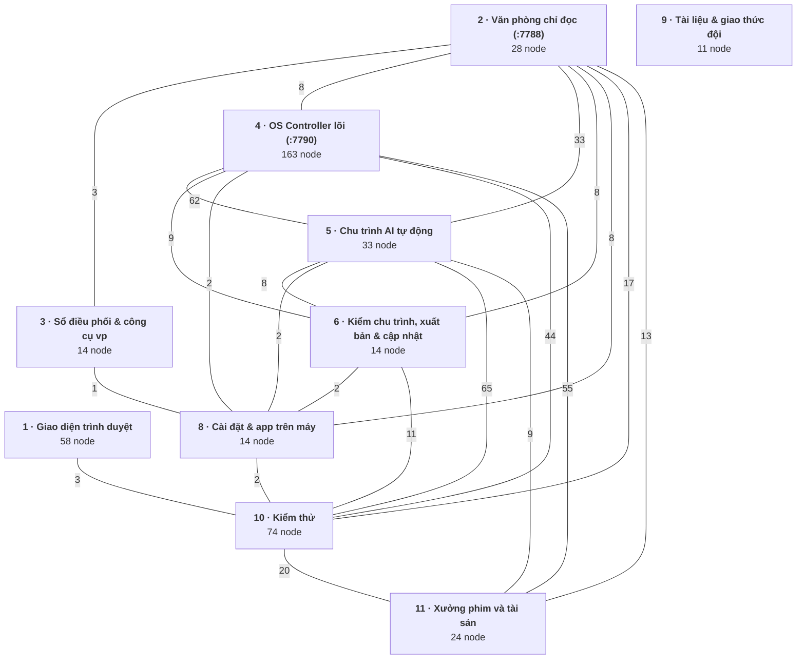

Số trên đường nối = số quan hệ giữa hai lớp (lời gọi, import, phụ thuộc, cấu hình, kích hoạt…), không tính `tested_by`, `documents`, `contains`. Hai tiến trình chạy trên máy CEO: **Văn phòng :7788** (`server.js`) và **OS Controller :7790** (`ctl/main.js`); trình duyệt chỉ nói chuyện với :7788, đường `/ctl/*` được `lib/ctlbridge.js` chuyển sang :7790 kèm token và chỉ khi yêu cầu đến từ chính máy; điện thoại đã ghép đi đường `/dkx/api/*` (`lib/dieu-khien-xa.js`) và chỉ gọi được các lệnh trong danh sách cho phép.

### 1 · Giao diện trình duyệt

Giao diện OS theo khu chức năng, chat và xin làm tại chỗ, quản lý code, PR, lịch, bộ não, kho phim, phim và tài sản; văn phòng 3D, điện thoại, PWA và các trang công cụ cũ.

- [`public/2d.html`](../public/2d.html) — Trang Đã chuyển · Văn phòng AI: hiển thị thông tin và thao tác của văn phòng trong trình duyệt.
- [`public/anime-studio.html`](../public/anime-studio.html) — Trang Naruto 3D Anime Studio 1:1 — Visual Inspector & Agent Prompt Generator: hiển thị thông tin và thao tác của văn phòng trong trình duyệt.
- [`public/app.js`](../public/app.js) — Đăng ký service worker và điều khiển cài PWA của văn phòng.
- [`public/board.html`](../public/board.html) — Trang Đã chuyển · Văn phòng AI: hiển thị thông tin và thao tác của văn phòng trong trình duyệt.
- [`public/cap-nhat.html`](../public/cap-nhat.html) — Kiểm bản phát hành và điều phối cập nhật app với kiểm sức khỏe và đường quay lại.
- [`public/characters.html`](../public/characters.html) — Trang Văn Phòng AI — Hồ Sơ Chi Tiết Chuẩn Manga Naruto Shippuden & 10 Vĩ Thú: hiển thị thông tin và thao tác của văn phòng trong trình duyệt.
- [`public/congviec.html`](../public/congviec.html) — Trang Đã chuyển · Văn phòng AI: hiển thị thông tin và thao tác của văn phòng trong trình duyệt.
- [`public/dien-thoai.html`](../public/dien-thoai.html) — Trang Điện thoại điều khiển: hiển thị thông tin và thao tác của văn phòng trong trình duyệt.
- [`public/dieu-khien.html`](../public/dieu-khien.html) — Trang Điều khiển văn phòng: hiển thị thông tin và thao tác của văn phòng trong trình duyệt.
- [`public/dieu-khien.webmanifest`](../public/dieu-khien.webmanifest) — Khai báo tên, biểu tượng, phạm vi và điểm mở của app PWA.
- [`public/dieukhien.html`](../public/dieukhien.html) — Trang Điều khiển máy: hiển thị thông tin và thao tác của văn phòng trong trình duyệt.
- [`public/hieusuat.html`](../public/hieusuat.html) — Trang Đánh giá nhân sự AI: hiển thị thông tin và thao tác của văn phòng trong trình duyệt.
- [`public/hopthu.html`](../public/hopthu.html) — Dựng trạng thái hòm thư từ sổ điều phối và nội dung liên quan.
- [`public/index.html`](../public/index.html) — Trang Văn phòng AI 3D: hiển thị thông tin và thao tác của văn phòng trong trình duyệt.
- [`public/ket-noi.html`](../public/ket-noi.html) — Liệt kê và thêm kết nối MCP cho các CLI theo chính sách đọc, làm việc và chặn gửi.
- [`public/manifest.webmanifest`](../public/manifest.webmanifest) — Khai báo tên, biểu tượng, phạm vi và điểm mở của app PWA.
- [`public/md.js`](../public/md.js) — Hiển thị Markdown với xử lý nội dung an toàn trong giao diện.
- [`public/noiquy.html`](../public/noiquy.html) — Trang Nội quy &amp; đội ngũ: hiển thị thông tin và thao tác của văn phòng trong trình duyệt.
- [`public/office-desk.css`](../public/office-desk.css) — Hiển thị bàn CEO, dữ liệu dự án, luồng, hạn mức và các thao tác điều phối.
- [`public/office-desk.js`](../public/office-desk.js) — Hiển thị bàn CEO, dữ liệu dự án, luồng, hạn mức và các thao tác điều phối. *Hàm chính:* `ctlBase`, `request`, `createDesk`.
- [`public/offline.html`](../public/offline.html) — Trang Văn phòng AI chưa chạy: hiển thị thông tin và thao tác của văn phòng trong trình duyệt.
- [`public/os.html`](../public/os.html) — Trang Thế Quân OS: hiển thị thông tin và thao tác của văn phòng trong trình duyệt.
- [`public/os/app.js`](../public/os/app.js) — Khởi tạo giao diện OS, đăng ký khu chức năng, nạp dự án và nối trạng thái trực tiếp. *Hàm chính:* `noiState`, `taiDuAn`, `moKhu`.
- [`public/os/base.css`](../public/os/base.css) — Giao diện base: nạp dữ liệu, hiển thị trạng thái và xử lý thao tác CEO.
- [`public/os/khu/bo-nao.js`](../public/os/khu/bo-nao.js) — Giao diện sổ kiến thức: nạp dữ liệu, hiển thị trạng thái và xử lý thao tác CEO. *Hàm chính:* `mo`.
- [`public/os/khu/code-du-an.js`](../public/os/khu/code-du-an.js) — Giao diện dự án code và tài liệu đính kèm: nạp dữ liệu, hiển thị trạng thái và xử lý thao tác CEO. *Hàm chính:* `mo`.
- [`public/os/khu/code-pr.js`](../public/os/khu/code-pr.js) — Giao diện nhánh, báo cáo và PR: nạp dữ liệu, hiển thị trạng thái và xử lý thao tác CEO. *Hàm chính:* `mo`.
- [`public/os/khu/cong-cu-cu.js`](../public/os/khu/cong-cu-cu.js) — Giao diện các trang công cụ cũ: nạp dữ liệu, hiển thị trạng thái và xử lý thao tác CEO. *Hàm chính:* `mo`.
- [`public/os/khu/cong-su.js`](../public/os/khu/cong-su.js) — Giao diện cộng sự và nhân vật AI: nạp dữ liệu, hiển thị trạng thái và xử lý thao tác CEO. *Hàm chính:* `mo`.
- [`public/os/khu/giao-viec.js`](../public/os/khu/giao-viec.js) — Giao diện giao việc cho đội hoặc một vai: nạp dữ liệu, hiển thị trạng thái và xử lý thao tác CEO. *Hàm chính:* `mo`.
- [`public/os/khu/luong.js`](../public/os/khu/luong.js) — Giao diện luồng AI và bàn giao: nạp dữ liệu, hiển thị trạng thái và xử lý thao tác CEO. *Hàm chính:* `mo`.
- [`public/os/khu/models.js`](../public/os/khu/models.js) — Giao diện model và mức suy nghĩ: nạp dữ liệu, hiển thị trạng thái và xử lý thao tác CEO. *Hàm chính:* `mo`.
- [`public/os/khu/phim-ban-dung.js`](../public/os/khu/phim-ban-dung.js) — Giao diện bàn dựng và cổng duyệt phim: nạp dữ liệu, hiển thị trạng thái và xử lý thao tác CEO. *Hàm chính:* `mo`.
- [`public/os/khu/phim-canh.js`](../public/os/khu/phim-canh.js) — Giao diện cảnh và take phim: nạp dữ liệu, hiển thị trạng thái và xử lý thao tác CEO. *Hàm chính:* `mo`.
- [`public/os/khu/phim-helper-ui.js`](../public/os/khu/phim-helper-ui.js) — Giao diện nhân vật, khung cảnh, giọng và mô hình: nạp dữ liệu, hiển thị trạng thái và xử lý thao tác CEO. *Hàm chính:* `veHelper`, `veCanh`, `veKhung`, `veGiong`, `veBlender`.
- [`public/os/khu/phim-kho.js`](../public/os/khu/phim-kho.js) — Giao diện kho phim theo loại: nạp dữ liệu, hiển thị trạng thái và xử lý thao tác CEO. *Hàm chính:* `mo`.
- [`public/os/khu/phim-xem-3d.js`](../public/os/khu/phim-xem-3d.js) — Giao diện xem mô hình GLB với Three.js: nạp dữ liệu, hiển thị trạng thái và xử lý thao tác CEO. *Hàm chính:* `disposeModel`, `xem3D`.
- [`public/os/khu/phim.js`](../public/os/khu/phim.js) — Giao diện xưởng phim và quá trình sản xuất: nạp dữ liệu, hiển thị trạng thái và xử lý thao tác CEO. *Hàm chính:* `moKhuPhim`, `mo`.
- [`public/os/khu/tin-nhan.js`](../public/os/khu/tin-nhan.js) — Giao diện chat, xin làm và kết quả kiểm web: nạp dữ liệu, hiển thị trạng thái và xử lý thao tác CEO. *Hàm chính:* `mo`.
- [`public/os/khu/tong-quan.js`](../public/os/khu/tong-quan.js) — Giao diện tổng quan hoạt động: nạp dữ liệu, hiển thị trạng thái và xử lý thao tác CEO. *Hàm chính:* `mo`.
- [`public/os/khu/viec.js`](../public/os/khu/viec.js) — Giao diện việc đang chạy: nạp dữ liệu, hiển thị trạng thái và xử lý thao tác CEO. *Hàm chính:* `mo`.
- [`public/os/ngan.js`](../public/os/ngan.js) — Giao diện ngăn thao tác tại chỗ: nạp dữ liệu, hiển thị trạng thái và xử lý thao tác CEO. *Hàm chính:* `taoNgan`.
- [`public/os/os.css`](../public/os/os.css) — Giao diện os: nạp dữ liệu, hiển thị trạng thái và xử lý thao tác CEO.
- [`public/os/tokens.css`](../public/os/tokens.css) — Giao diện tokens: nạp dữ liệu, hiển thị trạng thái và xử lý thao tác CEO.
- [`public/os/ui.js`](../public/os/ui.js) — Giao diện HTTP và thành phần giao diện dùng chung: nạp dữ liệu, hiển thị trạng thái và xử lý thao tác CEO. *Hàm chính:* `esc`, `cat`, `safeHttps`, `luc`, `usd`, `ctl`, `dangTai`, `rong` (+4).
- [`public/os/viec-chung.js`](../public/os/viec-chung.js) — Giao diện trạng thái và giải thích của luồng: nạp dữ liệu, hiển thị trạng thái và xử lý thao tác CEO. *Hàm chính:* `tenDuAn`, `tenVai`, `tenLenh`, `cauHoi`, `soLuot`, `lopLuong`, `danhSachGiaiThich`, `tomTatGiaiThich`.
- [`public/progress-view.js`](../public/progress-view.js) — Hiển thị tiến độ theo phase, lượt và trạng thái bàn giao.
- [`public/prototype.css`](../public/prototype.css) — Định nghĩa bố cục, màu sắc và quy tắc responsive cho giao diện văn phòng.
- [`public/prototype.html`](../public/prototype.html) — Trang Văn phòng AI · Tổng quan: hiển thị thông tin và thao tác của văn phòng trong trình duyệt.
- [`public/prototype.js`](../public/prototype.js) — Nối trang tổng quan cũ với dữ liệu workspace, hạn mức và luồng AI thật.
- [`public/skill.html`](../public/skill.html) — Kiểm nguồn skill đã ghim và đồng bộ vào thư mục skill của từng AI.
- [`public/sw.js`](../public/sw.js) — Service worker lưu trang hướng dẫn offline để app dùng được khi máy chủ tắt.
- [`public/thoitiet.js`](../public/thoitiet.js) — Chuyển thời gian và thời tiết trực tiếp thành trạng thái ánh sáng của cảnh văn phòng. *Hàm chính:* `vietnamHour`, `vietnamClock`, `describeWeather`, `toScene`, `fetchWeather`, `connectLive`.
- [`public/tinnhan.html`](../public/tinnhan.html) — Trang Tin nhắn: hiển thị thông tin và thao tác của văn phòng trong trình duyệt.
- [`public/tongquan.html`](../public/tongquan.html) — Ghép sổ việc và tiến độ với phiên AI để dựng tổng quan cho CEO.
- [`public/vanphong3d.html`](../public/vanphong3d.html) — Dựng cảnh Three.js của văn phòng, nhân vật, bàn làm việc và thao tác điều hướng.
- [`public/vanphong3d.js`](../public/vanphong3d.js) — Dựng cảnh Three.js của văn phòng, nhân vật, bàn làm việc và thao tác điều hướng. *Hàm chính:* `createOffice`.
- [`public/xuong-phim.html`](../public/xuong-phim.html) — Quản lý môi trường xưởng phim, công cụ FFmpeg và các thành phần tạo media.

### 2 · Văn phòng chỉ đọc (:7788)

Máy chủ HTTP/SSE server.js chỉ đọc nhật ký phiên Claude/Codex và sổ data/, dựng trạng thái mỗi giây, che khóa, chặn CSRF/DNS rebinding, phục vụ /state, /events, /tongquan, /hopthu, /docs, tài khoản AI, cầu /ctl (chỉ chính máy) và kênh /dkx cho điện thoại đã ghép (khóa xem + khóa thiết bị + danh sách lệnh).

- [`lib/app.js`](../lib/app.js) — Các tiện ích app cục bộ, nhận diện tiến trình, đường dẫn trình duyệt và biểu tượng. *Hàm chính:* `HOME`, `PID_FILE`, `LOG_FILE`, `officeHost`, `isUp`, `waitUp`, `browserCandidates`, `findBrowser` (+4).
- [`lib/config.js`](../lib/config.js) — Nạp cấu hình văn phòng và các giá trị mặc định cho cổng, thư mục và giới hạn. *Hàm chính:* `loadConfig`.
- [`lib/ctlbridge.js`](../lib/ctlbridge.js) — Chuyển tiếp HTTP và SSE giữa văn phòng với OS Controller cục bộ. *Hàm chính:* `call`, `proxy`, `streamGet`.
- [`lib/dieu-khien-xa.js`](../lib/dieu-khien-xa.js) — Ghép thiết bị, xác thực khóa và giới hạn lệnh điều khiển từ điện thoại. *Hàm chính:* `allowed`, `createDieuKhienXa`, `ipOf`, `handle`.
- [`lib/docs.js`](../lib/docs.js) — Đọc sổ nội quy và tài liệu, tách bảng/mục và theo dõi thay đổi chưa xem. *Hàm chính:* `table`, `sections`, `rulesWithAge`, `build`.
- [`lib/ghi-file.js`](../lib/ghi-file.js) — Ghi tệp nguyên tử và thử lại thao tác đổi tên khi Windows tạm khóa file. *Hàm chính:* `renameRetry`, `writeAtomic`.
- [`lib/guard.js`](../lib/guard.js) — Chặn yêu cầu ghi sai nguồn hoặc Host để chống CSRF và DNS rebinding. *Hàm chính:* `checkHost`, `checkWrite`, `readJson`, `isLocal`.
- [`lib/hopthu.js`](../lib/hopthu.js) — Dựng trạng thái hòm thư từ sổ điều phối và nội dung liên quan. *Hàm chính:* `state`, `build`.
- [`lib/keys.js`](../lib/keys.js) — Lưu và đọc khóa dịch vụ trong thư mục riêng của văn phòng, trả trạng thái đã che. *Hàm chính:* `file`, `has`, `save`.
- [`lib/mailbox.js`](../lib/mailbox.js) — Đọc sổ thư JSONL và tạo dữ liệu thư phục vụ giao diện văn phòng. *Hàm chính:* `slug`, `newId`, `fileOf`, `append`, `findVai`.
- [`lib/mask.js`](../lib/mask.js) — Che chuỗi có dạng khóa và thông tin nhạy cảm trước khi đưa vào log hoặc phản hồi. *Hàm chính:* `maskSecrets`, `cleanEnv`, `looksLikeKey`, `maskText`.
- [`lib/perf.js`](../lib/perf.js) — Tính hiệu suất, thời gian hoạt động và chi phí AI từ nhật ký phiên. *Hàm chính:* `seekTime`, `lineCodex`, `step`, `scanAll`, `compute`, `costDays`.
- [`lib/proc.js`](../lib/proc.js) — Dừng tiến trình cùng cây con theo hệ điều hành. *Hàm chính:* `alive`, `killTree`.
- [`lib/so-tin-nhan.js`](../lib/so-tin-nhan.js) — Lưu hội thoại lâu dài theo luồng vào JSONL, che nội dung nhạy cảm và đọc lại lịch sử. *Hàm chính:* `khoaTin`, `createSoTinNhan`.
- [`lib/tongquan.js`](../lib/tongquan.js) — Ghép sổ việc và tiến độ với phiên AI để dựng tổng quan cho CEO. *Hàm chính:* `matchAgent`, `tailLines`, `lastProgress`, `build`.
- [`server.js`](../server.js) — Máy chủ HTTP/SSE đọc phiên Claude và Codex, sổ điều phối và trạng thái mỗi giây; phục vụ giao diện, chat lâu dài và cầu điều khiển. *Hàm chính:* `mask`, `readLive`, `discover`, `agentFromLabel`, `pushEvent`, `parseClaude`, `parseCodex`, `pollAgent` (+7).
- Route `GET /api/running-tasks` ([`server.js:721`](../server.js#L721-L721)) — Đọc trạng thái hoặc dữ liệu /api/running-tasks qua GET /api/running-tasks.
- Route `POST /api/kill-task` ([`server.js:738`](../server.js#L738-L738)) — Thực hiện thao tác có kiểm điều kiện /api/kill-task qua POST /api/kill-task.
- Route `GET /api/accounts` ([`server.js:759`](../server.js#L759-L759)) — Đọc trạng thái hoặc dữ liệu /api/accounts qua GET /api/accounts.
- Route `POST /api/accounts/save` ([`server.js:769`](../server.js#L769-L769)) — Thực hiện thao tác có kiểm điều kiện /api/accounts/save qua POST /api/accounts/save.
- Route `GET /events` ([`server.js:783`](../server.js#L783-L783)) — Đọc trạng thái hoặc dữ liệu /events qua GET /events.
- Route `GET /state` ([`server.js:784`](../server.js#L784-L784)) — Đọc trạng thái hoặc dữ liệu /state qua GET /state.
- Route `GET /tin-nhan` ([`server.js:785`](../server.js#L785-L785)) — Đọc trạng thái hoặc dữ liệu /tin-nhan qua GET /tin-nhan.
- Route `GET /perf-events` ([`server.js:807`](../server.js#L807-L807)) — Đọc trạng thái hoặc dữ liệu /perf-events qua GET /perf-events.
- Route `GET /perf` ([`server.js:808`](../server.js#L808-L808)) — Đọc trạng thái hoặc dữ liệu /perf qua GET /perf.
- Route `GET /hopthu` ([`server.js:809`](../server.js#L809-L809)) — Đọc trạng thái hoặc dữ liệu /hopthu qua GET /hopthu.
- Route `GET /tongquan` ([`server.js:810`](../server.js#L810-L810)) — Đọc trạng thái hoặc dữ liệu /tongquan qua GET /tongquan.
- Route `GET /docs` ([`server.js:811`](../server.js#L811-L811)) — Đọc trạng thái hoặc dữ liệu /docs qua GET /docs.

### 3 · Sổ điều phối & công cụ vp

Công cụ agent ghi sổ data/ (hòm thư, lượt DEV, Cần anh, việc ưu tiên, gói việc, bài học) và khung mẫu mau/ mà setup chép sang.

- [`mau/BAI-HOC.md`](../mau/BAI-HOC.md) — Tài liệu Sổ Bài Học & Ngân Hàng Lỗi Dự Án Của Đội AI (Continuous Self-Learning Knowledge Base); Bảng bài học & Cái chặn tự động.
- [`mau/CAN-ANH.md`](../mau/CAN-ANH.md) — Tài liệu Cần anh; Bảng.
- [`mau/CAP-BAC.md`](../mau/CAP-BAC.md) — Tài liệu Cấp bậc và quyền.
- [`mau/DOAN-CHEN-VAO-AGENTS.md`](../mau/DOAN-CHEN-VAO-AGENTS.md) — Tài liệu Văn phòng ảo và sổ điều phối của đội.
- [`mau/DOI-NGU.md`](../mau/DOI-NGU.md) — Tài liệu Đội ngũ; Điều hành; Kỹ sư.
- [`mau/goi/vi-du/tien-do.md`](../mau/goi/vi-du/tien-do.md) — Tài liệu Tiến độ gói vi-du.
- [`mau/goi/vi-du/viec.json`](../mau/goi/vi-du/viec.json) — Cấu hình viec: goi, ten, viec.
- [`mau/NOI-QUY.md`](../mau/NOI-QUY.md) — Tài liệu Nội quy đội AI; 1.
- [`mau/QUYET-DINH.md`](../mau/QUYET-DINH.md) — Tài liệu Quyết định của chủ văn phòng; Lịch sử.
- [`mau/spec/VI-DU.md`](../mau/spec/VI-DU.md) — Tài liệu Ví dụ: SPEC tính năng đăng nhập; Mục tiêu; Phạm vi; Đạt khi.
- [`mau/TU-DIEN.md`](../mau/TU-DIEN.md) — Tài liệu Từ điển kỹ thuật.
- [`mau/UU-TIEN.json`](../mau/UU-TIEN.json) — Cấu hình UU-TIEN: cap_nhat, nguoi_ghi, luat, dang_lam, tam_dung.
- [`mau/VIEC-LAM-SAU.md`](../mau/VIEC-LAM-SAU.md) — Tài liệu Việc làm sau; Kỹ thuật; Sản phẩm.
- [`tools/vp.js`](../tools/vp.js) — Công cụ CLI ghi sổ thư, lượt DEV, Cần anh, gói việc, tiến độ và bài học của đội. *Hàm chính:* `cmdLuot`, `cmdCanAnh`, `cmdViec`, `cmdGoi`.

### 4 · OS Controller lõi (:7790)

Tiến trình ctl/main.js riêng chỉ nghe localhost cổng 7790, có token: định tuyến API /jobs, /projects, /fs/write, sổ tiến trình + chính sách lệnh, workspace, file, giám sát, kiểm toán và SQLite.

- [`ctl/audit.js`](../ctl/audit.js) — Ghi nhật ký kiểm toán chỉ thêm mới, che dữ liệu nhạy cảm trước khi lưu. *Hàm chính:* `createAudit`.
- [`ctl/db.js`](../ctl/db.js) — Khởi tạo SQLite WAL và migration thêm mới cho sổ tác vụ, luồng và kiểm toán. *Hàm chính:* `home`, `migrate`, `open`.
- [`ctl/files.js`](../ctl/files.js) — Đọc ghi file workspace với kiểm đường dẫn và dấu SHA-256 chống ghi đè thay đổi đồng thời. *Hàm chính:* `createFiles`.
- [`ctl/jobs.js`](../ctl/jobs.js) — Quản lý tiến trình, duyệt lệnh, timeout, log và dừng cả cây tác vụ. *Hàm chính:* `createJobs`.
- [`ctl/main.js`](../ctl/main.js) — Khởi tạo OS Controller tại localhost, nối SQLite, tác vụ, workspace và các API điều phối. *Hàm chính:* `createCtl`.
- [`ctl/monitor.js`](../ctl/monitor.js) — Theo dõi trạng thái máy và các tiến trình để cung cấp thông tin vận hành. *Hàm chính:* `createMonitor`.
- [`ctl/policy.js`](../ctl/policy.js) — Phân loại lệnh, kiểm danh sách cho phép và xác định chương trình chạy trên máy. *Hàm chính:* `classify`, `resolveProgram`.
- [`ctl/workspaces.js`](../ctl/workspaces.js) — Nạp workspace và agent.md, đọc tiến độ dự án và chặn đường dẫn nhạy cảm hoặc thoát repo. *Hàm chính:* `readProgress`, `isSensitive`, `createWorkspaces`.
- Route `GET /health` ([`ctl/main.js:245`](../ctl/main.js#L245-L247)) — Đọc trạng thái hoặc dữ liệu sức khỏe Controller qua GET /health.
- Route `GET /quotas` ([`ctl/main.js:246`](../ctl/main.js#L246-L247)) — Đọc trạng thái hoặc dữ liệu hạn mức AI qua GET /quotas.
- Route `POST /quotas/refresh` ([`ctl/main.js:247`](../ctl/main.js#L247-L247)) — Thực hiện thao tác có kiểm điều kiện hạn mức AI qua POST /quotas/refresh.
- Route `GET /monitor` ([`ctl/main.js:248`](../ctl/main.js#L248-L255)) — Đọc trạng thái hoặc dữ liệu tài nguyên và trạng thái qua GET /monitor.
- Route `GET /audit` ([`ctl/main.js:249`](../ctl/main.js#L249-L255)) — Đọc trạng thái hoặc dữ liệu kiểm toán qua GET /audit.
- Route `GET /jobs` ([`ctl/main.js:251`](../ctl/main.js#L251-L255)) — Đọc trạng thái hoặc dữ liệu tác vụ qua GET /jobs.
- Route `GET /jobs/:id` ([`ctl/main.js:256`](../ctl/main.js#L256-L256)) — Đọc trạng thái hoặc dữ liệu tác vụ qua GET /jobs/:id.
- Route `POST /jobs` ([`ctl/main.js:257`](../ctl/main.js#L257-L263)) — Thực hiện thao tác có kiểm điều kiện tác vụ qua POST /jobs.
- Route `POST /jobs/:id/approve` ([`ctl/main.js:264`](../ctl/main.js#L264-L271)) — Thực hiện thao tác có kiểm điều kiện tác vụ qua POST /jobs/:id/approve.
- Route `POST /jobs/:id/reject` ([`ctl/main.js:265`](../ctl/main.js#L265-L271)) — Thực hiện thao tác có kiểm điều kiện tác vụ qua POST /jobs/:id/reject.
- Route `POST /jobs/:id/kill` ([`ctl/main.js:266`](../ctl/main.js#L266-L271)) — Thực hiện thao tác có kiểm điều kiện tác vụ qua POST /jobs/:id/kill.
- Route `POST /kill-all` ([`ctl/main.js:272`](../ctl/main.js#L272-L279)) — Thực hiện thao tác có kiểm điều kiện /kill-all qua POST /kill-all.
- Route `GET /workspaces` ([`ctl/main.js:281`](../ctl/main.js#L281-L286)) — Đọc trạng thái hoặc dữ liệu workspace qua GET /workspaces.
- Route `GET /projects` ([`ctl/main.js:282`](../ctl/main.js#L282-L286)) — Đọc trạng thái hoặc dữ liệu dự án qua GET /projects.
- Route `GET /ideas` ([`ctl/main.js:284`](../ctl/main.js#L284-L286)) — Đọc trạng thái hoặc dữ liệu ý tưởng qua GET /ideas.
- Route `POST /du-an-moi/goi-y` ([`ctl/main.js:285`](../ctl/main.js#L285-L286)) — Thực hiện thao tác có kiểm điều kiện dự án mới qua POST /du-an-moi/goi-y.
- Route `POST /du-an-moi` ([`ctl/main.js:286`](../ctl/main.js#L286-L286)) — Thực hiện thao tác có kiểm điều kiện dự án mới qua POST /du-an-moi.
- Route `GET /du-an-moi/:id` ([`ctl/main.js:287`](../ctl/main.js#L287-L288)) — Đọc trạng thái hoặc dữ liệu dự án mới qua GET /du-an-moi/:id.
- Route `POST /ideas` ([`ctl/main.js:288`](../ctl/main.js#L288-L288)) — Thực hiện thao tác có kiểm điều kiện ý tưởng qua POST /ideas.
- Route `POST /ideas/:id/start` ([`ctl/main.js:289`](../ctl/main.js#L289-L300)) — Thực hiện thao tác có kiểm điều kiện ý tưởng qua POST /ideas/:id/start.
- Route `GET /ket-noi` ([`ctl/main.js:291`](../ctl/main.js#L291-L300)) — Đọc trạng thái hoặc dữ liệu kết nối MCP qua GET /ket-noi.
- Route `POST /ket-noi/add` ([`ctl/main.js:292`](../ctl/main.js#L292-L300)) — Thực hiện thao tác có kiểm điều kiện kết nối MCP qua POST /ket-noi/add.
- Route `POST /ket-noi/login` ([`ctl/main.js:293`](../ctl/main.js#L293-L300)) — Thực hiện thao tác có kiểm điều kiện kết nối MCP qua POST /ket-noi/login.
- Route `POST /ket-noi/phong` ([`ctl/main.js:294`](../ctl/main.js#L294-L300)) — Thực hiện thao tác có kiểm điều kiện kết nối MCP qua POST /ket-noi/phong.
- Route `POST /ket-noi/cai-may` ([`ctl/main.js:296`](../ctl/main.js#L296-L300)) — Thực hiện thao tác có kiểm điều kiện kết nối MCP qua POST /ket-noi/cai-may.
- Route `GET /phim/du-an` ([`ctl/main.js:299`](../ctl/main.js#L299-L300)) — Đọc trạng thái hoặc dữ liệu phim và tài sản qua GET /phim/du-an.
- Route `POST /phim/kho` ([`ctl/main.js:300`](../ctl/main.js#L300-L300)) — Thực hiện thao tác có kiểm điều kiện phim và tài sản qua POST /phim/kho.
- Route `POST /phim/kho/loai` ([`ctl/main.js:301`](../ctl/main.js#L301-L302)) — Thực hiện thao tác có kiểm điều kiện phim và tài sản qua POST /phim/kho/loai.
- Route `GET /phim/don-nhap` ([`ctl/main.js:302`](../ctl/main.js#L302-L302)) — Đọc trạng thái hoặc dữ liệu phim và tài sản qua GET /phim/don-nhap.
- Route `POST /phim/don-nhap` ([`ctl/main.js:303`](../ctl/main.js#L303-L305)) — Thực hiện thao tác có kiểm điều kiện phim và tài sản qua POST /phim/don-nhap.
- Route `GET /phim/tai-lieu` ([`ctl/main.js:304`](../ctl/main.js#L304-L305)) — Đọc trạng thái hoặc dữ liệu phim và tài sản qua GET /phim/tai-lieu.
- Route `POST /phim/tai-lieu` ([`ctl/main.js:305`](../ctl/main.js#L305-L305)) — Thực hiện thao tác có kiểm điều kiện phim và tài sản qua POST /phim/tai-lieu.
- Route `POST /phim/mo-hinh/duyet` ([`ctl/main.js:306`](../ctl/main.js#L306-L307)) — Thực hiện thao tác có kiểm điều kiện phim và tài sản qua POST /phim/mo-hinh/duyet.
- Route `POST /phim/blender` ([`ctl/main.js:307`](../ctl/main.js#L307-L307)) — Thực hiện thao tác có kiểm điều kiện phim và tài sản qua POST /phim/blender.
- Route `POST /phim/blender/dung` ([`ctl/main.js:308`](../ctl/main.js#L308-L312)) — Thực hiện thao tác có kiểm điều kiện phim và tài sản qua POST /phim/blender/dung.
- Route `POST /phim/blender/gan-canh` ([`ctl/main.js:313`](../ctl/main.js#L313-L328)) — Thực hiện thao tác có kiểm điều kiện phim và tài sản qua POST /phim/blender/gan-canh.
- Route `POST /phim/helper/nhan-vat` ([`ctl/main.js:329`](../ctl/main.js#L329-L343)) — Thực hiện thao tác có kiểm điều kiện phim và tài sản qua POST /phim/helper/nhan-vat.
- Route `POST /phim/helper/nguon` ([`ctl/main.js:330`](../ctl/main.js#L330-L343)) — Thực hiện thao tác có kiểm điều kiện phim và tài sản qua POST /phim/helper/nguon.
- Route `POST /phim/helper/goc` ([`ctl/main.js:331`](../ctl/main.js#L331-L343)) — Thực hiện thao tác có kiểm điều kiện phim và tài sản qua POST /phim/helper/goc.
- Route `POST /phim/helper/khoa` ([`ctl/main.js:332`](../ctl/main.js#L332-L343)) — Thực hiện thao tác có kiểm điều kiện phim và tài sản qua POST /phim/helper/khoa.
- Route `POST /phim/helper/ap-dung` ([`ctl/main.js:333`](../ctl/main.js#L333-L343)) — Thực hiện thao tác có kiểm điều kiện phim và tài sản qua POST /phim/helper/ap-dung.
- Route `POST /phim/helper/khung` ([`ctl/main.js:334`](../ctl/main.js#L334-L343)) — Thực hiện thao tác có kiểm điều kiện phim và tài sản qua POST /phim/helper/khung.
- Route `POST /phim/helper/tong-mau` ([`ctl/main.js:335`](../ctl/main.js#L335-L343)) — Thực hiện thao tác có kiểm điều kiện phim và tài sản qua POST /phim/helper/tong-mau.
- Route `POST /phim/helper/canh` ([`ctl/main.js:336`](../ctl/main.js#L336-L343)) — Thực hiện thao tác có kiểm điều kiện phim và tài sản qua POST /phim/helper/canh.
- Route `POST /phim/helper/giong-thu` ([`ctl/main.js:337`](../ctl/main.js#L337-L343)) — Thực hiện thao tác có kiểm điều kiện phim và tài sản qua POST /phim/helper/giong-thu.
- Route `POST /phim/helper/goi` ([`ctl/main.js:338`](../ctl/main.js#L338-L343)) — Thực hiện thao tác có kiểm điều kiện phim và tài sản qua POST /phim/helper/goi.
- Route `POST /phim/helper/tach-khung` ([`ctl/main.js:339`](../ctl/main.js#L339-L343)) — Thực hiện thao tác có kiểm điều kiện phim và tài sản qua POST /phim/helper/tach-khung.
- Route `GET /phim/helper/goc` ([`ctl/main.js:344`](../ctl/main.js#L344-L348)) — Đọc trạng thái hoặc dữ liệu phim và tài sản qua GET /phim/helper/goc.
- Route `POST /phim/helper/prompt` ([`ctl/main.js:345`](../ctl/main.js#L345-L348)) — Thực hiện thao tác có kiểm điều kiện phim và tài sản qua POST /phim/helper/prompt.
- Route `POST /phim/helper/goi-anh` ([`ctl/main.js:349`](../ctl/main.js#L349-L363)) — Thực hiện thao tác có kiểm điều kiện phim và tài sản qua POST /phim/helper/goi-anh.
- Route `POST /phim/take-nhap` ([`ctl/main.js:364`](../ctl/main.js#L364-L381)) — Thực hiện thao tác có kiểm điều kiện phim và tài sản qua POST /phim/take-nhap.
- Route `POST /phim/capcut` ([`ctl/main.js:382`](../ctl/main.js#L382-L391)) — Thực hiện thao tác có kiểm điều kiện phim và tài sản qua POST /phim/capcut.
- Route `GET /phim` ([`ctl/main.js:392`](../ctl/main.js#L392-L393)) — Đọc trạng thái hoặc dữ liệu phim và tài sản qua GET /phim.
- Route `GET /phim/mau` ([`ctl/main.js:394`](../ctl/main.js#L394-L395)) — Đọc trạng thái hoặc dữ liệu phim và tài sản qua GET /phim/mau.
- Route `POST /phim/mau/:ma/phan-tich` ([`ctl/main.js:395`](../ctl/main.js#L395-L395)) — Thực hiện thao tác có kiểm điều kiện phim và tài sản qua POST /phim/mau/:ma/phan-tich.
- Route `POST /phim/mau/:ma/tao-phim` ([`ctl/main.js:396`](../ctl/main.js#L396-L396)) — Thực hiện thao tác có kiểm điều kiện phim và tài sản qua POST /phim/mau/:ma/tao-phim.
- Route `POST /phim/mau/:ma/xoa` ([`ctl/main.js:397`](../ctl/main.js#L397-L398)) — Thực hiện thao tác có kiểm điều kiện phim và tài sản qua POST /phim/mau/:ma/xoa.
- Route `POST /phim/co-van` ([`ctl/main.js:398`](../ctl/main.js#L398-L398)) — Thực hiện thao tác có kiểm điều kiện phim và tài sản qua POST /phim/co-van.
- Route `GET /phim/luong` ([`ctl/main.js:399`](../ctl/main.js#L399-L400)) — Đọc trạng thái hoặc dữ liệu phim và tài sản qua GET /phim/luong.
- Route `POST /phim/luong` ([`ctl/main.js:400`](../ctl/main.js#L400-L400)) — Thực hiện thao tác có kiểm điều kiện phim và tài sản qua POST /phim/luong.
- Route `POST /phim/luong/dung` ([`ctl/main.js:401`](../ctl/main.js#L401-L411)) — Thực hiện thao tác có kiểm điều kiện phim và tài sản qua POST /phim/luong/dung.
- Route `POST /phim/uoc-tinh` ([`ctl/main.js:412`](../ctl/main.js#L412-L413)) — Thực hiện thao tác có kiểm điều kiện phim và tài sản qua POST /phim/uoc-tinh.
- Route `POST /phim/quay` ([`ctl/main.js:413`](../ctl/main.js#L413-L413)) — Thực hiện thao tác có kiểm điều kiện phim và tài sản qua POST /phim/quay.
- Route `POST /phim/ceo` ([`ctl/main.js:414`](../ctl/main.js#L414-L415)) — Thực hiện thao tác có kiểm điều kiện phim và tài sản qua POST /phim/ceo.
- Route `POST /phim/dung` ([`ctl/main.js:415`](../ctl/main.js#L415-L415)) — Thực hiện thao tác có kiểm điều kiện phim và tài sản qua POST /phim/dung.
- Route `POST /phim/cong` ([`ctl/main.js:416`](../ctl/main.js#L416-L422)) — Thực hiện thao tác có kiểm điều kiện phim và tài sản qua POST /phim/cong.
- Route `POST /phim/quay-lai` ([`ctl/main.js:423`](../ctl/main.js#L423-L426)) — Thực hiện thao tác có kiểm điều kiện phim và tài sản qua POST /phim/quay-lai.
- Route `GET /flow` ([`ctl/main.js:424`](../ctl/main.js#L424-L426)) — Đọc trạng thái hoặc dữ liệu /flow qua GET /flow.
- Route `POST /flow/:id/mo` ([`ctl/main.js:425`](../ctl/main.js#L425-L426)) — Thực hiện thao tác có kiểm điều kiện /flow/:id/mo qua POST /flow/:id/mo.
- Route `POST /flow/nhip` ([`ctl/main.js:426`](../ctl/main.js#L426-L426)) — Thực hiện thao tác có kiểm điều kiện /flow/nhip qua POST /flow/nhip.
- Route `GET /xuong-phim` ([`ctl/main.js:427`](../ctl/main.js#L427-L428)) — Đọc trạng thái hoặc dữ liệu /xuong-phim qua GET /xuong-phim.
- Route `POST /xuong-phim/cai` ([`ctl/main.js:428`](../ctl/main.js#L428-L428)) — Thực hiện thao tác có kiểm điều kiện /xuong-phim/cai qua POST /xuong-phim/cai.
- Route `GET /dieu-phoi` ([`ctl/main.js:429`](../ctl/main.js#L429-L432)) — Đọc trạng thái hoặc dữ liệu /dieu-phoi qua GET /dieu-phoi.
- Route `GET /agy-tai-khoan` ([`ctl/main.js:430`](../ctl/main.js#L430-L432)) — Đọc trạng thái hoặc dữ liệu /agy-tai-khoan qua GET /agy-tai-khoan.
- Route `POST /agy-tai-khoan/cat` ([`ctl/main.js:432`](../ctl/main.js#L432-L432)) — Thực hiện thao tác có kiểm điều kiện /agy-tai-khoan/cat qua POST /agy-tai-khoan/cat.
- Route `POST /agy-tai-khoan/sua` ([`ctl/main.js:433`](../ctl/main.js#L433-L434)) — Thực hiện thao tác có kiểm điều kiện /agy-tai-khoan/sua qua POST /agy-tai-khoan/sua.
- Route `POST /agy-tai-khoan/doc-nghi` ([`ctl/main.js:434`](../ctl/main.js#L434-L434)) — Thực hiện thao tác có kiểm điều kiện /agy-tai-khoan/doc-nghi qua POST /agy-tai-khoan/doc-nghi.
- Route `POST /agy-tai-khoan/:id/chuyen` ([`ctl/main.js:435`](../ctl/main.js#L435-L435)) — Thực hiện thao tác có kiểm điều kiện /agy-tai-khoan/:id/chuyen qua POST /agy-tai-khoan/:id/chuyen.
- Route `POST /agy-tai-khoan/:id/xoa` ([`ctl/main.js:436`](../ctl/main.js#L436-L441)) — Thực hiện thao tác có kiểm điều kiện /agy-tai-khoan/:id/xoa qua POST /agy-tai-khoan/:id/xoa.
- Route `GET /codex-tai-khoan` ([`ctl/main.js:438`](../ctl/main.js#L438-L441)) — Đọc trạng thái hoặc dữ liệu /codex-tai-khoan qua GET /codex-tai-khoan.
- Route `POST /codex-tai-khoan/them` ([`ctl/main.js:439`](../ctl/main.js#L439-L441)) — Thực hiện thao tác có kiểm điều kiện /codex-tai-khoan/them qua POST /codex-tai-khoan/them.
- Route `POST /codex-tai-khoan/sua` ([`ctl/main.js:440`](../ctl/main.js#L440-L441)) — Thực hiện thao tác có kiểm điều kiện /codex-tai-khoan/sua qua POST /codex-tai-khoan/sua.
- Route `POST /codex-tai-khoan/doc` ([`ctl/main.js:441`](../ctl/main.js#L441-L441)) — Thực hiện thao tác có kiểm điều kiện /codex-tai-khoan/doc qua POST /codex-tai-khoan/doc.
- Route `POST /codex-tai-khoan/:id/dang-nhap` ([`ctl/main.js:442`](../ctl/main.js#L442-L443)) — Thực hiện thao tác có kiểm điều kiện /codex-tai-khoan/:id/dang-nhap qua POST /codex-tai-khoan/:id/dang-nhap.
- Route `POST /codex-tai-khoan/:id/chuyen` ([`ctl/main.js:443`](../ctl/main.js#L443-L443)) — Thực hiện thao tác có kiểm điều kiện /codex-tai-khoan/:id/chuyen qua POST /codex-tai-khoan/:id/chuyen.
- Route `POST /codex-tai-khoan/:id/bo` ([`ctl/main.js:444`](../ctl/main.js#L444-L447)) — Thực hiện thao tác có kiểm điều kiện /codex-tai-khoan/:id/bo qua POST /codex-tai-khoan/:id/bo.
- Route `GET /dieu-phoi/models` ([`ctl/main.js:445`](../ctl/main.js#L445-L447)) — Đọc trạng thái hoặc dữ liệu /dieu-phoi/models qua GET /dieu-phoi/models.
- Route `GET /skill` ([`ctl/main.js:447`](../ctl/main.js#L447-L447)) — Đọc trạng thái hoặc dữ liệu skill của đội qua GET /skill.
- Route `POST /skill/de-xuat` ([`ctl/main.js:449`](../ctl/main.js#L449-L449)) — Thực hiện thao tác có kiểm điều kiện skill của đội qua POST /skill/de-xuat.
- Route `POST /skill/de-xuat/:id/duyet` ([`ctl/main.js:450`](../ctl/main.js#L450-L453)) — Thực hiện thao tác có kiểm điều kiện skill của đội qua POST /skill/de-xuat/:id/duyet.
- Route `POST /skill/de-xuat/:id/tham-khao` ([`ctl/main.js:451`](../ctl/main.js#L451-L453)) — Thực hiện thao tác có kiểm điều kiện skill của đội qua POST /skill/de-xuat/:id/tham-khao.
- Route `POST /skill/de-xuat/:id/tu-choi` ([`ctl/main.js:452`](../ctl/main.js#L452-L453)) — Thực hiện thao tác có kiểm điều kiện skill của đội qua POST /skill/de-xuat/:id/tu-choi.
- Route `POST /skill/de-xuat/:id/phan-tich-lai` ([`ctl/main.js:453`](../ctl/main.js#L453-L453)) — Thực hiện thao tác có kiểm điều kiện skill của đội qua POST /skill/de-xuat/:id/phan-tich-lai.
- Route `POST /dieu-phoi` ([`ctl/main.js:454`](../ctl/main.js#L454-L456)) — Thực hiện thao tác có kiểm điều kiện /dieu-phoi qua POST /dieu-phoi.
- Route `GET /cap-nhat` ([`ctl/main.js:455`](../ctl/main.js#L455-L456)) — Đọc trạng thái hoặc dữ liệu /cap-nhat qua GET /cap-nhat.
- Route `POST /cap-nhat` ([`ctl/main.js:456`](../ctl/main.js#L456-L456)) — Thực hiện thao tác có kiểm điều kiện /cap-nhat qua POST /cap-nhat.
- Route `GET /nhat-ky` ([`ctl/main.js:457`](../ctl/main.js#L457-L459)) — Đọc trạng thái hoặc dữ liệu /nhat-ky qua GET /nhat-ky.
- Route `GET /publish` ([`ctl/main.js:458`](../ctl/main.js#L458-L459)) — Đọc trạng thái hoặc dữ liệu phát hành dự án qua GET /publish.
- Route `POST /publish/prepare` ([`ctl/main.js:459`](../ctl/main.js#L459-L459)) — Thực hiện thao tác có kiểm điều kiện phát hành dự án qua POST /publish/prepare.
- Route `POST /publish/:id/release` ([`ctl/main.js:460`](../ctl/main.js#L460-L462)) — Thực hiện thao tác có kiểm điều kiện phát hành dự án qua POST /publish/:id/release.
- Route `GET /chat` ([`ctl/main.js:461`](../ctl/main.js#L461-L462)) — Đọc trạng thái hoặc dữ liệu hội thoại qua GET /chat.
- Route `POST /chat` ([`ctl/main.js:462`](../ctl/main.js#L462-L462)) — Thực hiện thao tác có kiểm điều kiện hội thoại qua POST /chat.
- Route `POST /chat/duyet` ([`ctl/main.js:463`](../ctl/main.js#L463-L463)) — Thực hiện thao tác có kiểm điều kiện hội thoại qua POST /chat/duyet.
- Route `POST /chat/file` ([`ctl/main.js:464`](../ctl/main.js#L464-L477)) — Thực hiện thao tác có kiểm điều kiện hội thoại qua POST /chat/file.
- Route `POST /chat/tu-choi` ([`ctl/main.js:465`](../ctl/main.js#L465-L477)) — Thực hiện thao tác có kiểm điều kiện hội thoại qua POST /chat/tu-choi.
- Route `POST /chat/clear` ([`ctl/main.js:466`](../ctl/main.js#L466-L477)) — Thực hiện thao tác có kiểm điều kiện hội thoại qua POST /chat/clear.
- Route `GET /bo-nao` ([`ctl/main.js:467`](../ctl/main.js#L467-L477)) — Đọc trạng thái hoặc dữ liệu sổ kiến thức qua GET /bo-nao.
- Route `GET /bo-nao/doc` ([`ctl/main.js:468`](../ctl/main.js#L468-L477)) — Đọc trạng thái hoặc dữ liệu sổ kiến thức qua GET /bo-nao/doc.
- Route `POST /bo-nao/ghi` ([`ctl/main.js:469`](../ctl/main.js#L469-L477)) — Thực hiện thao tác có kiểm điều kiện sổ kiến thức qua POST /bo-nao/ghi.
- Route `POST /bo-nao/xoa` ([`ctl/main.js:470`](../ctl/main.js#L470-L477)) — Thực hiện thao tác có kiểm điều kiện sổ kiến thức qua POST /bo-nao/xoa.
- Route `GET /bo-nao/lich-su` ([`ctl/main.js:471`](../ctl/main.js#L471-L477)) — Đọc trạng thái hoặc dữ liệu sổ kiến thức qua GET /bo-nao/lich-su.
- Route `GET /bo-nao/ban` ([`ctl/main.js:472`](../ctl/main.js#L472-L477)) — Đọc trạng thái hoặc dữ liệu sổ kiến thức qua GET /bo-nao/ban.
- Route `POST /bo-nao/hoan-tac` ([`ctl/main.js:473`](../ctl/main.js#L473-L477)) — Thực hiện thao tác có kiểm điều kiện sổ kiến thức qua POST /bo-nao/hoan-tac.
- Route `GET /quyen` ([`ctl/main.js:476`](../ctl/main.js#L476-L477)) — Đọc trạng thái hoặc dữ liệu /quyen qua GET /quyen.
- Route `POST /quyen` ([`ctl/main.js:477`](../ctl/main.js#L477-L477)) — Thực hiện thao tác có kiểm điều kiện /quyen qua POST /quyen.
- Route `GET /lich-chay` ([`ctl/main.js:478`](../ctl/main.js#L478-L486)) — Đọc trạng thái hoặc dữ liệu lịch giao việc qua GET /lich-chay.
- Route `POST /lich-chay` ([`ctl/main.js:479`](../ctl/main.js#L479-L486)) — Thực hiện thao tác có kiểm điều kiện lịch giao việc qua POST /lich-chay.
- Route `POST /lich-chay/:id/bat` ([`ctl/main.js:480`](../ctl/main.js#L480-L486)) — Thực hiện thao tác có kiểm điều kiện lịch giao việc qua POST /lich-chay/:id/bat.
- Route `POST /lich-chay/:id/xoa` ([`ctl/main.js:481`](../ctl/main.js#L481-L486)) — Thực hiện thao tác có kiểm điều kiện lịch giao việc qua POST /lich-chay/:id/xoa.
- Route `POST /lich-chay/:id/chay-ngay` ([`ctl/main.js:482`](../ctl/main.js#L482-L486)) — Thực hiện thao tác có kiểm điều kiện lịch giao việc qua POST /lich-chay/:id/chay-ngay.
- Route `GET /scan` ([`ctl/main.js:483`](../ctl/main.js#L483-L486)) — Đọc trạng thái hoặc dữ liệu rà soát đầu vào qua GET /scan.
- Route `POST /scan/resume` ([`ctl/main.js:487`](../ctl/main.js#L487-L491)) — Thực hiện thao tác có kiểm điều kiện rà soát đầu vào qua POST /scan/resume.
- Route `POST /scan/approve` ([`ctl/main.js:492`](../ctl/main.js#L492-L492)) — Thực hiện thao tác có kiểm điều kiện rà soát đầu vào qua POST /scan/approve.
- Route `GET /github/repos` ([`ctl/main.js:493`](../ctl/main.js#L493-L496)) — Đọc trạng thái hoặc dữ liệu repo GitHub qua GET /github/repos.
- Route `GET /github/pulls` ([`ctl/main.js:494`](../ctl/main.js#L494-L496)) — Đọc trạng thái hoặc dữ liệu repo GitHub qua GET /github/pulls.
- Route `GET /github/pulls/:number` ([`ctl/main.js:495`](../ctl/main.js#L495-L496)) — Đọc trạng thái hoặc dữ liệu repo GitHub qua GET /github/pulls/:number.
- Route `POST /github/open` ([`ctl/main.js:496`](../ctl/main.js#L496-L496)) — Thực hiện thao tác có kiểm điều kiện repo GitHub qua POST /github/open.
- Route `GET /github/operations/:id` ([`ctl/main.js:497`](../ctl/main.js#L497-L498)) — Đọc trạng thái hoặc dữ liệu repo GitHub qua GET /github/operations/:id.
- Route `POST /workspaces` ([`ctl/main.js:498`](../ctl/main.js#L498-L498)) — Thực hiện thao tác có kiểm điều kiện workspace qua POST /workspaces.
- Route `GET /workspaces/overview` ([`ctl/main.js:500`](../ctl/main.js#L500-L508)) — Đọc trạng thái hoặc dữ liệu workspace qua GET /workspaces/overview.
- Route `POST /bo-kiem` ([`ctl/main.js:509`](../ctl/main.js#L509-L510)) — Thực hiện thao tác có kiểm điều kiện /bo-kiem qua POST /bo-kiem.
- Route `POST /workspaces/remove` ([`ctl/main.js:510`](../ctl/main.js#L510-L510)) — Thực hiện thao tác có kiểm điều kiện workspace qua POST /workspaces/remove.
- Route `POST /workspaces/switch` ([`ctl/main.js:511`](../ctl/main.js#L511-L514)) — Thực hiện thao tác có kiểm điều kiện workspace qua POST /workspaces/switch.
- Route `GET /fs/list` ([`ctl/main.js:516`](../ctl/main.js#L516-L525)) — Đọc trạng thái hoặc dữ liệu tệp workspace qua GET /fs/list.
- Route `GET /fs/read` ([`ctl/main.js:517`](../ctl/main.js#L517-L525)) — Đọc trạng thái hoặc dữ liệu tệp workspace qua GET /fs/read.
- Route `POST /fs/write` ([`ctl/main.js:518`](../ctl/main.js#L518-L525)) — Thực hiện thao tác có kiểm điều kiện tệp workspace qua POST /fs/write.
- Route `GET /ai/status` ([`ctl/main.js:520`](../ctl/main.js#L520-L525)) — Đọc trạng thái hoặc dữ liệu lượt AI qua GET /ai/status.
- Route `POST /ai/run` ([`ctl/main.js:521`](../ctl/main.js#L521-L525)) — Thực hiện thao tác có kiểm điều kiện lượt AI qua POST /ai/run.
- Route `GET /autopilot` ([`ctl/main.js:526`](../ctl/main.js#L526-L528)) — Đọc trạng thái hoặc dữ liệu luồng AI qua GET /autopilot.
- Route `GET /autopilot/:id` ([`ctl/main.js:527`](../ctl/main.js#L527-L528)) — Đọc trạng thái hoặc dữ liệu luồng AI qua GET /autopilot/:id.
- Route `POST /autopilot` ([`ctl/main.js:528`](../ctl/main.js#L528-L528)) — Thực hiện thao tác có kiểm điều kiện luồng AI qua POST /autopilot.
- Route `POST /autopilot/:id/stop` ([`ctl/main.js:529`](../ctl/main.js#L529-L532)) — Thực hiện thao tác có kiểm điều kiện luồng AI qua POST /autopilot/:id/stop.
- Route `POST /autopilot/:id/answer` ([`ctl/main.js:530`](../ctl/main.js#L530-L532)) — Thực hiện thao tác có kiểm điều kiện luồng AI qua POST /autopilot/:id/answer.
- Route `POST /autopilot/:id/resume` ([`ctl/main.js:531`](../ctl/main.js#L531-L532)) — Thực hiện thao tác có kiểm điều kiện luồng AI qua POST /autopilot/:id/resume.
- Route `POST /autopilot/:id/web-prompt` ([`ctl/main.js:532`](../ctl/main.js#L532-L532)) — Thực hiện thao tác có kiểm điều kiện luồng AI qua POST /autopilot/:id/web-prompt.
- Route `POST /autopilot/:id/web-result` ([`ctl/main.js:534`](../ctl/main.js#L534-L534)) — Thực hiện thao tác có kiểm điều kiện luồng AI qua POST /autopilot/:id/web-result.
- Route `GET /autopilot/:id/steps/:n/diff` ([`ctl/main.js:536`](../ctl/main.js#L536-L542)) — Đọc trạng thái hoặc dữ liệu luồng AI qua GET /autopilot/:id/steps/:n/diff.
- Route `POST /autopilot/:id/push` ([`ctl/main.js:537`](../ctl/main.js#L537-L542)) — Thực hiện thao tác có kiểm điều kiện luồng AI qua POST /autopilot/:id/push.
- Route `POST /autopilot/:id/approve` ([`ctl/main.js:538`](../ctl/main.js#L538-L542)) — Thực hiện thao tác có kiểm điều kiện luồng AI qua POST /autopilot/:id/approve.
- Route `POST /autopilot/:id/reject` ([`ctl/main.js:539`](../ctl/main.js#L539-L542)) — Thực hiện thao tác có kiểm điều kiện luồng AI qua POST /autopilot/:id/reject.
- Route `GET /handoffs` ([`ctl/main.js:541`](../ctl/main.js#L541-L542)) — Đọc trạng thái hoặc dữ liệu /handoffs qua GET /handoffs.
- Route `GET /handoffs/:id` ([`ctl/main.js:542`](../ctl/main.js#L542-L542)) — Đọc trạng thái hoặc dữ liệu /handoffs/:id qua GET /handoffs/:id.
- Route `POST /handoffs/:id/approve` ([`ctl/main.js:543`](../ctl/main.js#L543-L588)) — Thực hiện thao tác có kiểm điều kiện /handoffs/:id/approve qua POST /handoffs/:id/approve.
- Route `POST /handoffs/:id/reject` ([`ctl/main.js:544`](../ctl/main.js#L544-L589)) — Thực hiện thao tác có kiểm điều kiện /handoffs/:id/reject qua POST /handoffs/:id/reject.
- Route `POST /handoffs/:id/answer` ([`ctl/main.js:545`](../ctl/main.js#L545-L590)) — Thực hiện thao tác có kiểm điều kiện /handoffs/:id/answer qua POST /handoffs/:id/answer.

### 5 · Chu trình AI tự động

Ý tưởng / dự án mới → luồng tự động (/autopilot) → lượt AI theo NEXT_OWNER → bàn giao → Claude kiểm duyệt → CEO duyệt và đẩy nhánh; kèm hợp đồng giao tiếp và chạy song song Astra + Kakashi, điều phối model và mục lục từ bản đồ, tài khoản Antigravity, hạn mức, bộ skill và duyệt skill từ GitHub, kết nối MCP theo phòng và MCP chạy trên máy (Chrome DevTools, tra cứu Gemini), rà file, chat, nhật ký, t…

- [`ctl/agy-dang-nhap.ps1`](../ctl/agy-dang-nhap.ps1) — Cất / nạp đăng nhập Antigravity CLI trong Windows Credential Manager (CEO duyệt 16/11/2026: hai tài khoản family + Pro).
- [`ctl/agy-tai-khoan.js`](../ctl/agy-tai-khoan.js) — Quản lý tài khoản Antigravity, hạn mức và chuyển tài khoản khi không có tiến trình đang chạy. *Hàm chính:* `anEmail`, `credWin`, `agyDangChayTu`, `laNhomRieng`, `nhomCua`, `conLai`, `createAgyTaiKhoan`.
- [`ctl/autopilot.js`](../ctl/autopilot.js) — Điều phối luồng AI theo NEXT_OWNER, chờ hạn mức và câu trả lời CEO, ngắt mạch khi lỗi và chờ duyệt báo cáo. *Hàm chính:* `waitFromMessage`, `responseText`, `createAutopilot`.
- [`ctl/bo-nao.js`](../ctl/bo-nao.js) — Quản lý sổ kiến thức của văn phòng với lịch sử Git riêng và thao tác ghi an toàn. *Hàm chính:* `ghiAnToan`, `createBoNao`.
- [`ctl/chat.js`](../ctl/chat.js) — Chat hai bước: đọc repo và web; AI xin làm, qua cổng kiểm web, chờ CEO duyệt rồi kiểm phạm vi file. *Hàm chính:* `promptFor`, `parseReply`, `loiDeHieu`, `createChat`.
- [`ctl/chot-file.js`](../ctl/chot-file.js) — Chụp cây Git trước và sau lượt chat, phát hiện sửa ngoài phạm vi và khôi phục thay đổi chưa được duyệt. *Hàm chính:* `camHan`, `laGit`, `chuanDuong`, `khop`, `dauBoQua`, `chup`, `traVe`, `kiemSau` (+1).
- [`ctl/chrome-devtools.js`](../ctl/chrome-devtools.js) — Cấu hình Chrome DevTools MCP cục bộ theo phiên bản đã ghim và quyền dùng từng phòng. *Hàm chính:* `thuMuc`, `trangThai`, `lenh`, `cai`.
- [`ctl/codex-tai-khoan.js`](../ctl/codex-tai-khoan.js) — Quản lý nhiều tài khoản GPT với CODEX_HOME riêng, chọn tài khoản và theo dõi hạn mức. *Hàm chính:* `conLaiCua`, `createCodexTaiKhoan`.
- [`ctl/cong-web.js`](../ctl/cong-web.js) — Gom nguồn web AI đã đọc, tải lại qua chặn URL và DNS nội bộ, quét cục bộ rồi nhờ Claude chỉ đọc chấm rủi ro. *Hàm chính:* `quet`, `phanTichNhatKy`, `boChuKy`, `gomUrl`, `coWeb`, `laIpNoiBo`, `lookupAnToan`, `layHttp` (+1).
- [`ctl/dieu-phoi.js`](../ctl/dieu-phoi.js) — Chọn model và mức suy nghĩ theo vai, độ khó, blocker và hạn mức của lượt AI. *Hàm chính:* `kindOf`, `remaining`, `classify`, `createDieuPhoi`.
- [`ctl/du-an-moi.js`](../ctl/du-an-moi.js) — Gợi ý tên rồi tạo repo theo CEO duyệt, nạp khung dự án và lưu tài liệu đính kèm chỉ trên máy. *Hàm chính:* `slug`, `chuanTen`, `goiYQuyTac`, `goiYClaude`, `datKhungPhim`, `luuKhungPhim`, `kiemDinhKem`, `luuDinhKem` (+1).
- [`ctl/handoff.js`](../ctl/handoff.js) — Đọc khóa lượt và kiểm JSON bàn giao, câu hỏi CEO và yêu cầu giải thích trong log AI. *Hàm chính:* `readTurn`, `setTurn`, `checkHandoff`, `checkList`, `checkExplain`, `checkAsk`, `findHandoff`.
- [`ctl/ideas.js`](../ctl/ideas.js) — Lưu ý tưởng CEO ngoài repo và mở luồng từ bước đặc tả theo khóa lượt. *Hàm chính:* `createIdeas`.
- [`ctl/ket-noi-danh-muc.js`](../ctl/ket-noi-danh-muc.js) — Danh mục MCP dùng chung, phân nhóm kết nối và đánh dấu công cụ gửi dữ liệu cần chặn.
- [`ctl/ket-noi.js`](../ctl/ket-noi.js) — Liệt kê và thêm kết nối MCP cho các CLI theo chính sách đọc, làm việc và chặn gửi. *Hàm chính:* `parseClaude`, `parseCodex`, `parseAgy`, `createConnectors`.
- [`ctl/lich-chay.js`](../ctl/lich-chay.js) — Quản lý lịch giao việc, kiểm nhịp, tính lần tới và kích hoạt luồng đúng điều kiện. *Hàm chính:* `kiemNhip`, `tinhLanToi`, `createLichChay`.
- [`ctl/mcp-may.js`](../ctl/mcp-may.js) — Kiểm tra và cài máy chủ MCP cục bộ đúng phiên bản đã ghim. *Hàm chính:* `kiemDef`, `thuMuc`, `danhSachThem`, `tatCa`, `tim`, `themMcp`, `trangThai`, `lenh` (+2).
- [`ctl/mcp-phong.js`](../ctl/mcp-phong.js) — Lưu quyền dùng MCP từng phòng và dựng tham số kết nối cho CLI. *Hàm chính:* `ROLE_PHONG`, `hopLe`, `read`, `save`, `claudeTool`, `argsFor`, `note`.
- [`ctl/mien-hop-dong.js`](../ctl/mien-hop-dong.js) — Ghi và đọc quyết định miễn hợp đồng API do CEO duyệt. *Hàm chính:* `createMienHopDong`, `dongDeNghi`.
- [`ctl/muc-luc.js`](../ctl/muc-luc.js) — Chọn mục lục file và ký hiệu liên quan từ đồ thị hệ thống để đưa vào lời giao việc. *Hàm chính:* `fold`, `words`, `load`, `relevant`, `note`.
- [`ctl/nhanh.js`](../ctl/nhanh.js) — Chuẩn bị nhánh làm việc riêng, lưu thay đổi và lấy diff theo quy tắc Git an toàn. *Hàm chính:* `git`, `isRepo`, `head`, `branchOf`, `untracked`, `agentMdLocal`, `dirty`, `slug` (+9).
- [`ctl/nhat-ky.js`](../ctl/nhat-ky.js) — Đọc sự kiện từ nhật ký AI, che khóa và lập dòng thời gian hoạt động. *Hàm chính:* `parseLine`, `createJournal`.
- [`ctl/quotas.js`](../ctl/quotas.js) — Đọc và chuẩn hóa hạn mức Claude, Codex, Antigravity với cache và timeout độc lập. *Hàm chính:* `codexBuckets`, `claudeReset`, `claudeBuckets`, `antigravityBuckets`, `agyModelList`, `codexModelList`, `createQueries`, `createQuotas`.
- [`ctl/quyen.js`](../ctl/quyen.js) — Lưu ba mức quyền theo vai và cấp cấu hình quyền chạy cho từng lượt. *Hàm chính:* `createQuyen`.
- [`ctl/ra-soat.js`](../ctl/ra-soat.js) — Quét mã, tệp phụ thuộc và văn bản tìm dấu chèn chỉ dẫn, phá dữ liệu hoặc tuồn thông tin trước lượt toàn quyền. *Hàm chính:* `listFiles`, `scanText`, `near`, `depFiles`, `scanDependencyFiles`, `scanDeps`, `scan`, `createScanner`.
- [`ctl/runner.js`](../ctl/runner.js) — Dựng và chạy CLI theo vai, quyền, tài khoản, MCP và hạn mức; đọc bàn giao và quản lý lượt. *Hàm chính:* `boGioiHanLuot`, `fullAccessArgs`, `readOnlyArgs`, `chatWebArgs`, `mcpMay`, `withTraCuu`, `withMcp`, `phanChuongTrinh` (+1).
- [`ctl/skill-duyet.js`](../ctl/skill-duyet.js) — Quét repo skill hoặc MCP từ link, kiểm nguồn và kết luận duyệt trước khi cài. *Hàm chính:* `docLink`, `layCommit`, `docFrontmatter`, `quet`, `goiYDuongDan`, `repoTuUrl`, `traNpm`, `docKetLuan` (+2).
- [`ctl/skill-mac-dinh.json`](../ctl/skill-mac-dinh.json) — Cấu hình skill-mac-dinh: ghi_chu, nguon.
- [`ctl/skill.js`](../ctl/skill.js) — Kiểm nguồn skill đã ghim và đồng bộ vào thư mục skill của từng AI. *Hàm chính:* `THU_MUC`, `kiemNguon`, `danhMucGoc`, `danhMuc`, `skillsCua`, `taiVe`, `createSkill`, `checkSkill`.
- [`ctl/song-song.js`](../ctl/song-song.js) — Chạy Astra và Kakashi ở worktree tách biệt, kiểm phạm vi rồi gộp theo điều kiện. *Hàm chính:* `trongThuMuc`, `dieuKien`, `tao`, `phamVi`, `gop`, `don`, `datLaiSo`.
- [`ctl/thongbao.js`](../ctl/thongbao.js) — Gửi thông báo cục bộ cho CEO khi có sự kiện cần chú ý. *Hàm chính:* `createNotifier`.
- [`ctl/tra-cuu-mcp.js`](../ctl/tra-cuu-mcp.js) — !/usr/bin/env node Máy chủ MCP (stdio) "tra-cuu" cho lượt Claude/Codex: hai công cụ tim_kiem và doc_tai_lieu gọi Gemini miễn phí (ctl/tra-cuu.js). *Hàm chính:* `handle`.
- [`ctl/tra-cuu.js`](../ctl/tra-cuu.js) — Kiểm câu hỏi và URL rồi gọi tra cứu Gemini với giới hạn đầu vào. *Hàm chính:* `kiemCau`, `kiemLink`, `createTraCuu`, `khoaGemini`, `traCuuBat`.

### 6 · Kiểm chu trình, xuất bản & cập nhật

Bộ kiểm agent.md và bộ kiểm hợp đồng giao tiếp (văn phòng + CI), mẫu workflow kiem-chu-trinh.yml cài vào repo dự án, xuất bản dự án qua GitHub (/publish), mở repo GitHub, nút Cập nhật app, các workflow CI của chính kho và bản đồ hệ thống sinh từ đồ thị.

- [`.github/workflows/kiem-tra.yml`](../.github/workflows/kiem-tra.yml) — Workflow CI kiểm chu trình, chất lượng mã và bộ test của repo.
- [`.github/workflows/phat-hanh.yml`](../.github/workflows/phat-hanh.yml) — Workflow kiểm tag phát hành và bộ kiểm trước khi người dùng cập nhật.
- [`ctl/bo-kiem.js`](../ctl/bo-kiem.js) — Cài bộ kiểm chu trình và workflow CI vào worktree riêng của repo dự án. *Hàm chính:* `createBoKiem`.
- [`ctl/cap-nhat.js`](../ctl/cap-nhat.js) — Kiểm bản phát hành và điều phối cập nhật app với kiểm sức khỏe và đường quay lại. *Hàm chính:* `createUpdater`.
- [`ctl/github.js`](../ctl/github.js) — Kết nối GitHub bằng đăng nhập Git của máy để liệt kê, mở, clone và quản lý repo dự án. *Hàm chính:* `remoteName`, `createGitHub`.
- [`ctl/khung/kiem-chu-trinh.yml`](../ctl/khung/kiem-chu-trinh.yml) — Workflow CI kiểm chu trình, chất lượng mã và bộ test của repo.
- [`ctl/xuat-ban.js`](../ctl/xuat-ban.js) — Chạy kiểm thử, xác định cách phát hành và điều phối xuất bản khi CEO yêu cầu. *Hàm chính:* `testCommand`, `codeVersion`, `releaseMethod`, `createPublisher`.
- [`lib/cap-nhat.js`](../lib/cap-nhat.js) — Kiểm bản phát hành và điều phối cập nhật app với kiểm sức khỏe và đường quay lại. *Hàm chính:* `HOME`, `STATE_FILE`, `LOG_FILE`, `firstLine`, `gitIn`, `cmpTag`, `localVersion`, `check` (+7).
- [`lib/kiem-agent.js`](../lib/kiem-agent.js) — Kiểm cấu trúc agent.md, khóa lượt, giới hạn log, blocker và lịch sử đổi vùng theo vai. *Hàm chính:* `parse`, `checkText`, `checkChange`, `parseSync`, `checkHistory`, `main`.
- [`lib/kiem-hop-dong.js`](../lib/kiem-hop-dong.js) — Kiểm cấu trúc hợp đồng API, mẫu dữ liệu và độ khớp giữa mã backend với frontend. *Hàm chính:* `kiemGiaTri`, `duyetSchema`, `kiemCauTruc`, `docMa`, `regexBackend`, `timBackend`, `kiemLech`, `kiemRepo` (+2).
- [`tools/cap-nhat-ban-do.js`](../tools/cap-nhat-ban-do.js) — Kiểm mốc đồ thị và giao cập nhật bản đồ nền qua Codex với khóa chống chạy chồng. *Hàm chính:* `lenhCodex`, `ghiChan`, `kiemChan`, `chay`.
- [`tools/kiem-agent.js`](../tools/kiem-agent.js) — Kiểm cấu trúc agent.md, khóa lượt, giới hạn log, blocker và lịch sử đổi vùng theo vai.
- [`tools/kiem-hop-dong.js`](../tools/kiem-hop-dong.js) — Kiểm cấu trúc hợp đồng API, mẫu dữ liệu và độ khớp giữa mã backend với frontend.
- [`tools/ve-ban-do.js`](../tools/ve-ban-do.js) — Sinh tài liệu Markdown liên kết miền nghiệp vụ, workflow, kiến trúc và vị trí mã từ hai đồ thị. *Hàm chính:* `main`.

### 8 · Cài đặt & app trên máy

Cài đặt lần đầu, bật/tắt văn phòng + ctl, tự bật lại, lối tắt Windows, mở đường vào cho điện thoại (Cloudflare, Tailscale), lệnh cài bộ skill và Chrome DevTools MCP, cấu hình gói.

- [`.gitattributes`](../.gitattributes) — Quy định chuẩn hóa kết thúc dòng của tệp văn bản và shell script.
- [`config.example.json`](../config.example.json) — Cấu hình config.example: title, subtitle, ownerName, port, host, projects, keepHours, accessKey.
- [`package.json`](../package.json) — Khai báo gói văn phòng ảo phiên bản 1.7.0, điểm vào server.js, yêu cầu Node.js và các lệnh khởi động, quản lý app, điều khiển và kiểm thử.
- [`scripts/cai-app.js`](../scripts/cai-app.js) — Cài Văn phòng AI thành app trên Windows: `npm run cai-app`. *Hàm chính:* `plan`.
- [`scripts/cap-nhat.js`](../scripts/cap-nhat.js) — Kiểm bản phát hành và điều phối cập nhật app với kiểm sức khỏe và đường quay lại. *Hàm chính:* `ctlVersion`, `healthy`.
- [`scripts/chay-tat-ca.js`](../scripts/chay-tat-ca.js) — Chạy cùng lúc văn phòng (server.js, cổng 7788) và OS Controller (ctl, cổng 7790): `npm run all`. *Hàm chính:* `launch`, `stop`.
- [`scripts/dien-thoai-tailscale.ps1`](../scripts/dien-thoai-tailscale.ps1) — Mở văn phòng cho điện thoại qua Tailscale: mạng riêng chỉ gồm máy của anh, địa chỉ HTTPS cố định (không đổi như trycloudflare), không mở cổng nào ra Internet.
- [`scripts/mo-app.js`](../scripts/mo-app.js) — Mở app Văn phòng AI: `npm run app` (lối tắt Desktop cũng chạy file này).
- [`scripts/tat-app.js`](../scripts/tat-app.js) — Tắt Văn phòng AI đã bật bằng `npm run app`: `npm run tat-app`.
- [`scripts/xem-tren-dien-thoai.ps1`](../scripts/xem-tren-dien-thoai.ps1) — Mở đường hầm Cloudflare (miễn phí, không cần tài khoản) để xem văn phòng trên điện thoại.
- [`scripts/xem-tren-dien-thoai.sh`](../scripts/xem-tren-dien-thoai.sh) — !/usr/bin/env sh Mở đường hầm Cloudflare (miễn phí, không cần tài khoản) để xem văn phòng trên điện thoại.
- [`setup.js`](../setup.js) — Cài văn phòng lần đầu, gợi ý dự án, ghi cấu hình và chép khung sổ theo lựa chọn người dùng. *Hàm chính:* `findProjects`, `main`.
- [`tools/cai-chrome-devtools.js`](../tools/cai-chrome-devtools.js) — !/usr/bin/env node Cài / kiểm Chrome DevTools MCP cho văn phòng (ctl/chrome-devtools.js).
- [`tools/cai-skill.js`](../tools/cai-skill.js) — !/usr/bin/env node Cài / kiểm bộ skill mặc định của văn phòng cho Claude, Codex, Antigravity (danh mục: ctl/skill-mac-dinh.json).

### 9 · Tài liệu & giao thức đội

README, hướng dẫn cho agent, sổ agent.md, chỉ thị của CEO, đặc tả, mẫu agent.md.

- [`agent.md`](../agent.md) — Đặc tả sản phẩm và kiến trúc, khóa lượt theo vai, nhật ký phase và sổ blocker của dự án.
- [`AGENTS.md`](../AGENTS.md) — Quy định ranh giới ghi file, đường mạng đã duyệt và cách cập nhật bản đồ cho agent.
- [`CLAUDE.md`](../CLAUDE.md) — Quy định ranh giới ghi file, đường mạng đã duyệt và cách cập nhật bản đồ cho Claude.
- [`ctl/agent-template.md`](../ctl/agent-template.md) — Tài liệu AGENT.MD (v2.3) — NGUỒN SỰ THẬT DUY NHẤT & SỔ BÀN GIAO THEO LƯỢT; [1] HIẾN PHÁP DỰ ÁN & LUẬT CHUNG; [2] ĐẶC TẢ SẢN PHẨM, AI AGENT & THIẾT KẾ FULLSTACK FRONTEND…
- [`docs/BIEN-BAN-BAO-TRI-UI.md`](../docs/BIEN-BAN-BAO-TRI-UI.md) — Tài liệu Biên bản bảo trì và kiểm thử UI Văn phòng AI; Việc đã làm và bàn giao; Hai lượt review độc lập trước khi sửa; Số đo gốc của điện thoại đã ghép.
- [`docs/CO-CHE-TU-HOC.md`](../docs/CO-CHE-TU-HOC.md) — Tài liệu CƠ CHẾ TỰ HỌC HỎI & NGÂN HÀNG LỖI DỰ ÁN (CONTINUOUS SELF-LEARNING SYSTEM); 1.
- [`docs/SPEC-VUNG-2.md`](../docs/SPEC-VUNG-2.md) — Tài liệu ĐẶC TẢ SẢN PHẨM & THIẾT KẾ FULLSTACK FRONTEND (VÙNG [2] PROTOCOL V2.2); [2.1] SẢN PHẨM & PHẠM VI MVP; 1.
- [`HUONG-DAN-CHO-AGENT.md`](../HUONG-DAN-CHO-AGENT.md) — Tài liệu Hướng dẫn cho agent: cài và dùng Văn phòng ảo 3D; 0.
- [`LENH-BAN-GIAO-CLAUDE.md`](../LENH-BAN-GIAO-CLAUDE.md) — Tài liệu LỆNH BÀN GIAO ĐỘI TRƯỞNG TỐI CAO & CHỈ THỊ DỰ ÁN CHO CLAUDE CODE; 1.
- [`README.md`](../README.md) — Giới thiệu văn phòng ảo 3D, cách cài và vận hành đội AI với các sổ điều phối và OS Controller.
- [`YEU-CAU-SUA-LOI-CLAUDE.md`](../YEU-CAU-SUA-LOI-CLAUDE.md) — Tài liệu ĐẶC TẢ KIẾN TRÚC & YÊU CẦU NÂNG CẤP: CHU TRÌNH TỰ ĐỘNG HÓA TOÀN NĂNG ĐA DỰ ÁN; 1.

### 10 · Kiểm thử

Bộ kiểm thử Node.js cho backend, điều phối AI, bảo vệ file và web, giao diện OS, xưởng phim và bản đồ; chạy trong CI.

- [`test/agy-tai-khoan.test.js`](../test/agy-tai-khoan.test.js) — Kiểm thử Quản lý tài khoản Antigravity, hạn mức và chuyển tài khoản khi không có tiến trình đang chạy. *Hàm chính:* `khoGia`, `deTraVe`.
- [`test/app.test.js`](../test/app.test.js) — Kiểm thử Các tiện ích app cục bộ, nhận diện tiến trình, đường dẫn trình duyệt và biểu tượng.
- [`test/autopilot.test.js`](../test/autopilot.test.js) — Kiểm thử Điều phối luồng AI theo NEXT_OWNER, chờ hạn mức và câu trả lời CEO, ngắt mạch khi lỗi và chờ duyệt báo cáo. *Hàm chính:* `fixture`.
- [`test/ban-do.test.js`](../test/ban-do.test.js) — Kiểm thử ban do.
- [`test/ban-dung.test.js`](../test/ban-dung.test.js) — Kiểm thử Lập kế hoạch FFmpeg ghép take, phụ đề, giọng và nhạc; đo đầu ra và kiểm các cổng duyệt.
- [`test/bao-tri-hoi-quy-ui.test.js`](../test/bao-tri-hoi-quy-ui.test.js) — Kiểm thử bao tri hoi quy ui. *Hàm chính:* `createMiniDom`, `installGlobals`, `makeKho`.
- [`test/bao-tri-ui.test.js`](../test/bao-tri-ui.test.js) — Kiểm thử bao tri ui.
- [`test/bo-kiem.test.js`](../test/bo-kiem.test.js) — Kiểm thử Cài bộ kiểm chu trình và workflow CI vào worktree riêng của repo dự án. *Hàm chính:* `fixture`.
- [`test/bo-nao.test.js`](../test/bo-nao.test.js) — Kiểm thử Quản lý sổ kiến thức của văn phòng với lịch sử Git riêng và thao tác ghi an toàn.
- [`test/cap-nhat-ban-do.test.js`](../test/cap-nhat-ban-do.test.js) — Kiểm thử Kiểm mốc đồ thị và giao cập nhật bản đồ nền qua Codex với khóa chống chạy chồng.
- [`test/cap-nhat.test.js`](../test/cap-nhat.test.js) — Kiểm thử Kiểm bản phát hành và điều phối cập nhật app với kiểm sức khỏe và đường quay lại. *Hàm chính:* `fixture`, `httpCase`.
- [`test/chat.test.js`](../test/chat.test.js) — Kiểm thử Chat hai bước: đọc repo và web; AI xin làm, qua cổng kiểm web, chờ CEO duyệt rồi kiểm phạm vi file. *Hàm chính:* `fixture`.
- [`test/chay-phim.test.js`](../test/chay-phim.test.js) — Kiểm thử chay phim.
- [`test/cho-han-muc.test.js`](../test/cho-han-muc.test.js) — Kiểm thử cho han muc. *Hàm chính:* `fixture`.
- [`test/chot-file.test.js`](../test/chot-file.test.js) — Kiểm thử Chụp cây Git trước và sau lượt chat, phát hiện sửa ngoài phạm vi và khôi phục thay đổi chưa được duyệt.
- [`test/chrome-devtools.test.js`](../test/chrome-devtools.test.js) — Kiểm thử Cấu hình Chrome DevTools MCP cục bộ theo phiên bản đã ghim và quyền dùng từng phòng.
- [`test/codex-model.test.js`](../test/codex-model.test.js) — Kiểm thử codex model. *Hàm chính:* `fixture`.
- [`test/codex-tai-khoan.test.js`](../test/codex-tai-khoan.test.js) — Kiểm thử Quản lý nhiều tài khoản GPT với CODEX_HOME riêng, chọn tài khoản và theo dõi hạn mức. *Hàm chính:* `fixture`.
- [`test/cong-web.test.js`](../test/cong-web.test.js) — Kiểm thử Gom nguồn web AI đã đọc, tải lại qua chặn URL và DNS nội bộ, quét cục bộ rồi nhờ Claude chỉ đọc chấm rủi ro. *Hàm chính:* `dung`.
- [`test/ctl.test.js`](../test/ctl.test.js) — Kiểm thử ctl. *Hàm chính:* `call`.
- [`test/ctlbridge.test.js`](../test/ctlbridge.test.js) — Kiểm thử Chuyển tiếp HTTP và SSE giữa văn phòng với OS Controller cục bộ.
- [`test/dieu-khien-xa.test.js`](../test/dieu-khien-xa.test.js) — Kiểm thử Ghép thiết bị, xác thực khóa và giới hạn lệnh điều khiển từ điện thoại. *Hàm chính:* `server`.
- [`test/dieu-phoi.test.js`](../test/dieu-phoi.test.js) — Kiểm thử Chọn model và mức suy nghĩ theo vai, độ khó, blocker và hạn mức của lượt AI. *Hàm chính:* `graphRepo`, `runCase`.
- [`test/dinh-kem-va-loi.test.js`](../test/dinh-kem-va-loi.test.js) — Kiểm thử dinh kem va loi.
- [`test/doc-repo.test.js`](../test/doc-repo.test.js) — Kiểm thử doc repo. *Hàm chính:* `makeRepo`, `fixture`.
- [`test/du-an-moi.test.js`](../test/du-an-moi.test.js) — Kiểm thử Gợi ý tên rồi tạo repo theo CEO duyệt, nạp khung dự án và lưu tài liệu đính kèm chỉ trên máy. *Hàm chính:* `gia`.
- [`test/ghi-file.test.js`](../test/ghi-file.test.js) — Kiểm thử Ghi tệp nguyên tử và thử lại thao tác đổi tên khi Windows tạm khóa file.
- [`test/giai-thich.test.js`](../test/giai-thich.test.js) — Kiểm thử giai thich. *Hàm chính:* `fixture`.
- [`test/github.test.js`](../test/github.test.js) — Kiểm thử Kết nối GitHub bằng đăng nhập Git của máy để liệt kê, mở, clone và quản lý repo dự án. *Hàm chính:* `fixture`.
- [`test/guard.test.js`](../test/guard.test.js) — Kiểm thử Chặn yêu cầu ghi sai nguồn hoặc Host để chống CSRF và DNS rebinding.
- [`test/html.test.js`](../test/html.test.js) — Kiểm thử html.
- [`test/kakashi.test.js`](../test/kakashi.test.js) — Kiểm thử kakashi.
- [`test/ket-noi-nhat-ky.test.js`](../test/ket-noi-nhat-ky.test.js) — Kiểm thử ket noi nhat ky.
- [`test/keys.test.js`](../test/keys.test.js) — Kiểm thử Lưu và đọc khóa dịch vụ trong thư mục riêng của văn phòng, trả trạng thái đã che.
- [`test/kho-phim.test.js`](../test/kho-phim.test.js) — Kiểm thử Quản lý kho phim cục bộ theo loại, tạo workspace phim và dọn tài sản nháp theo điều kiện.
- [`test/kiem-agent.test.js`](../test/kiem-agent.test.js) — Kiểm thử Kiểm cấu trúc agent.md, khóa lượt, giới hạn log, blocker và lịch sử đổi vùng theo vai.
- [`test/kiem-hop-dong.test.js`](../test/kiem-hop-dong.test.js) — Kiểm thử Kiểm cấu trúc hợp đồng API, mẫu dữ liệu và độ khớp giữa mã backend với frontend. *Hàm chính:* `HOP_DONG`.
- [`test/lich-chay.test.js`](../test/lich-chay.test.js) — Kiểm thử Quản lý lịch giao việc, kiểm nhịp, tính lần tới và kích hoạt luồng đúng điều kiện. *Hàm chính:* `dungLich`.
- [`test/luong-phim.test.js`](../test/luong-phim.test.js) — Kiểm thử Điều phối sản xuất phim qua kịch bản, cố vấn, giọng đọc, cảnh quay, dựng và các cổng CEO duyệt. *Hàm chính:* `tao`.
- [`test/may-anh-gpt.test.js`](../test/may-anh-gpt.test.js) — Kiểm thử may anh gpt. *Hàm chính:* `lap`.
- [`test/may-quay.test.js`](../test/may-quay.test.js) — Kiểm thử Tạo ảnh và video theo cảnh, quản lý phiếu chi, ảnh tham chiếu và take chờ CEO duyệt. *Hàm chính:* `createMayQuay`, `duAn`.
- [`test/mcp-phong.test.js`](../test/mcp-phong.test.js) — Kiểm thử Lưu quyền dùng MCP từng phòng và dựng tham số kết nối cho CLI.
- [`test/mien-hop-dong.test.js`](../test/mien-hop-dong.test.js) — Kiểm thử Ghi và đọc quyết định miễn hợp đồng API do CEO duyệt. *Hàm chính:* `fixture`.
- [`test/nhanh-rieng.test.js`](../test/nhanh-rieng.test.js) — Kiểm thử nhanh rieng. *Hàm chính:* `fixture`.
- [`test/os.test.js`](../test/os.test.js) — Kiểm thử os.
- [`test/phase4.test.js`](../test/phase4.test.js) — Kiểm thử phase4. *Hàm chính:* `call`.
- [`test/phase5.test.js`](../test/phase5.test.js) — Kiểm thử phase5. *Hàm chính:* `call`.
- [`test/phim-helper.test.js`](../test/phim-helper.test.js) — Kiểm thử Quản lý nhân vật, khóa góc nhìn, khung cảnh, giọng thử và gói tài sản đã duyệt.
- [`test/phim-mau.test.js`](../test/phim-mau.test.js) — Kiểm thử Phân tích video mẫu thành hồ sơ phong cách và gợi ý tư liệu cho phim.
- [`test/phim-tai-lieu.test.js`](../test/phim-tai-lieu.test.js) — Kiểm thử Lưu tài liệu và tài sản phim, kiểm GLB, duyệt tài sản và ghi take theo đường dẫn an toàn.
- [`test/phim.test.js`](../test/phim.test.js) — Kiểm thử Đọc và kiểm hợp đồng phim.json, đường dẫn tài sản và đồng bộ thời lượng theo giọng đọc.
- [`test/proc.test.js`](../test/proc.test.js) — Kiểm thử Dừng tiến trình cùng cây con theo hệ điều hành.
- [`test/projects.test.js`](../test/projects.test.js) — Kiểm thử projects. *Hàm chính:* `fixture`.
- [`test/ps1-bom.test.js`](../test/ps1-bom.test.js) — Kiểm thử ps1 bom.
- [`test/quotas.test.js`](../test/quotas.test.js) — Kiểm thử Đọc và chuẩn hóa hạn mức Claude, Codex, Antigravity với cache và timeout độc lập.
- [`test/quyen-api.test.js`](../test/quyen-api.test.js) — Kiểm thử quyen api. *Hàm chính:* `call`.
- [`test/quyen.test.js`](../test/quyen.test.js) — Kiểm thử Lưu ba mức quyền theo vai và cấp cấu hình quyền chạy cho từng lượt. *Hàm chính:* `fixture`.
- [`test/skill-duyet.test.js`](../test/skill-duyet.test.js) — Kiểm thử Quét repo skill hoặc MCP từ link, kiểm nguồn và kết luận duyệt trước khi cài. *Hàm chính:* `fixture`.
- [`test/skill.test.js`](../test/skill.test.js) — Kiểm thử Kiểm nguồn skill đã ghim và đồng bộ vào thư mục skill của từng AI. *Hàm chính:* `fixture`.
- [`test/so-tin-nhan.test.js`](../test/so-tin-nhan.test.js) — Kiểm thử Lưu hội thoại lâu dài theo luồng vào JSONL, che nội dung nhạy cảm và đọc lại lịch sử.
- [`test/song-song.test.js`](../test/song-song.test.js) — Kiểm thử Chạy Astra và Kakashi ở worktree tách biệt, kiểm phạm vi rồi gộp theo điều kiện. *Hàm chính:* `fixture`.
- [`test/tat-ctl.test.js`](../test/tat-ctl.test.js) — Kiểm thử tat ctl. *Hàm chính:* `call`, `startCtlWithTree`.
- [`test/thoitiet.test.js`](../test/thoitiet.test.js) — Kiểm thử thoitiet.
- [`test/tien-do.test.js`](../test/tien-do.test.js) — Kiểm thử tien do. *Hàm chính:* `protocol`, `fixture`.
- [`test/toan-quyen.test.js`](../test/toan-quyen.test.js) — Kiểm thử toan quyen. *Hàm chính:* `fixture`.
- [`test/tra-cuu.test.js`](../test/tra-cuu.test.js) — Kiểm thử Kiểm câu hỏi và URL rồi gọi tra cứu Gemini với giới hạn đầu vào.
- [`test/tu-bat-lai.test.js`](../test/tu-bat-lai.test.js) — Kiểm thử tu bat lai. *Hàm chính:* `setup`.
- [`test/tu-hanh.test.js`](../test/tu-hanh.test.js) — Kiểm thử tu hanh. *Hàm chính:* `fixture`.
- [`test/van-phong-sach.test.js`](../test/van-phong-sach.test.js) — Kiểm thử van phong sach. *Hàm chính:* `startOffice`.
- [`test/workspace-junction.test.js`](../test/workspace-junction.test.js) — Kiểm thử workspace junction. *Hàm chính:* `fixture`.
- [`test/xem-tin-can-anh.test.js`](../test/xem-tin-can-anh.test.js) — Kiểm thử hồi quy mục Việc cần anh: khởi động máy chủ trong môi trường tạm, kiểm tra chiTiet giữ phần cuối câu trả lời AI, giới hạn 1500 ký tự và che khóa; đối chiếu mã T…
- [`test/xuat-ban.test.js`](../test/xuat-ban.test.js) — Kiểm thử Chạy kiểm thử, xác định cách phát hành và điều phối xuất bản khi CEO yêu cầu. *Hàm chính:* `fixture`.
- [`test/xuong-phim.test.js`](../test/xuong-phim.test.js) — Kiểm thử Quản lý môi trường xưởng phim, công cụ FFmpeg và các thành phần tạo media.
- [`test/y-tuong.test.js`](../test/y-tuong.test.js) — Kiểm thử y tuong. *Hàm chính:* `fixture`.

### 11 · Xưởng phim và tài sản

Kho phim trên máy, hợp đồng phim.json, luồng sản xuất qua cổng CEO duyệt, nhân vật và khung cảnh, giọng đọc, máy quay, Blender, CapCut, FFmpeg và đo đầu ra.

- [`ctl/ban-dung.js`](../ctl/ban-dung.js) — Lập kế hoạch FFmpeg ghép take, phụ đề, giọng và nhạc; đo đầu ra và kiểm các cổng duyệt. *Hàm chính:* `takeDung`, `keHoach`, `keHoachTrong`, `ngatDong`, `trangPhuDe`, `lenhDung`, `docDo`, `danhGia` (+3).
- [`ctl/co-van-tay.js`](../ctl/co-van-tay.js) — Gọi cố vấn kịch bản chỉ đọc khi CEO bấm và dùng lại kết quả có cùng chữ ký. *Hàm chính:* `createCoVanTay`.
- [`ctl/kho-phim.js`](../ctl/kho-phim.js) — Quản lý kho phim cục bộ theo loại, tạo workspace phim và dọn tài sản nháp theo điều kiện. *Hàm chính:* `thuMucTu`, `duongDanDangDung`, `createKhoPhim`.
- [`ctl/khung/phim/gitignore.txt`](../ctl/khung/phim/gitignore.txt) — Ảnh, giọng đọc, clip quay và bản xuất nặng: giữ trên máy, không đưa vào git.
- [`ctl/khung/phim/kich-ban.md`](../ctl/khung/phim/kich-ban.md) — Tài liệu Kịch bản; Ý tưởng; Lời dẫn; Phân cảnh.
- [`ctl/khung/phim/phim.json`](../ctl/khung/phim/phim.json) — Đọc và kiểm hợp đồng phim.json, đường dẫn tài sản và đồng bộ thời lượng theo giọng đọc.
- [`ctl/khung/phim/PHIM.md`](../ctl/khung/phim/PHIM.md) — Tài liệu Hồ sơ phim — hướng dẫn cho đội AI; Ai ghi trường nào; Một cảnh; Lệnh.
- [`ctl/luong-phim.js`](../ctl/luong-phim.js) — Điều phối sản xuất phim qua kịch bản, cố vấn, giọng đọc, cảnh quay, dựng và các cổng CEO duyệt. *Hàm chính:* `noiDungNghiemThu`, `noiDungAgy`, `chuKyCoVan`, `boLienKetTep`, `promptCoVan`, `thuMucThat`, `tepThat`, `ghiAtomic` (+7).
- [`ctl/may-quay.js`](../ctl/may-quay.js) — Tạo ảnh và video theo cảnh, quản lý phiếu chi, ảnh tham chiếu và take chờ CEO duyệt. *Hàm chính:* `ghiPhieuChiCho`, `docPhieuChiCho`, `anhThamChieuGpt`, `anhChupFile`, `docAnhGpt`, `anhCodexDaTao`, `chayCodexAnh`, `layKetQua` (+1).
- [`ctl/phim-blender.js`](../ctl/phim-blender.js) — Tìm Blender và tạo bản xem GLB theo quy trình xưởng phim. *Hàm chính:* `timBlender`, `createPhimBlender`.
- [`ctl/phim-capcut.js`](../ctl/phim-capcut.js) — Xuất gói dự án CapCut từ tài sản và nhịp cảnh đã chọn. *Hàm chính:* `goiCapCut`.
- [`ctl/phim-helper.js`](../ctl/phim-helper.js) — Quản lý nhân vật, khóa góc nhìn, khung cảnh, giọng thử và gói tài sản đã duyệt. *Hàm chính:* `taoNhanVat`, `chonNguon`, `goc`, `khoa`, `apDung`, `yeuCau`, `khung`, `tongMau` (+4).
- [`ctl/phim-mau.js`](../ctl/phim-mau.js) — Phân tích video mẫu thành hồ sơ phong cách và gợi ý tư liệu cho phim. *Hàm chính:* `promptPhanTich`, `goiYTu`, `createPhimMau`.
- [`ctl/phim-tai-lieu.js`](../ctl/phim-tai-lieu.js) — Lưu tài liệu và tài sản phim, kiểm GLB, duyệt tài sản và ghi take theo đường dẫn an toàn. *Hàm chính:* `writeFile`, `directory`, `verifyGlb`, `list`, `save`, `file`, `approve`, `importTake` (+4).
- [`ctl/tram-flow.js`](../ctl/tram-flow.js) — Chuẩn bị lời giao tạo cảnh, đọc kết quả và điều phối thao tác tại trạm Flow. *Hàm chính:* `timChrome`, `moTaNhip`, `docKetQua`, `createTramFlow`.
- [`ctl/xuong-phim.js`](../ctl/xuong-phim.js) — Quản lý môi trường xưởng phim, công cụ FFmpeg và các thành phần tạo media. *Hàm chính:* `thuMucGoc`, `duongDan`, `timFfmpeg`, `taiFile`, `createXuongPhim`.
- [`lib/phim.js`](../lib/phim.js) — Đọc và kiểm hợp đồng phim.json, đường dẫn tài sản và đồng bộ thời lượng theo giọng đọc. *Hàm chính:* `duongDanHopLe`, `docFileTrongPhim`, `tongGiong`, `giongKhopCanh`, `kiem`, `dongBoGiong`, `congDaDuyet`, `dauKhoanQuay`.
- [`skills/xuong-phim/SKILL.md`](../skills/xuong-phim/SKILL.md) — Tài liệu Xưởng Phim AI; Luật không được phá; Hai dây chuyền; 8 công đoạn, 4 cổng.
- [`tools/phim-nguon.py`](../tools/phim-nguon.py) — Trích văn bản kèm vị trí từ tài liệu Office và gói mã đính kèm mà không bung ra đĩa. *Hàm chính:* `xml`, `text`, `index`, `main`.
- [`tools/phim.js`](../tools/phim.js) — Đọc và kiểm hợp đồng phim.json, đường dẫn tài sản và đồng bộ thời lượng theo giọng đọc. *Hàm chính:* `main`.
- [`tools/xuong-phim/blender_turntable.py`](../tools/xuong-phim/blender_turntable.py) — Render tài sản GLB bằng Workbench thành vòng xoay để duyệt mô hình.
- [`tools/xuong-phim/helper_pack.py`](../tools/xuong-phim/helper_pack.py) — Đóng gói tài sản phim đã duyệt với đường dẫn tương đối.
- [`tools/xuong-phim/requirements.txt`](../tools/xuong-phim/requirements.txt) — Thư viện Python chung của xưởng phim (venv ở ~/.van-phong-ao/xuong-phim/venv).
- [`tools/xuong-phim/tts_sync.py`](../tools/xuong-phim/tts_sync.py) — Tạo giọng đọc bằng Edge-TTS hoặc Kokoro, đồng bộ từng cảnh và xuất phụ đề có mốc thời gian. *Hàm chính:* `thoat`, `la_kokoro`, `thu_muc_goc`, `thu_muc_model`, `tim_ffmpeg`, `ms_srt`, `dong`, `chuan_hoa_moc` (+8).

## 5. Lộ trình đọc mã

1. **Mục đích văn phòng** — README giới thiệu cách biến nhật ký CLI và sổ điều phối thành văn phòng theo dõi đội AI. Đọc phần cài đặt và phạm vi trước khi đi vào hai máy chủ cục bộ. (`README.md`, `package.json`)
2. **Cài app và cấu hình** — Từ mô hình vận hành ở bước trước, setup tạo cấu hình và khung sổ. Bộ khởi chạy bật văn phòng cùng Controller, còn app và cập nhật có cơ chế kiểm sức khỏe để vận hành trên máy. (`setup.js`, `scripts/chay-tat-ca.js`, `lib/app.js`, `lib/cap-nhat.js`)
3. **Đọc phiên và phát trạng thái** — server.js khám phá và đọc log Claude/Codex rồi dựng snapshot cho HTTP và SSE. Các tiện ích che khóa và kiểm nguồn yêu cầu bảo vệ dữ liệu trước khi đưa lên giao diện. (`server.js`, `lib/mask.js`, `lib/guard.js`)
4. **Sổ và tin nhắn lâu dài** — Các màn hình lấy nội quy, hòm thư và tổng quan từ sổ mà công cụ vp cập nhật. Hội thoại lâu dài có bộ lưu JSONL riêng để lịch sử vẫn còn sau khi đóng app. (`tools/vp.js`, `lib/docs.js`, `lib/hopthu.js`, `lib/so-tin-nhan.js`)
5. **Controller và tác vụ** — Controller là đầu mối được nhiều tệp kiểm thử nhập vào nhất và nối các bộ điều phối. Jobs, policy và workspace kiểm điều kiện chạy lệnh, theo dõi tiến trình và giới hạn phạm vi làm việc. (`ctl/main.js`, `ctl/jobs.js`, `ctl/policy.js`, `ctl/workspaces.js`, `ctl/db.js`)
6. **Giao diện OS tại chỗ** — Trên nền API của bước trước, app OS điều hướng các khu chức năng và nạp trạng thái dự án. Ngăn thao tác cho CEO xử lý công việc, bàn giao và lịch sử ngay trong khu đang xem. (`public/os/app.js`, `public/os/ngan.js`, `public/os/khu/giao-viec.js`, `public/os/khu/code-du-an.js`)
7. **Chu trình và bàn giao** — Autopilot đưa việc qua các vai theo NEXT_OWNER và giữ trạng thái chờ CEO hoặc hạn mức. Runner dựng CLI và kiểm bàn giao; bộ kiểm agent.md ràng buộc vùng sửa và khóa lượt. (`ctl/autopilot.js`, `ctl/runner.js`, `ctl/handoff.js`, `lib/kiem-agent.js`)
8. **Quyền và nguồn lực AI** — Sau khi hiểu một lượt, xem cách chọn model, quyền và tài khoản để chạy lượt đó. Bộ điều phối dùng độ khó và hạn mức, còn các bộ quản lý tài khoản tách dữ liệu đăng nhập theo cơ chế của CLI. (`ctl/dieu-phoi.js`, `ctl/quyen.js`, `ctl/quotas.js`, `ctl/codex-tai-khoan.js`, `ctl/agy-tai-khoan.js`)
9. **Chat và cổng kiểm web** — Chat thường cho AI đọc và trả lời; yêu cầu làm việc chuyển sang trạng thái chờ CEO duyệt. Cổng web kiểm nguồn AI đã dùng, còn chốt file so sánh cây trước và sau để xử lý thay đổi ngoài phạm vi được duyệt. (`ctl/chat.js`, `ctl/cong-web.js`, `ctl/chot-file.js`, `public/os/khu/tin-nhan.js`)
10. **Kho và luồng phim** — Xưởng phim tách phim khỏi dự án code, lưu hợp đồng phim.json và tài sản theo workspace. Luồng sản xuất đi qua kịch bản, cố vấn, giọng đọc và các cổng duyệt; helper quản lý nhân vật và khung cảnh. (`ctl/kho-phim.js`, `ctl/luong-phim.js`, `lib/phim.js`, `ctl/phim-helper.js`)
11. **Tạo cảnh và dựng phim** — Sau kịch bản, máy quay quản lý ảnh, clip và take cho từng cảnh. Bàn dựng ghép media bằng FFmpeg, đo kết quả và chờ duyệt; Blender và CapCut hỗ trợ xem tài sản và bàn giao dựng. (`ctl/may-quay.js`, `ctl/ban-dung.js`, `ctl/phim-blender.js`, `ctl/phim-capcut.js`, `tools/xuong-phim/tts_sync.py`)
12. **Kiến thức và lịch việc** — Bộ não lưu tri thức của văn phòng với lịch sử riêng và lịch chạy kích hoạt nhiệm vụ theo nhịp. Hai bộ phận này bổ sung ngữ cảnh và thời điểm cho chu trình đã xem, thay cho chỉ giao việc thủ công. (`ctl/bo-nao.js`, `ctl/lich-chay.js`, `public/os/khu/bo-nao.js`)
13. **Kiểm thử và bản đồ** — CI kiểm chu trình và bộ test trước khi thay đổi được chấp nhận. Đồ thị kiến trúc và miền nghiệp vụ là đầu vào để sinh tài liệu workflow tới mã nguồn, giúp người đọc quay lại đúng khu chức năng. (`.github/workflows/kiem-tra.yml`, `test/ban-do.test.js`, `tools/ve-ban-do.js`, `tools/cap-nhat-ban-do.js`)

## 6. Điểm phát hiện khi vẽ — đã xử lý

Vẽ lại toàn bộ ngày 19/11/2026 (thêm miền "Năng lực & tài nguyên của đội AI" và 14 workflow mới: ghép và điều khiển từ điện thoại, dự án mới, hợp đồng giao tiếp, miễn hợp đồng, chạy song song Astra + Kakashi, điều phối model, tài khoản Antigravity, tài khoản GPT cho Codex (vẽ thêm 20/11 sau khi PR #59 vào main), bộ skill, duyệt repo skill, Chrome DevTools, tra cứu Gemini, vẽ lại bản đồ). Các điểm phát hiện lần này đều đã sửa:

1. **Nút "Phân việc ngoài lề (Đặc cách)" là thao tác giả — đã làm thật (PR #58).** Trước đây nó chỉ hiện bong bóng và báo "đã ghi nhận vào sổ điều phối và hòm thư" mà không gửi gì; ô "Bypass Codex" không có tác dụng. Nay nút ⚡ **"Giao việc một vai"** (`public/index.html`) đọc lượt thật từ ctl và chạy đúng một lượt AI qua `POST /ctl/ai/run` cho vai đang giữ NEXT_OWNER; ctl chặn vai sai lượt, lỗi hiện nguyên văn. Quyền viết mã vượt vai chỉ theo đặc cách CEO ghi ở Vùng [4.1] của agent.md; `test/van-phong-sach.test.js` chặn hộp giả quay lại.
2. **CLAUDE.md/AGENTS.md nay liệt kê đủ đường mạng ra ngoài** (hai file giống hệt nhau): tra cứu Gemini (`ctl/tra-cuu.js`); GitHub API và `git push` lên repo của CEO (`ctl/github.js`, `ctl/nhanh.js`, `ctl/bo-kiem.js`, `ctl/xuat-ban.js`); Claude CLI gợi ý tên repo (`ctl/du-an-moi.js`); `git fetch`/`npm view` khi duyệt skill (`ctl/skill-duyet.js`, `ctl/skill.js`); `npm install` MCP ghim bản (`ctl/mcp-may.js`). Thêm đường mới phải được CEO duyệt và ghi vào đó.
3. **IP trong nhật ký điện thoại không còn tin tiêu đề do máy khác tự gửi.** `ipOf` (`lib/dieu-khien-xa.js`) chỉ đọc tiêu đề proxy khi yêu cầu nối từ chính máy (đường hầm chạy trên máy). Qua Tailscale nó lấy phần tử cuối của X-Forwarded-For (do `tailscale serve` thêm) và bỏ qua `cf-*`; qua Cloudflare nó lấy `cf-connecting-ip`; nối thẳng từ máy khác trong mạng thì lấy địa chỉ socket. Có test trong `test/dieu-khien-xa.test.js`. IP vẫn chỉ để xem lại, không dùng để xác thực.
4. **README mục "Cấu trúc mã" đã liệt kê đủ module** của `lib/`, `ctl/` (chia nhóm), `tools/`, `public/` và `scripts/`.
5. **README bảng "Các màn hình" đã viết lại theo các trang đang có** (sửa 20/11/2026): văn phòng 3D theo toà nhà hiện tại, bàn làm việc, giao việc cả đội / một vai, Tổng quan, Điều khiển máy, Kết nối, Repo & Skill, Cập nhật, Nội quy, Hòm thư, Đánh giá nhân sự, Tin nhắn, Nhân vật 3D, Điện thoại, App trên máy. Bỏ dòng "Sơ đồ 2D" (`2d.html` chỉ còn chuyển hướng) và các "màn trái/giữa/phải" cũ.
6. **Thông báo giả ở trang nhân vật (`characters.html`) đã bỏ (20/11/2026).** Hai nút "Duyệt tất cả" và "Duyệt tạo hình nhân vật này" chỉ hiện alert "đã duyệt, đã khóa vào hệ thống" mà không có sổ duyệt nào: đã bỏ. Nút "Yêu cầu chỉnh thêm chi tiết" trước báo "đã ghi nhận" mà không ghi gì, nay lưu thật thành ý tưởng của dự án đang chọn (`POST /ctl/ideas`) và báo đúng kết quả.

Ghi nhận:

7. **4 trang chuyển hướng** (`2d.html`, `board.html`, `congviec.html`, `tongquan.html`) giữ lại cho dấu trang cũ — đúng chủ đích, chỉ ghi nhận.

Bốn điểm của lần vẽ trước (đường nhắn tin PIN cũ, ngoại lệ "văn phòng chỉ đọc", "Phát loa" giả, chữ hỏng mã hoá trong `test/tat-ctl.test.js`) đã xử lý ngày 17/11/2026; `test/van-phong-sach.test.js` giữ cho chúng không quay lại. Node `isLocal` trước đây trỏ `lib/ctlbridge.js` nay trỏ đúng `lib/guard.js`.
