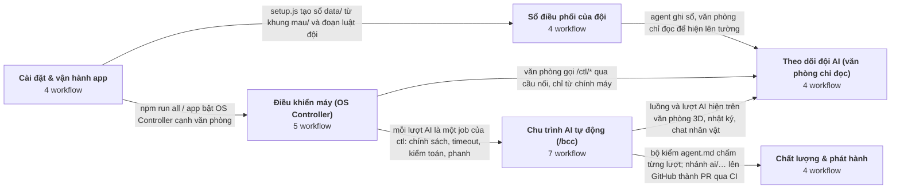
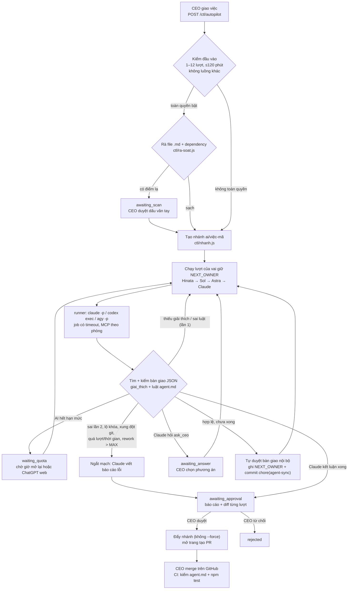
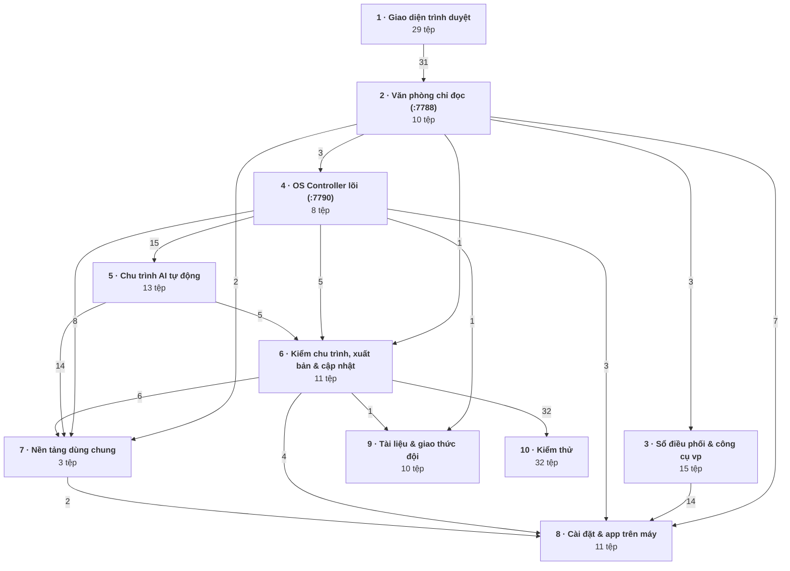

# Bản đồ hệ thống Văn phòng AI — từ workflow tới mã nguồn

> Sinh tự động bởi Understand Anything từ `.ua/domain-graph.json` (workflow nghiệp vụ) và `.ua/knowledge-graph.json` (bản đồ hệ thống) tại commit `d6050cc`. Sửa đồ thị thì sinh lại trang này; đừng sửa tay.

**Cách xem bản tương tác:** trong repo này chạy
```bash
npx https://github.com/Egonex-AI/Understand-Anything/releases/latest/download/understand-anything-viewer.tgz .
```
rồi mở link có `?token=…` mà lệnh in ra. Nút **Domain** = workflow, **Structural** = bản đồ lớp, **Start Tour** = đi theo 14 bước.

Quy mô: 225 node (75 hàm chính, 8 khái niệm), 532 quan hệ, 10 lớp kiến trúc · 6 miền nghiệp vụ, 28 workflow, 119 bước.

## 1. Sáu miền nghiệp vụ và cách chúng nối nhau



## 2. Workflow trung tâm: CEO giao việc → đội AI → CEO duyệt

Đây là vòng lặp `ctl/autopilot.js` + `ctl/runner.js`. Mỗi ô là một trạng thái thật của luồng (`run.status`).



## 3. Bản đồ hệ thống: 10 lớp kiến trúc



Số trên mũi tên = số quan hệ giữa hai lớp, gộp cả hai chiều, mũi tên xếp theo thứ tự lớp (không tính `tested_by`, `documents`). Hai tiến trình chạy trên máy CEO: **Văn phòng chỉ đọc :7788** (`server.js`) và **OS Controller :7790** (`ctl/main.js`); trình duyệt chỉ nói chuyện với :7788, đường `/ctl/*` được `lib/ctlbridge.js` chuyển sang :7790 kèm token và chỉ khi yêu cầu đến từ chính máy.

### 1 · Giao diện trình duyệt

Các trang web CEO dùng: văn phòng 3D, Tổng quan/Bảng điều hành, Điều khiển máy, Kết nối, Cập nhật, hòm thư, nội quy, hiệu suất; PWA và trang chuyển hướng cũ.

- [`public/2d.html`](../public/2d.html) — Trang cũ đã gộp: tự chuyển sang Tổng quan.
- [`public/anime-studio.html`](../public/anime-studio.html) — Studio xem nhân vật 3D và sinh prompt mô tả nhân vật cho agent.
- [`public/app.js`](../public/app.js) — Phần 'app' dùng chung mọi trang: đăng ký service worker (trang offline khi văn phòng tắt) và nút Cài app cho Edge/Chrome.
- [`public/board.html`](../public/board.html) — Trang cũ đã gộp: tự chuyển sang prototype.html#board.
- [`public/cap-nhat.html`](../public/cap-nhat.html) — Màn Cập nhật: xem bản mới, ghi chú thay đổi, bấm cập nhật và theo dõi tiến độ.
- [`public/characters.html`](../public/characters.html) — Hồ sơ nhân vật chi tiết (phong cách manga) của các vai AI và 10 vĩ thú.
- [`public/chat-ui.js`](../public/chat-ui.js) — Ô nhắn tin cũ (gọi chat/status, chat/send với PIN). Không trang HTML nào nạp tệp này → có thể là mã thừa sau khi chat chuyển sang /ctl/chat.
- [`public/congviec.html`](../public/congviec.html) — Trang cũ đã gộp: tự chuyển sang prototype.html#projects.
- [`public/dieukhien.html`](../public/dieukhien.html) — Màn Điều khiển máy: CPU/RAM trực tiếp, phanh khẩn cấp, workspace, chạy lệnh (chờ duyệt), lượt AI + duyệt chuyển lượt, sửa file, nhật ký kiểm toán — chỉ mở được trên chính máy.
- [`public/hieusuat.html`](../public/hieusuat.html) — Màn Đánh giá nhân sự AI: token theo giờ/ngày, quỹ Codex tuần, xếp loại A–D (nghe /perf-events).
- [`public/hopthu.html`](../public/hopthu.html) — Màn Hòm thư: tình trạng tin theo từng vai (đọc /hopthu).
- [`public/index.html`](../public/index.html) — Trang chính: Văn phòng 3D (three.js) với 8 phòng, ô Cần anh, Tiền AI hôm nay, 3 màn hình tường; nghe /events, phát loa giao việc, dừng việc, tài khoản AI, chat với nhân vật qua /ctl/chat.
- [`public/ket-noi.html`](../public/ket-noi.html) — Màn Kết nối: MCP của từng AI, thêm/đăng nhập kết nối, chia kết nối theo phòng.
- [`public/manifest.webmanifest`](../public/manifest.webmanifest) — Manifest PWA: tên, start_url, biểu tượng 192/512/maskable, lối tắt nhanh tới Điều khiển máy, Bảng điều hành, Hồ sơ nhân vật.
- [`public/md.js`](../public/md.js) — Hiển thị Markdown gọn cho sổ sách; luôn thoát HTML trước vì nội dung do agent viết là dữ liệu.
- [`public/noiquy.html`](../public/noiquy.html) — Màn Nội quy & đội ngũ: nội quy, đội ngũ, cấp bậc, sổ tay (bài học, việc để sau, từ điển, SPEC) từ /docs.
- [`public/office-desk.css`](../public/office-desk.css) — Kiểu dáng bàn làm việc CEO (dùng ở index và Tổng quan).
- [`public/office-desk.js`](../public/office-desk.js) — Bàn làm việc của CEO trong văn phòng: chọn dự án/repo GitHub, giao việc tự động, theo dõi chu trình, duyệt báo cáo, rà file, hạn mức, xuất bản, cài bộ kiểm, nhật ký — gọi rất nhiều API /ctl.
- [`public/offline.html`](../public/offline.html) — Trang hướng dẫn khi văn phòng chưa chạy; tự mở lại khi văn phòng bật.
- [`public/progress-view.js`](../public/progress-view.js) — Thành phần hiển thị tiến độ repo (Phase, lượt, blocker, trạng thái) dùng chung cho văn phòng 3D và Tổng quan.
- [`public/prototype.css`](../public/prototype.css) — Kiểu dáng trang Tổng quan.
- [`public/prototype.html`](../public/prototype.html) — Trang Tổng quan / Bảng điều hành (#board, #projects): giao việc cho cả đội, theo dõi luồng, dự án, hạn mức.
- [`public/prototype.js`](../public/prototype.js) — Logic trang Tổng quan: nghe /events, chọn workspace/repo GitHub, giao ý tưởng & luồng tự động, duyệt bàn giao, rà file, hạn mức, tài khoản.
- [`public/sw.js`](../public/sw.js) — Service worker: không đệm dữ liệu văn phòng, chỉ hiện trang offline khi máy chủ chưa chạy.
- [`public/thoitiet.js`](../public/thoitiet.js) — Giờ Việt Nam (UTC+7) và thời tiết thật từ Open-Meteo cho cảnh 3D; chỉ gửi tọa độ thành phố, không gửi dữ liệu dự án.
- [`public/tinnhan.html`](../public/tinnhan.html) — Màn Tin nhắn: toàn bộ tin 24 giờ, lọc theo người (đọc /state).
- [`public/tongquan.html`](../public/tongquan.html) — Trang cũ đã gộp: tự chuyển sang prototype.html.
- [`public/vanphong3d.html`](../public/vanphong3d.html) — Trang xem trước văn phòng 3D độc lập (dùng createOffice).
- [`public/vanphong3d.js`](../public/vanphong3d.js) — Thư viện dựng văn phòng 3D dùng chung (createOffice): bầu trời theo giờ, cây cối, tòa nhà các phòng AI, nhân vật đi WASD, nhãn CSS2D.

### 2 · Văn phòng chỉ đọc (:7788)

Máy chủ HTTP/SSE chỉ đọc nhật ký phiên và sổ data/, dựng trạng thái mỗi giây, che khóa, chặn CSRF/DNS rebinding, cầu nối sang ctl.

- [`lib/chat.js`](../lib/chat.js) — API nhắn tin cũ /chat/status, /chat/send: ghi tin vào hòm thư của agent, từ xa cần mã PIN 6 số ở ~/.van-phong-ao/pin.txt. Hiện chỉ public/chat-ui.js gọi tới (tệp đó không trang nào nạp).
- [`lib/config.js`](../lib/config.js) — Đọc config.json và gộp giá trị mặc định (cổng, dataDir, trần tiền AI, giá token, kênh cập nhật…); dùng chung cho server.js, tools/vp.js và các script app.
- [`lib/ctlbridge.js`](../lib/ctlbridge.js) — Cầu nối văn phòng → OS Controller: proxy /ctl/* tới 127.0.0.1:7790 kèm token đọc từ ~/.van-phong-ao/ctl-token; chặn mọi yêu cầu không từ chính máy (REMOTE_DENIED).
- [`lib/docs.js`](../lib/docs.js) — Đọc sổ sách điều phối (chỉ đọc) cho màn tường 'Công việc & tiến độ' và 'Nội quy & đội ngũ'; nội quy mới đổi trong 24 giờ gắn nhãn MỚI; mọi chữ đi qua mask().
- [`lib/guard.js`](../lib/guard.js) — Lớp chặn CSRF / DNS rebinding cho cả văn phòng và ctl: yêu cầu ghi phải là JSON cùng origin; host lạ bắt buộc có khóa xem; đọc JSON có giới hạn kích thước.
- [`lib/hopthu.js`](../lib/hopthu.js) — Tổng hợp hòm thư data/hop-thu/<vai>.jsonl: số tin chưa xong, chờ quá 1 giờ, bị nhắc ≥2 lần, chưa đọc, tin cũ nhất theo từng vai.
- [`lib/keys.js`](../lib/keys.js) — Lưu khóa API Giám đốc nhập ở màn 'Tài khoản AI' vào ~/.van-phong-ao/keys.json (quyền 600, ngoài repo); máy chủ chỉ hỏi 'đã có khóa chưa'.
- [`lib/perf.js`](../lib/perf.js) — Đánh giá nhân sự AI: đếm token thật 7 ngày từ nhật ký (Codex token_count, Claude message.usage), tính giờ làm, tiền ước tính và xếp loại A/B/C/D.
- [`lib/tongquan.js`](../lib/tongquan.js) — Tổng quan cho Giám đốc: ghép UU-TIEN.json + trạng thái gói việc + tiến độ + hòm thư thành bảng 'việc gì, ai làm, tới đâu, nghẽn ở đâu' và tình trạng từng bot.
- [`server.js`](../server.js) — Máy chủ văn phòng (cổng 7788, chỉ đọc): tìm phiên Claude/Codex trong ~/.claude và ~/.codex, đọc nhật ký + sổ data/ mỗi giây, dựng snapshot trạng thái và đẩy qua SSE /events; phục vụ giao diện public/, API /state /perf /hopthu /tongquan /docs, phát loa giao việc, và chuyển /ctl/* sang OS Controller.

### 3 · Sổ điều phối & công cụ vp

Công cụ agent ghi sổ data/ (hòm thư, lượt DEV, Cần anh, việc ưu tiên, gói việc, bài học) và khung mẫu mau/ mà setup chép sang.

- [`lib/mailbox.js`](../lib/mailbox.js) — Ghi hòm thư: tên tệp theo vai (bỏ dấu, gạch nối), sinh mã tin ht-…, append sự kiện JSONL; dùng chung cho tools/vp.js và nhắn tin của văn phòng.
- [`mau/BAI-HOC.md`](../mau/BAI-HOC.md) — Khung sổ bài học & ngân hàng lỗi: mỗi bài học kèm cái chặn tự động.
- [`mau/CAN-ANH.md`](../mau/CAN-ANH.md) — Khung sổ 'Cần anh': việc chỉ chủ quyết được, ghi bằng vp cananh hoi/xong.
- [`mau/CAP-BAC.md`](../mau/CAP-BAC.md) — Khung cấp bậc & quyền: Chủ văn phòng → Quản lý → Điều phối → Kỹ sư.
- [`mau/DOAN-CHEN-VAO-AGENTS.md`](../mau/DOAN-CHEN-VAO-AGENTS.md) — Đoạn luật đội dán vào AGENTS.md/CLAUDE.md của dự án: đọc hòm thư cuối lượt, hỏi chủ qua Cần anh, lấy/nhả lượt DEV, ghi 'Đang dở' trước khi nghỉ (setup điền đường dẫn thật).
- [`mau/DOI-NGU.md`](../mau/DOI-NGU.md) — Khung bảng đội ngũ: vai, mã phiên, nền tảng, việc; tên phiên nên trùng tên vai để văn phòng nhận người.
- [`mau/NOI-QUY.md`](../mau/NOI-QUY.md) — Khung nội quy đội AI: ranh giới phải hỏi chủ (production, khóa mới, tiền, xóa dữ liệu, đổi luật) và các luật làm việc chung.
- [`mau/QUYET-DINH.md`](../mau/QUYET-DINH.md) — Khung nhật ký quyết định của chủ văn phòng.
- [`mau/TU-DIEN.md`](../mau/TU-DIEN.md) — Khung từ điển kỹ thuật giải thích bằng tiếng Việt thường.
- [`mau/UU-TIEN.json`](../mau/UU-TIEN.json) — Khung việc ưu tiên: danh sách dang_lam / tam_dung, mỗi việc trỏ tới mục gói 'gói:MÃ'.
- [`mau/VIEC-LAM-SAU.md`](../mau/VIEC-LAM-SAU.md) — Khung sổ việc làm sau / ý tưởng hoãn theo nhóm.
- [`mau/goi/vi-du/tien-do.md`](../mau/goi/vi-du/tien-do.md) — Ví dụ sổ tiến độ của gói, có mục 'Đang dở' để phiên mới đọc tiếp.
- [`mau/goi/vi-du/viec.json`](../mau/goi/vi-du/viec.json) — Ví dụ gói việc: các mục có yêu cầu, kiểm thật, trạng thái đạt/sửa.
- [`mau/spec/VI-DU.md`](../mau/spec/VI-DU.md) — Ví dụ một SPEC trong sổ tay đội.
- [`tools/vp.js`](../tools/vp.js) — Công cụ `vp` để agent ghi sổ data/: hòm thư (gui/tiep/xong/ds), lượt DEV (cho/lay/nha/huy/xem), Cần anh, việc ưu tiên, gói việc & tiến độ, bài học.

### 4 · OS Controller lõi (:7790)

Tiến trình riêng chỉ nghe localhost, có token: định tuyến API, sổ tiến trình + chính sách lệnh, workspace, file, giám sát, kiểm toán, SQLite.

- [`ctl/audit.js`](../ctl/audit.js) — Nhật ký kiểm toán chỉ INSERT: mọi lần chạy, duyệt, từ chối, dừng, ghi file đều được ghi (đã che khóa), không sửa/xóa được.
- [`ctl/db.js`](../ctl/db.js) — Sổ SQLite ~/.van-phong-ao/ctl.db (node:sqlite, WAL) với MIGRATIONS chỉ-thêm để bản cũ vẫn mở được khi quay lại.
- [`ctl/files.js`](../ctl/files.js) — Đọc/ghi file trong workspace; ghi phải kèm sha256 bản đang đọc để không đè thay đổi của AI khác (409 CHANGED).
- [`ctl/jobs.js`](../ctl/jobs.js) — Sổ tiến trình: mỗi việc ctl chạy có dòng trong bảng jobs, timeout, log, dừng được cả cây; lệnh ngoài danh sách vào 'pending_approval' chờ CEO duyệt.
- [`ctl/main.js`](../ctl/main.js) — OS Controller (127.0.0.1:7790): dựng mọi module (jobs, workspaces, runner, autopilot, quotas…), sinh token mỗi lần bật, xác thực Bearer + chặn host lạ, và định tuyến ~60 API /jobs /workspaces /fs /ai /autopilot /handoffs /publish /cap-nhat…
- [`ctl/monitor.js`](../ctl/monitor.js) — Giám sát CPU/RAM toàn máy và từng việc ctl đang chạy (vai Pain): Linux đọc /proc, Windows hỏi PowerShell có đệm 5 giây.
- [`ctl/policy.js`](../ctl/policy.js) — Chính sách lệnh: allow (chạy ngay), approve (CEO duyệt lần hai: push, install, lệnh lạ), deny (shell, trình thông dịch tùy ý); resolveProgram tìm chương trình thật.
- [`ctl/workspaces.js`](../ctl/workspaces.js) — Workspace đã đăng ký là vùng duy nhất ctl được chạy lệnh/đọc ghi file; realpath chặn '..'/symlink ra ngoài; đọc tiến độ agent.md (Phase, vai, blocker) và tạo agent.md từ mẫu khi repo chưa có.

### 5 · Chu trình AI tự động

Ý tưởng → luồng tự động → lượt AI theo NEXT_OWNER → bàn giao → Claude kiểm duyệt → CEO duyệt; nhánh riêng, hạn mức, kết nối MCP theo phòng, rà file, chat, nhật ký, thông báo.

- [`ctl/autopilot.js`](../ctl/autopilot.js) — Bộ điều phối luồng tự động: CEO giao một việc → chạy lần lượt theo NEXT_OWNER (Hinata → Sol → Astra → Claude), tự duyệt bàn giao nội bộ, ngắt mạch khi sai bàn giao/hết lượt/lộ khóa/xung đột git, chờ hạn mức, hỏi CEO (ask_ceo), và dừng ở báo cáo Claude chờ CEO duyệt rồi đẩy nhánh.
- [`ctl/chat.js`](../ctl/chat.js) — Chat chỉ đọc với từng nhân vật (Pain, Hinata, Itachi, Sasuke, Sakura): AI xem repo để trả lời, không sửa file; việc ngoài phạm vi thì chỉ CEO sang đúng phòng kèm prompt soạn sẵn.
- [`ctl/handoff.js`](../ctl/handoff.js) — Khóa lượt agent.md: đọc/ghi NEXT_OWNER & LAST_UPDATED_BY, tìm dòng JSON bàn giao trong log, kiểm schema bàn giao, giai_thich (chặn chữ cho có) và ask_ceo; 5 vai hợp lệ và mức suy luận Codex.
- [`ctl/ideas.js`](../ctl/ideas.js) — Ý tưởng của CEO — bước đầu chu trình /bcc: lưu ý tưởng và giao cho luồng tự động bắt đầu từ lượt Hinata (SPEC_ARCHITECT); sai lượt thì cần FORCE_OVERRIDE.
- [`ctl/ket-noi-danh-muc.js`](../ctl/ket-noi-danh-muc.js) — Danh mục kết nối MCP dùng chung (nhóm tài liệu/thiết kế/dữ liệu/gửi/triển khai) và danh sách bị chặn với Claude khi toàn quyền.
- [`ctl/ket-noi.js`](../ctl/ket-noi.js) — Trang Kết nối (MCP): liệt kê kết nối của từng AI, thêm/đăng nhập kết nối cho Codex & Antigravity, chia theo phòng; chính sách 'đọc + làm, chặn gửi' khi chạy toàn quyền.
- [`ctl/mcp-phong.js`](../ctl/mcp-phong.js) — Kết nối theo phòng: mỗi phòng (Hinata, Itachi, Sasuke, Sakura) chỉ bật vài MCP đúng việc; sinh cờ CLI để lượt AI chỉ thấy kết nối của phòng mình.
- [`ctl/nhanh.js`](../ctl/nhanh.js) — Nhánh riêng cho mỗi luồng: ai/<việc>-<mã>; commit file AI đổi sau từng lượt để xem diff; chỉ push (không --force) khi CEO bấm Đẩy nhánh và tạo link PR.
- [`ctl/nhat-ky.js`](../ctl/nhat-ky.js) — Nhật ký văn phòng: dòng thời gian 'ai làm gì, lúc nào' ghép từ sổ luồng tự động và log từng lượt AI (câu nói, lệnh chạy, file sửa).
- [`ctl/quotas.js`](../ctl/quotas.js) — Theo dõi hạn mức Codex/Claude/Antigravity bằng lệnh trạng thái của CLI (không gọi mô hình): chuẩn hóa % đã dùng, giờ reset, lỗi một hãng không xóa số liệu hãng khác.
- [`ctl/ra-soat.js`](../ctl/ra-soat.js) — Rà file chữ AI sẽ đọc (README, *.md, AGENTS.md…) và dependency trước khi cho AI chạy toàn quyền: bắt câu nhắm vào AI, tải-và-chạy, ký tự ẩn, gói giả tên; CEO duyệt theo dấu vân tay.
- [`ctl/runner.js`](../ctl/runner.js) — Runner lượt AI: chỉ chạy vai đang giữ NEXT_OWNER, 1 lượt/workspace; dựng prompt theo vai + kết thúc JSON bàn giao; chạy claude -p / codex exec / agy -p; sau lượt tìm dòng bàn giao, kiểm giải thích và luật agent.md; duyệt thì ghi agent.md + commit chore(agent-sync).
- [`ctl/thongbao.js`](../ctl/thongbao.js) — Thông báo góc màn hình Windows (PowerShell, tại chỗ) khi luồng cần CEO: Claude hỏi, báo cáo chờ duyệt, lỗi, hết hạn mức.

### 6 · Kiểm chu trình, xuất bản & cập nhật

Bộ kiểm agent.md (văn phòng + CI), cài bộ kiểm vào repo dự án, xuất bản dự án qua GitHub, mở repo GitHub, nút Cập nhật app và các workflow CI.

- [`.github/workflows/kiem-tra.yml`](../.github/workflows/kiem-tra.yml) — CI 'Kiểm tra' mỗi PR và mỗi lần cập nhật main: chạy bộ kiểm agent.md (kể cả từng commit agent-sync) và npm test; chỉ quyền đọc.
- [`.github/workflows/phat-hanh.yml`](../.github/workflows/phat-hanh.yml) — CI 'Kiểm bản phát hành' khi CEO đẩy tag vX.Y.Z: tag đúng mẫu, khớp package.json, nằm trên main và test xanh.
- [`ctl/bo-kiem.js`](../ctl/bo-kiem.js) — Cài 'bộ kiểm chu trình' vào repo dự án: tách nhánh vp/bo-kiem-chu-trinh-… trong worktree tạm, chép kiem-agent.js + workflow kiem-chu-trinh.yml, đẩy nhánh và trả link PR.
- [`ctl/cap-nhat.js`](../ctl/cap-nhat.js) — Nút Cập nhật: xem có bản phát hành mới, từ chối khi đang có lượt AI/việc chạy hoặc app không bật bằng npm run app, rồi giao cho scripts/cap-nhat.js chạy tách.
- [`ctl/github.js`](../ctl/github.js) — Chọn repo GitHub trong app: liệt kê repo qua Git Credential Manager (không nhập token), clone vào ~/Projects/<chủ>/<repo> hoặc nhận bản sao có sẵn, đăng ký workspace; gọi workflow_dispatch.
- [`ctl/khung/kiem-chu-trinh.yml`](../ctl/khung/kiem-chu-trinh.yml) — Khung workflow GitHub Actions văn phòng cài vào repo dự án: kiểm agent.md và từng commit agent-sync, rồi lint/test theo công nghệ (Node/Python).
- [`ctl/xuat-ban.js`](../ctl/xuat-ban.js) — Xuất bản dự án (chỉ CEO bấm): bước 1 kiểm repo sạch, Dockerfile, Docker, test, docker build tại máy; bước 2 đẩy tag vX.Y.Z hoặc chạy workflow_dispatch để GitHub Actions đưa lên GHCR/Releases.
- [`lib/cap-nhat.js`](../lib/cap-nhat.js) — Logic cập nhật bằng git: kênh phat-hanh (chỉ tag vX.Y.Z) hoặc main; chỉ fast-forward, từ chối khi có commit riêng/file đang sửa; runUpdate tắt → lên bản → bật → kiểm → rollback.
- [`lib/kiem-agent.js`](../lib/kiem-agent.js) — Bộ kiểm chu trình agent.md tự chạy được: đủ vùng/dòng khóa lượt, [4.1] ≤25 dòng, blocker đúng mẫu, mỗi vai chỉ sửa vùng của mình đúng lượt, không tăng Phase khi còn OPEN, không lộ khóa; kiểm cả lịch sử commit.
- [`scripts/cap-nhat.js`](../scripts/cap-nhat.js) — Bộ cập nhật chạy tách khỏi cây tiến trình: tắt văn phòng → fast-forward lên bản mới → bật lại → kiểm ctl trả đúng phiên bản; hỏng thì quay về bản cũ.
- [`tools/kiem-agent.js`](../tools/kiem-agent.js) — CLI mỏng gọi lib/kiem-agent.js; CI GitHub chạy trên mỗi PR (--tu origin/main) và người/AI chạy tay.

### 7 · Nền tảng dùng chung

Tiện ích an toàn dùng ở mọi nơi: che khóa, ghi file nguyên tử, dừng cả cây tiến trình.

- [`lib/ghi-file.js`](../lib/ghi-file.js) — Ghi file nguyên tử (ghi tạm rồi đổi tên), thử lại ~2 giây khi Windows khóa tạm (EPERM/EBUSY) để sổ luồng, token… không bao giờ ghi dở.
- [`lib/mask.js`](../lib/mask.js) — Che chuỗi giống khóa/token trước khi ghi log hoặc trả về trình duyệt; lọc biến môi trường chứa khóa khi chạy CLI; định nghĩa KEY_SHAPE dùng chung.
- [`lib/proc.js`](../lib/proc.js) — Dừng thật một tiến trình cùng cả cây con (Windows taskkill /T /F, Unix theo nhóm) rồi xác nhận PID đã mất — lõi của phanh khẩn cấp.

### 8 · Cài đặt & app trên máy

Cài đặt lần đầu, bật/tắt văn phòng + ctl, tự bật lại, lối tắt Windows, xem trên điện thoại, cấu hình gói.

- [`.gitattributes`](../.gitattributes) — Cấu hình git: chuẩn hóa xuống dòng cho tệp văn bản.
- [`config.example.json`](../config.example.json) — Mẫu config.json: tên văn phòng, cổng 7788, danh sách dự án theo dõi, khóa xem, gán tên/phòng cho phiên (staff), giấu phiên.
- [`lib/app.js`](../lib/app.js) — Tiện ích 'app trên máy': tìm trình duyệt Edge/Chrome, kiểm văn phòng đã chạy (isUp/waitUp), nhận diện tiến trình app theo PID, đổi PNG thành .ico cho lối tắt.
- [`package.json`](../package.json) — Manifest Node (không có dependency ngoài): phiên bản app và các lệnh npm setup/start/ctl/all/app/tat-app/cai-app/vp/kiem-agent/test.
- [`scripts/cai-app.js`](../scripts/cai-app.js) — `npm run cai-app`: tạo lối tắt 'Văn phòng AI' trên Desktop/Start Menu, tùy chọn tự khởi động cùng Windows, hoặc gỡ lối tắt (--go).
- [`scripts/chay-tat-ca.js`](../scripts/chay-tat-ca.js) — `npm run all`: bật song song văn phòng (7788) và OS Controller (7790); một bên chết thì tắt bên kia; cờ --tu-bat-lai tự bật lại tối đa 5 lần/10 phút; tắt ctl qua kênh IPC để ctl kịp dừng việc.
- [`scripts/mo-app.js`](../scripts/mo-app.js) — `npm run app`: chưa chạy thì bật ngầm chay-tat-ca --tu-bat-lai, chờ trả lời rồi mở cửa sổ app Edge/Chrome (--app); --nen chỉ bật ngầm khi đăng nhập Windows.
- [`scripts/tat-app.js`](../scripts/tat-app.js) — `npm run tat-app`: tắt văn phòng đã bật bằng app theo PID đã lưu, kiểm PID đúng tiến trình văn phòng, quá 15 giây thì dừng cả cây.
- [`scripts/xem-tren-dien-thoai.ps1`](../scripts/xem-tren-dien-thoai.ps1) — Bản PowerShell của đường hầm Cloudflare cho Windows; cũng bắt buộc có khóa xem.
- [`scripts/xem-tren-dien-thoai.sh`](../scripts/xem-tren-dien-thoai.sh) — Mở đường hầm Cloudflare (macOS/Linux) để xem văn phòng trên điện thoại; từ chối chạy khi chưa có khóa xem.
- [`setup.js`](../setup.js) — Trình cài đặt: tự tìm dự án đã dùng AI 14 ngày qua, hỏi 5 câu (hoặc --yes cho agent), ghi config.json, chép khung mau/ sang data/ và tạo đoạn luật đội có đường dẫn thật.

### 9 · Tài liệu & giao thức đội

README, hướng dẫn cho agent, sổ agent.md, chỉ thị của CEO, đặc tả, mẫu agent.md.

- [`AGENTS.md`](../AGENTS.md) — Lời dặn ngắn cho agent Codex: cài văn phòng thì đọc HUONG-DAN-CHO-AGENT.md; sửa mã thì server.js + lib/ chỉ đọc, ghi sổ bằng tools/vp.js, không thêm thư viện ngoài.
- [`CLAUDE.md`](../CLAUDE.md) — Bản sao lời dặn cho Claude Code (giống AGENTS.md): cách cài văn phòng và ranh giới khi sửa mã.
- [`HUONG-DAN-CHO-AGENT.md`](../HUONG-DAN-CHO-AGENT.md) — Kịch bản để một agent AI tự cài văn phòng từ link repo: kiểm Node, clone, setup --yes, chạy server, tự kiểm /state, xin phép chủ trước khi dán luật đội vào AGENTS.md/CLAUDE.md và mở ra Internet.
- [`LENH-BAN-GIAO-CLAUDE.md`](../LENH-BAN-GIAO-CLAUDE.md) — Lệnh bàn giao của CEO cho Claude Code làm Đội trưởng (CLAUDE_AUDITOR) theo giao thức /bcc v2.2: vai trò, quyền hạn và việc phải làm.
- [`README.md`](../README.md) — Tài liệu chính: văn phòng ảo 3D biến các phiên Claude Code/Codex thành một công ty AI; hướng dẫn cài, các màn hình, OS Controller, hạn mức AI, sổ điều phối data/, bộ kiểm agent.md, cấu hình và cấu trúc mã.
- [`YEU-CAU-SUA-LOI-CLAUDE.md`](../YEU-CAU-SUA-LOI-CLAUDE.md) — Đặc tả yêu cầu nâng cấp 'chu trình tự động hóa đa dự án': mọi repo đều chạy được vòng Hinata → Sol → Astra → Claude, kèm các lỗi cần sửa.
- [`agent.md`](../agent.md) — Sổ giao thức của chính dự án này (Universal Protocol v2.2): 5 vùng [1] hiến pháp, [2] đặc tả, [3] kiến trúc, [4] khóa lượt NEXT_OWNER + nhật ký Phase, [5] blocker của Claude. Là 'nguồn sự thật' mà mọi vai AI đọc trước khi làm.
- [`ctl/agent-template.md`](../ctl/agent-template.md) — Mẫu agent.md v2.2 mà OS Controller tự tạo khi nạp một repo mới chưa có sổ: luật tối cao, 5 vùng, luật [1].6 clean code có máy kiểm và [1].7 cập nhật không cài lại.
- [`docs/CO-CHE-TU-HOC.md`](../docs/CO-CHE-TU-HOC.md) — Cơ chế tự học: mỗi lỗi mất ≥20 phút phải ghi vào sổ BAI-HOC kèm 'cái chặn tự động' để dự án sau không lặp lại.
- [`docs/SPEC-VUNG-2.md`](../docs/SPEC-VUNG-2.md) — Đặc tả sản phẩm & thiết kế frontend (Vùng [2]) của văn phòng: phạm vi MVP, luồng người dùng, hệ thống nhân vật và design system.

### 10 · Kiểm thử

Bộ node --test (32 tệp) chạy trong CI mỗi PR.

- [`test/app.test.js`](../test/app.test.js) — Kiểm thử (node --test): manifest đủ điều kiện cài, mọi trang gắn manifest/app.js, service worker và kế hoạch lối tắt.
- [`test/autopilot.test.js`](../test/autopilot.test.js) — Kiểm thử (node --test): cả chuỗi tự bàn giao nội bộ, dừng ở Claude chờ CEO; bàn giao sai thì Claude báo lỗi.
- [`test/bo-kiem.test.js`](../test/bo-kiem.test.js) — Kiểm thử (node --test): kiem-agent tự chạy được một mình, mẫu agent.md có luật CI, cài bộ kiểm vào repo.
- [`test/cap-nhat.test.js`](../test/cap-nhat.test.js) — Kiểm thử (node --test): so tag theo số, chỉ tới bản đã phát hành, fast-forward và quay về khi hỏng.
- [`test/chat.test.js`](../test/chat.test.js) — Kiểm thử (node --test): tách dòng JSON trả lời chat: chuyển phòng, prompt giao việc, trả lời thường.
- [`test/cho-han-muc.test.js`](../test/cho-han-muc.test.js) — Kiểm thử (node --test): hết hạn mức: luồng chờ đúng giờ CLI báo rồi tự chạy tiếp, không tính vào giới hạn lượt.
- [`test/codex-model.test.js`](../test/codex-model.test.js) — Kiểm thử (node --test): Sol chạy gpt-6.1-sol, Astra chạy gpt-6-astra, mức suy luận do đội trưởng đặt.
- [`test/ctl.test.js`](../test/ctl.test.js) — Kiểm thử (node --test): ctl: thiếu token 401, host lạ 403, POST từ trang lạ 403; chính sách và dừng việc.
- [`test/doc-repo.test.js`](../test/doc-repo.test.js) — Kiểm thử (node --test): đọc repo: tạo agent.md khi thiếu, không ghi đè; số liệu thật từ git/README.
- [`test/ghi-file.test.js`](../test/ghi-file.test.js) — Kiểm thử (node --test): ghi file nguyên tử: thử lại khi Windows khóa tạm.
- [`test/giai-thich.test.js`](../test/giai-thich.test.js) — Kiểm thử (node --test): schema giai_thich bắt buộc với Hinata/Sol/Astra; quên giải thích thì trả lại một lần.
- [`test/github.test.js`](../test/github.test.js) — Kiểm thử (node --test): liệt kê repo riêng tư phân trang, credential không lộ, mở bản sao có sẵn.
- [`test/guard.test.js`](../test/guard.test.js) — Kiểm thử (node --test): cho POST cùng origin và CLI, chặn trang lạ.
- [`test/html.test.js`](../test/html.test.js) — Kiểm thử (node --test): kiểm cấu trúc HTML các trang.
- [`test/ket-noi-nhat-ky.test.js`](../test/ket-noi-nhat-ky.test.js) — Kiểm thử (node --test): đọc danh sách kết nối 3 AI, chính sách chặn gửi khi toàn quyền, nhật ký văn phòng.
- [`test/keys.test.js`](../test/keys.test.js) — Kiểm thử (node --test): lưu khóa API hợp lệ, từ chối nhà cung cấp lạ.
- [`test/kiem-agent.test.js`](../test/kiem-agent.test.js) — Kiểm thử (node --test): bộ kiểm agent.md: bản hợp lệ, sai vùng, sai lượt, tăng Phase khi còn OPEN, lộ khóa.
- [`test/mcp-phong.test.js`](../test/mcp-phong.test.js) — Kiểm thử (node --test): kết nối theo phòng: mặc định, lưu, chặn nhóm gửi; cờ --disallowedTools cho Claude.
- [`test/nhanh-rieng.test.js`](../test/nhanh-rieng.test.js) — Kiểm thử (node --test): luồng làm trên nhánh ai/…, commit từng lượt, main không đổi, repo dở thì từ chối.
- [`test/phase4.test.js`](../test/phase4.test.js) — Kiểm thử (node --test): chính sách lệnh allow/approve/deny đa công nghệ và resolveProgram.
- [`test/phase5.test.js`](../test/phase5.test.js) — Kiểm thử (node --test): tìm dòng bàn giao trong nhiều định dạng log, sai lượt 409, đủ 4 vai có CLI.
- [`test/proc.test.js`](../test/proc.test.js) — Kiểm thử (node --test): dừng cả cây tiến trình và xác nhận PID đã mất.
- [`test/projects.test.js`](../test/projects.test.js) — Kiểm thử (node --test): tổng hợp nhiều workspace: lượt, kiểm duyệt, blocker, job gần nhất.
- [`test/quotas.test.js`](../test/quotas.test.js) — Kiểm thử (node --test): chuẩn hóa hạn mức Codex/Claude/Antigravity, thiếu số liệu không thành 0.
- [`test/tat-ctl.test.js`](../test/tat-ctl.test.js) — Kiểm thử (node --test): tắt ctl qua IPC: ctl dừng cả cây việc rồi thoát.
- [`test/thoitiet.test.js`](../test/thoitiet.test.js) — Kiểm thử (node --test): giờ Việt Nam UTC+7, mã thời tiết WMO, gọi Open-Meteo đúng tọa độ.
- [`test/tien-do.test.js`](../test/tien-do.test.js) — Kiểm thử (node --test): đọc tiến độ agent.md đúng vùng, chỉ blocker OPEN, che secret.
- [`test/toan-quyen.test.js`](../test/toan-quyen.test.js) — Kiểm thử (node --test): cờ toàn quyền đúng từng CLI, rà file .md bắt prompt injection.
- [`test/tu-bat-lai.test.js`](../test/tu-bat-lai.test.js) — Kiểm thử (node --test): --tu-bat-lai bật lại ctl khi sập, quá 5 lần/10 phút thì tắt hẳn.
- [`test/tu-hanh.test.js`](../test/tu-hanh.test.js) — Kiểm thử (node --test): Claude hỏi CEO trong luồng, CEO chọn phương án; ngắt mạch khi log lộ khóa.
- [`test/xuat-ban.test.js`](../test/xuat-ban.test.js) — Kiểm thử (node --test): nhận cách xuất bản của repo, xuất bản bằng tag chỉ sau kiểm tra & build.
- [`test/y-tuong.test.js`](../test/y-tuong.test.js) — Kiểm thử (node --test): ý tưởng: lưu, chỉ hiện đúng dự án, lượt đầu là SPEC_ARCHITECT.

## 4. Toàn bộ 28 workflow, từng bước trỏ tới mã

### Cài đặt & vận hành app

Đưa văn phòng lên máy CEO, giữ nó chạy ổn định và nâng cấp an toàn mà không cài lại. Không thư viện ngoài, dữ liệu nằm ngoài git.

**Luật nghiệp vụ:** Không cần npm install; Hỏi chủ trước khi cài phần mềm, dán luật đội, mở ra Internet; Chỉ nhận bản CEO đã phát hành (kênh phat-hanh); Cập nhật chỉ fast-forward, hỏng thì quay về; Xem từ xa bắt buộc có khóa xem.

#### Cài văn phòng lần đầu

Từ link repo tới văn phòng chạy được, có sổ data/ và luật đội. — *Kích hoạt:* `npm run setup / node setup.js --yes (agent)` (cli).

1. **Kiểm Node ≥18 và nhật ký AI có sẵn** — Agent kiểm node -v và ~/.claude/projects, ~/.codex/sessions. [`HUONG-DAN-CHO-AGENT.md:1`](../HUONG-DAN-CHO-AGENT.md#L1-L167)
2. **Tìm dự án đã dùng AI 14 ngày** — Đọc nhật ký phiên để đề xuất thư mục dự án. [`setup.js:26`](../setup.js#L26-L45)
3. **Ghi config.json + tạo data/ từ mau/** — Hỏi 5 câu (hoặc --yes), ghi cấu hình, chép khung sổ. [`setup.js:47`](../setup.js#L47-L112)
4. **Chạy máy chủ và tự kiểm /state** — Phải thấy ít nhất chủ + phiên của agent. [`server.js:491`](../server.js#L491-L537)
5. **Hỏi chủ rồi dán luật đội vào AGENTS.md/CLAUDE.md** — Để mọi phiên AI dùng hòm thư, lượt DEV, Cần anh. [`mau/DOAN-CHEN-VAO-AGENTS.md:1`](../mau/DOAN-CHEN-VAO-AGENTS.md#L1-L18)

#### Mở app & tự bật lại

Lối tắt Desktop bật ngầm văn phòng + ctl, mở cửa sổ app, sập thì tự bật lại có giới hạn. — *Kích hoạt:* `Lối tắt 'Văn phòng AI' / npm run app` (manual).

1. **Tạo lối tắt Desktop/Startup** — WScript.Shell qua PowerShell, đường dẫn qua biến môi trường. [`scripts/cai-app.js:1`](../scripts/cai-app.js#L1-L73)
2. **Bật ngầm chay-tat-ca --tu-bat-lai** — Ghi PID và log, chờ văn phòng trả lời. [`scripts/mo-app.js:1`](../scripts/mo-app.js#L1-L49)
3. **Chạy văn phòng :7788 + ctl :7790** — Một bên chết thì tắt bên kia; tự bật lại ≤5 lần/10 phút. [`scripts/chay-tat-ca.js:1`](../scripts/chay-tat-ca.js#L1-L56)
4. **Mở cửa sổ app Edge/Chrome** — Chế độ --app, không thanh địa chỉ. [`lib/app.js:1`](../lib/app.js#L1-L99)
5. **Tắt app an toàn** — Kiểm PID đúng tiến trình, ctl dừng hết việc trước khi thoát. [`scripts/tat-app.js:1`](../scripts/tat-app.js#L1-L34)

#### Cập nhật app một nút

Lên bản CEO đã phát hành mà không xóa dữ liệu, tự quay về nếu hỏng. — *Kích hoạt:* `Nút Cập nhật (cap-nhat.html) → POST /ctl/cap-nhat` (http).

1. **Kiểm có tag vX.Y.Z mới** — 1 phút sau khi bật rồi mỗi 6 giờ, hoặc bấm kiểm ngay. [`lib/cap-nhat.js:38`](../lib/cap-nhat.js#L38-L72)
2. **Từ chối nếu đang bận** — Có lượt AI/việc đang chạy, file đang sửa, commit riêng, hoặc không bật bằng app. [`ctl/cap-nhat.js:21`](../ctl/cap-nhat.js#L21-L63)
3. **Chạy bộ cập nhật tách khỏi cây tiến trình** — Để lúc tắt văn phòng bộ cập nhật không bị dừng theo. [`scripts/cap-nhat.js:1`](../scripts/cap-nhat.js#L1-L65)
4. **Tắt → fast-forward → bật lại** — Dữ liệu data/, config.json, ctl.db giữ nguyên; ctl.db tự migrate. [`lib/cap-nhat.js:98`](../lib/cap-nhat.js#L98-L116)
5. **Kiểm ctl trả đúng phiên bản, hỏng thì rollback** — Không lên được thì quay về bản cũ và bật lại. [`lib/cap-nhat.js:98`](../lib/cap-nhat.js#L98-L116)

#### Xem trên điện thoại

Mở văn phòng ra mạng LAN hoặc Internet có khóa xem. — *Kích hoạt:* `scripts/xem-tren-dien-thoai.(sh|ps1)` (cli).

1. **Đặt host 0.0.0.0 + accessKey** — Bắt buộc có khóa xem trước khi mở ra ngoài. [`config.example.json:1`](../config.example.json#L1-L15)
2. **Mở đường hầm Cloudflare** — Script từ chối chạy khi chưa có khóa. [`scripts/xem-tren-dien-thoai.sh:1`](../scripts/xem-tren-dien-thoai.sh#L1-L14)
3. **Nhập khóa xem một lần** — Cookie vpk 30 ngày; điều khiển máy vẫn bị chặn từ xa. [`server.js:584`](../server.js#L584-L588)

### Theo dõi đội AI (văn phòng chỉ đọc)

Biến nhật ký phiên Claude/Codex và sổ data/ thành văn phòng 3D sống động, bảng điều hành, đánh giá nhân sự — chỉ đọc, không gửi dữ liệu ra ngoài.

**Luật nghiệp vụ:** Chỉ đọc ~/.claude, ~/.codex và data/; Che mọi chuỗi giống khóa trước khi hiện; Phiên im quá keepHours thì rời văn phòng; Điều khiển máy chỉ từ chính máy này.

#### Cập nhật trạng thái văn phòng mỗi giây

Từ nhật ký phiên tới robot gõ phím trên màn 3D. — *Kích hoạt:* `Mở http://localhost:7788 (GET /events)` (http).

1. **Tìm phiên mới mỗi 5 giây** — Quét thư mục nhật ký, lọc theo dự án trong config. [`server.js:142`](../server.js#L142-L178)
2. **Đọc phần nhật ký mới** — 8 MB cuối lần đầu, sau đó chỉ phần thêm. [`server.js:297`](../server.js#L297-L318)
3. **Hiểu từng dòng Claude/Codex** — Đang làm, đã xong, tin chủ, công cụ, token. [`server.js:225`](../server.js#L225-L267)
4. **Đọc sổ DEV, việc, Cần anh** — Mỗi file chỉ đọc lại khi đổi. [`server.js:324`](../server.js#L324-L360)
5. **Dựng snapshot toàn văn phòng** — Người, phòng, trạng thái, việc, DEV, tin bay, tiền AI. [`server.js:491`](../server.js#L491-L537)
6. **Đẩy SSE tới trình duyệt** — Văn phòng 3D và bảng điều hành vẽ lại. [`server.js:596`](../server.js#L596-L599)

#### Đánh giá nhân sự & tiền AI

Token thật theo giờ/ngày, quỹ Codex tuần, xếp loại A–D. — *Kích hoạt:* `Màn hieusuat.html (GET /perf-events)` (http).

1. **Quét token 7 ngày từ nhật ký** — Codex token_count, Claude message.usage bỏ trùng. [`lib/perf.js:98`](../lib/perf.js#L98-L109)
2. **Tính giờ làm, tiền, xếp loại** — Theo việc xong, lỗi lệnh, lượt DEV, độ tiết kiệm. [`lib/perf.js:131`](../lib/perf.js#L131-L185)
3. **Hiện bảng đánh giá** — Ô Tiền AI chuyển đỏ khi vượt 80% trần. [`public/hieusuat.html:1`](../public/hieusuat.html#L1-L290)

#### Tổng quan cho Giám đốc

Việc gì, để làm gì, ai làm, tới đâu, nghẽn ở đâu. — *Kích hoạt:* `prototype.html (GET /tongquan, /hopthu, /docs)` (http).

1. **Đọc thứ tự việc UU-TIEN.json** — Mỗi việc trỏ tới mục gói 'gói:MÃ'. [`server.js:375`](../server.js#L375-L409)
2. **Ghép trạng thái gói + tiến độ + hòm thư** — Hạn quá thì đỏ; bot 'rảnh mà còn việc', 'im quá 2 giờ'. [`lib/tongquan.js:45`](../lib/tongquan.js#L45-L85)
3. **Tình trạng hòm thư từng vai** — Chưa xong, chờ >1h, bị nhắc nhiều lần. [`lib/hopthu.js:37`](../lib/hopthu.js#L37-L57)
4. **Màn tường Công việc & Nội quy** — Nội quy mới đổi gắn nhãn MỚI. [`lib/docs.js:62`](../lib/docs.js#L62-L116)

#### Chat với nhân vật AI

CEO bấm một nhân vật và hỏi thẳng; AI chỉ đọc repo để trả lời. — *Kích hoạt:* `Bấm nhân vật trên văn phòng 3D → POST /ctl/chat` (http).

1. **CEO gửi câu hỏi** — Kèm 6 tin gần nhất để AI nhớ mạch. [`ctl/chat.js:83`](../ctl/chat.js#L83-L105)
2. **AI trả lời ở chế độ chỉ đọc** — Không sửa file, không chuyển lượt, chạy riêng. [`ctl/chat.js:1`](../ctl/chat.js#L1-L140)
3. **Ngoài phạm vi thì chỉ sang đúng phòng** — Kèm prompt soạn sẵn hoặc prompt giao việc qua luồng chính. [`ctl/chat.js:1`](../ctl/chat.js#L1-L140)

### Sổ điều phối của đội

Cách các phiên AI phối hợp như một đội thật qua sổ data/: hòm thư, lượt DEV, hỏi chủ, việc ưu tiên, gói việc, bài học. Agent ghi bằng vp, văn phòng chỉ đọc.

**Luật nghiệp vụ:** Đọc hòm thư cuối mỗi lượt (vp tiep); Mỗi lúc chỉ một người giữ lượt DEV; Chỉ hỏi chủ với production, khóa mới, tiền, xóa dữ liệu, đổi luật; Ghi 'Đang dở' trước khi nghỉ; Lỗi mất ≥20 phút phải ghi bài học kèm cái chặn.

#### Hòm thư giữa các vai

Gửi việc → người nhận đọc cuối lượt → làm xong thì đóng. — *Kích hoạt:* `vp gui / vp tiep / vp xong` (cli).

1. **Gửi việc cho một vai** — Tin [VIỆC] … có mã ht-…. [`tools/vp.js:72`](../tools/vp.js#L72-L77)
2. **Ghi vào hop-thu/<vai>.jsonl** — Tên tệp theo vai, bỏ dấu. [`lib/mailbox.js:11`](../lib/mailbox.js#L11-L14)
3. **Người nhận đọc tin cũ nhất chưa xong** — Đọc lại nhiều lần mà chưa xong thì bị nhắc. [`tools/vp.js:82`](../tools/vp.js#L82-L88)
4. **Làm xong thì đóng tin** — Văn phòng hiện chờ đọc → đã đọc → đã xong. [`tools/vp.js:89`](../tools/vp.js#L89-L94)

#### Lượt dùng môi trường DEV

Môi trường thử chung, mỗi lúc một người: xếp hàng, lấy, nhả kèm kết quả. — *Kích hoạt:* `vp luot cho|lay|nha|huy|xem` (cli).

1. **Xếp hàng chờ lượt** — Theo gói việc và vai. [`tools/vp.js:104`](../tools/vp.js#L104-L132)
2. **Lấy lượt (từ chối nếu người khác đang giữ)** — Ghi DEV.lock và sự kiện DEV-LUOT.jsonl. [`tools/vp.js:104`](../tools/vp.js#L104-L132)
3. **Nhả lượt kèm kết quả đạt/hỏng và tiền** — Phòng DEV trên văn phòng cập nhật. [`tools/vp.js:104`](../tools/vp.js#L104-L132)
4. **Văn phòng hiện người giữ và hàng chờ** — Ai đứng giữa Phòng DEV, ai xếp hàng. [`server.js:324`](../server.js#L324-L360)

#### Hỏi chủ qua sổ 'Cần anh'

Việc chỉ chủ quyết được đi vào một sổ, hiện ở ô Cần anh làm. — *Kích hoạt:* `vp cananh hoi` (cli).

1. **Agent ghi câu hỏi kèm lựa chọn** — CA-n trong CAN-ANH.md. [`tools/vp.js:137`](../tools/vp.js#L137-L158)
2. **Văn phòng hiện ô 'Cần anh làm'** — Gộp sổ + phiên đang chờ chủ. [`server.js:428`](../server.js#L428-L440)
3. **Có trả lời thì người hỏi tự đóng** — vp cananh xong CA-n "trả lời". [`tools/vp.js:137`](../tools/vp.js#L137-L158)

#### Việc ưu tiên, gói việc & tiến độ

Thứ tự việc → gói việc có mục kiểm thật → tiến độ và 'Đang dở'. — *Kích hoạt:* `vp viec / vp goi / vp tiendo` (cli).

1. **Thêm việc ưu tiên có chủ, người duyệt, hạn** — UU-TIEN.json. [`tools/vp.js:162`](../tools/vp.js#L162-L184)
2. **Tạo gói và các mục yêu cầu + kiểm thật** — goi/<gói>/viec.json. [`tools/vp.js:187`](../tools/vp.js#L187-L212)
3. **Ghi tiến độ và 'Đang dở'** — Phiên mới đọc tiếp từ đây. [`tools/vp.js:213`](../tools/vp.js#L213-L219)
4. **Đánh dấu mục đạt kèm bằng chứng** — Sửa thêm lần nào thì đếm lan_sua. [`tools/vp.js:187`](../tools/vp.js#L187-L212)
5. **Ghi bài học kèm cái chặn tự động** — Đọc trước mỗi gói việc mới. [`tools/vp.js:220`](../tools/vp.js#L220-L226)

### Chu trình AI tự động (/bcc)

CEO giao một việc; đội Hinata → Sol → Astra → Claude tự bàn giao nội bộ theo NEXT_OWNER trên nhánh riêng; máy kiểm từng bàn giao; Claude là đội trưởng, dừng ở báo cáo chờ CEO duyệt.

**Luật nghiệp vụ:** Chỉ vai giữ NEXT_OWNER được chạy; 1 lượt AI/workspace; Mặc định tối đa 10 lượt và 90 phút mỗi luồng; Hinata/Sol/Astra bắt buộc giai_thich; thiếu thì trả lại đúng vai một lần; Chỉ Claude được xóa file; vai khác đề nghị xóa; Ngắt mạch: bàn giao sai, lộ khóa, xung đột git, Claude trả về Codex quá MAX_REWORK; Không push/merge/release tự động; CEO bấm Đẩy nhánh; Hết hạn mức thì chờ đúng giờ, không tính vào giới hạn lượt.

#### Giao ý tưởng mới (bắt đầu /bcc)

Ý tưởng của CEO đi vào lượt Hinata đặc tả Vùng [2]. — *Kích hoạt:* `Bàn CEO → POST /ctl/ideas, /ctl/ideas/:id/start` (http).

1. **Lưu ý tưởng theo dự án** — Ngoài repo, trong kho ctl. [`ctl/ideas.js:35`](../ctl/ideas.js#L35-L44)
2. **Kiểm lượt hiện tại trong agent.md** — Đang tới lượt người khác thì cần CEO xác nhận FORCE_OVERRIDE. [`ctl/ideas.js:58`](../ctl/ideas.js#L58-L84)
3. **Chuyển NEXT_OWNER sang SPEC_ARCHITECT** — Commit chore(agent-sync). [`ctl/handoff.js:26`](../ctl/handoff.js#L26-L32)
4. **Bật luồng tự động từ lượt Hinata** — Đi tiếp flow 'Luồng tự động'. [`ctl/autopilot.js:344`](../ctl/autopilot.js#L344-L360)

#### Luồng tự động: CEO giao việc → báo cáo Claude

Vòng chính của văn phòng: từ một câu giao việc tới báo cáo cuối chờ CEO duyệt. — *Kích hoạt:* `Bàn CEO 'Giao cho cả đội' → POST /ctl/autopilot` (http).

1. **Kiểm việc giao, giới hạn lượt/thời gian** — 1–12 lượt, ≤120 phút; dự án chưa có luồng khác. [`ctl/autopilot.js:344`](../ctl/autopilot.js#L344-L360)
2. **Rà file trước khi chạy toàn quyền** — Có điểm bất thường thì dừng chờ CEO duyệt. [`ctl/ra-soat.js:151`](../ctl/ra-soat.js#L151-L163)
3. **Tạo nhánh riêng ai/<việc>-<mã>** — Repo đang sửa dở thì từ chối. [`ctl/nhanh.js:65`](../ctl/nhanh.js#L65-L79)
4. **Chạy lượt của vai giữ NEXT_OWNER** — Lời giao việc + quyết định CEO + giải thích các lượt trước. [`ctl/autopilot.js:271`](../ctl/autopilot.js#L271-L304)
5. **Vòng 500 ms đọc kết quả lượt** — Commit file AI đổi, kiểm bàn giao, quyết bước tiếp. [`ctl/autopilot.js:362`](../ctl/autopilot.js#L362-L437)
6. **Tự duyệt bàn giao nội bộ** — Ghi NEXT_OWNER + commit, chạy lượt kế. [`ctl/runner.js:254`](../ctl/runner.js#L254-L278)
7. **Claude kiểm duyệt, đối chiếu giải thích với diff** — Trả về Codex sửa hoặc kết thúc. [`ctl/runner.js:184`](../ctl/runner.js#L184-L206)
8. **Dừng ở báo cáo cuối chờ CEO duyệt** — Thông báo Windows cho CEO. [`ctl/thongbao.js:1`](../ctl/thongbao.js#L1-L32)

#### Một lượt AI và kiểm bàn giao

Chi tiết điều gì xảy ra trong một lượt của một vai. — *Kích hoạt:* `runner.run (từ autopilot hoặc nút 'Chạy lượt' ở Điều khiển máy)` (event).

1. **Kiểm đúng lượt, không bận, không bàn giao treo** — Sai lượt → NOT_YOUR_TURN; có bàn giao chờ → HANDOFF_PENDING. [`ctl/runner.js:184`](../ctl/runner.js#L184-L206)
2. **Dựng prompt theo vai + MCP của phòng** — Kèm luật xóa file, giải thích, dòng JSON kết thúc bắt buộc. [`ctl/mcp-phong.js:55`](../ctl/mcp-phong.js#L55-L75)
3. **Gọi CLI AI như một job có timeout** — claude -p / codex exec / agy -p; biến môi trường chứa khóa bị lọc. [`ctl/jobs.js:22`](../ctl/jobs.js#L22-L202)
4. **Tìm dòng JSON bàn giao trong log** — Hỗ trợ text, JSON Claude, JSONL Codex. [`ctl/handoff.js:123`](../ctl/handoff.js#L123-L146)
5. **Kiểm schema bàn giao + giai_thich** — Chặn chữ mẫu, viết cho có. [`ctl/handoff.js:35`](../ctl/handoff.js#L35-L57)
6. **Kiểm luật agent.md của lượt** — Đúng vùng của vai, không tăng Phase khi còn OPEN, không lộ khóa. [`lib/kiem-agent.js:88`](../lib/kiem-agent.js#L88-L110)
7. **Lưu bàn giao chờ duyệt** — Lỗi mạng/429 thì tự thử lại sau 1 phút. [`ctl/runner.js:225`](../ctl/runner.js#L225-L236)

#### Claude hỏi CEO (ask_ceo)

Đội trưởng phản biện AI khác; khi cần CEO quyết, luồng chờ CEO chọn phương án. — *Kích hoạt:* `Bàn giao của Claude có trường ask_ceo` (event).

1. **Phát hiện ask_ceo trong bàn giao** — Luồng sang awaiting_answer, kèm toàn bộ phân tích của Claude. [`ctl/autopilot.js:362`](../ctl/autopilot.js#L362-L437)
2. **CEO chọn một phương án** — POST /ctl/autopilot/:id/answer. [`ctl/autopilot.js:441`](../ctl/autopilot.js#L441-L453)
3. **Duyệt bàn giao theo phương án** — Lượt sang vai của phương án, ghi lý do vào commit. [`ctl/runner.js:282`](../ctl/runner.js#L282-L294)
4. **Ghi quyết định vào luồng và chạy tiếp** — Các lượt sau làm theo; lượt và thời gian tính lại. [`ctl/autopilot.js:271`](../ctl/autopilot.js#L271-L304)

#### Hết hạn mức: chờ hoặc làm qua ChatGPT web

AI của lượt hết hạn mức gói: chờ đúng giờ mở lại, hoặc CEO tự làm lượt trên ChatGPT web. — *Kích hoạt:* `Log lượt khớp QUOTA_HIT` (event).

1. **Đọc hạn mức 3 nhà cung cấp** — Lệnh trạng thái của CLI, không gọi mô hình. [`ctl/quotas.js:152`](../ctl/quotas.js#L152-L172)
2. **Chuyển sang waiting_quota tới giờ mở lại** — Giờ lấy từ thông báo CLI hoặc bộ theo dõi. [`ctl/autopilot.js:166`](../ctl/autopilot.js#L166-L177)
3. **(Tùy chọn) Nhờ AI còn hạn mức soạn master prompt** — Kèm chuẩn đầu ra; không AI nào soạn được thì dùng mẫu. [`ctl/autopilot.js:210`](../ctl/autopilot.js#L210-L221)
4. **CEO dán kết quả ChatGPT, AI kiểm rồi áp** — Đạt chuẩn thì áp như một lượt của vai đó. [`ctl/autopilot.js:505`](../ctl/autopilot.js#L505-L534)
5. **Tới giờ thì chạy lại đúng lượt đó** — Ngữ cảnh nằm trong agent.md/repo nên không mất. [`ctl/autopilot.js:179`](../ctl/autopilot.js#L179-L185)

#### CEO duyệt báo cáo & đẩy nhánh

Kết thúc luồng: CEO đọc báo cáo + diff từng lượt, duyệt và đưa lên GitHub thành PR. — *Kích hoạt:* `Bàn CEO → POST /ctl/autopilot/:id/approve, /push` (http).

1. **Xem diff từng lượt** — GET /ctl/autopilot/:id/steps/:n/diff. [`ctl/nhanh.js:109`](../ctl/nhanh.js#L109-L121)
2. **Duyệt hoặc từ chối báo cáo** — Duyệt bàn giao cuối của Claude; không tự push. [`ctl/autopilot.js:466`](../ctl/autopilot.js#L466-L480)
3. **Đẩy nhánh ai/… (không --force)** — Trả link tạo PR trên GitHub. [`ctl/autopilot.js:483`](../ctl/autopilot.js#L483-L490)
4. **CEO merge PR trên GitHub** — Văn phòng không bao giờ merge hay xóa nhánh.

#### Kết nối MCP theo phòng

Kết nối là của chung văn phòng, mỗi phòng chỉ bật vài kết nối đúng việc; chặn gửi khi toàn quyền. — *Kích hoạt:* `Trang ket-noi.html → /ctl/ket-noi/*` (http).

1. **Liệt kê kết nối của Claude/Codex/Antigravity** — Đọc qua `mcp list` của từng CLI. [`ctl/ket-noi.js:47`](../ctl/ket-noi.js#L47-L75)
2. **Thêm/đăng nhập kết nối cho Codex, Antigravity** — OAuth theo URL trong danh mục. [`ctl/ket-noi.js:78`](../ctl/ket-noi.js#L78-L91)
3. **Chọn kết nối cho từng phòng** — Lưu mcp-phong.json; chặn nhóm gửi. [`ctl/ket-noi.js:105`](../ctl/ket-noi.js#L105-L109)
4. **Lượt AI chỉ thấy kết nối của phòng mình** — Đỡ tốn token, đỡ rủi ro. [`ctl/mcp-phong.js:55`](../ctl/mcp-phong.js#L55-L75)

### Điều khiển máy (OS Controller)

Cửa duy nhất để AI và CEO tác động lên máy: chỉ localhost, có token, mọi lệnh theo chính sách, chỉ trong workspace đã đăng ký, có phanh khẩn cấp và nhật ký kiểm toán không xóa được.

**Luật nghiệp vụ:** Chỉ nghe 127.0.0.1:7790, mọi yêu cầu cần Bearer token sinh mới mỗi lần bật; Lệnh ngoài danh sách chờ CEO duyệt; shell/trình thông dịch bị cấm; Không đăng ký được cả ổ đĩa, thư mục người dùng, thư mục ẩn; Ghi file phải kèm sha256 bản đang đọc; Nhật ký kiểm toán chỉ INSERT, giữ 90 ngày.

#### Chạy lệnh theo chính sách

CEO (hoặc luồng) yêu cầu chạy lệnh trong workspace. — *Kích hoạt:* `Điều khiển máy → POST /ctl/jobs` (http).

1. **Xác thực token + chặn host lạ** — Qua cầu nối chỉ từ chính máy. [`lib/ctlbridge.js:38`](../lib/ctlbridge.js#L38-L56)
2. **Phân loại allow / approve / deny** — git status, npm test chạy ngay; push, install chờ duyệt; shell bị cấm. [`ctl/policy.js:37`](../ctl/policy.js#L37-L83)
3. **Lệnh 'approve' chờ CEO bấm duyệt lần hai** — pending_approval → approve/reject. [`ctl/jobs.js:142`](../ctl/jobs.js#L142-L148)
4. **Chạy không qua shell, có timeout và log** — Không chèn lệnh được. [`ctl/jobs.js:127`](../ctl/jobs.js#L127-L132)
5. **Ghi nhật ký kiểm toán** — Mọi lần chạy, duyệt, từ chối, dừng. [`ctl/audit.js:1`](../ctl/audit.js#L1-L19)

#### Phanh khẩn cấp (Kill-All)

Dừng mọi việc và lượt AI do ctl chạy, kể cả tiến trình con. — *Kích hoạt:* `Nút 'Dừng tất cả' → POST /ctl/kill-all` (http).

1. **CEO bấm Dừng tất cả** — Từ văn phòng 3D hoặc Điều khiển máy. [`public/dieukhien.html:1`](../public/dieukhien.html#L1-L377)
2. **Dừng mọi job đang chạy** — Ghi kiểm toán từng việc. [`ctl/jobs.js:171`](../ctl/jobs.js#L171-L176)
3. **Dừng cả cây tiến trình và xác nhận PID mất** — Windows taskkill /T /F. [`lib/proc.js:16`](../lib/proc.js#L16-L31)

#### Đăng ký workspace & mở repo GitHub

Chọn dự án cho đội AI làm việc. — *Kích hoạt:* `Bàn CEO → Chọn repo GitHub → POST /ctl/github/open` (http).

1. **Liệt kê repo qua Git Credential Manager** — Gồm repo riêng tư; không nhập token. [`ctl/github.js:51`](../ctl/github.js#L51-L58)
2. **Nhận bản sao có sẵn hoặc clone vào ~/Projects** — Thư mục đích có dữ liệu khác thì báo lỗi. [`ctl/github.js:72`](../ctl/github.js#L72-L113)
3. **Đăng ký workspace (chặn thư mục nguy hiểm)** — realpath, không ổ đĩa/thư mục ẩn. [`ctl/workspaces.js:78`](../ctl/workspaces.js#L78-L94)
4. **Tạo agent.md từ mẫu khi repo chưa có** — Không ghi đè bản có sẵn. [`ctl/workspaces.js:98`](../ctl/workspaces.js#L98-L106)
5. **Đọc tiến độ dự án** — Phase, lượt, blocker OPEN, kiểm duyệt. [`ctl/workspaces.js:149`](../ctl/workspaces.js#L149-L189)

#### Sửa file an toàn trong workspace

Duyệt, mở, sửa, lưu mà không đè thay đổi của AI khác. — *Kích hoạt:* `Điều khiển máy → GET /ctl/fs/read, POST /ctl/fs/write` (http).

1. **Đọc file kèm sha256** — Chỉ trong workspace. [`ctl/files.js:13`](../ctl/files.js#L13-L26)
2. **Chặn .., symlink ra ngoài, .git** — PATH_ESCAPE. [`ctl/workspaces.js:193`](../ctl/workspaces.js#L193-L212)
3. **Ghi khi sha256 còn khớp** — Khác thì 409 CHANGED. [`ctl/files.js:37`](../ctl/files.js#L37-L51)

#### Rà file trước khi cho AI toàn quyền

Chống prompt injection trong README/*.md và gói giả tên trước khi AI chạy toàn quyền. — *Kích hoạt:* `Trước runner.run / autopilot.start khi toàn quyền bật` (event).

1. **Quét file chữ + dependency** — Câu nhắm vào AI, tải-và-chạy, ký tự ẩn, gói giả tên. [`ctl/ra-soat.js:151`](../ctl/ra-soat.js#L151-L163)
2. **Có điểm bất thường thì chặn chạy** — NEEDS_SCAN_APPROVAL, luồng sang awaiting_scan. [`ctl/ra-soat.js:190`](../ctl/ra-soat.js#L190-L194)
3. **CEO xem và duyệt theo dấu vân tay** — File đổi thêm điểm mới thì phải duyệt lại. [`ctl/ra-soat.js:195`](../ctl/ra-soat.js#L195-L203)

### Chất lượng & phát hành

Máy kiểm những luật đo được thay vì trông AI tự nhớ; mọi dự án qua CI; chỉ CEO xuất bản và phát hành.

**Luật nghiệp vụ:** Mỗi PR phải qua kiểm agent.md + test; Commit sửa agent.md phải là commit riêng đúng mẫu message; FORCE_OVERRIDE biến lỗi quyền thành cảnh báo; Chỉ CEO bấm xuất bản; build và đẩy image do GitHub Actions làm; Merge vào main không có nghĩa là phát hành.

#### Kiểm chu trình agent.md

Luật giao thức được máy kiểm sau mỗi lượt AI và trên mỗi PR. — *Kích hoạt:* `CI kiem-tra.yml (pull_request) / runner.done` (event).

1. **Kiểm bản agent.md hiện tại** — Đủ vùng, dòng khóa lượt, giới hạn dòng, blocker đúng mẫu, không lộ khóa. [`lib/kiem-agent.js:59`](../lib/kiem-agent.js#L59-L82)
2. **Kiểm từng lần sửa theo vai và lượt** — Mỗi vai chỉ sửa vùng của mình; Claude không tự sửa Phase. [`lib/kiem-agent.js:88`](../lib/kiem-agent.js#L88-L110)
3. **Kiểm mọi commit agent-sync trong PR** — node tools/kiem-agent.js --tu origin/main. [`lib/kiem-agent.js:120`](../lib/kiem-agent.js#L120-L141)
4. **Chạy npm test** — 32 tệp node --test. [`.github/workflows/kiem-tra.yml:1`](../.github/workflows/kiem-tra.yml#L1-L36)

#### Cài bộ kiểm vào repo dự án

Áp chu trình cho mọi dự án của đội bằng một nút. — *Kích hoạt:* `Bàn CEO → Cài bộ kiểm vào repo → POST /ctl/bo-kiem` (http).

1. **Tách nhánh vp/bo-kiem-chu-trinh-… trong worktree tạm** — Không đụng thư mục và nhánh đang làm. [`ctl/bo-kiem.js:45`](../ctl/bo-kiem.js#L45-L92)
2. **Chép tools/kiem-agent.js + workflow kiem-chu-trinh.yml** — Bản chép nguyên lib/kiem-agent.js tự chạy được. [`ctl/khung/kiem-chu-trinh.yml:1`](../ctl/khung/kiem-chu-trinh.yml#L1-L57)
3. **Đẩy nhánh và mở trang tạo PR** — CEO merge trên GitHub. [`ctl/nhanh.js:124`](../ctl/nhanh.js#L124-L131)

#### Xuất bản dự án

Hai bước, chỉ CEO bấm: kiểm tra & build tại máy, rồi để GitHub Actions xuất bản. — *Kích hoạt:* `Bàn CEO → POST /ctl/publish/prepare, /publish/:id/release` (http).

1. **Repo sạch, có Dockerfile, Docker đang chạy** — Thiếu gì thì dừng và báo. [`ctl/xuat-ban.js:115`](../ctl/xuat-ban.js#L115-L157)
2. **Chạy test và docker build tại máy** — Không đẩy gì ra ngoài ở bước này. [`ctl/xuat-ban.js:115`](../ctl/xuat-ban.js#L115-L157)
3. **Đẩy tag vX.Y.Z hoặc chạy workflow_dispatch** — GitHub Actions build lên GHCR + Releases. [`ctl/xuat-ban.js:160`](../ctl/xuat-ban.js#L160-L211)

#### Phát hành bản mới của Văn phòng AI

Từ PR nâng version tới máy người dùng thấy nút Cập nhật. — *Kích hoạt:* `CEO tạo tag vX.Y.Z trên main` (manual).

1. **Đội AI nâng version qua PR; CEO merge** — package.json. [`package.json:1`](../package.json#L1-L22)
2. **CEO tạo tag vX.Y.Z trên main** — GitHub → Releases.
3. **Workflow kiểm tag đúng mẫu, khớp version, trên main, test xanh** — Đỏ thì xóa tag, sửa, tag lại. [`.github/workflows/phat-hanh.yml:1`](../.github/workflows/phat-hanh.yml#L1-L37)
4. **Máy người dùng thấy 'Cập nhật: có vX.Y.Z' trong ≤6 giờ** — Đi tiếp flow 'Cập nhật app một nút'. [`lib/cap-nhat.js:38`](../lib/cap-nhat.js#L38-L72)

## 5. Lộ trình đọc mã (tour 14 bước)

1. **Bức tranh tổng thể** — Văn phòng AI là hai tiến trình trên máy CEO: Văn phòng chỉ đọc (:7788) để XEM đội AI làm việc, và OS Controller (:7790) để ĐIỀU KHIỂN đội AI chạy theo giao thức agent.md. Bắt đầu từ README và agent.md. (`README.md`, `agent.md`, Giám đốc (CEO / chủ văn phòng), 5 vai AI của đội)
2. **Cài đặt & khởi chạy** — setup.js hỏi 5 câu, ghi config.json, chép khung mau/ sang data/. `npm run all` (hoặc lối tắt app) bật cả hai tiến trình và tự bật lại khi sập. (`setup.js`, `package.json`, `scripts/chay-tat-ca.js`, `scripts/mo-app.js`, `config.example.json`)
3. **Văn phòng chỉ đọc: từ nhật ký tới màn hình** — server.js tìm phiên trong ~/.claude và ~/.codex, đọc nhật ký + sổ data/ mỗi giây, dựng snapshot và đẩy qua SSE /events. Không gửi gì ra ngoài, che mọi chuỗi giống khóa. (`server.js`, `server.js:discover`, `server.js:snapshot`, `server.js:sse`, Nhật ký phiên AI (~/.claude, ~/.codex))
4. **Lớp bảo vệ của văn phòng** — Mọi yêu cầu qua guard (CSRF, DNS rebinding) và khóa xem; đường /ctl/* chỉ chạy được từ chính máy, token ctl không bao giờ xuống trình duyệt. (`lib/guard.js`, `lib/ctlbridge.js`, `lib/mask.js`, `lib/keys.js`)
5. **Màn hình CEO dùng** — index.html dựng văn phòng 3D (vanphong3d.js) và bàn làm việc CEO (office-desk.js); prototype.html là Tổng quan/Bảng điều hành; dieukhien.html là Điều khiển máy. (`public/index.html`, `public/vanphong3d.js`, `public/office-desk.js`, `public/prototype.html`, `public/dieukhien.html`)
6. **Sổ điều phối: cách đội AI phối hợp thủ công** — Agent ghi sổ bằng `vp` (hòm thư, lượt DEV, Cần anh, việc ưu tiên, gói việc, bài học); văn phòng chỉ đọc lại để hiện lên tường. (`tools/vp.js`, `lib/mailbox.js`, Sổ điều phối data/, `lib/hopthu.js`, `lib/tongquan.js`, `mau/DOAN-CHEN-VAO-AGENTS.md`)
7. **OS Controller: cửa điều khiển máy** — ctl/main.js dựng mọi module và ~60 API; jobs + policy quyết lệnh nào chạy ngay, lệnh nào chờ CEO duyệt, lệnh nào cấm; workspace là ranh giới duy nhất; mọi thứ vào nhật ký kiểm toán. (`ctl/main.js`, `ctl/jobs.js`, `ctl/policy.js`, `ctl/workspaces.js`, `ctl/audit.js`, Kho của OS Controller (~/.van-phong-ao))
8. **Workflow 1 — CEO giao việc / ý tưởng** — Ý tưởng chuyển lượt cho Hinata; giao việc bật luồng tự động: kiểm sổ agent.md, rà file, tạo nhánh ai/…, rồi chạy lượt đầu. (`ctl/ideas.js`, `ctl/ideas.js:start`, `ctl/autopilot.js:start`, `ctl/nhanh.js:prepare`, `ctl/ra-soat.js:scan`)
9. **Workflow 2 — Một lượt AI và bàn giao** — runner chỉ chạy vai đang giữ NEXT_OWNER, dựng prompt + MCP theo phòng, gọi CLI; xong lượt thì tìm dòng JSON bàn giao, kiểm giải thích và luật agent.md; duyệt thì ghi NEXT_OWNER + commit chore(agent-sync). (`ctl/runner.js`, `ctl/runner.js:run`, `ctl/runner.js:done`, `ctl/handoff.js`, `lib/kiem-agent.js:checkChange`, agent.md trong repo dự án, CLI AI chạy nền)
10. **Workflow 3 — Vòng lặp tự động & ngắt mạch** — autopilot.tick chạy mỗi 500 ms: lưu bước, trả lại lượt thiếu giải thích một lần, chờ hạn mức, ngắt mạch khi lộ khóa/xung đột/quá lượt, Claude hỏi CEO (ask_ceo), tới báo cáo cuối thì dừng chờ duyệt. (`ctl/autopilot.js:tick`, `ctl/autopilot.js:launch`, `ctl/autopilot.js:waitQuota`, `ctl/autopilot.js:answer`, `ctl/quotas.js`, `ctl/thongbao.js`)
11. **Workflow 4 — CEO duyệt và đưa lên GitHub** — CEO đọc báo cáo + diff từng lượt, duyệt rồi bấm Đẩy nhánh: push nhánh ai/… (không --force) và mở trang tạo PR. Merge là việc của CEO trên GitHub. (`ctl/autopilot.js:decide`, `ctl/autopilot.js:pushBranch`, `ctl/nhanh.js:push`, GitHub (remote, PR, tag, Actions))
12. **Chất lượng: bộ kiểm chu trình** — Luật đo được của agent.md được máy kiểm ở hai nơi: sau mỗi lượt AI (runner) và trên mỗi PR (CI). Văn phòng còn cài bộ kiểm này vào repo dự án. (`lib/kiem-agent.js`, `tools/kiem-agent.js`, `.github/workflows/kiem-tra.yml`, `ctl/bo-kiem.js`, `ctl/khung/kiem-chu-trinh.yml`)
13. **Xuất bản dự án & cập nhật app** — Xuất bản: kiểm tra & build tại máy rồi để GitHub Actions xuất bản. Cập nhật app: chỉ bản CEO đã gắn tag, fast-forward, hỏng thì quay về. (`ctl/xuat-ban.js`, `ctl/cap-nhat.js`, `lib/cap-nhat.js`, `scripts/cap-nhat.js`, `.github/workflows/phat-hanh.yml`)
14. **Kiểm thử** — 32 tệp node --test bao phủ từng workflow trên (tự hành, hỏi CEO, hạn mức, nhánh riêng, xuất bản, chính sách lệnh…). CI chạy toàn bộ trên mỗi PR. (`test/autopilot.test.js`, `test/tu-hanh.test.js`, `test/cho-han-muc.test.js`, `test/nhanh-rieng.test.js`, `test/kiem-agent.test.js`)

## 6. Điểm phát hiện khi vẽ — cần anh rà

1. **`public/chat-ui.js` không trang nào nạp.** Tệp này là ô nhắn tin cũ gọi `chat/status`, `chat/send` (PIN 6 số). Chat trên văn phòng 3D hiện đi qua `/ctl/chat` (`ctl/chat.js`, chỉ đọc, chỉ trên chính máy). Hệ quả: đường `/chat/*` trong `lib/chat.js` (ghi tin vào hòm thư, từ xa cần PIN) vẫn được `server.js` phục vụ nhưng giao diện không còn chỗ dùng — có thể là mã thừa.
2. **README dòng "Nhắn tin cho agent"** vẫn tả tính năng "tin vào hòm thư; từ xa nhập PIN 6 số" — có thể đã lỗi thời so với chat `/ctl/chat` hiện tại.
3. **4 trang chuyển hướng** (`2d.html`, `board.html`, `congviec.html`, `tongquan.html`) không trang nào trỏ tới; chú thích trong tệp nói giữ lại cho dấu trang cũ — đúng chủ đích, chỉ ghi nhận.

Chưa sửa gì trong mã; chờ anh quyết.
