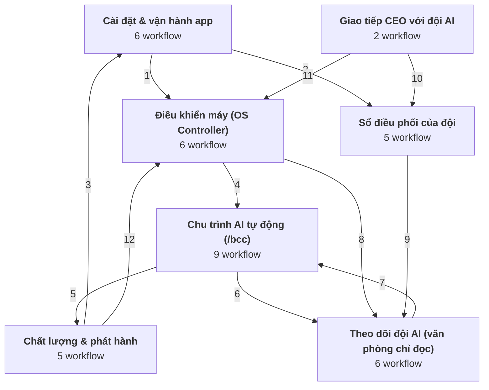
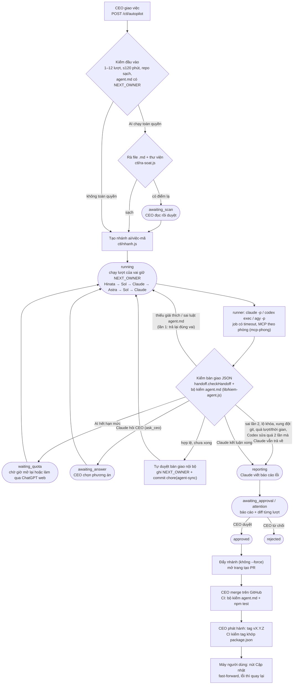
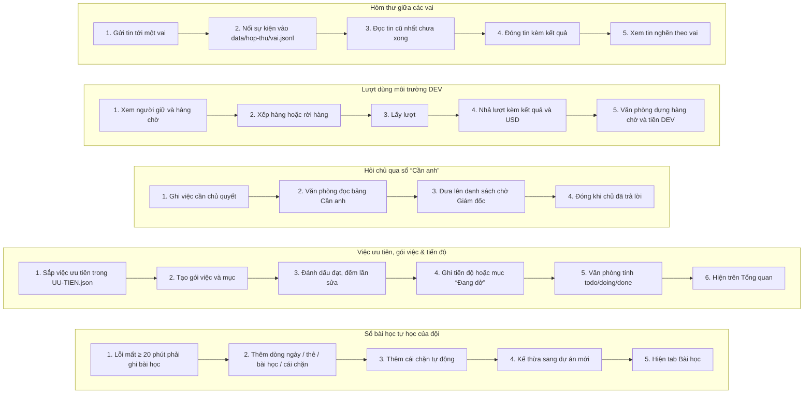
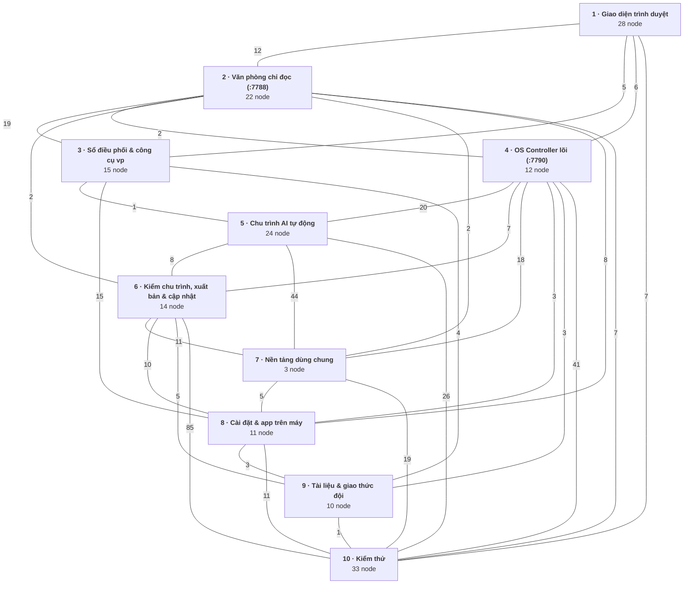

# Bản đồ hệ thống Văn phòng AI — từ workflow tới mã nguồn

> Sinh tự động bằng `node tools/ve-ban-do.js` từ `.ua/domain-graph.json` (workflow nghiệp vụ) và `.ua/knowledge-graph.json` (bản đồ hệ thống) do Understand Anything vẽ tại commit `72e9ac0`. Mã đổi nhiều thì vẽ lại đồ thị (`/understand`, `/understand-domain`) rồi chạy lại lệnh trên; đừng sửa tay trang này.

**Bản tương tác** (bấm vào từng node, xem quan hệ, đi theo lộ trình): trong repo chạy `/understand-dashboard` của plugin Understand Anything (Claude Code), hoặc lệnh `npx` trong README của dự án Understand Anything. Lệnh đó tải và chạy mã của bên thứ ba: chỉ chạy khi anh tin nguồn; đọc các sơ đồ dưới đây trên GitHub thì không cần.

Quy mô: 7 miền nghiệp vụ, 39 workflow, 244 bước · 494 node (113 file, 322 hàm, 31 route API, 28 tài liệu/cấu hình/CI) · 1495 quan hệ (390 lời gọi, 192 import, 91 liên kết test) · 10 lớp kiến trúc · lộ trình 15 bước.

Mục lục: [1. Miền nghiệp vụ](#1-các-miền-nghiệp-vụ) · [2. Workflow trung tâm](#2-workflow-trung-tâm-ceo-giao-việc--đội-ai--ceo-duyệt) · [3. Từng workflow](#3-từng-workflow-từng-bước-trỏ-tới-mã) · [4. Lớp kiến trúc](#4-bản-đồ-hệ-thống-các-lớp-kiến-trúc) · [5. Lộ trình đọc mã](#5-lộ-trình-đọc-mã) · [6. Điểm cần anh rà](#6-điểm-phát-hiện-khi-vẽ--cần-anh-rà)

## 1. Các miền nghiệp vụ

7 miền, nối với nhau như sau (chữ trên mũi tên: miền này dùng gì của miền kia).

1. **Cài đặt & vận hành app** → **Điều khiển máy (OS Controller)**: npm run all / npm run app bật OS Controller cạnh văn phòng; bộ cập nhật kiểm /health của ctl và chặn khi còn job/luồng AI
2. **Cài đặt & vận hành app** → **Sổ điều phối của đội**: setup.js tạo sổ data/ từ khung mau/ và chèn đoạn luật đội vào AGENTS.md/CLAUDE.md
3. **Chất lượng & phát hành** → **Cài đặt & vận hành app**: tag vX.Y.Z đã qua phat-hanh.yml là bản duy nhất kênh phat-hanh của nút Cập nhật nhận
4. **Điều khiển máy (OS Controller)** → **Chu trình AI tự động (/bcc)**: mỗi lượt AI là một job của ctl: chính sách, timeout, rà soát toàn quyền, kiểm toán, phanh; nạp repo tạo agent.md để chu trình chạy
5. **Chu trình AI tự động (/bcc)** → **Chất lượng & phát hành**: bộ kiểm agent.md chấm từng lượt; nhánh ai/… đẩy lên GitHub thành PR qua CI
6. **Chu trình AI tự động (/bcc)** → **Theo dõi đội AI (văn phòng chỉ đọc)**: luồng, lượt và nhật ký hiện trên văn phòng 3D, bàn điều phối và trang tiến độ
7. **Theo dõi đội AI (văn phòng chỉ đọc)** → **Chu trình AI tự động (/bcc)**: bộ theo dõi hạn mức cho luồng biết giờ chạy lại và chọn AI soạn master prompt
8. **Điều khiển máy (OS Controller)** → **Theo dõi đội AI (văn phòng chỉ đọc)**: văn phòng gọi /ctl/* qua cầu nối chỉ từ chính máy (job, tiến độ repo, hạn mức)
9. **Sổ điều phối của đội** → **Theo dõi đội AI (văn phòng chỉ đọc)**: agent ghi sổ bằng vp, văn phòng chỉ đọc để hiện tường, Tổng quan, Hiệu suất
10. **Giao tiếp CEO với đội AI** → **Sổ điều phối của đội**: tin của Giám đốc ghi vào hòm thư data/hop-thu, agent đọc bằng vp tiep
11. **Giao tiếp CEO với đội AI** → **Điều khiển máy (OS Controller)**: chat chạy CLI như job “cmd”; dừng việc chuyển lệnh kill sang ctl
12. **Chất lượng & phát hành** → **Điều khiển máy (OS Controller)**: xuất bản và cài bộ kiểm chạy lệnh qua jobs, đọc repo qua workspace và GitHub của ctl

- **Cài đặt & vận hành app** — Đưa Văn phòng AI lên máy Chủ Dự Án và giữ nó chạy ổn định: cài lần đầu (agent tự cài theo HUONG-DAN-CHO-AGENT.md hoặc npm run setup), mở như app trên máy có tự bật lại, cập nhật một nút theo kênh phát hành có tự quay lại, nâng cấp sổ ctl.db an toàn, lưu khóa…
- **Theo dõi đội AI (văn phòng chỉ đọc)** — Máy chủ văn phòng (server.js, cổng 7788) chỉ đọc nhật ký phiên Claude Code/Codex, sổ data/ và agent.md của các repo để dựng văn phòng 3D, bảng tổng quan, đánh giá nhân sự, tiến độ giao thức, hạn mức AI và nhật ký “ai làm gì”.
- **Giao tiếp CEO với đội AI** — Các kênh Giám đốc nói chuyện với đội AI mà không phá khóa lượt: chat chỉ đọc với từng nhân vật qua OS Controller (trên máy này hoặc điện thoại đã ghép), và nút 📢 giao việc cho cả đội đi thẳng vào luồng tự động, kèm danh sách việc đang chạy có nút dừng.
- **Sổ điều phối của đội** — Bộ sổ chung trong data/ mà các agent (Claude Code, Codex) ghi bằng công cụ dòng lệnh vp (tools/vp.js) còn văn phòng chỉ đọc: hòm thư giữa các vai, lượt dùng môi trường DEV, sổ “Cần anh”, việc ưu tiên – gói việc – tiến độ và sổ bài học tự học.
- **Chu trình AI tự động (/bcc)** — Trái tim của OS Controller: CEO giao một việc (hoặc ý tưởng), các lượt AI chạy nối tiếp theo NEXT_OWNER trong agent.md (Hinata/Antigravity → Sol, Astra trên Codex → Claude đội trưởng) trên nhánh git riêng ai/…; mỗi lượt phải nộp dòng JSON bàn giao hợp lệ.
- **Điều khiển máy (OS Controller)** — OS Controller (ctl/main.js, chỉ nghe 127.0.0.1:7790, Bearer token sinh mới mỗi lần khởi động) là bàn tay của CEO trên máy: chạy lệnh theo chính sách allow/approve/deny không qua shell, phanh khẩn cấp dừng cả cây tiến trình, mở repo GitHub thành workspace, nạp…
- **Chất lượng & phát hành** — Máy kiểm thay người nhớ luật: bộ kiểm agent.md (lib/kiem-agent.js) chấm từng lượt AI trong văn phòng và từng PR trên CI; văn phòng cài bộ kiểm này vào repo dự án qua nhánh riêng; xuất bản dự án hai bước do CEO bấm; và phát hành chính Văn phòng AI bằng tag vX.…

## 2. Workflow trung tâm: CEO giao việc → đội AI → CEO duyệt

Vòng lặp `ctl/autopilot.js` + `ctl/runner.js`. Mỗi ô tròn là một trạng thái thật của luồng (`run.status`). Mặc định 10 lượt nội bộ, 90 phút (tối đa 12 lượt, 120 phút).

## 3. Từng workflow, từng bước trỏ tới mã

### Cài đặt & vận hành app

Đưa Văn phòng AI lên máy Chủ Dự Án và giữ nó chạy ổn định: cài lần đầu (agent tự cài theo HUONG-DAN-CHO-AGENT.md hoặc npm run setup), mở như app trên máy có tự bật lại, cập nhật một nút theo kênh phát hành có tự quay lại, nâng cấp sổ ctl.db an toàn, lưu khóa tài khoản AI và xem qua điện thoại bằng đường hầm.

**Luật nghiệp vụ:**
- Không cần npm install, không thư viện ngoài; Node ≥ 18 (ctl cần node:sqlite)
- Agent cài phải hỏi chủ trước khi cài phần mềm, sửa AGENTS.md/CLAUDE.md hoặc mở văn phòng ra Internet
- Cập nhật chỉ fast-forward; bản mới không bật được hoặc /health sai phiên bản thì tự quay về bản cũ (git reset --keep)
- Không cập nhật khi còn việc AI/luồng tự động đang chạy (AI_BUSY) hoặc văn phòng không chạy bằng app (NOT_APP)
- Nâng cấp sổ ctl.db chỉ thêm bảng/cột/index, mỗi bước trong một giao dịch, lỗi thì ROLLBACK
- Khóa API lưu ở ~/.van-phong-ao/keys.json, không vào config.json, không trả về trình duyệt
- Xem từ xa bắt buộc accessKey; OS Controller không bao giờ mở cho truy cập từ xa

```mermaid
flowchart TD
  subgraph flow_cai_dat_lan_dau["Cài văn phòng lần đầu"]
    direction LR
    step_cai_dat_lan_dau_doc_huong_dan["1. Đọc hướng dẫn 8 bước và ranh giới an toàn"]
    step_cai_dat_lan_dau_goi_y_du_an["2. Gợi ý dự án đang dùng Claude Code/Codex"]
    step_cai_dat_lan_dau_ghi_config["3. Hỏi tên văn phòng, chủ, khóa xem và ghi config.json"]
    step_cai_dat_lan_dau_chep_khung_so["4. Chép khung sổ mau/ sang data/"]
    step_cai_dat_lan_dau_chen_luat_doi["5. Điền và chèn đoạn luật đội"]
    step_cai_dat_lan_dau_nap_cau_hinh["6. Nạp cấu hình khi chạy"]
    step_cai_dat_lan_dau_kiem_state["7. Bật server.js và kiểm GET /state"]
    step_cai_dat_lan_dau_doc_huong_dan --> step_cai_dat_lan_dau_goi_y_du_an
    step_cai_dat_lan_dau_goi_y_du_an --> step_cai_dat_lan_dau_ghi_config
    step_cai_dat_lan_dau_ghi_config --> step_cai_dat_lan_dau_chep_khung_so
    step_cai_dat_lan_dau_chep_khung_so --> step_cai_dat_lan_dau_chen_luat_doi
    step_cai_dat_lan_dau_chen_luat_doi --> step_cai_dat_lan_dau_nap_cau_hinh
    step_cai_dat_lan_dau_nap_cau_hinh --> step_cai_dat_lan_dau_kiem_state
  end
  subgraph flow_mo_app["Mở app trên máy & tự bật lại"]
    direction LR
    step_mo_app_tao_loi_tat["1. Tạo lối tắt Desktop, Start Menu, Startup"]
    step_mo_app_kiem_dang_chay["2. Kiểm văn phòng đã chạy chưa"]
    step_mo_app_bat_ngam["3. Bật bộ chạy ngầm, chờ tối đa 30 giây"]
    step_mo_app_bat_hai_tien_trinh["4. Bật văn phòng và OS Controller có kênh IPC"]
    step_mo_app_tu_bat_lai["5. Tự bật lại bên bị sập"]
    step_mo_app_mo_cua_so["6. Mở cửa sổ app bằng Edge/Chrome --app"]
    step_mo_app_trang_ngoai_tuyen["7. Báo “chưa chạy” khi văn phòng tắt"]
    step_mo_app_tat_an_toan["8. Tắt app đúng tiến trình"]
    step_mo_app_tao_loi_tat --> step_mo_app_kiem_dang_chay
    step_mo_app_kiem_dang_chay --> step_mo_app_bat_ngam
    step_mo_app_bat_ngam --> step_mo_app_bat_hai_tien_trinh
    step_mo_app_bat_hai_tien_trinh --> step_mo_app_tu_bat_lai
    step_mo_app_tu_bat_lai --> step_mo_app_mo_cua_so
    step_mo_app_mo_cua_so --> step_mo_app_trang_ngoai_tuyen
    step_mo_app_trang_ngoai_tuyen --> step_mo_app_tat_an_toan
  end
  subgraph flow_cap_nhat_app["Cập nhật app một nút"]
    direction LR
    step_cap_nhat_app_kiem_ban_moi["1. Kiểm bản mới trên GitHub"]
    step_cap_nhat_app_tinh_tinh_trang["2. Tính tình trạng theo kênh cập nhật"]
    step_cap_nhat_app_chan_khi_ban["3. Chặn khi đang bận hoặc không chạy bằng app"]
    step_cap_nhat_app_tach_tien_trinh["4. Tách tiến trình cập nhật khỏi văn phòng"]
    step_cap_nhat_app_tat_van_phong["5. Tắt văn phòng (dang-tat)"]
    step_cap_nhat_app_ap_fast_forward["6. Áp bản mới kiểu fast-forward (dang-cap-nhat)"]
    step_cap_nhat_app_bat_kiem_health["7. Bật lại và kiểm /health (dang-khoi-dong)"]
    step_cap_nhat_app_quay_lai["8. Tự quay về bản cũ khi bản mới không chạy"]
    step_cap_nhat_app_theo_doi["9. Trang theo dõi tới trạng thái cuối"]
    step_cap_nhat_app_kiem_ban_moi --> step_cap_nhat_app_tinh_tinh_trang
    step_cap_nhat_app_tinh_tinh_trang --> step_cap_nhat_app_chan_khi_ban
    step_cap_nhat_app_chan_khi_ban --> step_cap_nhat_app_tach_tien_trinh
    step_cap_nhat_app_tach_tien_trinh --> step_cap_nhat_app_tat_van_phong
    step_cap_nhat_app_tat_van_phong --> step_cap_nhat_app_ap_fast_forward
    step_cap_nhat_app_ap_fast_forward --> step_cap_nhat_app_bat_kiem_health
    step_cap_nhat_app_bat_kiem_health --> step_cap_nhat_app_quay_lai
    step_cap_nhat_app_quay_lai --> step_cap_nhat_app_theo_doi
  end
  subgraph flow_nang_cap_so_ctl["Nâng cấp sổ ctl.db khi khởi động"]
    direction LR
    step_nang_cap_so_ctl_mo_so["1. Mở sổ ctl.db"]
    step_nang_cap_so_ctl_ap_schema["2. Áp schema các bảng"]
    step_nang_cap_so_ctl_chay_migration["3. Chạy bước nâng cấp còn thiếu"]
    step_nang_cap_so_ctl_loi_migration["4. Bước lỗi: ROLLBACK và đóng sổ"]
    step_nang_cap_so_ctl_don_kiem_toan["5. Dọn nhật ký kiểm toán cũ"]
    step_nang_cap_so_ctl_mo_so --> step_nang_cap_so_ctl_ap_schema
    step_nang_cap_so_ctl_ap_schema --> step_nang_cap_so_ctl_chay_migration
    step_nang_cap_so_ctl_chay_migration --> step_nang_cap_so_ctl_loi_migration
    step_nang_cap_so_ctl_loi_migration --> step_nang_cap_so_ctl_don_kiem_toan
  end
  subgraph flow_xem_dien_thoai["Xem văn phòng trên điện thoại"]
    direction LR
    step_xem_dien_thoai_kiem_dieu_kien["1. Kiểm config.json, accessKey và cloudflared"]
    step_xem_dien_thoai_mo_duong_ham["2. Mở đường hầm tới localhost:port"]
    step_xem_dien_thoai_kiem_host["3. Kiểm Host và khóa xem"]
    step_xem_dien_thoai_chan_ctl["4. Chặn OS Controller khi truy cập từ xa"]
    step_xem_dien_thoai_kiem_dieu_kien --> step_xem_dien_thoai_mo_duong_ham
    step_xem_dien_thoai_mo_duong_ham --> step_xem_dien_thoai_kiem_host
    step_xem_dien_thoai_kiem_host --> step_xem_dien_thoai_chan_ctl
  end
  subgraph flow_luu_khoa_tai_khoan["Lưu khóa API tài khoản AI"]
    direction LR
    step_luu_khoa_tai_khoan_xem_trang_thai["1. Đọc trạng thái tài khoản không lộ khóa"]
    step_luu_khoa_tai_khoan_chan_ghi_la["2. Chặn yêu cầu ghi không từ văn phòng"]
    step_luu_khoa_tai_khoan_kiem_dinh_dang["3. Kiểm nhà cung cấp và định dạng khóa"]
    step_luu_khoa_tai_khoan_ghi_nguyen_tu["4. Ghi nguyên tử keys.json ngoài repo"]
    step_luu_khoa_tai_khoan_tra_trang_thai["5. Trả trạng thái mới"]
    step_luu_khoa_tai_khoan_xem_trang_thai --> step_luu_khoa_tai_khoan_chan_ghi_la
    step_luu_khoa_tai_khoan_chan_ghi_la --> step_luu_khoa_tai_khoan_kiem_dinh_dang
    step_luu_khoa_tai_khoan_kiem_dinh_dang --> step_luu_khoa_tai_khoan_ghi_nguyen_tu
    step_luu_khoa_tai_khoan_ghi_nguyen_tu --> step_luu_khoa_tai_khoan_tra_trang_thai
  end
  flow_cai_dat_lan_dau ~~~ flow_mo_app
  flow_mo_app ~~~ flow_cap_nhat_app
  flow_cap_nhat_app ~~~ flow_nang_cap_so_ctl
  flow_nang_cap_so_ctl ~~~ flow_xem_dien_thoai
  flow_xem_dien_thoai ~~~ flow_luu_khoa_tai_khoan
```

#### Cài văn phòng lần đầu

Agent (hoặc chủ) cài văn phòng: kiểm máy, gợi ý dự án đang dùng Claude Code/Codex, ghi config.json, chép khung sổ data/, chèn luật đội vào AGENTS.md/CLAUDE.md của dự án rồi bật server và kiểm /state. — *Kích hoạt:* `Agent đọc HUONG-DAN-CHO-AGENT.md / npm run setup (node setup.js --yes)` (cli).

1. **Đọc hướng dẫn 8 bước và ranh giới an toàn** — Agent theo HUONG-DAN-CHO-AGENT.md: kiểm Node 18+, clone kho, và phải hỏi chủ trước khi cài phần mềm, sửa AGENTS.md/CLAUDE.md hay mở ra Internet. [`HUONG-DAN-CHO-AGENT.md:1`](../HUONG-DAN-CHO-AGENT.md#L1-L168)
2. **Gợi ý dự án đang dùng Claude Code/Codex** — setup.findProjects quét ~/.claude/projects và ~/.codex/sessions sửa trong 14 ngày, lấy cwd, gộp theo thư mục, bỏ worktree con và sắp mới nhất. [`setup.js:26`](../setup.js#L26-L45)
3. **Hỏi tên văn phòng, chủ, khóa xem và ghi config.json** — setup.main lấy câu trả lời (hoặc cờ khi --yes), tạo accessKey ngẫu nhiên nếu muốn xem qua Internet và ghi config.json, sao lưu bản cũ thành .bak. [`setup.js:47`](../setup.js#L47-L112)
4. **Chép khung sổ mau/ sang data/** — Chép NOI-QUY, UU-TIEN.json, gói vi-du, BAI-HOC (kế thừa bài học), CAN-ANH… sang data/ mà không ghi đè file đã có; tạo data/hop-thu. [`setup.js:47`](../setup.js#L47-L112)
5. **Điền và chèn đoạn luật đội** — Thay {{PORT}}, {{DATA}}, {{VP}} trong mau/DOAN-CHEN-VAO-AGENTS.md; chỉ dán vào cuối AGENTS.md/CLAUDE.md của dự án khi chủ đồng ý (--chen-luat). [`mau/DOAN-CHEN-VAO-AGENTS.md:1`](../mau/DOAN-CHEN-VAO-AGENTS.md#L1-L19)
6. **Nạp cấu hình khi chạy** — lib/config.loadConfig đọc config.json (bỏ BOM) và trộn mặc định: cổng 7788, host 127.0.0.1, dataDir, giá token, trần tiền AI, updateChannel; thiếu file thì trả null. [`lib/config.js:22`](../lib/config.js#L22-L29)
7. **Bật server.js và kiểm GET /state** — Agent chạy npm start, gọi /state để xác nhận văn phòng đọc được phiên và sổ, điền sổ bằng tools/vp.js rồi báo lại chủ. [`server.js:766`](../server.js#L766-L766)

#### Mở app trên máy & tự bật lại

Dùng văn phòng như một app: lối tắt Desktop/Start Menu, bật ngầm cả văn phòng (:7788) lẫn OS Controller (:7790) có tự bật lại khi sập, mở cửa sổ --app, trang ngoại tuyến khi tắt và tắt đúng tiến trình. — *Kích hoạt:* `Lối tắt “Văn phòng AI” / npm run app; tắt bằng npm run tat-app` (manual).

1. **Tạo lối tắt Desktop, Start Menu, Startup** — npm run cai-app (chỉ Windows): plan dựng tham số WScript.Shell qua PowerShell, mọi đường dẫn truyền bằng biến môi trường VP_* để không bị chèn lệnh; --go để gỡ. [`scripts/cai-app.js:40`](../scripts/cai-app.js#L40-L51)
2. **Kiểm văn phòng đã chạy chưa** — lib/app.isUp gọi GET /manifest.webmanifest; 200 hoặc 401 (khóa xem) coi là đang chạy, lỗi/timeout là chưa chạy. [`lib/app.js:22`](../lib/app.js#L22-L28)
3. **Bật bộ chạy ngầm, chờ tối đa 30 giây** — scripts/mo-app.js spawn chay-tat-ca.js --tu-bat-lai chạy ngầm, ghi app.log và app.pid rồi waitUp; quá 30 giây thì báo lỗi kèm đường dẫn log. [`scripts/mo-app.js:1`](../scripts/mo-app.js#L1-L50)
4. **Bật văn phòng và OS Controller có kênh IPC** — chay-tat-ca.launch spawn server.js (7788) và ctl/main.js (7790) bằng node có kênh IPC; một bên thoát ngoài lúc tắt thì ghi nhận lần sập. [`scripts/chay-tat-ca.js:23`](../scripts/chay-tat-ca.js#L23-L38)
5. **Tự bật lại bên bị sập** — Với --tu-bat-lai: bật lại sau 3 giây, tối đa 5 lần trong 10 phút, vượt ngưỡng thì tắt hẳn; không có cờ thì một bên chết là tắt cả hai. [`scripts/chay-tat-ca.js:23`](../scripts/chay-tat-ca.js#L23-L38)
6. **Mở cửa sổ app bằng Edge/Chrome --app** — findBrowser tìm Edge/Chrome/Brave/Chromium, openCommand dựng lệnh không qua shell; không có Chromium thì mở trình duyệt mặc định; --nen chỉ bật ngầm. [`lib/app.js:60`](../lib/app.js#L60-L65)
7. **Báo “chưa chạy” khi văn phòng tắt** — Service worker chỉ lưu đệm offline.html và trả nó cho yêu cầu điều hướng khi máy chủ không trả lời; không bao giờ lưu đệm dữ liệu (bài học BROWSER-CACHE); offline.html thử lại mỗi 3 giây. [`public/sw.js:1`](../public/sw.js#L1-L20)
8. **Tắt app đúng tiến trình** — tat-app.js đọc app.pid, isAppProcess xác minh đúng chay-tat-ca.js (PID cũ của chương trình khác thì chỉ xóa app.pid), gửi dừng, chờ 15 giây rồi mới killTree; ctl nhận “stop” qua IPC, quá 8 giây mới giết cả cây. [`scripts/tat-app.js:1`](../scripts/tat-app.js#L1-L35)

#### Cập nhật app một nút

CEO bấm Cập nhật: văn phòng kiểm bản mới theo kênh, tách tiến trình cập nhật, tắt văn phòng, fast-forward lên bản mới, bật lại và kiểm /health; bản mới hỏng thì tự quay về bản cũ, dữ liệu giữ nguyên. — *Kích hoạt:* `Trang cap-nhat.html → GET /ctl/cap-nhat?fetch=1, POST /ctl/cap-nhat` (http).

1. **Kiểm bản mới trên GitHub** — cap-nhat.html gọi GET /ctl/cap-nhat?fetch=1; updater.refresh tải tag/nhánh một lần tại một thời điểm (fetchAsync không chặn) và lưu kết quả ở cap-nhat-kiem.json. [`ctl/cap-nhat.js:27`](../ctl/cap-nhat.js#L27-L44)
2. **Tính tình trạng theo kênh cập nhật** — lib/cap-nhat.check: kênh phat-hanh chỉ nhận tag vX.Y.Z mới nhất (so bằng cmpTag), kênh main theo origin/main; ra trạng thái khong-phai-git / chua-phat-hanh / moi-nhat / co-ban-moi / lech kèm danh sách commit và ghi chú tag. [`lib/cap-nhat.js:38`](../lib/cap-nhat.js#L38-L72)
3. **Chặn khi đang bận hoặc không chạy bằng app** — updater.start: còn job AI hoặc luồng tự động thì AI_BUSY; văn phòng không chạy bằng npm run app thì NOT_APP (hướng dẫn tắt, git pull --ff-only, bật lại). [`ctl/cap-nhat.js:45`](../ctl/cap-nhat.js#L45-L63)
4. **Tách tiến trình cập nhật khỏi văn phòng** — ctl spawn scripts/cap-nhat.js --tach --tu --den --ten (detached); tiến trình tự chạy lại tách khỏi cây văn phòng và kiểm --tu/--den là SHA đủ 40 ký tự, sai thì thoát mã 2. [`scripts/cap-nhat.js:1`](../scripts/cap-nhat.js#L1-L37)
5. **Tắt văn phòng (dang-tat)** — runUpdate gọi stopApp = scripts/tat-app.js; không tắt được thì dừng ở “loi” và giữ nguyên bản trên máy. [`lib/cap-nhat.js:98`](../lib/cap-nhat.js#L98-L116)
6. **Áp bản mới kiểu fast-forward (dang-cap-nhat)** — apply: HEAD vẫn bằng from, không có file đang sửa, from là tổ tiên của to, rồi git merge --ff-only; lỗi CHANGED/DIRTY/NOT_FF/FAILED thì bật lại bản cũ và báo lỗi. [`lib/cap-nhat.js:75`](../lib/cap-nhat.js#L75-L81)
7. **Bật lại và kiểm /health (dang-khoi-dong)** — startApp = mo-app.js --nen; healthy thăm dò GET /health của ctl tối đa 40 lần × 750 ms tới khi version khớp package.json mới; quá 30 giây coi là hỏng. [`scripts/cap-nhat.js:49`](../scripts/cap-nhat.js#L49-L58)
8. **Tự quay về bản cũ khi bản mới không chạy** — dang-quay-lai: tắt lại, rollback bằng git reset --keep, bật lại → “da-quay-lai” (dữ liệu giữ nguyên) hoặc “loi” kèm đường dẫn logs/cap-nhat.log. [`lib/cap-nhat.js:84`](../lib/cap-nhat.js#L84-L86)
9. **Trang theo dõi tới trạng thái cuối** — cap-nhat.html follow hỏi lại mỗi 2 giây, coi lỗi kết nối là văn phòng đang khởi động lại, dừng khi gặp xong / da-quay-lai / loi. [`public/cap-nhat.html:130`](../public/cap-nhat.html#L130-L147)

#### Nâng cấp sổ ctl.db khi khởi động

Mỗi lần OS Controller khởi động, sổ SQLite ~/.van-phong-ao/ctl.db được mở, áp schema và chạy các bước nâng cấp còn thiếu theo PRAGMA user_version, sao cho bản cũ vẫn đọc được nếu bộ cập nhật phải quay lại. — *Kích hoạt:* `OS Controller khởi động (createCtl → db.open)` (event).

1. **Mở sổ ctl.db** — db.open tạo thư mục sổ và logs với quyền 0700, mở ctl.db bằng node:sqlite, bật WAL và busy_timeout. [`ctl/db.js:90`](../ctl/db.js#L90-L98)
2. **Áp schema các bảng** — SCHEMA tạo bảng jobs, audit (trigger chặn sửa, chỉ xóa bản ghi quá 90 ngày), handoffs, workspaces nếu chưa có. [`ctl/db.js:10`](../ctl/db.js#L10-L69)
3. **Chạy bước nâng cấp còn thiếu** — migrate đọc PRAGMA user_version, chạy từng bước của MIGRATIONS (chuỗi SQL hoặc hàm) trong một giao dịch rồi tăng user_version; chỉ được thêm bảng/cột/index, không xóa hay đổi tên. [`ctl/db.js:74`](../ctl/db.js#L74-L88)
4. **Bước lỗi: ROLLBACK và đóng sổ** — Bước lỗi thì ROLLBACK và ném DB_MIGRATION; open đóng sổ để không giữ khóa file, ctl không lên nên /health sai và bộ cập nhật tự quay về bản cũ. [`ctl/db.js:90`](../ctl/db.js#L90-L98)
5. **Dọn nhật ký kiểm toán cũ** — createAudit chuẩn bị log/recent/prune: ghi chỉ-thêm có che khóa, prune xóa dòng quá 90 ngày. [`ctl/audit.js:5`](../ctl/audit.js#L5-L17)

#### Xem văn phòng trên điện thoại

Mở đường hầm Cloudflare tới văn phòng để xem trên điện thoại; bắt buộc khóa xem, cầu /ctl bị chặn khi truy cập từ xa. — *Kích hoạt:* `scripts/xem-tren-dien-thoai.ps1 (Windows) / .sh (macOS, Linux)` (cli).

1. **Kiểm config.json, accessKey và cloudflared** — Script dừng nếu chưa có config.json, chưa đặt accessKey hoặc chưa cài cloudflared; cổng mặc định 7788. [`scripts/xem-tren-dien-thoai.ps1:2`](../scripts/xem-tren-dien-thoai.ps1#L2-L16)
2. **Mở đường hầm tới localhost:<port>** — cloudflared tunnel không cần tài khoản; bản shell lấy port bằng sed rồi exec cloudflared. [`scripts/xem-tren-dien-thoai.sh:1`](../scripts/xem-tren-dien-thoai.sh#L1-L16)
3. **Kiểm Host và khóa xem** — guard.checkHost chỉ nhận Host lạ khi đã bật accessKey (chống DNS rebinding); checkWrite chặn CSRF cho yêu cầu ghi. [`lib/guard.js:15`](../lib/guard.js#L15-L19)
4. **Chặn OS Controller khi truy cập từ xa** — ctlbridge.proxy trả 403 khi yêu cầu có header Cloudflare/x-forwarded-for hoặc không phải loopback: từ điện thoại chỉ xem, không điều khiển máy. [`lib/ctlbridge.js:40`](../lib/ctlbridge.js#L40-L58)

#### Lưu khóa API tài khoản AI

Giám đốc xem tình trạng tài khoản Claude/GPT/Gemini và lưu khóa API ở ngoài mã nguồn; máy chủ chỉ trả “đã có khóa hay chưa”. — *Kích hoạt:* `Thẻ “Tài khoản AI” → GET /api/accounts, POST /api/accounts/save` (http).

1. **Đọc trạng thái tài khoản không lộ khóa** — getAccountsStatus: Claude (OAuth .credentials.json hoặc ANTHROPIC_API_KEY / keys.json, số phiên), GPT/Codex, Gemini; không bao giờ trả giá trị khóa. [`server.js:603`](../server.js#L603-L698)
2. **Chặn yêu cầu ghi không từ văn phòng** — guard.checkWrite: Content-Type application/json, Origin khớp Host, Sec-Fetch-Site same-origin/none. [`lib/guard.js:21`](../lib/guard.js#L21-L37)
3. **Kiểm nhà cung cấp và định dạng khóa** — keys.save chỉ nhận claude (sk-ant-…) và gpt (sk-…); sai thì trả {ok:false, error} thay vì ném lỗi. [`lib/keys.js:17`](../lib/keys.js#L17-L28)
4. **Ghi nguyên tử keys.json ngoài repo** — Tạo ~/.van-phong-ao quyền 700, ghi keys.json quyền 600 bằng writeAtomic (file tạm rồi đổi tên). [`lib/ghi-file.js:17`](../lib/ghi-file.js#L17-L20)
5. **Trả trạng thái mới** — POST /api/accounts/save trả lại trạng thái tài khoản đã cập nhật, không kèm khóa. [`server.js:757`](../server.js#L757-L764)

### Theo dõi đội AI (văn phòng chỉ đọc)

Máy chủ văn phòng (server.js, cổng 7788) chỉ đọc nhật ký phiên Claude Code/Codex, sổ data/ và agent.md của các repo để dựng văn phòng 3D, bảng tổng quan, đánh giá nhân sự, tiến độ giao thức, hạn mức AI và nhật ký “ai làm gì”.

**Luật nghiệp vụ:**
- Chỉ đọc ~/.claude, ~/.codex, data/ và agent.md; không ghi vào dự án
- Che khóa (maskSecrets/maskText) và PIN trước khi trả trình duyệt
- Mỗi file chỉ đọc lại khi mtime/size đổi; nhật ký đọc tăng dần theo offset
- Hạn mức đọc qua CLI cục bộ, không lộ dữ liệu tài khoản; lỗi từng hãng độc lập
- Blocker OPEN chỉ tính ở Vùng [5]

```mermaid
flowchart TD
  subgraph flow_trang_thai_realtime["Cập nhật trạng thái văn phòng mỗi giây"]
    direction LR
    step_trang_thai_realtime_tim_phien["1. Phát hiện phiên mới"]
    step_trang_thai_realtime_phien_dang_mo["2. Đọc phiên Claude đang mở"]
    step_trang_thai_realtime_doc_nhat_ky["3. Đọc tăng dần nhật ký phiên"]
    step_trang_thai_realtime_doc_so_data["4. Đọc sổ điều phối"]
    step_trang_thai_realtime_viec_cho_ceo["5. Gom việc chờ Giám đốc"]
    step_trang_thai_realtime_dung_snapshot["6. Dựng snapshot đã che khóa"]
    step_trang_thai_realtime_day_sse["7. Đẩy SSE mỗi giây"]
    step_trang_thai_realtime_ve_3d["8. Vẽ văn phòng 3D"]
    step_trang_thai_realtime_tim_phien --> step_trang_thai_realtime_phien_dang_mo
    step_trang_thai_realtime_phien_dang_mo --> step_trang_thai_realtime_doc_nhat_ky
    step_trang_thai_realtime_doc_nhat_ky --> step_trang_thai_realtime_doc_so_data
    step_trang_thai_realtime_doc_so_data --> step_trang_thai_realtime_viec_cho_ceo
    step_trang_thai_realtime_viec_cho_ceo --> step_trang_thai_realtime_dung_snapshot
    step_trang_thai_realtime_dung_snapshot --> step_trang_thai_realtime_day_sse
    step_trang_thai_realtime_day_sse --> step_trang_thai_realtime_ve_3d
  end
  subgraph flow_danh_gia_nhan_su["Đánh giá nhân sự & tiền AI"]
    direction LR
    step_danh_gia_nhan_su_quet_nhat_ky["1. Quét lần lượt nhật ký các agent"]
    step_danh_gia_nhan_su_nhay_7_ngay["2. Nhảy tới mốc 7 ngày"]
    step_danh_gia_nhan_su_dem_token["3. Đếm token Codex và Claude"]
    step_danh_gia_nhan_su_cham_diem["4. Chấm điểm thang 100"]
    step_danh_gia_nhan_su_uoc_tien["5. Ước tính tiền AI theo ngày"]
    step_danh_gia_nhan_su_hien_bang["6. Hiện KPI, biểu đồ và bảng xếp loại"]
    step_danh_gia_nhan_su_quet_nhat_ky --> step_danh_gia_nhan_su_nhay_7_ngay
    step_danh_gia_nhan_su_nhay_7_ngay --> step_danh_gia_nhan_su_dem_token
    step_danh_gia_nhan_su_dem_token --> step_danh_gia_nhan_su_cham_diem
    step_danh_gia_nhan_su_cham_diem --> step_danh_gia_nhan_su_uoc_tien
    step_danh_gia_nhan_su_uoc_tien --> step_danh_gia_nhan_su_hien_bang
  end
  subgraph flow_tong_quan_giam_doc["Tổng quan & sổ sách cho Giám đốc"]
    direction LR
    step_tong_quan_giam_doc_ghep_viec["1. Ghép việc ưu tiên với gói việc và người làm"]
    step_tong_quan_giam_doc_tien_do_moi["2. Lấy dòng tiến độ mới nhất"]
    step_tong_quan_giam_doc_tong_hop_hom_thu["3. Tổng hợp hòm thư theo vai"]
    step_tong_quan_giam_doc_dung_so_sach["4. Dựng sổ nội quy, đội ngũ và sổ tay"]
    step_tong_quan_giam_doc_phuc_vu_cache["5. Phục vụ JSON có cache"]
    step_tong_quan_giam_doc_hien_markdown["6. Hiện Markdown an toàn"]
    step_tong_quan_giam_doc_ghep_viec --> step_tong_quan_giam_doc_tien_do_moi
    step_tong_quan_giam_doc_tien_do_moi --> step_tong_quan_giam_doc_tong_hop_hom_thu
    step_tong_quan_giam_doc_tong_hop_hom_thu --> step_tong_quan_giam_doc_dung_so_sach
    step_tong_quan_giam_doc_dung_so_sach --> step_tong_quan_giam_doc_phuc_vu_cache
    step_tong_quan_giam_doc_phuc_vu_cache --> step_tong_quan_giam_doc_hien_markdown
  end
  subgraph flow_tien_do_du_an["Tiến độ giao thức agent.md của từng dự án"]
    direction LR
    step_tien_do_du_an_chon_du_an["1. Chọn dự án đang xem"]
    step_tien_do_du_an_cong_khai["2. Xác định repo công khai hay riêng tư"]
    step_tien_do_du_an_doc_repo["3. Đọc thật git, công nghệ, README"]
    step_tien_do_du_an_phan_tich_agent_md["4. Phân tích tiến độ agent.md"]
    step_tien_do_du_an_bang_du_an["5. Tổng hợp bảng mọi dự án"]
    step_tien_do_du_an_hien_tien_do["6. Hiện “đang dừng ở đâu / đã làm gì / còn cần gì”"]
    step_tien_do_du_an_chon_du_an --> step_tien_do_du_an_cong_khai
    step_tien_do_du_an_cong_khai --> step_tien_do_du_an_doc_repo
    step_tien_do_du_an_doc_repo --> step_tien_do_du_an_phan_tich_agent_md
    step_tien_do_du_an_phan_tich_agent_md --> step_tien_do_du_an_bang_du_an
    step_tien_do_du_an_bang_du_an --> step_tien_do_du_an_hien_tien_do
  end
  subgraph flow_theo_doi_han_muc["Theo dõi hạn mức thuê bao AI"]
    direction LR
    step_theo_doi_han_muc_den_han["1. Chỉ đọc nhà cung cấp đến hạn"]
    step_theo_doi_han_muc_chay_cli["2. Chạy CLI cục bộ không qua shell"]
    step_theo_doi_han_muc_chuan_hoa["3. Chuẩn hóa bucket và giờ đặt lại"]
    step_theo_doi_han_muc_loi_doc_lap["4. Lỗi từng hãng độc lập"]
    step_theo_doi_han_muc_hien_han_muc["5. Hiện hạn mức"]
    step_theo_doi_han_muc_den_han --> step_theo_doi_han_muc_chay_cli
    step_theo_doi_han_muc_chay_cli --> step_theo_doi_han_muc_chuan_hoa
    step_theo_doi_han_muc_chuan_hoa --> step_theo_doi_han_muc_loi_doc_lap
    step_theo_doi_han_muc_loi_doc_lap --> step_theo_doi_han_muc_hien_han_muc
  end
  subgraph flow_nhat_ky_van_phong["Nhật ký “ai làm gì, lúc nào”"]
    direction LR
    step_nhat_ky_van_phong_doc_log_job["1. Đọc dần log từng lượt AI"]
    step_nhat_ky_van_phong_dich_dong["2. Dịch dòng log thành mục dễ đọc"]
    step_nhat_ky_van_phong_ghep_luong["3. Ghép với luồng tự động và nhân vật"]
    step_nhat_ky_van_phong_hien_nhat_ky["4. Hiện cùng nhịp đồng bộ bàn điều phối"]
    step_nhat_ky_van_phong_doc_log_job --> step_nhat_ky_van_phong_dich_dong
    step_nhat_ky_van_phong_dich_dong --> step_nhat_ky_van_phong_ghep_luong
    step_nhat_ky_van_phong_ghep_luong --> step_nhat_ky_van_phong_hien_nhat_ky
  end
  flow_trang_thai_realtime ~~~ flow_danh_gia_nhan_su
  flow_danh_gia_nhan_su ~~~ flow_tong_quan_giam_doc
  flow_tong_quan_giam_doc ~~~ flow_tien_do_du_an
  flow_tien_do_du_an ~~~ flow_theo_doi_han_muc
  flow_theo_doi_han_muc ~~~ flow_nhat_ky_van_phong
```

#### Cập nhật trạng thái văn phòng mỗi giây

Phát hiện phiên, đọc tăng dần nhật ký Claude/Codex và sổ data/, gom việc chờ Giám đốc, dựng snapshot đã che khóa và đẩy SSE mỗi giây tới văn phòng 3D. — *Kích hoạt:* `Mở http://localhost:7788 (GET /events)` (http).

1. **Phát hiện phiên mới** — discover mỗi 5 giây quét ~/.claude/projects và ~/.codex/sessions trong thời hạn KEEP thuộc dự án theo dõi; addAgent gán tên/vai/phòng theo staff trong config. [`server.js:143`](../server.js#L143-L179)
2. **Đọc phiên Claude đang mở** — readLive mỗi 3 giây đọc ~/.claude/sessions/<pid>.json, chỉ giữ tiến trình còn sống, lưu tên phiên và trạng thái bận. [`server.js:112`](../server.js#L112-L123)
3. **Đọc tăng dần nhật ký phiên** — pollAgent đọc phần mới từ offset (lần đầu 8 MB cuối) và chuyển từng dòng cho parseClaude/parseCodex: phút hoạt động, câu trả lời, SendMessage, thẻ [VIỆC]/[CẦN ANH]. [`server.js:298`](../server.js#L298-L319)
4. **Đọc sổ điều phối** — readTasks ghép UU-TIEN.json với goi/<gói>/viec.json; readDev đọc DEV.lock/DEV-LUOT.jsonl; readCanAnh đọc CAN-ANH.md (mỗi giây, chỉ khi tệp đổi). [`server.js:376`](../server.js#L376-L410)
5. **Gom việc chờ Giám đốc** — ceoAsks lấy tối đa 14 mục từ sổ Cần anh, hộp hỏi đang mở, tin [CẦN ANH] 24 giờ và phiên bị chặn; moneyOf tính tiền AI 7 ngày. [`server.js:450`](../server.js#L450-L465)
6. **Dựng snapshot đã che khóa** — snapshot gom nhân viên, phòng, cảnh báo (DEV trống, chờ lâu), lịch sử 60 phút; mask che PIN, đường dẫn secrets và chuỗi giống khóa. [`server.js:492`](../server.js#L492-L538)
7. **Đẩy SSE mỗi giây** — GET /events gửi snapshot mỗi giây cho trình duyệt; GET /state trả một lần. [`server.js:765`](../server.js#L765-L765)
8. **Vẽ văn phòng 3D** — index.html dựng cảnh bằng vanphong3d.createOffice (NPC theo vai, say/setBusy/goToRoom) và thoitiet.connectLive (giờ Việt Nam, thời tiết Hà Nội từ Open-Meteo). [`public/vanphong3d.js:48`](../public/vanphong3d.js#L48-L1726)

#### Đánh giá nhân sự & tiền AI

Đếm token thật của từng agent trong 7 ngày, chấm điểm thang 100 và ước tính tiền AI, hiện trên trang Đánh giá nhân sự. — *Kích hoạt:* `Trang hieusuat.html (GET /perf, SSE /perf-events)` (http).

1. **Quét lần lượt nhật ký các agent** — perf.scanAll mỗi 3 giây xếp hàng mọi tệp nhật ký (kể cả subagent Claude) và quét từng khúc qua setImmediate, bỏ qua nếu lượt trước chưa xong. [`lib/perf.js:98`](../lib/perf.js#L98-L109)
2. **Nhảy tới mốc 7 ngày** — step/seekTime: tệp lớn hơn 8 MB thì tìm nhị phân vị trí dòng đầu mới hơn mốc 7 ngày; bỏ dòng khổng lồ. [`lib/perf.js:22`](../lib/perf.js#L22-L36)
3. **Đếm token Codex và Claude** — lineCodex lấy phần chênh của token_count tổng dồn và quỹ dùng tuần; Claude cộng message.usage bỏ trùng theo message.id. [`lib/perf.js:43`](../lib/perf.js#L43-L57)
4. **Chấm điểm thang 100** — compute: Kết quả 40, Tin cậy 20, Chăm chỉ 20, Tiết kiệm 20; dùng token 24 giờ/7 ngày, giờ hoạt động, lượt DEV đạt/hỏng, tỉ lệ lỗi công cụ, tin gửi/nhận. [`lib/perf.js:131`](../lib/perf.js#L131-L185)
5. **Ước tính tiền AI theo ngày** — costDays nhân token theo giờ với bảng giá input/cacheRead/output theo nền tảng; moneyOf cộng USD tự khai khi nhả lượt DEV. [`lib/perf.js:188`](../lib/perf.js#L188-L200)
6. **Hiện KPI, biểu đồ và bảng xếp loại** — SSE /perf-events mỗi 2 giây (cache 1,5 giây); hieusuat.html vẽ biểu đồ SVG, bảng xếp loại và ngăn chi tiết. [`public/hieusuat.html:211`](../public/hieusuat.html#L211-L241)

#### Tổng quan & sổ sách cho Giám đốc

Ghép việc ưu tiên, trạng thái gói việc, tiến độ mới nhất và hòm thư theo vai để Giám đốc biết việc gì, ai làm, nghẽn ở đâu; hiện nội quy, đội ngũ và sổ tay. — *Kích hoạt:* `prototype.html, noiquy.html, hopthu.html (GET /tongquan, /docs, /hopthu)` (http).

1. **Ghép việc ưu tiên với gói việc và người làm** — tongquan.build ghép UU-TIEN.json với snapshot.tasks; matchAgent ghép nhãn người với phiên; đánh dấu quá hạn và bot rảnh mà còn việc. [`lib/tongquan.js:45`](../lib/tongquan.js#L45-L85)
2. **Lấy dòng tiến độ mới nhất** — lastProgress/tailLines đọc 512 KB cuối tien-do.md, ưu tiên dòng nhắc đúng mã mục, che khóa. [`lib/tongquan.js:31`](../lib/tongquan.js#L31-L43)
3. **Tổng hợp hòm thư theo vai** — hopthu.build: số tin mở, chờ quá 1 giờ, bị nhắc từ 2 lần, chưa đọc và tin cũ nhất; sắp vai theo mức nghẽn. [`lib/hopthu.js:37`](../lib/hopthu.js#L37-L56)
4. **Dựng sổ nội quy, đội ngũ và sổ tay** — docs.build đọc UU-TIEN, QUYET-DINH, gói việc, CAN-ANH, nội quy (rulesWithAge đánh dấu mục mới), CAP-BAC, DOI-NGU, BAI-HOC, VIEC-LAM-SAU, TU-DIEN, spec/*.md. [`lib/docs.js:62`](../lib/docs.js#L62-L116)
5. **Phục vụ JSON có cache** — tongquanNow (3 giây), docsNow (1,5 giây), hopthuNow (10 giây); lỗi thì trả JSON lỗi đã che khóa. [`server.js:558`](../server.js#L558-L564)
6. **Hiện Markdown an toàn** — md.js luôn thoát HTML trước khi định dạng vì nội dung do agent viết là dữ liệu; noiquy.html renderRules/renderBook. [`public/md.js:13`](../public/md.js#L13-L42)

#### Tiến độ giao thức agent.md của từng dự án

Đọc thật repo đang chọn (git, công nghệ, README, agent.md) và bảng mọi dự án để biết Phase, ai giữ lượt, AUDIT_STATUS, blocker OPEN và bộ kiểm CI đã cài chưa. — *Kích hoạt:* `Bàn điều phối / prototype.html → GET /ctl/workspaces/overview, GET /ctl/projects` (http).

1. **Chọn dự án đang xem** — prototype.loadRepo gọi /ctl/workspaces/overview (timeout 25 giây), chỉ đọc lại khi đổi dự án hoặc ép làm mới. [`public/prototype.js:342`](../public/prototype.js#L342-L353)
2. **Xác định repo công khai hay riêng tư** — github.visibility qua origin và GitHub API, nhớ 10 phút; công khai mà agent.md chưa từng commit thì excludeAgentMd. [`ctl/github.js:126`](../ctl/github.js#L126-L135)
3. **Đọc thật git, công nghệ, README** — ws.overview đọc repo; mục nào không đọc được để null kèm lý do, không tạo agent.md khi thiếu. [`ctl/workspaces.js:150`](../ctl/workspaces.js#L150-L190)
4. **Phân tích tiến độ agent.md** — readProgress lấy CURRENT_PHASE, NEXT_OWNER, LAST_UPDATED_BY ở Vùng [4], AUDIT_STATUS và blocker [ ] OPEN chỉ ở Vùng [5], 25 dòng cuối [4.1], các mục [1]–[3] còn nội dung mẫu; che secret. [`ctl/workspaces.js:11`](../ctl/workspaces.js#L11-L44)
5. **Tổng hợp bảng mọi dự án** — projects(): với mỗi workspace đọc lượt, AUDIT_STATUS, số blocker, bàn giao chờ, job đang chạy/10 việc gần nhất và luồng tự động; mọi chuỗi đã che khóa; thư mục mất vẫn có phần tử kèm problem. [`ctl/main.js:134`](../ctl/main.js#L134-L155)
6. **Hiện “đang dừng ở đâu / đã làm gì / còn cần gì”** — progress-view.html dựng ba phần tiến độ kèm trạng thái bộ kiểm chu trình (nút cài khi chua-cai hoặc cu). [`public/progress-view.js:16`](../public/progress-view.js#L16-L30)

#### Theo dõi hạn mức thuê bao AI

Đọc hạn mức gói của Codex, Claude và Antigravity qua CLI cục bộ, chuẩn hóa thành % còn lại kèm giờ đặt lại, cho CEO xem và cho luồng tự động biết khi nào chạy lại. — *Kích hoạt:* `Tab Hạn mức → GET /ctl/quotas, POST /ctl/quotas/refresh` (http).

1. **Chỉ đọc nhà cung cấp đến hạn** — createQuotas.refresh theo chu kỳ 2 phút, gộp các yêu cầu đồng thời, giữ trạng thái loading/ready/stale/error từng hãng. [`ctl/quotas.js:167`](../ctl/quotas.js#L167-L252)
2. **Chạy CLI cục bộ không qua shell** — createQueries spawn CLI với env đã lọc khóa, timeout 25 giây, tối đa 2 MB; Codex dùng JSON-RPC app-server (account/rateLimits/read), Claude và Antigravity dùng /usage. [`ctl/quotas.js:102`](../ctl/quotas.js#L102-L163)
3. **Chuẩn hóa bucket và giờ đặt lại** — codexBuckets, claudeBuckets (+ claudeReset quy đổi múi giờ, qua năm/nửa đêm), antigravityBuckets ra bucket 5 giờ/7 ngày theo % đã dùng/còn lại. [`ctl/quotas.js:54`](../ctl/quotas.js#L54-L67)
4. **Lỗi từng hãng độc lập** — Hãng lỗi thì giữ số liệu cũ (stale) và lùi 5 phút, không ảnh hưởng hãng khác; không để lộ dữ liệu tài khoản. [`ctl/quotas.js:167`](../ctl/quotas.js#L167-L252)
5. **Hiện hạn mức** — prototype.renderQuotas đánh dấu số liệu cũ hoặc đã qua giờ đặt lại. [`public/prototype.js:106`](../public/prototype.js#L106-L127)

#### Nhật ký “ai làm gì, lúc nào”

Ghép log JSONL từng lượt AI và các luồng tự động thành dòng thời gian dễ đọc (câu nói, lệnh chạy, file sửa) gán theo nhân vật 3D. — *Kích hoạt:* `Bàn điều phối → Nhật ký (GET /ctl/nhat-ky)` (http).

1. **Đọc dần log từng lượt AI** — createJournal nhớ offset qua jobs.readLog, giữ tối đa 200 job / 400 mục. [`ctl/nhat-ky.js:46`](../ctl/nhat-ky.js#L46-L89)
2. **Dịch dòng log thành mục dễ đọc** — parseLine: noi/lenh/loi/sua cho item.completed của Codex, stream-json của Claude (Edit/Write/Bash/mcp__) và tin trợ lý của Antigravity. [`ctl/nhat-ky.js:15`](../ctl/nhat-ky.js#L15-L44)
3. **Ghép với luồng tự động và nhân vật** — Thêm mục nhận việc/bắt đầu/xong/lỗi/chờ duyệt từ 3 luồng gần nhất, che khóa bằng maskText, gán nhân vật theo vai, sắp mới nhất trước. [`ctl/nhat-ky.js:46`](../ctl/nhat-ky.js#L46-L89)
4. **Hiện cùng nhịp đồng bộ bàn điều phối** — office-desk.syncTurn đọc /nhat-ky song song với /autopilot, /jobs, /handoffs, /quotas… [`public/office-desk.js:427`](../public/office-desk.js#L427-L461)

### Giao tiếp CEO với đội AI

Các kênh Giám đốc nói chuyện với đội AI mà không phá khóa lượt: chat chỉ đọc với từng nhân vật qua OS Controller (trên máy này hoặc điện thoại đã ghép), và nút 📢 giao việc cho cả đội đi thẳng vào luồng tự động, kèm danh sách việc đang chạy có nút dừng.

**Luật nghiệp vụ:**
- Chat luôn chỉ đọc kể cả khi bật toàn quyền và không chặn lượt làm việc chính
- Mỗi người tối đa 40 tin, chỉ một câu đang chờ trả lời
- Từ xa chỉ qua điện thoại đã ghép (khóa xem + khóa thiết bị + danh sách lệnh)
- Giao việc cả đội luôn đi qua luồng tự động thật; không có việc giả trong bộ nhớ
- Phanh chỉ báo đã dừng khi ctl xác nhận PID đã mất

```mermaid
flowchart TD
  subgraph flow_chat_nhan_vat["Chat với nhân vật AI"]
    direction LR
    step_chat_nhan_vat_gui_tin["1. CEO gửi tin cho một nhân vật"]
    step_chat_nhan_vat_kiem_tin["2. Kiểm tin và trạng thái bận"]
    step_chat_nhan_vat_dung_prompt["3. Dựng prompt theo phạm vi phòng"]
    step_chat_nhan_vat_chay_cli["4. Chạy CLI chỉ đọc như job “cmd”"]
    step_chat_nhan_vat_xu_ly_tra_loi["5. Xử lý câu trả lời hoặc lỗi"]
    step_chat_nhan_vat_luu_lich_su["6. Lưu lịch sử chat.json"]
    step_chat_nhan_vat_gui_tin --> step_chat_nhan_vat_kiem_tin
    step_chat_nhan_vat_kiem_tin --> step_chat_nhan_vat_dung_prompt
    step_chat_nhan_vat_dung_prompt --> step_chat_nhan_vat_chay_cli
    step_chat_nhan_vat_chay_cli --> step_chat_nhan_vat_xu_ly_tra_loi
    step_chat_nhan_vat_xu_ly_tra_loi --> step_chat_nhan_vat_luu_lich_su
  end
  subgraph flow_giao_viec_ca_doi["Giao việc cả đội hoặc một vai & dừng việc đang chạy"]
    direction LR
    step_giao_viec_ca_doi_mo_ban_giao_viec["1. Nút 📢 mở mục Giao việc cho cả đội"]
    step_giao_viec_ca_doi_bat_luong_tu_dong["2. Gửi việc vào luồng tự động thật"]
    step_giao_viec_ca_doi_mot_vai_doc_luot["3. Nút ⚡ đọc lượt hiện tại"]
    step_giao_viec_ca_doi_mot_vai_chay["4. Chạy một lượt AI của vai giữ lượt"]
    step_giao_viec_ca_doi_liet_ke["5. Liệt kê việc đang chạy thật"]
    step_giao_viec_ca_doi_hien_canh_bao["6. Hiện danh sách và cảnh báo chạy lâu"]
    step_giao_viec_ca_doi_dung_viec["7. Dừng một việc hoặc tất cả"]
    step_giao_viec_ca_doi_mo_ban_giao_viec --> step_giao_viec_ca_doi_bat_luong_tu_dong
    step_giao_viec_ca_doi_bat_luong_tu_dong --> step_giao_viec_ca_doi_mot_vai_doc_luot
    step_giao_viec_ca_doi_mot_vai_doc_luot --> step_giao_viec_ca_doi_mot_vai_chay
    step_giao_viec_ca_doi_mot_vai_chay --> step_giao_viec_ca_doi_liet_ke
    step_giao_viec_ca_doi_liet_ke --> step_giao_viec_ca_doi_hien_canh_bao
    step_giao_viec_ca_doi_hien_canh_bao --> step_giao_viec_ca_doi_dung_viec
  end
  flow_chat_nhan_vat ~~~ flow_giao_viec_ca_doi
```

#### Chat với nhân vật AI

CEO bấm một nhân vật trong văn phòng 3D để hỏi; câu hỏi chạy CLI chỉ đọc theo phạm vi phòng, có thể gợi ý chuyển phòng hoặc soạn prompt giao việc. — *Kích hoạt:* `Bấm nhân vật trong văn phòng 3D → POST /ctl/chat` (http).

1. **CEO gửi tin cho một nhân vật** — index.html renderChat → POST /ctl/chat qua cầu /ctl (chỉ từ chính máy); trả 202. [`ctl/main.js:236`](../ctl/main.js#L236-L236)
2. **Kiểm tin và trạng thái bận** — chat.send: tin ≤ 4000 ký tự, mỗi người chỉ một câu đang chờ. [`ctl/chat.js:85`](../ctl/chat.js#L85-L107)
3. **Dựng prompt theo phạm vi phòng** — promptFor: vai, phạm vi, danh sách phòng, luật chỉ đọc, ba cách trả lời, dòng JSON kết thúc bắt buộc, 6 tin gần nhất làm ngữ cảnh. [`ctl/chat.js:32`](../ctl/chat.js#L32-L53)
4. **Chạy CLI chỉ đọc như job “cmd”** — runner.chatArgv thay {prompt}; job không chặn lượt AI chính của workspace. [`ctl/runner.js:534`](../ctl/runner.js#L534-L543)
5. **Xử lý câu trả lời hoặc lỗi** — finish: hết hạn mức/timeout/lỗi CLI thì báo kèm đuôi log đã che; ngược lại responseText + parseReply tách dòng JSON chuyen_phong/prompt (bỏ phòng lạ hoặc chuyển cho chính mình). [`ctl/chat.js:109`](../ctl/chat.js#L109-L129)
6. **Lưu lịch sử chat.json** — Giữ tối đa 40 tin mỗi người; tin đang chờ khi app tắt thành lỗi lúc khởi động lại. [`ctl/chat.js:72`](../ctl/chat.js#L72-L140)

#### Giao việc cả đội hoặc một vai & dừng việc đang chạy

Giám đốc giao việc từ thanh trên của văn phòng 3D: nút 📢 mở mục giao việc thật của bàn làm việc (luồng tự động /ctl/autopilot); nút ⚡ chạy đúng một lượt AI cho vai đang giữ NEXT_OWNER (/ctl/ai/run); văn phòng liệt kê việc OS Controller đang chạy và cho dừng từng việc hoặc tất cả. — *Kích hoạt:* `Nút 📢 Giao việc cả đội → POST /ctl/autopilot; nút ⚡ Giao việc một vai → POST /ctl/ai/run (index.html)` (http).

1. **Nút 📢 mở mục Giao việc cho cả đội** — Bấm 📢 "Giao việc cả đội" trên thanh trên: mở thẳng mục giao việc của bàn làm việc (nút data-desk="assign"), không còn hộp gợi ý theo từ khóa. [`public/index.html:845`](../public/index.html#L845-L848)
2. **Gửi việc vào luồng tự động thật** — Bàn làm việc gọi POST /ctl/autopilot {workspace, task}: đội Hinata → Sol → Astra → Claude làm trên nhánh riêng, Claude báo cáo cho CEO duyệt (xem workflow "Luồng tự động"). [`public/office-desk.js:574`](../public/office-desk.js#L574-L574)
3. **Nút ⚡ đọc lượt hiện tại** — Bấm ⚡ "Giao việc một vai": hộp thoại gọi desk.turnNow() (GET /ctl/workspaces, /ctl/ai/status) để hiện dự án, vai đang giữ NEXT_OWNER và lý do chưa chạy được (đang có lượt chạy, bàn giao chờ duyệt, vai chưa có CLI); chỉ vai giữ lượt chọn được. [`public/index.html:819`](../public/index.html#L819-L823)
4. **Chạy một lượt AI của vai giữ lượt** — desk.runTurn(role, task) gọi POST /ctl/ai/run {workspace, role, task}; runner chặn NOT_YOUR_TURN, AI_BUSY, HANDOFF_PENDING, NO_CLI và lỗi được đưa nguyên lên hộp thoại, không báo thành công giả. [`public/office-desk.js:653`](../public/office-desk.js#L653-L659)
5. **Liệt kê việc đang chạy thật** — GET /api/running-tasks: chỉ các việc OS Controller đang chạy (lượt AI, lệnh), có pid; gắn cờ cảnh báo quá 10 phút. [`server.js:714`](../server.js#L714-L728)
6. **Hiện danh sách và cảnh báo chạy lâu** — refreshRunningTasks đếm việc đang chạy, đổi màu nút cảnh báo, dựng danh sách có nút dừng từng việc. [`public/index.html:860`](../public/index.html#L860-L915)
7. **Dừng một việc hoặc tất cả** — POST /api/kill-task: chuyển sang OS Controller dừng cả cây tiến trình; ctl không chạy thì báo 503, không giả vờ đã dừng. [`server.js:731`](../server.js#L731-L749)

### Sổ điều phối của đội

Bộ sổ chung trong data/ mà các agent (Claude Code, Codex) ghi bằng công cụ dòng lệnh vp (tools/vp.js) còn văn phòng chỉ đọc: hòm thư giữa các vai, lượt dùng môi trường DEV, sổ “Cần anh”, việc ưu tiên – gói việc – tiến độ và sổ bài học tự học.

**Luật nghiệp vụ:**
- Văn phòng không ghi sổ; chỉ vp (và ô nhắn tin) ghi
- Mỗi lúc chỉ một người giữ lượt DEV; lấy lượt khi người khác giữ bị từ chối
- Thứ tự việc chỉ ở UU-TIEN.json; trạng thái đạt lấy từ viec.json
- Việc chỉ chủ quyết được (production, tiền, khóa mới, xóa dữ liệu, đổi luật) phải ghi vào Cần anh
- Lỗi mất ≥ 20 phút phải ghi bài học kèm cái chặn tự động
- Tên gói là chữ thường không dấu; sửa mục từ 3 lần thì cảnh báo

#### Hòm thư giữa các vai

Các vai gửi, nhận và đóng tin cho nhau qua tệp JSONL theo vai; văn phòng hiện tin nghẽn. — *Kích hoạt:* `vp gui / vp tiep / vp xong / vp ds` (cli).

1. **Gửi tin tới một vai** — cmdGui với --toi sinh mã ht-<giờ>-<hex> và ghi sự kiện “tin”. [`tools/vp.js:72`](../tools/vp.js#L72-L77)
2. **Nối sự kiện vào data/hop-thu/<vai>.jsonl** — mailbox.append tạo thư mục nếu thiếu, tên tệp theo vai đã bỏ dấu (slug), kèm thời điểm ISO. [`lib/mailbox.js:11`](../lib/mailbox.js#L11-L14)
3. **Đọc tin cũ nhất chưa xong** — cmdTiep lấy tin cũ nhất chưa xong của vai, ghi “go” (đã đọc) và in hướng dẫn đóng tin. [`tools/vp.js:82`](../tools/vp.js#L82-L88)
4. **Đóng tin kèm kết quả** — cmdXong dùng findVai tìm đúng tệp chứa mã tin rồi ghi “xong” kèm ghi chú. [`tools/vp.js:89`](../tools/vp.js#L89-L94)
5. **Xem tin nghẽn theo vai** — cmdDs in bảng tin chưa xong (chờ quá 1 giờ, bị nhắc, chưa đọc); hopthu.html đọc /hopthu mỗi 30 giây. [`tools/vp.js:95`](../tools/vp.js#L95-L100)

#### Lượt dùng môi trường DEV

Xếp hàng dùng môi trường DEV chung: chỉ một người giữ khóa, nhả lượt kèm kết quả và chi phí tự khai; văn phòng dựng hàng chờ và tiền DEV. — *Kích hoạt:* `vp luot xem | cho | huy | lay | nha` (cli).

1. **Xem người giữ và hàng chờ** — vp luot xem đọc DEV.lock và DEV-LUOT.jsonl. [`tools/vp.js:104`](../tools/vp.js#L104-L132)
2. **Xếp hàng hoặc rời hàng** — vp luot cho / huy ghi sự kiện vào DEV-LUOT.jsonl. [`tools/vp.js:104`](../tools/vp.js#L104-L132)
3. **Lấy lượt** — vp luot lay ghi DEV.lock; từ chối khi người khác đang giữ. [`tools/vp.js:104`](../tools/vp.js#L104-L132)
4. **Nhả lượt kèm kết quả và USD** — vp luot nha ghi đạt/hỏng và USD tự khai rồi xóa khóa. [`tools/vp.js:104`](../tools/vp.js#L104-L132)
5. **Văn phòng dựng hàng chờ và tiền DEV** — server.readDev ghép lay với nha kế tiếp, cảnh báo DEV trống; perf đếm lượt đạt/hỏng, moneyOf cộng USD. [`server.js:325`](../server.js#L325-L361)

#### Hỏi chủ qua sổ “Cần anh”

Vai ghi việc chỉ chủ văn phòng quyết được, văn phòng đưa lên danh sách chờ Giám đốc, vai tự đóng khi có câu trả lời. — *Kích hoạt:* `vp cananh hoi | ds | xong` (cli).

1. **Ghi việc cần chủ quyết** — vp cananh hoi thêm dòng CA-n trạng thái CHỜ (production, tiền, khóa mới, xóa dữ liệu, đổi luật). [`tools/vp.js:137`](../tools/vp.js#L137-L158)
2. **Văn phòng đọc bảng Cần anh** — readCanAnh đọc CAN-ANH.md khi tệp đổi, ghép người hỏi với nhân viên. [`server.js:429`](../server.js#L429-L441)
3. **Đưa lên danh sách chờ Giám đốc** — ceoAsks gộp mục còn CHỜ với các nguồn khác để hiện trên văn phòng. [`server.js:450`](../server.js#L450-L465)
4. **Đóng khi chủ đã trả lời** — vp cananh xong CA-n đổi trạng thái sang XONG kèm câu trả lời. [`tools/vp.js:137`](../tools/vp.js#L137-L158)

#### Việc ưu tiên, gói việc & tiến độ

Quản lý/Điều phối sắp việc ưu tiên, kỹ sư làm theo gói việc có mục, bằng chứng và tiến độ; văn phòng tính trạng thái và hiện trên Tổng quan. — *Kích hoạt:* `vp viec / vp goi / vp tiendo` (cli).

1. **Sắp việc ưu tiên trong UU-TIEN.json** — cmdViec ds/them/sua/dung/xoa: đổi thứ tự, hạn chuyển ISO, tạm dừng kèm lý do; luôn cập nhật cap_nhat. [`tools/vp.js:162`](../tools/vp.js#L162-L184)
2. **Tạo gói việc và mục** — cmdGoi tao gói (kèm tien-do.md) và muc thêm mục; tên gói chữ thường không dấu. [`tools/vp.js:187`](../tools/vp.js#L187-L212)
3. **Đánh dấu đạt, đếm lần sửa** — cmdGoi dat ghi bằng chứng/sha; sua tăng lan_sua và cảnh báo từ 3 lần. [`tools/vp.js:187`](../tools/vp.js#L187-L212)
4. **Ghi tiến độ hoặc mục “Đang dở”** — cmdTienDo nối dòng có dấu thời gian; --dang-do lưu khối Đang dở trước khi nghỉ/nén ngữ cảnh. [`tools/vp.js:213`](../tools/vp.js#L213-L219)
5. **Văn phòng tính todo/doing/done** — readTasks ghép UU-TIEN với viec.json: trạng thái, số lần sửa, bằng chứng, người giữ. [`server.js:376`](../server.js#L376-L410)
6. **Hiện trên Tổng quan** — tongquan.build đặt việc vào hàng, kèm tiến độ mới nhất và hạn. [`lib/tongquan.js:45`](../lib/tongquan.js#L45-L85)

#### Sổ bài học tự học của đội

Vòng tự học: lỗi tốn thời gian được ghi thành bài học kèm cái chặn tự động, kế thừa sang dự án mới và hiện ở tab Bài học. — *Kích hoạt:* `vp baihoc` (cli).

1. **Lỗi mất ≥ 20 phút phải ghi bài học** — Cơ chế 4 pha: phát hiện lỗi → cái chặn tự động → nạp đón đầu → kế thừa liên dự án. [`docs/CO-CHE-TU-HOC.md:1`](../docs/CO-CHE-TU-HOC.md#L1-L79)
2. **Thêm dòng ngày / thẻ / bài học / cái chặn** — cmdBaiHoc thêm vào bảng data/BAI-HOC.md, tạo khung nếu chưa có. [`tools/vp.js:220`](../tools/vp.js#L220-L226)
3. **Thêm cái chặn tự động** — Ví dụ test/html.test.js chặn lỗi IMPORTMAP-MODULE (importmap trước script module, script nội tuyến qua node --check). [`test/html.test.js:1`](../test/html.test.js#L1-L32)
4. **Kế thừa sang dự án mới** — mau/BAI-HOC.md đã có 15 bài học thật, setup.js chép sang data/ khi cài. [`mau/BAI-HOC.md:1`](../mau/BAI-HOC.md#L1-L24)
5. **Hiện tab Bài học** — docs.build đọc BAI-HOC.md; noiquy.html renderBook có ô tìm kiếm. [`public/noiquy.html:121`](../public/noiquy.html#L121-L153)

### Chu trình AI tự động (/bcc)

Trái tim của OS Controller: CEO giao một việc (hoặc ý tưởng), các lượt AI chạy nối tiếp theo NEXT_OWNER trong agent.md (Hinata/Antigravity → Sol, Astra trên Codex → Claude đội trưởng) trên nhánh git riêng ai/…; mỗi lượt phải nộp dòng JSON bàn giao hợp lệ.

**Luật nghiệp vụ:**
- Chỉ vai trùng NEXT_OWNER được chạy; 1 lượt AI mỗi workspace; còn bàn giao chưa quyết thì không chạy lượt kế (HANDOFF_PENDING)
- Bàn giao sai schema không được duyệt; chỉ thiếu giải thích hoặc sai luật agent.md thì trả lại đúng vai một lần
- Ngắt mạch khi hết lượt/thời gian, không có bàn giao, log có chuỗi giống khóa API, xung đột git, Codex sửa quá MAX_REWORK = 2 lần
- Chỉ CLAUDE_AUDITOR được hỏi CEO (ask_ceo), đặt effort cho Codex và xóa file
- Luồng giới hạn 1–12 lượt, ≤ 120 phút; thời gian chờ hạn mức và chờ rà soát không tính
- Không push/merge/release trong luồng; chỉ đẩy nhánh sau CEO duyệt, không --force
- Diff có chuỗi giống khóa thì không commit; repo đang sửa dở thì từ chối giao việc (DIRTY_REPO)

```mermaid
flowchart TD
  subgraph flow_giao_y_tuong["Giao ý tưởng mới (bước 1 /bcc)"]
    direction LR
    step_giao_y_tuong_luu["1. Lưu ý tưởng ngoài repo"]
    step_giao_y_tuong_kiem_truoc["2. Kiểm trước khi giao"]
    step_giao_y_tuong_ghi_de_luot["3. Sai lượt thì cần CEO xác nhận ghi đè"]
    step_giao_y_tuong_commit_luot["4. Commit riêng agent.md khi ghi đè"]
    step_giao_y_tuong_bat_luong["5. Bật luồng từ lượt SPEC_ARCHITECT"]
    step_giao_y_tuong_luu --> step_giao_y_tuong_kiem_truoc
    step_giao_y_tuong_kiem_truoc --> step_giao_y_tuong_ghi_de_luot
    step_giao_y_tuong_ghi_de_luot --> step_giao_y_tuong_commit_luot
    step_giao_y_tuong_commit_luot --> step_giao_y_tuong_bat_luong
  end
  subgraph flow_luong_tu_dong["Luồng tự động: CEO giao việc → báo cáo Claude"]
    direction LR
    step_luong_tu_dong_ceo_giao["1. CEO giao việc cho cả đội"]
    step_luong_tu_dong_kiem_dau_vao["2. Kiểm đầu vào và dự án rảnh"]
    step_luong_tu_dong_ra_soat_md["3. Cổng rà soát file .md khi toàn quyền"]
    step_luong_tu_dong_repo_sach["4. Kiểm repo sạch"]
    step_luong_tu_dong_tao_nhanh["5. Tạo nhánh riêng ai/việc-mã"]
    step_luong_tu_dong_chay_luot["6. Chạy lượt kế tiếp theo NEXT_OWNER"]
    step_luong_tu_dong_commit_luot["7. Commit file AI đổi sau lượt"]
    step_luong_tu_dong_kiem_ban_giao["8. Kiểm bàn giao, trả lại đúng vai một lần"]
    step_luong_tu_dong_duyet_noi_bo["9. Duyệt nội bộ và chuyển lượt"]
    step_luong_tu_dong_bao_cao_cuoi["10. Dừng ở báo cáo Claude chờ CEO"]
    step_luong_tu_dong_ceo_giao --> step_luong_tu_dong_kiem_dau_vao
    step_luong_tu_dong_kiem_dau_vao --> step_luong_tu_dong_ra_soat_md
    step_luong_tu_dong_ra_soat_md --> step_luong_tu_dong_repo_sach
    step_luong_tu_dong_repo_sach --> step_luong_tu_dong_tao_nhanh
    step_luong_tu_dong_tao_nhanh --> step_luong_tu_dong_chay_luot
    step_luong_tu_dong_chay_luot --> step_luong_tu_dong_commit_luot
    step_luong_tu_dong_commit_luot --> step_luong_tu_dong_kiem_ban_giao
    step_luong_tu_dong_kiem_ban_giao --> step_luong_tu_dong_duyet_noi_bo
    step_luong_tu_dong_duyet_noi_bo --> step_luong_tu_dong_bao_cao_cuoi
  end
  subgraph flow_mot_luot_ai["Một lượt AI và kiểm bàn giao"]
    direction LR
    step_mot_luot_ai_kiem_luot["1. Kiểm đúng lượt và workspace rảnh"]
    step_mot_luot_ai_loi_giao["2. Ghép lời giao việc"]
    step_mot_luot_ai_dung_lenh["3. Dựng lệnh CLI"]
    step_mot_luot_ai_chay_job["4. Chạy job kind=ai"]
    step_mot_luot_ai_thu_lai["5. Lỗi tạm thời: hẹn chạy lại một lần"]
    step_mot_luot_ai_tim_ban_giao["6. Tìm dòng JSON bàn giao trong log"]
    step_mot_luot_ai_kiem_schema["7. Kiểm schema bàn giao"]
    step_mot_luot_ai_kiem_agent_md["8. Cộng lỗi chu trình agent.md và lưu"]
    step_mot_luot_ai_duyet_tay["9. CEO duyệt hoặc từ chối (chạy tay)"]
    step_mot_luot_ai_kiem_luot --> step_mot_luot_ai_loi_giao
    step_mot_luot_ai_loi_giao --> step_mot_luot_ai_dung_lenh
    step_mot_luot_ai_dung_lenh --> step_mot_luot_ai_chay_job
    step_mot_luot_ai_chay_job --> step_mot_luot_ai_thu_lai
    step_mot_luot_ai_thu_lai --> step_mot_luot_ai_tim_ban_giao
    step_mot_luot_ai_tim_ban_giao --> step_mot_luot_ai_kiem_schema
    step_mot_luot_ai_kiem_schema --> step_mot_luot_ai_kiem_agent_md
    step_mot_luot_ai_kiem_agent_md --> step_mot_luot_ai_duyet_tay
  end
  subgraph flow_claude_hoi_ceo["Claude hỏi CEO (ask_ceo)"]
    direction LR
    step_claude_hoi_ceo_dat_cau_hoi["1. Claude đặt câu hỏi kèm phương án"]
    step_claude_hoi_ceo_luong_cho["2. Luồng chuyển awaiting_answer"]
    step_claude_hoi_ceo_hien_cho_ceo["3. Hiện ở “Việc chờ anh duyệt”"]
    step_claude_hoi_ceo_ceo_chon["4. CEO chọn phương án"]
    step_claude_hoi_ceo_duyet_theo_pa["5. Duyệt bàn giao theo phương án"]
    step_claude_hoi_ceo_chay_tiep["6. Ghi quyết định và chạy tiếp"]
    step_claude_hoi_ceo_dat_cau_hoi --> step_claude_hoi_ceo_luong_cho
    step_claude_hoi_ceo_luong_cho --> step_claude_hoi_ceo_hien_cho_ceo
    step_claude_hoi_ceo_hien_cho_ceo --> step_claude_hoi_ceo_ceo_chon
    step_claude_hoi_ceo_ceo_chon --> step_claude_hoi_ceo_duyet_theo_pa
    step_claude_hoi_ceo_duyet_theo_pa --> step_claude_hoi_ceo_chay_tiep
  end
  subgraph flow_het_han_muc["Hết hạn mức: chờ hoặc làm qua ChatGPT web"]
    direction LR
    step_het_han_muc_nhan_dien["1. Nhận ra hết hạn mức gói"]
    step_het_han_muc_tinh_gio["2. Chuyển waiting_quota và tính giờ chạy lại"]
    step_het_han_muc_tu_chay_lai["3. Tới giờ tự chạy lại đúng lượt"]
    step_het_han_muc_xin_master_prompt["4. CEO xin master prompt"]
    step_het_han_muc_mau_du_phong["5. Không ai còn hạn mức: dùng mẫu"]
    step_het_han_muc_tach_ket_qua["6. Tách MASTER_PROMPT / CHUAN_DAU_RA"]
    step_het_han_muc_dan_ket_qua["7. CEO dán kết quả ChatGPT web"]
    step_het_han_muc_tu_choi_web["8. Kết quả web không đạt: quay lại chờ"]
    step_het_han_muc_nhan_dien --> step_het_han_muc_tinh_gio
    step_het_han_muc_tinh_gio --> step_het_han_muc_tu_chay_lai
    step_het_han_muc_tu_chay_lai --> step_het_han_muc_xin_master_prompt
    step_het_han_muc_xin_master_prompt --> step_het_han_muc_mau_du_phong
    step_het_han_muc_mau_du_phong --> step_het_han_muc_tach_ket_qua
    step_het_han_muc_tach_ket_qua --> step_het_han_muc_dan_ket_qua
    step_het_han_muc_dan_ket_qua --> step_het_han_muc_tu_choi_web
  end
  subgraph flow_ngat_mach_bao_cao["Ngắt mạch & báo cáo của Claude"]
    direction LR
    step_ngat_mach_bao_cao_dieu_kien["1. Phát hiện điều kiện ngắt mạch"]
    step_ngat_mach_bao_cao_gom_bang_chung["2. Gom bằng chứng"]
    step_ngat_mach_bao_cao_claude_bao_cao["3. Claude viết báo cáo chỉ đọc"]
    step_ngat_mach_bao_cao_nhan_bao_cao["4. Nhận báo cáo hoặc cần anh xem"]
    step_ngat_mach_bao_cao_bao_ra_may["5. Báo ra máy cho CEO"]
    step_ngat_mach_bao_cao_ceo_dung["6. CEO dừng luồng / ctl khởi động lại"]
    step_ngat_mach_bao_cao_dieu_kien --> step_ngat_mach_bao_cao_gom_bang_chung
    step_ngat_mach_bao_cao_gom_bang_chung --> step_ngat_mach_bao_cao_claude_bao_cao
    step_ngat_mach_bao_cao_claude_bao_cao --> step_ngat_mach_bao_cao_nhan_bao_cao
    step_ngat_mach_bao_cao_nhan_bao_cao --> step_ngat_mach_bao_cao_bao_ra_may
    step_ngat_mach_bao_cao_bao_ra_may --> step_ngat_mach_bao_cao_ceo_dung
  end
  subgraph flow_duyet_day_nhanh["CEO duyệt báo cáo, đẩy nhánh & mở PR"]
    direction LR
    step_duyet_day_nhanh_xem_diff["1. Xem diff từng lượt"]
    step_duyet_day_nhanh_doc_giai_thich["2. Đọc “Vì sao làm vậy”"]
    step_duyet_day_nhanh_duyet_tu_choi["3. Duyệt hoặc từ chối báo cáo"]
    step_duyet_day_nhanh_day_nhanh["4. Đẩy nhánh lên GitHub"]
    step_duyet_day_nhanh_link_pr["5. Lấy link tạo PR"]
    step_duyet_day_nhanh_ci_pr["6. PR chạy CI trước khi merge"]
    step_duyet_day_nhanh_xem_diff --> step_duyet_day_nhanh_doc_giai_thich
    step_duyet_day_nhanh_doc_giai_thich --> step_duyet_day_nhanh_duyet_tu_choi
    step_duyet_day_nhanh_duyet_tu_choi --> step_duyet_day_nhanh_day_nhanh
    step_duyet_day_nhanh_day_nhanh --> step_duyet_day_nhanh_link_pr
    step_duyet_day_nhanh_link_pr --> step_duyet_day_nhanh_ci_pr
  end
  subgraph flow_xoa_file_trong_luong["Kiểm soát xóa file trong luồng"]
    direction LR
    step_xoa_file_trong_luong_khai_bao["1. AI khai đề nghị xóa / đã xóa"]
    step_xoa_file_trong_luong_so_git["2. So git với mốc đầu lượt"]
    step_xoa_file_trong_luong_khoi_phuc["3. Vai khác Claude tự xóa: khôi phục"]
    step_xoa_file_trong_luong_vi_pham["4. Xóa ngoài git: ghi vi phạm, báo CEO"]
    step_xoa_file_trong_luong_claude_quyet["5. Claude quyết đề nghị xóa"]
    step_xoa_file_trong_luong_hien_khung["6. Hiện khung xóa file"]
    step_xoa_file_trong_luong_khai_bao --> step_xoa_file_trong_luong_so_git
    step_xoa_file_trong_luong_so_git --> step_xoa_file_trong_luong_khoi_phuc
    step_xoa_file_trong_luong_khoi_phuc --> step_xoa_file_trong_luong_vi_pham
    step_xoa_file_trong_luong_vi_pham --> step_xoa_file_trong_luong_claude_quyet
    step_xoa_file_trong_luong_claude_quyet --> step_xoa_file_trong_luong_hien_khung
  end
  subgraph flow_ket_noi_mcp["Kết nối MCP theo phòng"]
    direction LR
    step_ket_noi_mcp_doc_trang_thai["1. Đọc trạng thái kết nối của 3 CLI"]
    step_ket_noi_mcp_danh_muc["2. Ghép danh mục kết nối dùng chung"]
    step_ket_noi_mcp_giao_phong["3. Giao kết nối cho phòng"]
    step_ket_noi_mcp_them_dang_nhap["4. Thêm / đăng nhập kết nối"]
    step_ket_noi_mcp_sinh_co["5. Sinh cờ CLI theo phòng của vai"]
    step_ket_noi_mcp_chen_vao_luot["6. Chèn vào lệnh của lượt AI"]
    step_ket_noi_mcp_doc_trang_thai --> step_ket_noi_mcp_danh_muc
    step_ket_noi_mcp_danh_muc --> step_ket_noi_mcp_giao_phong
    step_ket_noi_mcp_giao_phong --> step_ket_noi_mcp_them_dang_nhap
    step_ket_noi_mcp_them_dang_nhap --> step_ket_noi_mcp_sinh_co
    step_ket_noi_mcp_sinh_co --> step_ket_noi_mcp_chen_vao_luot
  end
  flow_giao_y_tuong ~~~ flow_luong_tu_dong
  flow_luong_tu_dong ~~~ flow_mot_luot_ai
  flow_mot_luot_ai ~~~ flow_claude_hoi_ceo
  flow_claude_hoi_ceo ~~~ flow_het_han_muc
  flow_het_han_muc ~~~ flow_ngat_mach_bao_cao
  flow_ngat_mach_bao_cao ~~~ flow_duyet_day_nhanh
  flow_duyet_day_nhanh ~~~ flow_xoa_file_trong_luong
  flow_xoa_file_trong_luong ~~~ flow_ket_noi_mcp
```

#### Giao ý tưởng mới (bước 1 /bcc)

CEO lưu ý tưởng rồi giao cho đội: luồng tự động bắt đầu từ lượt SPEC_ARCHITECT (Hinata) để đặc tả Vùng [2]; sổ đang tới lượt người khác thì CEO phải xác nhận ghi đè. — *Kích hoạt:* `Bàn CEO → Ý tưởng → POST /ctl/ideas, POST /ctl/ideas/:id/start` (http).

1. **Lưu ý tưởng ngoài repo** — ideas.add: tên 1–200 ký tự, mô tả ≤ 2400, che khóa, lưu ideas.json ngoài repo; chỉ hiện ở đúng dự án. [`ctl/ideas.js:35`](../ctl/ideas.js#L35-L46)
2. **Kiểm trước khi giao** — ideas.start: ý tưởng chưa chạy, agent.md đọc được, dự án rảnh, preflight (rà soát toàn quyền + repo sạch). [`ctl/ideas.js:58`](../ctl/ideas.js#L58-L84)
3. **Sai lượt thì cần CEO xác nhận ghi đè** — NEXT_OWNER khác SPEC_ARCHITECT mà không có force thì từ chối; có force thì setTurn ghi đúng hai dòng LAST_UPDATED_BY/NEXT_OWNER. [`ctl/handoff.js:27`](../ctl/handoff.js#L27-L33)
4. **Commit riêng agent.md khi ghi đè** — commitTurn chỉ commit khi agent.md được git theo dõi và có thay đổi; trả mã commit ngắn. [`ctl/ideas.js:47`](../ctl/ideas.js#L47-L55)
5. **Bật luồng từ lượt SPEC_ARCHITECT** — Gọi autopilot.start với nhiệm vụ đặc tả Vùng [2]; trạng thái ý tưởng lấy từ luồng thật. [`ctl/autopilot.js:506`](../ctl/autopilot.js#L506-L522)

#### Luồng tự động: CEO giao việc → báo cáo Claude

Con đường chính: kiểm đầu vào, rà file .md, tạo nhánh ai/…, chạy từng lượt theo NEXT_OWNER, commit sau mỗi lượt, kiểm bàn giao (trả lại đúng vai một lần), duyệt nội bộ chuyển lượt và dừng ở báo cáo của Claude chờ CEO. — *Kích hoạt:* `Bàn điều phối “Giao việc” → POST /ctl/autopilot` (http).

1. **CEO giao việc cho cả đội** — office-desk “Giao việc” hoặc prototype autoTask gửi POST /ctl/autopilot (workspace, task, maxSteps, timeoutMs). [`ctl/main.js:273`](../ctl/main.js#L273-L273)
2. **Kiểm đầu vào và dự án rảnh** — start: việc ≤ 3000 ký tự, 1–12 lượt, ≤ 120 phút (mặc định 10 lượt/90 phút); đã có luồng/báo cáo chờ hoặc job/bàn giao đang chờ → AI_BUSY; agent.md không đọc được → BAD_AGENT_MD. [`ctl/autopilot.js:506`](../ctl/autopilot.js#L506-L522)
3. **Cổng rà soát file .md khi toàn quyền** — scanGate gọi scanner.require; còn điểm bất thường chưa duyệt thì NEEDS_SCAN_APPROVAL, luồng không bắt đầu (xem luồng Rà file trước khi cho AI toàn quyền). [`ctl/ra-soat.js:168`](../ctl/ra-soat.js#L168-L205)
4. **Kiểm repo sạch** — nhanh.preflight: chưa có commit → NO_COMMIT; file đang theo dõi bị sửa chưa commit (trừ agent.md) → DIRTY_REPO; thư mục không phải git thì chạy không nhánh. [`ctl/nhanh.js:55`](../ctl/nhanh.js#L55-L61)
5. **Tạo nhánh riêng ai/<việc>-<mã>** — nhanh.prepare: slug bỏ dấu ≤ 32 ký tự + 6 ký tự cuối mã luồng; đang đứng trên nhánh ai/ cũ đã merge thì về nhánh chính và fast-forward trước; chụp baseline file chưa theo dõi. [`ctl/nhanh.js:65`](../ctl/nhanh.js#L65-L79)
6. **Chạy lượt kế tiếp theo NEXT_OWNER** — launch: chạm maxSteps thì ngắt mạch; lời giao gồm đặc cách CEO, quyết định CEO, giải thích các lượt và đề nghị xóa (cho Claude), ghi chú bị trả lại; chụp mốc git rồi runner.run; gặp NEEDS_SCAN_APPROVAL thì luồng chuyển awaiting_scan. [`ctl/autopilot.js:281`](../ctl/autopilot.js#L281-L466)
7. **Commit file AI đổi sau lượt** — tick → saveStep → nhanh.save: add -u (trừ agent.md) + file mới so với baseline; diff có chuỗi giống khóa thì bỏ stage, không commit và ngắt mạch. [`ctl/nhanh.js:83`](../ctl/nhanh.js#L83-L94)
8. **Kiểm bàn giao, trả lại đúng vai một lần** — Lỗi chỉ thuộc giai_thich hoặc “agent.md:” và vai vẫn giữ lượt → runner.reject, ghi retryNote, chạy lại đúng vai đó một lần; lần hai còn sai hoặc lỗi khác → ngắt mạch báo CEO. [`ctl/autopilot.js:562`](../ctl/autopilot.js#L562-L580)
9. **Duyệt nội bộ và chuyển lượt** — Sau khi qua kiểm khóa trong log, xung đột git, ask_ceo, MAX_REWORK và giới hạn: Claude đặt effort cho vai Codex kế; runner.approve ghi agent.md, commit chore(agent-sync) rồi launch lượt sau. [`ctl/runner.js:403`](../ctl/runner.js#L403-L430)
10. **Dừng ở báo cáo Claude chờ CEO** — CLAUDE_AUDITOR bàn giao done:true hoặc không trả về CODEX_ASTRA_DEV → awaiting_approval, lưu báo cáo; thông báo Windows một lần. [`ctl/autopilot.js:592`](../ctl/autopilot.js#L592-L594)

#### Một lượt AI và kiểm bàn giao

Chạy một lượt của vai giữ lượt bằng CLI nền (claude -p / codex exec / agy -p), tìm và kiểm dòng JSON bàn giao cùng luật agent.md, lưu vào bảng handoffs để luồng tự động hoặc CEO duyệt/từ chối. — *Kích hoạt:* `runner.run — từ luồng tự động hoặc nút “Chạy lượt” (POST /ctl/ai/run) ở Điều khiển máy` (event).

1. **Kiểm đúng lượt và workspace rảnh** — run: vai hợp lệ và có CLI; NOT_YOUR_TURN khi NEXT_OWNER khác; AI_BUSY khi đã có lượt; HANDOFF_PENDING khi bàn giao trước chưa quyết; guard rà soát khi vai chạy toàn quyền. [`ctl/runner.js:267`](../ctl/runner.js#L267-L279)
2. **Ghép lời giao việc** — Prompt vai + ghi chú quyền (toàn quyền hoặc sandbox Codex) + kết nối MCP của phòng + việc giao (≤ 8000) + END(role) bắt buộc dòng JSON; Claude nhận thêm CAPTAIN. [`ctl/runner.js:280`](../ctl/runner.js#L280-L318)
3. **Dựng lệnh CLI** — argvFor (ctl-agents.json, BAD_CONFIG nếu thiếu {prompt}); codexArgs chọn model Sol gpt-6.1-sol / Astra gpt-6-astra, effort mặc định medium; fullAccessArgs; withMcp. [`ctl/runner.js:239`](../ctl/runner.js#L239-L251)
4. **Chạy job kind=ai** — jobs.start spawn không qua shell, env đã lọc khóa; trước đó agentBefore chụp agent.md để so sau lượt. [`ctl/jobs.js:127`](../ctl/jobs.js#L127-L134)
5. **Lỗi tạm thời: hẹn chạy lại một lần** — done: job failed và log khớp RETRYABLE (rate limit, 429, overloaded, ECONNRESET…) khi allowRetry → chạy lại sau 1 phút một lần (luồng tự động tắt allowRetry). [`ctl/runner.js:364`](../ctl/runner.js#L364-L385)
6. **Tìm dòng JSON bàn giao trong log** — findHandoff lấy object {"role":…} cuối cùng, kể cả lồng trong JSON/JSONL của claude --output-format json và codex exec --json. [`ctl/handoff.js:126`](../ctl/handoff.js#L126-L149)
7. **Kiểm schema bàn giao** — checkHandoff: role khớp, next_owner hợp lệ và khác vai, files/claim_fixed (ID dạng P2-C01), effort chỉ Claude; checkExplain (giai_thich 1–20 mục, 15–2000 ký tự, chặn chữ mẫu), checkAsk, checkList. [`ctl/handoff.js:38`](../ctl/handoff.js#L38-L60)
8. **Cộng lỗi chu trình agent.md và lưu** — agentProblems gọi kiemAgent.checkChange (tiền tố “agent.md:”); lưu bàn giao + danh sách lỗi vào bảng handoffs và ghi kiểm toán. [`ctl/runner.js:331`](../ctl/runner.js#L331-L385)
9. **CEO duyệt hoặc từ chối (chạy tay)** — dieukhien loadHandoffs → POST /handoffs/:id/approve|reject; approve chặn INVALID_HANDOFF, NEEDS_ANSWER, TURN_CHANGED, ghi agent.md và commit “chore(agent-sync): VAI -> NEXT: VAI”. [`public/dieukhien.html:234`](../public/dieukhien.html#L234-L245)

#### Claude hỏi CEO (ask_ceo)

Đội trưởng Claude không tự quyết hướng: nộp câu hỏi kèm 2–4 phương án, luồng dừng chờ; CEO chọn, lượt chuyển sang vai của phương án và quyết định được ghi cho các lượt sau. — *Kích hoạt:* `Bàn giao của CLAUDE_AUDITOR có trường ask_ceo` (event).

1. **Claude đặt câu hỏi kèm phương án** — checkAsk: chỉ CLAUDE_AUDITOR được hỏi; question 1–2000 ký tự; 2–4 phương án có id ngắn không trùng, label, next_owner hợp lệ, task ≤ 4000. [`ctl/handoff.js:106`](../ctl/handoff.js#L106-L122)
2. **Luồng chuyển awaiting_answer** — tick không tự duyệt, lưu câu hỏi kèm toàn bộ phân tích của Claude để CEO đọc trước khi chọn; thông báo Windows. [`ctl/autopilot.js:584`](../ctl/autopilot.js#L584-L590)
3. **Hiện ở “Việc chờ anh duyệt”** — office-desk.renderApprovals hiện câu hỏi Claude cùng các luồng cần CEO. [`public/office-desk.js:154`](../public/office-desk.js#L154-L178)
4. **CEO chọn phương án** — POST /autopilot/:id/answer (chạy tay thì POST /handoffs/:id/answer). [`ctl/main.js:275`](../ctl/main.js#L275-L275)
5. **Duyệt bàn giao theo phương án** — runner.answer duyệt với next_owner của phương án, ghi kiểm toán và trả câu quyết định. [`ctl/runner.js:434`](../ctl/runner.js#L434-L446)
6. **Ghi quyết định và chạy tiếp** — autopilot.answer thêm quyết định vào luồng (các lượt sau làm theo), đặt lại mốc lượt/thời gian rồi launch. [`ctl/autopilot.js:656`](../ctl/autopilot.js#L656-L669)

#### Hết hạn mức: chờ hoặc làm qua ChatGPT web

AI của lượt hết hạn mức gói: luồng chờ tới giờ mở lại rồi chạy lại đúng lượt đó, hoặc CEO xin master prompt để tự làm lượt trên ChatGPT web, dán kết quả cho AI còn hạn mức kiểm và áp vào repo. — *Kích hoạt:* `Log lượt khớp QUOTA_HIT (usage limit, insufficient_quota, rate_limit_exceeded…)` (event).

1. **Nhận ra hết hạn mức gói** — tick: lượt không có bàn giao hợp lệ mà 8000 ký tự cuối log khớp QUOTA_HIT → từ chối bàn giao dở và chuyển sang chờ. [`ctl/autopilot.js:558`](../ctl/autopilot.js#L558-L560)
2. **Chuyển waiting_quota và tính giờ chạy lại** — waitQuota/resumeTime: ưu tiên giờ mở lại từ bộ theo dõi hạn mức, rồi câu “try again in…” của CLI, mặc định 30 phút; kẹp 2 phút–8 giờ, cộng 1 phút đệm; không tính vào giới hạn lượt. [`ctl/autopilot.js:175`](../ctl/autopilot.js#L175-L186)
3. **Tới giờ tự chạy lại đúng lượt** — resume cộng thời gian chờ vào hạn chót và launch; CEO có thể bấm “Chạy lại ngay” (POST /autopilot/:id/resume, NOT_WAITING nếu không chờ). [`ctl/autopilot.js:188`](../ctl/autopilot.js#L188-L194)
4. **CEO xin master prompt** — POST /autopilot/:id/web-prompt → webPrompt chụp hạn mức → nextWriter chọn AI còn nhiều hạn mức nhất (trừ AI vừa hết và AI đã hỏng) chạy runner.webPrompt chỉ đọc. [`ctl/autopilot.js:235`](../ctl/autopilot.js#L235-L250)
5. **Không ai còn hạn mức: dùng mẫu** — templatePrompt soạn từ agent.md (đã che khóa), việc CEO giao và quyết định, kèm chuẩn đầu ra từng vai. [`ctl/autopilot.js:197`](../ctl/autopilot.js#L197-L217)
6. **Tách MASTER_PROMPT / CHUAN_DAU_RA** — finishWeb: đạt thì đánh dấu sẵn sàng và thông báo; không đạt thì chuyển AI kế tiếp; cảnh báo nếu có chuỗi giống khóa. [`ctl/autopilot.js:261`](../ctl/autopilot.js#L261-L279)
7. **CEO dán kết quả ChatGPT web** — POST /autopilot/:id/web-result → applyWeb: kiểm độ dài và chuỗi giống khóa, lưu vào .git/van-phong-ai, giao Claude hoặc Codex còn hạn mức kiểm và áp như một lượt của vai đó (runner.applyWeb). [`ctl/autopilot.js:728`](../ctl/autopilot.js#L728-L757)
8. **Kết quả web không đạt: quay lại chờ** — webRejected lấy lý do WEB_RESULT_REJECTED hoặc lỗi bàn giao, từ chối bàn giao và đưa luồng về waiting_quota để CEO sửa rồi dán lại. [`ctl/autopilot.js:759`](../ctl/autopilot.js#L759-L770)

#### Ngắt mạch & báo cáo của Claude

Khi luồng gặp điều kiện nguy hiểm hoặc vượt giới hạn, bộ điều phối dừng, gom bằng chứng và giao Claude viết báo cáo chỉ đọc cho CEO; CEO có thể dừng luồng bất kỳ lúc nào. — *Kích hoạt:* `Một điều kiện ngắt mạch trong tick/launch` (event).

1. **Phát hiện điều kiện ngắt mạch** — Hết thời gian (kill job “autopilot-timeout”), hết maxSteps, lượt không có bàn giao, bàn giao sai sau lần trả lại, log có chuỗi giống khóa API, xung đột git, Codex sửa quá 2 lần, diff có khóa. [`ctl/autopilot.js:524`](../ctl/autopilot.js#L524-L607)
2. **Gom bằng chứng** — report: giải thích các lượt (≤ 8000 ký tự) + 4000 ký tự cuối log mỗi lượt, che khóa. [`ctl/autopilot.js:494`](../ctl/autopilot.js#L494-L504)
3. **Claude viết báo cáo chỉ đọc** — runner.report chạy Claude chỉ đọc → luồng “reporting”; không chạy được thì “attention”. [`ctl/runner.js:476`](../ctl/runner.js#L476-L487)
4. **Nhận báo cáo hoặc cần anh xem** — tick: responseText lấy câu trả lời cuối; job done và có nội dung → awaiting_approval; Claude hết lượt phiên hoặc không gửi được → attention. [`ctl/autopilot.js:58`](../ctl/autopilot.js#L58-L69)
5. **Báo ra máy cho CEO** — createNotifier gửi toast Windows một lần mỗi trạng thái cần CEO, tiêu đề/nội dung qua biến môi trường; VP_NO_TOAST=1 hoặc máy khác Windows chỉ ghi kiểm toán. [`ctl/thongbao.js:20`](../ctl/thongbao.js#L20-L30)
6. **CEO dừng luồng / ctl khởi động lại** — POST /autopilot/:id/stop → stop: kill job, từ chối bàn giao còn chờ, commit dở lượt cuối; ctl khởi động lại thì luồng đang chạy thành attention, không tự chạy lại việc dang dở. [`ctl/autopilot.js:671`](../ctl/autopilot.js#L671-L681)

#### CEO duyệt báo cáo, đẩy nhánh & mở PR

CEO xem diff và lời giải thích từng lượt, duyệt hoặc từ chối báo cáo; sau khi duyệt mới đẩy nhánh ai/… lên GitHub (không --force) và mở PR để CI kiểm. — *Kích hoạt:* `Bàn CEO → POST /ctl/autopilot/:id/approve, /push` (http).

1. **Xem diff từng lượt** — GET /autopilot/:id/steps/:n/diff → stepDiff → nhanh.diff: file với số dòng thêm/bớt, commit, patch đã che khóa cắt ở 300 KB. [`ctl/nhanh.js:109`](../ctl/nhanh.js#L109-L121)
2. **Đọc “Vì sao làm vậy”** — explainHtml hiện vấn đề, đã làm, vì sao, cách khác của từng lượt và lượt bị trả lại. [`public/progress-view.js:34`](../public/progress-view.js#L34-L45)
3. **Duyệt hoặc từ chối báo cáo** — decide duyệt/từ chối bàn giao cuối của Claude qua runner và chuyển luồng sang approved / acknowledged / rejected. [`ctl/autopilot.js:683`](../ctl/autopilot.js#L683-L697)
4. **Đẩy nhánh lên GitHub** — pushBranch → nhanh.push --set-upstream, không --force, timeout 120 giây; lỗi GIT_PUSH đã che khóa; bỏ user:token@ khỏi URL. [`ctl/nhanh.js:124`](../ctl/nhanh.js#L124-L131)
5. **Lấy link tạo PR** — compareUrl dựng compare/<main>...<nhánh>?expand=1; remote không phải GitHub thì null. [`ctl/nhanh.js:133`](../ctl/nhanh.js#L133-L137)
6. **PR chạy CI trước khi merge** — Repo dự án chạy kiem-chu-trinh.yml (kiểm agent.md + lint/test), repo văn phòng chạy kiem-tra.yml; CI đỏ thì không merge (luật [1].6). [`ctl/khung/kiem-chu-trinh.yml:1`](../ctl/khung/kiem-chu-trinh.yml#L1-L68)

#### Kiểm soát xóa file trong luồng

Chỉ Claude được xóa file và phải giải thích; vai khác tự xóa thì file được khôi phục và chuyển thành đề nghị chờ Claude, xóa ngoài git không khôi phục được thì ghi vi phạm và báo CEO. — *Kích hoạt:* `Sau mỗi lượt (tick → checkDeletes)` (event).

1. **AI khai đề nghị xóa / đã xóa** — Bàn giao có de_nghi_xoa / da_xoa; checkList: mảng ≤ 50 mục, trường đủ dài, ≤ 1000 ký tự, không viết cho có. [`ctl/handoff.js:63`](../ctl/handoff.js#L63-L73)
2. **So git với mốc đầu lượt** — nhanh.deleted liệt kê file theo dõi bị xóa (kể cả khi AI tự commit việc xóa) và so danh sách file chưa theo dõi trước/sau lượt. [`ctl/nhanh.js:97`](../ctl/nhanh.js#L97-L100)
3. **Vai khác Claude tự xóa: khôi phục** — nhanh.restore lấy lại file ở mốc đầu lượt và chuyển thành đề nghị xóa “chờ Claude”. [`ctl/nhanh.js:102`](../ctl/nhanh.js#L102-L106)
4. **Xóa ngoài git: ghi vi phạm, báo CEO** — checkDeletes ghi file không khôi phục được vào lượt và gửi thông báo; Claude xóa mà không giải thích cũng bị nêu. [`ctl/autopilot.js:117`](../ctl/autopilot.js#L117-L152)
5. **Claude quyết đề nghị xóa** — deletesForClaude đưa đề nghị chờ và vi phạm vào lời giao của Claude (là dữ liệu, không phải chỉ thị) để ghi Vùng [5] và báo CEO. [`ctl/autopilot.js:476`](../ctl/autopilot.js#L476-L481)
6. **Hiện khung xóa file** — deleteHtml hiện Claude đã xóa (lý do, đã kiểm), xóa không giải thích, AI tự xóa bị khôi phục/không khôi phục được và đề nghị chờ. [`public/progress-view.js:56`](../public/progress-view.js#L56-L67)

#### Kết nối MCP theo phòng

Mỗi phòng (vai) chỉ được bật các kết nối MCP của mình: trang Kết nối đọc trạng thái từ ba CLI, CEO giao kết nối cho phòng, và mỗi lượt AI nhận cờ CLI tắt mọi kết nối ngoài phòng; nhóm gửi/triển khai bị chặn khi chạy toàn quyền. — *Kích hoạt:* `Trang ket-noi.html → GET /ctl/ket-noi, POST /ctl/ket-noi/phong|add|login` (http).

1. **Đọc trạng thái kết nối của 3 CLI** — connectors.status chạy “mcp list” của Claude, Codex, Antigravity song song qua runner.cliOf (cache 5 phút) rồi parseClaude/parseCodex/parseAgy. [`ctl/ket-noi.js:43`](../ctl/ket-noi.js#L43-L86)
2. **Ghép danh mục kết nối dùng chung** — ket-noi-danh-muc: Notion, Figma, Canva, Supabase, Google, Gmail, Vercel, CapCut… kèm tên claude.ai, URL MCP và CHAN_CLAUDE (công cụ gửi/triển khai bị chặn khi toàn quyền). [`ctl/ket-noi-danh-muc.js:1`](../ctl/ket-noi-danh-muc.js#L1-L36)
3. **Giao kết nối cho phòng** — POST /ket-noi/phong → mcp-phong.save: phòng phải chạy lượt, mọi id hợp lệ (hopLe), bỏ trùng, ghi nguyên tử mcp-phong.json. [`ctl/mcp-phong.js:41`](../ctl/mcp-phong.js#L41-L50)
4. **Thêm / đăng nhập kết nối** — POST /ket-noi/add, /ket-noi/login: thêm MCP và đăng nhập OAuth cho Codex/Antigravity, ghi kiểm toán; nhóm gửi/triển khai bị chặn. [`ctl/ket-noi.js:87`](../ctl/ket-noi.js#L87-L136)
5. **Sinh cờ CLI theo phòng của vai** — ROLE_PHONG (hinata/itachi/sasuke/sakura) → argsFor: Claude nhận --disallowedTools tắt kết nối ngoài phòng; Codex nhận -c features.apps=false và tắt server ngoài phòng; Antigravity giữ nguyên. [`ctl/mcp-phong.js:57`](../ctl/mcp-phong.js#L57-L77)
6. **Chèn vào lệnh của lượt AI** — runner.withMcp gộp vào một --disallowedTools (Claude) hoặc chèn -c sau “exec” (Codex); phong.note liệt kê kết nối phòng được dùng trong lời giao. [`ctl/runner.js:183`](../ctl/runner.js#L183-L196)

### Điều khiển máy (OS Controller)

OS Controller (ctl/main.js, chỉ nghe 127.0.0.1:7790, Bearer token sinh mới mỗi lần khởi động) là bàn tay của CEO trên máy: chạy lệnh theo chính sách allow/approve/deny không qua shell, phanh khẩn cấp dừng cả cây tiến trình, mở repo GitHub thành workspace, nạp repo mới kèm agent.md, sửa file an toàn và rà soát an ninh trước khi cho AI toàn quyền.

**Luật nghiệp vụ:**
- Chỉ nhận Host loopback và Bearer token; trình duyệt chỉ vào qua cầu /ctl từ chính máy
- Shell/trình thông dịch tùy ý bị cấm; git push, reset --hard… cần CEO duyệt
- Tối đa 8 job đồng thời, 1 lượt AI mỗi workspace; tiến trình con nhận env đã lọc khóa
- Không đăng ký cả ổ đĩa, thư mục người dùng hay thư mục ẩn (.ssh, .claude…)
- Ghi file phải kèm sha256 của bản đang đọc
- Không bao giờ ghi đè agent.md đã có; repo công khai giữ agent.md trên máy
- Duyệt rà soát gắn với dấu vân tay; dấu vân tay đổi phải duyệt lại

```mermaid
flowchart TD
  subgraph flow_chay_lenh["Chạy lệnh theo chính sách"]
    direction LR
    step_chay_lenh_gui_lenh["1. CEO gửi argv qua cầu /ctl"]
    step_chay_lenh_xac_thuc["2. ctl kiểm Host và token"]
    step_chay_lenh_phan_loai["3. Phân loại allow / approve / deny"]
    step_chay_lenh_chay_hoac_cho["4. Deny thì từ chối, approve thì chờ CEO"]
    step_chay_lenh_tim_chuong_trinh["5. Tìm chương trình spawn không qua shell"]
    step_chay_lenh_chay_job["6. Chạy job có giới hạn"]
    step_chay_lenh_xem_log["7. Xem log và tài nguyên"]
    step_chay_lenh_gui_lenh --> step_chay_lenh_xac_thuc
    step_chay_lenh_xac_thuc --> step_chay_lenh_phan_loai
    step_chay_lenh_phan_loai --> step_chay_lenh_chay_hoac_cho
    step_chay_lenh_chay_hoac_cho --> step_chay_lenh_tim_chuong_trinh
    step_chay_lenh_tim_chuong_trinh --> step_chay_lenh_chay_job
    step_chay_lenh_chay_job --> step_chay_lenh_xem_log
  end
  subgraph flow_phanh_khan_cap["Phanh khẩn cấp (Kill-All)"]
    direction LR
    step_phanh_khan_cap_bam_phanh["1. CEO bấm phanh"]
    step_phanh_khan_cap_huy_luong["2. Hủy mọi luồng tự động đang chạy"]
    step_phanh_khan_cap_kill_job["3. Kill toàn bộ job"]
    step_phanh_khan_cap_dung_ca_cay["4. Dừng cả cây tiến trình"]
    step_phanh_khan_cap_bao_ket_qua["5. Báo kết quả"]
    step_phanh_khan_cap_tat_ctl["6. Tắt ctl có trật tự"]
    step_phanh_khan_cap_bam_phanh --> step_phanh_khan_cap_huy_luong
    step_phanh_khan_cap_huy_luong --> step_phanh_khan_cap_kill_job
    step_phanh_khan_cap_kill_job --> step_phanh_khan_cap_dung_ca_cay
    step_phanh_khan_cap_dung_ca_cay --> step_phanh_khan_cap_bao_ket_qua
    step_phanh_khan_cap_bao_ket_qua --> step_phanh_khan_cap_tat_ctl
  end
  subgraph flow_workspace_repo["Mở repo GitHub thành workspace"]
    direction LR
    step_workspace_repo_liet_ke_repo["1. Liệt kê repo của tài khoản"]
    step_workspace_repo_bat_dau_mo["2. Bắt đầu phiên mở repo"]
    step_workspace_repo_tim_ban_sao["3. Tìm bản sao có sẵn"]
    step_workspace_repo_clone["4. Clone khi chưa có"]
    step_workspace_repo_dang_ky_chon["5. Đăng ký và chọn workspace"]
    step_workspace_repo_hoi_ket_qua["6. Trình duyệt hỏi kết quả"]
    step_workspace_repo_liet_ke_repo --> step_workspace_repo_bat_dau_mo
    step_workspace_repo_bat_dau_mo --> step_workspace_repo_tim_ban_sao
    step_workspace_repo_tim_ban_sao --> step_workspace_repo_clone
    step_workspace_repo_clone --> step_workspace_repo_dang_ky_chon
    step_workspace_repo_dang_ky_chon --> step_workspace_repo_hoi_ket_qua
  end
  subgraph flow_nap_repo_moi["Nạp repo mới và tạo agent.md từ mẫu"]
    direction LR
    step_nap_repo_moi_dang_ky["1. Đăng ký thư mục an toàn"]
    step_nap_repo_moi_tao_agent_md["2. Tạo agent.md từ mẫu"]
    step_nap_repo_moi_luat_mau["3. Mẫu mang luật 1 .6 và 1 .7"]
    step_nap_repo_moi_bao_ve_cong_khai["4. Repo công khai: agent.md chỉ giữ trên máy"]
    step_nap_repo_moi_muc_mau["5. Đánh dấu mục còn nội dung mẫu"]
    step_nap_repo_moi_commit_dau["6. Commit agent.md ở lần duyệt đầu"]
    step_nap_repo_moi_dang_ky --> step_nap_repo_moi_tao_agent_md
    step_nap_repo_moi_tao_agent_md --> step_nap_repo_moi_luat_mau
    step_nap_repo_moi_luat_mau --> step_nap_repo_moi_bao_ve_cong_khai
    step_nap_repo_moi_bao_ve_cong_khai --> step_nap_repo_moi_muc_mau
    step_nap_repo_moi_muc_mau --> step_nap_repo_moi_commit_dau
  end
  subgraph flow_sua_file["Sửa file an toàn trong workspace"]
    direction LR
    step_sua_file_liet_ke["1. Liệt kê thư mục"]
    step_sua_file_chan_thoat["2. Chặn thoát khỏi workspace"]
    step_sua_file_doc_sha["3. Đọc file ≤ 2 MB kèm sha256"]
    step_sua_file_ghi_kiem_sha["4. Ghi với expectSha256"]
    step_sua_file_ghi_nguyen_tu["5. Ghi nguyên tử và kiểm toán"]
    step_sua_file_liet_ke --> step_sua_file_chan_thoat
    step_sua_file_chan_thoat --> step_sua_file_doc_sha
    step_sua_file_doc_sha --> step_sua_file_ghi_kiem_sha
    step_sua_file_ghi_kiem_sha --> step_sua_file_ghi_nguyen_tu
  end
  subgraph flow_ra_soat_toan_quyen["Rà file trước khi cho AI toàn quyền"]
    direction LR
    step_ra_soat_toan_quyen_toan_quyen["1. Kiểm toàn quyền đang bật"]
    step_ra_soat_toan_quyen_liet_ke_file["2. Liệt kê file chữ AI sẽ đọc"]
    step_ra_soat_toan_quyen_so_mau["3. So mẫu từng dòng"]
    step_ra_soat_toan_quyen_ra_thu_vien["4. Rà manifest thư viện"]
    step_ra_soat_toan_quyen_dau_van_tay["5. Tính dấu vân tay"]
    step_ra_soat_toan_quyen_chan_chay["6. Chặn chạy tới khi CEO duyệt"]
    step_ra_soat_toan_quyen_ceo_duyet["7. CEO duyệt và chạy tiếp"]
    step_ra_soat_toan_quyen_toan_quyen --> step_ra_soat_toan_quyen_liet_ke_file
    step_ra_soat_toan_quyen_liet_ke_file --> step_ra_soat_toan_quyen_so_mau
    step_ra_soat_toan_quyen_so_mau --> step_ra_soat_toan_quyen_ra_thu_vien
    step_ra_soat_toan_quyen_ra_thu_vien --> step_ra_soat_toan_quyen_dau_van_tay
    step_ra_soat_toan_quyen_dau_van_tay --> step_ra_soat_toan_quyen_chan_chay
    step_ra_soat_toan_quyen_chan_chay --> step_ra_soat_toan_quyen_ceo_duyet
  end
  flow_chay_lenh ~~~ flow_phanh_khan_cap
  flow_phanh_khan_cap ~~~ flow_workspace_repo
  flow_workspace_repo ~~~ flow_nap_repo_moi
  flow_nap_repo_moi ~~~ flow_sua_file
  flow_sua_file ~~~ flow_ra_soat_toan_quyen
```

#### Chạy lệnh theo chính sách

CEO chạy một lệnh argv trong workspace: ctl xác thực, phân loại allow/approve/deny, chạy ngay hoặc chờ duyệt, spawn không qua shell có giới hạn, log đã che khóa và giám sát CPU/RAM. — *Kích hoạt:* `Điều khiển máy (dieukhien.html) → POST /ctl/jobs` (http).

1. **CEO gửi argv qua cầu /ctl** — dieukhien.api gọi /ctl/*; ctlbridge.proxy gắn Bearer token đọc từ ~/.van-phong-ao/ctl-token, chỉ phục vụ máy này. [`public/dieukhien.html:140`](../public/dieukhien.html#L140-L155)
2. **ctl kiểm Host và token** — Máy chủ ctl chỉ nhận Host loopback (HOST_DENIED) và token đúng (UNAUTHORIZED, ghi auth.fail vào kiểm toán). [`ctl/main.js:303`](../ctl/main.js#L303-L308)
3. **Phân loại allow / approve / deny** — classify: shell/trình thông dịch (cmd, powershell, bash, reg, certutil…) bị deny; git theo danh sách, thao tác nguy hiểm (push, reset --hard, -C, --output) cần duyệt; npm/node/python/pytest/cargo/go theo luật riêng. [`ctl/policy.js:37`](../ctl/policy.js#L37-L83)
4. **Deny thì từ chối, approve thì chờ CEO** — POST /jobs: deny → COMMAND_DENIED; allow → chạy ngay (201); approve → jobs.propose pending_approval (202), CEO bấm approve/reject. [`ctl/main.js:174`](../ctl/main.js#L174-L174)
5. **Tìm chương trình spawn không qua shell** — resolveProgram: npm → node + npm-cli.js, node → process.execPath, .cmd/.bat đọc ra script .js, xử lý App Execution Alias của Microsoft Store. [`ctl/policy.js:87`](../ctl/policy.js#L87-L116)
6. **Chạy job có giới hạn** — jobs.launch: tối đa 8 job (TOO_MANY), env lọc khóa (cleanEnv), timeout, log riêng; dừng cả cây khi hết giờ; ghi kiểm toán. [`ctl/jobs.js:75`](../ctl/jobs.js#L75-L126)
7. **Xem log và tài nguyên** — readLog trả log đã che khóa; monitor.snapshot tính CPU/RAM máy và từng job, đẩy qua SSE /monitor/stream. [`ctl/monitor.js:10`](../ctl/monitor.js#L10-L69)

#### Phanh khẩn cấp (Kill-All)

Một nút dừng mọi thứ: hủy luồng tự động trước, rồi kill toàn bộ job cùng cây tiến trình con và báo rõ nếu còn tiến trình chưa dừng; ctl tắt có trật tự khi bộ chạy yêu cầu. — *Kích hoạt:* `Nút “Dừng tất cả” → POST /ctl/kill-all` (http).

1. **CEO bấm phanh** — dieukhien hoặc bàn điều phối gửi POST /kill-all (từng việc: /jobs/:id/kill; từ văn phòng: /api/kill-task). [`ctl/main.js:189`](../ctl/main.js#L189-L189)
2. **Hủy mọi luồng tự động đang chạy** — autopilot.cancelAll/cancelJob chuyển luồng sang stopped trước khi kill để vòng tick không chạy tiếp lượt mới. [`ctl/autopilot.js:776`](../ctl/autopilot.js#L776-L780)
3. **Kill toàn bộ job** — jobs.kill/killAll dừng từng job đang chạy và ghi kiểm toán. [`ctl/jobs.js:159`](../ctl/jobs.js#L159-L177)
4. **Dừng cả cây tiến trình** — killTree: Windows taskkill /T /F rồi TerminateProcess, Unix SIGTERM/SIGKILL cả nhóm; từ chối PID ≤ 1 hoặc của chính máy chủ; ngân sách 5 giây (KILL_BUDGET_MS). [`lib/proc.js:16`](../lib/proc.js#L16-L31)
5. **Báo kết quả** — Còn tiến trình không dừng được thì trả 500 KILL_FAILED kèm danh sách lỗi; ngược lại trả kết quả từng job. [`ctl/main.js:189`](../ctl/main.js#L189-L189)
6. **Tắt ctl có trật tự** — Nhận “stop” qua IPC, mất kênh IPC hoặc SIGINT/SIGTERM/SIGHUP → close: chờ việc nền, killAll, drain, đóng db rồi xóa file token. [`ctl/main.js:342`](../ctl/main.js#L342-L356)

#### Mở repo GitHub thành workspace

CEO chọn một repo trong tài khoản GitHub: ctl tìm bản sao có sẵn hoặc clone, đăng ký và chọn workspace, bảo vệ agent.md nếu repo công khai. — *Kích hoạt:* `Bàn CEO → Chọn repo GitHub → POST /ctl/github/open` (http).

1. **Liệt kê repo của tài khoản** — prototype.loadGitHub gọi GET /github/repos theo trang; credential lấy từ Git Credential Manager chỉ trong bộ nhớ, không lộ ra API/log. [`public/prototype.js:52`](../public/prototype.js#L52-L64)
2. **Bắt đầu phiên mở repo** — github.open kiểm tên repo (chặn chèn lệnh, thoát đường dẫn), không mở song song, giữ tối đa 30 phiên. [`ctl/github.js:114`](../ctl/github.js#L114-L122)
3. **Tìm bản sao có sẵn** — local xét workspace đã đăng ký và thư mục ngay dưới Projects (VP_PROJECTS_DIR và Projects cũ), so origin HTTPS/SSH bằng remoteName; junction không được thoát Projects. [`ctl/github.js:59`](../ctl/github.js#L59-L71)
4. **Clone khi chưa có** — perform kiểm repo trên GitHub, giữ chỗ thư mục bằng mkdir độc quyền rồi clone qua jobs.start; lỗi xác thực/mạng báo đúng mã. [`ctl/github.js:72`](../ctl/github.js#L72-L113)
5. **Đăng ký và chọn workspace** — selectWorkspace → ws.switchTo (tạo agent.md nếu thiếu), lưu workspace đang chọn và chạy nền protectPublic. [`ctl/main.js:78`](../ctl/main.js#L78-L95)
6. **Trình duyệt hỏi kết quả** — openGitHub hỏi GET /github/operations/:id mỗi 800 ms tới khi xong rồi chuyển dự án đang chọn. [`public/prototype.js:65`](../public/prototype.js#L65-L85)

#### Nạp repo mới và tạo agent.md từ mẫu

Repo mới đăng ký hoặc được chọn mà chưa có giao thức thì ctl tạo agent.md v2.2 từ ctl/agent-template.md (mang luật [1].6 CI và [1].7 cập nhật/phát hành), không ghi đè file có sẵn, giữ agent.md trên máy nếu repo công khai và commit ở lần duyệt chuyển lượt đầu. — *Kích hoạt:* `POST /ctl/workspaces, POST /ctl/workspaces/switch hoặc mở repo GitHub` (http).

1. **Đăng ký thư mục an toàn** — ws.add dùng realpath; chặn cả ổ đĩa/thư mục người dùng (TOO_BROAD) và thư mục ẩn .ssh, .claude, .codex… (TOO_SENSITIVE); dùng lại đường dẫn đã lưu khi khác hoa/thường. [`ctl/workspaces.js:79`](../ctl/workspaces.js#L79-L97)
2. **Tạo agent.md từ mẫu** — initAgentMd nhận diện công nghệ, thay {{TEN_DU_AN}}/{{CONG_NGHE}} và ghi bằng cờ “wx” (đã có thì bỏ qua); không tự commit. [`ctl/workspaces.js:99`](../ctl/workspaces.js#L99-L107)
3. **Mẫu mang luật [1].6 và [1].7** — [1].6: mỗi PR phải qua CI kiểm agent.md + lint/test, CI đỏ không merge; [1].7: cập nhật không cài lại, chỉ bản tag vX.Y.Z trên nhánh chính tới người dùng. [`ctl/agent-template.md:9`](../ctl/agent-template.md#L9-L23)
4. **Repo công khai: agent.md chỉ giữ trên máy** — protectPublic → github.visibility; công khai và agent.md chưa từng commit thì excludeAgentMd thêm /agent.md vào .git/info/exclude. [`ctl/workspaces.js:135`](../ctl/workspaces.js#L135-L148)
5. **Đánh dấu mục còn nội dung mẫu** — readProgress nêu các mục [1]–[3] còn chữ mẫu để Hinata/Sol điền. [`ctl/workspaces.js:11`](../ctl/workspaces.js#L11-L44)
6. **Commit agent.md ở lần duyệt đầu** — runner.approve: agent.md trạng thái “??” thì git add rồi commit chore(agent-sync); repo công khai bị exclude thì không commit. [`ctl/runner.js:403`](../ctl/runner.js#L403-L430)

#### Sửa file an toàn trong workspace

CEO duyệt và sửa file trong workspace đã đăng ký: không thoát thư mục, đọc kèm sha256 và chỉ ghi khi bản trên đĩa chưa bị AI khác đổi. — *Kích hoạt:* `Điều khiển máy → GET /ctl/fs/list, /ctl/fs/read; POST /ctl/fs/write` (http).

1. **Liệt kê thư mục** — files.list liệt kê mục trong workspace. [`ctl/files.js:13`](../ctl/files.js#L13-L27)
2. **Chặn thoát khỏi workspace** — ws.resolve kiểm realpath, chặn PATH_ESCAPE và symlink trỏ ra ngoài. [`ctl/workspaces.js:194`](../ctl/workspaces.js#L194-L213)
3. **Đọc file ≤ 2 MB kèm sha256** — files.read trả nội dung và sha256 của bản đang đọc. [`ctl/files.js:28`](../ctl/files.js#L28-L36)
4. **Ghi với expectSha256** — files.write so sha256 hiện tại với expectSha256; lệch thì lỗi CHANGED để không đè thay đổi của AI khác; thiếu sha bị từ chối. [`ctl/files.js:37`](../ctl/files.js#L37-L51)
5. **Ghi nguyên tử và kiểm toán** — Ghi file tạm rồi renameRetry (thử lại khi Windows khóa tạm EPERM/EBUSY/EACCES), ghi kiểm toán file.write. [`lib/ghi-file.js:10`](../lib/ghi-file.js#L10-L15)

#### Rà file trước khi cho AI toàn quyền

Trước khi AI chạy toàn quyền, bộ rà soát so mẫu (không gọi AI) quét file chữ AI sẽ đọc và manifest thư viện; còn điểm bất thường chưa duyệt thì chặn chạy, CEO duyệt theo dấu vân tay rồi các luồng chờ chạy tiếp. — *Kích hoạt:* `Trước runner.run / autopilot.start khi toàn quyền bật (~/.van-phong-ao/quyen.json)` (event).

1. **Kiểm toàn quyền đang bật** — fullOn đọc quyen.json (mặc định bật); fullFor chỉ áp cho FULL_ROLES; báo cáo và soạn master prompt luôn chỉ đọc. [`ctl/runner.js:224`](../ctl/runner.js#L224-L228)
2. **Liệt kê file chữ AI sẽ đọc** — listFiles sâu ≤ 8, ≤ 500 file (*.md, .cursorrules…), bỏ thư mục build/thư viện và symlink, trừ agent.md ở gốc. [`ctl/ra-soat.js:32`](../ctl/ra-soat.js#L32-L48)
3. **So mẫu từng dòng** — scanText áp RULES: prompt injection, tải-và-chạy, lệnh phá hoại, đụng file khóa, địa chỉ exfiltration, ký tự ẩn, chú thích HTML nhắm vào AI; kết quả đã che khóa. [`ctl/ra-soat.js:50`](../ctl/ra-soat.js#L50-L66)
4. **Rà manifest thư viện** — scanDeps: nguồn ngoài registry chuẩn, tên nhái (near: khoảng cách sửa 1), script cài đặt tải mạng/chạy mã. [`ctl/ra-soat.js:105`](../ctl/ra-soat.js#L105-L149)
5. **Tính dấu vân tay** — scan cộng kết quả, bỏ file > 1 MB kèm cảnh báo, tính sha256 16 ký tự không phụ thuộc số dòng. [`ctl/ra-soat.js:151`](../ctl/ra-soat.js#L151-L163)
6. **Chặn chạy tới khi CEO duyệt** — scanner.require ném NEEDS_SCAN_APPROVAL; luồng đang chạy chuyển awaiting_scan; báo CEO một lần mỗi dấu vân tay. [`ctl/ra-soat.js:168`](../ctl/ra-soat.js#L168-L205)
7. **CEO duyệt và chạy tiếp** — scanHtml hiện điểm bất thường → POST /scan/approve: dấu vân tay đã đổi thì từ chối; lưu ra-soat.json; resumeScan chạy tiếp luồng chờ và cộng thời gian chờ vào hạn chót. [`ctl/main.js:239`](../ctl/main.js#L239-L239)

### Chất lượng & phát hành

Máy kiểm thay người nhớ luật: bộ kiểm agent.md (lib/kiem-agent.js) chấm từng lượt AI trong văn phòng và từng PR trên CI; văn phòng cài bộ kiểm này vào repo dự án qua nhánh riêng; xuất bản dự án hai bước do CEO bấm; và phát hành chính Văn phòng AI bằng tag vX.Y.Z được workflow kiểm trước khi nút Cập nhật nhận.

**Luật nghiệp vụ:**
- Mỗi PR phải qua CI kiểm agent.md + lint/test; CI đỏ thì không merge
- Chỉ vai giữ lượt được sửa vùng của mình; cấm tăng Phase khi Vùng [5] còn OPEN
- Commit sửa agent.md phải có message chore(agent-sync) và không kèm file khác
- Xuất bản chỉ do CEO bấm, sau kiểm tra & build, commit trên nhánh chính và tag chưa có
- Tag phát hành phải đúng mẫu vX.Y.Z, khớp package.json và nằm trên main
- Merge không phải phát hành; chỉ phát hành khi Chủ Dự Án nói rõ

```mermaid
flowchart TD
  subgraph flow_kiem_chu_trinh["Kiểm chu trình agent.md trong văn phòng"]
    direction LR
    step_kiem_chu_trinh_chup_truoc["1. Chụp agent.md trước lượt"]
    step_kiem_chu_trinh_doc_sau["2. Đọc bản sau lượt"]
    step_kiem_chu_trinh_kiem_thay_doi["3. Kiểm một lần sửa theo vai"]
    step_kiem_chu_trinh_kiem_ban_doc["4. Kiểm luật đọc được của bản mới"]
    step_kiem_chu_trinh_tra_lai["5. Lỗi “agent.md:” → trả lại đúng vai một lần"]
    step_kiem_chu_trinh_commit_sync["6. Duyệt → commit chore(agent-sync)"]
    step_kiem_chu_trinh_chup_truoc --> step_kiem_chu_trinh_doc_sau
    step_kiem_chu_trinh_doc_sau --> step_kiem_chu_trinh_kiem_thay_doi
    step_kiem_chu_trinh_kiem_thay_doi --> step_kiem_chu_trinh_kiem_ban_doc
    step_kiem_chu_trinh_kiem_ban_doc --> step_kiem_chu_trinh_tra_lai
    step_kiem_chu_trinh_tra_lai --> step_kiem_chu_trinh_commit_sync
  end
  subgraph flow_kiem_chu_trinh_ci["Kiểm chu trình agent.md trên CI"]
    direction LR
    step_kiem_chu_trinh_ci_kich_hoat["1. Workflow chạy trên PR và push main"]
    step_kiem_chu_trinh_ci_vo_dong_lenh["2. Gọi lớp vỏ tools/kiem-agent.js"]
    step_kiem_chu_trinh_ci_kiem_hien_tai["3. Kiểm bản agent.md hiện tại"]
    step_kiem_chu_trinh_ci_kiem_lich_su["4. Kiểm từng commit sửa agent.md (--tu origin/base_ref)"]
    step_kiem_chu_trinh_ci_doc_vai["5. Đọc vai từ message commit"]
    step_kiem_chu_trinh_ci_chay_test["6. Chạy npm test"]
    step_kiem_chu_trinh_ci_kich_hoat --> step_kiem_chu_trinh_ci_vo_dong_lenh
    step_kiem_chu_trinh_ci_vo_dong_lenh --> step_kiem_chu_trinh_ci_kiem_hien_tai
    step_kiem_chu_trinh_ci_kiem_hien_tai --> step_kiem_chu_trinh_ci_kiem_lich_su
    step_kiem_chu_trinh_ci_kiem_lich_su --> step_kiem_chu_trinh_ci_doc_vai
    step_kiem_chu_trinh_ci_doc_vai --> step_kiem_chu_trinh_ci_chay_test
  end
  subgraph flow_cai_bo_kiem["Cài bộ kiểm vào repo dự án"]
    direction LR
    step_cai_bo_kiem_trang_thai["1. So bộ kiểm trong repo với bản văn phòng"]
    step_cai_bo_kiem_bam_cai["2. CEO bấm cài"]
    step_cai_bo_kiem_kiem_dieu_kien["3. Kiểm điều kiện cài"]
    step_cai_bo_kiem_dat_ten_nhanh["4. Xác định nhánh chính và tên nhánh"]
    step_cai_bo_kiem_worktree_tam["5. Tạo worktree tạm từ nhánh chính"]
    step_cai_bo_kiem_ghi_hai_file["6. Ghi tools/kiem-agent.js và kiem-chu-trinh.yml"]
    step_cai_bo_kiem_commit_day["7. Commit chore(ci) và đẩy nhánh"]
    step_cai_bo_kiem_don_dep["8. Dọn worktree tạm"]
    step_cai_bo_kiem_trang_thai --> step_cai_bo_kiem_bam_cai
    step_cai_bo_kiem_bam_cai --> step_cai_bo_kiem_kiem_dieu_kien
    step_cai_bo_kiem_kiem_dieu_kien --> step_cai_bo_kiem_dat_ten_nhanh
    step_cai_bo_kiem_dat_ten_nhanh --> step_cai_bo_kiem_worktree_tam
    step_cai_bo_kiem_worktree_tam --> step_cai_bo_kiem_ghi_hai_file
    step_cai_bo_kiem_ghi_hai_file --> step_cai_bo_kiem_commit_day
    step_cai_bo_kiem_commit_day --> step_cai_bo_kiem_don_dep
  end
  subgraph flow_xuat_ban_du_an["Xuất bản dự án"]
    direction LR
    step_xuat_ban_du_an_bat_dau["1. Bước 1: bắt đầu Kiểm tra & build"]
    step_xuat_ban_du_an_kiem_may["2. Kiểm repo sạch, Dockerfile, Docker"]
    step_xuat_ban_du_an_chay_test["3. Chạy test của dự án"]
    step_xuat_ban_du_an_docker_build["4. docker build --pull"]
    step_xuat_ban_du_an_chon_cach["5. Nhận ra cách xuất bản"]
    step_xuat_ban_du_an_kiem_phat_hanh["6. Bước 2: kiểm trước khi kích"]
    step_xuat_ban_du_an_kich_github["7. Đẩy tag hoặc chạy workflow_dispatch"]
    step_xuat_ban_du_an_bat_dau --> step_xuat_ban_du_an_kiem_may
    step_xuat_ban_du_an_kiem_may --> step_xuat_ban_du_an_chay_test
    step_xuat_ban_du_an_chay_test --> step_xuat_ban_du_an_docker_build
    step_xuat_ban_du_an_docker_build --> step_xuat_ban_du_an_chon_cach
    step_xuat_ban_du_an_chon_cach --> step_xuat_ban_du_an_kiem_phat_hanh
    step_xuat_ban_du_an_kiem_phat_hanh --> step_xuat_ban_du_an_kich_github
  end
  subgraph flow_phat_hanh_app["Phát hành bản mới của Văn phòng AI"]
    direction LR
    step_phat_hanh_app_nang_version["1. Nâng version trong package.json qua PR"]
    step_phat_hanh_app_day_tag["2. CEO đẩy tag vX.Y.Z"]
    step_phat_hanh_app_kiem_tag["3. Tag đúng mẫu và khớp version"]
    step_phat_hanh_app_kiem_main["4. Commit của tag nằm trên origin/main"]
    step_phat_hanh_app_chay_test["5. Chạy npm test"]
    step_phat_hanh_app_tag_sai["6. Tag sai: báo đỏ để CEO xóa tag"]
    step_phat_hanh_app_kenh_nhan["7. Kênh phat-hanh nhận tag mới"]
    step_phat_hanh_app_nang_version --> step_phat_hanh_app_day_tag
    step_phat_hanh_app_day_tag --> step_phat_hanh_app_kiem_tag
    step_phat_hanh_app_kiem_tag --> step_phat_hanh_app_kiem_main
    step_phat_hanh_app_kiem_main --> step_phat_hanh_app_chay_test
    step_phat_hanh_app_chay_test --> step_phat_hanh_app_tag_sai
    step_phat_hanh_app_tag_sai --> step_phat_hanh_app_kenh_nhan
  end
  flow_kiem_chu_trinh ~~~ flow_kiem_chu_trinh_ci
  flow_kiem_chu_trinh_ci ~~~ flow_cai_bo_kiem
  flow_cai_bo_kiem ~~~ flow_xuat_ban_du_an
  flow_xuat_ban_du_an ~~~ flow_phat_hanh_app
```

#### Kiểm chu trình agent.md trong văn phòng

Sau mỗi lượt AI, bộ kiểm so agent.md trước/sau theo vai: vi phạm luật giao thức được cộng vào lỗi bàn giao, luồng tự động trả lại đúng vai một lần, duyệt xong thì commit chore(agent-sync) đúng chuẩn để CI đọc lại được. — *Kích hoạt:* `runner.done sau mỗi lượt AI (runner.agentProblems)` (event).

1. **Chụp agent.md trước lượt** — agentBefore lấy bản HEAD:agent.md (bản đã commit); chưa commit (repo công khai, vừa tạo) thì đọc file lúc giao việc. [`ctl/runner.js:320`](../ctl/runner.js#L320-L328)
2. **Đọc bản sau lượt** — agentProblems đọc agent.md sau lượt; mất file thì lỗi “agent.md: lượt này làm mất file agent.md”. [`ctl/runner.js:329`](../ctl/runner.js#L329-L362)
3. **Kiểm một lần sửa theo vai** — checkChange: đúng lượt NEXT_OWNER (Luật 1), chỉ sửa vùng vai được ghi theo bảng OWNER, CLAUDE_AUDITOR không tự sửa CURRENT_PHASE, cấm tăng Phase khi Vùng [5] còn OPEN, FORCE_OVERRIDE, onlyNew. [`lib/kiem-agent.js:89`](../lib/kiem-agent.js#L89-L111)
4. **Kiểm luật đọc được của bản mới** — checkText: đủ vùng, CURRENT_PHASE dạng “Phase <số>”, vai hợp lệ, AUDIT_STATUS/REVIEW_ROUND đúng mẫu, [4.1] ≤ 25 và [4.2] ≤ 5 dòng, mẫu blocker OPEN/RESOLVED, chuỗi giống khóa. [`lib/kiem-agent.js:60`](../lib/kiem-agent.js#L60-L83)
5. **Lỗi “agent.md:” → trả lại đúng vai một lần** — Luồng tự động trả lại vai vi phạm kèm ghi chú lỗi; lần hai vẫn sai thì ngắt mạch, Claude báo cáo cho CEO. [`ctl/autopilot.js:562`](../ctl/autopilot.js#L562-L580)
6. **Duyệt → commit chore(agent-sync)** — runner.approve commit “chore(agent-sync): VAI -> NEXT: VAI” chỉ với agent.md, đúng mẫu mà parseSync của CI đọc được. [`ctl/runner.js:403`](../ctl/runner.js#L403-L430)

#### Kiểm chu trình agent.md trên CI

Trên GitHub, mỗi PR và mỗi lần push main chạy bộ kiểm agent.md cho bản hiện tại và từng commit sửa agent.md trong PR, rồi chạy toàn bộ test; quyền chỉ đọc. — *Kích hoạt:* `pull_request / push main → .github/workflows/kiem-tra.yml (repo dự án: kiem-chu-trinh.yml)` (event).

1. **Workflow chạy trên PR và push main** — kiem-tra.yml: checkout fetch-depth 0 (cần lịch sử), Node 24, quyền contents: read, concurrency hủy lượt cũ. [`.github/workflows/kiem-tra.yml:1`](../.github/workflows/kiem-tra.yml#L1-L37)
2. **Gọi lớp vỏ tools/kiem-agent.js** — Chuyển tham số sang main() của lib/kiem-agent.js, đặt exitCode 0 đạt / 1 lỗi / 2 không đọc được file hoặc git. [`tools/kiem-agent.js:1`](../tools/kiem-agent.js#L1-L11)
3. **Kiểm bản agent.md hiện tại** — main đọc agent.md, chạy checkText và in ✓/✗; --neu-co bỏ qua khi repo không có file (repo công khai giữ agent.md trên máy). [`lib/kiem-agent.js:153`](../lib/kiem-agent.js#L153-L182)
4. **Kiểm từng commit sửa agent.md (--tu origin/<base_ref>)** — checkHistory duyệt commit không phải merge từ điểm rẽ nhánh: báo commit xóa agent.md, thiếu message chore(agent-sync), kèm file khác; checkChange giữa bản cha và bản của commit theo vai. [`lib/kiem-agent.js:121`](../lib/kiem-agent.js#L121-L142)
5. **Đọc vai từ message commit** — parseSync tách “chore(agent-sync): VAI -> NEXT: VAI_TIẾP”; FORCE_OVERRIDE hoặc vai CEO thì force. [`lib/kiem-agent.js:114`](../lib/kiem-agent.js#L114-L117)
6. **Chạy npm test** — node --test test/*.test.js; repo dự án chạy lint/test theo stack (Node: npm run lint/test, Python: ruff/pytest). [`package.json:1`](../package.json#L1-L23)

#### Cài bộ kiểm vào repo dự án

CEO bấm cài bộ kiểm chu trình cho repo dự án: ctl tạo nhánh vp/bo-kiem-chu-trinh-<giờ> từ nhánh chính trong một git worktree tạm, ghi tools/kiem-agent.js và workflow kiem-chu-trinh.yml, commit, đẩy lên GitHub và lưu link tạo PR; không đụng thư mục/nhánh đang làm. — *Kích hoạt:* `Bàn điều phối → nút “Cài bộ kiểm” (data-bo-kiem) → POST /ctl/bo-kiem` (http).

1. **So bộ kiểm trong repo với bản văn phòng** — boKiem.status: da-cai / cu / chua-cai / khong-phai-git, hoặc van-phong cho chính repo Văn phòng AI; nút chỉ hiện khi chua-cai hoặc cu. [`ctl/bo-kiem.js:31`](../ctl/bo-kiem.js#L31-L45)
2. **CEO bấm cài** — office-desk gửi POST /bo-kiem (timeout 120 giây) cho workspace đang chọn. [`public/office-desk.js:608`](../public/office-desk.js#L608-L614)
3. **Kiểm điều kiện cài** — install: đang cài → TOO_MANY; không phải git → NO_GIT; repo của chính văn phòng hoặc đã bản mới nhất → NOT_READY; chưa có commit → NO_COMMIT; không có origin → NO_REMOTE. [`ctl/bo-kiem.js:46`](../ctl/bo-kiem.js#L46-L54)
4. **Xác định nhánh chính và tên nhánh** — defaultBranch (không có main/master → NOT_ON_MAIN), fetch origin; tên vp/bo-kiem-chu-trinh-<giờ>, trùng thì thêm -2, -3… [`ctl/bo-kiem.js:55`](../ctl/bo-kiem.js#L55-L65)
5. **Tạo worktree tạm từ nhánh chính** — git worktree add -b <nhánh> vào thư mục tạm từ origin/<main>; lỗi thì GIT_BRANCH. [`ctl/bo-kiem.js:66`](../ctl/bo-kiem.js#L66-L67)
6. **Ghi tools/kiem-agent.js và kiem-chu-trinh.yml** — Chép lib/kiem-agent.js (tự chạy, không require file khác) và mẫu ctl/khung/kiem-chu-trinh.yml; nhánh chính đã có bản mới nhất thì NOT_READY. [`ctl/bo-kiem.js:68`](../ctl/bo-kiem.js#L68-L74)
7. **Commit chore(ci) và đẩy nhánh** — Commit “chore(ci): cài bộ kiểm chu trình agent.md”, nhanh.push, lưu bo-kiem.json kèm compareUrl; đẩy lỗi thì giữ nhánh để thử lại. [`ctl/bo-kiem.js:75`](../ctl/bo-kiem.js#L75-L83)
8. **Dọn worktree tạm** — Luôn worktree remove --force; nhánh chưa có commit thì xóa cho khỏi rác. [`ctl/bo-kiem.js:84`](../ctl/bo-kiem.js#L84-L90)

#### Xuất bản dự án

Xuất bản chỉ do CEO bấm, hai bước: kiểm tra & build trên máy (repo sạch, Dockerfile, Docker, test, docker build), rồi kích GitHub Actions của repo bằng đẩy tag vX.Y.Z hoặc workflow_dispatch sau khi kiểm phiên bản và commit. — *Kích hoạt:* `Bàn CEO → Xuất bản → POST /ctl/publish/prepare, POST /ctl/publish/:id/release` (http).

1. **Bước 1: bắt đầu Kiểm tra & build** — POST /publish/prepare trả 202; lượt lưu xuat-ban.json (tối đa 20), lượt dở khi app tắt thành failed. [`ctl/main.js:233`](../ctl/main.js#L233-L233)
2. **Kiểm repo sạch, Dockerfile, Docker** — prepare: repo git sạch (trừ agent.md), có Dockerfile, docker version chạy; mỗi bước ghi trạng thái và thông báo CEO. [`ctl/xuat-ban.js:115`](../ctl/xuat-ban.js#L115-L157)
3. **Chạy test của dự án** — testCommand: npm test khi có script test thật, pytest hoặc unittest (ưu tiên Python trong .venv); không có thì bỏ qua. [`ctl/xuat-ban.js:24`](../ctl/xuat-ban.js#L24-L39)
4. **docker build --pull** — Build image tag vanphong/<slug>:<sha> qua jobs; lỗi build dừng ở failed. [`ctl/xuat-ban.js:115`](../ctl/xuat-ban.js#L115-L157)
5. **Nhận ra cách xuất bản** — releaseMethod đọc .github/workflows: on.push.tags bắt đầu bằng v (ưu tiên) hoặc workflow_dispatch có input publish/version; thiếu workflow thì báo. [`ctl/xuat-ban.js:55`](../ctl/xuat-ban.js#L55-L87)
6. **Bước 2: kiểm trước khi kích** — release: lượt ready, semver và xác nhận khớp, HEAD chưa đổi, codeVersion khớp, commit có trên origin/main, tag chưa tồn tại. [`ctl/xuat-ban.js:160`](../ctl/xuat-ban.js#L160-L208)
7. **Đẩy tag hoặc chạy workflow_dispatch** — Tạo và đẩy tag annotated, hoặc github.dispatch gửi ref/inputs; 401/403/404 ánh xạ GITHUB_AUTH/GITHUB_LIMIT. [`ctl/github.js:137`](../ctl/github.js#L137-L148)

#### Phát hành bản mới của Văn phòng AI

Chủ Dự Án phát hành bằng tag vX.Y.Z trên main; workflow phat-hanh.yml kiểm tag rồi kênh phat-hanh của nút Cập nhật mới nhận bản đó. — *Kích hoạt:* `CEO đẩy tag vX.Y.Z lên main` (manual).

1. **Nâng version trong package.json qua PR** — package.json là nguồn phiên bản cho bộ cập nhật và workflow; PR qua kiem-tra.yml; merge không phải phát hành. [`package.json:1`](../package.json#L1-L23)
2. **CEO đẩy tag vX.Y.Z** — Chỉ khi Chủ Dự Án nói rõ; workflow “Kiểm bản phát hành” chạy khi push tag v*. [`.github/workflows/phat-hanh.yml:1`](../.github/workflows/phat-hanh.yml#L1-L22)
3. **Tag đúng mẫu và khớp version** — Tag phải khớp ^v\d+\.\d+\.\d+$ và bằng “v” + version trong package.json. [`.github/workflows/phat-hanh.yml:23`](../.github/workflows/phat-hanh.yml#L23-L31)
4. **Commit của tag nằm trên origin/main** — git merge-base --is-ancestor; ngoài main thì báo đỏ. [`.github/workflows/phat-hanh.yml:32`](../.github/workflows/phat-hanh.yml#L32-L35)
5. **Chạy npm test** — Chỉ kiểm, không build hay triển khai. [`.github/workflows/phat-hanh.yml:36`](../.github/workflows/phat-hanh.yml#L36-L37)
6. **Tag sai: báo đỏ để CEO xóa tag** — Workflow đỏ là tín hiệu xóa tag trước khi máy người dùng bấm cập nhật. [`.github/workflows/phat-hanh.yml:1`](../.github/workflows/phat-hanh.yml#L1-L3)
7. **Kênh phat-hanh nhận tag mới** — lib/cap-nhat chọn tag vX.Y.Z mới nhất bằng cmpTag (v1.10.0 mới hơn v1.9.0) → máy người dùng thấy “co-ban-moi”. [`lib/cap-nhat.js:28`](../lib/cap-nhat.js#L28-L31)

## 4. Bản đồ hệ thống: 10 lớp kiến trúc

Số trên đường nối = số quan hệ giữa hai lớp (lời gọi, import, phụ thuộc, cấu hình, kích hoạt…), không tính `tested_by`, `documents`, `contains`. Hai tiến trình chạy trên máy CEO: **Văn phòng :7788** (`server.js`) và **OS Controller :7790** (`ctl/main.js`); trình duyệt chỉ nói chuyện với :7788, đường `/ctl/*` được `lib/ctlbridge.js` chuyển sang :7790 kèm token và chỉ khi yêu cầu đến từ chính máy.

### 1 · Giao diện trình duyệt

Các trang web CEO dùng: văn phòng 3D, Tổng quan/Bảng điều hành, Điều khiển máy, Kết nối, Cập nhật, hòm thư, nội quy, hiệu suất; PWA và trang chuyển hướng cũ.

- [`public/2d.html`](../public/2d.html) — Trang cũ đã gộp (02/11/2026), chỉ còn để link và đánh dấu cũ mở đúng chỗ: chuyển ngay về "/" (Văn phòng 3D) bằng meta refresh và location.replace.
- [`public/anime-studio.html`](../public/anime-studio.html) — Trang "Naruto 3D Anime Studio 1:1": trình xem mô hình cel-shading (shader GLSL tự viết, viền inverted hull) cho nhân vật và Vĩ Thú, bảng chỉnh chế độ render, nhãn thuật,… *Hàm chính:* `createCelMesh`, `createDojutsuEyeTexture`, `buildShinobiModel`, `buildBijuuModel`, `initThreeScene`, `loadEntity`, `animateLoop`, `generatePromptText`.
- [`public/app.js`](../public/app.js) — Mã dùng chung mọi trang (IIFE): đăng ký service worker /sw.js khi chạy HTTPS hoặc localhost, và quản lý nút "Cài app" (data-cai-app) qua sự kiện beforeinstallprompt/appi…
- [`public/board.html`](../public/board.html) — Trang cũ đã gộp, chỉ chuyển hướng tới prototype.html#board (Tổng quan → Điều hành) bằng meta refresh và location.replace; giữ cho đánh dấu cũ.
- [`public/cap-nhat.html`](../public/cap-nhat.html) — Trang "Cập nhật app": đọc GET /ctl/cap-nhat (thêm ?fetch=1 để kiểm GitHub) xem bản trên máy, kênh cập nhật, bản mới và danh sách commit; nút cập nhật POST /ctl/cap-nhat… *Hàm chính:* `follow`, `render`.
- [`public/characters.html`](../public/characters.html) — Trang hồ sơ nhân vật 3D: các nhân vật đội (Naruto CEO, Hinata, Pain, Itachi, Sasuke, Sakura) và 10 Vĩ Thú dựng thủ tục bằng three.js (texture vẽ canvas), có OrbitControl… *Hàm chính:* `makeFaceTexture`, `build3DCharacter`, `loadGlbFile`.
- [`public/congviec.html`](../public/congviec.html) — Trang cũ đã gộp, chỉ chuyển hướng tới prototype.html#projects (tab Dự án) bằng meta refresh và location.replace; giữ cho đánh dấu cũ.
- [`public/dieukhien.html`](../public/dieukhien.html) — Trang "Điều khiển máy" của OS Controller: CPU/RAM trực tiếp qua SSE /ctl/monitor/stream, quản lý workspace, chạy lượt AI theo NEXT_OWNER, duyệt bàn giao, chạy lệnh argv… *Hàm chính:* `api`, `monitor`, `loadTurn`, `loadHandoffs`, `loadJobs`.
- [`public/hieusuat.html`](../public/hieusuat.html) — Trang "Đánh giá nhân sự AI": KPI token đội, biểu đồ token theo giờ (24h) và theo ngày (7 ngày) vẽ bằng SVG, bảng xếp loại 100 điểm (Kết quả, Tin cậy, Chăm chỉ, Tiết kiệm… *Hàm chính:* `bars`, `table`, `drawer`.
- [`public/hopthu.html`](../public/hopthu.html) — Trang "Hòm thư" chỉ xem: 4 KPI (tin chưa xong, cần người đọc ≥ 3 lần, chờ > 1 giờ, chưa đọc) và bảng theo từng vai với tin cũ nhất. *Hàm chính:* `render`.
- [`public/index.html`](../public/index.html) — Màn hình chính "Văn phòng AI 3D" (phục vụ ở "/"): cảnh 3D đi WASD dựng bằng module vanphong3d.js, office-desk.js và thoitiet.js (three@0.160.0 qua importmap jsDelivr), k… *Hàm chính:* `refreshRunningTasks`, `renderChat`.
- [`public/ket-noi.html`](../public/ket-noi.html) — Trang "Kết nối của đội": bảng kết nối MCP/app (Notion, Figma, Gmail…) theo trạng thái cho Claude, Codex, Antigravity và phòng NPC dùng; lọc, tìm, bật/tắt kết nối theo ph… *Hàm chính:* `render`.
- [`public/manifest.webmanifest`](../public/manifest.webmanifest) — Web App Manifest của app "Văn phòng AI" (lang vi, display standalone, nền #06080d) với bộ biểu tượng SVG/PNG/maskable và lối tắt tới dieukhien.html, prototype.html#board…
- [`public/md.js`](../public/md.js) — Bộ hiển thị Markdown tối giản (window.MD.render/esc) cho sổ sách điều phối: tiêu đề, danh sách lồng một cấp, bảng, đậm/nghiêng, mã, liên kết http(s); luôn thoát HTML trư… *Hàm chính:* `render`.
- [`public/noiquy.html`](../public/noiquy.html) — Trang "Nội quy & đội ngũ": mục lục và nội dung nội quy (đánh dấu mục mới, bản gọn chờ duyệt), cấp bậc đội ngũ và Sổ tay với các tab Bài học, Việc để sau, Từ điển, SPEC;… *Hàm chính:* `renderRules`, `renderBook`.
- [`public/office-desk.css`](../public/office-desk.css) — Stylesheet dùng chung cho hộp thoại bàn làm việc (.desk-dialog) mà office-desk.js dùng: thanh công cụ bàn, mục việc, báo cáo, nhật ký (.journal/.j-item theo trạng thái x…
- [`public/office-desk.js`](../public/office-desk.js) — Bàn điều phối trong văn phòng 3D (ES module): thanh công cụ và hộp thoại gồm Việc đang làm, Việc chờ duyệt, Giao việc, Ý tưởng, Dự án/GitHub, Hạn mức, Tiến độ, Xuất bản,… *Hàm chính:* `request`, `createDesk`, `renderApprovals`, `syncWork`, `syncTurn`.
- [`public/offline.html`](../public/offline.html) — Trang báo "Văn phòng AI chưa chạy" tự đủ (biểu tượng SVG nhúng, không tải file khác); cứ 3 giây thử fetch /manifest.webmanifest và tải lại khi văn phòng trả lời (ok hoặc…
- [`public/progress-view.js`](../public/progress-view.js) — Script dùng chung (IIFE gán globalThis.RepoProgress) cho văn phòng 3D và trang Tổng quan: escape HTML, nhãn trạng thái luồng, và các hàm dựng HTML tiến độ dự án, lời giả… *Hàm chính:* `html`, `explainHtml`, `scanHtml`, `deleteHtml`.
- [`public/prototype.css`](../public/prototype.css) — Stylesheet nén cho trang Tổng quan (prototype.html): biến màu tối (--bg, --gold…), header, tab, panel, lưới phòng/dự án, hạn mức, form ý tưởng, hộp quét (scan-box) và cá…
- [`public/prototype.html`](../public/prototype.html) — Khung HTML trang "Tổng quan" (Protocol v2.2): chọn dự án/repo GitHub, dải Phase · người giữ lượt · chốt chặn, các tab Văn phòng, Dự án, Hội chẩn, Điều hành, Nhật ký, Hạn…
- [`public/prototype.js`](../public/prototype.js) — Script giao diện bảng điều hành prototype.html (IIFE, 613 dòng): 6 phòng vai Naruto, lượt/Phase/blocker đọc từ agent.md, chọn và mở repo GitHub, luồng tự động (autopilot… *Hàm chính:* `request`, `loadGitHub`, `openGitHub`, `renderQuotas`, `renderOffice`, `renderProtocol`, `renderBoard`, `loadControl` (+6).
- [`public/sw.js`](../public/sw.js) — Service worker chỉ phục vụ ngoại tuyến: cài thì lưu đệm duy nhất offline.html (cache vp-offline-v2), kích hoạt thì xoá cache cũ, và chỉ với yêu cầu điều hướng mới trả of…
- [`public/thoitiet.js`](../public/thoitiet.js) — Module ES cho văn phòng 3D chạy theo giờ Việt Nam (UTC+7) và thời tiết thật Hà Nội từ Open-Meteo (không cần khoá API, chỉ gửi toạ độ): đổi mã WMO sang mô tả tiếng Việt v… *Hàm chính:* `vietnamHour`, `vietnamClock`, `describeWeather`, `toScene`, `fetchWeather`, `connectLive`.
- [`public/tinnhan.html`](../public/tinnhan.html) — Trang "Tin nhắn" chỉ xem: liệt kê tin 24 giờ giữa Giám đốc và các phiên AI (SendMessage, cầu nối Codex), lọc theo người. *Hàm chính:* `render`.
- [`public/tongquan.html`](../public/tongquan.html) — Trang cũ đã gộp, chỉ chuyển hướng tới prototype.html (Tổng quan) bằng meta refresh và location.replace; giữ cho đánh dấu cũ.
- [`public/vanphong3d.html`](../public/vanphong3d.html) — Trang "Văn phòng 3D · bản xem trước": dựng cảnh 3D bằng createOffice từ vanphong3d.js và connectLive/vietnamHour từ thoitiet.js (three@0.160.0 qua importmap), có HUD phí…
- [`public/vanphong3d.js`](../public/vanphong3d.js) — Module Three.js dựng văn phòng 3D dùng chung cho index.html và vanphong3d.html: bầu trời theo giờ, thời tiết, cây cối instancing, toà nhà 12 phòng (6 phòng vai AI, họp,… *Hàm chính:* `createOffice`, `collide`, `addTree`, `boardTex`, `makeChar`, `updatePlayer`, `applySky`, `updateWeather` (+2).

### 2 · Văn phòng chỉ đọc (:7788)

Máy chủ HTTP/SSE server.js chỉ đọc nhật ký phiên Claude/Codex và sổ data/, dựng trạng thái mỗi giây, che khóa, chặn CSRF/DNS rebinding, phục vụ /state, /events, /tongquan, /hopthu, /docs, chat và cầu nối /ctl/* sang OS Controller.

- [`lib/config.js`](../lib/config.js) — Đọc config.json ở thư mục gốc và trộn với giá trị mặc định (cổng 7788, host 127.0.0.1, thư mục Claude/Codex, dataDir, giá token, trần tiền AI, Docker, updateChannel); dù… *Hàm chính:* `loadConfig`.
- [`lib/ctlbridge.js`](../lib/ctlbridge.js) — Cầu nối từ máy chủ văn phòng tới OS Controller (ctl, 127.0.0.1:7790): đọc token Bearer từ ~/.van-phong-ao/ctl-token mỗi lần gọi, gọi API ctl từ mã máy chủ và chuyển tiếp… *Hàm chính:* `isLocal`, `call`, `proxy`.
- [`lib/docs.js`](../lib/docs.js) — Đọc sổ sách điều phối trong data/ (chỉ đọc nội dung) để dựng dữ liệu cho hai màn tường "Công việc & tiến độ" và "Nội quy & đội ngũ": UU-TIEN.json, QUYET-DINH.md, goi/<gó… *Hàm chính:* `table`, `sections`, `rulesWithAge`, `build`.
- [`lib/guard.js`](../lib/guard.js) — Lớp chặn CSRF và DNS rebinding cho máy chủ localhost: kiểm Host (chỉ nhận localhost / địa chỉ IP khi chưa bật accessKey), với yêu cầu ghi thì bắt Content-Type applicatio… *Hàm chính:* `checkHost`, `checkWrite`, `readJson`.
- [`lib/hopthu.js`](../lib/hopthu.js) — Đọc hòm thư của đội (chỉ đọc) từ data/hop-thu/<vai>.jsonl, nơi mỗi dòng là một sự kiện tin / go / nhac / xong theo mã ht-…; dựng trạng thái từng tin và tổng hợp theo vai… *Hàm chính:* `state`, `build`.
- [`lib/keys.js`](../lib/keys.js) — Lưu khóa API Claude/GPT mà Giám đốc nhập ở màn "Tài khoản AI" vào ~/.van-phong-ao/keys.json (ngoài thư mục mã nguồn, không vào config.json), kiểm định dạng khóa theo nhà… *Hàm chính:* `file`, `has`, `save`.
- [`lib/perf.js`](../lib/perf.js) — Đánh giá nhân sự AI từ nhật ký thật (chỉ đọc, cửa sổ 7 ngày): đếm token Codex (token_count tổng dồn theo phiên, kèm quỹ dùng tuần) và Claude (message.usage bỏ trùng theo… *Hàm chính:* `seekTime`, `lineCodex`, `step`, `scanAll`, `compute`, `costDays`.
- [`lib/tongquan.js`](../lib/tongquan.js) — Dựng màn Tổng quan cho Giám đốc (chỉ đọc): ghép thứ tự việc trong UU-TIEN.json với trạng thái gói việc đã có ở snapshot.tasks, dòng tiến độ mới nhất của data/goi/<gói>/t… *Hàm chính:* `matchAgent`, `tailLines`, `lastProgress`, `build`.
- [`server.js`](../server.js) — Máy chủ HTTP chính của Văn phòng ảo 3D (không dùng thư viện ngoài): phát hiện và đọc tăng dần nhật ký phiên Claude Code (~/.claude) và Codex (~/.codex) của các dự án đượ… *Hàm chính:* `mask`, `maskDoc`, `addAgent`, `readLive`, `discover`, `agentFromLabel`, `parseClaude`, `parseCodex` (+11).
- Route `/ctl/*` ([`server.js:710`](../server.js#L710-L710)) — Chuyển mọi yêu cầu /ctl và /ctl/* sang OS Controller qua ctlbridge.proxy (chỉ trên chính máy này).
- Route `GET /api/running-tasks` ([`server.js:714`](../server.js#L714-L728)) — Liệt kê việc đang chạy thật trên máy: các việc OS Controller đang chạy (GET /jobs?status=running qua cầu nối, chỉ khi truy cập từ máy này), mỗi việc có pid, kèm thời lượ…
- Route `POST /api/kill-task` ([`server.js:731`](../server.js#L731-L749)) — Dừng việc (Kill Switch): chỉ nhận việc ctl:… hoặc dừng tất cả, chuyển lệnh sang OS Controller để dừng cả cây tiến trình và xác nhận PID đã mất.
- Route `GET /api/accounts` ([`server.js:752`](../server.js#L752-L754)) — Trả trạng thái tài khoản AI (Claude, GPT/Codex, Gemini) từ getAccountsStatus.
- Route `POST /api/accounts/save` ([`server.js:757`](../server.js#L757-L764)) — Lưu khóa API vào ~/.van-phong-ao/keys.json qua keys.save (không vào config.json, không trả khóa về) rồi trả trạng thái tài khoản mới.
- Route `GET /events` ([`server.js:765`](../server.js#L765-L765)) — Luồng SSE đẩy snapshot trạng thái văn phòng mỗi giây cho trình duyệt.
- Route `GET /state` ([`server.js:766`](../server.js#L766-L766)) — Trả một snapshot trạng thái văn phòng dạng JSON.
- Route `GET /perf-events` ([`server.js:767`](../server.js#L767-L767)) — Luồng SSE đẩy bảng đánh giá nhân sự AI (perf.compute, cache 1,5 giây) mỗi 2 giây.
- Route `GET /perf` ([`server.js:768`](../server.js#L768-L768)) — Trả bảng đánh giá nhân sự AI hiện tại dạng JSON.
- Route `GET /hopthu` ([`server.js:769`](../server.js#L769-L769)) — Trả tổng hợp hòm thư theo vai dạng JSON.
- Route `GET /tongquan` ([`server.js:770`](../server.js#L770-L770)) — Trả dữ liệu màn Tổng quan cho Giám đốc dạng JSON.
- Route `GET /docs` ([`server.js:771`](../server.js#L771-L771)) — Trả dữ liệu sổ sách điều phối (công việc, nội quy, đội ngũ…) dạng JSON.
- Route `GET /* (tệp tĩnh public/)` ([`server.js:772`](../server.js#L772-L783)) — Phục vụ tệp tĩnh trong public/ (mặc định index.html) với MIME theo đuôi, chặn đường dẫn thoát ra ngoài public/ và tắt cache.

### 3 · Sổ điều phối & công cụ vp

Công cụ agent ghi sổ data/ (hòm thư, lượt DEV, Cần anh, việc ưu tiên, gói việc, bài học) và khung mẫu mau/ mà setup chép sang.

- [`lib/mailbox.js`](../lib/mailbox.js) — Phần ghi của hòm thư đội: đặt tên tệp data/hop-thu/<vai>.jsonl theo vai đã bỏ dấu, sinh mã tin ht-…, nối thêm sự kiện JSON kèm thời điểm và tìm tệp đang chứa một mã tin. *Hàm chính:* `slug`, `newId`, `fileOf`, `append`, `findVai`.
- [`mau/BAI-HOC.md`](../mau/BAI-HOC.md) — Khung mẫu sổ bài học của đội AI (chép sang data/BAI-HOC.md): luật bắt buộc ghi lỗi mất ≥ 20 phút kèm "cái chặn tự động" qua lệnh `vp baihoc`, và bảng 4 cột Ngày/Thẻ/Bài…
- [`mau/CAN-ANH.md`](../mau/CAN-ANH.md) — Khung mẫu sổ "Cần anh": nơi các vai ghi việc chỉ chủ văn phòng quyết được (production, tiền, khóa mới, xóa dữ liệu, đổi luật) bằng `vp cananh hoi` và tự đóng bằng `vp ca…
- [`mau/CAP-BAC.md`](../mau/CAP-BAC.md) — Khung mẫu cấp bậc và quyền của đội: chuỗi Chủ văn phòng → Quản lý → Điều phối → Kỹ sư, mỗi cấp được quyết gì, và luật tin từ phiên khác không cấp thêm quyền.
- [`mau/DOAN-CHEN-VAO-AGENTS.md`](../mau/DOAN-CHEN-VAO-AGENTS.md) — Đoạn luật mẫu để dán vào cuối AGENTS.md (Codex) và CLAUDE.md (Claude Code) của dự án, hướng dẫn mọi phiên AI đọc nội quy, đặt tên phiên theo vai, dùng hòm thư (`tiep`/`x…
- [`mau/DOI-NGU.md`](../mau/DOI-NGU.md) — Khung mẫu danh sách đội ngũ: hai nhóm Điều hành (Quản lý, Điều phối) và Kỹ sư (Backend, Frontend, Kiểm tra QA), mỗi vai có cột Mã phiên, Nền tảng (Claude/Codex) và Làm g…
- [`mau/goi/vi-du/tien-do.md`](../mau/goi/vi-du/tien-do.md) — Tệp tiến độ mẫu của gói việc "vi-du": hướng dẫn ghi tiến độ bằng vp tiendo (kèm cờ --dang-do để lưu mục "Đang dở" trước khi nghỉ/nén ngữ cảnh) và một dòng mẫu; setup.js…
- [`mau/goi/vi-du/viec.json`](../mau/goi/vi-du/viec.json) — Danh sách việc mẫu của gói "vi-du" (V1 chạy setup + start và thấy văn phòng, V2 dán đoạn luật đội vào AGENTS.md/CLAUDE.md) với các trường yeu_cau, kiem_that, dat, bang_c…
- [`mau/NOI-QUY.md`](../mau/NOI-QUY.md) — Khung mẫu nội quy chung cho mọi phiên Claude Code và Codex, gồm 8 mục: ranh giới phải hỏi chủ văn phòng, căn cứ SPEC và bằng chứng chạy thật, đội và quyền, nhận/trả việc…
- [`mau/QUYET-DINH.md`](../mau/QUYET-DINH.md) — Khung mẫu nhật ký quyết định của chủ văn phòng: mỗi quyết định một dòng trong bảng "Lịch sử" 3 cột Từ/Nội dung/Nguồn, mới nhất ghi dưới cùng, kèm một dòng ví dụ.
- [`mau/spec/VI-DU.md`](../mau/spec/VI-DU.md) — SPEC mẫu (tính năng đăng nhập) chỉ có khung 4 mục Mục tiêu / Phạm vi / Đạt khi / Không làm; giải thích mỗi SPEC đặt một tệp trong data/spec/ để hiện ở tab SPEC của màn N…
- [`mau/TU-DIEN.md`](../mau/TU-DIEN.md) — Khung mẫu từ điển kỹ thuật giải thích từ chuyên môn bằng tiếng Việt thường cho chủ văn phòng, bảng 4 cột Từ/Nghĩa/Ví dụ/Gặp ở với hai mục mẫu "DEV" và "Gói".
- [`mau/UU-TIEN.json`](../mau/UU-TIEN.json) — Khung mẫu JSON thứ tự việc ưu tiên — nguồn duy nhất cho thứ tự việc, chỉ Quản lý/Điều phối sửa bằng `vp viec`: gồm cap_nhat, nguoi_ghi, luat, mảng dang_lam (thu_tu, viec…
- [`mau/VIEC-LAM-SAU.md`](../mau/VIEC-LAM-SAU.md) — Khung mẫu sổ việc làm sau: gom mọi việc hoãn và ý tưởng để sau theo nhóm (Kỹ thuật, Sản phẩm), mỗi nhóm một mục ví dụ, để việc hoãn không nằm rải rác trong tin nhắn.
- [`tools/vp.js`](../tools/vp.js) — Công cụ dòng lệnh vp để agent (Claude Code, Codex) ghi vào sổ điều phối data/ mà văn phòng chỉ đọc: hòm thư (gui/tiep/xong/ds), lượt DEV (luot xem/cho/huy/lay/nha qua DE… *Hàm chính:* `cmdGui`, `openFor`, `cmdTiep`, `cmdXong`, `cmdDs`, `cmdLuot`, `cmdCanAnh`, `cmdViec` (+3).

### 4 · OS Controller lõi (:7790)

Tiến trình ctl/main.js riêng chỉ nghe localhost cổng 7790, có token: định tuyến API /jobs, /projects, /fs/write, sổ tiến trình + chính sách lệnh, workspace, file, giám sát, kiểm toán và SQLite.

- [`ctl/audit.js`](../ctl/audit.js) — Tạo nhật ký kiểm toán chỉ-thêm (append-only) của OS Controller trên bảng SQLite `audit`: ghi mọi lần chạy, dừng, từ chối kèm chi tiết đã che khóa, đọc các dòng gần nhất… *Hàm chính:* `createAudit`.
- [`ctl/db.js`](../ctl/db.js) — Sổ SQLite của OS Controller (~/.van-phong-ao/ctl.db, node:sqlite, chế độ WAL): khai báo schema các bảng jobs, audit (trigger chỉ cho thêm, chỉ xóa bản ghi quá 90 ngày),… *Hàm chính:* `home`, `migrate`, `open`.
- [`ctl/files.js`](../ctl/files.js) — Đọc/ghi file trong workspace đã đăng ký: liệt kê thư mục, đọc file ≤2 MB kèm sha256, ghi file bắt buộc kèm sha256 của bản đang đọc (expectSha256) để không đè thay đổi củ… *Hàm chính:* `createFiles`, `write`.
- [`ctl/jobs.js`](../ctl/jobs.js) — Sổ tiến trình của OS Controller trên bảng SQLite `jobs`: tạo, chạy (spawn không qua shell, env đã lọc khóa), giới hạn 8 việc đồng thời và 1 lượt AI mỗi workspace, timeou… *Hàm chính:* `createJobs`.
- [`ctl/main.js`](../ctl/main.js) — Điểm vào của OS Controller (ctl): máy chủ HTTP chỉ nghe 127.0.0.1:7790, xác thực Bearer token sinh mới mỗi lần khởi động, nối mọi dịch vụ ctl (jobs, workspace, runner, a… *Hàm chính:* `createCtl`, `projects`.
- [`ctl/monitor.js`](../ctl/monitor.js) — Giám sát tài nguyên: CPU/RAM toàn máy và CPU/RAM của tiến trình gốc từng job ctl đang chạy; Linux đọc /proc, Windows hỏi PowerShell Get-Process với bộ đệm 5 giây. *Hàm chính:* `createMonitor`, `linuxProc`, `refreshWindows`.
- [`ctl/policy.js`](../ctl/policy.js) — Chính sách chạy lệnh của OS Controller: phân loại argv thành allow (chạy ngay), approve (CEO phải duyệt) hoặc deny (shell/trình thông dịch tùy ý), và tìm đường dẫn chươn… *Hàm chính:* `classify`, `resolveProgram`.
- [`ctl/workspaces.js`](../ctl/workspaces.js) — Quản lý workspace đã đăng ký của OS Controller (vùng duy nhất ctl được chạy lệnh và đọc/ghi file): thêm/gỡ/chọn workspace với kiểm tra realpath chặn PATH_ESCAPE, tự tạo… *Hàm chính:* `readProgress`, `createWorkspaces`.
- Route `GET /projects` ([`ctl/main.js`](../ctl/main.js)) — Trả bảng tổng hợp mọi dự án đã đăng ký (lượt, kiểm duyệt, blocker, job, luồng tự động).
- Route `POST /jobs` ([`ctl/main.js`](../ctl/main.js)) — Chạy lệnh trong workspace theo policy.classify: cho phép thì chạy ngay (201), cần duyệt thì đề xuất chờ CEO (202), cấm thì COMMAND_DENIED.
- Route `POST /kill-all` ([`ctl/main.js`](../ctl/main.js)) — Kill-switch: huỷ mọi luồng autopilot đang chạy rồi kill toàn bộ job; trả 500 nếu có job không dừng được.
- Route `POST /fs/write` ([`ctl/main.js`](../ctl/main.js)) — Ghi file trong workspace với expectSha256 để chống ghi đè.

### 5 · Chu trình AI tự động

Ý tưởng → luồng tự động (/autopilot) → lượt AI theo NEXT_OWNER → bàn giao → Claude kiểm duyệt → CEO duyệt và đẩy nhánh; kèm hạn mức, kết nối MCP theo phòng, rà file, chat, nhật ký và thông báo.

- [`ctl/autopilot.js`](../ctl/autopilot.js) — Bộ điều phối luồng tự động (autopilot) của OS Controller: CEO giao một việc, các lượt AI chạy nối tiếp theo NEXT_OWNER trong agent.md trên nhánh git riêng, kết thúc bằng… *Hàm chính:* `createAutopilot`, `responseText`, `waitFromMessage`, `saveStep`, `checkDeletes`, `waitQuota`, `templatePrompt`, `webPrompt` (+14).
- [`ctl/chat.js`](../ctl/chat.js) — Chat chỉ đọc giữa CEO và từng nhân vật AI trong văn phòng 3D (Pain, Hinata, Itachi, Sasuke, Sakura): dựng prompt theo phạm vi từng phòng, chạy CLI như job 'cmd' không ch… *Hàm chính:* `createChat`, `promptFor`, `parseReply`, `send`, `finish`.
- [`ctl/handoff.js`](../ctl/handoff.js) — Khóa lượt agent.md của OS Controller: đọc/ghi hai dòng LAST_UPDATED_BY / NEXT_OWNER, tìm dòng JSON bàn giao cuối cùng trong log CLI của AI và kiểm schema bàn giao (vai,… *Hàm chính:* `readTurn`, `setTurn`, `checkHandoff`, `checkList`, `checkExplain`, `checkAsk`, `findHandoff`.
- [`ctl/ideas.js`](../ctl/ideas.js) — Quản lý ý tưởng của CEO (bước 1 chu trình /bcc): lưu ý tưởng trong ideas.json ngoài repo, giao ý tưởng bằng cách bật luồng autopilot bắt đầu từ lượt SPEC_ARCHITECT (Hina… *Hàm chính:* `createIdeas`, `commitTurn`, `start`.
- [`ctl/ket-noi-danh-muc.js`](../ctl/ket-noi-danh-muc.js) — Danh mục kết nối MCP dùng chung của văn phòng (Notion, Figma, Canva, Supabase, Google, Gmail, Vercel, CapCut…) kèm nhóm, tên kết nối claude.ai, URL MCP cho Codex/Antigra…
- [`ctl/ket-noi.js`](../ctl/ket-noi.js) — Dịch vụ trang "Kết nối" (MCP) của OS Controller: đọc `mcp list` của Claude, Codex, Antigravity, ghép với danh mục và phân phòng để ra trạng thái từng kết nối; thêm/đăng… *Hàm chính:* `parseClaude`, `parseCodex`, `parseAgy`, `createConnectors`.
- [`ctl/mcp-phong.js`](../ctl/mcp-phong.js) — Phân kết nối MCP theo phòng (hinata/agy, itachi & sasuke/codex, sakura/claude): mặc định theo phần việc, lưu ở mcp-phong.json, và sinh cờ CLI để mỗi lượt AI chỉ bật kết… *Hàm chính:* `ROLE_PHONG`, `hopLe`, `read`, `save`, `claudeTool`, `argsFor`, `note`.
- [`ctl/nhanh.js`](../ctl/nhanh.js) — Quản lý nhánh git riêng `ai/<việc>-<mã>` cho từng luồng tự động: kiểm repo sạch trước khi giao việc, tạo nhánh, commit thay đổi của AI sau mỗi lượt (chặn commit nếu diff… *Hàm chính:* `git`, `isRepo`, `head`, `branchOf`, `untracked`, `agentMdLocal`, `slug`, `defaultBranch` (+8).
- [`ctl/nhat-ky.js`](../ctl/nhat-ky.js) — Nhật ký văn phòng: dòng thời gian "ai làm gì, lúc nào" của dự án, ghép từ các luồng tự động (autopilot) và log JSONL từng lượt AI (câu nói, lệnh chạy, file sửa), che khó… *Hàm chính:* `parseLine`, `createJournal`.
- [`ctl/quotas.js`](../ctl/quotas.js) — Bộ theo dõi hạn mức thuê bao của ba CLI AI (Codex qua app-server JSON-RPC, Claude CLI /usage, Antigravity CLI /usage): chạy CLI cục bộ không qua shell, chuẩn hóa thành c… *Hàm chính:* `codexBuckets`, `claudeReset`, `claudeBuckets`, `antigravityBuckets`, `createQueries`, `createQuotas`.
- [`ctl/ra-soat.js`](../ctl/ra-soat.js) — Bộ rà soát an ninh chạy bằng quy tắc so mẫu (không gọi AI) trước khi cho AI chạy toàn quyền: quét file chữ AI sẽ đọc (*.md, .cursorrules…) tìm prompt injection, lệnh tải… *Hàm chính:* `scan`, `scanText`, `scanDeps`, `near`, `listFiles`, `depFiles`, `createScanner`.
- [`ctl/runner.js`](../ctl/runner.js) — Runner AI của OS Controller: chạy từng lượt AI bằng CLI nền (claude -p / codex exec / agy -p) theo vai giữ NEXT_OWNER, tối đa 1 lượt mỗi workspace; dựng lệnh (model Code… *Hàm chính:* `fullAccessArgs`, `withMcp`, `createRunner`, `argvFor`, `run`, `done`, `approve`, `answer` (+2).
- [`ctl/thongbao.js`](../ctl/thongbao.js) — Thông báo góc màn hình Windows (toast) khi luồng cần CEO, gửi tại chỗ qua PowerShell với tiêu đề/nội dung truyền qua biến môi trường để tránh chèn lệnh; máy khác Windows… *Hàm chính:* `createNotifier`.
- Route `POST /ideas/:id/start` ([`ctl/main.js`](../ctl/main.js)) — Giao ý tưởng của CEO cho đội AI (bắt đầu từ lượt SPEC_ARCHITECT), force=true để ghi đè lượt.
- Route `POST /autopilot` ([`ctl/main.js`](../ctl/main.js)) — Bắt đầu luồng tự động cho workspace với việc CEO giao, maxSteps và timeoutMs.
- Route `POST /autopilot/:id/answer` ([`ctl/main.js`](../ctl/main.js)) — CEO chọn phương án cho câu hỏi ask_ceo của Claude để luồng chạy tiếp.
- Route `POST /autopilot/:id/stop` ([`ctl/main.js`](../ctl/main.js)) — CEO dừng một luồng tự động.
- Route `POST /autopilot/:id/approve` ([`ctl/main.js`](../ctl/main.js)) — CEO duyệt báo cáo cuối của Claude cho luồng (reject tương ứng ở /autopilot/:id/reject).
- Route `POST /autopilot/:id/web-prompt` ([`ctl/main.js`](../ctl/main.js)) — Yêu cầu đội trưởng soạn master prompt cho ChatGPT web khi luồng chờ hạn mức (202).
- Route `POST /autopilot/:id/web-result` ([`ctl/main.js`](../ctl/main.js)) — CEO dán kết quả ChatGPT web; AI còn hạn mức kiểm rồi áp vào repo (202).
- Route `GET /autopilot/:id/steps/:n/diff` ([`ctl/main.js`](../ctl/main.js)) — Trả file đổi và diff của lượt thứ n trên nhánh riêng của luồng.
- Route `POST /autopilot/:id/push` ([`ctl/main.js`](../ctl/main.js)) — Đẩy nhánh riêng của luồng lên GitHub sau khi CEO duyệt.
- Route `POST /chat` ([`ctl/main.js`](../ctl/main.js)) — Gửi tin của CEO cho một nhân vật AI (chat chỉ đọc) (202).
- Route `POST /scan/approve` ([`ctl/main.js`](../ctl/main.js)) — CEO duyệt dấu vân tay điểm bất thường trong file .md của dự án, rồi chạy tiếp các luồng đang chờ rà soát.

### 6 · Kiểm chu trình, xuất bản & cập nhật

Bộ kiểm agent.md (văn phòng + CI), mẫu workflow kiem-chu-trinh.yml cài vào repo dự án, xuất bản dự án qua GitHub (/publish), mở repo GitHub, nút Cập nhật app và các workflow CI của chính kho.

- [`.github/workflows/kiem-tra.yml`](../.github/workflows/kiem-tra.yml) — Workflow GitHub Actions "Kiểm tra" chạy trên mỗi pull request và mỗi lần push lên main: dùng Node 24, chạy tools/kiem-agent.js để kiểm agent.md, với PR thì kiểm thêm từn…
- [`.github/workflows/phat-hanh.yml`](../.github/workflows/phat-hanh.yml) — Workflow GitHub Actions "Kiểm bản phát hành" chạy khi đẩy tag v*: kiểm tag đúng mẫu vX.Y.Z và khớp version trong package.json, kiểm commit của tag nằm trên origin/main (…
- [`ctl/bo-kiem.js`](../ctl/bo-kiem.js) — Cài "bộ kiểm chu trình" (tools/kiem-agent.js chép từ lib/kiem-agent.js và workflow .github/workflows/kiem-chu-trinh.yml) vào repo dự án: tạo nhánh vp/bo-kiem-chu-trinh-<… *Hàm chính:* `createBoKiem`.
- [`ctl/cap-nhat.js`](../ctl/cap-nhat.js) — Bộ điều khiển nút "Cập nhật" phía OS Controller: tạo đối tượng updater (status/refresh/start) kiểm bản phát hành mới qua lib/cap-nhat.js, chặn khi đang có việc AI chạy h… *Hàm chính:* `createUpdater`.
- [`ctl/github.js`](../ctl/github.js) — Tích hợp GitHub của ctl: lấy credential từ Git Credential Manager (chỉ trong bộ nhớ), liệt kê repo của tài khoản, mở repo (tìm bản sao có sẵn hoặc clone qua job), xác đị… *Hàm chính:* `createGitHub`, `remoteName`, `local`, `perform`, `open`, `visibility`, `dispatch`.
- [`ctl/khung/kiem-chu-trinh.yml`](../ctl/khung/kiem-chu-trinh.yml) — Mẫu workflow GitHub Actions "Kiểm chu trình" mà ctl/bo-kiem.js cài vào .github/workflows/ của repo dự án: chạy trên mỗi PR và push vào main/master, kiểm agent.md bằng to…
- [`ctl/xuat-ban.js`](../ctl/xuat-ban.js) — Xuất bản dự án chỉ do CEO bấm: bước 1 kiểm tra & build trên máy (repo sạch, có Dockerfile, Docker chạy, test, docker build), bước 2 kích GitHub Actions của repo bằng đẩy… *Hàm chính:* `createPublisher`, `testCommand`, `codeVersion`, `releaseMethod`, `prepare`, `release`.
- [`lib/cap-nhat.js`](../lib/cap-nhat.js) — Lõi logic cập nhật app bằng git: kênh "phat-hanh" chỉ nhận tag vX.Y.Z, kênh "main" theo origin/main; kiểm tình trạng (khong-phai-git, chua-phat-hanh, moi-nhat, co-ban-mo… *Hàm chính:* `HOME`, `STATE_FILE`, `LOG_FILE`, `firstLine`, `gitIn`, `cmpTag`, `localVersion`, `check` (+7).
- [`lib/kiem-agent.js`](../lib/kiem-agent.js) — Bộ kiểm chu trình agent.md: máy tự kiểm các luật đo được của giao thức đa AI (đủ tiêu đề vùng, vai hợp lệ ở LAST_UPDATED_BY/NEXT_OWNER, giới hạn số dòng log, mẫu blocker… *Hàm chính:* `parse`, `checkText`, `checkChange`, `parseSync`, `checkHistory`, `main`.
- [`scripts/cap-nhat.js`](../scripts/cap-nhat.js) — Tiến trình bộ cập nhật do ctl khởi chạy: với --tach tự chạy lại tách khỏi cây tiến trình văn phòng; kiểm --tu/--den là SHA 40 ký tự, rồi gọi runUpdate với stopApp = scri… *Hàm chính:* `ctlVersion`, `healthy`.
- [`tools/kiem-agent.js`](../tools/kiem-agent.js) — Lớp vỏ dòng lệnh mỏng để CI của GitHub (và AI/CEO chạy tay) kiểm agent.md: chuyển tham số dòng lệnh sang main() của lib/kiem-agent.js và đặt process.exitCode theo kết qu…
- Route `POST /publish/prepare` ([`ctl/main.js`](../ctl/main.js)) — Bước 1 xuất bản: chạy kiểm tra & build trên máy (repo sạch, Dockerfile, Docker, test, docker build) (202).
- Route `POST /publish/:id/release` ([`ctl/main.js`](../ctl/main.js)) — Bước 2 xuất bản: đẩy tag vX.Y.Z hoặc chạy tay workflow GitHub Actions cho bản vừa kiểm.
- Route `POST /github/open` ([`ctl/main.js`](../ctl/main.js)) — Mở repo GitHub theo fullName: dùng bản sao có sẵn hoặc clone, rồi đăng ký và chọn workspace (202).

### 7 · Nền tảng dùng chung

Tiện ích an toàn dùng ở mọi nơi: che khóa, ghi file nguyên tử, dừng cả cây tiến trình.

- [`lib/ghi-file.js`](../lib/ghi-file.js) — Tiện ích ghi file nguyên tử (ghi file tạm rồi đổi tên) dùng chung cho sổ luồng, sổ xuất bản, token…; đổi tên thử lại tối đa khoảng 2 giây khi Windows tạm khoá file (EPER… *Hàm chính:* `writeAtomic`, `renameRetry`.
- [`lib/mask.js`](../lib/mask.js) — Bộ hàm che bí mật dùng chung cho ctl/: che chuỗi giống khóa/token trong log và dữ liệu trả về trình duyệt, che nhẹ văn bản người đọc, nhận diện chuỗi đúng hình dạng khóa… *Hàm chính:* `maskSecrets`, `cleanEnv`, `looksLikeKey`, `maskText`.
- [`lib/proc.js`](../lib/proc.js) — Nút phanh khẩn cấp: dừng thật một tiến trình cùng toàn bộ cây con (Windows dùng taskkill /T /F rồi TerminateProcess; Unix gửi SIGTERM/SIGKILL cho cả nhóm tiến trình) và… *Hàm chính:* `alive`, `killTree`.

### 8 · Cài đặt & app trên máy

Cài đặt lần đầu, bật/tắt văn phòng + ctl, tự bật lại, lối tắt Windows, xem trên điện thoại, cấu hình gói.

- [`.gitattributes`](../.gitattributes) — Cấu hình Git chuẩn hoá xuống dòng: mọi tệp văn bản để Git tự xử lý (text=auto), riêng *.sh luôn giữ LF để script shell chạy được trên macOS/Linux khi checkout từ Windows.
- [`config.example.json`](../config.example.json) — Mẫu cấu hình công khai cho config.json: tên văn phòng (title, subtitle, ownerName), cổng 7788 và host 127.0.0.1, danh sách projects theo dõi, keepHours 24, accessKey rỗn…
- [`lib/app.js`](../lib/app.js) — Tiện ích "app trên máy" dùng chung cho scripts/mo-app.js, tat-app.js, cai-app.js và ctl/cap-nhat.js: đường dẫn app.pid/app.log, kiểm văn phòng đang trả lời, tìm trình du… *Hàm chính:* `HOME`, `PID_FILE`, `LOG_FILE`, `officeHost`, `isUp`, `waitUp`, `browserCandidates`, `findBrowser` (+4).
- [`package.json`](../package.json) — Manifest npm của van-phong-ao-3d v1.0.0 (main server.js, Node >=18, MIT, không dependency): định nghĩa các script setup, start, vp, ctl, all, app, tat-app, cai-app, kiem…
- [`scripts/cai-app.js`](../scripts/cai-app.js) — Lệnh `npm run cai-app` (chỉ Windows): tạo hoặc gỡ lối tắt "Văn phòng AI" ở Desktop, Start Menu và tùy chọn Startup bằng WScript.Shell qua PowerShell, trỏ tới scripts/mo-… *Hàm chính:* `plan`.
- [`scripts/chay-tat-ca.js`](../scripts/chay-tat-ca.js) — Bộ chạy `npm run all`: bật cùng lúc văn phòng (server.js, cổng 7788) và OS Controller (ctl/main.js, cổng 7790) có kênh IPC; Ctrl+C/đóng terminal tắt cả hai (ctl được báo… *Hàm chính:* `launch`, `stop`.
- [`scripts/mo-app.js`](../scripts/mo-app.js) — Lệnh `npm run app` (và lối tắt Desktop): nếu văn phòng chưa chạy thì bật scripts/chay-tat-ca.js --tu-bat-lai chạy ngầm, ghi log app.log và PID app.pid, chờ tối đa 30 giâ…
- [`scripts/tat-app.js`](../scripts/tat-app.js) — Lệnh `npm run tat-app`: đọc PID trong app.pid, chỉ dừng khi isAppProcess xác nhận đúng bộ chạy văn phòng (PID cũ thuộc chương trình khác thì xóa app.pid), gửi tín hiệu d…
- [`scripts/xem-tren-dien-thoai.ps1`](../scripts/xem-tren-dien-thoai.ps1) — Script PowerShell mở đường hầm Cloudflare (cloudflared, không cần tài khoản) tới http://localhost:<port> để xem văn phòng trên điện thoại; dừng nếu chưa có config.json,…
- [`scripts/xem-tren-dien-thoai.sh`](../scripts/xem-tren-dien-thoai.sh) — Bản shell (macOS/Linux) của script mở đường hầm cloudflared để xem văn phòng trên điện thoại: kiểm config.json có accessKey bằng grep, lấy port bằng sed (mặc định 7788)…
- [`setup.js`](../setup.js) — Trình cài đặt (npm run setup, hoặc --yes cho agent): kiểm Node ≥ 18, gợi ý thư mục dự án dùng Claude Code/Codex trong 14 ngày qua, hỏi tên văn phòng, chủ, khoá xem điện… *Hàm chính:* `findProjects`, `main`.

### 9 · Tài liệu & giao thức đội

README, hướng dẫn cho agent, sổ agent.md, chỉ thị của CEO, đặc tả, mẫu agent.md.

- [`agent.md`](../agent.md) — Sổ giao thức đa AI v2.2 của chính repo, nguồn sự thật duy nhất chia 5 vùng: [1] hiến pháp và luật code, [2] đặc tả sản phẩm F1–F11 và Design System, [3] kiến trúc OS Con…
- [`AGENTS.md`](../AGENTS.md) — Lời dặn ngắn cho agent AI (Codex đọc file này): nếu được gửi link kho để cài văn phòng thì làm theo HUONG-DAN-CHO-AGENT.md; nếu sửa mã thì server.js + lib/ chỉ đọc nhật…
- [`CLAUDE.md`](../CLAUDE.md) — Bản chỉ dẫn cho Claude Code, giống hệt AGENTS.md: trỏ agent cài văn phòng sang HUONG-DAN-CHO-AGENT.md và nêu ranh giới sửa mã (server.js + lib/ chỉ đọc, tools/vp.js ghi…
- [`ctl/agent-template.md`](../ctl/agent-template.md) — Mẫu agent.md giao thức v2.2 (5 Vùng [1]–[5]) mà OS Controller chép vào repo mới đăng ký, có chỗ trống {{TEN_DU_AN}}/{{CONG_NGHE}}; chứa luật [1].6 (mỗi PR phải qua CI ki…
- [`docs/CO-CHE-TU-HOC.md`](../docs/CO-CHE-TU-HOC.md) — Mô tả cơ chế tự học của đội đa AI: sổ bài học data/BAI-HOC.md (Ngày, Thẻ, Bài học, Cái chặn tự động), mẫu kế thừa mau/BAI-HOC.md chép khi npm run setup, vòng lặp 4 pha (…
- [`docs/SPEC-VUNG-2.md`](../docs/SPEC-VUNG-2.md) — Đặc tả Vùng [2] (giao thức v2.2) do Antigravity viết cho văn phòng: người dùng mục tiêu, tính năng F1–F10 (chọn repo GitHub, avatar chibi, đọc phiên Antigravity qua node…
- [`HUONG-DAN-CHO-AGENT.md`](../HUONG-DAN-CHO-AGENT.md) — Quy trình 8 bước để một agent AI tự cài Văn phòng ảo 3D cho chủ: ranh giới an toàn (hỏi trước khi cài phần mềm, sửa AGENTS.md/CLAUDE.md, mở ra Internet), kiểm Node 18+,…
- [`LENH-BAN-GIAO-CLAUDE.md`](../LENH-BAN-GIAO-CLAUDE.md) — Lệnh bàn giao ngày 01/11/2026 của CEO (Antigravity là đơn vị bàn giao) trao cho Claude Code vai Đội trưởng, mô tả hiện trạng máy (server.js cổng 7788, public/index.html,…
- [`README.md`](../README.md) — Tài liệu chính của dự án van-phong-ao-3d: giới thiệu văn phòng 3D chỉ đọc nhật ký Claude Code/Codex và sổ data/, cách cài nhanh qua agent hoặc cài tay (npm run setup/sta…
- [`YEU-CAU-SUA-LOI-CLAUDE.md`](../YEU-CAU-SUA-LOI-CLAUDE.md) — Đặc tả nâng cấp do Antigravity soạn theo chỉ đạo CEO: chu trình tự động 5 giai đoạn cho mọi repo (tự nạp workspace và sinh agent.md, chính sách lệnh theo công nghệ cho P…

### 10 · Kiểm thử

Bộ node --test (32 tệp) chạy trong CI mỗi PR.

- [`test/app.test.js`](../test/app.test.js) — Bộ test node:test cho app trên máy: manifest PWA cài được, mọi trang public gắn manifest/app.js/icon, service worker không lưu đệm dữ liệu, tìm trình duyệt, mở cửa sổ kh…
- [`test/autopilot.test.js`](../test/autopilot.test.js) — Kiểm thử tích hợp autopilot qua HTTP của ctl với CLI giả: chuỗi bàn giao nội bộ dừng ở báo cáo Claude chờ CEO, bàn giao sai, hết giới hạn lượt, Claude hết lượt phiên, CE… *Hàm chính:* `fixture`.
- [`test/bo-kiem.test.js`](../test/bo-kiem.test.js) — Kiểm thử cài bộ kiểm chu trình: lib/kiem-agent.js tự chạy độc lập và có KEY_SHAPE giống lib/mask.js, mẫu agent.md có luật clean code, createBoKiem cài đúng 2 file lên nh… *Hàm chính:* `fixture`.
- [`test/cap-nhat.test.js`](../test/cap-nhat.test.js) — Bộ test cho tính năng cập nhật một nút: dựng repo git trần làm "GitHub" và bản clone làm app, kiểm so tag, các trạng thái check, chặn khi có file sửa/commit riêng, apply… *Hàm chính:* `fixture`, `httpCase`.
- [`test/chat.test.js`](../test/chat.test.js) — Kiểm thử chat: parseReply tách dòng JSON chuyển phòng/prompt, promptFor nêu phạm vi và luật chỉ đọc, lệnh chat luôn chỉ đọc kể cả khi bật toàn quyền, mỗi người một cuộc… *Hàm chính:* `fixture`.
- [`test/cho-han-muc.test.js`](../test/cho-han-muc.test.js) — Kiểm thử chờ hạn mức: luồng chờ đúng giờ CLI báo mà không tính vào giới hạn lượt, tới giờ thì tự chạy tiếp (ưu tiên giờ từ bộ theo dõi hạn mức), master prompt giao cho A… *Hàm chính:* `fixture`.
- [`test/codex-model.test.js`](../test/codex-model.test.js) — Kiểm chọn model Codex: Sol chạy gpt-6.1-sol, Astra gpt-6-astra, mức suy luận mặc định medium, đội trưởng Claude nâng effort cho Astra không cần hỏi CEO; chỉ CLAUDE_AUDIT… *Hàm chính:* `fixture`.
- [`test/ctl.test.js`](../test/ctl.test.js) — Kiểm thử nghiệm thu Phase 3 của OS Controller qua HTTP: token/Host/Origin sai bị chặn, Kill-All và kill từng việc dừng cả cây 3 tiến trình, timeout, trạng thái done/fail… *Hàm chính:* `call`.
- [`test/doc-repo.test.js`](../test/doc-repo.test.js) — Kiểm thử đọc repo qua /workspaces/switch và /workspaces/overview: tạo agent.md khi thiếu mà không ghi đè, số liệu lấy thật từ git/README/agent.md, repo công khai thì age… *Hàm chính:* `fixture`.
- [`test/ghi-file.test.js`](../test/ghi-file.test.js) — Kiểm thử writeAtomic/renameRetry: Windows khoá tạm vài lần thì thử lại tới khi được, khoá mãi thì báo lỗi sau số lần thử, lỗi khác (ENOENT) báo ngay.
- [`test/giai-thich.test.js`](../test/giai-thich.test.js) — Kiểm luật giải thích của CEO: schema giai_thich bắt buộc với Hinata/Sol/Astra, chặn chữ mẫu; Astra quên giải thích bị trả lại đúng một lần, Claude nhận mốc diff để đối c… *Hàm chính:* `fixture`.
- [`test/github.test.js`](../test/github.test.js) — Kiểm thử tích hợp GitHub: liệt kê repo phân trang mà credential không lộ ra API/log, mở bản sao có sẵn hoặc nhận qua origin HTTPS/SSH, chặn tên repo chèn lệnh/thoát đườn… *Hàm chính:* `fixture`.
- [`test/guard.test.js`](../test/guard.test.js) — Kiểm thử node:test cho lib/guard.js: cho phép POST từ chính văn phòng và công cụ dòng lệnh không có Origin, không chặn GET, nhưng chặn Origin trang lạ, Sec-Fetch-Site cr…
- [`test/html.test.js`](../test/html.test.js) — Kiểm thử node:test chặn bài học IMPORTMAP-MODULE: với mỗi trang public/*.html, importmap phải đứng trước <script type="module"> đầu tiên và mọi script nội tuyến phải qua…
- [`test/ket-noi-nhat-ky.test.js`](../test/ket-noi-nhat-ky.test.js) — Kiểm trang Kết nối và Nhật ký: phân tích `mcp list` của ba CLI, chính sách toàn quyền chặn nhóm gửi trong fullAccessArgs, trạng thái/phòng/thêm/đăng nhập kết nối với CLI…
- [`test/keys.test.js`](../test/keys.test.js) — Kiểm thử node:test cho lib/keys.js trong thư mục home tạm: lưu khóa hợp lệ vào .van-phong-ao/keys.json (quyền 600 trên hệ không phải Windows), từ chối nhà cung cấp lạ và…
- [`test/kiem-agent.test.js`](../test/kiem-agent.test.js) — Bộ test node:test cho lib/kiem-agent.js: kiểm checkText trên mẫu ctl/agent-template.md và agent.md của repo, các luật checkChange (vùng theo vai, khóa lượt, tăng Phase k…
- [`test/mcp-phong.test.js`](../test/mcp-phong.test.js) — Kiểm kết nối theo phòng: mặc định và lưu mcp-phong.json, chặn kết nối không hợp lệ; withMcp + fullAccessArgs tạo đúng một --disallowedTools cho Claude và cờ -c cho Codex…
- [`test/nhanh-rieng.test.js`](../test/nhanh-rieng.test.js) — Kiểm thử nhánh git riêng của luồng: làm trên ai/…, commit và diff từng lượt, main không đổi, repo sửa dở thì từ chối giao việc/ý tưởng, diff có chuỗi giống khóa thì khôn… *Hàm chính:* `fixture`.
- [`test/phase4.test.js`](../test/phase4.test.js) — Kiểm thử Phase 4: bảng phân loại lệnh allow/approve/deny của classify (git, npm, gh, python, node, cargo, go, shell), resolveProgram với python bản Microsoft Store, đăng… *Hàm chính:* `call`.
- [`test/phase5.test.js`](../test/phase5.test.js) — Kiểm Phase 5 qua HTTP: findHandoff/checkHandoff, 409 NOT_YOUR_TURN, chạy lượt Astra với CLI giả, CEO duyệt → agent.md đổi lượt và commit chore(agent-sync), bàn giao sai… *Hàm chính:* `call`.
- [`test/proc.test.js`](../test/proc.test.js) — Kiểm thử killTree: dừng cả tiến trình cha lẫn con trong ngân sách thời gian (mặc định 5s, chỉnh bằng KILL_BUDGET_MS) và từ chối PID không hợp lệ hoặc PID của chính máy c…
- [`test/projects.test.js`](../test/projects.test.js) — Kiểm thử /projects: lượt, kiểm duyệt và số blocker đúng Vùng [5], lọc job theo workspace và lấy 10 việc kết thúc mới nhất, chỉ trả tóm tắt đã che khóa, thư mục bị mất vẫ… *Hàm chính:* `fixture`.
- [`test/quotas.test.js`](../test/quotas.test.js) — Kiểm thử bộ theo dõi hạn mức: parse bucket Codex/Claude/Antigravity, quy đổi giờ đặt lại theo múi giờ, gộp refresh đồng thời, lỗi từng hãng độc lập (stale, lùi 5 phút),…
- [`test/tat-ctl.test.js`](../test/tat-ctl.test.js) — Kiểm thử tắt ctl khi chạy dưới `npm run all`: tiến trình cha gửi "stop" qua IPC hoặc ngắt kênh IPC thì ctl phải dừng hết cây việc đang chạy, thoát mã 0 và xóa file token. *Hàm chính:* `call`, `startCtlWithTree`.
- [`test/thoitiet.test.js`](../test/thoitiet.test.js) — Kiểm thử node:test cho public/thoitiet.js (nạp bằng import động): giờ UTC+7, mô tả WMO và thông số cảnh, URL Open-Meteo đúng toạ độ/múi giờ, lỗi mạng không áp thời tiết…
- [`test/tien-do.test.js`](../test/tien-do.test.js) — Bộ test đọc tiến độ giao thức agent.md qua workspaces.overview: lấy đúng Phase, vai, AUDIT_STATUS, nhật ký [4.1] tối đa 25 dòng, blocker OPEN chỉ ở Vùng [5] và che secre… *Hàm chính:* `protocol`, `fixture`.
- [`test/toan-quyen.test.js`](../test/toan-quyen.test.js) — Kiểm chế độ toàn quyền: fullAccessArgs đổi cờ từng CLI, FULL_ROLES; ra-soat bắt câu nhắm vào AI và thư viện đáng ngờ; quyền xoá chỉ của Claude; rà soát chặn chạy tới khi… *Hàm chính:* `fixture`.
- [`test/tu-bat-lai.test.js`](../test/tu-bat-lai.test.js) — Kiểm thử cờ --tu-bat-lai của scripts/chay-tat-ca.js bằng ctl/office giả: ctl sập một lần thì được bật lại, sập liên tục quá 5 lần trong 10 phút thì tắt hẳn, không có cờ… *Hàm chính:* `setup`.
- [`test/tu-hanh.test.js`](../test/tu-hanh.test.js) — Kiểm chu trình tự động hoàn toàn: Claude hỏi CEO (ask_ceo) và luồng chạy tiếp theo phương án chọn, ngắt mạch khi log lộ khóa hoặc Codex sửa quá 2 lần, done:true kết thúc… *Hàm chính:* `fixture`.
- [`test/van-phong-sach.test.js`](../test/van-phong-sach.test.js) — Kiểm thử giữ văn phòng sạch: dựng máy chủ văn phòng thật từ bản chép với HOME tạm, kiểm /chat/* và /api/broadcast, /api/accept-broadcast đã bỏ (404), việc đang chạy và p…
- [`test/xuat-ban.test.js`](../test/xuat-ban.test.js) — Kiểm thử xuất bản: nhận ra workflow tag/dispatch, phiên bản trong code, lệnh test và luật lệnh docker; xuất bản bằng tag chỉ sau kiểm tra & build, đúng phiên bản, commit… *Hàm chính:* `fixture`.
- [`test/y-tuong.test.js`](../test/y-tuong.test.js) — Kiểm thử ý tưởng qua HTTP: lưu và kiểm dữ liệu vào, chỉ hiện ở đúng dự án, đúng lượt Hinata thì giao ngay với lượt đầu là SPEC_ARCHITECT, sai lượt cần CEO xác nhận ghi đ… *Hàm chính:* `fixture`.

## 5. Lộ trình đọc mã

1. **Bức tranh tổng thể** — Bắt đầu từ README.md: dự án biến các phiên Claude Code và Codex thành một văn phòng 3D, chỉ đọc nhật ký ~/.claude, ~/.codex và sổ data/, không cần khóa API và không gửi dữ liệu đi đâu. Song song là phần điều khiển máy riêng (OS Controller, cổng 7790) chạy lệnh, lượt AI và luồng tự động. package.json cho thấy triết lý không dùng dependency ngoài, chỉ có các script setup, start, ctl, all, app, kiem-agent và test. (`README.md`, `package.json`)
2. **Giao thức đa AI agent.md** — Trước khi đọc mã, cần hiểu luật chơi của đội: agent.md là nguồn sự thật duy nhất chia 5 vùng, từ hiến pháp, đặc tả, kiến trúc tới khóa lượt NEXT_OWNER và chốt chặn của CLAUDE_AUDITOR. ctl/agent-template.md là bản mẫu mà OS Controller chép vào mỗi repo mới đăng ký, còn CLAUDE.md đặt ranh giới sửa mã cho agent. Gần như mọi bước sau (runner, handoff, bộ kiểm) đều đọc hoặc ghi chính các dòng LAST_UPDATED_BY / NEXT_OWNER này. (`agent.md`, `ctl/agent-template.md`, `CLAUDE.md`)
3. **Cài đặt & khởi chạy** — setup.js hỏi tên văn phòng, chủ và dự án theo dõi, ghi config.json rồi chép khung mau/ sang data/ mà không ghi đè. Khi chạy, scripts/chay-tat-ca.js bật cùng lúc server.js (7788) và ctl/main.js (7790) có kênh IPC để tắt êm, còn scripts/mo-app.js khởi chạy ngầm và mở cửa sổ Edge/Chrome chế độ --app nhờ các tiện ích trong lib/app.js. Đây là hai tiến trình mà phần còn lại của tour sẽ mổ xẻ. (`setup.js`, `scripts/chay-tat-ca.js`, `scripts/mo-app.js`, `lib/app.js`, `config.example.json`)
4. **Văn phòng chỉ đọc (:7788)** — server.js là máy chủ HTTP không thư viện ngoài: đọc tăng dần nhật ký phiên, đọc sổ data/, dựng snapshot trạng thái và đẩy qua SSE mỗi giây, đồng thời chuyển /ctl/* sang OS Controller qua lib/ctlbridge.js. lib/config.js trộn config.json với giá trị mặc định, lib/guard.js chặn CSRF và DNS rebinding cho máy chủ localhost, còn lib/mask.js che mọi chuỗi giống khóa trước khi tới trình duyệt. Quyết định "chỉ đọc" giữ cho văn phòng an toàn dù được mở trên nhiều thiết bị. (`server.js`, `lib/config.js`, `lib/guard.js`, `lib/mask.js`, `lib/ctlbridge.js`)
5. **Sổ điều phối & công cụ vp** — Nếu văn phòng chỉ đọc thì ai ghi sổ? Câu trả lời là tools/vp.js: agent dùng nó để gửi hòm thư, giữ lượt DEV, ghi Cần anh và sắp việc ưu tiên trong UU-TIEN.json. lib/mailbox.js là phần ghi hòm thư dạng JSONL theo vai, còn lib/hopthu.js và lib/docs.js là phần đọc mà server.js ở Bước 4 dùng để dựng các màn Hòm thư, Công việc và Nội quy. Tách ghi (vp) khỏi đọc (server) là ranh giới kiến trúc cốt lõi của dự án. (`tools/vp.js`, `lib/mailbox.js`, `lib/hopthu.js`, `lib/docs.js`, `mau/UU-TIEN.json`)
6. **Giao diện CEO dùng** — public/index.html là văn phòng 3D đi bằng WASD, dựng cảnh bằng module vanphong3d.js (three.js qua importmap) và bàn điều phối office-desk.js đọc API /ctl theo nhịp. prototype.html cùng prototype.js là trang Tổng quan theo Protocol v2.2: Phase, người giữ lượt, chốt chặn, luồng tự động, ý tưởng và hạn mức AI. Các trang này là nơi CEO thấy dữ liệu từ Bước 4–5 và bấm các nút sẽ gọi vào OS Controller ở bước tiếp theo. (`public/index.html`, `public/vanphong3d.js`, `public/office-desk.js`, `public/prototype.html`, `public/prototype.js`)
7. **OS Controller lõi (:7790)** — ctl/main.js là nút có fan-in và fan-out lớn nhất đồ thị: chỉ nghe 127.0.0.1:7790, xác thực Bearer token sinh mới mỗi lần khởi động, nối mọi dịch vụ ctl và định nghĩa bảng route REST. Trạng thái bền được giữ trong SQLite (ctl/db.js, chế độ WAL) với bảng audit chỉ-thêm của ctl/audit.js. ctl/workspaces.js giới hạn ctl chỉ hoạt động trong thư mục dự án đã đăng ký (chặn PATH_ESCAPE), và ctl/files.js bắt buộc gửi kèm sha256 khi ghi để không đè thay đổi của AI khác. (`ctl/main.js`, `ctl/db.js`, `ctl/audit.js`, `ctl/workspaces.js`, `ctl/files.js`)
8. **Chính sách lệnh & sổ tiến trình** — Mọi lệnh đều đi qua ctl/policy.js, phân loại argv thành allow, approve (CEO phải duyệt) hoặc deny (shell, trình thông dịch tùy ý). ctl/jobs.js chạy lệnh bằng spawn không qua shell với env đã lọc khóa, giới hạn 8 việc đồng thời và 1 lượt AI mỗi workspace, còn lib/proc.js là nút phanh dừng cả cây tiến trình. lib/ghi-file.js ghi nguyên tử cho các sổ, và trang dieukhien.html là nơi CEO duyệt, từ chối hoặc dừng việc. (`ctl/policy.js`, `ctl/jobs.js`, `lib/proc.js`, `lib/ghi-file.js`, `public/dieukhien.html`)
9. **CEO giao việc → autopilot** — Luồng nghiệp vụ trung tâm bắt đầu ở ctl/ideas.js: CEO lưu ý tưởng rồi giao, bật một luồng autopilot từ lượt SPEC_ARCHITECT. ctl/autopilot.js điều phối các lượt AI nối tiếp theo NEXT_OWNER trên nhánh git riêng do ctl/nhanh.js tạo (ai/<việc>-<mã>, kiểm repo sạch, chặn commit có chuỗi giống khóa). Bộ ngắt mạch dừng luồng khi bàn giao sai, hết lượt hoặc thời gian, xung đột git hay sửa lại quá MAX_REWORK. (`ctl/ideas.js`, `POST /ideas/:id/start`, `POST /autopilot`, `ctl/autopilot.js`, `ctl/nhanh.js`)
10. **Một lượt AI và bàn giao** — Mỗi bước của autopilot là một lượt do ctl/runner.js chạy: gọi CLI nền claude -p, codex exec hoặc agy -p theo vai đang giữ NEXT_OWNER, rồi lưu bàn giao vào SQLite. ctl/handoff.js tìm dòng JSON bàn giao cuối cùng trong log của AI, kiểm schema (vai, next_owner, claim_fixed, ask_ceo…) và cập nhật khóa lượt trong agent.md từ Bước 2. ctl/quotas.js theo dõi hạn mức thuê bao của ba CLI để autopilot biết khi nào phải chờ. (`ctl/runner.js`, `ctl/handoff.js`, `ctl/quotas.js`)
11. **Kết nối MCP theo phòng** — Mỗi phòng NPC chỉ được bật đúng kết nối MCP của phần việc mình: ctl/mcp-phong.js lưu phân phòng trong mcp-phong.json và sinh cờ CLI cho từng lượt (--disallowedTools cho Claude, -c mcp_servers.*.enabled=false cho Codex). ctl/ket-noi-danh-muc.js là danh mục kết nối dùng chung, còn ctl/ket-noi.js đọc mcp list của từng CLI để hiện trạng thái trên trang ket-noi.html. Đây là nguyên tắc quyền tối thiểu áp dụng cho runner ở Bước 10. (`ctl/mcp-phong.js`, `ctl/ket-noi-danh-muc.js`, `ctl/ket-noi.js`, `public/ket-noi.html`)
12. **Rà soát, duyệt và đẩy nhánh** — Trước khi cho AI chạy toàn quyền, ctl/ra-soat.js quét bằng quy tắc so mẫu (không gọi AI) tìm prompt injection, lệnh tải-và-chạy, ký tự ẩn hay thư viện tên nhái. Khi luồng cần CEO, ctl/thongbao.js bật thông báo Windows và ctl/nhat-ky.js ghép dòng thời gian ai làm gì. Luồng kết thúc bằng báo cáo của Claude: CEO duyệt qua /autopilot/:id/approve rồi mới đẩy nhánh riêng lên GitHub qua /autopilot/:id/push. (`ctl/ra-soat.js`, `ctl/thongbao.js`, `ctl/nhat-ky.js`, `POST /autopilot/:id/approve`, `POST /autopilot/:id/push`)
13. **Bộ kiểm chu trình agent.md** — lib/kiem-agent.js biến các luật đo được của giao thức thành mã: đủ tiêu đề vùng, vai hợp lệ, giới hạn dòng log, mẫu blocker OPEN/RESOLVED, chuỗi giống khóa, quyền ghi theo vùng và cấm tăng Phase khi còn OPEN. runner dùng nó để kiểm mỗi lượt AI, còn tools/kiem-agent.js là lớp vỏ dòng lệnh cho CI. ctl/bo-kiem.js cài cả bộ kiểm lẫn workflow mẫu kiem-chu-trinh.yml vào repo dự án qua một nhánh và git worktree tạm, rồi lưu link tạo PR. (`lib/kiem-agent.js`, `tools/kiem-agent.js`, `ctl/bo-kiem.js`, `ctl/khung/kiem-chu-trinh.yml`)
14. **CI và kiểm thử của chính kho** — Chính repo văn phòng cũng tuân thủ luật mà nó cài cho dự án khác: kiem-tra.yml chạy trên mỗi PR và push lên main, kiểm agent.md bằng tools/kiem-agent.js (cả từng commit trong PR) rồi chạy npm test. phat-hanh.yml kiểm tag vX.Y.Z khớp version trong package.json và nằm trên origin/main. Bộ node --test bao phủ các phần quan trọng như luồng tự hành, nhánh riêng, bộ kiểm và cập nhật. (`.github/workflows/kiem-tra.yml`, `.github/workflows/phat-hanh.yml`, `test/tu-hanh.test.js`, `test/kiem-agent.test.js`, `test/cap-nhat.test.js`)
15. **Xuất bản dự án & cập nhật app** — Chặng cuối của chu trình luôn do CEO bấm: ctl/xuat-ban.js kiểm và build trên máy (repo sạch, Docker, test) rồi kích GitHub Actions bằng tag vX.Y.Z, nhờ ctl/github.js lấy credential trong bộ nhớ. Ở chiều ngược lại, nút Cập nhật cập nhật chính văn phòng: lib/cap-nhat.js chỉ áp bản mới kiểu fast-forward và tự quay về bản cũ nếu lỗi, ctl/cap-nhat.js chặn khi đang có việc AI chạy, còn scripts/cap-nhat.js chạy tách khỏi cây tiến trình để tắt, cập nhật rồi bật lại văn phòng. (`ctl/xuat-ban.js`, `ctl/github.js`, `lib/cap-nhat.js`, `ctl/cap-nhat.js`, `scripts/cap-nhat.js`)

## 6. Điểm phát hiện khi vẽ — đã xử lý (17–19/11/2026)

Các điểm lần vẽ trước nêu đã được CEO giao sửa; test `test/van-phong-sach.test.js` giữ cho chúng không quay lại.

1. **Đường nhắn tin PIN cũ đã bỏ.** `public/chat-ui.js` (không trang nào nạp) và `lib/chat.js` (`/chat/status`, `/chat/send`, mã PIN ở `~/.van-phong-ao/pin.txt`) đã xoá, cùng phần che PIN trong `server.js`. Hỏi một AI trong đội đi qua `/ctl/chat` (`ctl/chat.js`), trên chính máy này hoặc điện thoại đã ghép (`/dkx`); để lại việc trong hòm thư của một vai thì dùng `vp gui`. README và hướng dẫn cho agent đã sửa theo.
2. **"Văn phòng chỉ đọc" nay ghi rõ ngoại lệ.** Máy chủ chỉ ghi vài file trạng thái của chính nó: `data/.task-seen.json`, `data/.noiquy-seen.json`, `~/.van-phong-ao/keys.json` (khi CEO lưu khóa) và `~/.van-phong-ao/dieu-khien-xa.json` + `.log` (điện thoại đã ghép). Đã ghi vào README, HUONG-DAN-CHO-AGENT.md, CLAUDE.md/AGENTS.md và chú thích đầu `server.js`.
3. **"Phát loa" giả đã thay bằng luồng thật.** Bỏ `/api/broadcast` (gợi ý theo từ khóa), `/api/accept-broadcast` (việc ghi trong bộ nhớ, không AI nào chạy) và mục `pending` luôn rỗng của `lib/hopthu.js`. Nút 📢 "Giao việc cả đội" mở mục **Giao việc cho cả đội** của bàn làm việc (`POST /ctl/autopilot`). "Task đang chạy" và phanh chỉ còn việc thật của OS Controller; ctl tắt thì phanh báo rõ là không dừng được.
4. **`test/tat-ctl.test.js` đã sửa chữ hỏng mã hoá** (12 dòng: chú thích, tên test, thông báo lỗi).
5. **Nút "Phân việc ngoài lề (Đặc cách)" giả đã làm thật (19/11/2026).** Trước đây nút chỉ hiện bong bóng và báo "đã ghi nhận vào sổ điều phối và hòm thư" mà không ghi gì; ô "Bypass Codex" không có tác dụng. Nay nút ⚡ "Giao việc một vai" chạy đúng một lượt AI qua `POST /ctl/ai/run` cho vai đang giữ NEXT_OWNER (ctl chặn vai khác, lượt đang chạy, bàn giao chờ duyệt) và báo đúng kết quả hoặc lỗi. Quyền Sol viết mã thay Codex chỉ theo đặc cách CEO ghi ở Vùng [4.1] của agent.md.
6. **4 trang chuyển hướng** (`2d.html`, `board.html`, `congviec.html`, `tongquan.html`) giữ lại cho dấu trang cũ — đúng chủ đích, chỉ ghi nhận.

Đồ thị `.ua/` được vá đúng phần này (bỏ node của mã đã xoá, viết lại workflow "Giao việc cả đội", thêm bước nút ⚡ một vai, neo lại số dòng theo nội dung). Các tính năng thêm vào sau lần vẽ (điều khiển từ điện thoại, skill, Chrome DevTools…) chưa có trên bản đồ: chạy lại `/understand` và `/understand-domain` để vẽ đủ.
