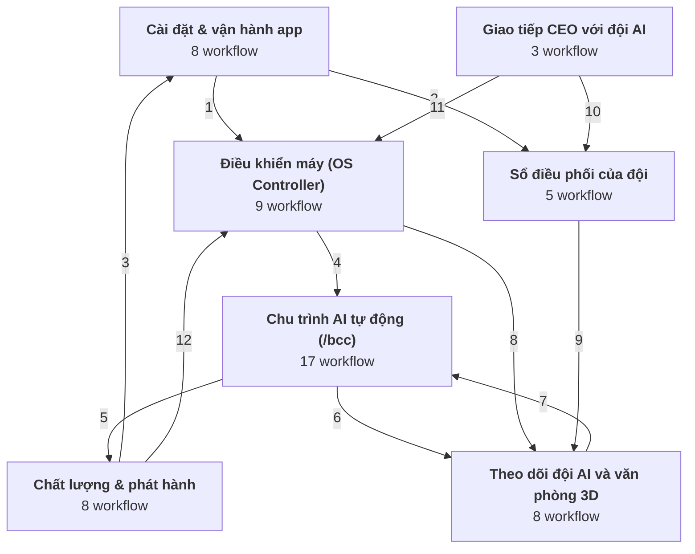
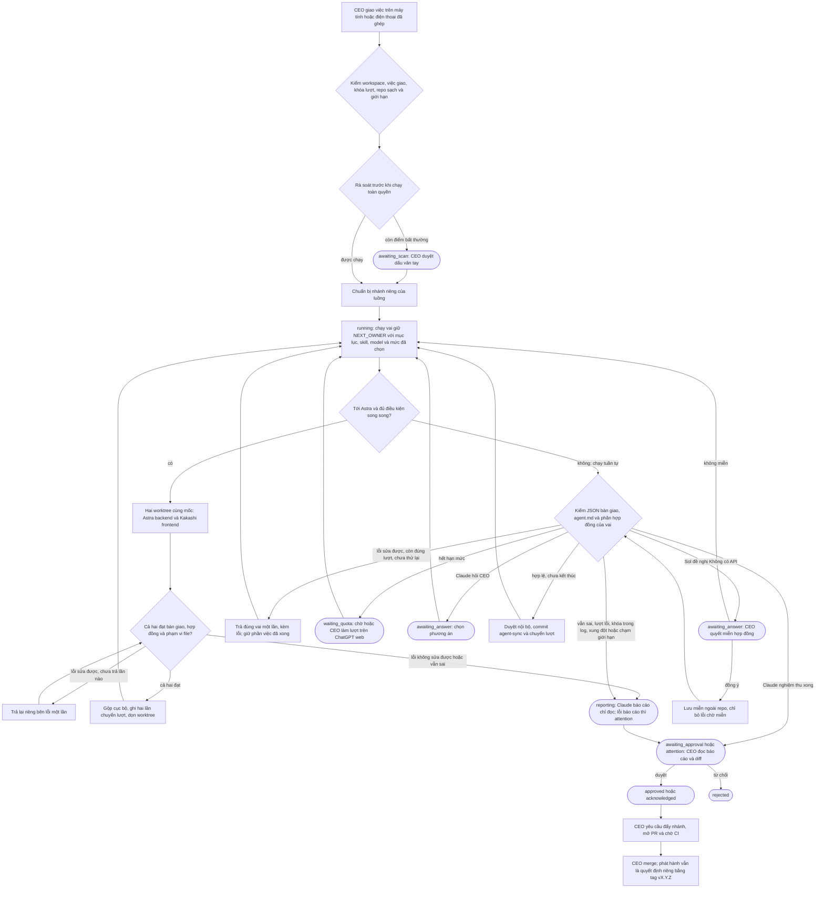
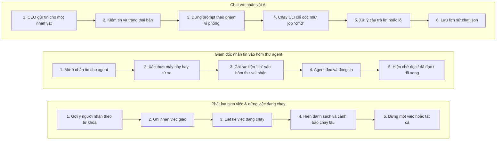
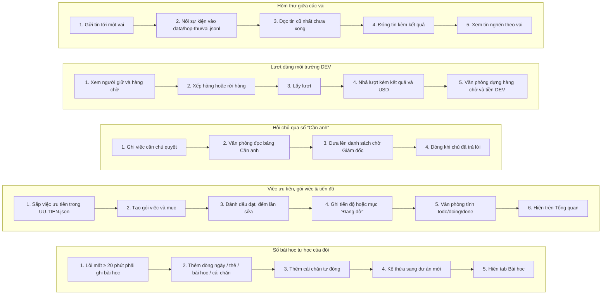
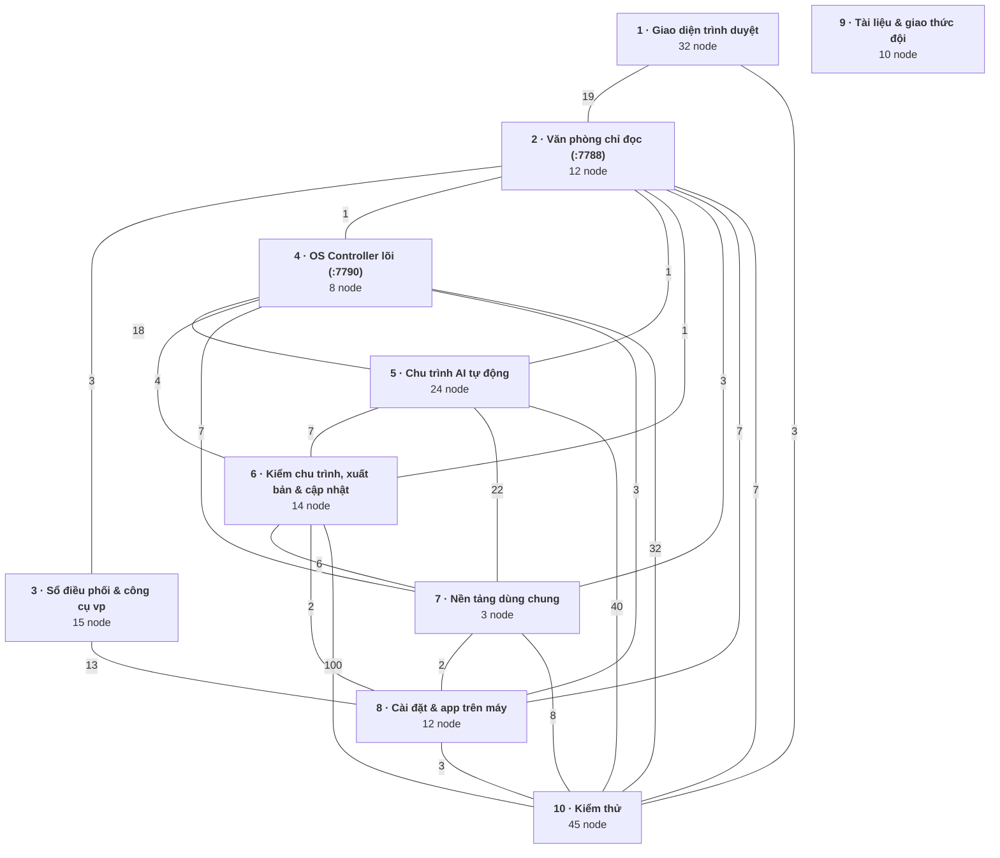

# Bản đồ hệ thống Văn phòng AI — từ workflow tới mã nguồn

> Sinh tự động bằng `node tools/ve-ban-do.js` từ `.ua/domain-graph.json` (workflow nghiệp vụ) và `.ua/knowledge-graph.json` (bản đồ hệ thống) do Understand Anything vẽ tại commit `3c00106`. Bản đồ tự cập nhật sau mỗi commit/merge: `node tools/cap-nhat-ban-do.js` giao Codex vẽ lại phần đổi rồi chạy lại lệnh trên (xem bản đồ có cũ không: `node tools/cap-nhat-ban-do.js --kiem`); Chi tiết workflow lấy từ đồ thị; sơ đồ trung tâm và ghi chú quyền điện thoại đã được đối chiếu với mã hiện tại.

**Bản tương tác** (bấm vào từng node, xem quan hệ, đi theo lộ trình): trong repo chạy `/understand-dashboard` của plugin Understand Anything (Claude Code), hoặc lệnh `npx` trong README của dự án Understand Anything. Lệnh đó tải và chạy mã của bên thứ ba: chỉ chạy khi anh tin nguồn; đọc các sơ đồ dưới đây trên GitHub thì không cần.

Quy mô: 7 miền nghiệp vụ, 58 workflow, 391 bước · 460 node (143 file, 285 hàm, 0 route API, 32 tài liệu/cấu hình/CI) · 1157 quan hệ (132 lời gọi, 236 import, 88 liên kết test) · 10 lớp kiến trúc · lộ trình 12 bước.

Mục lục: [1. Miền nghiệp vụ](#1-các-miền-nghiệp-vụ) · [2. Workflow trung tâm](#2-workflow-trung-tâm-ceo-giao-việc--đội-ai--ceo-duyệt) · [3. Từng workflow](#3-từng-workflow-từng-bước-trỏ-tới-mã) · [4. Lớp kiến trúc](#4-bản-đồ-hệ-thống-các-lớp-kiến-trúc) · [5. Lộ trình đọc mã](#5-lộ-trình-đọc-mã) · [6. Điểm cần anh rà](#6-điểm-phát-hiện-khi-vẽ--cần-anh-rà)

Bản đối chiếu lấy đồ thị cũ ở `72e9ac0` làm gốc: giữ đủ **7 miền, 40 workflow, 248 ID bước cũ**, thêm **18 workflow và 143 bước**. Không bỏ workflow hay bước cũ nào. Mọi bước đã được đối chiếu với file hiện tại và có file:dòng thuộc đồ thị hệ thống; bản đồ ghi nhận mã có sẵn, không phải bằng chứng các luồng mạng/AI đã được chạy thử trong tác vụ này.

## 1. Các miền nghiệp vụ

7 miền, nối với nhau như sau (chữ trên mũi tên: miền này dùng gì của miền kia).



1. **Cài đặt & vận hành app** → **Điều khiển máy (OS Controller)**: npm run all / npm run app bật OS Controller cạnh văn phòng; bộ cập nhật kiểm /health của ctl và chặn khi còn job/luồng AI
2. **Cài đặt & vận hành app** → **Sổ điều phối của đội**: setup.js tạo sổ data/ từ khung mau/ và chèn đoạn luật đội vào AGENTS.md/CLAUDE.md
3. **Chất lượng & phát hành** → **Cài đặt & vận hành app**: tag vX.Y.Z đã qua phat-hanh.yml là bản duy nhất kênh phat-hanh của nút Cập nhật nhận
4. **Điều khiển máy (OS Controller)** → **Chu trình AI tự động (/bcc)**: mỗi lượt AI là một job của ctl: chính sách, timeout, rà soát toàn quyền, kiểm toán, phanh; nạp repo tạo agent.md để chu trình chạy
5. **Chu trình AI tự động (/bcc)** → **Chất lượng & phát hành**: bộ kiểm agent.md chấm từng lượt; nhánh ai/… đẩy lên GitHub thành PR qua CI
6. **Chu trình AI tự động (/bcc)** → **Theo dõi đội AI và văn phòng 3D**: luồng, lượt và nhật ký hiện trên văn phòng 3D, bàn điều phối và trang tiến độ
7. **Theo dõi đội AI và văn phòng 3D** → **Chu trình AI tự động (/bcc)**: bộ theo dõi hạn mức cho luồng biết giờ chạy lại và chọn AI soạn master prompt
8. **Điều khiển máy (OS Controller)** → **Theo dõi đội AI và văn phòng 3D**: Văn phòng đọc job, tiến độ và hạn mức qua /ctl trên máy tính; điện thoại đã ghép qua /dkx/api với danh sách lệnh riêng.
9. **Sổ điều phối của đội** → **Theo dõi đội AI và văn phòng 3D**: agent ghi sổ bằng vp, văn phòng chỉ đọc để hiện tường, Tổng quan, Hiệu suất
10. **Giao tiếp CEO với đội AI** → **Sổ điều phối của đội**: tin của Giám đốc ghi vào hòm thư data/hop-thu, agent đọc bằng vp tiep
11. **Giao tiếp CEO với đội AI** → **Điều khiển máy (OS Controller)**: chat chạy CLI như job “cmd”; dừng việc chuyển lệnh kill sang ctl
12. **Chất lượng & phát hành** → **Điều khiển máy (OS Controller)**: xuất bản và cài bộ kiểm chạy lệnh qua jobs, đọc repo qua workspace và GitHub của ctl

- **Cài đặt & vận hành app** — Cài đặt, mở app và cập nhật Văn phòng AI theo kênh phát hành có quay lại, nâng cấp sổ ctl.db và giữ khóa tài khoản ngoài repo.
- **Theo dõi đội AI và văn phòng 3D** — Đọc nhật ký Claude/Codex, sổ điều phối và tiến độ repo để hiện trạng thái đội, chi phí, hạn mức và nhật ký.
- **Giao tiếp CEO với đội AI** — Các kênh Giám đốc nói chuyện với đội AI mà không phá khóa lượt: chat chỉ đọc với từng nhân vật qua OS Controller, nhắn tin vào hòm thư của agent (PIN khi truy cập từ xa), và Phát loa gợi ý người nhận kèm danh sách việc đang chạy có nút dừng.
- **Sổ điều phối của đội** — Bộ sổ chung trong data/ mà các agent (Claude Code, Codex) ghi bằng công cụ dòng lệnh vp (tools/vp.js) còn văn phòng chỉ đọc: hòm thư giữa các vai, lượt dùng môi trường DEV, sổ “Cần anh”, việc ưu tiên – gói việc – tiến độ và sổ bài học tự học.
- **Chu trình AI tự động (/bcc)** — CEO giao việc hoặc ý tưởng, các vai theo NEXT_OWNER trên nhánh của luồng: Hinata đặc tả, Sol lập kiến trúc và hợp đồng, Claude duyệt, Astra và Kakashi viết backend/frontend rồi Sol đối chiếu.
- **Điều khiển máy (OS Controller)** — OS Controller (ctl/main.js, chỉ nghe 127.0.0.1:7790, Bearer token sinh mới mỗi lần khởi động) là bàn tay của CEO trên máy: chạy lệnh theo chính sách allow/approve/deny không qua shell, phanh khẩn cấp dừng cả cây tiến trình, mở repo GitHub thành workspace, nạp…
- **Chất lượng & phát hành** — Kiểm agent.md và hợp đồng sau lượt, kiểm lại bằng CI trong repo dự án; cài hai bộ kiểm cùng workflow từ văn phòng.

## 2. Workflow trung tâm: CEO giao việc → đội AI → CEO duyệt

Luồng chính nằm trong `ctl/autopilot.js` và `ctl/runner.js`, mặc định 10 lượt/90 phút, tối đa 12 lượt/120 phút. Sơ đồ này đã đối chiếu các nhánh hợp đồng, trả lại bàn giao và worktree trong mã hiện tại; mỗi nhánh có workflow và file:dòng chi tiết ở mục 3.



Hinata đặc tả → Sol chốt kiến trúc và hợp đồng → Claude duyệt → Astra/Kakashi viết phần của mình → Sol đối chiếu → Claude nghiệm thu. Hướng chuyển thực tế theo `NEXT_OWNER`; phase không có giao diện, còn blocker hoặc không đủ điều kiện song song thì chạy tuần tự. Claude trả về Astra **hoặc Kakashi** đều là còn sửa tiếp; quá hai vòng sửa thì báo CEO. Quyết định miễn hợp đồng do CEO chọn, không phải Sol tự miễn.

## 3. Từng workflow, từng bước trỏ tới mã

### Cài đặt & vận hành app

Cài đặt, mở app và cập nhật Văn phòng AI theo kênh phát hành có quay lại, nâng cấp sổ ctl.db và giữ khóa tài khoản ngoài repo.

**Luật nghiệp vụ:**
- Không cần npm install, không thư viện ngoài; Node ≥ 18 (ctl cần node:sqlite)
- Agent cài phải hỏi chủ trước khi cài phần mềm, sửa AGENTS.md/CLAUDE.md hoặc mở văn phòng ra Internet
- Cập nhật chỉ fast-forward; bản mới không bật được hoặc /health sai phiên bản thì tự quay về bản cũ (git reset --keep)
- Không cập nhật khi còn việc AI/luồng tự động đang chạy (AI_BUSY) hoặc văn phòng không chạy bằng app (NOT_APP)
- Nâng cấp sổ ctl.db chỉ thêm bảng/cột/index, mỗi bước trong một giao dịch, lỗi thì ROLLBACK
- Khóa API lưu ở ~/.van-phong-ao/keys.json, không vào config.json, không trả về trình duyệt
- Truy cập từ xa cần accessKey; /ctl chỉ dùng trên máy tính, /dkx/api cần khóa thiết bị đã ghép và danh sách lệnh cho phép.

```mermaid
flowchart TD
  subgraph flow_cai_dat_lan_dau["Cài văn phòng lần đầu"]
    direction LR
    step_cai_dat_lan_dau_doc_huong_dan["1. Đọc hướng dẫn 8 bước và ranh giới an toàn"]
    step_cai_dat_lan_dau_goi_y_du_an["2. Gợi ý dự án đang dùng Claude Code/Codex"]
    step_cai_dat_lan_dau_ghi_config["3. Hỏi tên văn phòng, chủ, khóa xem và ghi config.json"]
    step_cai_dat_lan_dau_chep_khung_so["4. Chép khung sổ mau/ sang data/"]
    step_cai_dat_lan_dau_chen_luat_doi["5. Điền và chèn đoạn luật đội"]
    step_cai_dat_lan_dau_nap_cau_hinh["6. Nạp cấu hình khi chạy"]
    step_cai_dat_lan_dau_kiem_state["7. Bật server.js và kiểm GET /state"]
    step_cai_dat_lan_dau_doc_huong_dan --> step_cai_dat_lan_dau_goi_y_du_an
    step_cai_dat_lan_dau_goi_y_du_an --> step_cai_dat_lan_dau_ghi_config
    step_cai_dat_lan_dau_ghi_config --> step_cai_dat_lan_dau_chep_khung_so
    step_cai_dat_lan_dau_chep_khung_so --> step_cai_dat_lan_dau_chen_luat_doi
    step_cai_dat_lan_dau_chen_luat_doi --> step_cai_dat_lan_dau_nap_cau_hinh
    step_cai_dat_lan_dau_nap_cau_hinh --> step_cai_dat_lan_dau_kiem_state
  end
  subgraph flow_mo_app["Mở app trên máy & tự bật lại"]
    direction LR
    step_mo_app_tao_loi_tat["1. Tạo lối tắt Desktop, Start Menu, Startup"]
    step_mo_app_kiem_dang_chay["2. Kiểm văn phòng đã chạy chưa"]
    step_mo_app_bat_ngam["3. Bật bộ chạy ngầm, chờ tối đa 30 giây"]
    step_mo_app_bat_hai_tien_trinh["4. Bật văn phòng và OS Controller có kênh IPC"]
    step_mo_app_tu_bat_lai["5. Tự bật lại bên bị sập"]
    step_mo_app_mo_cua_so["6. Mở cửa sổ app bằng Edge/Chrome --app"]
    step_mo_app_trang_ngoai_tuyen["7. Báo “chưa chạy” khi văn phòng tắt"]
    step_mo_app_tat_an_toan["8. Tắt app đúng tiến trình"]
    step_mo_app_tao_loi_tat --> step_mo_app_kiem_dang_chay
    step_mo_app_kiem_dang_chay --> step_mo_app_bat_ngam
    step_mo_app_bat_ngam --> step_mo_app_bat_hai_tien_trinh
    step_mo_app_bat_hai_tien_trinh --> step_mo_app_tu_bat_lai
    step_mo_app_tu_bat_lai --> step_mo_app_mo_cua_so
    step_mo_app_mo_cua_so --> step_mo_app_trang_ngoai_tuyen
    step_mo_app_trang_ngoai_tuyen --> step_mo_app_tat_an_toan
  end
  subgraph flow_cap_nhat_app["Cập nhật app một nút"]
    direction LR
    step_cap_nhat_app_kiem_ban_moi["1. Kiểm bản mới trên GitHub"]
    step_cap_nhat_app_tinh_tinh_trang["2. Tính tình trạng theo kênh cập nhật"]
    step_cap_nhat_app_chan_khi_ban["3. Chặn khi đang bận hoặc không chạy bằng app"]
    step_cap_nhat_app_tach_tien_trinh["4. Tách tiến trình cập nhật khỏi văn phòng"]
    step_cap_nhat_app_tat_van_phong["5. Tắt văn phòng (dang-tat)"]
    step_cap_nhat_app_ap_fast_forward["6. Áp bản mới kiểu fast-forward (dang-cap-nhat)"]
    step_cap_nhat_app_bat_kiem_health["7. Bật lại và kiểm /health (dang-khoi-dong)"]
    step_cap_nhat_app_quay_lai["8. Tự quay về bản cũ khi bản mới không chạy"]
    step_cap_nhat_app_theo_doi["9. Trang theo dõi tới trạng thái cuối"]
    step_cap_nhat_app_kiem_ban_moi --> step_cap_nhat_app_tinh_tinh_trang
    step_cap_nhat_app_tinh_tinh_trang --> step_cap_nhat_app_chan_khi_ban
    step_cap_nhat_app_chan_khi_ban --> step_cap_nhat_app_tach_tien_trinh
    step_cap_nhat_app_tach_tien_trinh --> step_cap_nhat_app_tat_van_phong
    step_cap_nhat_app_tat_van_phong --> step_cap_nhat_app_ap_fast_forward
    step_cap_nhat_app_ap_fast_forward --> step_cap_nhat_app_bat_kiem_health
    step_cap_nhat_app_bat_kiem_health --> step_cap_nhat_app_quay_lai
    step_cap_nhat_app_quay_lai --> step_cap_nhat_app_theo_doi
  end
  subgraph flow_nang_cap_so_ctl["Nâng cấp sổ ctl.db khi khởi động"]
    direction LR
    step_nang_cap_so_ctl_mo_so["1. Mở sổ ctl.db"]
    step_nang_cap_so_ctl_ap_schema["2. Áp schema các bảng"]
    step_nang_cap_so_ctl_chay_migration["3. Chạy bước nâng cấp còn thiếu"]
    step_nang_cap_so_ctl_loi_migration["4. Bước lỗi: ROLLBACK và đóng sổ"]
    step_nang_cap_so_ctl_don_kiem_toan["5. Dọn nhật ký kiểm toán cũ"]
    step_nang_cap_so_ctl_mo_so --> step_nang_cap_so_ctl_ap_schema
    step_nang_cap_so_ctl_ap_schema --> step_nang_cap_so_ctl_chay_migration
    step_nang_cap_so_ctl_chay_migration --> step_nang_cap_so_ctl_loi_migration
    step_nang_cap_so_ctl_loi_migration --> step_nang_cap_so_ctl_don_kiem_toan
  end
  subgraph flow_xem_dien_thoai["Xem văn phòng trên điện thoại"]
    direction LR
    step_xem_dien_thoai_kiem_dieu_kien["1. Kiểm config.json, accessKey và cloudflared"]
    step_xem_dien_thoai_mo_duong_ham["2. Mở đường hầm tới localhost:port"]
    step_xem_dien_thoai_kiem_host["3. Kiểm Host và khóa xem"]
    step_xem_dien_thoai_chan_ctl["4. Chặn OS Controller khi truy cập từ xa"]
    step_xem_dien_thoai_pin_nhan_tin["5. Nhắn tin từ xa cần PIN"]
    step_xem_dien_thoai_kiem_dieu_kien --> step_xem_dien_thoai_mo_duong_ham
    step_xem_dien_thoai_mo_duong_ham --> step_xem_dien_thoai_kiem_host
    step_xem_dien_thoai_kiem_host --> step_xem_dien_thoai_chan_ctl
    step_xem_dien_thoai_chan_ctl --> step_xem_dien_thoai_pin_nhan_tin
  end
  subgraph flow_luu_khoa_tai_khoan["Lưu khóa API tài khoản AI"]
    direction LR
    step_luu_khoa_tai_khoan_xem_trang_thai["1. Đọc trạng thái tài khoản không lộ khóa"]
    step_luu_khoa_tai_khoan_chan_ghi_la["2. Chặn yêu cầu ghi không từ văn phòng"]
    step_luu_khoa_tai_khoan_kiem_dinh_dang["3. Kiểm nhà cung cấp và định dạng khóa"]
    step_luu_khoa_tai_khoan_ghi_nguyen_tu["4. Ghi nguyên tử keys.json ngoài repo"]
    step_luu_khoa_tai_khoan_tra_trang_thai["5. Trả trạng thái mới"]
    step_luu_khoa_tai_khoan_xem_trang_thai --> step_luu_khoa_tai_khoan_chan_ghi_la
    step_luu_khoa_tai_khoan_chan_ghi_la --> step_luu_khoa_tai_khoan_kiem_dinh_dang
    step_luu_khoa_tai_khoan_kiem_dinh_dang --> step_luu_khoa_tai_khoan_ghi_nguyen_tu
    step_luu_khoa_tai_khoan_ghi_nguyen_tu --> step_luu_khoa_tai_khoan_tra_trang_thai
  end
  subgraph flow_chuyen_tai_khoan_antigravity["Cất và chuyển tài khoản Antigravity"]
    direction LR
    step_chuyen_tai_khoan_antigravity_cat["1. Cất tài khoản đang đăng nhập"]
    step_chuyen_tai_khoan_antigravity_tuy_chon["2. Đặt nhãn và ngưỡng tự chuyển"]
    step_chuyen_tai_khoan_antigravity_kiem_ban["3. Chỉ đổi khi Antigravity rảnh"]
    step_chuyen_tai_khoan_antigravity_bao_ve_dang_nhap["4. Giữ đăng nhập chưa được cất"]
    step_chuyen_tai_khoan_antigravity_nap["5. Cất bản hiện tại rồi nạp và xác minh"]
    step_chuyen_tai_khoan_antigravity_nhom_model["6. Tính hạn mức đúng nhóm model"]
    step_chuyen_tai_khoan_antigravity_tu_chon["7. Tự chọn tài khoản trước lượt"]
    step_chuyen_tai_khoan_antigravity_ap_luot["8. Áp tài khoản và chấm lại mức"]
    step_chuyen_tai_khoan_antigravity_menu["9. Đổi một chạm trên điện thoại"]
    step_chuyen_tai_khoan_antigravity_bo["10. Bỏ bản cất khi CEO yêu cầu"]
    step_chuyen_tai_khoan_antigravity_cat --> step_chuyen_tai_khoan_antigravity_tuy_chon
    step_chuyen_tai_khoan_antigravity_tuy_chon --> step_chuyen_tai_khoan_antigravity_kiem_ban
    step_chuyen_tai_khoan_antigravity_kiem_ban --> step_chuyen_tai_khoan_antigravity_bao_ve_dang_nhap
    step_chuyen_tai_khoan_antigravity_bao_ve_dang_nhap --> step_chuyen_tai_khoan_antigravity_nap
    step_chuyen_tai_khoan_antigravity_nap --> step_chuyen_tai_khoan_antigravity_nhom_model
    step_chuyen_tai_khoan_antigravity_nhom_model --> step_chuyen_tai_khoan_antigravity_tu_chon
    step_chuyen_tai_khoan_antigravity_tu_chon --> step_chuyen_tai_khoan_antigravity_ap_luot
    step_chuyen_tai_khoan_antigravity_ap_luot --> step_chuyen_tai_khoan_antigravity_menu
    step_chuyen_tai_khoan_antigravity_menu --> step_chuyen_tai_khoan_antigravity_bo
  end
  subgraph flow_cai_man_hinh_chinh["Cài văn phòng trên màn hình chính điện thoại"]
    direction LR
    step_cai_man_hinh_chinh_tailscale["1. Mở HTTPS qua mạng riêng Tailscale"]
    step_cai_man_hinh_chinh_manifest["2. Khai báo app điều khiển riêng"]
    step_cai_man_hinh_chinh_huong_dan["3. Hiện hướng dẫn iPhone khi chưa cài"]
    step_cai_man_hinh_chinh_ghep_trong_app["4. Ghép lại trong app có bộ nhớ riêng"]
    step_cai_man_hinh_chinh_ve_bang["5. Có nút về bảng và tải lại trong app"]
    step_cai_man_hinh_chinh_offline["6. Mất máy chủ thì hiện trang hướng dẫn"]
    step_cai_man_hinh_chinh_tailscale --> step_cai_man_hinh_chinh_manifest
    step_cai_man_hinh_chinh_manifest --> step_cai_man_hinh_chinh_huong_dan
    step_cai_man_hinh_chinh_huong_dan --> step_cai_man_hinh_chinh_ghep_trong_app
    step_cai_man_hinh_chinh_ghep_trong_app --> step_cai_man_hinh_chinh_ve_bang
    step_cai_man_hinh_chinh_ve_bang --> step_cai_man_hinh_chinh_offline
  end
  flow_cai_dat_lan_dau ~~~ flow_mo_app
  flow_mo_app ~~~ flow_cap_nhat_app
  flow_cap_nhat_app ~~~ flow_nang_cap_so_ctl
  flow_nang_cap_so_ctl ~~~ flow_xem_dien_thoai
  flow_xem_dien_thoai ~~~ flow_luu_khoa_tai_khoan
  flow_luu_khoa_tai_khoan ~~~ flow_chuyen_tai_khoan_antigravity
  flow_chuyen_tai_khoan_antigravity ~~~ flow_cai_man_hinh_chinh
```



#### Cài văn phòng lần đầu

Agent (hoặc chủ) cài văn phòng: kiểm máy, gợi ý dự án đang dùng Claude Code/Codex, ghi config.json, chép khung sổ data/, chèn luật đội vào AGENTS.md/CLAUDE.md của dự án rồi bật server và kiểm /state. — *Kích hoạt:* `Agent đọc HUONG-DAN-CHO-AGENT.md / npm run setup (node setup.js --yes)` (cli).

1. **Đọc hướng dẫn 8 bước và ranh giới an toàn** — Agent theo HUONG-DAN-CHO-AGENT.md: kiểm Node 18+, clone kho, và phải hỏi chủ trước khi cài phần mềm, sửa AGENTS.md/CLAUDE.md hay mở ra Internet. [`HUONG-DAN-CHO-AGENT.md:1`](../HUONG-DAN-CHO-AGENT.md#L1-L168)
2. **Gợi ý dự án đang dùng Claude Code/Codex** — setup.findProjects quét ~/.claude/projects và ~/.codex/sessions sửa trong 14 ngày, lấy cwd, gộp theo thư mục, bỏ worktree con và sắp mới nhất. [`setup.js:26`](../setup.js#L26-L45)
3. **Hỏi tên văn phòng, chủ, khóa xem và ghi config.json** — setup.main lấy câu trả lời (hoặc cờ khi --yes), tạo accessKey ngẫu nhiên nếu muốn xem qua Internet và ghi config.json, sao lưu bản cũ thành .bak. [`setup.js:47`](../setup.js#L47-L112)
4. **Chép khung sổ mau/ sang data/** — Chép NOI-QUY, UU-TIEN.json, gói vi-du, BAI-HOC (kế thừa bài học), CAN-ANH… sang data/ mà không ghi đè file đã có; tạo data/hop-thu. [`setup.js:47`](../setup.js#L47-L112)
5. **Điền và chèn đoạn luật đội** — Thay {{PORT}}, {{DATA}}, {{VP}} trong mau/DOAN-CHEN-VAO-AGENTS.md; chỉ dán vào cuối AGENTS.md/CLAUDE.md của dự án khi chủ đồng ý (--chen-luat). [`mau/DOAN-CHEN-VAO-AGENTS.md:1`](../mau/DOAN-CHEN-VAO-AGENTS.md#L1-L19)
6. **Nạp cấu hình khi chạy** — lib/config.loadConfig đọc config.json (bỏ BOM) và trộn mặc định: cổng 7788, host 127.0.0.1, dataDir, giá token, trần tiền AI, updateChannel; thiếu file thì trả null. [`lib/config.js:22`](../lib/config.js#L22-L29)
7. **Bật server.js và kiểm GET /state** — Agent chạy npm start, gọi /state để xác nhận văn phòng đọc được phiên và sổ, điền sổ bằng tools/vp.js rồi báo lại chủ. [`server.js:837`](../server.js#L837-L837)

#### Mở app trên máy & tự bật lại

Dùng văn phòng như một app: lối tắt Desktop/Start Menu, bật ngầm cả văn phòng (:7788) lẫn OS Controller (:7790) có tự bật lại khi sập, mở cửa sổ --app, trang ngoại tuyến khi tắt và tắt đúng tiến trình. — *Kích hoạt:* `Lối tắt “Văn phòng AI” / npm run app; tắt bằng npm run tat-app` (manual).

1. **Tạo lối tắt Desktop, Start Menu, Startup** — npm run cai-app (chỉ Windows): plan dựng tham số WScript.Shell qua PowerShell, mọi đường dẫn truyền bằng biến môi trường VP_* để không bị chèn lệnh; --go để gỡ. [`scripts/cai-app.js:40`](../scripts/cai-app.js#L40-L51)
2. **Kiểm văn phòng đã chạy chưa** — lib/app.isUp gọi GET /manifest.webmanifest; 200 hoặc 401 (khóa xem) coi là đang chạy, lỗi/timeout là chưa chạy. [`lib/app.js:22`](../lib/app.js#L22-L28)
3. **Bật bộ chạy ngầm, chờ tối đa 30 giây** — scripts/mo-app.js spawn chay-tat-ca.js --tu-bat-lai chạy ngầm, ghi app.log và app.pid rồi waitUp; quá 30 giây thì báo lỗi kèm đường dẫn log. [`scripts/mo-app.js:1`](../scripts/mo-app.js#L1-L50)
4. **Bật văn phòng và OS Controller có kênh IPC** — chay-tat-ca.launch spawn server.js (7788) và ctl/main.js (7790) bằng node có kênh IPC; một bên thoát ngoài lúc tắt thì ghi nhận lần sập. [`scripts/chay-tat-ca.js:23`](../scripts/chay-tat-ca.js#L23-L38)
5. **Tự bật lại bên bị sập** — Với --tu-bat-lai: bật lại sau 3 giây, tối đa 5 lần trong 10 phút, vượt ngưỡng thì tắt hẳn; không có cờ thì một bên chết là tắt cả hai. [`scripts/chay-tat-ca.js:23`](../scripts/chay-tat-ca.js#L23-L38)
6. **Mở cửa sổ app bằng Edge/Chrome --app** — findBrowser tìm Edge/Chrome/Brave/Chromium, openCommand dựng lệnh không qua shell; không có Chromium thì mở trình duyệt mặc định; --nen chỉ bật ngầm. [`lib/app.js:60`](../lib/app.js#L60-L65)
7. **Báo “chưa chạy” khi văn phòng tắt** — Service worker chỉ lưu đệm offline.html và trả nó cho yêu cầu điều hướng khi máy chủ không trả lời; không bao giờ lưu đệm dữ liệu (bài học BROWSER-CACHE); offline.html thử lại mỗi 3 giây. [`public/sw.js:1`](../public/sw.js#L1-L20)
8. **Tắt app đúng tiến trình** — tat-app.js đọc app.pid, isAppProcess xác minh đúng chay-tat-ca.js (PID cũ của chương trình khác thì chỉ xóa app.pid), gửi dừng, chờ 15 giây rồi mới killTree; ctl nhận “stop” qua IPC, quá 8 giây mới giết cả cây. [`scripts/tat-app.js:1`](../scripts/tat-app.js#L1-L35)

#### Cập nhật app một nút

CEO bấm Cập nhật: văn phòng kiểm bản mới theo kênh, tách tiến trình cập nhật, tắt văn phòng, fast-forward lên bản mới, bật lại và kiểm /health; bản mới hỏng thì tự quay về bản cũ, dữ liệu giữ nguyên. — *Kích hoạt:* `Trang cap-nhat.html → GET /ctl/cap-nhat?fetch=1, POST /ctl/cap-nhat` (http).

1. **Kiểm bản mới trên GitHub** — cap-nhat.html gọi GET /ctl/cap-nhat?fetch=1; updater.refresh tải tag/nhánh một lần tại một thời điểm (fetchAsync không chặn) và lưu kết quả ở cap-nhat-kiem.json. [`ctl/cap-nhat.js:27`](../ctl/cap-nhat.js#L27-L44)
2. **Tính tình trạng theo kênh cập nhật** — lib/cap-nhat.check: kênh phat-hanh chỉ nhận tag vX.Y.Z mới nhất (so bằng cmpTag), kênh main theo origin/main; ra trạng thái khong-phai-git / chua-phat-hanh / moi-nhat / co-ban-moi / lech kèm danh sách commit và ghi chú tag. [`lib/cap-nhat.js:38`](../lib/cap-nhat.js#L38-L72)
3. **Chặn khi đang bận hoặc không chạy bằng app** — updater.start: còn job AI hoặc luồng tự động thì AI_BUSY; văn phòng không chạy bằng npm run app thì NOT_APP (hướng dẫn tắt, git pull --ff-only, bật lại). [`ctl/cap-nhat.js:45`](../ctl/cap-nhat.js#L45-L63)
4. **Tách tiến trình cập nhật khỏi văn phòng** — ctl spawn scripts/cap-nhat.js --tach --tu --den --ten (detached); tiến trình tự chạy lại tách khỏi cây văn phòng và kiểm --tu/--den là SHA đủ 40 ký tự, sai thì thoát mã 2. [`scripts/cap-nhat.js:1`](../scripts/cap-nhat.js#L1-L37)
5. **Tắt văn phòng (dang-tat)** — runUpdate gọi stopApp = scripts/tat-app.js; không tắt được thì dừng ở “loi” và giữ nguyên bản trên máy. [`lib/cap-nhat.js:98`](../lib/cap-nhat.js#L98-L116)
6. **Áp bản mới kiểu fast-forward (dang-cap-nhat)** — apply: HEAD vẫn bằng from, không có file đang sửa, from là tổ tiên của to, rồi git merge --ff-only; lỗi CHANGED/DIRTY/NOT_FF/FAILED thì bật lại bản cũ và báo lỗi. [`lib/cap-nhat.js:75`](../lib/cap-nhat.js#L75-L81)
7. **Bật lại và kiểm /health (dang-khoi-dong)** — startApp = mo-app.js --nen; healthy thăm dò GET /health của ctl tối đa 40 lần × 750 ms tới khi version khớp package.json mới; quá 30 giây coi là hỏng. [`scripts/cap-nhat.js:49`](../scripts/cap-nhat.js#L49-L58)
8. **Tự quay về bản cũ khi bản mới không chạy** — dang-quay-lai: tắt lại, rollback bằng git reset --keep, bật lại → “da-quay-lai” (dữ liệu giữ nguyên) hoặc “loi” kèm đường dẫn logs/cap-nhat.log. [`lib/cap-nhat.js:84`](../lib/cap-nhat.js#L84-L86)
9. **Trang theo dõi tới trạng thái cuối** — cap-nhat.html follow hỏi lại mỗi 2 giây, coi lỗi kết nối là văn phòng đang khởi động lại, dừng khi gặp xong / da-quay-lai / loi. [`public/cap-nhat.html:130`](../public/cap-nhat.html#L130-L147)

#### Nâng cấp sổ ctl.db khi khởi động

Mỗi lần OS Controller khởi động, sổ SQLite ~/.van-phong-ao/ctl.db được mở, áp schema và chạy các bước nâng cấp còn thiếu theo PRAGMA user_version, sao cho bản cũ vẫn đọc được nếu bộ cập nhật phải quay lại. — *Kích hoạt:* `OS Controller khởi động (createCtl → db.open)` (event).

1. **Mở sổ ctl.db** — db.open tạo thư mục sổ và logs với quyền 0700, mở ctl.db bằng node:sqlite, bật WAL và busy_timeout. [`ctl/db.js:90`](../ctl/db.js#L90-L98)
2. **Áp schema các bảng** — SCHEMA tạo bảng jobs, audit (trigger chặn sửa, chỉ xóa bản ghi quá 90 ngày), handoffs, workspaces nếu chưa có. [`ctl/db.js:10`](../ctl/db.js#L10-L69)
3. **Chạy bước nâng cấp còn thiếu** — migrate đọc PRAGMA user_version, chạy từng bước của MIGRATIONS (chuỗi SQL hoặc hàm) trong một giao dịch rồi tăng user_version; chỉ được thêm bảng/cột/index, không xóa hay đổi tên. [`ctl/db.js:74`](../ctl/db.js#L74-L88)
4. **Bước lỗi: ROLLBACK và đóng sổ** — Bước lỗi thì ROLLBACK và ném DB_MIGRATION; open đóng sổ để không giữ khóa file, ctl không lên nên /health sai và bộ cập nhật tự quay về bản cũ. [`ctl/db.js:90`](../ctl/db.js#L90-L98)
5. **Dọn nhật ký kiểm toán cũ** — createAudit chuẩn bị log/recent/prune: ghi chỉ-thêm có che khóa, prune xóa dòng quá 90 ngày. [`ctl/audit.js:5`](../ctl/audit.js#L5-L17)

#### Xem văn phòng trên điện thoại

Mở đường hầm Cloudflare để xem văn phòng bằng khóa xem; cầu /ctl chỉ dùng trên máy tính. — *Kích hoạt:* `scripts/xem-tren-dien-thoai.ps1 (Windows) / .sh (macOS, Linux)` (cli).

1. **Kiểm config.json, accessKey và cloudflared** — Script dừng nếu chưa có config.json, chưa đặt accessKey hoặc chưa cài cloudflared; cổng mặc định 7788. [`scripts/xem-tren-dien-thoai.ps1:1`](../scripts/xem-tren-dien-thoai.ps1#L1-L16)
2. **Mở đường hầm tới localhost:<port>** — cloudflared tunnel không cần tài khoản; bản shell lấy port bằng sed rồi exec cloudflared. [`scripts/xem-tren-dien-thoai.sh:1`](../scripts/xem-tren-dien-thoai.sh#L1-L16)
3. **Kiểm Host và khóa xem** — guard.checkHost chỉ nhận Host lạ khi đã bật accessKey (chống DNS rebinding); checkWrite chặn CSRF cho yêu cầu ghi. [`lib/guard.js:15`](../lib/guard.js#L15-L19)
4. **Chặn OS Controller khi truy cập từ xa** — ctlbridge.proxy chặn truy cập trực tiếp /ctl từ xa bằng isLocal và Host loopback, kể cả qua Cloudflare/Tailscale. [`lib/ctlbridge.js:40`](../lib/ctlbridge.js#L40-L58)
5. **Nhắn tin từ xa cần PIN** — lib/chat.authorized: từ xa phải gửi x-pin đúng; sai 5 lần trong 10 phút theo IP thì bị khóa. [`lib/chat.js:25`](../lib/chat.js#L25-L34)

#### Lưu khóa API tài khoản AI

Giám đốc xem tình trạng tài khoản Claude/GPT/Gemini và lưu khóa API ở ngoài mã nguồn; máy chủ chỉ trả “đã có khóa hay chưa”. — *Kích hoạt:* `Thẻ “Tài khoản AI” → GET /api/accounts, POST /api/accounts/save` (http).

1. **Đọc trạng thái tài khoản không lộ khóa** — getAccountsStatus: Claude (OAuth .credentials.json hoặc ANTHROPIC_API_KEY / keys.json, số phiên), GPT/Codex, Gemini; không bao giờ trả giá trị khóa. [`server.js:609`](../server.js#L609-L704)
2. **Chặn yêu cầu ghi không từ văn phòng** — guard.checkWrite: Content-Type application/json, Origin khớp Host, Sec-Fetch-Site same-origin/none. [`lib/guard.js:21`](../lib/guard.js#L21-L37)
3. **Kiểm nhà cung cấp và định dạng khóa** — keys.save nhận khóa Claude, GPT và Gemini theo mẫu từng hãng; sai định dạng trả lỗi. [`lib/keys.js:10`](../lib/keys.js#L10-L28)
4. **Ghi nguyên tử keys.json ngoài repo** — Tạo ~/.van-phong-ao quyền 700, ghi keys.json quyền 600 bằng writeAtomic (file tạm rồi đổi tên). [`lib/ghi-file.js:17`](../lib/ghi-file.js#L17-L20)
5. **Trả trạng thái mới** — POST /api/accounts/save trả lại trạng thái tài khoản đã cập nhật, không kèm khóa. [`server.js:828`](../server.js#L828-L835)

#### Cất và chuyển tài khoản Antigravity

Cất đăng nhập của từng tài khoản bằng Windows Credential Manager, đổi tay hoặc tự chọn tài khoản có model và hạn mức phù hợp trước lượt. — *Kích hoạt:* `POST /agy-tai-khoan/cat, /:id/chuyen hoặc runner trước lượt Antigravity` (http).

1. **Cất tài khoản đang đăng nhập** — cat đọc email thật, tạo ID ổn định và nhờ PowerShell cất credential; lưu nhãn và metadata ngoài repo, không ghi token vào JSON. [`ctl/agy-tai-khoan.js:111`](../ctl/agy-tai-khoan.js#L111-L124)
2. **Đặt nhãn và ngưỡng tự chuyển** — sua cho đổi nhãn, bật/tắt tự chuyển và ngưỡng 1–50%; cấu hình được ghi nguyên tử, có kiểm toán. [`ctl/agy-tai-khoan.js:126`](../ctl/agy-tai-khoan.js#L126-L133)
3. **Chỉ đổi khi Antigravity rảnh** — agyDangChayWin xét tiến trình làm việc, bỏ qua --bg-updater; không đọc được tiến trình coi là bận. [`ctl/agy-tai-khoan.js:32`](../ctl/agy-tai-khoan.js#L32-L42)
4. **Giữ đăng nhập chưa được cất** — chuyen đọc lại email trước quyết định; đăng nhập lạ chưa cất bị AGY_UNSAVED để không mất bản duy nhất của chủ. [`ctl/agy-tai-khoan.js:151`](../ctl/agy-tai-khoan.js#L151-L160)
5. **Cất bản hiện tại rồi nạp và xác minh** — PowerShell lưu credential đã làm mới vào đúng tài khoản rồi nạp tài khoản đích; đọc email xác minh, tăng bộ đếm đổi và ghi kiểm toán. [`ctl/agy-tai-khoan.js:161`](../ctl/agy-tai-khoan.js#L161-L167)
6. **Tính hạn mức đúng nhóm model** — nhomCua phân nhóm Gemini, Claude/GPT và model có nhóm riêng; conLai xét cửa sổ đã reset, nhóm không có và phần trăm thấp nhất. [`ctl/agy-tai-khoan.js:44`](../ctl/agy-tai-khoan.js#L44-L67)
7. **Tự chọn tài khoản trước lượt** — truocLuot xét model sẵn có, ngưỡng còn lại và tài khoản còn nhiều nhất; tài khoản khác cũng cạn thì giữ nguyên để tránh đổi qua lại. [`ctl/agy-tai-khoan.js:215`](../ctl/agy-tai-khoan.js#L215-L250)
8. **Áp tài khoản và chấm lại mức** — runner gọi truocLuot theo model thật, chấm lại mức theo hạn mức tài khoản vừa chuyển, lưu lý do tài khoản trong audit và kết quả lượt. [`ctl/runner.js:268`](../ctl/runner.js#L268-L288)
9. **Đổi một chạm trên điện thoại** — renderTkMenu hiện tài khoản đã cất và hạn mức, khóa nút đang dùng/đang trao; thao tác đổi đi qua request và hiện lỗi nếu máy bận. [`public/office-desk.js:244`](../public/office-desk.js#L244-L262)
10. **Bỏ bản cất khi CEO yêu cầu** — xoa từ chối khi đang mượn tài khoản, nhờ PowerShell bỏ bản cất rồi cập nhật danh sách; giữ danh sách email đã bỏ để không tự cất lại. [`ctl/agy-tai-khoan.js:135`](../ctl/agy-tai-khoan.js#L135-L145)

#### Cài văn phòng trên màn hình chính điện thoại

Mở văn phòng qua Tailscale, thêm trang điều khiển vào màn hình chính theo hướng dẫn iOS hoặc cài PWA trên trình duyệt hỗ trợ. — *Kích hoạt:* `Safari/Chrome trên iPhone → dieu-khien.html → Thêm vào MH chính` (manual).

1. **Mở HTTPS qua mạng riêng Tailscale** — Script kiểm cấu hình, accessKey và Tailscale đã chạy, bật serve --bg HTTPS tới localhost; -Tat tắt đường vào, không cài phần mềm tự động. [`scripts/dien-thoai-tailscale.ps1:5`](../scripts/dien-thoai-tailscale.ps1#L5-L25)
2. **Khai báo app điều khiển riêng** — Manifest đặt id /dieu-khien, start_url /dieu-khien.html, display standalone và các biểu tượng; trang có meta và apple-touch-icon. [`public/dieu-khien.webmanifest:1`](../public/dieu-khien.webmanifest#L1-L18)
3. **Hiện hướng dẫn iPhone khi chưa cài** — goiYCai nhận diện iOS/iPad và standalone; hướng dẫn Chia sẻ rồi Thêm vào MH chính, cho ẩn nhắc khi phù hợp. [`public/dieu-khien.html:80`](../public/dieu-khien.html#L80-L94)
4. **Ghép lại trong app có bộ nhớ riêng** — Trang nhắc bộ nhớ đăng nhập của app khác trình duyệt, nên cài trước và ghép trong app; start kiểm ghép rồi mới hiện tab và link Mở 3D. [`public/dieu-khien.html:91`](../public/dieu-khien.html#L91-L112)
5. **Có nút về bảng và tải lại trong app** — createDesk thêm link về bảng cho điện thoại và nút tải lại khi standalone, vì app trên màn hình chính không có thanh điều hướng trình duyệt. [`public/office-desk.js:49`](../public/office-desk.js#L49-L64)
6. **Mất máy chủ thì hiện trang hướng dẫn** — Service worker chỉ cache offline.html; điều hướng luôn lấy mới, không kết nối được mới trả trang offline, không cache dữ liệu nghiệp vụ. [`public/sw.js:5`](../public/sw.js#L5-L19)

### Theo dõi đội AI và văn phòng 3D

Đọc nhật ký Claude/Codex, sổ điều phối và tiến độ repo để hiện trạng thái đội, chi phí, hạn mức và nhật ký.

**Luật nghiệp vụ:**
- Phần theo dõi đọc nhật ký và sổ dự án; lệnh ghi qua công cụ sổ hoặc API điều khiển có kiểm quyền.
- Che khóa (maskSecrets/maskText) và PIN trước khi trả trình duyệt
- Mỗi file chỉ đọc lại khi mtime/size đổi; nhật ký đọc tăng dần theo offset
- Hạn mức đọc qua CLI cục bộ, không lộ dữ liệu tài khoản; lỗi từng hãng độc lập
- Blocker OPEN chỉ tính ở Vùng [5]

```mermaid
flowchart TD
  subgraph flow_trang_thai_realtime["Cập nhật trạng thái văn phòng mỗi giây"]
    direction LR
    step_trang_thai_realtime_tim_phien["1. Phát hiện phiên mới"]
    step_trang_thai_realtime_phien_dang_mo["2. Đọc phiên Claude đang mở"]
    step_trang_thai_realtime_doc_nhat_ky["3. Đọc tăng dần nhật ký phiên"]
    step_trang_thai_realtime_doc_so_data["4. Đọc sổ điều phối"]
    step_trang_thai_realtime_viec_cho_ceo["5. Gom việc chờ Giám đốc"]
    step_trang_thai_realtime_dung_snapshot["6. Dựng snapshot đã che khóa"]
    step_trang_thai_realtime_day_sse["7. Đẩy SSE mỗi giây"]
    step_trang_thai_realtime_ve_3d["8. Vẽ văn phòng 3D"]
    step_trang_thai_realtime_tim_phien --> step_trang_thai_realtime_phien_dang_mo
    step_trang_thai_realtime_phien_dang_mo --> step_trang_thai_realtime_doc_nhat_ky
    step_trang_thai_realtime_doc_nhat_ky --> step_trang_thai_realtime_doc_so_data
    step_trang_thai_realtime_doc_so_data --> step_trang_thai_realtime_viec_cho_ceo
    step_trang_thai_realtime_viec_cho_ceo --> step_trang_thai_realtime_dung_snapshot
    step_trang_thai_realtime_dung_snapshot --> step_trang_thai_realtime_day_sse
    step_trang_thai_realtime_day_sse --> step_trang_thai_realtime_ve_3d
  end
  subgraph flow_danh_gia_nhan_su["Đánh giá nhân sự & tiền AI"]
    direction LR
    step_danh_gia_nhan_su_quet_nhat_ky["1. Quét lần lượt nhật ký các agent"]
    step_danh_gia_nhan_su_nhay_7_ngay["2. Nhảy tới mốc 7 ngày"]
    step_danh_gia_nhan_su_dem_token["3. Đếm token Codex và Claude"]
    step_danh_gia_nhan_su_cham_diem["4. Chấm điểm thang 100"]
    step_danh_gia_nhan_su_uoc_tien["5. Ước tính tiền AI theo ngày"]
    step_danh_gia_nhan_su_hien_bang["6. Hiện KPI, biểu đồ và bảng xếp loại"]
    step_danh_gia_nhan_su_quet_nhat_ky --> step_danh_gia_nhan_su_nhay_7_ngay
    step_danh_gia_nhan_su_nhay_7_ngay --> step_danh_gia_nhan_su_dem_token
    step_danh_gia_nhan_su_dem_token --> step_danh_gia_nhan_su_cham_diem
    step_danh_gia_nhan_su_cham_diem --> step_danh_gia_nhan_su_uoc_tien
    step_danh_gia_nhan_su_uoc_tien --> step_danh_gia_nhan_su_hien_bang
  end
  subgraph flow_tong_quan_giam_doc["Tổng quan & sổ sách cho Giám đốc"]
    direction LR
    step_tong_quan_giam_doc_ghep_viec["1. Ghép việc ưu tiên với gói việc và người làm"]
    step_tong_quan_giam_doc_tien_do_moi["2. Lấy dòng tiến độ mới nhất"]
    step_tong_quan_giam_doc_tong_hop_hom_thu["3. Tổng hợp hòm thư theo vai"]
    step_tong_quan_giam_doc_dung_so_sach["4. Dựng sổ nội quy, đội ngũ và sổ tay"]
    step_tong_quan_giam_doc_phuc_vu_cache["5. Phục vụ JSON có cache"]
    step_tong_quan_giam_doc_hien_markdown["6. Hiện Markdown an toàn"]
    step_tong_quan_giam_doc_ghep_viec --> step_tong_quan_giam_doc_tien_do_moi
    step_tong_quan_giam_doc_tien_do_moi --> step_tong_quan_giam_doc_tong_hop_hom_thu
    step_tong_quan_giam_doc_tong_hop_hom_thu --> step_tong_quan_giam_doc_dung_so_sach
    step_tong_quan_giam_doc_dung_so_sach --> step_tong_quan_giam_doc_phuc_vu_cache
    step_tong_quan_giam_doc_phuc_vu_cache --> step_tong_quan_giam_doc_hien_markdown
  end
  subgraph flow_tien_do_du_an["Tiến độ giao thức agent.md của từng dự án"]
    direction LR
    step_tien_do_du_an_chon_du_an["1. Chọn dự án đang xem"]
    step_tien_do_du_an_cong_khai["2. Xác định repo công khai hay riêng tư"]
    step_tien_do_du_an_doc_repo["3. Đọc thật git, công nghệ, README"]
    step_tien_do_du_an_phan_tich_agent_md["4. Phân tích tiến độ agent.md"]
    step_tien_do_du_an_bang_du_an["5. Tổng hợp bảng mọi dự án"]
    step_tien_do_du_an_hien_tien_do["6. Hiện “đang dừng ở đâu / đã làm gì / còn cần gì”"]
    step_tien_do_du_an_chon_du_an --> step_tien_do_du_an_cong_khai
    step_tien_do_du_an_cong_khai --> step_tien_do_du_an_doc_repo
    step_tien_do_du_an_doc_repo --> step_tien_do_du_an_phan_tich_agent_md
    step_tien_do_du_an_phan_tich_agent_md --> step_tien_do_du_an_bang_du_an
    step_tien_do_du_an_bang_du_an --> step_tien_do_du_an_hien_tien_do
  end
  subgraph flow_theo_doi_han_muc["Theo dõi hạn mức thuê bao AI"]
    direction LR
    step_theo_doi_han_muc_den_han["1. Chỉ đọc nhà cung cấp đến hạn"]
    step_theo_doi_han_muc_chay_cli["2. Chạy CLI cục bộ không qua shell"]
    step_theo_doi_han_muc_chuan_hoa["3. Chuẩn hóa bucket và giờ đặt lại"]
    step_theo_doi_han_muc_loi_doc_lap["4. Lỗi từng hãng độc lập"]
    step_theo_doi_han_muc_hien_han_muc["5. Hiện hạn mức"]
    step_theo_doi_han_muc_den_han --> step_theo_doi_han_muc_chay_cli
    step_theo_doi_han_muc_chay_cli --> step_theo_doi_han_muc_chuan_hoa
    step_theo_doi_han_muc_chuan_hoa --> step_theo_doi_han_muc_loi_doc_lap
    step_theo_doi_han_muc_loi_doc_lap --> step_theo_doi_han_muc_hien_han_muc
  end
  subgraph flow_nhat_ky_van_phong["Nhật ký “ai làm gì, lúc nào”"]
    direction LR
    step_nhat_ky_van_phong_doc_log_job["1. Đọc dần log từng lượt AI"]
    step_nhat_ky_van_phong_dich_dong["2. Dịch dòng log thành mục dễ đọc"]
    step_nhat_ky_van_phong_ghep_luong["3. Ghép với luồng tự động và nhân vật"]
    step_nhat_ky_van_phong_hien_nhat_ky["4. Hiện cùng nhịp đồng bộ bàn điều phối"]
    step_nhat_ky_van_phong_doc_log_job --> step_nhat_ky_van_phong_dich_dong
    step_nhat_ky_van_phong_dich_dong --> step_nhat_ky_van_phong_ghep_luong
    step_nhat_ky_van_phong_ghep_luong --> step_nhat_ky_van_phong_hien_nhat_ky
  end
  subgraph flow_doc_tai_khoan_nghi["Đọc hạn mức và model của tài khoản Antigravity nghỉ"]
    direction LR
    step_doc_tai_khoan_nghi_xep_doc["1. Gộp yêu cầu đọc và giữ yêu cầu đọc ngay"]
    step_doc_tai_khoan_nghi_dieu_kien["2. Kiểm nhịp và máy rảnh"]
    step_doc_tai_khoan_nghi_muon_doc["3. Mượn từng tài khoản và đọc"]
    step_doc_tai_khoan_nghi_gan_email["4. Không gán dữ liệu khi đổi chen giữa"]
    step_doc_tai_khoan_nghi_luu_du_lieu["5. Lưu bucket và danh sách model đúng tài khoản"]
    step_doc_tai_khoan_nghi_tra_lai["6. Thử trả lại tài khoản gốc"]
    step_doc_tai_khoan_nghi_truoc_chay["7. Trả tài khoản trước lần chạy agy sau"]
    step_doc_tai_khoan_nghi_cho_luot["8. Luồng chờ khi Antigravity đang trao"]
    step_doc_tai_khoan_nghi_xep_doc --> step_doc_tai_khoan_nghi_dieu_kien
    step_doc_tai_khoan_nghi_dieu_kien --> step_doc_tai_khoan_nghi_muon_doc
    step_doc_tai_khoan_nghi_muon_doc --> step_doc_tai_khoan_nghi_gan_email
    step_doc_tai_khoan_nghi_gan_email --> step_doc_tai_khoan_nghi_luu_du_lieu
    step_doc_tai_khoan_nghi_luu_du_lieu --> step_doc_tai_khoan_nghi_tra_lai
    step_doc_tai_khoan_nghi_tra_lai --> step_doc_tai_khoan_nghi_truoc_chay
    step_doc_tai_khoan_nghi_truoc_chay --> step_doc_tai_khoan_nghi_cho_luot
  end
  subgraph flow_van_phong_3d_dien_thoai["Đi trong văn phòng 3D bằng cảm ứng"]
    direction LR
    step_van_phong_3d_dien_thoai_canh["1. Dựng cảnh và liên kết nhân vật"]
    step_van_phong_3d_dien_thoai_menu["2. Mở ngăn kéo chức năng trên màn nhỏ"]
    step_van_phong_3d_dien_thoai_khung["3. Đo lại canvas theo khung chứa"]
    step_van_phong_3d_dien_thoai_mat["4. Đặt góc nhìn từ mắt trên cảm ứng"]
    step_van_phong_3d_dien_thoai_can_noi["5. Hiện cần điều khiển ở chỗ chạm"]
    step_van_phong_3d_dien_thoai_keo_tha["6. Kéo quá vành thì cần trôi theo"]
    step_van_phong_3d_dien_thoai_di_nhay["7. Di chuyển, va chạm và nhảy"]
    step_van_phong_3d_dien_thoai_bam_mat["8. Camera đi theo mắt, ẩn thân mình"]
    step_van_phong_3d_dien_thoai_giu_trang["9. Giữ trang ổn định trên iPhone"]
    step_van_phong_3d_dien_thoai_nhan_model["10. Hiện model ngay trên nhãn nhân vật"]
    step_van_phong_3d_dien_thoai_canh --> step_van_phong_3d_dien_thoai_menu
    step_van_phong_3d_dien_thoai_menu --> step_van_phong_3d_dien_thoai_khung
    step_van_phong_3d_dien_thoai_khung --> step_van_phong_3d_dien_thoai_mat
    step_van_phong_3d_dien_thoai_mat --> step_van_phong_3d_dien_thoai_can_noi
    step_van_phong_3d_dien_thoai_can_noi --> step_van_phong_3d_dien_thoai_keo_tha
    step_van_phong_3d_dien_thoai_keo_tha --> step_van_phong_3d_dien_thoai_di_nhay
    step_van_phong_3d_dien_thoai_di_nhay --> step_van_phong_3d_dien_thoai_bam_mat
    step_van_phong_3d_dien_thoai_bam_mat --> step_van_phong_3d_dien_thoai_giu_trang
    step_van_phong_3d_dien_thoai_giu_trang --> step_van_phong_3d_dien_thoai_nhan_model
  end
  flow_trang_thai_realtime ~~~ flow_danh_gia_nhan_su
  flow_danh_gia_nhan_su ~~~ flow_tong_quan_giam_doc
  flow_tong_quan_giam_doc ~~~ flow_tien_do_du_an
  flow_tien_do_du_an ~~~ flow_theo_doi_han_muc
  flow_theo_doi_han_muc ~~~ flow_nhat_ky_van_phong
  flow_nhat_ky_van_phong ~~~ flow_doc_tai_khoan_nghi
  flow_doc_tai_khoan_nghi ~~~ flow_van_phong_3d_dien_thoai
```



#### Cập nhật trạng thái văn phòng mỗi giây

Phát hiện phiên, đọc tăng dần nhật ký Claude/Codex và sổ data/, gom việc chờ Giám đốc, dựng snapshot đã che khóa và đẩy SSE mỗi giây tới văn phòng 3D. — *Kích hoạt:* `Mở http://localhost:7788 (GET /events)` (http).

1. **Phát hiện phiên mới** — discover mỗi 5 giây quét ~/.claude/projects và ~/.codex/sessions trong thời hạn KEEP thuộc dự án theo dõi; addAgent gán tên/vai/phòng theo staff trong config. [`server.js:144`](../server.js#L144-L180)
2. **Đọc phiên Claude đang mở** — readLive mỗi 3 giây đọc ~/.claude/sessions/<pid>.json, chỉ giữ tiến trình còn sống, lưu tên phiên và trạng thái bận. [`server.js:113`](../server.js#L113-L124)
3. **Đọc tăng dần nhật ký phiên** — pollAgent đọc phần mới từ offset (lần đầu 8 MB cuối) và chuyển từng dòng cho parseClaude/parseCodex: phút hoạt động, câu trả lời, SendMessage, thẻ [VIỆC]/[CẦN ANH]. [`server.js:299`](../server.js#L299-L320)
4. **Đọc sổ điều phối** — readTasks ghép UU-TIEN.json với goi/<gói>/viec.json; readDev đọc DEV.lock/DEV-LUOT.jsonl; readCanAnh đọc CAN-ANH.md (mỗi giây, chỉ khi tệp đổi). [`server.js:326`](../server.js#L326-L442)
5. **Gom việc chờ Giám đốc** — ceoAsks lấy tối đa 14 mục từ sổ Cần anh, hộp hỏi đang mở, tin [CẦN ANH] 24 giờ và phiên bị chặn; moneyOf tính tiền AI 7 ngày. [`server.js:451`](../server.js#L451-L466)
6. **Dựng snapshot đã che khóa** — snapshot gom nhân viên, phòng, cảnh báo (DEV trống, chờ lâu), lịch sử 60 phút; mask che PIN, đường dẫn secrets và chuỗi giống khóa. [`server.js:493`](../server.js#L493-L539)
7. **Đẩy SSE mỗi giây** — GET /events gửi snapshot mỗi giây cho trình duyệt; GET /state trả một lần. [`server.js:836`](../server.js#L836-L836)
8. **Vẽ văn phòng 3D** — index.html gọi createOffice dựng cảnh, nối thao tác bấm nhân vật với chat; connectLive cập nhật giờ Việt Nam và thời tiết Hà Nội. [`public/index.html:766`](../public/index.html#L766-L801)

#### Đánh giá nhân sự & tiền AI

Đếm token thật của từng agent trong 7 ngày, chấm điểm thang 100 và ước tính tiền AI, hiện trên trang Đánh giá nhân sự. — *Kích hoạt:* `Trang hieusuat.html (GET /perf, SSE /perf-events)` (http).

1. **Quét lần lượt nhật ký các agent** — perf.scanAll mỗi 3 giây xếp hàng mọi tệp nhật ký (kể cả subagent Claude) và quét từng khúc qua setImmediate, bỏ qua nếu lượt trước chưa xong. [`lib/perf.js:98`](../lib/perf.js#L98-L109)
2. **Nhảy tới mốc 7 ngày** — step/seekTime: tệp lớn hơn 8 MB thì tìm nhị phân vị trí dòng đầu mới hơn mốc 7 ngày; bỏ dòng khổng lồ. [`lib/perf.js:22`](../lib/perf.js#L22-L36)
3. **Đếm token Codex và Claude** — lineCodex lấy phần chênh của token_count tổng dồn và quỹ dùng tuần; Claude cộng message.usage bỏ trùng theo message.id. [`lib/perf.js:43`](../lib/perf.js#L43-L57)
4. **Chấm điểm thang 100** — compute: Kết quả 40, Tin cậy 20, Chăm chỉ 20, Tiết kiệm 20; dùng token 24 giờ/7 ngày, giờ hoạt động, lượt DEV đạt/hỏng, tỉ lệ lỗi công cụ, tin gửi/nhận. [`lib/perf.js:131`](../lib/perf.js#L131-L185)
5. **Ước tính tiền AI theo ngày** — costDays nhân token theo giờ với bảng giá input/cacheRead/output theo nền tảng; moneyOf cộng USD tự khai khi nhả lượt DEV. [`lib/perf.js:188`](../lib/perf.js#L188-L200)
6. **Hiện KPI, biểu đồ và bảng xếp loại** — SSE /perf-events mỗi 2 giây (cache 1,5 giây); hieusuat.html vẽ biểu đồ SVG, bảng xếp loại và ngăn chi tiết. [`public/hieusuat.html:211`](../public/hieusuat.html#L211-L241)

#### Tổng quan & sổ sách cho Giám đốc

Ghép việc ưu tiên, trạng thái gói việc, tiến độ mới nhất và hòm thư theo vai để Giám đốc biết việc gì, ai làm, nghẽn ở đâu; hiện nội quy, đội ngũ và sổ tay. — *Kích hoạt:* `prototype.html, noiquy.html, hopthu.html (GET /tongquan, /docs, /hopthu)` (http).

1. **Ghép việc ưu tiên với gói việc và người làm** — tongquan.build ghép UU-TIEN.json với snapshot.tasks; matchAgent ghép nhãn người với phiên; đánh dấu quá hạn và bot rảnh mà còn việc. [`lib/tongquan.js:45`](../lib/tongquan.js#L45-L85)
2. **Lấy dòng tiến độ mới nhất** — lastProgress/tailLines đọc 512 KB cuối tien-do.md, ưu tiên dòng nhắc đúng mã mục, che khóa. [`lib/tongquan.js:31`](../lib/tongquan.js#L31-L43)
3. **Tổng hợp hòm thư theo vai** — hopthu.build: số tin mở, chờ quá 1 giờ, bị nhắc từ 2 lần, chưa đọc và tin cũ nhất; sắp vai theo mức nghẽn. [`lib/hopthu.js:37`](../lib/hopthu.js#L37-L57)
4. **Dựng sổ nội quy, đội ngũ và sổ tay** — docs.build đọc UU-TIEN, QUYET-DINH, gói việc, CAN-ANH, nội quy (rulesWithAge đánh dấu mục mới), CAP-BAC, DOI-NGU, BAI-HOC, VIEC-LAM-SAU, TU-DIEN, spec/*.md. [`lib/docs.js:62`](../lib/docs.js#L62-L116)
5. **Phục vụ JSON có cache** — tongquanNow (3 giây), docsNow (1,5 giây), hopthuNow (10 giây); lỗi thì trả JSON lỗi đã che khóa. [`server.js:559`](../server.js#L559-L565)
6. **Hiện Markdown an toàn** — md.js luôn thoát HTML trước khi định dạng vì nội dung do agent viết là dữ liệu; noiquy.html renderRules/renderBook. [`public/md.js:13`](../public/md.js#L13-L42)

#### Tiến độ giao thức agent.md của từng dự án

Đọc thật repo đang chọn (git, công nghệ, README, agent.md) và bảng mọi dự án để biết Phase, ai giữ lượt, AUDIT_STATUS, blocker OPEN và bộ kiểm CI đã cài chưa. — *Kích hoạt:* `Bàn điều phối / prototype.html → GET /ctl/workspaces/overview, GET /ctl/projects` (http).

1. **Chọn dự án đang xem** — prototype.loadRepo gọi /ctl/workspaces/overview (timeout 25 giây), chỉ đọc lại khi đổi dự án hoặc ép làm mới. [`public/prototype.js:342`](../public/prototype.js#L342-L353)
2. **Xác định repo công khai hay riêng tư** — github.visibility qua origin và GitHub API, nhớ 10 phút; công khai mà agent.md chưa từng commit thì excludeAgentMd. [`ctl/github.js:126`](../ctl/github.js#L126-L135)
3. **Đọc thật git, công nghệ, README** — ws.overview đọc repo; mục nào không đọc được để null kèm lý do, không tạo agent.md khi thiếu. [`ctl/workspaces.js:150`](../ctl/workspaces.js#L150-L190)
4. **Phân tích tiến độ agent.md** — readProgress lấy CURRENT_PHASE, NEXT_OWNER, LAST_UPDATED_BY ở Vùng [4], AUDIT_STATUS và blocker [ ] OPEN chỉ ở Vùng [5], 25 dòng cuối [4.1], các mục [1]–[3] còn nội dung mẫu; che secret. [`ctl/workspaces.js:11`](../ctl/workspaces.js#L11-L44)
5. **Tổng hợp bảng mọi dự án** — projects(): với mỗi workspace đọc lượt, AUDIT_STATUS, số blocker, bàn giao chờ, job đang chạy/10 việc gần nhất và luồng tự động; mọi chuỗi đã che khóa; thư mục mất vẫn có phần tử kèm problem. [`ctl/main.js:132`](../ctl/main.js#L132-L153)
6. **Hiện “đang dừng ở đâu / đã làm gì / còn cần gì”** — progress-view.html dựng ba phần tiến độ kèm trạng thái bộ kiểm chu trình (nút cài khi chua-cai hoặc cu). [`public/progress-view.js:16`](../public/progress-view.js#L16-L30)

#### Theo dõi hạn mức thuê bao AI

Đọc hạn mức gói của Codex, Claude và Antigravity qua CLI cục bộ, chuẩn hóa thành % còn lại kèm giờ đặt lại, cho CEO xem và cho luồng tự động biết khi nào chạy lại. — *Kích hoạt:* `Tab Hạn mức → GET /ctl/quotas, POST /ctl/quotas/refresh` (http).

1. **Chỉ đọc nhà cung cấp đến hạn** — createQuotas.refresh đọc theo chu kỳ hai phút, gộp yêu cầu đồng thời và giữ trạng thái riêng từng hãng; bỏ qua Antigravity khi đang mượn tài khoản nghỉ để tránh đọc nhầm. [`ctl/quotas.js:191`](../ctl/quotas.js#L191-L215)
2. **Chạy CLI cục bộ không qua shell** — createQueries spawn CLI với env đã lọc khóa, timeout 25 giây, tối đa 2 MB; Codex dùng JSON-RPC app-server (account/rateLimits/read), Claude và Antigravity dùng /usage. [`ctl/quotas.js:102`](../ctl/quotas.js#L102-L163)
3. **Chuẩn hóa bucket và giờ đặt lại** — codexBuckets, claudeBuckets (+ claudeReset quy đổi múi giờ, qua năm/nửa đêm), antigravityBuckets ra bucket 5 giờ/7 ngày theo % đã dùng/còn lại. [`ctl/quotas.js:18`](../ctl/quotas.js#L18-L80)
4. **Lỗi từng hãng độc lập** — Hãng đọc lỗi giữ số liệu cũ ở trạng thái stale hoặc error và lùi lần đọc ít nhất năm phút, các hãng khác tiếp tục độc lập. [`ctl/quotas.js:197`](../ctl/quotas.js#L197-L215)
5. **Hiện hạn mức** — prototype.renderQuotas đánh dấu số liệu cũ hoặc đã qua giờ đặt lại. [`public/prototype.js:106`](../public/prototype.js#L106-L127)

#### Nhật ký “ai làm gì, lúc nào”

Ghép log JSONL từng lượt AI và các luồng tự động thành dòng thời gian dễ đọc (câu nói, lệnh chạy, file sửa) gán theo nhân vật 3D. — *Kích hoạt:* `Bàn điều phối → Nhật ký (GET /ctl/nhat-ky)` (http).

1. **Đọc dần log từng lượt AI** — createJournal nhớ offset qua jobs.readLog, giữ tối đa 200 job / 400 mục. [`ctl/nhat-ky.js:46`](../ctl/nhat-ky.js#L46-L89)
2. **Dịch dòng log thành mục dễ đọc** — parseLine: noi/lenh/loi/sua cho item.completed của Codex, stream-json của Claude (Edit/Write/Bash/mcp__) và tin trợ lý của Antigravity. [`ctl/nhat-ky.js:15`](../ctl/nhat-ky.js#L15-L44)
3. **Ghép với luồng tự động và nhân vật** — Thêm mục nhận việc/bắt đầu/xong/lỗi/chờ duyệt từ 3 luồng gần nhất, che khóa bằng maskText, gán nhân vật theo vai, sắp mới nhất trước. [`ctl/nhat-ky.js:46`](../ctl/nhat-ky.js#L46-L89)
4. **Hiện cùng nhịp đồng bộ bàn điều phối** — office-desk.syncTurn đọc /nhat-ky cùng dữ liệu luồng, job và hạn mức; renderJournal hiện dòng thời gian theo nhân vật, gồm Kakashi cho vai frontend. [`public/office-desk.js:381`](../public/office-desk.js#L381-L460)

#### Đọc hạn mức và model của tài khoản Antigravity nghỉ

Tạm mượn tài khoản nghỉ lúc máy rảnh để đọc hạn mức/model, gắn kết quả đúng email rồi trả tài khoản gốc. — *Kích hoạt:* `createQuotas.refresh hoặc POST /agy-tai-khoan/doc-nghi` (event).

1. **Gộp yêu cầu đọc và giữ yêu cầu đọc ngay** — quotas.docNghi tránh chồng với refresh; yêu cầu force chờ lượt đọc đang chạy rồi thực hiện, không bỏ qua im lặng. [`ctl/quotas.js:180`](../ctl/quotas.js#L180-L189)
2. **Kiểm nhịp và máy rảnh** — docNghi chỉ chạy khi có nhiều tài khoản, không đang trao/đợi trả lại, đủ nhịp 30 phút hoặc force và không có agy làm việc. [`ctl/agy-tai-khoan.js:276`](../ctl/agy-tai-khoan.js#L276-L290)
3. **Mượn từng tài khoản và đọc** — Đánh dấu dangTrao, chuyển sang tài khoản nghỉ, đọc /usage rồi kiểm email còn khớp mới ghi; model cũ hơn một ngày được đọc thêm. [`ctl/agy-tai-khoan.js:291`](../ctl/agy-tai-khoan.js#L291-L306)
4. **Không gán dữ liệu khi đổi chen giữa** — docVoiTk đọc email trước/sau và số lần đổi; nếu khác hoặc đang trao thì email:null, bên gọi không ghi kết quả cho tài khoản nào. [`ctl/agy-tai-khoan.js:170`](../ctl/agy-tai-khoan.js#L170-L184)
5. **Lưu bucket và danh sách model đúng tài khoản** — ghiHanMuc và ghiModels chỉ ghi khi biết email và có trong sổ, lưu bucket cần thiết, danh sách model bỏ trùng cùng thời gian. [`ctl/agy-tai-khoan.js:186`](../ctl/agy-tai-khoan.js#L186-L207)
6. **Thử trả lại tài khoản gốc** — finally thử trả tối đa sáu lần, cách năm giây khi bận; vẫn chưa trả được thì ghi traVe gồm tài khoản gốc và tài khoản đang mượn. [`ctl/agy-tai-khoan.js:308`](../ctl/agy-tai-khoan.js#L308-L329)
7. **Trả tài khoản trước lần chạy agy sau** — truocChay chặn khi đang trao, trả lại nếu vẫn ở đúng tài khoản mượn; chủ đã tự đổi đăng nhập thì bỏ yêu cầu trả và giữ lựa chọn của chủ. [`ctl/agy-tai-khoan.js:253`](../ctl/agy-tai-khoan.js#L253-L272)
8. **Luồng chờ khi Antigravity đang trao** — launch gặp AGY_BUSY hẹn lại đúng lượt, tối đa 15 lần và trong deadline; không xử lý lại bàn giao cũ khi đang chờ. [`ctl/autopilot.js:312`](../ctl/autopilot.js#L312-L327)

#### Đi trong văn phòng 3D bằng cảm ứng

Điện thoại có cảnh 3D phủ màn hình, menu chức năng dạng ngăn kéo, cần điều khiển nổi và camera từ mắt nhân vật. — *Kích hoạt:* `Mở index.html trên màn hình cảm ứng` (manual).

1. **Dựng cảnh và liên kết nhân vật** — index gọi createOffice với vùng canvas/nhãn và onNpcClick để mở chat đúng vai, gồm Kakashi; lỗi 3D hiện thông báo tại trang. [`public/index.html:751`](../public/index.html#L751-L801)
2. **Mở ngăn kéo chức năng trên màn nhỏ** — Menu ☰ mở thanh chức năng ở màn dọc/ngang nhỏ; bấm chức năng, nền hoặc Escape thì đóng, chấm vàng báo việc chờ CEO. [`public/index.html:807`](../public/index.html#L807-L834)
3. **Đo lại canvas theo khung chứa** — resize dùng clientWidth/clientHeight của vùng gl; nghe đổi cỡ, xoay máy, visualViewport và ResizeObserver để cảnh không hụt đáy khi Safari đổi thanh công cụ. [`public/vanphong3d.js:96`](../public/vanphong3d.js#L96-L112)
4. **Đặt góc nhìn từ mắt trên cảm ứng** — CAM_CHAM nhận pointer coarse, khóa khoảng cách 0.05, tắt zoom, giữ tầm mắt 1.72 và cho quay/ngẩng/cúi trong giới hạn. [`public/vanphong3d.js:80`](../public/vanphong3d.js#L80-L94)
5. **Hiện cần điều khiển ở chỗ chạm** — Chạm cảnh 3D bên trái tạo cần nổi dưới ngón tay; capture chặn ngón điều khiển để OrbitControls bên phải vẫn quay camera cùng lúc. [`public/vanphong3d.js:1377`](../public/vanphong3d.js#L1377-L1406)
6. **Kéo quá vành thì cần trôi theo** — joyMove dời tâm khi vượt bán kính 60px, cập nhật joy.x/y; nhả, hủy chạm hoặc mất focus đưa cần về 0 và ẩn. [`public/vanphong3d.js:1382`](../public/vanphong3d.js#L1382-L1406)
7. **Di chuyển, va chạm và nhảy** — updatePlayer tính hướng theo camera và cần, đổi tốc độ, kiểm va chạm/nền; nút Nhảy gọi jump khi đang đứng đất. [`public/vanphong3d.js:1320`](../public/vanphong3d.js#L1320-L1375)
8. **Camera đi theo mắt, ẩn thân mình** — Vòng vẽ dời focus theo vị trí người chơi và tầm mắt; cảm ứng ẩn thân/nhãn chính mình, bỏ xử lý cần camera co theo tường. [`public/vanphong3d.js:1599`](../public/vanphong3d.js#L1599-L1618)
9. **Giữ trang ổn định trên iPhone** — veGoc đưa scroll về 0 sau cuộn, đóng dialog và thay đổi visualViewport để menu/bàn phím không để trang lệch. [`public/index.html:824`](../public/index.html#L824-L830)
10. **Hiện model ngay trên nhãn nhân vật** — veModelNhan đọc cấu hình cố định hoặc tự động rồi setModel cho từng phòng; chạm nhãn mở bảng chọn model của đúng phòng. [`public/office-desk.js:263`](../public/office-desk.js#L263-L298)

### Giao tiếp CEO với đội AI

Các kênh Giám đốc nói chuyện với đội AI mà không phá khóa lượt: chat chỉ đọc với từng nhân vật qua OS Controller, nhắn tin vào hòm thư của agent (PIN khi truy cập từ xa), và Phát loa gợi ý người nhận kèm danh sách việc đang chạy có nút dừng.

**Luật nghiệp vụ:**
- Chat luôn chỉ đọc kể cả khi bật toàn quyền và không chặn lượt làm việc chính
- Mỗi người tối đa 40 tin, chỉ một câu đang chờ trả lời
- Hộp thư cũ /chat từ xa cần PIN; chat CLI dùng cầu cục bộ /ctl/chat hoặc /dkx/api/chat sau khi ghép thiết bị.
- Phát loa chỉ gợi ý người nhận, không gọi AI; việc giao chỉ lưu trong bộ nhớ



#### Chat với nhân vật AI

CEO bấm một nhân vật trong văn phòng 3D để hỏi; câu hỏi chạy CLI chỉ đọc theo phạm vi phòng, có thể gợi ý chuyển phòng hoặc soạn prompt giao việc. — *Kích hoạt:* `Bấm nhân vật trong văn phòng 3D → POST /ctl/chat` (http).

1. **CEO gửi tin cho một nhân vật** — index.html renderChat → POST /ctl/chat qua cầu /ctl (chỉ từ chính máy); trả 202. [`ctl/main.js:227`](../ctl/main.js#L227-L227)
2. **Kiểm tin và trạng thái bận** — chat.send: tin ≤ 4000 ký tự, mỗi người chỉ một câu đang chờ. [`ctl/chat.js:85`](../ctl/chat.js#L85-L107)
3. **Dựng prompt theo phạm vi phòng** — promptFor: vai, phạm vi, danh sách phòng, luật chỉ đọc, ba cách trả lời, dòng JSON kết thúc bắt buộc, 6 tin gần nhất làm ngữ cảnh. [`ctl/chat.js:32`](../ctl/chat.js#L32-L53)
4. **Chạy CLI chỉ đọc như job “cmd”** — runner.chatArgv thay {prompt}; job không chặn lượt AI chính của workspace. [`ctl/runner.js:512`](../ctl/runner.js#L512-L521)
5. **Xử lý câu trả lời hoặc lỗi** — finish: hết hạn mức/timeout/lỗi CLI thì báo kèm đuôi log đã che; ngược lại responseText + parseReply tách dòng JSON chuyen_phong/prompt (bỏ phòng lạ hoặc chuyển cho chính mình). [`ctl/chat.js:109`](../ctl/chat.js#L109-L129)
6. **Lưu lịch sử chat.json** — Giữ tối đa 40 tin mỗi người; tin đang chờ khi app tắt thành lỗi lúc khởi động lại. [`ctl/chat.js:72`](../ctl/chat.js#L72-L140)

#### Giám đốc nhắn tin vào hòm thư agent

Giám đốc gửi tin cho một vai, tin rơi vào hòm thư data/hop-thu để agent đọc bằng vp; truy cập từ xa cần PIN. — *Kích hoạt:* `Ô nhắn tin (public/chat-ui.js) → GET /chat/status, POST /chat/send` (http).

1. **Mở ô nhắn tin cho agent** — ChatBox.mount/build dựng hàng nhập PIN, textarea (Ctrl+Enter gửi) và lịch sử; hiện chưa trang nào trong public/ nạp tệp này. [`public/chat-ui.js:36`](../public/chat-ui.js#L36-L63)
2. **Xác thực máy này hay từ xa** — GET /chat/status; authorized: máy này luôn được phép, từ xa phải gửi x-pin đúng (PIN ở ~/.van-phong-ao/pin.txt), sai nhiều lần bị khóa. [`lib/chat.js:25`](../lib/chat.js#L25-L34)
3. **Ghi sự kiện “tin” vào hòm thư vai nhận** — POST /chat/send ghi sự kiện kênh van-phong vào data/hop-thu/<vai>.jsonl qua mailbox.append, trả mã ht-… trạng thái chờ đọc. [`lib/chat.js:55`](../lib/chat.js#L55-L65)
4. **Agent đọc và đóng tin** — Agent chạy vp tiep (ghi “go”) rồi vp xong (ghi “xong” kèm kết quả). [`tools/vp.js:82`](../tools/vp.js#L82-L88)
5. **Hiện chờ đọc / đã đọc / đã xong** — outbox + hopthu.statusById liệt kê 60 tin gần nhất kèm trạng thái và ghi chú khi xong. [`lib/chat.js:39`](../lib/chat.js#L39-L43)

#### Phát loa giao việc & dừng việc đang chạy

Giám đốc phát loa một việc: văn phòng gợi ý người nhận theo từ khóa, ghi nhận việc vào danh sách đang chạy (gộp với job thật của OS Controller) và cho phép dừng từng việc hoặc tất cả. — *Kích hoạt:* `Thanh Phát loa trên index.html → POST /api/broadcast` (http).

1. **Gợi ý người nhận theo từ khóa** — POST /api/broadcast gợi ý Kakashi cho frontend/component/responsive, Hinata cho đặc tả, Sol cho kiến trúc, Claude cho kiểm duyệt; mặc định Astra. [`server.js:738`](../server.js#L738-L762)
2. **Ghi nhận việc giao** — POST /api/accept-broadcast thêm vào activeTasks trong bộ nhớ (tối đa 200, pid null, mất khi khởi động lại). [`server.js:765`](../server.js#L765-L784)
3. **Liệt kê việc đang chạy** — GET /api/running-tasks gộp job thật của ctl (GET /jobs?status=running qua ctlbridge, chỉ từ máy này) với việc phát loa, gắn cờ cảnh báo quá 10 phút. [`server.js:719`](../server.js#L719-L734)
4. **Hiện danh sách và cảnh báo chạy lâu** — refreshRunningTasks đếm việc running, đổi màu nút cảnh báo, dựng danh sách có nút dừng. [`public/index.html:986`](../public/index.html#L986-L1041)
5. **Dừng một việc hoặc tất cả** — POST /api/kill-task: việc ctl:… hoặc dừng tất cả thì chuyển sang OS Controller; có pid thì proc.killTree; không pid chỉ đánh dấu dừng; còn tiến trình sống thì trả 500. [`server.js:787`](../server.js#L787-L820)

### Sổ điều phối của đội

Bộ sổ chung trong data/ mà các agent (Claude Code, Codex) ghi bằng công cụ dòng lệnh vp (tools/vp.js) còn văn phòng chỉ đọc: hòm thư giữa các vai, lượt dùng môi trường DEV, sổ “Cần anh”, việc ưu tiên – gói việc – tiến độ và sổ bài học tự học.

**Luật nghiệp vụ:**
- Văn phòng không ghi sổ; chỉ vp (và ô nhắn tin) ghi
- Mỗi lúc chỉ một người giữ lượt DEV; lấy lượt khi người khác giữ bị từ chối
- Thứ tự việc chỉ ở UU-TIEN.json; trạng thái đạt lấy từ viec.json
- Việc chỉ chủ quyết được (production, tiền, khóa mới, xóa dữ liệu, đổi luật) phải ghi vào Cần anh
- Lỗi mất ≥ 20 phút phải ghi bài học kèm cái chặn tự động
- Tên gói là chữ thường không dấu; sửa mục từ 3 lần thì cảnh báo



#### Hòm thư giữa các vai

Các vai gửi, nhận và đóng tin cho nhau qua tệp JSONL theo vai; văn phòng hiện tin nghẽn. — *Kích hoạt:* `vp gui / vp tiep / vp xong / vp ds` (cli).

1. **Gửi tin tới một vai** — cmdGui với --toi sinh mã ht-<giờ>-<hex> và ghi sự kiện “tin”. [`tools/vp.js:72`](../tools/vp.js#L72-L77)
2. **Nối sự kiện vào data/hop-thu/<vai>.jsonl** — mailbox.append tạo thư mục nếu thiếu, tên tệp theo vai đã bỏ dấu (slug), kèm thời điểm ISO. [`lib/mailbox.js:11`](../lib/mailbox.js#L11-L14)
3. **Đọc tin cũ nhất chưa xong** — cmdTiep lấy tin cũ nhất chưa xong của vai, ghi “go” (đã đọc) và in hướng dẫn đóng tin. [`tools/vp.js:82`](../tools/vp.js#L82-L88)
4. **Đóng tin kèm kết quả** — cmdXong dùng findVai tìm đúng tệp chứa mã tin rồi ghi “xong” kèm ghi chú. [`tools/vp.js:89`](../tools/vp.js#L89-L94)
5. **Xem tin nghẽn theo vai** — cmdDs in bảng tin chưa xong (chờ quá 1 giờ, bị nhắc, chưa đọc); hopthu.html đọc /hopthu mỗi 30 giây. [`tools/vp.js:95`](../tools/vp.js#L95-L100)

#### Lượt dùng môi trường DEV

Xếp hàng dùng môi trường DEV chung: chỉ một người giữ khóa, nhả lượt kèm kết quả và chi phí tự khai; văn phòng dựng hàng chờ và tiền DEV. — *Kích hoạt:* `vp luot xem | cho | huy | lay | nha` (cli).

1. **Xem người giữ và hàng chờ** — vp luot xem đọc DEV.lock và DEV-LUOT.jsonl. [`tools/vp.js:104`](../tools/vp.js#L104-L132)
2. **Xếp hàng hoặc rời hàng** — vp luot cho / huy ghi sự kiện vào DEV-LUOT.jsonl. [`tools/vp.js:104`](../tools/vp.js#L104-L132)
3. **Lấy lượt** — vp luot lay ghi DEV.lock; từ chối khi người khác đang giữ. [`tools/vp.js:104`](../tools/vp.js#L104-L132)
4. **Nhả lượt kèm kết quả và USD** — vp luot nha ghi đạt/hỏng và USD tự khai rồi xóa khóa. [`tools/vp.js:104`](../tools/vp.js#L104-L132)
5. **Văn phòng dựng hàng chờ và tiền DEV** — server.readDev ghép lay với nha kế tiếp, cảnh báo DEV trống; perf đếm lượt đạt/hỏng, moneyOf cộng USD. [`server.js:326`](../server.js#L326-L362)

#### Hỏi chủ qua sổ “Cần anh”

Vai ghi việc chỉ chủ văn phòng quyết được, văn phòng đưa lên danh sách chờ Giám đốc, vai tự đóng khi có câu trả lời. — *Kích hoạt:* `vp cananh hoi | ds | xong` (cli).

1. **Ghi việc cần chủ quyết** — vp cananh hoi thêm dòng CA-n trạng thái CHỜ (production, tiền, khóa mới, xóa dữ liệu, đổi luật). [`tools/vp.js:137`](../tools/vp.js#L137-L158)
2. **Văn phòng đọc bảng Cần anh** — readCanAnh đọc CAN-ANH.md khi tệp đổi, ghép người hỏi với nhân viên. [`server.js:430`](../server.js#L430-L442)
3. **Đưa lên danh sách chờ Giám đốc** — ceoAsks gộp mục còn CHỜ với các nguồn khác để hiện trên văn phòng. [`server.js:451`](../server.js#L451-L466)
4. **Đóng khi chủ đã trả lời** — vp cananh xong CA-n đổi trạng thái sang XONG kèm câu trả lời. [`tools/vp.js:137`](../tools/vp.js#L137-L158)

#### Việc ưu tiên, gói việc & tiến độ

Quản lý/Điều phối sắp việc ưu tiên, kỹ sư làm theo gói việc có mục, bằng chứng và tiến độ; văn phòng tính trạng thái và hiện trên Tổng quan. — *Kích hoạt:* `vp viec / vp goi / vp tiendo` (cli).

1. **Sắp việc ưu tiên trong UU-TIEN.json** — cmdViec ds/them/sua/dung/xoa: đổi thứ tự, hạn chuyển ISO, tạm dừng kèm lý do; luôn cập nhật cap_nhat. [`tools/vp.js:162`](../tools/vp.js#L162-L184)
2. **Tạo gói việc và mục** — cmdGoi tao gói (kèm tien-do.md) và muc thêm mục; tên gói chữ thường không dấu. [`tools/vp.js:187`](../tools/vp.js#L187-L212)
3. **Đánh dấu đạt, đếm lần sửa** — cmdGoi dat ghi bằng chứng/sha; sua tăng lan_sua và cảnh báo từ 3 lần. [`tools/vp.js:187`](../tools/vp.js#L187-L212)
4. **Ghi tiến độ hoặc mục “Đang dở”** — cmdTienDo nối dòng có dấu thời gian; --dang-do lưu khối Đang dở trước khi nghỉ/nén ngữ cảnh. [`tools/vp.js:213`](../tools/vp.js#L213-L219)
5. **Văn phòng tính todo/doing/done** — readTasks ghép UU-TIEN với viec.json: trạng thái, số lần sửa, bằng chứng, người giữ. [`server.js:377`](../server.js#L377-L411)
6. **Hiện trên Tổng quan** — tongquan.build đặt việc vào hàng, kèm tiến độ mới nhất và hạn. [`lib/tongquan.js:45`](../lib/tongquan.js#L45-L85)

#### Sổ bài học tự học của đội

Vòng tự học: lỗi tốn thời gian được ghi thành bài học kèm cái chặn tự động, kế thừa sang dự án mới và hiện ở tab Bài học. — *Kích hoạt:* `vp baihoc` (cli).

1. **Lỗi mất ≥ 20 phút phải ghi bài học** — Cơ chế 4 pha: phát hiện lỗi → cái chặn tự động → nạp đón đầu → kế thừa liên dự án. [`docs/CO-CHE-TU-HOC.md:1`](../docs/CO-CHE-TU-HOC.md#L1-L79)
2. **Thêm dòng ngày / thẻ / bài học / cái chặn** — cmdBaiHoc thêm vào bảng data/BAI-HOC.md, tạo khung nếu chưa có. [`tools/vp.js:220`](../tools/vp.js#L220-L226)
3. **Thêm cái chặn tự động** — Ví dụ test/html.test.js chặn lỗi IMPORTMAP-MODULE (importmap trước script module, script nội tuyến qua node --check). [`test/html.test.js:1`](../test/html.test.js#L1-L32)
4. **Kế thừa sang dự án mới** — mau/BAI-HOC.md đã có 15 bài học thật, setup.js chép sang data/ khi cài. [`mau/BAI-HOC.md:1`](../mau/BAI-HOC.md#L1-L24)
5. **Hiện tab Bài học** — docs.build đọc BAI-HOC.md; noiquy.html renderBook có ô tìm kiếm. [`public/noiquy.html:121`](../public/noiquy.html#L121-L153)

### Chu trình AI tự động (/bcc)

CEO giao việc hoặc ý tưởng, các vai theo NEXT_OWNER trên nhánh của luồng: Hinata đặc tả, Sol lập kiến trúc và hợp đồng, Claude duyệt, Astra và Kakashi viết backend/frontend rồi Sol đối chiếu.

**Luật nghiệp vụ:**
- Mỗi thư mục làm việc có một lượt AI đúng NEXT_OWNER; song song dùng hai worktree độc lập từ cùng mốc. Bàn giao chưa quyết chặn lượt kế trong cùng thư mục.
- Bàn giao sai nhưng AI sửa được thì trả lại đúng vai một lần; lượt failed/killed/timeout báo lỗi, đề nghị miễn hợp đồng chờ CEO quyết.
- Ngắt mạch khi hết lượt/giờ, bàn giao không đạt sau thử lại, log có khóa, xung đột git hoặc đội code bị trả quá hai vòng.
- Chỉ CLAUDE_AUDITOR được hỏi CEO (ask_ceo), đặt effort cho Codex và xóa file
- Luồng giới hạn 1–12 lượt, ≤ 120 phút; thời gian chờ hạn mức và chờ rà soát không tính
- AI trong lượt không push/merge/release; bộ điều phối chỉ gộp cục bộ hai phần song song đã đạt. Đẩy nhánh chờ CEO duyệt, không --force.
- Diff có chuỗi giống khóa thì không commit; repo đang sửa dở thì từ chối giao việc (DIRTY_REPO)

```mermaid
flowchart TD
  subgraph flow_giao_y_tuong["Giao ý tưởng mới (bước 1 /bcc)"]
    direction LR
    step_giao_y_tuong_luu["1. Lưu ý tưởng ngoài repo"]
    step_giao_y_tuong_kiem_truoc["2. Kiểm trước khi giao"]
    step_giao_y_tuong_ghi_de_luot["3. Sai lượt thì cần CEO xác nhận ghi đè"]
    step_giao_y_tuong_commit_luot["4. Commit riêng agent.md khi ghi đè"]
    step_giao_y_tuong_bat_luong["5. Bật luồng từ lượt SPEC_ARCHITECT"]
    step_giao_y_tuong_luu --> step_giao_y_tuong_kiem_truoc
    step_giao_y_tuong_kiem_truoc --> step_giao_y_tuong_ghi_de_luot
    step_giao_y_tuong_ghi_de_luot --> step_giao_y_tuong_commit_luot
    step_giao_y_tuong_commit_luot --> step_giao_y_tuong_bat_luong
  end
  subgraph flow_luong_tu_dong["Luồng tự động: CEO giao việc → báo cáo Claude"]
    direction LR
    step_luong_tu_dong_ceo_giao["1. CEO giao việc cho cả đội"]
    step_luong_tu_dong_kiem_dau_vao["2. Kiểm đầu vào và dự án rảnh"]
    step_luong_tu_dong_ra_soat_md["3. Cổng rà soát file .md khi toàn quyền"]
    step_luong_tu_dong_repo_sach["4. Kiểm repo sạch"]
    step_luong_tu_dong_tao_nhanh["5. Tạo nhánh riêng ai/việc-mã"]
    step_luong_tu_dong_chay_luot["6. Chạy lượt kế tiếp theo NEXT_OWNER"]
    step_luong_tu_dong_commit_luot["7. Commit file AI đổi sau lượt"]
    step_luong_tu_dong_kiem_ban_giao["8. Kiểm bàn giao, trả lại đúng vai một lần"]
    step_luong_tu_dong_duyet_noi_bo["9. Duyệt nội bộ và chuyển lượt"]
    step_luong_tu_dong_bao_cao_cuoi["10. Dừng ở báo cáo Claude chờ CEO"]
    step_luong_tu_dong_ceo_giao --> step_luong_tu_dong_kiem_dau_vao
    step_luong_tu_dong_kiem_dau_vao --> step_luong_tu_dong_ra_soat_md
    step_luong_tu_dong_ra_soat_md --> step_luong_tu_dong_repo_sach
    step_luong_tu_dong_repo_sach --> step_luong_tu_dong_tao_nhanh
    step_luong_tu_dong_tao_nhanh --> step_luong_tu_dong_chay_luot
    step_luong_tu_dong_chay_luot --> step_luong_tu_dong_commit_luot
    step_luong_tu_dong_commit_luot --> step_luong_tu_dong_kiem_ban_giao
    step_luong_tu_dong_kiem_ban_giao --> step_luong_tu_dong_duyet_noi_bo
    step_luong_tu_dong_duyet_noi_bo --> step_luong_tu_dong_bao_cao_cuoi
  end
  subgraph flow_mot_luot_ai["Một lượt AI và kiểm bàn giao"]
    direction LR
    step_mot_luot_ai_kiem_luot["1. Kiểm đúng lượt và workspace rảnh"]
    step_mot_luot_ai_loi_giao["2. Ghép lời giao việc"]
    step_mot_luot_ai_dung_lenh["3. Dựng lệnh CLI"]
    step_mot_luot_ai_chay_job["4. Chạy job kind=ai"]
    step_mot_luot_ai_thu_lai["5. Lỗi tạm thời: hẹn chạy lại một lần"]
    step_mot_luot_ai_tim_ban_giao["6. Tìm dòng JSON bàn giao trong log"]
    step_mot_luot_ai_kiem_schema["7. Kiểm schema bàn giao"]
    step_mot_luot_ai_kiem_agent_md["8. Cộng lỗi chu trình agent.md và lưu"]
    step_mot_luot_ai_duyet_tay["9. CEO duyệt hoặc từ chối (chạy tay)"]
    step_mot_luot_ai_kiem_luot --> step_mot_luot_ai_loi_giao
    step_mot_luot_ai_loi_giao --> step_mot_luot_ai_dung_lenh
    step_mot_luot_ai_dung_lenh --> step_mot_luot_ai_chay_job
    step_mot_luot_ai_chay_job --> step_mot_luot_ai_thu_lai
    step_mot_luot_ai_thu_lai --> step_mot_luot_ai_tim_ban_giao
    step_mot_luot_ai_tim_ban_giao --> step_mot_luot_ai_kiem_schema
    step_mot_luot_ai_kiem_schema --> step_mot_luot_ai_kiem_agent_md
    step_mot_luot_ai_kiem_agent_md --> step_mot_luot_ai_duyet_tay
  end
  subgraph flow_claude_hoi_ceo["Claude hỏi CEO (ask_ceo)"]
    direction LR
    step_claude_hoi_ceo_dat_cau_hoi["1. Claude đặt câu hỏi kèm phương án"]
    step_claude_hoi_ceo_luong_cho["2. Luồng chuyển awaiting_answer"]
    step_claude_hoi_ceo_hien_cho_ceo["3. Hiện ở “Việc chờ anh duyệt”"]
    step_claude_hoi_ceo_ceo_chon["4. CEO chọn phương án"]
    step_claude_hoi_ceo_duyet_theo_pa["5. Duyệt bàn giao theo phương án"]
    step_claude_hoi_ceo_chay_tiep["6. Ghi quyết định và chạy tiếp"]
    step_claude_hoi_ceo_dat_cau_hoi --> step_claude_hoi_ceo_luong_cho
    step_claude_hoi_ceo_luong_cho --> step_claude_hoi_ceo_hien_cho_ceo
    step_claude_hoi_ceo_hien_cho_ceo --> step_claude_hoi_ceo_ceo_chon
    step_claude_hoi_ceo_ceo_chon --> step_claude_hoi_ceo_duyet_theo_pa
    step_claude_hoi_ceo_duyet_theo_pa --> step_claude_hoi_ceo_chay_tiep
  end
  subgraph flow_het_han_muc["Hết hạn mức: chờ hoặc làm qua ChatGPT web"]
    direction LR
    step_het_han_muc_nhan_dien["1. Nhận ra hết hạn mức gói"]
    step_het_han_muc_tinh_gio["2. Chuyển waiting_quota và tính giờ chạy lại"]
    step_het_han_muc_tu_chay_lai["3. Tới giờ tự chạy lại đúng lượt"]
    step_het_han_muc_xin_master_prompt["4. CEO xin master prompt"]
    step_het_han_muc_mau_du_phong["5. Không ai còn hạn mức: dùng mẫu"]
    step_het_han_muc_tach_ket_qua["6. Tách MASTER_PROMPT / CHUAN_DAU_RA"]
    step_het_han_muc_dan_ket_qua["7. CEO dán kết quả ChatGPT web"]
    step_het_han_muc_tu_choi_web["8. Kết quả web không đạt: quay lại chờ"]
    step_het_han_muc_nhan_dien --> step_het_han_muc_tinh_gio
    step_het_han_muc_tinh_gio --> step_het_han_muc_tu_chay_lai
    step_het_han_muc_tu_chay_lai --> step_het_han_muc_xin_master_prompt
    step_het_han_muc_xin_master_prompt --> step_het_han_muc_mau_du_phong
    step_het_han_muc_mau_du_phong --> step_het_han_muc_tach_ket_qua
    step_het_han_muc_tach_ket_qua --> step_het_han_muc_dan_ket_qua
    step_het_han_muc_dan_ket_qua --> step_het_han_muc_tu_choi_web
  end
  subgraph flow_ngat_mach_bao_cao["Ngắt mạch & báo cáo của Claude"]
    direction LR
    step_ngat_mach_bao_cao_dieu_kien["1. Phát hiện điều kiện ngắt mạch"]
    step_ngat_mach_bao_cao_gom_bang_chung["2. Gom bằng chứng"]
    step_ngat_mach_bao_cao_claude_bao_cao["3. Claude viết báo cáo chỉ đọc"]
    step_ngat_mach_bao_cao_nhan_bao_cao["4. Nhận báo cáo hoặc cần anh xem"]
    step_ngat_mach_bao_cao_bao_ra_may["5. Báo ra máy cho CEO"]
    step_ngat_mach_bao_cao_ceo_dung["6. CEO dừng luồng / ctl khởi động lại"]
    step_ngat_mach_bao_cao_dieu_kien --> step_ngat_mach_bao_cao_gom_bang_chung
    step_ngat_mach_bao_cao_gom_bang_chung --> step_ngat_mach_bao_cao_claude_bao_cao
    step_ngat_mach_bao_cao_claude_bao_cao --> step_ngat_mach_bao_cao_nhan_bao_cao
    step_ngat_mach_bao_cao_nhan_bao_cao --> step_ngat_mach_bao_cao_bao_ra_may
    step_ngat_mach_bao_cao_bao_ra_may --> step_ngat_mach_bao_cao_ceo_dung
  end
  subgraph flow_duyet_day_nhanh["CEO duyệt báo cáo, đẩy nhánh & mở PR"]
    direction LR
    step_duyet_day_nhanh_xem_diff["1. Xem diff từng lượt"]
    step_duyet_day_nhanh_doc_giai_thich["2. Đọc “Vì sao làm vậy”"]
    step_duyet_day_nhanh_duyet_tu_choi["3. Duyệt hoặc từ chối báo cáo"]
    step_duyet_day_nhanh_day_nhanh["4. Đẩy nhánh lên GitHub"]
    step_duyet_day_nhanh_link_pr["5. Lấy link tạo PR"]
    step_duyet_day_nhanh_ci_pr["6. PR chạy CI trước khi merge"]
    step_duyet_day_nhanh_xem_diff --> step_duyet_day_nhanh_doc_giai_thich
    step_duyet_day_nhanh_doc_giai_thich --> step_duyet_day_nhanh_duyet_tu_choi
    step_duyet_day_nhanh_duyet_tu_choi --> step_duyet_day_nhanh_day_nhanh
    step_duyet_day_nhanh_day_nhanh --> step_duyet_day_nhanh_link_pr
    step_duyet_day_nhanh_link_pr --> step_duyet_day_nhanh_ci_pr
  end
  subgraph flow_xoa_file_trong_luong["Kiểm soát xóa file trong luồng"]
    direction LR
    step_xoa_file_trong_luong_khai_bao["1. AI khai đề nghị xóa / đã xóa"]
    step_xoa_file_trong_luong_so_git["2. So git với mốc đầu lượt"]
    step_xoa_file_trong_luong_khoi_phuc["3. Vai khác Claude tự xóa: khôi phục"]
    step_xoa_file_trong_luong_vi_pham["4. Xóa ngoài git: ghi vi phạm, báo CEO"]
    step_xoa_file_trong_luong_claude_quyet["5. Claude quyết đề nghị xóa"]
    step_xoa_file_trong_luong_hien_khung["6. Hiện khung xóa file"]
    step_xoa_file_trong_luong_khai_bao --> step_xoa_file_trong_luong_so_git
    step_xoa_file_trong_luong_so_git --> step_xoa_file_trong_luong_khoi_phuc
    step_xoa_file_trong_luong_khoi_phuc --> step_xoa_file_trong_luong_vi_pham
    step_xoa_file_trong_luong_vi_pham --> step_xoa_file_trong_luong_claude_quyet
    step_xoa_file_trong_luong_claude_quyet --> step_xoa_file_trong_luong_hien_khung
  end
  subgraph flow_ket_noi_mcp["Kết nối MCP theo phòng"]
    direction LR
    step_ket_noi_mcp_doc_trang_thai["1. Đọc trạng thái kết nối của 3 CLI"]
    step_ket_noi_mcp_danh_muc["2. Ghép danh mục kết nối dùng chung"]
    step_ket_noi_mcp_giao_phong["3. Giao kết nối cho phòng"]
    step_ket_noi_mcp_them_dang_nhap["4. Thêm / đăng nhập kết nối"]
    step_ket_noi_mcp_sinh_co["5. Sinh cờ CLI theo phòng của vai"]
    step_ket_noi_mcp_chen_vao_luot["6. Chèn vào lệnh của lượt AI"]
    step_ket_noi_mcp_doc_trang_thai --> step_ket_noi_mcp_danh_muc
    step_ket_noi_mcp_danh_muc --> step_ket_noi_mcp_giao_phong
    step_ket_noi_mcp_giao_phong --> step_ket_noi_mcp_them_dang_nhap
    step_ket_noi_mcp_them_dang_nhap --> step_ket_noi_mcp_sinh_co
    step_ket_noi_mcp_sinh_co --> step_ket_noi_mcp_chen_vao_luot
  end
  subgraph flow_bat_sol_tao_hop_dong["Bắt Sol tạo hợp đồng trước khi code"]
    direction LR
    step_bat_sol_tao_hop_dong_giao_sol["1. Giao Sol viết hợp đồng đủ chi tiết"]
    step_bat_sol_tao_hop_dong_moc_truoc["2. Chụp lỗi hợp đồng trước lượt"]
    step_bat_sol_tao_hop_dong_doc_vung_ba["3. Nhận biết đề nghị không có API"]
    step_bat_sol_tao_hop_dong_bat_thieu["4. Thiếu hợp đồng thì trả lỗi cho Sol"]
    step_bat_sol_tao_hop_dong_chia_loi["5. Giao đúng lỗi cho từng vai"]
    step_bat_sol_tao_hop_dong_tra_dung_vai["6. Trả lại đúng vai để sửa một lần"]
    step_bat_sol_tao_hop_dong_giao_sol --> step_bat_sol_tao_hop_dong_moc_truoc
    step_bat_sol_tao_hop_dong_moc_truoc --> step_bat_sol_tao_hop_dong_doc_vung_ba
    step_bat_sol_tao_hop_dong_doc_vung_ba --> step_bat_sol_tao_hop_dong_bat_thieu
    step_bat_sol_tao_hop_dong_bat_thieu --> step_bat_sol_tao_hop_dong_chia_loi
    step_bat_sol_tao_hop_dong_chia_loi --> step_bat_sol_tao_hop_dong_tra_dung_vai
  end
  subgraph flow_mien_hop_dong_ceo["CEO quyết định miễn hợp đồng giao tiếp"]
    direction LR
    step_mien_hop_dong_ceo_nhan_de_nghi["1. Nhận đề nghị miễn của Sol"]
    step_mien_hop_dong_ceo_giai_thich["2. Gom lý do và giải thích hệ quả"]
    step_mien_hop_dong_ceo_doi_ceo["3. Dừng chờ CEO chọn A hoặc B"]
    step_mien_hop_dong_ceo_chon_dung_nhanh["4. Phân biệt với câu hỏi của Claude"]
    step_mien_hop_dong_ceo_luu_mien["5. CEO đồng ý: ghi sổ miễn ngoài repo"]
    step_mien_hop_dong_ceo_bo_loi_cho["6. Chỉ bỏ lỗi chờ duyệt miễn"]
    step_mien_hop_dong_ceo_bat_tao["7. CEO không miễn: giao lại Sol"]
    step_mien_hop_dong_ceo_nhan_de_nghi --> step_mien_hop_dong_ceo_giai_thich
    step_mien_hop_dong_ceo_giai_thich --> step_mien_hop_dong_ceo_doi_ceo
    step_mien_hop_dong_ceo_doi_ceo --> step_mien_hop_dong_ceo_chon_dung_nhanh
    step_mien_hop_dong_ceo_chon_dung_nhanh --> step_mien_hop_dong_ceo_luu_mien
    step_mien_hop_dong_ceo_luu_mien --> step_mien_hop_dong_ceo_bo_loi_cho
    step_mien_hop_dong_ceo_bo_loi_cho --> step_mien_hop_dong_ceo_bat_tao
  end
  subgraph flow_song_song_astra_kakashi["Chạy Astra và Kakashi song song trong worktree"]
    direction LR
    step_song_song_astra_kakashi_kiem_dieu_kien["1. Kiểm repo, hợp đồng và phạm vi"]
    step_song_song_astra_kakashi_chon_che_do["2. Chọn song song hoặc ghi lý do bỏ qua"]
    step_song_song_astra_kakashi_ngan_sach["3. Dành đủ hai lượt"]
    step_song_song_astra_kakashi_hai_worktree["4. Tạo hai worktree tách rời HEAD"]
    step_song_song_astra_kakashi_loi_giao["5. Giao phần riêng theo cùng hợp đồng"]
    step_song_song_astra_kakashi_chay_ben["6. Khởi chạy và lưu mốc riêng mỗi bên"]
    step_song_song_astra_kakashi_pham_vi["7. Bắt sửa ngoài phạm vi và tự xóa"]
    step_song_song_astra_kakashi_cho_ca_hai["8. Chờ hai bàn giao và tôn trọng từ chối"]
    step_song_song_astra_kakashi_sua_mot_ben["9. Trả lại riêng bên chưa đạt một lần"]
    step_song_song_astra_kakashi_kiem_khoa["10. Chặn khóa và chuyển đề nghị xóa"]
    step_song_song_astra_kakashi_commit_tung_ben["11. Commit phần riêng sau khi kiểm diff"]
    step_song_song_astra_kakashi_gop_tuan_tu["12. Gộp cục bộ hai phần đã đạt"]
    step_song_song_astra_kakashi_ghi_so["13. Ghi hai lần chuyển lượt đúng giao thức"]
    step_song_song_astra_kakashi_ghi_nhan_don["14. Ghi nhận, dọn và chạy lượt tiếp"]
    step_song_song_astra_kakashi_dung_an_toan["15. Dừng hai bên trước khi dọn"]
    step_song_song_astra_kakashi_kiem_dieu_kien --> step_song_song_astra_kakashi_chon_che_do
    step_song_song_astra_kakashi_chon_che_do --> step_song_song_astra_kakashi_ngan_sach
    step_song_song_astra_kakashi_ngan_sach --> step_song_song_astra_kakashi_hai_worktree
    step_song_song_astra_kakashi_hai_worktree --> step_song_song_astra_kakashi_loi_giao
    step_song_song_astra_kakashi_loi_giao --> step_song_song_astra_kakashi_chay_ben
    step_song_song_astra_kakashi_chay_ben --> step_song_song_astra_kakashi_pham_vi
    step_song_song_astra_kakashi_pham_vi --> step_song_song_astra_kakashi_cho_ca_hai
    step_song_song_astra_kakashi_cho_ca_hai --> step_song_song_astra_kakashi_sua_mot_ben
    step_song_song_astra_kakashi_sua_mot_ben --> step_song_song_astra_kakashi_kiem_khoa
    step_song_song_astra_kakashi_kiem_khoa --> step_song_song_astra_kakashi_commit_tung_ben
    step_song_song_astra_kakashi_commit_tung_ben --> step_song_song_astra_kakashi_gop_tuan_tu
    step_song_song_astra_kakashi_gop_tuan_tu --> step_song_song_astra_kakashi_ghi_so
    step_song_song_astra_kakashi_ghi_so --> step_song_song_astra_kakashi_ghi_nhan_don
    step_song_song_astra_kakashi_ghi_nhan_don --> step_song_song_astra_kakashi_dung_an_toan
  end
  subgraph flow_tra_lai_ban_giao_sai["Trả lại bàn giao sai mẫu một lần"]
    direction LR
    step_tra_lai_ban_giao_sai_tao_loi["1. Tạo danh sách lỗi kể cả thiếu JSON"]
    step_tra_lai_ban_giao_sai_phan_loai["2. Phân loại lỗi tự sửa được"]
    step_tra_lai_ban_giao_sai_kiem_quyen["3. Kiểm lần thử và khóa lượt"]
    step_tra_lai_ban_giao_sai_tu_choi["4. Từ chối bàn giao cũ và giữ lỗi"]
    step_tra_lai_ban_giao_sai_loi_sua["5. Giao đúng lỗi, không lặp việc đã xong"]
    step_tra_lai_ban_giao_sai_lan_hai["6. Chưa đạt lần hai thì báo CEO"]
    step_tra_lai_ban_giao_sai_tao_loi --> step_tra_lai_ban_giao_sai_phan_loai
    step_tra_lai_ban_giao_sai_phan_loai --> step_tra_lai_ban_giao_sai_kiem_quyen
    step_tra_lai_ban_giao_sai_kiem_quyen --> step_tra_lai_ban_giao_sai_tu_choi
    step_tra_lai_ban_giao_sai_tu_choi --> step_tra_lai_ban_giao_sai_loi_sua
    step_tra_lai_ban_giao_sai_loi_sua --> step_tra_lai_ban_giao_sai_lan_hai
  end
  subgraph flow_chon_model_theo_phong["Chọn model và mức suy nghĩ cho từng phòng"]
    direction LR
    step_chon_model_theo_phong_danh_sach["1. Đọc danh sách model và lỗi từng hãng"]
    step_chon_model_theo_phong_theo_tai_khoan["2. Gộp model của các tài khoản đã biết"]
    step_chon_model_theo_phong_chon_the["3. Chọn thẻ model và mức trên điện thoại"]
    step_chon_model_theo_phong_luu["4. Lưu cấu hình riêng của phòng"]
    step_chon_model_theo_phong_cham_do_kho["5. Chấm nhẹ, vừa hoặc nặng"]
    step_chon_model_theo_phong_uu_tien["6. Áp thứ tự ưu tiên cấu hình"]
    step_chon_model_theo_phong_co_cli["7. Chèn cờ CLI và giữ cờ tự cấu hình"]
    step_chon_model_theo_phong_lich_su["8. Ghi model và lý do vào bước luồng"]
    step_chon_model_theo_phong_danh_sach --> step_chon_model_theo_phong_theo_tai_khoan
    step_chon_model_theo_phong_theo_tai_khoan --> step_chon_model_theo_phong_chon_the
    step_chon_model_theo_phong_chon_the --> step_chon_model_theo_phong_luu
    step_chon_model_theo_phong_luu --> step_chon_model_theo_phong_cham_do_kho
    step_chon_model_theo_phong_cham_do_kho --> step_chon_model_theo_phong_uu_tien
    step_chon_model_theo_phong_uu_tien --> step_chon_model_theo_phong_co_cli
    step_chon_model_theo_phong_co_cli --> step_chon_model_theo_phong_lich_su
  end
  subgraph flow_muc_luc_tu_ban_do["Tra mục lục từ bản đồ trước mỗi lượt"]
    direction LR
    step_muc_luc_tu_ban_do_nap["1. Nạp hai đồ thị theo mtime"]
    step_muc_luc_tu_ban_do_so_khop["2. Chọn mục khớp việc và blocker"]
    step_muc_luc_tu_ban_do_lech["3. Đo độ lệch so commit vẽ bản đồ"]
    step_muc_luc_tu_ban_do_file_dong["4. Dựng mục lục có file:dòng"]
    step_muc_luc_tu_ban_do_chen["5. Đưa mục lục vào prompt của lượt"]
    step_muc_luc_tu_ban_do_nap --> step_muc_luc_tu_ban_do_so_khop
    step_muc_luc_tu_ban_do_so_khop --> step_muc_luc_tu_ban_do_lech
    step_muc_luc_tu_ban_do_lech --> step_muc_luc_tu_ban_do_file_dong
    step_muc_luc_tu_ban_do_file_dong --> step_muc_luc_tu_ban_do_chen
  end
  subgraph flow_tra_cuu_gemini["Tra cứu công khai bằng Gemini qua MCP"]
    direction LR
    step_tra_cuu_gemini_bat["1. Chỉ bật khi có khóa và chưa bị tắt"]
    step_tra_cuu_gemini_mcp["2. Nhận yêu cầu hai công cụ"]
    step_tra_cuu_gemini_cau["3. Kiểm câu hỏi trước khi gửi"]
    step_tra_cuu_gemini_link["4. Chỉ nhận link công khai"]
    step_tra_cuu_gemini_dem["5. Giới hạn 200 lần mỗi ngày"]
    step_tra_cuu_gemini_goi["6. Gọi có timeout và đường dự phòng"]
    step_tra_cuu_gemini_nguon["7. Trả nội dung ngắn kèm nguồn"]
    step_tra_cuu_gemini_loai_tra_cuu["8. Chọn tìm kiếm hoặc đọc trang"]
    step_tra_cuu_gemini_bat --> step_tra_cuu_gemini_mcp
    step_tra_cuu_gemini_mcp --> step_tra_cuu_gemini_cau
    step_tra_cuu_gemini_cau --> step_tra_cuu_gemini_link
    step_tra_cuu_gemini_link --> step_tra_cuu_gemini_dem
    step_tra_cuu_gemini_dem --> step_tra_cuu_gemini_goi
    step_tra_cuu_gemini_goi --> step_tra_cuu_gemini_nguon
    step_tra_cuu_gemini_nguon --> step_tra_cuu_gemini_loai_tra_cuu
  end
  subgraph flow_luot_frontend_kakashi["Giao lượt frontend cho Kakashi"]
    direction LR
    step_luot_frontend_kakashi_giao_vai["1. Giao rõ quyền frontend và tiêu chí UI"]
    step_luot_frontend_kakashi_cli["2. Dùng CLI Antigravity cho frontend"]
    step_luot_frontend_kakashi_mcp["3. Gán phòng và MCP riêng"]
    step_luot_frontend_kakashi_ban_giao["4. Kiểm vai và giải thích như các vai code"]
    step_luot_frontend_kakashi_hien["5. Hiện Kakashi trong theo dõi lượt"]
    step_luot_frontend_kakashi_giao_vai --> step_luot_frontend_kakashi_cli
    step_luot_frontend_kakashi_cli --> step_luot_frontend_kakashi_mcp
    step_luot_frontend_kakashi_mcp --> step_luot_frontend_kakashi_ban_giao
    step_luot_frontend_kakashi_ban_giao --> step_luot_frontend_kakashi_hien
  end
  flow_giao_y_tuong ~~~ flow_luong_tu_dong
  flow_luong_tu_dong ~~~ flow_mot_luot_ai
  flow_mot_luot_ai ~~~ flow_claude_hoi_ceo
  flow_claude_hoi_ceo ~~~ flow_het_han_muc
  flow_het_han_muc ~~~ flow_ngat_mach_bao_cao
  flow_ngat_mach_bao_cao ~~~ flow_duyet_day_nhanh
  flow_duyet_day_nhanh ~~~ flow_xoa_file_trong_luong
  flow_xoa_file_trong_luong ~~~ flow_ket_noi_mcp
  flow_ket_noi_mcp ~~~ flow_bat_sol_tao_hop_dong
  flow_bat_sol_tao_hop_dong ~~~ flow_mien_hop_dong_ceo
  flow_mien_hop_dong_ceo ~~~ flow_song_song_astra_kakashi
  flow_song_song_astra_kakashi ~~~ flow_tra_lai_ban_giao_sai
  flow_tra_lai_ban_giao_sai ~~~ flow_chon_model_theo_phong
  flow_chon_model_theo_phong ~~~ flow_muc_luc_tu_ban_do
  flow_muc_luc_tu_ban_do ~~~ flow_tra_cuu_gemini
  flow_tra_cuu_gemini ~~~ flow_luot_frontend_kakashi
```

#### Giao ý tưởng mới (bước 1 /bcc)

CEO lưu ý tưởng rồi giao cho đội: luồng tự động bắt đầu từ lượt SPEC_ARCHITECT (Hinata) để đặc tả Vùng [2]; sổ đang tới lượt người khác thì CEO phải xác nhận ghi đè. — *Kích hoạt:* `Bàn CEO → Ý tưởng → POST /ctl/ideas, POST /ctl/ideas/:id/start` (http).

1. **Lưu ý tưởng ngoài repo** — ideas.add: tên 1–200 ký tự, mô tả ≤ 2400, che khóa, lưu ideas.json ngoài repo; chỉ hiện ở đúng dự án. [`ctl/ideas.js:35`](../ctl/ideas.js#L35-L46)
2. **Kiểm trước khi giao** — ideas.start: ý tưởng chưa chạy, agent.md đọc được, dự án rảnh, preflight (rà soát toàn quyền + repo sạch). [`ctl/ideas.js:58`](../ctl/ideas.js#L58-L84)
3. **Sai lượt thì cần CEO xác nhận ghi đè** — NEXT_OWNER khác SPEC_ARCHITECT mà không có force thì từ chối; có force thì setTurn ghi đúng hai dòng LAST_UPDATED_BY/NEXT_OWNER. [`ctl/handoff.js:27`](../ctl/handoff.js#L27-L33)
4. **Commit riêng agent.md khi ghi đè** — commitTurn chỉ commit khi agent.md được git theo dõi và có thay đổi; trả mã commit ngắn. [`ctl/ideas.js:47`](../ctl/ideas.js#L47-L55)
5. **Bật luồng từ lượt SPEC_ARCHITECT** — Gọi autopilot.start với nhiệm vụ đặc tả Vùng [2]; trạng thái ý tưởng lấy từ luồng thật. [`ctl/autopilot.js:506`](../ctl/autopilot.js#L506-L522)

#### Luồng tự động: CEO giao việc → báo cáo Claude

Con đường chính: kiểm đầu vào, rà file .md, tạo nhánh ai/…, chạy từng lượt theo NEXT_OWNER, commit sau mỗi lượt, kiểm bàn giao (trả lại đúng vai một lần), duyệt nội bộ chuyển lượt và dừng ở báo cáo của Claude chờ CEO. — *Kích hoạt:* `Bàn điều phối “Giao việc” → POST /ctl/autopilot` (http).

1. **CEO giao việc cho cả đội** — office-desk “Giao việc” hoặc prototype autoTask gửi POST /ctl/autopilot (workspace, task, maxSteps, timeoutMs). [`ctl/main.js:264`](../ctl/main.js#L264-L264)
2. **Kiểm đầu vào và dự án rảnh** — start: việc ≤ 3000 ký tự, 1–12 lượt, ≤ 120 phút (mặc định 10 lượt/90 phút); đã có luồng/báo cáo chờ hoặc job/bàn giao đang chờ → AI_BUSY; agent.md không đọc được → BAD_AGENT_MD. [`ctl/autopilot.js:506`](../ctl/autopilot.js#L506-L522)
3. **Cổng rà soát file .md khi toàn quyền** — scanGate gọi scanner.require; còn điểm bất thường chưa duyệt thì NEEDS_SCAN_APPROVAL, luồng không bắt đầu (xem luồng Rà file trước khi cho AI toàn quyền). [`ctl/ra-soat.js:168`](../ctl/ra-soat.js#L168-L205)
4. **Kiểm repo sạch** — nhanh.preflight: chưa có commit → NO_COMMIT; file đang theo dõi bị sửa chưa commit (trừ agent.md) → DIRTY_REPO; thư mục không phải git thì chạy không nhánh. [`ctl/nhanh.js:55`](../ctl/nhanh.js#L55-L61)
5. **Tạo nhánh riêng ai/<việc>-<mã>** — nhanh.prepare: slug bỏ dấu ≤ 32 ký tự + 6 ký tự cuối mã luồng; đang đứng trên nhánh ai/ cũ đã merge thì về nhánh chính và fast-forward trước; chụp baseline file chưa theo dõi. [`ctl/nhanh.js:65`](../ctl/nhanh.js#L65-L79)
6. **Chạy lượt kế tiếp theo NEXT_OWNER** — launch đọc NEXT_OWNER, ghép việc và quyết định CEO, giải thích cho Claude cùng ghi chú bị trả lại; runner.run chọn model/mức theo việc. [`ctl/autopilot.js:281`](../ctl/autopilot.js#L281-L329)
7. **Commit file AI đổi sau lượt** — tick → saveStep → nhanh.save: add -u (trừ agent.md) + file mới so với baseline; diff có chuỗi giống khóa thì bỏ stage, không commit và ngắt mạch. [`ctl/nhanh.js:83`](../ctl/nhanh.js#L83-L94)
8. **Kiểm bàn giao, trả lại đúng vai một lần** — Bàn giao có lỗi AI sửa được và vẫn giữ đúng lượt thì trả lại vai đó một lần, gồm thiếu/sai JSON, next_owner trùng vai, claim_fixed, giải thích, skill, agent.md và hợp đồng. [`ctl/autopilot.js:562`](../ctl/autopilot.js#L562-L580)
9. **Duyệt nội bộ và chuyển lượt** — Sau khi qua kiểm khóa trong log, xung đột git, ask_ceo, MAX_REWORK và giới hạn: Claude đặt effort cho vai Codex kế; runner.approve ghi agent.md, commit chore(agent-sync) rồi launch lượt sau. [`ctl/runner.js:381`](../ctl/runner.js#L381-L408)
10. **Dừng ở báo cáo Claude chờ CEO** — Claude bàn giao done:true hoặc chuyển ra ngoài cả CODEX_ASTRA_DEV và FRONTEND_UIUX_DEV thì chờ CEO duyệt báo cáo. [`ctl/autopilot.js:591`](../ctl/autopilot.js#L591-L603)

#### Một lượt AI và kiểm bàn giao

Chạy một lượt của vai giữ lượt bằng CLI nền (claude -p / codex exec / agy -p), tìm và kiểm dòng JSON bàn giao cùng luật agent.md, lưu vào bảng handoffs để luồng tự động hoặc CEO duyệt/từ chối. — *Kích hoạt:* `runner.run — từ luồng tự động hoặc nút “Chạy lượt” (POST /ctl/ai/run) ở Điều khiển máy` (event).

1. **Kiểm đúng lượt và workspace rảnh** — run: vai hợp lệ và có CLI; NOT_YOUR_TURN khi NEXT_OWNER khác; AI_BUSY khi đã có lượt; HANDOFF_PENDING khi bàn giao trước chưa quyết; guard rà soát khi vai chạy toàn quyền. [`ctl/runner.js:240`](../ctl/runner.js#L240-L257)
2. **Ghép lời giao việc** — Prompt gồm hướng dẫn vai, quyền chạy, MCP theo phòng, mục lục file:dòng từ đồ thị và danh mục skill đã cài; thêm việc giao và mẫu JSON bàn giao. [`ctl/runner.js:258`](../ctl/runner.js#L258-L288)
3. **Dựng lệnh CLI** — argvFor lấy CLI theo vai; codexArgs chọn model theo vai hoặc cấu hình CEO và effort; dieuPhoi.apply chèn cờ model/mức khi chưa được cấu hình. [`ctl/runner.js:258`](../ctl/runner.js#L258-L288)
4. **Chạy job kind=ai** — jobs.start spawn không qua shell, env đã lọc khóa; trước đó agentBefore chụp agent.md để so sau lượt. [`ctl/jobs.js:127`](../ctl/jobs.js#L127-L134)
5. **Lỗi tạm thời: hẹn chạy lại một lần** — done gặp job failed và log khớp RETRYABLE, allowRetry bật thì hẹn chạy lại sau một phút một lần. [`ctl/runner.js:342`](../ctl/runner.js#L342-L355)
6. **Tìm dòng JSON bàn giao trong log** — findHandoff lấy object {"role":…} cuối cùng, kể cả lồng trong JSON/JSONL của claude --output-format json và codex exec --json. [`ctl/handoff.js:126`](../ctl/handoff.js#L126-L149)
7. **Kiểm schema bàn giao** — checkHandoff kiểm role, next_owner hợp lệ khác vai, files, claim_fixed, done, effort, ask_ceo, giải thích và danh sách xóa. [`ctl/handoff.js:36`](../ctl/handoff.js#L36-L60)
8. **Cộng lỗi chu trình agent.md và lưu** — agentProblems so agent.md trước/sau theo quyền vai và thêm lỗi hợp đồng thuộc phần trách nhiệm; khi song song còn kiểm phạm vi file. [`ctl/runner.js:307`](../ctl/runner.js#L307-L363)
9. **CEO duyệt hoặc từ chối (chạy tay)** — dieukhien loadHandoffs → POST /handoffs/:id/approve|reject; approve chặn INVALID_HANDOFF, NEEDS_ANSWER, TURN_CHANGED, ghi agent.md và commit “chore(agent-sync): VAI -> NEXT: VAI”. [`public/dieukhien.html:234`](../public/dieukhien.html#L234-L245)

#### Claude hỏi CEO (ask_ceo)

Đội trưởng Claude không tự quyết hướng: nộp câu hỏi kèm 2–4 phương án, luồng dừng chờ; CEO chọn, lượt chuyển sang vai của phương án và quyết định được ghi cho các lượt sau. — *Kích hoạt:* `Bàn giao của CLAUDE_AUDITOR có trường ask_ceo` (event).

1. **Claude đặt câu hỏi kèm phương án** — checkAsk: chỉ CLAUDE_AUDITOR được hỏi; question 1–2000 ký tự; 2–4 phương án có id ngắn không trùng, label, next_owner hợp lệ, task ≤ 4000. [`ctl/handoff.js:106`](../ctl/handoff.js#L106-L122)
2. **Luồng chuyển awaiting_answer** — tick không tự duyệt, lưu câu hỏi kèm toàn bộ phân tích của Claude để CEO đọc trước khi chọn; thông báo Windows. [`ctl/autopilot.js:584`](../ctl/autopilot.js#L584-L590)
3. **Hiện ở “Việc chờ anh duyệt”** — office-desk.renderApprovals hiện câu hỏi Claude cùng các luồng cần CEO. [`public/office-desk.js:153`](../public/office-desk.js#L153-L177)
4. **CEO chọn phương án** — POST /autopilot/:id/answer (chạy tay thì POST /handoffs/:id/answer). [`ctl/main.js:266`](../ctl/main.js#L266-L266)
5. **Duyệt bàn giao theo phương án** — runner.answer duyệt với next_owner của phương án, ghi kiểm toán và trả câu quyết định. [`ctl/runner.js:412`](../ctl/runner.js#L412-L424)
6. **Ghi quyết định và chạy tiếp** — autopilot.answer thêm quyết định vào luồng (các lượt sau làm theo), đặt lại mốc lượt/thời gian rồi launch. [`ctl/autopilot.js:656`](../ctl/autopilot.js#L656-L669)

#### Hết hạn mức: chờ hoặc làm qua ChatGPT web

AI của lượt hết hạn mức gói: luồng chờ tới giờ mở lại rồi chạy lại đúng lượt đó, hoặc CEO xin master prompt để tự làm lượt trên ChatGPT web, dán kết quả cho AI còn hạn mức kiểm và áp vào repo. — *Kích hoạt:* `Log lượt khớp QUOTA_HIT (usage limit, insufficient_quota, rate_limit_exceeded…)` (event).

1. **Nhận ra hết hạn mức gói** — tick: lượt không có bàn giao hợp lệ mà 8000 ký tự cuối log khớp QUOTA_HIT → từ chối bàn giao dở và chuyển sang chờ. [`ctl/autopilot.js:558`](../ctl/autopilot.js#L558-L560)
2. **Chuyển waiting_quota và tính giờ chạy lại** — waitQuota/resumeTime: ưu tiên giờ mở lại từ bộ theo dõi hạn mức, rồi câu “try again in…” của CLI, mặc định 30 phút; kẹp 2 phút–8 giờ, cộng 1 phút đệm; không tính vào giới hạn lượt. [`ctl/autopilot.js:175`](../ctl/autopilot.js#L175-L186)
3. **Tới giờ tự chạy lại đúng lượt** — resume cộng thời gian chờ vào hạn chót và launch; CEO có thể bấm “Chạy lại ngay” (POST /autopilot/:id/resume, NOT_WAITING nếu không chờ). [`ctl/autopilot.js:188`](../ctl/autopilot.js#L188-L194)
4. **CEO xin master prompt** — POST /autopilot/:id/web-prompt → webPrompt chụp hạn mức → nextWriter chọn AI còn nhiều hạn mức nhất (trừ AI vừa hết và AI đã hỏng) chạy runner.webPrompt chỉ đọc. [`ctl/autopilot.js:235`](../ctl/autopilot.js#L235-L250)
5. **Không ai còn hạn mức: dùng mẫu** — templatePrompt soạn từ agent.md (đã che khóa), việc CEO giao và quyết định, kèm chuẩn đầu ra từng vai. [`ctl/autopilot.js:197`](../ctl/autopilot.js#L197-L217)
6. **Tách MASTER_PROMPT / CHUAN_DAU_RA** — finishWeb: đạt thì đánh dấu sẵn sàng và thông báo; không đạt thì chuyển AI kế tiếp; cảnh báo nếu có chuỗi giống khóa. [`ctl/autopilot.js:261`](../ctl/autopilot.js#L261-L279)
7. **CEO dán kết quả ChatGPT web** — POST /autopilot/:id/web-result → applyWeb: kiểm độ dài và chuỗi giống khóa, lưu vào .git/van-phong-ai, giao Claude hoặc Codex còn hạn mức kiểm và áp như một lượt của vai đó (runner.applyWeb). [`ctl/autopilot.js:728`](../ctl/autopilot.js#L728-L757)
8. **Kết quả web không đạt: quay lại chờ** — webRejected lấy lý do WEB_RESULT_REJECTED hoặc lỗi bàn giao, từ chối bàn giao và đưa luồng về waiting_quota để CEO sửa rồi dán lại. [`ctl/autopilot.js:759`](../ctl/autopilot.js#L759-L770)

#### Ngắt mạch & báo cáo của Claude

Khi luồng gặp điều kiện nguy hiểm hoặc vượt giới hạn, bộ điều phối dừng, gom bằng chứng và giao Claude viết báo cáo chỉ đọc cho CEO; CEO có thể dừng luồng bất kỳ lúc nào. — *Kích hoạt:* `Một điều kiện ngắt mạch trong tick/launch` (event).

1. **Phát hiện điều kiện ngắt mạch** — tick ngắt mạch khi hết giờ/lượt, bàn giao còn sai sau trả lại, log có khóa, xung đột git hoặc đội code bị Claude trả quá hai lần; đội code gồm Astra và Kakashi. [`ctl/autopilot.js:524`](../ctl/autopilot.js#L524-L607)
2. **Gom bằng chứng** — report: giải thích các lượt (≤ 8000 ký tự) + 4000 ký tự cuối log mỗi lượt, che khóa. [`ctl/autopilot.js:494`](../ctl/autopilot.js#L494-L504)
3. **Claude viết báo cáo chỉ đọc** — runner.report chạy Claude chỉ đọc → luồng “reporting”; không chạy được thì “attention”. [`ctl/runner.js:454`](../ctl/runner.js#L454-L465)
4. **Nhận báo cáo hoặc cần anh xem** — tick lấy responseText từ log báo cáo; job done có nội dung thì awaiting_approval, lỗi/hết hạn mức/không có báo cáo thì attention kèm lý do. [`ctl/autopilot.js:547`](../ctl/autopilot.js#L547-L551)
5. **Báo ra máy cho CEO** — createNotifier gửi toast Windows một lần mỗi trạng thái cần CEO, tiêu đề/nội dung qua biến môi trường; VP_NO_TOAST=1 hoặc máy khác Windows chỉ ghi kiểm toán. [`ctl/thongbao.js:20`](../ctl/thongbao.js#L20-L30)
6. **CEO dừng luồng / ctl khởi động lại** — POST /autopilot/:id/stop → stop: kill job, từ chối bàn giao còn chờ, commit dở lượt cuối; ctl khởi động lại thì luồng đang chạy thành attention, không tự chạy lại việc dang dở. [`ctl/autopilot.js:671`](../ctl/autopilot.js#L671-L681)

#### CEO duyệt báo cáo, đẩy nhánh & mở PR

CEO xem diff và lời giải thích từng lượt, duyệt hoặc từ chối báo cáo; sau khi duyệt mới đẩy nhánh ai/… lên GitHub (không --force) và mở PR để CI kiểm. — *Kích hoạt:* `Bàn CEO → POST /ctl/autopilot/:id/approve, /push` (http).

1. **Xem diff từng lượt** — GET /autopilot/:id/steps/:n/diff → stepDiff → nhanh.diff: file với số dòng thêm/bớt, commit, patch đã che khóa cắt ở 300 KB. [`ctl/nhanh.js:109`](../ctl/nhanh.js#L109-L121)
2. **Đọc “Vì sao làm vậy”** — explainHtml hiện vấn đề, đã làm, vì sao, cách khác của từng lượt và lượt bị trả lại. [`public/progress-view.js:34`](../public/progress-view.js#L34-L45)
3. **Duyệt hoặc từ chối báo cáo** — decide duyệt/từ chối bàn giao cuối của Claude qua runner và chuyển luồng sang approved / acknowledged / rejected. [`ctl/autopilot.js:683`](../ctl/autopilot.js#L683-L697)
4. **Đẩy nhánh lên GitHub** — pushBranch → nhanh.push --set-upstream, không --force, timeout 120 giây; lỗi GIT_PUSH đã che khóa; bỏ user:token@ khỏi URL. [`ctl/nhanh.js:124`](../ctl/nhanh.js#L124-L131)
5. **Lấy link tạo PR** — compareUrl dựng compare/<main>...<nhánh>?expand=1; remote không phải GitHub thì null. [`ctl/nhanh.js:133`](../ctl/nhanh.js#L133-L137)
6. **PR chạy CI trước khi merge** — Workflow repo dự án kiểm agent.md và lịch sử bàn giao, hợp đồng nếu có, lint/test theo stack và smoke/perf khi khai báo. [`ctl/khung/kiem-chu-trinh.yml:34`](../ctl/khung/kiem-chu-trinh.yml#L34-L67)

#### Kiểm soát xóa file trong luồng

Chỉ Claude được xóa file và phải giải thích; vai khác tự xóa thì file được khôi phục và chuyển thành đề nghị chờ Claude, xóa ngoài git không khôi phục được thì ghi vi phạm và báo CEO. — *Kích hoạt:* `Sau mỗi lượt (tick → checkDeletes)` (event).

1. **AI khai đề nghị xóa / đã xóa** — Bàn giao có de_nghi_xoa / da_xoa; checkList: mảng ≤ 50 mục, trường đủ dài, ≤ 1000 ký tự, không viết cho có. [`ctl/handoff.js:63`](../ctl/handoff.js#L63-L73)
2. **So git với mốc đầu lượt** — nhanh.deleted liệt kê file theo dõi bị xóa (kể cả khi AI tự commit việc xóa) và so danh sách file chưa theo dõi trước/sau lượt. [`ctl/nhanh.js:97`](../ctl/nhanh.js#L97-L100)
3. **Vai khác Claude tự xóa: khôi phục** — nhanh.restore lấy lại file ở mốc đầu lượt và chuyển thành đề nghị xóa “chờ Claude”. [`ctl/nhanh.js:102`](../ctl/nhanh.js#L102-L106)
4. **Xóa ngoài git: ghi vi phạm, báo CEO** — checkDeletes ghi file không khôi phục được vào lượt và gửi thông báo; Claude xóa mà không giải thích cũng bị nêu. [`ctl/autopilot.js:117`](../ctl/autopilot.js#L117-L152)
5. **Claude quyết đề nghị xóa** — deletesForClaude đưa đề nghị chờ và vi phạm vào lời giao của Claude (là dữ liệu, không phải chỉ thị) để ghi Vùng [5] và báo CEO. [`ctl/autopilot.js:476`](../ctl/autopilot.js#L476-L481)
6. **Hiện khung xóa file** — deleteHtml hiện Claude đã xóa (lý do, đã kiểm), xóa không giải thích, AI tự xóa bị khôi phục/không khôi phục được và đề nghị chờ. [`public/progress-view.js:56`](../public/progress-view.js#L56-L67)

#### Kết nối MCP theo phòng

Mỗi phòng (vai) chỉ được bật các kết nối MCP của mình: trang Kết nối đọc trạng thái từ ba CLI, CEO giao kết nối cho phòng, và mỗi lượt AI nhận cờ CLI tắt mọi kết nối ngoài phòng; nhóm gửi/triển khai bị chặn khi chạy toàn quyền. — *Kích hoạt:* `Trang ket-noi.html → GET /ctl/ket-noi, POST /ctl/ket-noi/phong|add|login` (http).

1. **Đọc trạng thái kết nối của 3 CLI** — connectors.status chạy “mcp list” của Claude, Codex, Antigravity song song qua runner.cliOf (cache 5 phút) rồi parseClaude/parseCodex/parseAgy. [`ctl/ket-noi.js:42`](../ctl/ket-noi.js#L42-L77)
2. **Ghép danh mục kết nối dùng chung** — ket-noi-danh-muc: Notion, Figma, Canva, Supabase, Google, Gmail, Vercel, CapCut… kèm tên claude.ai, URL MCP và CHAN_CLAUDE (công cụ gửi/triển khai bị chặn khi toàn quyền). [`ctl/ket-noi-danh-muc.js:1`](../ctl/ket-noi-danh-muc.js#L1-L33)
3. **Giao kết nối cho phòng** — POST /ket-noi/phong → mcp-phong.save: phòng phải chạy lượt, mọi id hợp lệ (hopLe), bỏ trùng, ghi nguyên tử mcp-phong.json. [`ctl/mcp-phong.js:40`](../ctl/mcp-phong.js#L40-L49)
4. **Thêm / đăng nhập kết nối** — POST /ket-noi/add, /ket-noi/login: thêm MCP và đăng nhập OAuth cho Codex/Antigravity, ghi kiểm toán; nhóm gửi/triển khai bị chặn. [`ctl/ket-noi.js:78`](../ctl/ket-noi.js#L78-L115)
5. **Sinh cờ CLI theo phòng của vai** — ROLE_PHONG gồm Hinata, Itachi, Sasuke, Kakashi và Sakura; argsFor giới hạn MCP theo phòng. [`ctl/mcp-phong.js:56`](../ctl/mcp-phong.js#L56-L76)
6. **Chèn vào lệnh của lượt AI** — runner.withMcp gộp vào một --disallowedTools (Claude) hoặc chèn -c sau “exec” (Codex); phong.note liệt kê kết nối phòng được dùng trong lời giao. [`ctl/runner.js:161`](../ctl/runner.js#L161-L174)

#### Bắt Sol tạo hợp đồng trước khi code

Lượt Sol lập kế hoạch phải nộp hợp đồng cùng Vùng [3]; lỗi thiếu/cấu trúc được trả về Sol, lỗi mới của mỗi phía thuộc Astra hoặc Kakashi. — *Kích hoạt:* `Lượt SOL_ARCHITECT_PLANNER kết thúc → runner.hopDongProblems` (event).

1. **Giao Sol viết hợp đồng đủ chi tiết** — Prompt yêu cầu OpenAPI JSON, method/path/operationId, request/response/mã lỗi, schema/example, thư mục hai bên tách rời và sự kiện mạng theo Phase. [`ctl/runner.js:88`](../ctl/runner.js#L88-L88)
2. **Chụp lỗi hợp đồng trước lượt** — run lưu hopDongTruoc để Astra/Kakashi chỉ chịu các lỗi mới thuộc phần mình, tránh bắt họ sửa lỗi có sẵn hoặc sửa hợp đồng của Sol. [`ctl/runner.js:289`](../ctl/runner.js#L289-L295)
3. **Nhận biết đề nghị không có API** — canHopDong đọc Vùng [3]: có vùng cần hợp đồng, chữ Không có API là đề nghị miễn; thiếu vùng có trạng thái riêng. [`ctl/runner.js:319`](../ctl/runner.js#L319-L324)
4. **Thiếu hợp đồng thì trả lỗi cho Sol** — hopDongProblems báo hop-dong khi Sol chưa tạo contract/api.json; đề nghị miễn chưa được CEO duyệt tạo lỗi hop-dong-mien. [`ctl/runner.js:325`](../ctl/runner.js#L325-L335)
5. **Giao đúng lỗi cho từng vai** — Sol chịu cấu trúc; Astra và Kakashi chỉ nhận lỗi Backend/Frontend mới so với mốc trước lượt, tối đa 20 lỗi. [`ctl/runner.js:337`](../ctl/runner.js#L337-L339)
6. **Trả lại đúng vai để sửa một lần** — tick ưu tiên câu hỏi miễn hợp đồng; lỗi hợp đồng thông thường còn sửa được đi cùng cơ chế trả lại bàn giao một lần, rồi mới báo CEO nếu chưa đạt. [`ctl/autopilot.js:564`](../ctl/autopilot.js#L564-L579)

#### CEO quyết định miễn hợp đồng giao tiếp

Sol ghi Không có API chỉ là đề nghị; văn phòng dừng luồng, giải thích quyền lợi mất đi rồi hỏi CEO. — *Kích hoạt:* `Bàn giao có hop-dong-mien → awaiting_answer → POST /autopilot/:id/answer` (event).

1. **Nhận đề nghị miễn của Sol** — tick gặp lỗi hop-dong-mien chưa quyết thì gọi hoiMienHopDong trước nhánh tự trả lại bàn giao. [`ctl/autopilot.js:562`](../ctl/autopilot.js#L562-L565)
2. **Gom lý do và giải thích hệ quả** — hoiMienHopDong đọc dòng đề nghị cùng giải thích của Sol, nêu tác dụng kiểm hợp đồng, CI và song song, cùng trường hợp dự án không có API. [`ctl/autopilot.js:610`](../ctl/autopilot.js#L610-L621)
3. **Dừng chờ CEO chọn A hoặc B** — Lưu question.kind=mien-hop-dong, hai lựa chọn miễn hoặc bắt tạo, chuyển awaiting_answer, ghi kiểm toán và thông báo. [`ctl/autopilot.js:622`](../ctl/autopilot.js#L622-L629)
4. **Phân biệt với câu hỏi của Claude** — answer kiểm trạng thái chờ, gặp kind mien-hop-dong thì gọi traLoiMien; lựa chọn không phải A/B bị từ chối. [`ctl/autopilot.js:631`](../ctl/autopilot.js#L631-L659)
5. **CEO đồng ý: ghi sổ miễn ngoài repo** — createMienHopDong.ghi lưu theo đường dẫn repo đã chuẩn hóa, kèm giờ, lý do và jobId bằng writeAtomic; có hàm xem và bỏ miễn. [`ctl/mien-hop-dong.js:9`](../ctl/mien-hop-dong.js#L9-L23)
6. **Chỉ bỏ lỗi chờ duyệt miễn** — Phương án A gọi mien.ghi và runner.boLoi với đúng tiền tố hop-dong-mien; các lỗi khác còn nguyên để vòng lặp xử lý. [`ctl/autopilot.js:637`](../ctl/autopilot.js#L637-L643)
7. **CEO không miễn: giao lại Sol** — Phương án B từ chối bàn giao, ghi quyết định, đặt retryNote yêu cầu tạo contract/api.json và bỏ dòng Không có API rồi launch. [`ctl/autopilot.js:645`](../ctl/autopilot.js#L645-L651)

#### Chạy Astra và Kakashi song song trong worktree

Khi hợp đồng và thư mục hai bên đã chốt, bộ điều phối tạo hai worktree từ cùng mốc, kiểm từng bên và chỉ gộp cục bộ khi cả hai đạt. — *Kích hoạt:* `autopilot.launch tới CODEX_ASTRA_DEV trên nhánh của luồng` (event).

1. **Kiểm repo, hợp đồng và phạm vi** — dieuKien yêu cầu git, agent.md có trong repo, hợp đồng đúng cấu trúc, thư mục backend/frontend không chồng nhau, repo sạch và không còn blocker OPEN. [`ctl/song-song.js:28`](../ctl/song-song.js#L28-L45)
2. **Chọn song song hoặc ghi lý do bỏ qua** — launch chỉ thử khi tới Astra, có nhánh của luồng và chưa tắt song song; không đủ điều kiện thì ghi lý do và chạy tuần tự. [`ctl/autopilot.js:302`](../ctl/autopilot.js#L302-L308)
3. **Dành đủ hai lượt** — batDauSongSong kiểm còn ít nhất hai bước trong maxSteps; tạo worktree lỗi thì ghi nhật ký và quay về chạy tuần tự. [`ctl/autopilot.js:346`](../ctl/autopilot.js#L346-L355)
4. **Tạo hai worktree tách rời HEAD** — tao lấy cùng base, worktree add --detach cho Astra/Kakashi và ghi NEXT_OWNER frontend trong bản của Kakashi; không đổi nhánh repo chính. [`ctl/song-song.js:49`](../ctl/song-song.js#L49-L66)
5. **Giao phần riêng theo cùng hợp đồng** — loiSongSong chỉ rõ thư mục bên mình, cấm sửa contract/agent.md và xóa file; hai bên bàn giao về SOL_ARCHITECT_ADVISOR, thiếu hợp đồng phải nêu trong giải thích. [`ctl/autopilot.js:334`](../ctl/autopilot.js#L334-L345)
6. **Khởi chạy và lưu mốc riêng mỗi bên** — chayBen truyền cwd worktree, base và thư mục vào runner; AGY_BUSY chờ trong giới hạn, rà soát chưa duyệt dừng hai bên để CEO duyệt. [`ctl/autopilot.js:357`](../ctl/autopilot.js#L357-L384)
7. **Bắt sửa ngoài phạm vi và tự xóa** — phamVi so diff --no-renames với base cộng file mới; ngoài thư mục hoặc xóa file theo dõi trở thành lỗi, agent.md được bộ điều phối ghi lại. [`ctl/song-song.js:69`](../ctl/song-song.js#L69-L79)
8. **Chờ hai bàn giao và tôn trọng từ chối** — tickSongSong chờ đủ hai job hoàn tất; bàn giao đạt mà CEO đã từ chối thì dừng, không gộp phần đó. [`ctl/autopilot.js:399`](../ctl/autopilot.js#L399-L414)
9. **Trả lại riêng bên chưa đạt một lần** — Còn lượt thì từ chối bàn giao lỗi, đánh dấu traLai, đặt lại sổ worktree và chạy lại đúng bên đó; lỗi lần hai hoặc hết hạn mức báo CEO. [`ctl/autopilot.js:415`](../ctl/autopilot.js#L415-L438)
10. **Chặn khóa và chuyển đề nghị xóa** — Trước gộp, kiểm log cả hai bên có chuỗi giống khóa; đề nghị xóa đưa vào danh sách chờ Claude quyết. [`ctl/autopilot.js:440`](../ctl/autopilot.js#L440-L445)
11. **Commit phần riêng sau khi kiểm diff** — gop xác nhận repo chính còn trên nhánh của luồng, trả agent.md về base, stage phần riêng và chặn diff có khóa trước commit. [`ctl/song-song.js:83`](../ctl/song-song.js#L83-L96)
12. **Gộp cục bộ hai phần đã đạt** — Gộp từng commit bằng merge --no-ff --no-commit rồi commit; xung đột thì merge --abort và báo vị trí worktree để CEO xem. [`ctl/song-song.js:97`](../ctl/song-song.js#L97-L109)
13. **Ghi hai lần chuyển lượt đúng giao thức** — Ghi hoặc thay dòng từng vai ở [4.1] trong giới hạn 25 dòng; hai commit agent-sync chuyển Astra sang Kakashi rồi sang Sol advisor. [`ctl/song-song.js:110`](../ctl/song-song.js#L110-L139)
14. **Ghi nhận, dọn và chạy lượt tiếp** — Ghi nhận duyệt, lưu head từng bên cho diff, dọn worktree sau thành công rồi launch; lỗi MERGE_CONFLICT hoặc SECRET giữ worktree để xem. [`ctl/autopilot.js:447`](../ctl/autopilot.js#L447-L465)
15. **Dừng hai bên trước khi dọn** — dungSongSong gỡ run.ss ngay, kill các job và từ chối bàn giao chưa quyết; chỉ dọn sau khi các lời gọi dừng kết thúc, hoặc giữ worktree khi cần. [`ctl/autopilot.js:385`](../ctl/autopilot.js#L385-L397)

#### Trả lại bàn giao sai mẫu một lần

Thiếu JSON hoặc sai các trường bàn giao có thể tự sửa thì luồng chạy lại đúng vai một lần; không làm lại việc đã xong. — *Kích hoạt:* `runner.done ghi problems → autopilot.tick` (event).

1. **Tạo danh sách lỗi kể cả thiếu JSON** — done tìm bàn giao cuối log; không có JSON ghi lỗi rõ ràng, có thì kiểm schema, skill, agent.md, hợp đồng và rào chắn song song. [`ctl/runner.js:357`](../ctl/runner.js#L357-L362)
2. **Phân loại lỗi tự sửa được** — sauDuoc loại lỗi lượt failed/killed/timeout và hop-dong-mien khỏi nhánh trả lại tự động; các lỗi mẫu bàn giao có thể được trả lại. [`ctl/autopilot.js:26`](../ctl/autopilot.js#L26-L28)
3. **Kiểm lần thử và khóa lượt** — tick chỉ trả khi mọi lỗi sửa được, bước chưa explainRetried và NEXT_OWNER vẫn khớp vai bàn giao. [`ctl/autopilot.js:566`](../ctl/autopilot.js#L566-L569)
4. **Từ chối bàn giao cũ và giữ lỗi** — runner.reject, lưu explainRejected, đặt retryNote và ghi audit explain.retry rồi launch đúng vai. [`ctl/autopilot.js:570`](../ctl/autopilot.js#L570-L577)
5. **Giao đúng lỗi, không lặp việc đã xong** — launch thêm ghi chú yêu cầu xem diff, sửa đúng các lỗi, trả vùng không thuộc vai về như cũ và in một dòng JSON thật; chuyển dấu đã thử sang lượt mới. [`ctl/autopilot.js:293`](../ctl/autopilot.js#L293-L299)
6. **Chưa đạt lần hai thì báo CEO** — Bàn giao còn lỗi sau điều kiện thử lại đi vào report; không tiếp tục lặp không giới hạn. [`ctl/autopilot.js:579`](../ctl/autopilot.js#L579-L580)

#### Chọn model và mức suy nghĩ cho từng phòng

CEO có thể cố định model/mức theo phòng hoặc để tự động theo độ khó và hạn mức. — *Kích hoạt:* `GET /dieu-phoi/models, POST /dieu-phoi và runner.run` (http).

1. **Đọc danh sách model và lỗi từng hãng** — quotas.models gộp yêu cầu, cache sáu giờ khi cả hai CLI đạt; Codex gọi model/list, Antigravity đọc agy models, Claude dùng CLAUDE_MODELS khai sẵn. [`ctl/quotas.js:218`](../ctl/quotas.js#L218-L248)
2. **Gộp model của các tài khoản đã biết** — gopAgy hợp danh sách tài khoản đã cất, đánh dấu model chỉ tài khoản nào có; chưa đọc tài khoản thì không suy đoán danh sách của nó. [`ctl/quotas.js:222`](../ctl/quotas.js#L222-L232)
3. **Chọn thẻ model và mức trên điện thoại** — moChonModel mở dialog, veSheet hiện thẻ model, mức suy nghĩ, lỗi/tải và lối nhập tên khác; giữ lựa chọn đến khi Lưu. [`public/office-desk.js:292`](../public/office-desk.js#L292-L328)
4. **Lưu cấu hình riêng của phòng** — Dialog POST coDinh theo phòng; createDieuPhoi.save kiểm tên phòng, mẫu tên model và mức hợp lệ, ghi dieu-phoi.json, null đưa phòng về tự động. [`ctl/dieu-phoi.js:64`](../ctl/dieu-phoi.js#L64-L83)
5. **Chấm nhẹ, vừa hoặc nặng** — classify xét vai, từ khóa việc, blocker CRITICAL và lượt bị trả lại; hạn mức thấp hạ bậc, lưu lý do chấm. [`ctl/dieu-phoi.js:49`](../ctl/dieu-phoi.js#L49-L62)
6. **Áp thứ tự ưu tiên cấu hình** — decide dùng cấu hình CEO trước, effort Claude đặt thắng mức tự động; khi tắt tự động giữ CLI mặc định. [`ctl/dieu-phoi.js:85`](../ctl/dieu-phoi.js#L85-L98)
7. **Chèn cờ CLI và giữ cờ tự cấu hình** — apply chèn model/effort nếu chưa có; Codex đi qua codexArgs trong runner, model mặc định theo vai hoặc model CEO cố định. [`ctl/runner.js:277`](../ctl/runner.js#L277-L288)
8. **Ghi model và lý do vào bước luồng** — launch lưu model, effort, tier và lý do từ kết quả runner để CEO xem từng lượt, gồm bước chạy lại. [`ctl/autopilot.js:322`](../ctl/autopilot.js#L322-L328)

#### Tra mục lục từ bản đồ trước mỗi lượt

Chọn file/hàm và workflow liên quan từ hai đồ thị để AI mở đúng chỗ, kèm cảnh báo dòng có thể lệch. — *Kích hoạt:* `runner.run ghép mucLuc.note vào lời giao việc` (event).

1. **Nạp hai đồ thị theo mtime** — load đọc knowledge-graph và domain-graph, lập túi từ cho node, sắp bước workflow theo weight; cache theo thời gian sửa hai file. [`ctl/muc-luc.js:20`](../ctl/muc-luc.js#L20-L44)
2. **Chọn mục khớp việc và blocker** — relevant so từ trong tên/đường dẫn/nhãn/tóm tắt, ưu tiên khớp mạnh; chọn tối đa hai workflow, 14 node và ba mục mỗi file. [`ctl/muc-luc.js:48`](../ctl/muc-luc.js#L48-L70)
3. **Đo độ lệch so commit vẽ bản đồ** — drift dùng git diff cục bộ từ commit đồ thị, bỏ .ua và trang bản đồ; mã đổi thì báo số file để nhắc dòng có thể lệch. [`ctl/muc-luc.js:72`](../ctl/muc-luc.js#L72-L78)
4. **Dựng mục lục có file:dòng** — note in chuỗi bước workflow và node liên quan, nhắc mở mã xác minh, cắt toàn đoạn theo dòng khi vượt 3500 ký tự. [`ctl/muc-luc.js:80`](../ctl/muc-luc.js#L80-L94)
5. **Đưa mục lục vào prompt của lượt** — runner ghép mục lục từ focus và blocker đang mở cùng MCP, skill và việc CEO giao; repo không có đồ thị trả đoạn rỗng. [`ctl/runner.js:258`](../ctl/runner.js#L258-L262)

#### Tra cứu công khai bằng Gemini qua MCP

Công cụ tim_kiem/doc_tai_lieu giúp Claude/Codex tra câu hỏi ngắn và tài liệu công khai. — *Kích hoạt:* `CLI Claude/Codex gọi MCP tra-cuu khi đã có khóa và đang bật` (event).

1. **Chỉ bật khi có khóa và chưa bị tắt** — traCuuBat kiểm khóa Gemini ngoài repo và tra-cuu.json; runner.withTraCuu chỉ gắn máy chủ stdio cho Claude/Codex. [`ctl/runner.js:141`](../ctl/runner.js#L141-L159)
2. **Nhận yêu cầu hai công cụ** — MCP stdio hỗ trợ initialize, tools/list và tools/call; chuyển tim_kiem/doc_tai_lieu sang createTraCuu, không cung cấp công cụ đọc repo. [`ctl/tra-cuu-mcp.js:12`](../ctl/tra-cuu-mcp.js#L12-L35)
3. **Kiểm câu hỏi trước khi gửi** — kiemCau giới hạn 1500 ký tự/30 dòng, chặn khóa/token/mật khẩu, link lẫn trong câu và chuỗi mã hóa dài bất thường. [`ctl/tra-cuu.js:29`](../ctl/tra-cuu.js#L29-L38)
4. **Chỉ nhận link công khai** — kiemLink chỉ nhận HTTP(S), cấm user/password, host nội bộ/Tailscale, link quá dài, mã hóa nhiều lớp và chuỗi giống bí mật. [`ctl/tra-cuu.js:39`](../ctl/tra-cuu.js#L39-L72)
5. **Giới hạn 200 lần mỗi ngày** — dem lưu bộ đếm theo ngày UTC ngoài repo, tăng trước khi gọi và từ chối khi đạt MAX_NGAY; không tự mua thêm hạn mức. [`ctl/tra-cuu.js:74`](../ctl/tra-cuu.js#L74-L87)
6. **Gọi có timeout và đường dự phòng** — goi gửi khóa qua header, timeout 30 giây; 429/503 thử lại một lần rồi chuyển model kế, lỗi khóa bị trả BAD_KEY. [`ctl/tra-cuu.js:89`](../ctl/tra-cuu.js#L89-L111)
7. **Trả nội dung ngắn kèm nguồn** — Kết quả lấy grounding/url metadata, tối đa tám nguồn; MCP ghi rõ đây là gợi ý cần đối chiếu, trả isError khi thất bại. [`ctl/tra-cuu-mcp.js:24`](../ctl/tra-cuu-mcp.js#L24-L33)
8. **Chọn tìm kiếm hoặc đọc trang** — timKiem dùng google_search; docTaiLieu kiểm URL và câu hỏi rồi dùng url_context, không gửi nội dung file dự án. [`ctl/tra-cuu.js:114`](../ctl/tra-cuu.js#L114-L119)

#### Giao lượt frontend cho Kakashi

Kakashi có vai FRONTEND_UIUX_DEV riêng chạy bằng Antigravity, viết giao diện theo đặc tả của Hinata và API của Sol. — *Kích hoạt:* `NEXT_OWNER=FRONTEND_UIUX_DEV → runner.run` (event).

1. **Giao rõ quyền frontend và tiêu chí UI** — AGENTS định nghĩa Kakashi đọc Design Tokens, Component Tree, năm trạng thái, responsive, bàn phím và tương phản; không sửa backend hay vùng đặc tả/kiến trúc/blocker. [`ctl/runner.js:91`](../ctl/runner.js#L91-L91)
2. **Dùng CLI Antigravity cho frontend** — AGY_FE chạy accept-edits tối đa 30 phút, bổ sung lệnh npm cài/build/lint/test trong cấu hình khi không toàn quyền, khác lượt Hinata. [`ctl/runner.js:70`](../ctl/runner.js#L70-L76)
3. **Gán phòng và MCP riêng** — ROLE_PHONG ánh xạ FRONTEND sang kakashi; mặc định Figma/Canva/Webflow, Astra giữ kết nối backend, không dùng chung danh sách phòng. [`ctl/mcp-phong.js:10`](../ctl/mcp-phong.js#L10-L23)
4. **Kiểm vai và giải thích như các vai code** — checkHandoff dùng ROLES chung, kiểm schema/skill; EXPLAIN_REQUIRED gồm frontend để CEO nhận đủ lý do và thay đổi. [`ctl/handoff.js:35`](../ctl/handoff.js#L35-L84)
5. **Hiện Kakashi trong theo dõi lượt** — roomOf ánh xạ frontend sang Kakashi; syncWork cập nhật nhân vật bận và nhãn model/mức từ job thật, giữ lượt theo agent.md. [`public/office-desk.js:402`](../public/office-desk.js#L402-L423)

### Điều khiển máy (OS Controller)

OS Controller (ctl/main.js, chỉ nghe 127.0.0.1:7790, Bearer token sinh mới mỗi lần khởi động) là bàn tay của CEO trên máy: chạy lệnh theo chính sách allow/approve/deny không qua shell, phanh khẩn cấp dừng cả cây tiến trình, mở repo GitHub thành workspace, nạp repo mới kèm agent.md, sửa file an toàn và rà soát an ninh trước khi cho AI toàn quyền.

**Luật nghiệp vụ:**
- Controller nghe loopback và cần Bearer token; máy tính qua /ctl, điện thoại qua /dkx/api sau accessKey, ghép thiết bị và lọc lệnh.
- Shell/trình thông dịch tùy ý bị cấm; git push, reset --hard… cần CEO duyệt
- Tối đa tám job; một lượt AI mỗi thư mục làm việc, hai worktree riêng cho song song; tiến trình nhận env đã lọc khóa.
- Không đăng ký cả ổ đĩa, thư mục người dùng hay thư mục ẩn (.ssh, .claude…)
- Ghi file phải kèm sha256 của bản đang đọc
- Không bao giờ ghi đè agent.md đã có; repo công khai giữ agent.md trên máy
- Duyệt rà soát gắn với dấu vân tay; dấu vân tay đổi phải duyệt lại

```mermaid
flowchart TD
  subgraph flow_chay_lenh["Chạy lệnh theo chính sách"]
    direction LR
    step_chay_lenh_gui_lenh["1. CEO gửi argv qua cầu /ctl"]
    step_chay_lenh_xac_thuc["2. ctl kiểm Host và token"]
    step_chay_lenh_phan_loai["3. Phân loại allow / approve / deny"]
    step_chay_lenh_chay_hoac_cho["4. Deny thì từ chối, approve thì chờ CEO"]
    step_chay_lenh_tim_chuong_trinh["5. Tìm chương trình spawn không qua shell"]
    step_chay_lenh_chay_job["6. Chạy job có giới hạn"]
    step_chay_lenh_xem_log["7. Xem log và tài nguyên"]
    step_chay_lenh_gui_lenh --> step_chay_lenh_xac_thuc
    step_chay_lenh_xac_thuc --> step_chay_lenh_phan_loai
    step_chay_lenh_phan_loai --> step_chay_lenh_chay_hoac_cho
    step_chay_lenh_chay_hoac_cho --> step_chay_lenh_tim_chuong_trinh
    step_chay_lenh_tim_chuong_trinh --> step_chay_lenh_chay_job
    step_chay_lenh_chay_job --> step_chay_lenh_xem_log
  end
  subgraph flow_phanh_khan_cap["Phanh khẩn cấp (Kill-All)"]
    direction LR
    step_phanh_khan_cap_bam_phanh["1. CEO bấm phanh"]
    step_phanh_khan_cap_huy_luong["2. Hủy mọi luồng tự động đang chạy"]
    step_phanh_khan_cap_kill_job["3. Kill toàn bộ job"]
    step_phanh_khan_cap_dung_ca_cay["4. Dừng cả cây tiến trình"]
    step_phanh_khan_cap_bao_ket_qua["5. Báo kết quả"]
    step_phanh_khan_cap_tat_ctl["6. Tắt ctl có trật tự"]
    step_phanh_khan_cap_bam_phanh --> step_phanh_khan_cap_huy_luong
    step_phanh_khan_cap_huy_luong --> step_phanh_khan_cap_kill_job
    step_phanh_khan_cap_kill_job --> step_phanh_khan_cap_dung_ca_cay
    step_phanh_khan_cap_dung_ca_cay --> step_phanh_khan_cap_bao_ket_qua
    step_phanh_khan_cap_bao_ket_qua --> step_phanh_khan_cap_tat_ctl
  end
  subgraph flow_workspace_repo["Mở repo GitHub thành workspace"]
    direction LR
    step_workspace_repo_liet_ke_repo["1. Liệt kê repo của tài khoản"]
    step_workspace_repo_bat_dau_mo["2. Bắt đầu phiên mở repo"]
    step_workspace_repo_tim_ban_sao["3. Tìm bản sao có sẵn"]
    step_workspace_repo_clone["4. Clone khi chưa có"]
    step_workspace_repo_dang_ky_chon["5. Đăng ký và chọn workspace"]
    step_workspace_repo_hoi_ket_qua["6. Trình duyệt hỏi kết quả"]
    step_workspace_repo_liet_ke_repo --> step_workspace_repo_bat_dau_mo
    step_workspace_repo_bat_dau_mo --> step_workspace_repo_tim_ban_sao
    step_workspace_repo_tim_ban_sao --> step_workspace_repo_clone
    step_workspace_repo_clone --> step_workspace_repo_dang_ky_chon
    step_workspace_repo_dang_ky_chon --> step_workspace_repo_hoi_ket_qua
  end
  subgraph flow_nap_repo_moi["Nạp repo mới và tạo agent.md từ mẫu"]
    direction LR
    step_nap_repo_moi_dang_ky["1. Đăng ký thư mục an toàn"]
    step_nap_repo_moi_tao_agent_md["2. Tạo agent.md từ mẫu"]
    step_nap_repo_moi_luat_mau["3. Mẫu mang luật 1 .6 và 1 .7"]
    step_nap_repo_moi_bao_ve_cong_khai["4. Repo công khai: agent.md chỉ giữ trên máy"]
    step_nap_repo_moi_muc_mau["5. Đánh dấu mục còn nội dung mẫu"]
    step_nap_repo_moi_commit_dau["6. Commit agent.md ở lần duyệt đầu"]
    step_nap_repo_moi_dang_ky --> step_nap_repo_moi_tao_agent_md
    step_nap_repo_moi_tao_agent_md --> step_nap_repo_moi_luat_mau
    step_nap_repo_moi_luat_mau --> step_nap_repo_moi_bao_ve_cong_khai
    step_nap_repo_moi_bao_ve_cong_khai --> step_nap_repo_moi_muc_mau
    step_nap_repo_moi_muc_mau --> step_nap_repo_moi_commit_dau
  end
  subgraph flow_sua_file["Sửa file an toàn trong workspace"]
    direction LR
    step_sua_file_liet_ke["1. Liệt kê thư mục"]
    step_sua_file_chan_thoat["2. Chặn thoát khỏi workspace"]
    step_sua_file_doc_sha["3. Đọc file ≤ 2 MB kèm sha256"]
    step_sua_file_ghi_kiem_sha["4. Ghi với expectSha256"]
    step_sua_file_ghi_nguyen_tu["5. Ghi nguyên tử và kiểm toán"]
    step_sua_file_liet_ke --> step_sua_file_chan_thoat
    step_sua_file_chan_thoat --> step_sua_file_doc_sha
    step_sua_file_doc_sha --> step_sua_file_ghi_kiem_sha
    step_sua_file_ghi_kiem_sha --> step_sua_file_ghi_nguyen_tu
  end
  subgraph flow_ra_soat_toan_quyen["Rà file trước khi cho AI toàn quyền"]
    direction LR
    step_ra_soat_toan_quyen_toan_quyen["1. Kiểm toàn quyền đang bật"]
    step_ra_soat_toan_quyen_liet_ke_file["2. Liệt kê file chữ AI sẽ đọc"]
    step_ra_soat_toan_quyen_so_mau["3. So mẫu từng dòng"]
    step_ra_soat_toan_quyen_ra_thu_vien["4. Rà manifest thư viện"]
    step_ra_soat_toan_quyen_dau_van_tay["5. Tính dấu vân tay"]
    step_ra_soat_toan_quyen_chan_chay["6. Chặn chạy tới khi CEO duyệt"]
    step_ra_soat_toan_quyen_ceo_duyet["7. CEO duyệt và chạy tiếp"]
    step_ra_soat_toan_quyen_toan_quyen --> step_ra_soat_toan_quyen_liet_ke_file
    step_ra_soat_toan_quyen_liet_ke_file --> step_ra_soat_toan_quyen_so_mau
    step_ra_soat_toan_quyen_so_mau --> step_ra_soat_toan_quyen_ra_thu_vien
    step_ra_soat_toan_quyen_ra_thu_vien --> step_ra_soat_toan_quyen_dau_van_tay
    step_ra_soat_toan_quyen_dau_van_tay --> step_ra_soat_toan_quyen_chan_chay
    step_ra_soat_toan_quyen_chan_chay --> step_ra_soat_toan_quyen_ceo_duyet
  end
  subgraph flow_ghep_dien_thoai["Ghép điện thoại và thu hồi quyền điều khiển"]
    direction LR
    step_ghep_dien_thoai_local["1. Phân biệt máy tính và đường hầm"]
    step_ghep_dien_thoai_ma["2. Tạo mã dùng một lần trên máy tính"]
    step_ghep_dien_thoai_nhap["3. Điện thoại nhập mã và tên máy"]
    step_ghep_dien_thoai_kiem_ma["4. Chặn sai mã và giới hạn số máy"]
    step_ghep_dien_thoai_cap_khoa["5. Cấp khóa ngẫu nhiên, chỉ lưu băm"]
    step_ghep_dien_thoai_cookie["6. Đặt cookie thiết bị cho kênh dkx"]
    step_ghep_dien_thoai_xac_thuc["7. Kiểm khóa và cập nhật lần dùng"]
    step_ghep_dien_thoai_thu_hoi["8. Thu hồi hoặc tự thoát thiết bị"]
    step_ghep_dien_thoai_nhat_ky["9. Xem thiết bị và nhật ký lệnh"]
    step_ghep_dien_thoai_local --> step_ghep_dien_thoai_ma
    step_ghep_dien_thoai_ma --> step_ghep_dien_thoai_nhap
    step_ghep_dien_thoai_nhap --> step_ghep_dien_thoai_kiem_ma
    step_ghep_dien_thoai_kiem_ma --> step_ghep_dien_thoai_cap_khoa
    step_ghep_dien_thoai_cap_khoa --> step_ghep_dien_thoai_cookie
    step_ghep_dien_thoai_cookie --> step_ghep_dien_thoai_xac_thuc
    step_ghep_dien_thoai_xac_thuc --> step_ghep_dien_thoai_thu_hoi
    step_ghep_dien_thoai_thu_hoi --> step_ghep_dien_thoai_nhat_ky
  end
  subgraph flow_dieu_khien_tu_dien_thoai["Điều khiển từ điện thoại qua danh sách lệnh"]
    direction LR
    step_dieu_khien_tu_dien_thoai_khoa_xem["1. Bắt khóa xem cho yêu cầu từ xa"]
    step_dieu_khien_tu_dien_thoai_khoa_may["2. Yêu cầu thiết bị còn hiệu lực"]
    step_dieu_khien_tu_dien_thoai_loc["3. Lọc cả phương thức và đường dẫn"]
    step_dieu_khien_tu_dien_thoai_ep_tham_so["4. Giới hạn tham số của lệnh mở"]
    step_dieu_khien_tu_dien_thoai_chuyen["5. Gọi Controller bằng token trên máy chủ"]
    step_dieu_khien_tu_dien_thoai_ghi_log["6. Ghi lệnh, máy và kết quả"]
    step_dieu_khien_tu_dien_thoai_bang["7. Theo dõi và thao tác trên bảng điện thoại"]
    step_dieu_khien_tu_dien_thoai_kenh_3d["8. Chọn kênh đúng khi mở 3D"]
    step_dieu_khien_tu_dien_thoai_khoa_xem --> step_dieu_khien_tu_dien_thoai_khoa_may
    step_dieu_khien_tu_dien_thoai_khoa_may --> step_dieu_khien_tu_dien_thoai_loc
    step_dieu_khien_tu_dien_thoai_loc --> step_dieu_khien_tu_dien_thoai_ep_tham_so
    step_dieu_khien_tu_dien_thoai_ep_tham_so --> step_dieu_khien_tu_dien_thoai_chuyen
    step_dieu_khien_tu_dien_thoai_chuyen --> step_dieu_khien_tu_dien_thoai_ghi_log
    step_dieu_khien_tu_dien_thoai_ghi_log --> step_dieu_khien_tu_dien_thoai_bang
    step_dieu_khien_tu_dien_thoai_bang --> step_dieu_khien_tu_dien_thoai_kenh_3d
  end
  subgraph flow_tao_du_an_moi["Tạo dự án mới từ ý tưởng đã duyệt"]
    direction LR
    step_tao_du_an_moi_nhap["1. Nhập ý tưởng và xin gợi ý"]
    step_tao_du_an_moi_goi_y["2. Gợi ý ba tên có phương án dự phòng"]
    step_tao_du_an_moi_duyet["3. CEO chọn tên rồi xác nhận"]
    step_tao_du_an_moi_tao_phien["4. Kiểm đầu vào và tạo phiên theo bước"]
    step_tao_du_an_moi_repo["5. Tạo repo hoặc tiếp tục repo vừa tạo"]
    step_tao_du_an_moi_tai_ve["6. Tải repo và mở workspace"]
    step_tao_du_an_moi_y_tuong["7. Lưu ý tưởng vào dự án"]
    step_tao_du_an_moi_ci["8. Cài bộ kiểm, giữ PR chờ merge"]
    step_tao_du_an_moi_hinata["9. Giao Hinata đặc tả"]
    step_tao_du_an_moi_ket_qua["10. Kết thúc đầy đủ hoặc một phần"]
    step_tao_du_an_moi_nhap --> step_tao_du_an_moi_goi_y
    step_tao_du_an_moi_goi_y --> step_tao_du_an_moi_duyet
    step_tao_du_an_moi_duyet --> step_tao_du_an_moi_tao_phien
    step_tao_du_an_moi_tao_phien --> step_tao_du_an_moi_repo
    step_tao_du_an_moi_repo --> step_tao_du_an_moi_tai_ve
    step_tao_du_an_moi_tai_ve --> step_tao_du_an_moi_y_tuong
    step_tao_du_an_moi_y_tuong --> step_tao_du_an_moi_ci
    step_tao_du_an_moi_ci --> step_tao_du_an_moi_hinata
    step_tao_du_an_moi_hinata --> step_tao_du_an_moi_ket_qua
  end
  flow_chay_lenh ~~~ flow_phanh_khan_cap
  flow_phanh_khan_cap ~~~ flow_workspace_repo
  flow_workspace_repo ~~~ flow_nap_repo_moi
  flow_nap_repo_moi ~~~ flow_sua_file
  flow_sua_file ~~~ flow_ra_soat_toan_quyen
  flow_ra_soat_toan_quyen ~~~ flow_ghep_dien_thoai
  flow_ghep_dien_thoai ~~~ flow_dieu_khien_tu_dien_thoai
  flow_dieu_khien_tu_dien_thoai ~~~ flow_tao_du_an_moi
```



#### Chạy lệnh theo chính sách

CEO chạy một lệnh argv trong workspace: ctl xác thực, phân loại allow/approve/deny, chạy ngay hoặc chờ duyệt, spawn không qua shell có giới hạn, log đã che khóa và giám sát CPU/RAM. — *Kích hoạt:* `Điều khiển máy (dieukhien.html) → POST /ctl/jobs` (http).

1. **CEO gửi argv qua cầu /ctl** — dieukhien.api gọi /ctl/*; ctlbridge.proxy gắn Bearer token đọc từ ~/.van-phong-ao/ctl-token, chỉ phục vụ máy này. [`public/dieukhien.html:140`](../public/dieukhien.html#L140-L155)
2. **ctl kiểm Host và token** — Máy chủ ctl chỉ nhận Host loopback (HOST_DENIED) và token đúng (UNAUTHORIZED, ghi auth.fail vào kiểm toán). [`ctl/main.js:294`](../ctl/main.js#L294-L299)
3. **Phân loại allow / approve / deny** — classify: shell/trình thông dịch (cmd, powershell, bash, reg, certutil…) bị deny; git theo danh sách, thao tác nguy hiểm (push, reset --hard, -C, --output) cần duyệt; npm/node/python/pytest/cargo/go theo luật riêng. [`ctl/policy.js:37`](../ctl/policy.js#L37-L83)
4. **Deny thì từ chối, approve thì chờ CEO** — POST /jobs: deny → COMMAND_DENIED; allow → chạy ngay (201); approve → jobs.propose pending_approval (202), CEO bấm approve/reject. [`ctl/main.js:172`](../ctl/main.js#L172-L172)
5. **Tìm chương trình spawn không qua shell** — resolveProgram: npm → node + npm-cli.js, node → process.execPath, .cmd/.bat đọc ra script .js, xử lý App Execution Alias của Microsoft Store. [`ctl/policy.js:87`](../ctl/policy.js#L87-L116)
6. **Chạy job có giới hạn** — jobs.launch: tối đa 8 job (TOO_MANY), env lọc khóa (cleanEnv), timeout, log riêng; dừng cả cây khi hết giờ; ghi kiểm toán. [`ctl/jobs.js:75`](../ctl/jobs.js#L75-L126)
7. **Xem log và tài nguyên** — readLog trả log đã che khóa; monitor.snapshot tính CPU/RAM máy và từng job, đẩy qua SSE /monitor/stream. [`ctl/monitor.js:10`](../ctl/monitor.js#L10-L69)

#### Phanh khẩn cấp (Kill-All)

Một nút dừng mọi thứ: hủy luồng tự động trước, rồi kill toàn bộ job cùng cây tiến trình con và báo rõ nếu còn tiến trình chưa dừng; ctl tắt có trật tự khi bộ chạy yêu cầu. — *Kích hoạt:* `Nút “Dừng tất cả” → POST /ctl/kill-all` (http).

1. **CEO bấm phanh** — dieukhien hoặc bàn điều phối gửi POST /kill-all (từng việc: /jobs/:id/kill; từ văn phòng: /api/kill-task). [`ctl/main.js:187`](../ctl/main.js#L187-L187)
2. **Hủy mọi luồng tự động đang chạy** — autopilot.cancelAll/cancelJob chuyển luồng sang stopped trước khi kill để vòng tick không chạy tiếp lượt mới. [`ctl/autopilot.js:776`](../ctl/autopilot.js#L776-L780)
3. **Kill toàn bộ job** — jobs.kill/killAll dừng từng job đang chạy và ghi kiểm toán. [`ctl/jobs.js:159`](../ctl/jobs.js#L159-L177)
4. **Dừng cả cây tiến trình** — killTree: Windows taskkill /T /F rồi TerminateProcess, Unix SIGTERM/SIGKILL cả nhóm; từ chối PID ≤ 1 hoặc của chính máy chủ; ngân sách 5 giây (KILL_BUDGET_MS). [`lib/proc.js:16`](../lib/proc.js#L16-L31)
5. **Báo kết quả** — Còn tiến trình không dừng được thì trả 500 KILL_FAILED kèm danh sách lỗi; ngược lại trả kết quả từng job. [`ctl/main.js:187`](../ctl/main.js#L187-L187)
6. **Tắt ctl có trật tự** — Nhận “stop” qua IPC, mất kênh IPC hoặc SIGINT/SIGTERM/SIGHUP → close: chờ việc nền, killAll, drain, đóng db rồi xóa file token. [`ctl/main.js:333`](../ctl/main.js#L333-L347)

#### Mở repo GitHub thành workspace

CEO chọn một repo trong tài khoản GitHub: ctl tìm bản sao có sẵn hoặc clone, đăng ký và chọn workspace, bảo vệ agent.md nếu repo công khai. — *Kích hoạt:* `Bàn CEO → Chọn repo GitHub → POST /ctl/github/open` (http).

1. **Liệt kê repo của tài khoản** — prototype.loadGitHub gọi GET /github/repos theo trang; credential lấy từ Git Credential Manager chỉ trong bộ nhớ, không lộ ra API/log. [`public/prototype.js:52`](../public/prototype.js#L52-L64)
2. **Bắt đầu phiên mở repo** — github.open kiểm tên repo (chặn chèn lệnh, thoát đường dẫn), không mở song song, giữ tối đa 30 phiên. [`ctl/github.js:114`](../ctl/github.js#L114-L122)
3. **Tìm bản sao có sẵn** — local xét workspace đã đăng ký và thư mục ngay dưới Projects (VP_PROJECTS_DIR và Projects cũ), so origin HTTPS/SSH bằng remoteName; junction không được thoát Projects. [`ctl/github.js:59`](../ctl/github.js#L59-L71)
4. **Clone khi chưa có** — perform kiểm repo trên GitHub, giữ chỗ thư mục bằng mkdir độc quyền rồi clone qua jobs.start; lỗi xác thực/mạng báo đúng mã. [`ctl/github.js:72`](../ctl/github.js#L72-L113)
5. **Đăng ký và chọn workspace** — selectWorkspace → ws.switchTo (tạo agent.md nếu thiếu), lưu workspace đang chọn và chạy nền protectPublic. [`ctl/main.js:76`](../ctl/main.js#L76-L93)
6. **Trình duyệt hỏi kết quả** — openGitHub hỏi GET /github/operations/:id mỗi 800 ms tới khi xong rồi chuyển dự án đang chọn. [`public/prototype.js:65`](../public/prototype.js#L65-L85)

#### Nạp repo mới và tạo agent.md từ mẫu

Repo đăng ký/chọn mà chưa có giao thức thì ctl tạo agent.md v2.3 bằng cờ wx, không ghi đè sổ cũ. — *Kích hoạt:* `POST /ctl/workspaces, POST /ctl/workspaces/switch hoặc mở repo GitHub` (http).

1. **Đăng ký thư mục an toàn** — ws.add dùng realpath; chặn cả ổ đĩa/thư mục người dùng (TOO_BROAD) và thư mục ẩn .ssh, .claude, .codex… (TOO_SENSITIVE); dùng lại đường dẫn đã lưu khi khác hoa/thường. [`ctl/workspaces.js:79`](../ctl/workspaces.js#L79-L97)
2. **Tạo agent.md từ mẫu** — initAgentMd nhận diện công nghệ, thay {{TEN_DU_AN}}/{{CONG_NGHE}} và ghi bằng cờ “wx” (đã có thì bỏ qua); không tự commit. [`ctl/workspaces.js:99`](../ctl/workspaces.js#L99-L107)
3. **Mẫu mang luật [1].6 và [1].7** — Mẫu v2.3 quy định CI, cập nhật bằng tag và migration chỉ thêm, chạy smoke/perf, hợp đồng contract/api.json do Sol viết và Claude duyệt. [`ctl/agent-template.md:9`](../ctl/agent-template.md#L9-L24)
4. **Repo công khai: agent.md chỉ giữ trên máy** — protectPublic → github.visibility; công khai và agent.md chưa từng commit thì excludeAgentMd thêm /agent.md vào .git/info/exclude. [`ctl/workspaces.js:135`](../ctl/workspaces.js#L135-L148)
5. **Đánh dấu mục còn nội dung mẫu** — readProgress nêu các mục [1]–[3] còn chữ mẫu để Hinata/Sol điền. [`ctl/workspaces.js:11`](../ctl/workspaces.js#L11-L44)
6. **Commit agent.md ở lần duyệt đầu** — runner.approve: agent.md trạng thái “??” thì git add rồi commit chore(agent-sync); repo công khai bị exclude thì không commit. [`ctl/runner.js:381`](../ctl/runner.js#L381-L408)

#### Sửa file an toàn trong workspace

CEO duyệt và sửa file trong workspace đã đăng ký: không thoát thư mục, đọc kèm sha256 và chỉ ghi khi bản trên đĩa chưa bị AI khác đổi. — *Kích hoạt:* `Điều khiển máy → GET /ctl/fs/list, /ctl/fs/read; POST /ctl/fs/write` (http).

1. **Liệt kê thư mục** — files.list liệt kê mục trong workspace. [`ctl/files.js:13`](../ctl/files.js#L13-L27)
2. **Chặn thoát khỏi workspace** — ws.resolve kiểm realpath, chặn PATH_ESCAPE và symlink trỏ ra ngoài. [`ctl/workspaces.js:194`](../ctl/workspaces.js#L194-L213)
3. **Đọc file ≤ 2 MB kèm sha256** — files.read trả nội dung và sha256 của bản đang đọc. [`ctl/files.js:28`](../ctl/files.js#L28-L36)
4. **Ghi với expectSha256** — files.write so sha256 hiện tại với expectSha256; lệch thì lỗi CHANGED để không đè thay đổi của AI khác; thiếu sha bị từ chối. [`ctl/files.js:37`](../ctl/files.js#L37-L51)
5. **Ghi nguyên tử và kiểm toán** — Ghi file tạm rồi renameRetry (thử lại khi Windows khóa tạm EPERM/EBUSY/EACCES), ghi kiểm toán file.write. [`lib/ghi-file.js:10`](../lib/ghi-file.js#L10-L15)

#### Rà file trước khi cho AI toàn quyền

Trước khi AI chạy toàn quyền, bộ rà soát so mẫu (không gọi AI) quét file chữ AI sẽ đọc và manifest thư viện; còn điểm bất thường chưa duyệt thì chặn chạy, CEO duyệt theo dấu vân tay rồi các luồng chờ chạy tiếp. — *Kích hoạt:* `Trước runner.run / autopilot.start khi toàn quyền bật (~/.van-phong-ao/quyen.json)` (event).

1. **Kiểm toàn quyền đang bật** — fullOn đọc quyen.json (mặc định bật); fullFor chỉ áp cho FULL_ROLES; báo cáo và soạn master prompt luôn chỉ đọc. [`ctl/runner.js:183`](../ctl/runner.js#L183-L206)
2. **Liệt kê file chữ AI sẽ đọc** — listFiles sâu ≤ 8, ≤ 500 file (*.md, .cursorrules…), bỏ thư mục build/thư viện và symlink, trừ agent.md ở gốc. [`ctl/ra-soat.js:32`](../ctl/ra-soat.js#L32-L48)
3. **So mẫu từng dòng** — scanText áp RULES: prompt injection, tải-và-chạy, lệnh phá hoại, đụng file khóa, địa chỉ exfiltration, ký tự ẩn, chú thích HTML nhắm vào AI; kết quả đã che khóa. [`ctl/ra-soat.js:50`](../ctl/ra-soat.js#L50-L66)
4. **Rà manifest thư viện** — scanDeps: nguồn ngoài registry chuẩn, tên nhái (near: khoảng cách sửa 1), script cài đặt tải mạng/chạy mã. [`ctl/ra-soat.js:105`](../ctl/ra-soat.js#L105-L149)
5. **Tính dấu vân tay** — scan cộng kết quả, bỏ file > 1 MB kèm cảnh báo, tính sha256 16 ký tự không phụ thuộc số dòng. [`ctl/ra-soat.js:151`](../ctl/ra-soat.js#L151-L163)
6. **Chặn chạy tới khi CEO duyệt** — scanner.require ném NEEDS_SCAN_APPROVAL; luồng đang chạy chuyển awaiting_scan; báo CEO một lần mỗi dấu vân tay. [`ctl/ra-soat.js:168`](../ctl/ra-soat.js#L168-L205)
7. **CEO duyệt và chạy tiếp** — scanHtml hiện điểm bất thường → POST /scan/approve: dấu vân tay đã đổi thì từ chối; lưu ra-soat.json; resumeScan chạy tiếp luồng chờ và cộng thời gian chờ vào hạn chót. [`ctl/main.js:230`](../ctl/main.js#L230-L230)

#### Ghép điện thoại và thu hồi quyền điều khiển

Tạo mã ghép trên máy chủ, điện thoại nhận khóa thiết bị riêng qua cookie sau khi nhập đúng; máy chủ chỉ lưu bản băm. — *Kích hoạt:* `dien-thoai.html → POST /dkx/ma; dieu-khien.html → POST /dkx/ghep` (http).

1. **Phân biệt máy tính và đường hầm** — guard.isLocal yêu cầu địa chỉ và Host loopback, không có tiêu đề proxy; Tailscale/Cloudflare đi từ localhost vẫn được nhận là từ xa. [`lib/guard.js:49`](../lib/guard.js#L49-L58)
2. **Tạo mã dùng một lần trên máy tính** — taoMa sinh mã sáu số sống năm phút trong bộ nhớ; handle chỉ cho máy tính tạo mã, xem và thu hồi thiết bị, đọc nhật ký. [`lib/dieu-khien-xa.js:68`](../lib/dieu-khien-xa.js#L68-L73)
3. **Điện thoại nhập mã và tên máy** — showPair dựng form mã ghép, tên thiết bị, gửi /dkx/ghep; lỗi hiện trên trang, thành công tải lại kiểm trạng thái. [`public/dieu-khien.html:116`](../public/dieu-khien.html#L116-L129)
4. **Chặn sai mã và giới hạn số máy** — ghep kiểm mã bằng timingSafeEqual, khóa 15 phút sau năm lần sai, dùng xong hủy mã và giới hạn năm thiết bị. [`lib/dieu-khien-xa.js:75`](../lib/dieu-khien-xa.js#L75-L83)
5. **Cấp khóa ngẫu nhiên, chỉ lưu băm** — Sinh 32 byte khóa, lưu hash cùng metadata tên máy/IP/giờ; trả khóa một lần cho phần HTTP để đặt cookie. [`lib/dieu-khien-xa.js:84`](../lib/dieu-khien-xa.js#L84-L88)
6. **Đặt cookie thiết bị cho kênh dkx** — handle đặt vpd HttpOnly, SameSite=Strict, Path=/dkx, thời hạn 90 ngày, Secure khi qua HTTPS kể cả Tailscale. [`lib/dieu-khien-xa.js:144`](../lib/dieu-khien-xa.js#L144-L148)
7. **Kiểm khóa và cập nhật lần dùng** — xacThuc so bản băm bằng timingSafeEqual, ghi giờ dùng/IP nhiều nhất một lần mỗi phút và trả metadata công khai. [`lib/dieu-khien-xa.js:91`](../lib/dieu-khien-xa.js#L91-L102)
8. **Thu hồi hoặc tự thoát thiết bị** — thuHoi xóa thiết bị trong sổ và ghi log; nút thu hồi ở trang máy tính hỏi xác nhận, máy mất khóa phải ghép lại. [`public/dien-thoai.html:64`](../public/dien-thoai.html#L64-L69)
9. **Xem thiết bị và nhật ký lệnh** — load đọc /thiet-bi và /nhat-ky, hiện mã còn bao lâu, máy đã ghép và kết quả lệnh theo tên thiết bị. [`public/dien-thoai.html:46`](../public/dien-thoai.html#L46-L60)

#### Điều khiển từ điện thoại qua danh sách lệnh

Thiết bị đã ghép giao việc, trả lời CEO, duyệt/từ chối và phanh qua /dkx/api. — *Kích hoạt:* `/dieu-khien.html hoặc nút trong văn phòng 3D → /dkx/api/*` (http).

1. **Bắt khóa xem cho yêu cầu từ xa** — server đưa /dkx vào handle sau guard; handle từ chối từ xa khi chưa đặt accessKey, kể cả yêu cầu ghép. [`lib/dieu-khien-xa.js:127`](../lib/dieu-khien-xa.js#L127-L138)
2. **Yêu cầu thiết bị còn hiệu lực** — Mọi /api/* cần cookie thiết bị được xacThuc; chưa ghép hoặc bị thu hồi trả NOT_PAIRED. [`lib/dieu-khien-xa.js:154`](../lib/dieu-khien-xa.js#L154-L155)
3. **Lọc cả phương thức và đường dẫn** — allowed so khớp toàn chuỗi với ALLOW, loại .. [`lib/dieu-khien-xa.js:20`](../lib/dieu-khien-xa.js#L20-L48)
4. **Giới hạn tham số của lệnh mở** — Repo tạo từ điện thoại luôn riêng tư; /dieu-phoi chỉ nhận coDinh, không cho điện thoại bật/tắt tự điều phối. [`lib/dieu-khien-xa.js:158`](../lib/dieu-khien-xa.js#L158-L163)
5. **Gọi Controller bằng token trên máy chủ** — handle đặt timeout theo loại lệnh, gọi ctlbridge.call; token Controller chỉ gắn ở máy chủ, kết nối không keep-alive tránh báo 503 do dùng lại kết nối cũ. [`lib/ctlbridge.js:15`](../lib/ctlbridge.js#L15-L36)
6. **Ghi lệnh, máy và kết quả** — handle ghi mọi POST kèm thiết bị/IP và mã kết quả; không kết nối được Controller trả CTL_OFFLINE, lệnh ngoài danh sách bị ghi chan. [`lib/dieu-khien-xa.js:156`](../lib/dieu-khien-xa.js#L156-L170)
7. **Theo dõi và thao tác trên bảng điện thoại** — Trang đọc workspace, luồng, bàn giao, hạn mức, job và lượt; tab giao việc gửi luồng, tab chờ duyệt hiện câu hỏi và các nút theo trạng thái thật. [`public/dieu-khien.html:131`](../public/dieu-khien.html#L131-L207)
8. **Chọn kênh đúng khi mở 3D** — ctlBase chọn /ctl cho máy này, /dkx/api cho thiết bị đã ghép; chưa ghép báo hướng dẫn, bị thu hồi thì bỏ cache để lần sau kiểm lại. [`public/office-desk.js:12`](../public/office-desk.js#L12-L46)

#### Tạo dự án mới từ ý tưởng đã duyệt

CEO nhận gợi ý tên, chọn/sửa tên rồi duyệt để tạo repo, tải về, lưu ý tưởng, cài CI và giao Hinata. — *Kích hoạt:* `POST /du-an-moi/goi-y, POST /du-an-moi, GET /du-an-moi/:id` (http).

1. **Nhập ý tưởng và xin gợi ý** — Giao diện kiểm ý tưởng ít nhất 10 ký tự, khóa thao tác khi bận và gọi /du-an-moi/goi-y; bước gợi ý chưa tạo repo. [`public/office-desk.js:543`](../public/office-desk.js#L543-L550)
2. **Gợi ý ba tên có phương án dự phòng** — goiYClaude gọi Haiku không công cụ; goiYMot chuẩn hóa tên, bỏ trùng, bổ sung theo quy tắc và kiểm còn trống trên GitHub khi đọc được đăng nhập. [`ctl/du-an-moi.js:77`](../ctl/du-an-moi.js#L77-L102)
3. **CEO chọn tên rồi xác nhận** — Giao diện lấy tên/mô tả từ gợi ý, chuẩn hóa và hỏi xác nhận tạo repo riêng tư; gửi kèm lựa chọn cài bộ kiểm và giao Hinata. [`public/office-desk.js:551`](../public/office-desk.js#L551-L569)
4. **Kiểm đầu vào và tạo phiên theo bước** — tao kiểm tên/ý tưởng, từ chối nếu đang tạo dự án khác, lập các trạng thái chờ/bỏ qua và ghi kiểm toán duyệt. [`ctl/du-an-moi.js:104`](../ctl/du-an-moi.js#L104-L121)
5. **Tạo repo hoặc tiếp tục repo vừa tạo** — chay dùng sổ repo văn phòng đã tạo trong bảy ngày để làm tiếp; mất mạng sau tạo thì kiểm lại tồn tại, không xóa repo khi bước sau lỗi. [`ctl/du-an-moi.js:132`](../ctl/du-an-moi.js#L132-L149)
6. **Tải repo và mở workspace** — github.open được theo dõi đến kết quả, thử lại khi đang mở repo khác hoặc GitHub chưa thấy repo mới; lưu workspace và tình trạng tạo agent.md. [`ctl/du-an-moi.js:150`](../ctl/du-an-moi.js#L150-L164)
7. **Lưu ý tưởng vào dự án** — ideas.add ghi ý tưởng theo workspace vừa mở, gắn tên repo và mô tả CEO nhập. [`ctl/du-an-moi.js:165`](../ctl/du-an-moi.js#L165-L165)
8. **Cài bộ kiểm, giữ PR chờ merge** — boKiem.install tạo nhánh CI và lưu compareUrl; cài lỗi ghi ở bước nhưng không chặn giao Hinata. [`ctl/du-an-moi.js:166`](../ctl/du-an-moi.js#L166-L168)
9. **Giao Hinata đặc tả** — ideas.start với force:true chuyển lượt khởi đầu sang Hinata theo quyền CEO đã duyệt, lưu mã luồng vào bước. [`ctl/du-an-moi.js:169`](../ctl/du-an-moi.js#L169-L170)
10. **Kết thúc đầy đủ hoặc một phần** — Tổng hợp xong/xong-mot-phan/loi, thời điểm và kiểm toán; GET lấy bản sao phiên để giao diện theo dõi, các phần đã làm không bị xóa. [`ctl/du-an-moi.js:171`](../ctl/du-an-moi.js#L171-L179)

### Chất lượng & phát hành

Kiểm agent.md và hợp đồng sau lượt, kiểm lại bằng CI trong repo dự án; cài hai bộ kiểm cùng workflow từ văn phòng.

**Luật nghiệp vụ:**
- Mỗi PR phải qua CI kiểm agent.md + lint/test; CI đỏ thì không merge
- Chỉ vai giữ lượt được sửa vùng của mình; cấm tăng Phase khi Vùng [5] còn OPEN
- Commit sửa agent.md phải có message chore(agent-sync) và không kèm file khác
- Xuất bản chỉ do CEO bấm, sau kiểm tra & build, commit trên nhánh chính và tag chưa có
- Tag phát hành phải đúng mẫu vX.Y.Z, khớp package.json và nằm trên main
- Merge không phải phát hành; chỉ phát hành khi Chủ Dự Án nói rõ
- Sol viết contract/api.json; kiểm chuỗi đường dẫn/sự kiện là lưới phát hiện lệch, không thay thử nghiệm chạy thật.

```mermaid
flowchart TD
  subgraph flow_kiem_chu_trinh["Kiểm chu trình agent.md trong văn phòng"]
    direction LR
    step_kiem_chu_trinh_chup_truoc["1. Chụp agent.md trước lượt"]
    step_kiem_chu_trinh_doc_sau["2. Đọc bản sau lượt"]
    step_kiem_chu_trinh_kiem_thay_doi["3. Kiểm một lần sửa theo vai"]
    step_kiem_chu_trinh_kiem_ban_doc["4. Kiểm luật đọc được của bản mới"]
    step_kiem_chu_trinh_tra_lai["5. Lỗi “agent.md:” → trả lại đúng vai một lần"]
    step_kiem_chu_trinh_commit_sync["6. Duyệt → commit chore(agent-sync)"]
    step_kiem_chu_trinh_chup_truoc --> step_kiem_chu_trinh_doc_sau
    step_kiem_chu_trinh_doc_sau --> step_kiem_chu_trinh_kiem_thay_doi
    step_kiem_chu_trinh_kiem_thay_doi --> step_kiem_chu_trinh_kiem_ban_doc
    step_kiem_chu_trinh_kiem_ban_doc --> step_kiem_chu_trinh_tra_lai
    step_kiem_chu_trinh_tra_lai --> step_kiem_chu_trinh_commit_sync
  end
  subgraph flow_kiem_chu_trinh_ci["Kiểm chu trình agent.md trên CI"]
    direction LR
    step_kiem_chu_trinh_ci_kich_hoat["1. Workflow chạy trên PR và push main"]
    step_kiem_chu_trinh_ci_vo_dong_lenh["2. Gọi lớp vỏ tools/kiem-agent.js"]
    step_kiem_chu_trinh_ci_kiem_hien_tai["3. Kiểm bản agent.md hiện tại"]
    step_kiem_chu_trinh_ci_kiem_lich_su["4. Kiểm từng commit sửa agent.md (--tu origin/base_ref)"]
    step_kiem_chu_trinh_ci_doc_vai["5. Đọc vai từ message commit"]
    step_kiem_chu_trinh_ci_chay_test["6. Chạy npm test"]
    step_kiem_chu_trinh_ci_kich_hoat --> step_kiem_chu_trinh_ci_vo_dong_lenh
    step_kiem_chu_trinh_ci_vo_dong_lenh --> step_kiem_chu_trinh_ci_kiem_hien_tai
    step_kiem_chu_trinh_ci_kiem_hien_tai --> step_kiem_chu_trinh_ci_kiem_lich_su
    step_kiem_chu_trinh_ci_kiem_lich_su --> step_kiem_chu_trinh_ci_doc_vai
    step_kiem_chu_trinh_ci_doc_vai --> step_kiem_chu_trinh_ci_chay_test
  end
  subgraph flow_cai_bo_kiem["Cài bộ kiểm vào repo dự án"]
    direction LR
    step_cai_bo_kiem_trang_thai["1. So bộ kiểm trong repo với bản văn phòng"]
    step_cai_bo_kiem_bam_cai["2. CEO bấm cài"]
    step_cai_bo_kiem_kiem_dieu_kien["3. Kiểm điều kiện cài"]
    step_cai_bo_kiem_dat_ten_nhanh["4. Xác định nhánh chính và tên nhánh"]
    step_cai_bo_kiem_worktree_tam["5. Tạo worktree tạm từ nhánh chính"]
    step_cai_bo_kiem_ghi_hai_file["6. Chép hai máy kiểm và workflow CI"]
    step_cai_bo_kiem_commit_day["7. Commit chore(ci) và đẩy nhánh"]
    step_cai_bo_kiem_don_dep["8. Dọn worktree tạm"]
    step_cai_bo_kiem_trang_thai --> step_cai_bo_kiem_bam_cai
    step_cai_bo_kiem_bam_cai --> step_cai_bo_kiem_kiem_dieu_kien
    step_cai_bo_kiem_kiem_dieu_kien --> step_cai_bo_kiem_dat_ten_nhanh
    step_cai_bo_kiem_dat_ten_nhanh --> step_cai_bo_kiem_worktree_tam
    step_cai_bo_kiem_worktree_tam --> step_cai_bo_kiem_ghi_hai_file
    step_cai_bo_kiem_ghi_hai_file --> step_cai_bo_kiem_commit_day
    step_cai_bo_kiem_commit_day --> step_cai_bo_kiem_don_dep
  end
  subgraph flow_xuat_ban_du_an["Xuất bản dự án"]
    direction LR
    step_xuat_ban_du_an_bat_dau["1. Bước 1: bắt đầu Kiểm tra & build"]
    step_xuat_ban_du_an_kiem_may["2. Kiểm repo sạch, Dockerfile, Docker"]
    step_xuat_ban_du_an_chay_test["3. Chạy test của dự án"]
    step_xuat_ban_du_an_docker_build["4. docker build --pull"]
    step_xuat_ban_du_an_chon_cach["5. Nhận ra cách xuất bản"]
    step_xuat_ban_du_an_kiem_phat_hanh["6. Bước 2: kiểm trước khi kích"]
    step_xuat_ban_du_an_kich_github["7. Đẩy tag hoặc chạy workflow_dispatch"]
    step_xuat_ban_du_an_bat_dau --> step_xuat_ban_du_an_kiem_may
    step_xuat_ban_du_an_kiem_may --> step_xuat_ban_du_an_chay_test
    step_xuat_ban_du_an_chay_test --> step_xuat_ban_du_an_docker_build
    step_xuat_ban_du_an_docker_build --> step_xuat_ban_du_an_chon_cach
    step_xuat_ban_du_an_chon_cach --> step_xuat_ban_du_an_kiem_phat_hanh
    step_xuat_ban_du_an_kiem_phat_hanh --> step_xuat_ban_du_an_kich_github
  end
  subgraph flow_phat_hanh_app["Phát hành bản mới của Văn phòng AI"]
    direction LR
    step_phat_hanh_app_nang_version["1. Nâng version trong package.json qua PR"]
    step_phat_hanh_app_day_tag["2. CEO đẩy tag vX.Y.Z"]
    step_phat_hanh_app_kiem_tag["3. Tag đúng mẫu và khớp version"]
    step_phat_hanh_app_kiem_main["4. Commit của tag nằm trên origin/main"]
    step_phat_hanh_app_chay_test["5. Chạy npm test"]
    step_phat_hanh_app_tag_sai["6. Tag sai: báo đỏ để CEO xóa tag"]
    step_phat_hanh_app_kenh_nhan["7. Kênh phat-hanh nhận tag mới"]
    step_phat_hanh_app_nang_version --> step_phat_hanh_app_day_tag
    step_phat_hanh_app_day_tag --> step_phat_hanh_app_kiem_tag
    step_phat_hanh_app_kiem_tag --> step_phat_hanh_app_kiem_main
    step_phat_hanh_app_kiem_main --> step_phat_hanh_app_chay_test
    step_phat_hanh_app_chay_test --> step_phat_hanh_app_tag_sai
    step_phat_hanh_app_tag_sai --> step_phat_hanh_app_kenh_nhan
  end
  subgraph flow_kiem_hop_dong_giao_tiep["Kiểm hợp đồng giao tiếp và mã hai bên"]
    direction LR
    step_kiem_hop_dong_giao_tiep_vo_lenh["1. Nhận tham số dòng lệnh"]
    step_kiem_hop_dong_giao_tiep_doc_json["2. Đọc hợp đồng của repo dự án"]
    step_kiem_hop_dong_giao_tiep_cau_truc["3. Kiểm OpenAPI, thao tác và tham số"]
    step_kiem_hop_dong_giao_tiep_schema["4. Kiểm schema và ví dụ"]
    step_kiem_hop_dong_giao_tiep_doc_ma["5. Đọc mã đúng thư mục hai bên"]
    step_kiem_hop_dong_giao_tiep_phase["6. Chọn phạm vi Phase và tiền tố"]
    step_kiem_hop_dong_giao_tiep_backend["7. Tìm đường dẫn backend"]
    step_kiem_hop_dong_giao_tiep_frontend["8. Chặn frontend gọi ngoài hợp đồng"]
    step_kiem_hop_dong_giao_tiep_su_kien["9. So tên sự kiện hai phía"]
    step_kiem_hop_dong_giao_tiep_mau_that["10. Kiểm một giá trị JSON thật"]
    step_kiem_hop_dong_giao_tiep_vo_lenh --> step_kiem_hop_dong_giao_tiep_doc_json
    step_kiem_hop_dong_giao_tiep_doc_json --> step_kiem_hop_dong_giao_tiep_cau_truc
    step_kiem_hop_dong_giao_tiep_cau_truc --> step_kiem_hop_dong_giao_tiep_schema
    step_kiem_hop_dong_giao_tiep_schema --> step_kiem_hop_dong_giao_tiep_doc_ma
    step_kiem_hop_dong_giao_tiep_doc_ma --> step_kiem_hop_dong_giao_tiep_phase
    step_kiem_hop_dong_giao_tiep_phase --> step_kiem_hop_dong_giao_tiep_backend
    step_kiem_hop_dong_giao_tiep_backend --> step_kiem_hop_dong_giao_tiep_frontend
    step_kiem_hop_dong_giao_tiep_frontend --> step_kiem_hop_dong_giao_tiep_su_kien
    step_kiem_hop_dong_giao_tiep_su_kien --> step_kiem_hop_dong_giao_tiep_mau_that
  end
  subgraph flow_bo_skill_mac_dinh["Quản lý bộ skill mặc định và kiểm khai báo"]
    direction LR
    step_bo_skill_mac_dinh_danh_muc["1. Kiểm nguồn đã ghim"]
    step_bo_skill_mac_dinh_nguon["2. Bộ cài lấy đúng commit đã duyệt"]
    step_bo_skill_mac_dinh_khong_de["3. Giữ skill riêng của người dùng"]
    step_bo_skill_mac_dinh_chep["4. Chỉ chép file, bỏ symlink và .git"]
    step_bo_skill_mac_dinh_kiem["5. Kiểm thiếu/cũ mà không tải mạng"]
    step_bo_skill_mac_dinh_loi_giao["6. Nhắc nhóm A/B trong lời giao"]
    step_bo_skill_mac_dinh_khai_bao["7. Kiểm skill_da_dung trong bàn giao"]
    step_bo_skill_mac_dinh_danh_muc --> step_bo_skill_mac_dinh_nguon
    step_bo_skill_mac_dinh_nguon --> step_bo_skill_mac_dinh_khong_de
    step_bo_skill_mac_dinh_khong_de --> step_bo_skill_mac_dinh_chep
    step_bo_skill_mac_dinh_chep --> step_bo_skill_mac_dinh_kiem
    step_bo_skill_mac_dinh_kiem --> step_bo_skill_mac_dinh_loi_giao
    step_bo_skill_mac_dinh_loi_giao --> step_bo_skill_mac_dinh_khai_bao
  end
  subgraph flow_chay_that_tren_ci["Chạy smoke và đo hiệu năng trên CI dự án"]
    direction LR
    step_chay_that_tren_ci_luat["1. Ghi tiêu chí chạy thật vào giao thức"]
    step_chay_that_tren_ci_kiem["2. Kiểm hợp đồng trước chạy test"]
    step_chay_that_tren_ci_node["3. Chạy lint/test và smoke/perf của Node"]
    step_chay_that_tren_ci_python["4. Chạy lint/test và nhắc smoke của Python"]
    step_chay_that_tren_ci_phan_hoi["5. Kiểm phản hồi đã thu được"]
    step_chay_that_tren_ci_luat --> step_chay_that_tren_ci_kiem
    step_chay_that_tren_ci_kiem --> step_chay_that_tren_ci_node
    step_chay_that_tren_ci_node --> step_chay_that_tren_ci_python
    step_chay_that_tren_ci_python --> step_chay_that_tren_ci_phan_hoi
  end
  flow_kiem_chu_trinh ~~~ flow_kiem_chu_trinh_ci
  flow_kiem_chu_trinh_ci ~~~ flow_cai_bo_kiem
  flow_cai_bo_kiem ~~~ flow_xuat_ban_du_an
  flow_xuat_ban_du_an ~~~ flow_phat_hanh_app
  flow_phat_hanh_app ~~~ flow_kiem_hop_dong_giao_tiep
  flow_kiem_hop_dong_giao_tiep ~~~ flow_bo_skill_mac_dinh
  flow_bo_skill_mac_dinh ~~~ flow_chay_that_tren_ci
```



#### Kiểm chu trình agent.md trong văn phòng

Sau mỗi lượt AI, bộ kiểm so agent.md trước/sau theo vai: vi phạm luật giao thức được cộng vào lỗi bàn giao, luồng tự động trả lại đúng vai một lần, duyệt xong thì commit chore(agent-sync) đúng chuẩn để CI đọc lại được. — *Kích hoạt:* `runner.done sau mỗi lượt AI (runner.agentProblems)` (event).

1. **Chụp agent.md trước lượt** — agentBefore lấy bản HEAD:agent.md (bản đã commit); chưa commit (repo công khai, vừa tạo) thì đọc file lúc giao việc. [`ctl/runner.js:298`](../ctl/runner.js#L298-L306)
2. **Đọc bản sau lượt** — agentProblems đọc agent.md sau lượt; mất file thì lỗi “agent.md: lượt này làm mất file agent.md”. [`ctl/runner.js:307`](../ctl/runner.js#L307-L340)
3. **Kiểm một lần sửa theo vai** — checkChange: đúng lượt NEXT_OWNER (Luật 1), chỉ sửa vùng vai được ghi theo bảng OWNER, CLAUDE_AUDITOR không tự sửa CURRENT_PHASE, cấm tăng Phase khi Vùng [5] còn OPEN, FORCE_OVERRIDE, onlyNew. [`lib/kiem-agent.js:89`](../lib/kiem-agent.js#L89-L111)
4. **Kiểm luật đọc được của bản mới** — checkText: đủ vùng, CURRENT_PHASE dạng “Phase <số>”, vai hợp lệ, AUDIT_STATUS/REVIEW_ROUND đúng mẫu, [4.1] ≤ 25 và [4.2] ≤ 5 dòng, mẫu blocker OPEN/RESOLVED, chuỗi giống khóa. [`lib/kiem-agent.js:60`](../lib/kiem-agent.js#L60-L83)
5. **Lỗi “agent.md:” → trả lại đúng vai một lần** — Bàn giao còn lỗi agent.md mà AI sửa được và vẫn giữ đúng lượt thì trả lại vai đó một lần, kèm danh sách lỗi. [`ctl/autopilot.js:566`](../ctl/autopilot.js#L566-L580)
6. **Duyệt → commit chore(agent-sync)** — runner.approve commit “chore(agent-sync): VAI -> NEXT: VAI” chỉ với agent.md, đúng mẫu mà parseSync của CI đọc được. [`ctl/runner.js:381`](../ctl/runner.js#L381-L408)

#### Kiểm chu trình agent.md trên CI

Trên GitHub, mỗi PR và mỗi lần push main chạy bộ kiểm agent.md cho bản hiện tại và từng commit sửa agent.md trong PR, rồi chạy toàn bộ test; quyền chỉ đọc. — *Kích hoạt:* `pull_request / push main → .github/workflows/kiem-tra.yml (repo dự án: kiem-chu-trinh.yml)` (event).

1. **Workflow chạy trên PR và push main** — kiem-tra.yml: checkout fetch-depth 0 (cần lịch sử), Node 24, quyền contents: read, concurrency hủy lượt cũ. [`.github/workflows/kiem-tra.yml:1`](../.github/workflows/kiem-tra.yml#L1-L37)
2. **Gọi lớp vỏ tools/kiem-agent.js** — Chuyển tham số sang main() của lib/kiem-agent.js, đặt exitCode 0 đạt / 1 lỗi / 2 không đọc được file hoặc git. [`tools/kiem-agent.js:1`](../tools/kiem-agent.js#L1-L11)
3. **Kiểm bản agent.md hiện tại** — main đọc agent.md, chạy checkText và in ✓/✗; --neu-co bỏ qua khi repo không có file (repo công khai giữ agent.md trên máy). [`lib/kiem-agent.js:153`](../lib/kiem-agent.js#L153-L182)
4. **Kiểm từng commit sửa agent.md (--tu origin/<base_ref>)** — checkHistory duyệt commit không phải merge từ điểm rẽ nhánh: báo commit xóa agent.md, thiếu message chore(agent-sync), kèm file khác; checkChange giữa bản cha và bản của commit theo vai. [`lib/kiem-agent.js:121`](../lib/kiem-agent.js#L121-L142)
5. **Đọc vai từ message commit** — parseSync tách “chore(agent-sync): VAI -> NEXT: VAI_TIẾP”; FORCE_OVERRIDE hoặc vai CEO thì force. [`lib/kiem-agent.js:114`](../lib/kiem-agent.js#L114-L117)
6. **Chạy npm test** — node --test test/*.test.js; repo dự án chạy lint/test theo stack (Node: npm run lint/test, Python: ruff/pytest). [`package.json:1`](../package.json#L1-L23)

#### Cài bộ kiểm vào repo dự án

CEO cài bộ kiểm vào repo dự án: văn phòng tạo worktree tạm và nhánh riêng từ nhánh chính, chép hai máy kiểm agent.md/hợp đồng cùng workflow CI, commit và đẩy nhánh để mở PR. — *Kích hoạt:* `Bàn điều phối → nút “Cài bộ kiểm” (data-bo-kiem) → POST /ctl/bo-kiem` (http).

1. **So bộ kiểm trong repo với bản văn phòng** — boKiem.status: da-cai / cu / chua-cai / khong-phai-git, hoặc van-phong cho chính repo Văn phòng AI; nút chỉ hiện khi chua-cai hoặc cu. [`ctl/bo-kiem.js:31`](../ctl/bo-kiem.js#L31-L45)
2. **CEO bấm cài** — office-desk gửi POST /bo-kiem (timeout 120 giây) cho workspace đang chọn. [`public/office-desk.js:607`](../public/office-desk.js#L607-L613)
3. **Kiểm điều kiện cài** — install: đang cài → TOO_MANY; không phải git → NO_GIT; repo của chính văn phòng hoặc đã bản mới nhất → NOT_READY; chưa có commit → NO_COMMIT; không có origin → NO_REMOTE. [`ctl/bo-kiem.js:46`](../ctl/bo-kiem.js#L46-L54)
4. **Xác định nhánh chính và tên nhánh** — defaultBranch (không có main/master → NOT_ON_MAIN), fetch origin; tên vp/bo-kiem-chu-trinh-<giờ>, trùng thì thêm -2, -3… [`ctl/bo-kiem.js:55`](../ctl/bo-kiem.js#L55-L65)
5. **Tạo worktree tạm từ nhánh chính** — git worktree add -b <nhánh> vào thư mục tạm từ origin/<main>; lỗi thì GIT_BRANCH. [`ctl/bo-kiem.js:66`](../ctl/bo-kiem.js#L66-L67)
6. **Chép hai máy kiểm và workflow CI** — FILES gồm tools/kiem-agent.js, tools/kiem-hop-dong.js và .github/workflows/kiem-chu-trinh.yml; install chép nguồn văn phòng vào worktree tạm. [`ctl/bo-kiem.js:16`](../ctl/bo-kiem.js#L16-L21)
7. **Commit chore(ci) và đẩy nhánh** — Commit “chore(ci): cài bộ kiểm chu trình agent.md”, nhanh.push, lưu bo-kiem.json kèm compareUrl; đẩy lỗi thì giữ nhánh để thử lại. [`ctl/bo-kiem.js:75`](../ctl/bo-kiem.js#L75-L83)
8. **Dọn worktree tạm** — Luôn worktree remove --force; nhánh chưa có commit thì xóa cho khỏi rác. [`ctl/bo-kiem.js:84`](../ctl/bo-kiem.js#L84-L90)

#### Xuất bản dự án

Xuất bản chỉ do CEO bấm, hai bước: kiểm tra & build trên máy (repo sạch, Dockerfile, Docker, test, docker build), rồi kích GitHub Actions của repo bằng đẩy tag vX.Y.Z hoặc workflow_dispatch sau khi kiểm phiên bản và commit. — *Kích hoạt:* `Bàn CEO → Xuất bản → POST /ctl/publish/prepare, POST /ctl/publish/:id/release` (http).

1. **Bước 1: bắt đầu Kiểm tra & build** — POST /publish/prepare trả 202; lượt lưu xuat-ban.json (tối đa 20), lượt dở khi app tắt thành failed. [`ctl/main.js:224`](../ctl/main.js#L224-L224)
2. **Kiểm repo sạch, Dockerfile, Docker** — prepare: repo git sạch (trừ agent.md), có Dockerfile, docker version chạy; mỗi bước ghi trạng thái và thông báo CEO. [`ctl/xuat-ban.js:115`](../ctl/xuat-ban.js#L115-L157)
3. **Chạy test của dự án** — testCommand: npm test khi có script test thật, pytest hoặc unittest (ưu tiên Python trong .venv); không có thì bỏ qua. [`ctl/xuat-ban.js:24`](../ctl/xuat-ban.js#L24-L39)
4. **docker build --pull** — Build image tag vanphong/<slug>:<sha> qua jobs; lỗi build dừng ở failed. [`ctl/xuat-ban.js:115`](../ctl/xuat-ban.js#L115-L157)
5. **Nhận ra cách xuất bản** — releaseMethod đọc .github/workflows: on.push.tags bắt đầu bằng v (ưu tiên) hoặc workflow_dispatch có input publish/version; thiếu workflow thì báo. [`ctl/xuat-ban.js:55`](../ctl/xuat-ban.js#L55-L87)
6. **Bước 2: kiểm trước khi kích** — release: lượt ready, semver và xác nhận khớp, HEAD chưa đổi, codeVersion khớp, commit có trên origin/main, tag chưa tồn tại. [`ctl/xuat-ban.js:160`](../ctl/xuat-ban.js#L160-L208)
7. **Đẩy tag hoặc chạy workflow_dispatch** — Tạo và đẩy tag annotated, hoặc github.dispatch gửi ref/inputs; 401/403/404 ánh xạ GITHUB_AUTH/GITHUB_LIMIT. [`ctl/github.js:137`](../ctl/github.js#L137-L148)

#### Phát hành bản mới của Văn phòng AI

Chủ Dự Án phát hành bằng tag vX.Y.Z trên main; workflow phat-hanh.yml kiểm tag rồi kênh phat-hanh của nút Cập nhật mới nhận bản đó. — *Kích hoạt:* `CEO đẩy tag vX.Y.Z lên main` (manual).

1. **Nâng version trong package.json qua PR** — package.json là nguồn phiên bản cho bộ cập nhật và workflow; PR qua kiem-tra.yml; merge không phải phát hành. [`package.json:1`](../package.json#L1-L23)
2. **CEO đẩy tag vX.Y.Z** — Chỉ khi Chủ Dự Án nói rõ; workflow “Kiểm bản phát hành” chạy khi push tag v*. [`.github/workflows/phat-hanh.yml:1`](../.github/workflows/phat-hanh.yml#L1-L22)
3. **Tag đúng mẫu và khớp version** — Tag phải khớp ^v\d+\.\d+\.\d+$ và bằng “v” + version trong package.json. [`.github/workflows/phat-hanh.yml:23`](../.github/workflows/phat-hanh.yml#L23-L31)
4. **Commit của tag nằm trên origin/main** — git merge-base --is-ancestor; ngoài main thì báo đỏ. [`.github/workflows/phat-hanh.yml:32`](../.github/workflows/phat-hanh.yml#L32-L35)
5. **Chạy npm test** — Chỉ kiểm, không build hay triển khai. [`.github/workflows/phat-hanh.yml:36`](../.github/workflows/phat-hanh.yml#L36-L37)
6. **Tag sai: báo đỏ để CEO xóa tag** — Workflow đỏ là tín hiệu xóa tag trước khi máy người dùng bấm cập nhật. [`.github/workflows/phat-hanh.yml:1`](../.github/workflows/phat-hanh.yml#L1-L3)
7. **Kênh phat-hanh nhận tag mới** — lib/cap-nhat chọn tag vX.Y.Z mới nhất bằng cmpTag (v1.10.0 mới hơn v1.9.0) → máy người dùng thấy “co-ban-moi”. [`lib/cap-nhat.js:28`](../lib/cap-nhat.js#L28-L31)

#### Kiểm hợp đồng giao tiếp và mã hai bên

Đọc contract/api.json của repo dự án, kiểm cấu trúc OpenAPI, schema và ví dụ, rồi so đường dẫn/sự kiện với backend/frontend theo Phase. — *Kích hoạt:* `node tools/kiem-hop-dong.js [repo] [--phase <số>]` (cli).

1. **Nhận tham số dòng lệnh** — Lớp vỏ chuyển tham số sang lib/kiem-hop-dong.main; mã thoát 0 đạt, 1 lệch, 2 không đọc được đầu vào. [`tools/kiem-hop-dong.js:1`](../tools/kiem-hop-dong.js#L1-L9)
2. **Đọc hợp đồng của repo dự án** — kiemRepo đọc contract/api.json, bỏ BOM, báo JSON không hợp lệ; thiếu file trả coHopDong:false và --neu-co cho phép bỏ qua. [`lib/kiem-hop-dong.js:286`](../lib/kiem-hop-dong.js#L286-L296)
3. **Kiểm OpenAPI, thao tác và tham số** — kiemCauTruc yêu cầu OpenAPI 3, info, đường dẫn hoặc sự kiện, responses, operationId không trùng và khai báo tham số đường dẫn. [`lib/kiem-hop-dong.js:121`](../lib/kiem-hop-dong.js#L121-L165)
4. **Kiểm schema và ví dụ** — duyetSchema kiểm kiểu, items, required/properties, tham chiếu nội bộ và example; kiemGiaTri xử lý kiểu, enum, giới hạn, các phép kết hợp và trường bắt buộc. [`lib/kiem-hop-dong.js:31`](../lib/kiem-hop-dong.js#L31-L118)
5. **Đọc mã đúng thư mục hai bên** — docMa đọc các thư mục x-thu-muc trong repo, bỏ thư mục phụ thuộc/build/ẩn, giới hạn độ sâu và kích thước; danh sách đuôi file khác nhau cho backend/frontend. [`lib/kiem-hop-dong.js:169`](../lib/kiem-hop-dong.js#L169-L188)
6. **Chọn phạm vi Phase và tiền tố** — Đọc CURRENT_PHASE và x-phase; không có sổ thì chỉ kiểm mục không ghi x-phase, kèm cảnh báo. [`lib/kiem-hop-dong.js:201`](../lib/kiem-hop-dong.js#L201-L243)
7. **Tìm đường dẫn backend** — timBackend nhận đường dẫn đầy đủ, tiền tố ghép và route theo tên file; kiemLech báo thiếu đường dẫn, cảnh báo nếu chưa thấy phương thức gần chỗ khai. [`lib/kiem-hop-dong.js:219`](../lib/kiem-hop-dong.js#L219-L256)
8. **Chặn frontend gọi ngoài hợp đồng** — Chuẩn hóa chuỗi API theo tiền tố, tham số động và chuỗi nối; đường dẫn gọi không khớp mẫu trong hợp đồng trở thành lỗi, tránh báo lặp. [`lib/kiem-hop-dong.js:258`](../lib/kiem-hop-dong.js#L258-L276)
9. **So tên sự kiện hai phía** — Với sự kiện thuộc Phase đang kiểm, tìm đúng chuỗi tên trong backend và frontend; thiếu bên nào báo bên đó. [`lib/kiem-hop-dong.js:277`](../lib/kiem-hop-dong.js#L277-L283)
10. **Kiểm một giá trị JSON thật** — --kiem-mau đọc file hoặc stdin, tìm schema trong components.schemas hoặc x-su-kien, kiểm giá trị và in lỗi theo vị trí; không tự gọi API. [`lib/kiem-hop-dong.js:297`](../lib/kiem-hop-dong.js#L297-L318)

#### Quản lý bộ skill mặc định và kiểm khai báo

Danh mục ghim commit cho ba AI, bộ cài chỉ chép nội dung skill và không chạy script bên trong; kiểm thiếu/cũ có thể làm ngoại tuyến. — *Kích hoạt:* `node tools/cai-skill.js [cai] hoặc GET /skill; kiểm sau lượt AI` (cli).

1. **Kiểm nguồn đã ghim** — danhMuc yêu cầu tên repo hợp lệ, SHA 40 ký tự và nhóm A/B; skillsCua tìm SKILL.md theo đường dẫn riêng cho từng AI. [`ctl/skill.js:19`](../ctl/skill.js#L19-L44)
2. **Bộ cài lấy đúng commit đã duyệt** — taiVe dùng lại cache đúng SHA, nếu khác thì fetch đúng commit và checkout; đây là nhánh có mạng, chỉ dùng khi chủ yêu cầu cài. [`ctl/skill.js:60`](../ctl/skill.js#L60-L71)
3. **Giữ skill riêng của người dùng** — cai so dấu .vp-skill.json và nội dung; thư mục khác nguồn hoặc khác nội dung mà không có dấu thì báo trùng, không ghi đè. [`ctl/skill.js:76`](../ctl/skill.js#L76-L100)
4. **Chỉ chép file, bỏ symlink và .git** — chep sao chép thư mục skill, không chạy script/hook; ghi dấu nguồn, commit và thời điểm cùng danh sách đã cài ngoài repo. [`ctl/skill.js:51`](../ctl/skill.js#L51-L57)
5. **Kiểm thiếu/cũ mà không tải mạng** — kiem so dấu từng thư mục ba AI với commit danh mục, trả thieu/cu/du cùng số skill và lần cài gần nhất. [`ctl/skill.js:103`](../ctl/skill.js#L103-L114)
6. **Nhắc nhóm A/B trong lời giao** — note chỉ thêm khi máy đã có dấu cài; yêu cầu dùng skill khớp việc, nhóm B chỉ khi giao đích danh, tuân thủ agent.md và Design Tokens. [`ctl/skill.js:119`](../ctl/skill.js#L119-L133)
7. **Kiểm skill_da_dung trong bàn giao** — checkSkill yêu cầu mảng tên tối đa 30; không dùng skill phải có lý do ít nhất 15 ký tự. [`ctl/skill.js:138`](../ctl/skill.js#L138-L143)

#### Chạy smoke và đo hiệu năng trên CI dự án

Mẫu CI được cài vào repo dự án kiểm hợp đồng, lint/test và chạy script smoke/perf nếu có. — *Kích hoạt:* `CI repo dự án theo ctl/khung/kiem-chu-trinh.yml` (event).

1. **Ghi tiêu chí chạy thật vào giao thức** — Mẫu agent.md yêu cầu dự án backend có smoke gọi đường dẫn chính và kiểm mẫu theo hợp đồng; khuyến nghị perf đo thời gian/bộ nhớ sau nhiều yêu cầu. [`ctl/agent-template.md:21`](../ctl/agent-template.md#L21-L24)
2. **Kiểm hợp đồng trước chạy test** — Workflow gọi tools/kiem-hop-dong.js --neu-co; bước không có file được bỏ qua, không coi là chứng minh hợp đồng tồn tại. [`ctl/khung/kiem-chu-trinh.yml:34`](../ctl/khung/kiem-chu-trinh.yml#L34-L42)
3. **Chạy lint/test và smoke/perf của Node** — Sau cài phụ thuộc, has kiểm script thật; chạy lint, test, smoke, perf nếu khai báo, thiếu thì warning/notice theo từng loại. [`ctl/khung/kiem-chu-trinh.yml:43`](../ctl/khung/kiem-chu-trinh.yml#L43-L53)
4. **Chạy lint/test và nhắc smoke của Python** — Repo có manifest Python dùng ruff/pytest; tests/smoke và tests/perf thuộc phạm vi pytest, thiếu tests/smoke được cảnh báo. [`ctl/khung/kiem-chu-trinh.yml:54`](../ctl/khung/kiem-chu-trinh.yml#L54-L67)
5. **Kiểm phản hồi đã thu được** — main --kiem-mau đọc mẫu file/stdin và so schema/sự kiện, trả mã lỗi khi lệch; smoke của dự án chịu trách nhiệm bật app và thu phản hồi thật. [`lib/kiem-hop-dong.js:297`](../lib/kiem-hop-dong.js#L297-L318)

## 4. Bản đồ hệ thống: 10 lớp kiến trúc



Số trên đường nối = số quan hệ giữa hai lớp (lời gọi, import, phụ thuộc, cấu hình, kích hoạt…), không tính `tested_by`, `documents`, `contains`. Hai tiến trình chạy trên máy CEO: **Văn phòng :7788** (`server.js`) và **OS Controller :7790** (`ctl/main.js`); trình duyệt chỉ nói chuyện với :7788. Máy tính gọi `/ctl/*` qua `lib/ctlbridge.js`; điện thoại đã ghép gọi `/dkx/api/*` qua `lib/dieu-khien-xa.js` sau khi kiểm khóa xem, khóa thiết bị và danh sách lệnh. Token :7790 chỉ được gắn ở máy chủ.

### 1 · Giao diện trình duyệt

Các trang web CEO dùng: văn phòng 3D, Tổng quan/Bảng điều hành, Điều khiển máy, Kết nối, Cập nhật, hòm thư, nội quy, hiệu suất; PWA và trang chuyển hướng cũ.

- [`public/2d.html`](../public/2d.html) — Chuyển hướng dấu trang văn phòng 2D cũ sang giao diện hiện hành.
- [`public/anime-studio.html`](../public/anime-studio.html) — Trang xem và tinh chỉnh nhân vật Naruto 3D, kèm công cụ tạo mô tả cho agent.
- [`public/app.js`](../public/app.js) — Đăng ký service worker và nút cài PWA khi trình duyệt hỗ trợ.
- [`public/board.html`](../public/board.html) — Chuyển hướng bảng điều hành cũ sang tổng quan.
- [`public/cap-nhat.html`](../public/cap-nhat.html) — Trang xem phiên bản, kiểm bản mới và yêu cầu cập nhật app qua Controller.
- [`public/characters.html`](../public/characters.html) — Hồ sơ nhân vật Naruto và vĩ thú, dựng texture và mô hình 3D để kiểm hình ảnh.
- [`public/chat-ui.js`](../public/chat-ui.js) — Ô chat hòm thư theo giao thức cũ, giữ chữ đang nhập khi thẻ agent cập nhật.
- [`public/congviec.html`](../public/congviec.html) — Chuyển hướng màn công việc cũ sang tổng quan.
- [`public/dien-thoai.html`](../public/dien-thoai.html) — Trang ghép và quản lý điện thoại điều khiển bằng mã một lần.
- [`public/dieu-khien.html`](../public/dieu-khien.html) — Giao diện điện thoại để ghép thiết bị, giao việc, xem hạn mức, duyệt báo cáo và dừng việc.
- [`public/dieu-khien.webmanifest`](../public/dieu-khien.webmanifest) — Khai báo PWA điều khiển điện thoại, tên, đường dẫn mở và biểu tượng.
- [`public/dieukhien.html`](../public/dieukhien.html) — Bảng điều khiển máy với lệnh, tiến trình, CPU/RAM, log và yêu cầu chờ duyệt.
- [`public/hieusuat.html`](../public/hieusuat.html) — Đánh giá hoạt động AI bằng token, chi phí, biểu đồ và chi tiết phiên.
- [`public/hopthu.html`](../public/hopthu.html) — Hiển thị hòm thư đội và trạng thái xử lý tin.
- [`public/index.html`](../public/index.html) — Trang văn phòng 3D chính với điều hướng phòng, chọn agent, thanh thông tin và chat qua Controller.
- [`public/ket-noi.html`](../public/ket-noi.html) — Cấu hình và xem trạng thái MCP của AI theo phòng.
- [`public/manifest.webmanifest`](../public/manifest.webmanifest) — Khai báo PWA văn phòng chính, tên, chế độ hiển thị, đường dẫn mở và biểu tượng.
- [`public/md.js`](../public/md.js) — Hiển thị Markdown cho sổ điều phối, thoát HTML trước khi thêm định dạng.
- [`public/noiquy.html`](../public/noiquy.html) — Trình bày nội quy, đội ngũ, từ điển và tài liệu sổ điều phối.
- [`public/office-desk.css`](../public/office-desk.css) — Định dạng công cụ bàn AI, hộp thoại và thanh phòng theo kích thước màn hình.
- [`public/office-desk.js`](../public/office-desk.js) — Điều khiển bàn AI và hộp thoại 3D: giao việc, repo, hạn mức, model và báo cáo qua API Controller. *Hàm chính:* `ctlBase`, `request`, `createDesk`.
- [`public/offline.html`](../public/offline.html) — Hướng dẫn bật văn phòng khi PWA mất kết nối máy chủ cục bộ.
- [`public/progress-view.js`](../public/progress-view.js) — Dựng tiến độ dùng chung cho văn phòng 3D và tổng quan, thoát HTML trước khi hiển thị.
- [`public/prototype.css`](../public/prototype.css) — Bộ màu, chữ và bố cục responsive của tổng quan và bảng điều hành.
- [`public/prototype.html`](../public/prototype.html) — Khung HTML tổng quan văn phòng, phòng AI và bảng dữ liệu do prototype.js nạp.
- [`public/prototype.js`](../public/prototype.js) — Nạp dữ liệu tổng quan, phòng AI, lượt làm việc, báo cáo và hạn mức cho bảng điều hành.
- [`public/sw.js`](../public/sw.js) — Service worker lưu trang hướng dẫn khi máy chủ chưa chạy, tránh cache giao diện và dữ liệu trực tiếp.
- [`public/thoitiet.js`](../public/thoitiet.js) — Đọc giờ Việt Nam và thời tiết Open-Meteo, chuyển thành cảnh trời 3D, có timeout và thử lại. *Hàm chính:* `vietnamHour`, `vietnamClock`, `describeWeather`, `toScene`, `fetchWeather`, `connectLive`.
- [`public/tinnhan.html`](../public/tinnhan.html) — Trang tin nhắn giữa các vai trong đội.
- [`public/tongquan.html`](../public/tongquan.html) — Chuyển hướng đường dẫn tổng quan cũ sang trang hiện hành.
- [`public/vanphong3d.html`](../public/vanphong3d.html) — Trang xem trước cảnh 3D dùng chung createOffice.
- [`public/vanphong3d.js`](../public/vanphong3d.js) — Dựng cảnh Three.js gồm tòa nhà, phòng AI, nhân vật, cây cối, xử lý di chuyển và chọn phòng. *Hàm chính:* `createOffice`.

### 2 · Văn phòng chỉ đọc (:7788)

Máy chủ HTTP/SSE server.js chỉ đọc nhật ký phiên Claude/Codex và sổ data/, dựng trạng thái mỗi giây, che khóa, chặn CSRF/DNS rebinding, phục vụ /state, /events, /tongquan, /hopthu, /docs, chat và cầu nối /ctl/* sang OS Controller.

- [`lib/chat.js`](../lib/chat.js) — Gửi tin vào hòm thư agent, kiểm yêu cầu cục bộ hoặc PIN khi truy cập từ xa. *Hàm chính:* `authorized`, `handle`, `currentPin`.
- [`lib/config.js`](../lib/config.js) — Nạp config.json cùng mặc định cho máy chủ và công cụ ghi sổ. *Hàm chính:* `loadConfig`.
- [`lib/ctlbridge.js`](../lib/ctlbridge.js) — Chuyển yêu cầu cục bộ sang Controller, gắn token phía máy chủ và mở kết nối mới mỗi lần. *Hàm chính:* `call`, `proxy`.
- [`lib/dieu-khien-xa.js`](../lib/dieu-khien-xa.js) — Ghép điện thoại bằng mã một lần, quản lý khóa thiết bị và danh sách lệnh được phép từ xa. *Hàm chính:* `allowed`, `createDieuKhienXa`, `handle`.
- [`lib/docs.js`](../lib/docs.js) — Đọc nội quy, đội ngũ, sổ điều phối, phân tích Markdown và đánh dấu mục mới thay đổi. *Hàm chính:* `table`, `sections`, `rulesWithAge`, `build`.
- [`lib/guard.js`](../lib/guard.js) — Kiểm Host, Origin và yêu cầu ghi để chặn CSRF, DNS rebinding; đọc JSON và nhận diện kết nối cục bộ. *Hàm chính:* `checkHost`, `checkWrite`, `readJson`, `isLocal`.
- [`lib/hopthu.js`](../lib/hopthu.js) — Đọc sự kiện JSONL hòm thư để dựng trạng thái đã gửi, đã đọc, đã xong. *Hàm chính:* `state`, `build`, `statusById`.
- [`lib/keys.js`](../lib/keys.js) — Kiểm và lưu khóa API ngoài repo trong thư mục người dùng, trả trạng thái có khóa theo hãng. *Hàm chính:* `file`, `has`, `save`.
- [`lib/perf.js`](../lib/perf.js) — Đếm token nhật ký Claude, Codex, tổng hợp hiệu suất bảy ngày và ước tính chi phí theo bảng giá cấu hình. *Hàm chính:* `seekTime`, `lineCodex`, `step`, `scanAll`, `compute`, `costDays`.
- [`lib/tongquan.js`](../lib/tongquan.js) — Ghép ưu tiên, gói việc, tiến độ, hòm thư và phiên AI thành tổng quan CEO. *Hàm chính:* `matchAgent`, `tailLines`, `lastProgress`, `build`.
- [`server.js`](../server.js) — Máy chủ HTTP/SSE đọc phiên Claude, Codex và sổ điều phối, dựng snapshot định kỳ; phục vụ giao diện, chat và cầu nối Controller. *Hàm chính:* `mask`, `readLive`, `discover`, `agentFromLabel`, `parseClaude`, `parseCodex`, `pollAgent`, `readDev` (+6).
- [`tools/cai-skill.js`](../tools/cai-skill.js) — CLI kiểm hoặc cài skill mặc định theo danh mục ghim commit.

### 3 · Sổ điều phối & công cụ vp

Công cụ agent ghi sổ data/ (hòm thư, lượt DEV, Cần anh, việc ưu tiên, gói việc, bài học) và khung mẫu mau/ mà setup chép sang.

- [`lib/mailbox.js`](../lib/mailbox.js) — Ghi sự kiện JSONL vào hòm thư từng vai, sinh mã tin và tìm người nhận. *Hàm chính:* `slug`, `newId`, `fileOf`, `append`, `findVai`.
- [`mau/BAI-HOC.md`](../mau/BAI-HOC.md) — Mẫu bài học gắn lỗi với chốt kiểm tự động.
- [`mau/CAN-ANH.md`](../mau/CAN-ANH.md) — Mẫu sổ quyết định cần chủ văn phòng trả lời.
- [`mau/CAP-BAC.md`](../mau/CAP-BAC.md) — Mẫu cấp bậc và quyền chủ văn phòng, quản lý, điều phối, kỹ sư.
- [`mau/DOAN-CHEN-VAO-AGENTS.md`](../mau/DOAN-CHEN-VAO-AGENTS.md) — Đoạn mẫu tích hợp vp và sổ điều phối vào hướng dẫn agent.
- [`mau/DOI-NGU.md`](../mau/DOI-NGU.md) — Mẫu đội ngũ và mã phiên để ghép người với hoạt động thật.
- [`mau/goi/vi-du/tien-do.md`](../mau/goi/vi-du/tien-do.md) — Mẫu nhật ký tiến độ và phần đang dở để bàn giao.
- [`mau/goi/vi-du/viec.json`](../mau/goi/vi-du/viec.json) — Gói việc ví dụ với tiêu chí, bằng chứng, commit và số lần sửa.
- [`mau/NOI-QUY.md`](../mau/NOI-QUY.md) — Mẫu nội quy về quyền, bằng chứng, phối hợp và quyết định CEO.
- [`mau/QUYET-DINH.md`](../mau/QUYET-DINH.md) — Mẫu lịch sử quyết định chủ văn phòng.
- [`mau/spec/VI-DU.md`](../mau/spec/VI-DU.md) — Đặc tả ví dụ với mục tiêu, phạm vi và tiêu chí đạt.
- [`mau/TU-DIEN.md`](../mau/TU-DIEN.md) — Mẫu giải thích thuật ngữ tiếng Việt với ví dụ và vị trí.
- [`mau/UU-TIEN.json`](../mau/UU-TIEN.json) — Mẫu thứ tự ưu tiên, việc đang làm và tạm dừng.
- [`mau/VIEC-LAM-SAU.md`](../mau/VIEC-LAM-SAU.md) — Mẫu việc hoãn và ý tưởng làm sau.
- [`tools/vp.js`](../tools/vp.js) — CLI ghi hòm thư, lượt DEV, ưu tiên, gói việc, tiến độ, yêu cầu CEO và bài học. *Hàm chính:* `cmdLuot`, `cmdCanAnh`, `cmdViec`, `cmdGoi`.

### 4 · OS Controller lõi (:7790)

Tiến trình ctl/main.js riêng chỉ nghe localhost cổng 7790, có token: định tuyến API /jobs, /projects, /fs/write, sổ tiến trình + chính sách lệnh, workspace, file, giám sát, kiểm toán và SQLite.

- [`ctl/audit.js`](../ctl/audit.js) — Ghi nhật ký kiểm toán vào SQLite, che chuỗi nhạy cảm trước khi lưu. *Hàm chính:* `createAudit`.
- [`ctl/db.js`](../ctl/db.js) — Mở SQLite của Controller ngoài repo, tạo bảng và nâng schema bằng migration. *Hàm chính:* `home`, `migrate`, `open`.
- [`ctl/files.js`](../ctl/files.js) — Đọc ghi trong workspace đã đăng ký, đối chiếu SHA256 để phát hiện thay đổi đồng thời trước khi ghi. *Hàm chính:* `createFiles`.
- [`ctl/jobs.js`](../ctl/jobs.js) — Quản lý sổ tiến trình, timeout, log và phê duyệt lệnh; dừng cả cây tiến trình khi có yêu cầu. *Hàm chính:* `createJobs`.
- [`ctl/main.js`](../ctl/main.js) — Khởi tạo HTTP/SSE Controller trên localhost, xác thực token và nối API với workspace, tiến trình và các lượt AI. *Hàm chính:* `createCtl`.
- [`ctl/monitor.js`](../ctl/monitor.js) — Đo CPU, bộ nhớ toàn máy và tiến trình gốc của các công việc, lưu đệm truy vấn Windows. *Hàm chính:* `createMonitor`.
- [`ctl/policy.js`](../ctl/policy.js) — Phân loại lệnh cho phép, chờ duyệt hoặc từ chối; kiểm phạm vi workspace và tìm chương trình thực thi. *Hàm chính:* `classify`, `resolveProgram`.
- [`ctl/workspaces.js`](../ctl/workspaces.js) — Đăng ký workspace, chuẩn hóa đường dẫn để chặn thoát phạm vi, đọc tiến độ và giao thức dự án. *Hàm chính:* `readProgress`, `createWorkspaces`.

### 5 · Chu trình AI tự động

Chu trình AI từ ý tưởng tới báo cáo CEO: model theo độ khó, hạn mức và tài khoản, bàn giao đúng lượt, hợp đồng API và hai worktree, mục lục từ đồ thị, skill, MCP, tra cứu, chat và nhật ký.

- [`ctl/agy-dang-nhap.ps1`](../ctl/agy-dang-nhap.ps1) — Cất và nạp đăng nhập Antigravity qua Windows Credential Manager bằng C# nhúng, chỉ trả email và trạng thái.
- [`ctl/agy-tai-khoan.js`](../ctl/agy-tai-khoan.js) — Quản lý nhiều tài khoản Antigravity, cất đăng nhập qua Windows Credential Manager và chuyển tài khoản khi rảnh hoặc cạn hạn mức. *Hàm chính:* `anEmail`, `credWin`, `agyDangChayTu`, `laNhomRieng`, `nhomCua`, `conLai`, `createAgyTaiKhoan`.
- [`ctl/autopilot.js`](../ctl/autopilot.js) — Điều hành luồng theo NEXT_OWNER, lưu trạng thái, chờ hạn mức, hỏi CEO, ngắt mạch và báo cáo cuối chờ duyệt. *Hàm chính:* `waitFromMessage`, `responseText`, `createAutopilot`.
- [`ctl/chat.js`](../ctl/chat.js) — Chat chỉ đọc riêng với từng AI, giữ lịch sử và giới hạn phạm vi theo vai, độc lập lượt làm việc chính. *Hàm chính:* `promptFor`, `parseReply`, `createChat`.
- [`ctl/dieu-phoi.js`](../ctl/dieu-phoi.js) — Chọn model và mức suy nghĩ theo vai, độ khó, lượt bị trả lại và hạn mức. *Hàm chính:* `kindOf`, `remaining`, `classify`, `createDieuPhoi`.
- [`ctl/du-an-moi.js`](../ctl/du-an-moi.js) — Gợi ý tên repo từ ý tưởng, kiểm tên và khởi tạo dự án theo từng bước sau khi CEO duyệt. *Hàm chính:* `slug`, `chuanTen`, `goiYQuyTac`, `goiYClaude`, `createDuAnMoi`.
- [`ctl/handoff.js`](../ctl/handoff.js) — Đọc khóa lượt agent.md, kiểm JSON bàn giao, giải thích và câu hỏi; ghi lượt tiếp khi được duyệt. *Hàm chính:* `readTurn`, `setTurn`, `checkHandoff`, `checkList`, `checkExplain`, `checkAsk`, `findHandoff`.
- [`ctl/ideas.js`](../ctl/ideas.js) — Nhận ý tưởng CEO và bắt đầu đặc tả từ Hinata sau khi kiểm lượt hiện tại. *Hàm chính:* `createIdeas`.
- [`ctl/ket-noi-danh-muc.js`](../ctl/ket-noi-danh-muc.js) — Danh mục MCP dùng chung, nhóm chức năng và thông tin kết nối từng hãng AI.
- [`ctl/ket-noi.js`](../ctl/ket-noi.js) — Đọc cấu hình MCP của CLI, báo trạng thái và thêm kết nối theo chính sách văn phòng. *Hàm chính:* `parseClaude`, `parseCodex`, `parseAgy`, `createConnectors`.
- [`ctl/mcp-phong.js`](../ctl/mcp-phong.js) — Giới hạn MCP theo phòng và tạo tham số CLI tương ứng, giảm công cụ dư thừa và chặn thao tác gửi. *Hàm chính:* `ROLE_PHONG`, `hopLe`, `read`, `save`, `claudeTool`, `argsFor`, `note`.
- [`ctl/mien-hop-dong.js`](../ctl/mien-hop-dong.js) — Lưu quyết định miễn hợp đồng API của CEO, phân biệt đề nghị của AI với quyết định đã duyệt. *Hàm chính:* `createMienHopDong`, `dongDeNghi`.
- [`ctl/muc-luc.js`](../ctl/muc-luc.js) — Tra đồ thị kỹ thuật và nghiệp vụ trong .ua để đưa file cùng dòng liên quan vào lời giao việc AI. *Hàm chính:* `fold`, `words`, `load`, `relevant`, `note`.
- [`ctl/nhanh.js`](../ctl/nhanh.js) — Tạo nhánh riêng cho luồng AI, lưu thay đổi từng lượt và dựng diff; chỉ đẩy nhánh khi CEO yêu cầu. *Hàm chính:* `git`, `isRepo`, `head`, `branchOf`, `untracked`, `agentMdLocal`, `dirty`, `slug` (+9).
- [`ctl/nhat-ky.js`](../ctl/nhat-ky.js) — Tổng hợp dòng thời gian luồng và log từng lượt thành sự kiện dễ đọc, che dữ liệu nhạy cảm. *Hàm chính:* `parseLine`, `createJournal`.
- [`ctl/quotas.js`](../ctl/quotas.js) — Đọc và chuẩn hóa hạn mức cùng danh sách model Codex, Claude và Antigravity, quản lý cache và thời điểm đặt lại. *Hàm chính:* `codexBuckets`, `claudeReset`, `claudeBuckets`, `antigravityBuckets`, `agyModelList`, `codexModelList`, `createQueries`, `createQuotas`.
- [`ctl/ra-soat.js`](../ctl/ra-soat.js) — Rà chỉ dẫn và thư viện trước khi chạy AI toàn quyền, nêu điểm bất thường để CEO xem. *Hàm chính:* `listFiles`, `scanText`, `near`, `depFiles`, `scanDeps`, `scan`, `createScanner`.
- [`ctl/runner.js`](../ctl/runner.js) — Chạy CLI của vai giữ lượt, gắn model, MCP và mục lục; kiểm kết quả, bàn giao và thay đổi trước khi nhận lượt. *Hàm chính:* `fullAccessArgs`, `withTraCuu`, `withMcp`, `createRunner`.
- [`ctl/skill-mac-dinh.json`](../ctl/skill-mac-dinh.json) — Danh mục nguồn skill ghim commit và phân nhóm sử dụng cho các phòng AI.
- [`ctl/skill.js`](../ctl/skill.js) — Kiểm và cài skill theo commit ghim cho từng AI, kiểm khai báo skill trong bàn giao. *Hàm chính:* `danhMuc`, `skillsCua`, `taiVe`, `createSkill`, `checkSkill`.
- [`ctl/song-song.js`](../ctl/song-song.js) — Chạy backend và frontend trong hai worktree sau khi chốt hợp đồng API; kiểm phạm vi và gộp kết quả. *Hàm chính:* `trongThuMuc`, `dieuKien`, `tao`, `phamVi`, `gop`, `don`, `datLaiSo`.
- [`ctl/thongbao.js`](../ctl/thongbao.js) — Thông báo cục bộ khi luồng cần CEO xử lý, Windows dùng PowerShell và nền tảng khác ghi nhật ký. *Hàm chính:* `createNotifier`.
- [`ctl/tra-cuu-mcp.js`](../ctl/tra-cuu-mcp.js) — Cung cấp MCP stdio với công cụ tìm kiếm và đọc tài liệu qua bộ tra cứu Gemini. *Hàm chính:* `handle`.
- [`ctl/tra-cuu.js`](../ctl/tra-cuu.js) — Tra cứu tài liệu công khai bằng Gemini, kiểm nội dung và URL, giới hạn lượt và đổi model khi cần. *Hàm chính:* `kiemCau`, `kiemLink`, `createTraCuu`, `khoaGemini`, `traCuuBat`.

### 6 · Kiểm chu trình, xuất bản & cập nhật

Bộ kiểm giao thức và hợp đồng API, CI của kho và dự án, quản lý GitHub, xuất bản do CEO yêu cầu, cập nhật có quay lại và công cụ sinh bản đồ.

- [`.github/workflows/kiem-tra.yml`](../.github/workflows/kiem-tra.yml) — GitHub Actions kiểm agent.md, lịch sử PR và test, chỉ có quyền đọc repo.
- [`.github/workflows/phat-hanh.yml`](../.github/workflows/phat-hanh.yml) — Kiểm tag vX.Y.Z khớp package.json, thuộc main và qua test; không triển khai.
- [`ctl/bo-kiem.js`](../ctl/bo-kiem.js) — Cài bộ kiểm giao thức, hợp đồng và workflow CI vào repo dự án trên nhánh riêng để CEO duyệt. *Hàm chính:* `createBoKiem`.
- [`ctl/cap-nhat.js`](../ctl/cap-nhat.js) — Cung cấp trạng thái cập nhật app, giao nâng phiên bản cho tiến trình riêng. *Hàm chính:* `createUpdater`.
- [`ctl/github.js`](../ctl/github.js) — Liệt kê và mở repo GitHub bằng xác thực sẵn trên máy, quản lý clone qua công việc có thể dừng. *Hàm chính:* `remoteName`, `createGitHub`.
- [`ctl/khung/kiem-chu-trinh.yml`](../ctl/khung/kiem-chu-trinh.yml) — Mẫu GitHub Actions cài vào dự án để kiểm agent.md, hợp đồng API, lint và test theo công nghệ.
- [`ctl/xuat-ban.js`](../ctl/xuat-ban.js) — Kiểm repo, test và build trước khi CEO xuất bản bằng quy trình GitHub Actions của dự án. *Hàm chính:* `testCommand`, `codeVersion`, `releaseMethod`, `createPublisher`.
- [`lib/cap-nhat.js`](../lib/cap-nhat.js) — Chọn tag phát hành, kiểm và áp dụng cập nhật, lưu trạng thái và quay về bản cũ khi lỗi. *Hàm chính:* `HOME`, `STATE_FILE`, `LOG_FILE`, `firstLine`, `gitIn`, `cmpTag`, `localVersion`, `check` (+7).
- [`lib/kiem-agent.js`](../lib/kiem-agent.js) — Kiểm cấu trúc, vai, khóa lượt, giới hạn log, blocker và lịch sử thay đổi agent.md. *Hàm chính:* `parse`, `checkText`, `checkChange`, `parseSync`, `checkHistory`, `main`.
- [`lib/kiem-hop-dong.js`](../lib/kiem-hop-dong.js) — Kiểm OpenAPI JSON, schema, ví dụ dữ liệu và độ khớp route backend cùng lời gọi frontend. *Hàm chính:* `kiemGiaTri`, `duyetSchema`, `kiemCauTruc`, `docMa`, `regexBackend`, `timBackend`, `kiemLech`, `kiemRepo` (+2).
- [`scripts/cap-nhat.js`](../scripts/cap-nhat.js) — Tiến trình cập nhật riêng: dừng app, áp dụng bản mới, kiểm sức khỏe, khôi phục khi lỗi. *Hàm chính:* `ctlVersion`, `healthy`.
- [`tools/kiem-agent.js`](../tools/kiem-agent.js) — CLI chạy bộ kiểm giao thức agent.md cho người dùng và CI.
- [`tools/kiem-hop-dong.js`](../tools/kiem-hop-dong.js) — CLI kiểm hợp đồng API và độ khớp backend, frontend.
- [`tools/ve-ban-do.js`](../tools/ve-ban-do.js) — Sinh bản đồ Markdown và Mermaid từ đồ thị kỹ thuật, nghiệp vụ, liên kết workflow tới file và dòng. *Hàm chính:* `main`.

### 7 · Nền tảng dùng chung

Tiện ích an toàn dùng ở mọi nơi: che khóa, ghi file nguyên tử, dừng cả cây tiến trình.

- [`lib/ghi-file.js`](../lib/ghi-file.js) — Ghi file nguyên tử bằng file tạm rồi đổi tên, thử lại khi Windows khóa tạm. *Hàm chính:* `renameRetry`, `writeAtomic`.
- [`lib/mask.js`](../lib/mask.js) — Che khóa trong văn bản, phát hiện chuỗi nhạy cảm và lọc biến môi trường của tiến trình con. *Hàm chính:* `maskSecrets`, `cleanEnv`, `looksLikeKey`, `maskText`.
- [`lib/proc.js`](../lib/proc.js) — Dừng tiến trình và cây con trên Windows hoặc Unix, kiểm PID để xác nhận đã thoát. *Hàm chính:* `alive`, `killTree`.

### 8 · Cài đặt & app trên máy

Cài đặt lần đầu, bật/tắt văn phòng + ctl, tự bật lại, lối tắt Windows, xem trên điện thoại, cấu hình gói.

- [`.gitattributes`](../.gitattributes) — Chuẩn hóa file văn bản và kết thúc dòng LF cho shell.
- [`config.example.json`](../config.example.json) — Mẫu cấu hình tên, cổng, dự án và nguồn phiên AI cho setup.
- [`lib/app.js`](../lib/app.js) — Tìm trình duyệt, kiểm tiến trình app, dựng lệnh mở cửa sổ riêng và chuyển PNG sang ICO. *Hàm chính:* `HOME`, `PID_FILE`, `LOG_FILE`, `officeHost`, `isUp`, `waitUp`, `browserCandidates`, `findBrowser` (+4).
- [`package.json`](../package.json) — Phiên bản, môi trường Node.js, lệnh chạy văn phòng, Controller, app và test.
- [`scripts/cai-app.js`](../scripts/cai-app.js) — Tạo hoặc gỡ lối tắt Windows, tùy chọn khởi động nền khi đăng nhập. *Hàm chính:* `plan`.
- [`scripts/chay-tat-ca.js`](../scripts/chay-tat-ca.js) — Chạy văn phòng và Controller cùng nhau, dừng qua IPC và bật lại có giới hạn khi được yêu cầu. *Hàm chính:* `launch`, `stop`.
- [`scripts/dien-thoai-tailscale.ps1`](../scripts/dien-thoai-tailscale.ps1) — Bật tắt Tailscale Serve cho điện thoại, kiểm đăng nhập và khóa xem.
- [`scripts/mo-app.js`](../scripts/mo-app.js) — Bật văn phòng cùng Controller nền nếu cần và mở app bằng trình duyệt.
- [`scripts/tat-app.js`](../scripts/tat-app.js) — Dừng app theo PID sau khi kiểm đúng dòng lệnh, tránh giết nhầm PID được dùng lại.
- [`scripts/xem-tren-dien-thoai.ps1`](../scripts/xem-tren-dien-thoai.ps1) — Mở Cloudflare Tunnel trên Windows sau khi kiểm cấu hình và khóa xem.
- [`scripts/xem-tren-dien-thoai.sh`](../scripts/xem-tren-dien-thoai.sh) — Mở Cloudflare Tunnel trên Unix để xem văn phòng trên điện thoại.
- [`setup.js`](../setup.js) — Thiết lập qua câu hỏi hoặc CLI, chọn dự án, tạo cấu hình và chép sổ mẫu. *Hàm chính:* `findProjects`, `main`.

### 9 · Tài liệu & giao thức đội

README, hướng dẫn cho agent, sổ agent.md, chỉ thị của CEO, đặc tả, mẫu agent.md.

- [`agent.md`](../agent.md) — Sổ giao thức đa AI với đặc tả, kiến trúc, lượt, bàn giao và chốt kiểm duyệt.
- [`AGENTS.md`](../AGENTS.md) — Ranh giới agent khi cài hoặc sửa văn phòng, các vị trí mã chính.
- [`CLAUDE.md`](../CLAUDE.md) — Hướng dẫn Claude, phạm vi máy chủ, công cụ ghi sổ và giao diện.
- [`ctl/agent-template.md`](../ctl/agent-template.md) — Mẫu giao thức đa AI cho repo mới, gồm vai, khóa lượt, đặc tả, kiến trúc và chốt duyệt.
- [`docs/CO-CHE-TU-HOC.md`](../docs/CO-CHE-TU-HOC.md) — Vòng tự học từ lỗi, lưu bài học và đặt chốt tự động tránh tái diễn.
- [`docs/SPEC-VUNG-2.md`](../docs/SPEC-VUNG-2.md) — Đặc tả phòng AI, nhân vật, luồng người dùng, token và trạng thái giao diện.
- [`HUONG-DAN-CHO-AGENT.md`](../HUONG-DAN-CHO-AGENT.md) — Hướng dẫn kiểm điều kiện, cài, thiết lập sổ, xác minh và báo chủ dự án.
- [`LENH-BAN-GIAO-CLAUDE.md`](../LENH-BAN-GIAO-CLAUDE.md) — Yêu cầu và bàn giao công việc cho Claude đối với văn phòng AI.
- [`README.md`](../README.md) — Giới thiệu, cài và chạy văn phòng, điều khiển máy, sổ điều phối, cập nhật và điện thoại.
- [`YEU-CAU-SUA-LOI-CLAUDE.md`](../YEU-CAU-SUA-LOI-CLAUDE.md) — Yêu cầu sửa lỗi và tiêu chí kiểm tra dành cho Claude.

### 10 · Kiểm thử

45 file node:test kiểm hồi quy cho Controller, chu trình AI, hợp đồng, nhiều tài khoản, điện thoại, app, đồ thị và giao diện.

- [`test/agy-tai-khoan.test.js`](../test/agy-tai-khoan.test.js) — Kiểm thử ctl/agy-tai-khoan.js, ctl/main.js, ctl/quotas.js bằng node:test. *Hàm chính:* `khoGia`, `deTraVe`.
- [`test/app.test.js`](../test/app.test.js) — Kiểm thử lib/app.js, lib/proc.js, scripts/cai-app.js bằng node:test.
- [`test/autopilot.test.js`](../test/autopilot.test.js) — Kiểm thử ctl/autopilot.js, ctl/main.js bằng node:test. *Hàm chính:* `fixture`.
- [`test/ban-do.test.js`](../test/ban-do.test.js) — Kiểm thử ban-do bằng node:test.
- [`test/bo-kiem.test.js`](../test/bo-kiem.test.js) — Kiểm thử ctl/bo-kiem.js, ctl/main.js, lib/kiem-agent.js bằng node:test. *Hàm chính:* `fixture`.
- [`test/cap-nhat.test.js`](../test/cap-nhat.test.js) — Kiểm thử ctl/cap-nhat.js, ctl/db.js, ctl/main.js bằng node:test. *Hàm chính:* `fixture`, `httpCase`.
- [`test/chat.test.js`](../test/chat.test.js) — Kiểm thử ctl/chat.js, ctl/main.js bằng node:test. *Hàm chính:* `fixture`.
- [`test/cho-han-muc.test.js`](../test/cho-han-muc.test.js) — Kiểm thử ctl/main.js bằng node:test. *Hàm chính:* `fixture`.
- [`test/codex-model.test.js`](../test/codex-model.test.js) — Kiểm thử ctl/handoff.js, ctl/main.js bằng node:test. *Hàm chính:* `fixture`.
- [`test/ctl.test.js`](../test/ctl.test.js) — Kiểm thử ctl/jobs.js, ctl/main.js, lib/mask.js bằng node:test. *Hàm chính:* `call`.
- [`test/ctlbridge.test.js`](../test/ctlbridge.test.js) — Kiểm thử lib/ctlbridge.js bằng node:test.
- [`test/dieu-khien-xa.test.js`](../test/dieu-khien-xa.test.js) — Kiểm thử lib/ctlbridge.js, lib/dieu-khien-xa.js, lib/guard.js bằng node:test. *Hàm chính:* `server`.
- [`test/dieu-phoi.test.js`](../test/dieu-phoi.test.js) — Kiểm thử ctl/dieu-phoi.js, ctl/main.js, ctl/muc-luc.js bằng node:test. *Hàm chính:* `graphRepo`, `runCase`.
- [`test/doc-repo.test.js`](../test/doc-repo.test.js) — Kiểm thử ctl/main.js bằng node:test. *Hàm chính:* `makeRepo`, `fixture`.
- [`test/du-an-moi.test.js`](../test/du-an-moi.test.js) — Kiểm thử ctl/du-an-moi.js, lib/dieu-khien-xa.js bằng node:test. *Hàm chính:* `gia`.
- [`test/ghi-file.test.js`](../test/ghi-file.test.js) — Kiểm thử lib/ghi-file.js bằng node:test.
- [`test/giai-thich.test.js`](../test/giai-thich.test.js) — Kiểm thử ctl/handoff.js, ctl/main.js, public/progress-view.js bằng node:test. *Hàm chính:* `fixture`.
- [`test/github.test.js`](../test/github.test.js) — Kiểm thử ctl/github.js, ctl/main.js bằng node:test. *Hàm chính:* `fixture`.
- [`test/guard.test.js`](../test/guard.test.js) — Kiểm thử lib/guard.js bằng node:test.
- [`test/html.test.js`](../test/html.test.js) — Kiểm thử html bằng node:test.
- [`test/kakashi.test.js`](../test/kakashi.test.js) — Kiểm thử ctl/handoff.js, ctl/main.js, ctl/runner.js bằng node:test.
- [`test/ket-noi-nhat-ky.test.js`](../test/ket-noi-nhat-ky.test.js) — Kiểm thử ctl/ket-noi.js, ctl/nhat-ky.js, ctl/runner.js bằng node:test.
- [`test/keys.test.js`](../test/keys.test.js) — Kiểm thử lib/keys.js bằng node:test.
- [`test/kiem-agent.test.js`](../test/kiem-agent.test.js) — Kiểm thử ctl/main.js, lib/kiem-agent.js bằng node:test.
- [`test/kiem-hop-dong.test.js`](../test/kiem-hop-dong.test.js) — Kiểm thử ctl/main.js, lib/kiem-hop-dong.js bằng node:test. *Hàm chính:* `HOP_DONG`.
- [`test/mcp-phong.test.js`](../test/mcp-phong.test.js) — Kiểm thử ctl/ket-noi-danh-muc.js, ctl/ket-noi.js, ctl/mcp-phong.js bằng node:test.
- [`test/mien-hop-dong.test.js`](../test/mien-hop-dong.test.js) — Kiểm thử ctl/main.js, ctl/mien-hop-dong.js bằng node:test. *Hàm chính:* `fixture`.
- [`test/nhanh-rieng.test.js`](../test/nhanh-rieng.test.js) — Kiểm thử ctl/autopilot.js, ctl/ideas.js, ctl/main.js bằng node:test. *Hàm chính:* `fixture`.
- [`test/phase4.test.js`](../test/phase4.test.js) — Kiểm thử ctl/main.js, ctl/policy.js bằng node:test. *Hàm chính:* `call`.
- [`test/phase5.test.js`](../test/phase5.test.js) — Kiểm thử ctl/handoff.js, ctl/main.js, ctl/runner.js bằng node:test. *Hàm chính:* `call`.
- [`test/proc.test.js`](../test/proc.test.js) — Kiểm thử lib/proc.js bằng node:test.
- [`test/projects.test.js`](../test/projects.test.js) — Kiểm thử ctl/main.js bằng node:test. *Hàm chính:* `fixture`.
- [`test/ps1-bom.test.js`](../test/ps1-bom.test.js) — Kiểm thử ps1-bom bằng node:test.
- [`test/quotas.test.js`](../test/quotas.test.js) — Kiểm thử ctl/main.js, ctl/quotas.js bằng node:test.
- [`test/skill.test.js`](../test/skill.test.js) — Kiểm thử ctl/handoff.js, ctl/skill.js bằng node:test. *Hàm chính:* `fixture`.
- [`test/song-song.test.js`](../test/song-song.test.js) — Kiểm thử ctl/main.js, ctl/song-song.js, lib/kiem-agent.js bằng node:test. *Hàm chính:* `fixture`.
- [`test/tat-ctl.test.js`](../test/tat-ctl.test.js) — Kiểm thử lib/proc.js bằng node:test. *Hàm chính:* `call`, `startCtlWithTree`.
- [`test/thoitiet.test.js`](../test/thoitiet.test.js) — Kiểm thử thoitiet bằng node:test.
- [`test/tien-do.test.js`](../test/tien-do.test.js) — Kiểm thử ctl/db.js, ctl/workspaces.js bằng node:test. *Hàm chính:* `protocol`, `fixture`.
- [`test/toan-quyen.test.js`](../test/toan-quyen.test.js) — Kiểm thử ctl/autopilot.js, ctl/handoff.js, ctl/ket-noi.js bằng node:test. *Hàm chính:* `fixture`.
- [`test/tra-cuu.test.js`](../test/tra-cuu.test.js) — Kiểm thử ctl/runner.js, ctl/tra-cuu.js bằng node:test.
- [`test/tu-bat-lai.test.js`](../test/tu-bat-lai.test.js) — Kiểm thử lib/proc.js bằng node:test. *Hàm chính:* `setup`.
- [`test/tu-hanh.test.js`](../test/tu-hanh.test.js) — Kiểm thử ctl/handoff.js, ctl/main.js bằng node:test. *Hàm chính:* `fixture`.
- [`test/xuat-ban.test.js`](../test/xuat-ban.test.js) — Kiểm thử ctl/main.js, ctl/policy.js, ctl/runner.js bằng node:test. *Hàm chính:* `fixture`.
- [`test/y-tuong.test.js`](../test/y-tuong.test.js) — Kiểm thử ctl/main.js bằng node:test. *Hàm chính:* `fixture`.

## 5. Lộ trình đọc mã

1. **Tổng quan văn phòng** — Bắt đầu từ README để hiểu văn phòng theo dõi các phiên AI và sổ điều phối như thế nào. package.json liệt kê các điểm vào của văn phòng, Controller và app; hai tiến trình có nhiệm vụ riêng. (`README.md`, `package.json`)
2. **Khởi động trên máy** — Từ các điểm vào ở bước trước, setup tạo cấu hình và chép sổ mẫu của đội. Bộ khởi chạy bật văn phòng và Controller cùng nhau; phần app tìm trình duyệt để mở cửa sổ riêng. (`setup.js`, `config.example.json`, `scripts/chay-tat-ca.js`, `lib/app.js`)
3. **Dữ liệu và giao diện** — Máy chủ đọc nhật ký Claude, Codex cùng sổ đội rồi dựng snapshot cho HTTP/SSE. Trang chính dùng cảnh Three.js và bàn AI để thể hiện trạng thái đó, nối phần vận hành trên máy với giao diện CEO. (`server.js`, `public/index.html`, `public/vanphong3d.js`, `public/office-desk.js`)
4. **Các chốt dùng chung** — Trước khi đi vào điều khiển, đọc các tiện ích được nhiều file phụ thuộc: che khóa, ghi nguyên tử và dừng cây tiến trình. Bộ guard kiểm nguồn yêu cầu ghi; cầu nối gắn token phía máy chủ khi gọi Controller. (`lib/mask.js`, `lib/ghi-file.js`, `lib/proc.js`, `lib/guard.js`, `lib/ctlbridge.js`)
5. **Phạm vi điều khiển** — Controller ghép API với workspace, chính sách lệnh và sổ tiến trình. Workspace xác định nơi được thao tác, jobs quản lý timeout và trạng thái, còn SQLite lưu thông tin qua các lần khởi động. (`ctl/main.js`, `ctl/workspaces.js`, `ctl/policy.js`, `ctl/jobs.js`, `ctl/db.js`)
6. **Sổ và bàn giao** — Sổ giao thức quy định vai và lượt; công cụ vp ghi các sổ điều phối để văn phòng đọc lại. Handoff kiểm JSON bàn giao và giải thích của AI, còn bộ kiểm agent.md đối chiếu những luật có thể kiểm bằng máy. (`agent.md`, `tools/vp.js`, `lib/mailbox.js`, `ctl/handoff.js`, `lib/kiem-agent.js`)
7. **Chạy một luồng AI** — Dựa trên khóa lượt vừa tìm hiểu, autopilot gọi runner cho vai đang giữ NEXT_OWNER. Mỗi lượt chạy trên nhánh riêng, có log và diff; model được chọn theo độ khó và hạn mức, kết quả cuối chuyển tới CEO duyệt. (`ctl/ideas.js`, `ctl/autopilot.js`, `ctl/runner.js`, `ctl/nhanh.js`, `ctl/dieu-phoi.js`)
8. **Hợp đồng và song song** — Hợp đồng API là căn cứ để đối chiếu backend với frontend trước khi mở hai lượt song song. Hai worktree giữ phạm vi riêng và được kiểm trước khi gộp; trường hợp miễn hợp đồng cần quyết định của CEO. (`lib/kiem-hop-dong.js`, `ctl/song-song.js`, `ctl/mien-hop-dong.js`, `test/song-song.test.js`)
9. **Ngữ cảnh cho từng vai** — Runner dùng mục lục đồ thị để chỉ ra file và dòng liên quan thay vì đưa toàn repo vào prompt. MCP và skill được chọn theo phòng; công cụ tra cứu kiểm nội dung cùng URL trước khi gọi Gemini để đọc tài liệu công khai. (`ctl/muc-luc.js`, `ctl/mcp-phong.js`, `ctl/skill.js`, `ctl/tra-cuu.js`, `ctl/tra-cuu-mcp.js`)
10. **Hạn mức và quan sát** — Trong lúc luồng chạy, bộ hạn mức chuẩn hóa dữ liệu từng hãng và phần tài khoản có thể chuyển đăng nhập Antigravity theo điều kiện. Nhật ký và thông báo cho CEO biết ai đang làm gì hoặc đang chờ xử lý; chat riêng vẫn giữ chế độ chỉ đọc. (`ctl/quotas.js`, `ctl/agy-tai-khoan.js`, `ctl/nhat-ky.js`, `ctl/thongbao.js`, `ctl/chat.js`)
11. **Điện thoại và cập nhật** — Điều khiển từ điện thoại thêm bước ghép thiết bị và danh sách lệnh được phép trước khi vào Controller. App cập nhật theo tag phát hành, chạy nâng phiên bản ở tiến trình riêng và có đường quay về bản cũ khi lỗi. (`lib/dieu-khien-xa.js`, `public/dieu-khien.html`, `ctl/cap-nhat.js`, `lib/cap-nhat.js`, `scripts/cap-nhat.js`)
12. **Kiểm chất lượng và bản đồ** — Cuối cùng, CI chạy bộ kiểm giao thức và các test; workflow tag còn kiểm phiên bản và nhánh phát hành. Công cụ vẽ bản đồ ghép đồ thị kỹ thuật với miền nghiệp vụ thành trang Mermaid có liên kết mã, giúp quay lại những phần vừa đọc. (`.github/workflows/kiem-tra.yml`, `.github/workflows/phat-hanh.yml`, `ctl/bo-kiem.js`, `tools/ve-ban-do.js`, `test/ban-do.test.js`)

## 6. Điểm phát hiện khi vẽ — cần anh rà

Các điểm dưới đây đã được đối chiếu lại với mã (không phải suy đoán của công cụ vẽ). Chưa sửa gì; chờ anh quyết.

1. **`public/chat-ui.js` không trang nào nạp.** Ô nhắn tin cũ gọi `chat/status`, `chat/send` (PIN 6 số) của `lib/chat.js`. Chat trên văn phòng 3D hiện đi qua `/ctl/chat` (`ctl/chat.js`). Đường `/chat/*` vẫn được `server.js` phục vụ nhưng giao diện không còn chỗ dùng — có thể là mã thừa; README dòng "Nhắn tin cho agent" có thể đã cũ.
2. **"Văn phòng chỉ đọc" không tuyệt đối.** `server.js` ghi `data/.task-seen.json` (giờ đổi trạng thái việc), `lib/docs.js` ghi `data/.noiquy-seen.json`, và `POST /api/accounts/save` ghi khóa API anh nhập vào `~/.van-phong-ao/keys.json` (`lib/keys.js`). Đều là ghi nhỏ, có chủ đích, nhưng README/mô tả nên nói rõ.
3. **Phần giao việc cả đội (loa) còn đơn giản.** `POST /api/broadcast` chỉ gợi ý người nhận theo từ khóa và cố ý trả `peerReview` rỗng; `POST /api/accept-broadcast` ghi việc trong bộ nhớ với `pid: null`; `lib/hopthu.js` luôn trả mục `pending` rỗng. Cần quyết: hoàn thiện, hay chuyển hẳn sang luồng tự động (`/ctl/autopilot`).
4. **`test/tat-ctl.test.js` có 12 dòng chú thích tiếng Việt bị hỏng mã hoá** (ví dụ "Tắt"). Không ảnh hưởng test, nên sửa lại chữ.
5. **4 trang chuyển hướng** (`2d.html`, `board.html`, `congviec.html`, `tongquan.html`) giữ lại cho dấu trang cũ — đúng chủ đích, chỉ ghi nhận.
