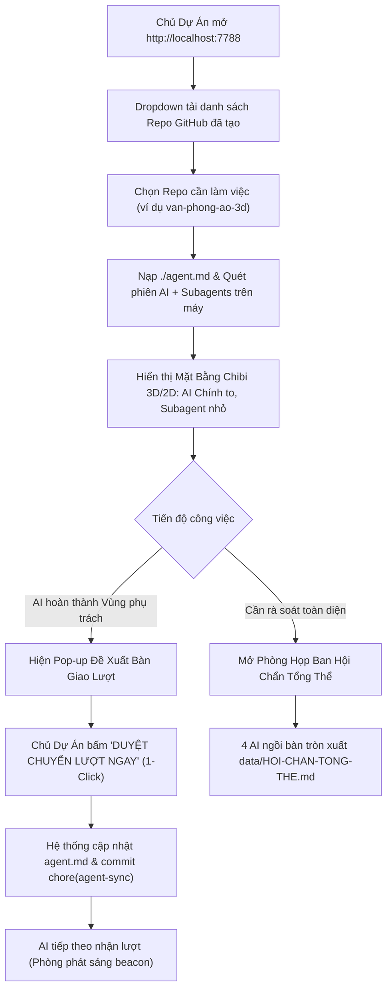

# ĐẶC TẢ SẢN PHẨM & THIẾT KẾ FULLSTACK FRONTEND (VÙNG [2] PROTOCOL V2.2)
**Dự án:** Văn phòng Quản lý AI Trực quan Đa Nền tảng (Chibi Edition - BCC v2.2)  
**Tác giả:** Antigravity (Gemini 3.8 / `SPEC_ARCHITECT & UIUX_FRONTEND_ARCHITECT`)  
**Chủ Dự Án:** Anh Oanh (Quyết định tối cao)  
**Tham chiếu gốc:** `https://github.com/marketingjuliancongdanh79-pixel/van-phong-ao-3d`  
**Giao thức:** Universal Protocol agent.md v2.2 (`/bcc`)

---

## [2.1] SẢN PHẨM & PHẠM VI MVP

### 1. Vấn đề & Người dùng mục tiêu
- **Người dùng mục tiêu:** Kỹ sư, lập trình viên và Chủ Dự Án sử dụng đồng thời 3 hệ thống AI hàng đầu: **Antigravity (Gemini 3.8)**, **Codex (OpenAI)**, và **Claude Code (Anthropic)** tích hợp trong VS Code.
- **Nỗi đau hiện tại:** Phải chuyển đổi thủ công liên tục giữa các cửa sổ terminal và phiên làm việc theo quy trình `/bcc`, tự kiểm tra và chỉnh sửa file `agent.md`, kho gốc `van-phong-ao-3d` chỉ chạy trong 1 thư mục tĩnh và chưa hỗ trợ Antigravity, chưa có bảng hội chẩn đa AI để ra bản chỉnh sửa tổng thể.
- **Chỉ số thành công đo được:**
  - 100% không cần mở tay file `agent.md` để xem ai giữ lượt;
  - 1 click phê duyệt chuyển lượt (`chore(agent-sync)`) từ cửa sổ pop-up tự động đề xuất;
  - Tải và đồng bộ danh sách GitHub Repo của Chủ Dự Án trực tiếp trên thanh điều hướng;
  - Tích hợp phòng Hội Chẩn Tổng Thể đa AI với tài liệu đồng thuận `data/HOI-CHAN-TONG-THE.md`;
  - Đọc nhật ký Antigravity trong < 2 giây qua `node:sqlite` tích hợp sẵn trong Node.js 24 (0 dependency bên ngoài);
  - 100% an toàn Zero-Leak, chạy nội bộ tại máy tính người dùng với tài khoản cá nhân đã đăng ký.

### 2. Danh mục Tính năng Bắt buộc (Must-Have F1..F7)
- **F1 (GitHub Repo Connect & Workspace Switcher):** Kết nối với tài khoản GitHub cá nhân (qua Personal Access Token lưu an toàn tại LocalStorage) để liệt kê toàn bộ các repo người dùng đã tạo. Cho phép chuyển đổi nhanh không gian làm việc giữa các repo đã clone trên máy hoặc bấm 1-click để clone repo mới về.  
  *Tiêu chí nghiệm thu:* Khi chọn một repo khác từ Dropdown, toàn bộ văn phòng tự động nạp lại `./agent.md`, lọc đúng các phiên AI của repo đó trong < 500ms.
- **F2 (Chibi Cute Visual Avatars & Proportional Scale):** Toàn bộ nhân sự AI và Chủ Dự Án được trực quan hóa bằng phong cách hoạt hình Chibi cute, ngộ nghĩnh:
  - Các AI chính (**Antigravity, Codex, Claude Code, Sol, CEO**) hiển thị ở kích thước lớn (**72px – 80px**) kèm phụ kiện nhận diện (Vương miện cho CEO, Tai mèo công nghệ cho Antigravity, Kính kiến trúc cho Sol, Tai nghe dev cho Codex, Mũ ca-nô cho Claude);
  - Các **Subagents** vệ tinh hiển thị ở kích thước nhỏ gọn mini (**32px – 36px**) bay lượn hoặc đứng cạnh AI cha.  
  *Tiêu chí nghiệm thu:* Nhìn vào mặt bằng thấy rõ ngay đâu là AI chủ lực đang làm việc và đâu là các subagent phụ trợ đang chạy ngầm.
- **F3 (Antigravity Engine & Subagents Hierarchy):** Module đọc dữ liệu Antigravity trực tiếp từ SQLite cục bộ `~/.gemini/antigravity/conversation_summaries.db` và nhật ký `transcript.jsonl`. Tự động nhận diện cây Subagents (`parent_conversation_id`) như `research`, `image-generator`, `generative_ui`.  
  *Tiêu chí nghiệm thu:* Khi Antigravity gọi subagent, robot chibi con xuất hiện ngay bên cạnh và cập nhật trạng thái realtime.
- **F4 (Hội Chẩn Ban Tổng Thể - Master Project Revision RFC):** Bổ sung một phòng họp ban lớn với bàn hội nghị tròn nơi cả 4 AI và Giám đốc cùng ngồi lại. Khi kích hoạt tính năng "Hội Chẩn Toàn Diện", cả 4 AI cùng rà soát chéo Vùng [2], [3], [5] và xuất ra tài liệu đồng thuận hợp nhất `data/HOI-CHAN-TONG-THE.md`.  
  *Tiêu chí nghiệm thu:* Tài liệu hội chẩn tổng thể được tạo/cập nhật với đầy đủ ý kiến của 4 AI và chữ ký duyệt của CEO.
- **F5 (Cơ chế Đề xuất Chuyển lượt Tự động Chờ Duyệt 1-Click):** Khi AI hoàn thành công việc của mình (ví dụ Antigravity xong Vùng [2]), hệ thống tự động bắn pop-up thông báo đề xuất chuyển lượt kèm bản tóm tắt. Chủ Dự Án chỉ cần bấm 1 nút `[ DUYỆT CHUYỂN LƯỢT NGAY ]`: hệ thống tự động ghi `NEXT_OWNER` vào Vùng [4] `agent.md`, ghi log Vùng [4.1], tạo Git commit `chore(agent-sync)` và gửi tin nhắn hòm thư cho AI tiếp theo.  
  *Tiêu chí nghiệm thu:* Chuyển lượt diễn ra tức thì sau cú click duyệt, không cần gõ lệnh git thủ công.
- **F6 (Zero-Leak Personal Accounts):** Hoạt động độc lập dựa trên các tài khoản cá nhân của người dùng đã đăng nhập sẵn qua CLI (`gemini` / `agy`, `claude login`, `codex login`), sử dụng đúng gói thuê bao đã mua. Không đòi hỏi nhập API key hay chuyển tiếp dữ liệu qua cloud server nào khác.  
  *Tiêu chí nghiệm thu:* Mọi chuỗi nhạy cảm đều được mặt nạ hóa tự động bằng `mask()`.
- **F7 (Native Node.js 24 SQLite Engine):** Tận dụng module chuẩn `node:sqlite` có sẵn trên Node.js v24.20.0 để đọc dữ liệu phiên làm việc, giữ nguyên tôn chỉ "Zero npm install" của repo gốc.

### 3. Ngoài phạm vi MVP (Out-of-Scope)
- Không can thiệp vào mã nhị phân đóng gói của VS Code hoặc các extension độc quyền.
- Không chia sẻ session trực tuyến ra môi trường internet công cộng mà không có đường hầm bảo mật.

---

## [2.2] LUỒNG NGƯỜI DÙNG ĐẦU-CUỐI (E2E USER FLOW)

---

## [2.3] LUỒNG ĐIỀU PHỐI AI AGENT & SUBAGENTS

### 1. Phân bổ vai trò & Kích thước Chibi
| AI Engine | Vai trò Protocol v2.2 | Vùng phụ trách | Ngoại hình Chibi |
|---|---|---|---|
| **Anh Oanh (Chủ Dự Án)** | `CHỦ TỊCH / CEO` | Toàn quyền | Chibi Boss lớn (80px), Vương miện vàng, Áo vest |
| **Antigravity (Gemini 3.8)** | `SPEC_ARCHITECT & UIUX` | Vùng [2] | Chibi Tím lớn (72px), Tai mèo công nghệ, Gõ phím |
| **Subagents Antigravity** | `Researcher, UI Gen...` | Trợ lý vệ tinh | Chibi Mini (36px), Bay quanh bàn Antigravity |
| **GPT 6.1 Sol** | `SOL_ARCHITECT_PLANNER` | Vùng [3] | Chibi Xanh ngọc lớn (72px), Kính kiến trúc sư |
| **Codex (GPT-6 Astra)** | `CODEX_ASTRA_DEV` | Vùng [3] & [4.1] | Chibi Xanh dương lớn (72px), Tai nghe lập trình |
| **Claude Code** | `CLAUDE_AUDITOR` | Vùng [5] | Chibi Cam lớn (72px), Mũ ca-nô chỉ huy |

### 2. Luồng Hội Chẩn Ban Tổng Thể (Master Revision Flow)
1. **Trigger:** Chủ Dự Án bấm nút "Hội Chẩn Ban Tổng Thể" hoặc khi kết thúc Phase 1 chuẩn bị sang Phase 2.
2. **Họp bàn tròn:**
   - Antigravity trình bày toàn bộ thiết kế Vùng [2];
   - Sol đối chiếu tính khả thi Backend, DB và API Vùng [3];
   - Codex đánh giá cấu trúc cây file và độ phức tạp mã nguồn;
   - Claude Captain quét lỗ hổng bảo mật, nguy cơ over-engineering và chốt chặn Blocker.
3. **Đầu ra:** Xuất file Markdown đồng thuận `data/HOI-CHAN-TONG-THE.md` trình Giám đốc ký duyệt.

---

## [2.4] THIẾT KẾ FULLSTACK FRONTEND & UI/UX DESIGN SYSTEM

### 1. Design Tokens & Visual Theme
- **Bảng màu:**
  - `Background`: `#06080d` (Vũ trụ sâu lắng)
  - `Surface / Glass Panel`: `rgba(14, 18, 26, 0.82)` với blur 14px
  - `Accent Gold (CEO / Protocol)`: `#ecc970`
  - `Antigravity Violet`: `#a855f7`
  - `Codex Blue`: `#3a86ff`
  - `Claude Orange`: `#e07a5f`
  - `Sol Emerald`: `#10b981`
  - `Meeting Rose`: `#f43f5e`
- **Typography:** `Plus Jakarta Sans` (Giao diện), `Quicksand` (Tiêu đề Chibi thân thiện), `JetBrains Mono` (Terminal/Session).
- **Icon Set:** Lucide Icons nét mảnh hiện đại.

### 2. Kiến trúc giao diện (Information Architecture)
- **Header:** Logo Văn phòng Chibi + Dropdown GitHub Repos (Hiển thị repo đã tạo & nút Clone) + Thanh điều phối Mutex v2.2 (Current Phase, Next Owner, 1-Click Handover CTA) + Nút Bàn Họp Hội Chẩn + Đồng hồ.
- **5 Không gian Màn hình:**
  1. *Mặt Bằng Văn Phòng Chibi & Subagents* (Các phòng ban với chibi ngộ nghĩnh, hiệu ứng thở chibi-bounce và nhấp nháy khi làm việc).
  2. *Phòng Họp Ban Tổng Thể* (Bàn tròn hội nghị, 5 vị trí ngồi Chibi, bảng xuất `HOI-CHAN-TONG-THE.md`).
  3. *Bảng Điều Hành Protocol v2.2* (5 Phase Stepper, sổ Cần anh, Hòm thư, DEV lock).
  4. *Live Transcript Stream* (Đọc realtime log từ các AI).
  5. *Tài Khoản AI Của Tôi* (Zero-Leak Personal Accounts Manager).
- **Right Drawer Inspector:** Thông tin phiên làm việc, trạng thái AI, danh sách Subagents mini, phím tắt nhắn tin.

### 3. Ma trận 5 Trạng Thái Màn Hình (5 Screen States Matrix)
| Trạng thái | View Mặt Bằng Chibi | View Bàn Họp Hội Chẩn | Pop-up Chuyển Lượt |
|---|---|---|---|
| **(1) Empty State** | Hiện văn phòng trống, nhân vật chibi ngủ gật, CTA "Chọn hoặc Clone Repo" | Bàn họp trống, hiện thông báo "Chưa có nội dung cần hội chẩn" | Ẩn, không có đề xuất chuyển lượt |
| **(2) Loading / Skeleton** | Radar quét hiệu ứng xoay tròn, skeleton mờ của các bàn làm việc | Skeleton tròn của bàn họp và 5 ghế | Nút "Đang kiểm tra tiến độ..." |
| **(3) Error State** | Chibi gãi đầu kèm bong bóng chat báo lỗi đọc nhật ký, nút Retry | Báo lỗi xung đột ý kiến (Discrepancy Conflict Warning) | Cảnh báo: `agent.md` bị khóa hoặc đang có Blocker chưa giải quyết |
| **(4) Success / Ready** | Các Chibi cử động nhịp nhàng, đúng phòng ban, hiển thị nhãn trạng thái | Đầy đủ 5 thành viên ngồi quanh bàn, tài liệu RFC sẵn sàng | Pop-up sáng vàng mời duyệt, hiển thị rõ người nhận tiếp theo |
| **(5) Streaming / Progress** | Chibi gõ phím lắc lư đầu (`chibi-typing`), beacon phòng phát sáng | Luồng tin chéo giữa các ghế hội nghị hiển thị trực quan | Dòng chữ "Đang ghi nhận commit git chore(agent-sync)..." |

---

## [2.5] TIÊU CHUẨN PHI CHỨC NĂNG & ACCESSIBILITY (A11Y)

- **Hiệu năng:** Khởi động và quét các phiên trên máy < 800ms; không gây giật lag khi render các animation chibi.
- **An toàn tuyệt đối:**
  - 100% dữ liệu nằm trong máy tính của bạn;
  - Tự động che chuỗi API key, access token và mã PIN trước khi truyền qua WebSocket/SSE;
  - Sử dụng module gốc của Node.js 24, hoàn toàn không phụ thuộc gói npm trôi nổi.
